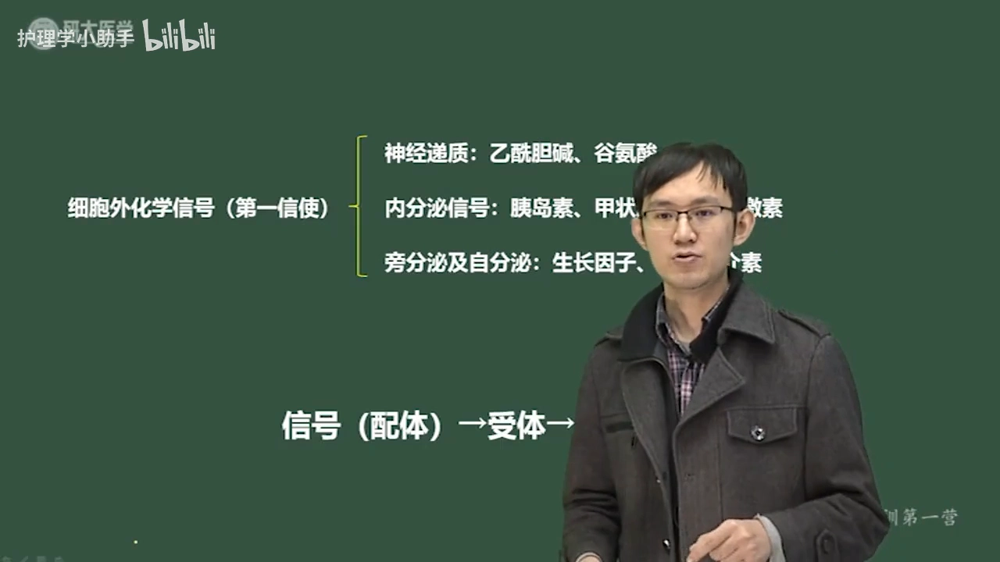
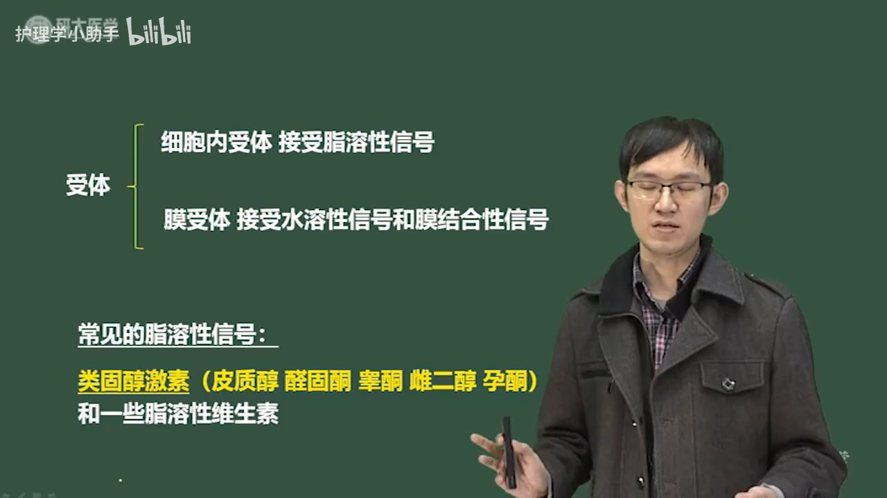
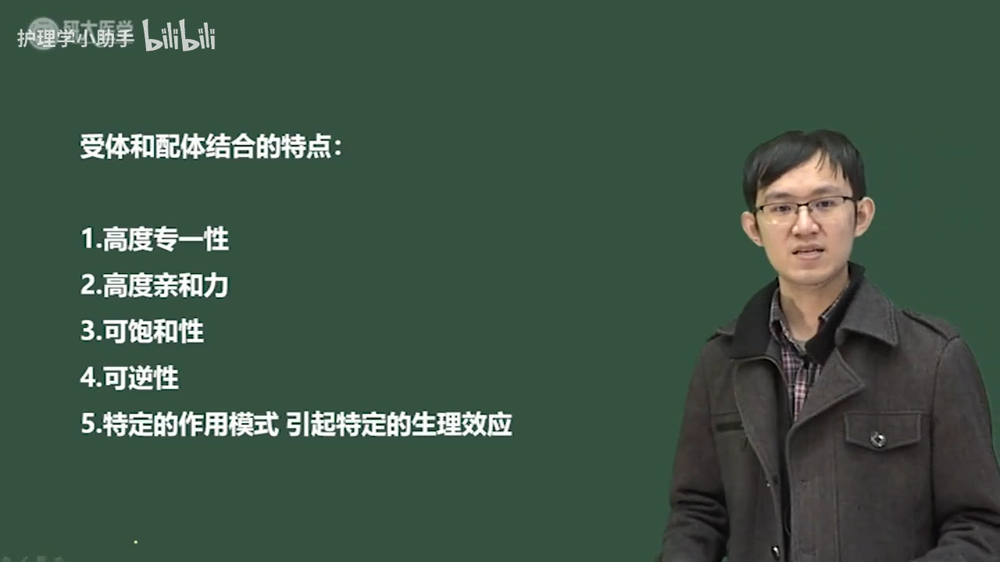
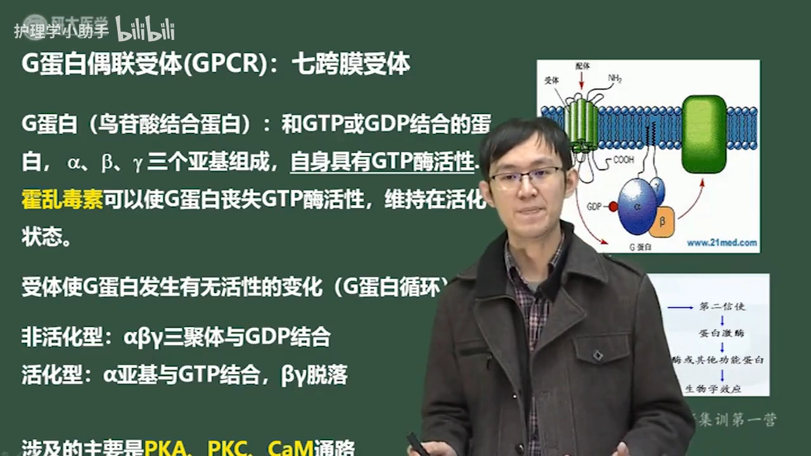
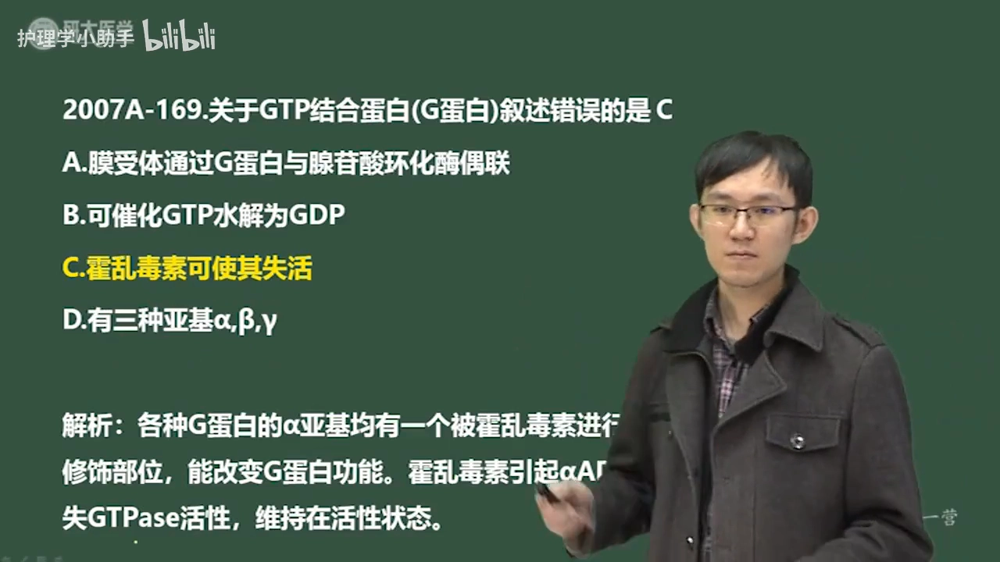
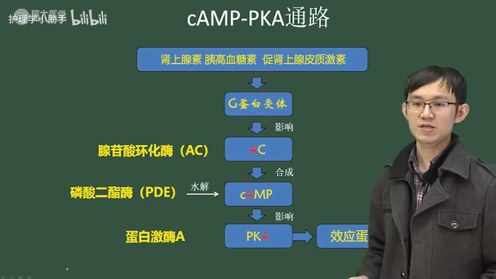
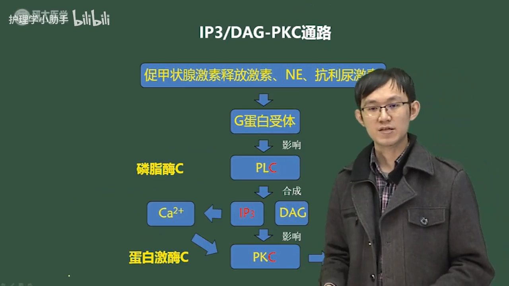
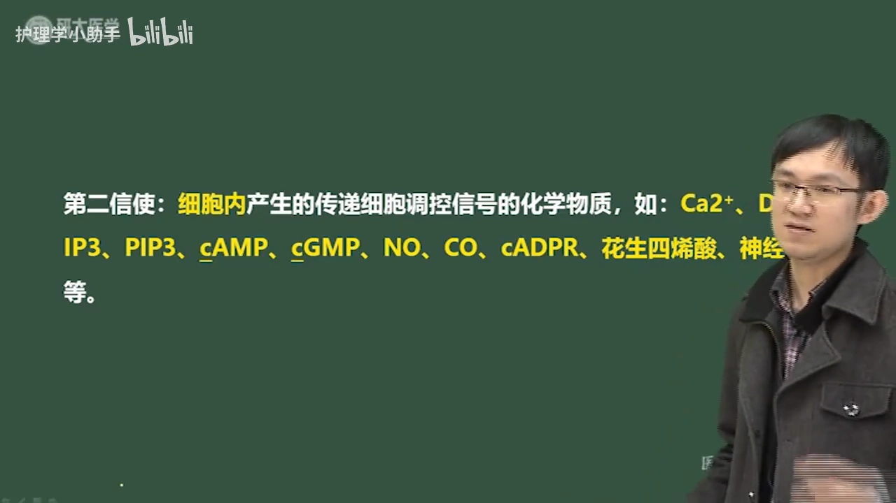
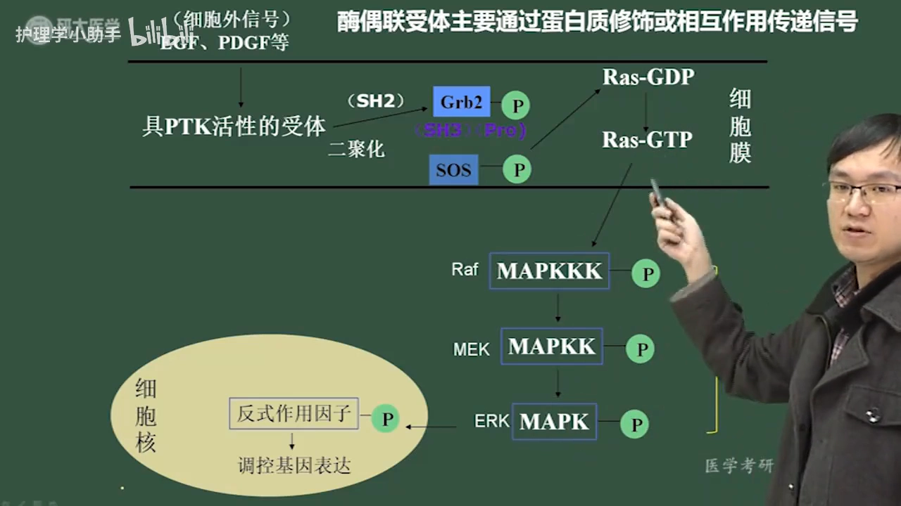
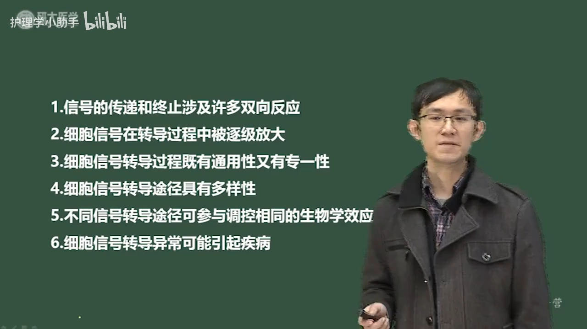

# 细胞信号转导总览：信使分级、受体类型与三条经典通路

> 视频来源：[16.细胞信号转导](https://www.bilibili.com/video/BV19S4y1z7W7/)（Bilibili · 江志陵，约 19 分钟）
> 导读（100 字以内）：这节串讲课用"信使 → 受体 → 分子开关 → 通路"一条线把细胞信号转导整章打通，并画出 PKA、PKC、PTK 三条经典通路。本文按这条线索重排；GPCR 与受体酪氨酸激酶的细节另见本节两篇专文。

## 本讲要解决的核心问题（SCQA）

**背景**：细胞需要对外界的刺激和信号做出反应。人体是多细胞组成的，细胞与细胞之间必须能互相"通话"——这正是细胞信号转导要解决的问题。

**冲突**：信号分子种类极多、名字拗口，通路图看上去错综复杂；而且信号的作用不能没有限度。比如肿瘤会持续分泌让心跳加快的激素，如果心率与激素浓度完全成正比、分泌得越多跳得越快，心脏早就室颤了。

**疑问**：细胞外的信号分子本身有什么分类？受体有哪几种、凭什么只认自己的配体？信号进入细胞后靠什么"开关"往下传？从膜上到细胞核，信号是如何一级级传递、又是如何被放大和随时关掉的？

**回答（中心思想）**：细胞信号转导可以拆成四步来理解。第一，信号分子按所在位置分为**第一信使（细胞外）、第二信使（细胞内）、第三信使（细胞核）**；第一信使按化学本质又分脂溶性、水溶性和膜结合性三类，受体因此只有**胞内受体**与**膜表面受体**两大类。第二，受体与配体的结合有**专一性、亲和力、可饱和性、可逆性和特定作用模式**五个特点，其中可饱和性是机体对信号强度的保护。第三，膜受体后面往往站着一个**分子开关**：G 蛋白偶联受体后面是 **G 蛋白**，酪氨酸蛋白激酶受体后面是 **Ras**，它们的共同点是都靠 **GTP 结合为开、GDP 结合为关**。第四，开关打开后信号沿**第二信使**和**磷酸化级联**逐级放大，最终进入细胞核调控基因表达——PKA、PKC、PTK 就是三条最经典的例子。

---

## 一、信号的三级信使，与受体的两大类

### 1.1 什么叫细胞信号转导

细胞信号转导是指：**细胞对外界的刺激或信号作出反应，通过胞内多种分子的相互作用引发一系列有序反应，把来自细胞外的信息传递到细胞内，从而调节细胞的代谢、增殖、分化等行为**。

一句话概括：它是"接力赛跑"——A 传给 B，B 传给 C，你只要认识这条链上 A、B、C 各自的名字，通路本身并没有太难的道理。

[【跳转到 01:38】](https://www.bilibili.com/video/BV19S4y1z7W7/?t=98)

### 1.2 三级信使：按"在哪儿"分类

机体里传递信号的这些小分子，按**所在部位**不同分成三级：

- **第一信使**：在细胞外，是留在细胞外面负责"敲门"的信号分子。
- **第二信使**：在细胞内，是第一信使激活受体后在胞内产生的信号分子（如 cAMP、IP3、Ca²⁺）。
- **第三信使**：在细胞核，把信号进一步带给基因表达环节。

记忆的诀窍就是位置：**胞外用第一、胞内用第二、胞核用第三**。

### 1.3 第一信使的三种化学本质

第一信使按化学本质大致分三类：**脂溶性、水溶性、膜结合性**。为什么这么分？因为细胞膜是一层磷脂双分子层：脂溶性强的分子水溶性一般不好，水溶性强的分子脂溶性一般不好。

- **脂溶性信号**容易穿过细胞膜，因此可以进入细胞，作用于**胞内受体**。
- **水溶性信号**透不过膜，只能作用于**膜表面受体**。
- **膜结合性信号**天生就存在于细胞表面，靠膜与膜之间的接触把信号传出去。

第一信使的成员很多，常见的有神经递质（如乙酰胆碱、谷氨酸）、内分泌信号（如胰岛素、生长激素）以及旁分泌和自分泌信号（如生长因子）。其中内分泌信号、神经递质、旁分泌/自分泌这三个名字值得记住：**神经递质又叫神经激素，指神经-肌接头和突触之间传递信号的小分子递质；旁分泌和自分泌信号则作用于周边细胞甚至细胞自身**。

### 1.4 受体只有两大类

受体与信使是一一对应的，所以受体大体也只有两类：

- **胞内受体**：接受能透过膜的**脂溶性信号**。
- **膜受体**：接受**水溶性信号和膜结合性信号**。

受体接纳信号之后并不"到此为止"，它会进一步向下游产生反应，把信号继续传给下游分子，或者一路传到细胞核，去启动新的基因表达、或抑制某些基因的表达。

常见的脂溶性信号（也就是能作用于胞内受体的信号）需要记住四类：

1. **类固醇激素**：讲胆固醇的去路时提到过，皮质醇、醛固酮、性激素都属于这一类。
2. **甲状腺素**：甲状腺素也是脂溶性的，可作用于胞内受体。
3. **维甲酸**：内科学讲白血病时出现过——M3 型白血病有效的治疗策略就是全反式维甲酸加砷剂。
4. **脂溶性维生素**：常见的有 A、D、E、K 四种。

---

## 二、受体与配体结合的五个特点

受体凭什么只认自己的配体、又为什么不会被过强的信号拖垮？答案就在受体与配体结合的五个特点里。

### 2.1 高度专一性

**一种受体只结合一种配体**，不会乱结合。比如肾上腺素作用于 α 受体和 β 受体，它不会跑去结合甲状腺素受体——这就是"高度专一性"。

### 2.2 高度亲和力

受体与配体的结合一定是**高亲和力**的。如果亲和力很差，两者结合不上，信号也就传不下去。

### 2.3 可饱和性：机体对信号强度的保护

受体只能接受一定程度的信号，**达到某个标准之后，再来更多的信号也不反应了**。这看似"迟钝"，其实是一种保护机制。

视频里用**嗜铬细胞瘤**举了例子：这种肿瘤会分泌大量的儿茶酚胺（肾上腺素、去甲肾上腺素）进入血液，刺激心肌，使心肌收缩力增强、心率加快。如果心率与激素浓度完全线性相关，分泌越多跳得越快，一分钟三百次、五百次乃至上千次，人早就室颤了。实际情况并非如此，原因就是**心肌细胞表面的 β 受体数量有限、有上限**：信号到一定程度就把受体完全饱和了，再多的儿茶酚胺心率也不会继续往上走，最多一百五六十次。这就是可饱和性带来的保护作用。

### 2.4 可逆性

受体与配体的结合是**可逆**的，结合之后还能放开。如果不可逆就麻烦了：结合一个就等于"干掉"一个受体，受体被永久性地阻断、失活，再也不能接受新的信号——那它就不叫激素，而叫毒素了。

### 2.5 特定的作用模式引起特定的生理效应

第五个特点是：**在特定的作用模式下引起特定的生理效应**。同一个信号在不同的组织、不同的受体分布下会产生不同的效果，这一条本身就是一个多选题式的考点。

---

## 三、G 蛋白：膜受体背后的分子开关

### 3.1 与受体偶联的 G 蛋白是什么

很多膜受体自己不直接干活，而是把活交给身后的一种蛋白——**G 蛋白**。因为它在细胞膜上来回跨膜七次，与之搭配的受体就叫**七次跨膜受体**。

[【跳转到 08:00】](https://www.bilibili.com/video/BV19S4y1z7W7/?t=480)

G 蛋白全称**鸟苷酸结合蛋白**，意思是它结合的是 **GTP 或者 GDP**。它的特殊之处在于**自身具有 GTP 酶活性**——可以把 GTP 水解成 GDP。因此 G 蛋白同时具备两个身份：

- 它能结合 GTP，也能结合 GDP；
- 它自己又能把 GTP 水解成 GDP。

也就是说，G 蛋白可以在两种状态之间来回转化：**结合 GTP 时叫活化型，结合 GDP 时叫非活化型**。

### 3.2 为什么说它像"开关"

活化型与非活化型之间的转化，本质上就是**信号通路的开关**。G 蛋白偶联受体之所以重要，正是因为这类受体广泛存在于很多信号转导通路的中间环节：随着 G 蛋白在活化与非活化之间切换，信号通道就出现了"开"与"关"。

失活之后的 G 蛋白还可以再次被激活，这个循环我们称为 **G 蛋白循环**：受体被配体激活 → G 蛋白的 α 亚基结合 GTP 而活化、βγ 亚基脱落 → α 亚基发挥 GTP 酶活性把 GTP 水解成 GDP → 回到非活化型。

[【跳转到 08:55】](https://www.bilibili.com/video/BV19S4y1z7W7/?t=535)

G 蛋白参与的通路主要有三条：**PKA 通路、PKC 通路和钙调蛋白（CaM）通路**。

### 3.3 霍乱毒素：把开关卡在"开"的位置

**霍乱毒素**（霍乱是典型的"二号病"）会让 G 蛋白**丧失 GTP 酶活性**。酶活性一旦丧失，GTP 就永远不会被水解成 GDP，G 蛋白于是**长期停留在 GTP 结合的活化状态**，信号通道一直开着——这正是霍乱的腹泻如此猛烈的原因。

[【跳转到 09:52】](https://www.bilibili.com/video/BV19S4y1z7W7/?t=592)

这里有一个极其常见的易错点，值得单独强调：说"霍乱毒素使 G 蛋白失活"是**错的**。准确的表述是——**霍乱毒素让 G 蛋白的酶（GTP 酶）活性失活，却让 G 蛋白本身维持在活化状态**。"酶活性失活"与"蛋白失活"是两个完全不同的概念，考试里就靠这一字之差区分。

---

## 四、三条经典通路：开关打开之后信号怎么走

### 4.1 PKA 通路：cAMP 作为第二信使

第一个经典例子是 **cAMP-PKA 通路**，它的走法如下：

1. 激素作用于 **G 蛋白偶联受体**。走这条路的激素要记住三个：**肾上腺素、胰高血糖素、促肾上腺皮质激素（ACTH）**。
2. 受体被激活后，影响下游 **腺苷酸环化酶（AC）** 的活性——AC 专门负责**合成 cAMP**。
3. **cAMP 升高**。cAMP 是第二信使，它去激活 **蛋白激酶 A（PKA）**。
4. PKA 把一些特定蛋白**磷酸化**：被磷酸化的蛋白有的酶活性改变，有的表达量改变，信号于是变成了特定的生物学效应。

[【跳转到 11:28】](https://www.bilibili.com/video/BV19S4y1z7W7/?t=688)

这条通路里还有一个容易被忽略的酶：**磷酸二酯酶（PDE）**，它负责**水解 cAMP**。"合成的 AC + 降解的 PDE"共同调节 cAMP 的浓度，这是这条经典通路的一个重要特点——所以题目问"影响 cAMP 含量的酶是谁"时，两个都要选。

### 4.2 PKC 通路：IP3、甘油二酯与钙离子

第二个例子是 **PKC 通路**，与 PKA 通路大同小异，只是中间的信使换了人：

1. 激素（**促甲状腺激素释放激素 TRH、去甲肾上腺素、抗利尿激素**）作用于 G 蛋白偶联受体。
2. 受体影响 **磷脂酶 C（PLC）** 的活性。
3. PLC 释放出 **IP3 和甘油二酯（DAG）**，它们进一步**诱导钙离子浓度升高**。
4. IP3、DAG、Ca²⁺ 都是第二信使，它们激活 **蛋白激酶 C（PKC）**，PKC 再去磷酸化效应蛋白，后面就与 PKA 通路是同一个套路了。

[【跳转到 12:50】](https://www.bilibili.com/video/BV19S4y1z7W7/?t=770)

正因为"涉及钙离子的通路"包括 PKC 通路和钙调蛋白通路，看到题目里出现钙离子，思路就要往这两条路上靠。

### 4.3 第二信使清单

第二信使的定义是：**细胞内产生的、传递细胞调控信号的化学物质**。常见的名单包括 Ca²⁺、DAG（DG）、IP3、PIP3、cAMP、cGMP、NO、CO、cADP 核糖、花生四烯酸和神经酰胺等（后两种是较新教材补充进来的）。

[【跳转到 14:03】](https://www.bilibili.com/video/BV19S4y1z7W7/?t=843)

两个书写细节要注意：**DAG 可以写成 DG**（都是甘油二酯的意思）；但 **cAMP 和 cGMP 里的 c 不能省**——小写 c 代表"环化"，写成 AMP、GMP 就变成腺苷酸和鸟苷酸，完全是另一回事了。

### 4.4 PTK 通路：Ras 开关与三级磷酸化级联

第三个例子是**酪氨酸蛋白激酶（PTK）通路**，它走的路比较长，也是本节唯一的"酶偶联受体"路线：

[【跳转到 15:24】](https://www.bilibili.com/video/BV19S4y1z7W7/?t=924)

1. 细胞外的信号分子 **EGF、PDGF** 结合**具 PTK 活性的受体**，受体被激活后二聚化、并招募下游蛋白。
2. 信号先传到两个结构域蛋白 **Grb2 和 SOS** 上（Grb2 用 SH2 结构域结合受体的磷酸酪氨酸，再用 SH3 结构域结合 SOS）。
3. Grb2-SOS 激活 **Ras 蛋白**。Ras 又叫**小 G 蛋白**，它和 G 蛋白一样具有 GTP 酶活性：**结合 GTP 是激活、变成 GDP 是失活**。两者是完全相通的同一类开关。
4. Ras 激活后，信号传给一组激酶，形成**三级磷酸化级联**：Raf（MAPKKK）→ MEK（MAPKK）→ ERK（MAPK）。
5. 最后一级激酶（MAPK/ERK）进入**细胞核**，磷酸化**反式作用因子（转录因子）**，从而调控基因表达。

[【跳转到 16:23】](https://www.bilibili.com/video/BV19S4y1z7W7/?t=983)

"三级磷酸化"这个名字很形象：磷酸化需要激酶，而激酶本身也是蛋白、也可以被磷酸化，于是就有了**激酶的激酶的激酶**——**激酶的激酶的激酶**激活**激酶的激酶**，**激酶的激酶**再激活**激酶**，最后由它把底物磷酸化，信号就这样层层接力，一直传到细胞核。

Ras 与 G 蛋白长得像、干的事也像，所以这里是考试最容易混淆的地方：**问"具有 GTP 酶活性"时 Ras 对、G 蛋白也对；但问"谁属于 G 蛋白偶联受体通路"时，能选的只有 G 蛋白这一支，不能把 Ras 填进去**。

---

## 五、信号通路的五个共同特点

把三条通路放在一起看，会发现它们共享同一套"脾气"：

[【跳转到 18:32】](https://www.bilibili.com/video/BV19S4y1z7W7/?t=1112)

1. **信号的传递和终止涉及许多双向反应**：既能激活，也能抑制。因为信号必须可开可关，不能只开不关。
2. **信号在转导过程中被逐级放大**：一级一级传下去之后，影响范围越来越广、效果持续的时间也越来越长。
3. **过程既有通用性又有专一性**：同一个信号可以用在很多地方，又能集中作用于某一个地方。
4. **转导途径具有多样性**：不同的信号传导途径可以参与调节相同的生物学效应，殊途同归。
5. **通路异常可以致病，也可以用来治病**：信号通路出问题会引起疾病，而这些环节同样也是药物的作用靶点。

---

## 小结

- 细胞信号转导 = 把细胞外的信息有序地传到细胞内，从而调节代谢、增殖与分化。
- 信使按位置分三级：**第一信使在细胞外、第二信使在细胞内、第三信使在细胞核**；第一信使按化学本质分脂溶性（作用于胞内受体）、水溶性和膜结合性（作用于膜受体）。
- 常见脂溶性信号：类固醇激素、甲状腺素、维甲酸、脂溶性维生素 A/D/E/K。
- 受体与配体结合的五个特点：**高度专一性、高度亲和力、可饱和性、可逆性、特定作用模式**。可饱和性是机体避免被过强信号拖垮的保护（β 受体与嗜铬细胞瘤）。
- **G 蛋白**是鸟苷酸结合蛋白，自身有 GTP 酶活性：结合 GTP 为活化型、结合 GDP 为非活化型，是信号通路的总开关，参与 PKA、PKC、钙调蛋白三条通路。
- **霍乱毒素**让 G 蛋白的 GTP 酶活性失活，使 G 蛋白长期处于活化状态——注意"酶活性失活"不等于"蛋白失活"。
- **PKA 通路**：肾上腺素/胰高血糖素/ACTH → G 蛋白偶联受体 → AC → cAMP → PKA → 磷酸化效应蛋白；PDE 负责水解 cAMP。
- **PKC 通路**：TRH/去甲肾上腺素/抗利尿激素 → G 蛋白偶联受体 → PLC → IP3 + DAG → Ca²⁺ → PKC。
- **PTK 通路**：EGF/PDGF → 具 PTK 活性的受体 → Grb2/SOS → Ras（小 G 蛋白）→ Raf/MEK/ERK 三级磷酸化级联 → 入核调控基因表达。
- 通路共性：双向可调、逐级放大、通用又专一、途径多样、异常致病也可治病。

## 关键术语速查

| 术语 | 一句话解释 |
| --- | --- |
| 第一信使 | 细胞外传递信号的分子，如激素、神经递质、生长因子 |
| 第二信使 | 细胞内产生的信号分子，如 cAMP、IP3、DAG、Ca²⁺ |
| 第三信使 | 细胞核内传递信号、影响基因表达的信号分子 |
| 胞内受体 | 接受脂溶性信号、位于细胞内的受体 |
| 膜受体 | 接受水溶性信号与膜结合性信号的膜表面受体 |
| 受体可饱和性 | 受体数量有限，信号过强时不再增加效应，是保护机制 |
| G 蛋白 | 鸟苷酸结合蛋白，GTP 结合为活化型、GDP 结合为非活化型 |
| GTP 酶活性 | 把 GTP 水解为 GDP 的能力，是 G 蛋白与 Ras 的开关 |
| 七次跨膜受体 | G 蛋白偶联受体，肽链七次穿过细胞膜 |
| 腺苷酸环化酶（AC） | 合成 cAMP 的酶 |
| 磷酸二酯酶（PDE） | 水解 cAMP 的酶 |
| 磷脂酶 C（PLC） | 把膜磷脂切成 IP3 和甘油二酯的酶 |
| PKA | 蛋白激酶 A，被 cAMP 激活，磷酸化效应蛋白 |
| PKC | 蛋白激酶 C，被 IP3、DAG 与 Ca²⁺ 激活 |
| PTK | 酪氨酸蛋白激酶，催化底物酪氨酸磷酸化 |
| Ras | 小 G 蛋白，EGF/PDGF 通路的开关，靠 GTP/GDP 切换 |
| Raf、MEK、ERK | MAPK 三级磷酸化级联里的三级激酶（MAPKKK、MAPKK、MAPK） |
| 霍乱毒素 | 使 G 蛋白丧失 GTP 酶活性，令其持续活化 |
