# 细胞周期是细胞状态的时间轴：从周期蛋白波动与染色体形态，读出细胞处在哪个状态

> 视频来源：[细胞之城专题 11：细胞周期与调控](https://www.bilibili.com/video/BV1tosg63Ec3/)（Bilibili · 羽升 AI 实践分享「细胞之城」3D 可视化专题，约 18 分钟）
> 导读：上一篇讲「细胞类型」怎么鉴定；这一篇换一个维度——同一个细胞的「状态」。视频系统讲了细胞周期的时间表、MPF 的发现、周期蛋白 + CDK 全酶、三个关键转化与检查点，本文按「细胞状态」这条主线重排：一个细胞的状态怎么读、怎么被推着走、怎么被叫停、最后停在哪里。

## 本讲要解决的核心问题（SCQA）

**背景**：上一篇我们把 cluster 注释成了有生物学意义的「细胞类型」。但类型不是故事的全部——做单细胞分析的人迟早会遇到：同一群细胞、甚至同一个细胞系，在不同样本、不同时刻测出来的表达谱并不一样。

**冲突**：原因之一是细胞一直在周期里循环。细胞周期把同一个细胞切成了好几个时相（G1、S、G2、M）：这些时相里，DNA 含量不同、表达的蛋白不同、染色体的样子也不同。也就是说，「细胞处在周期里的哪一段」本身就是一种**细胞状态**。这带来一个很实际的麻烦——同一个细胞类型的不同状态，可能比两个不同细胞类型还更像；如果不先把「状态差异」和「类型差异」分开，细胞类型注释就会被带偏。

**疑问**：细胞周期凭什么算一种「细胞状态」？我们凭什么知道一个细胞正处在周期的哪一段？这套状态机器和细胞类型又是什么关系？

**回答（中心思想）**：细胞周期的各个时相，就是同一个细胞的不同状态；每种状态都留下了可读出的标记——**分子层**是周期蛋白（cyclin）的含量波动，**物理层**是 DNA 含量 2C/4C，**形态层**是染色体的凝集形态与 EdU 掺入。推动状态前进的是 **cyclin–CDK 全酶**（油门），叫停它的是**检查点**（刹车），一个细胞最终停在持续增殖、G0 或终末分化三种状态之一。[【跳转到 00:00】](https://www.bilibili.com/video/BV1tosg63Ec3/?t=0)

---

## 一、细胞周期是一条状态时间轴：同一个细胞，在不同时相是「不同状态」

### 1.1 细胞周期 = 间期 + M 期，间期占了 95% 以上

老师先把框架写在黑板上：细胞周期等于**间期加上 M 期**；间期又分 G1、S、G2 三段，占了整个周期 95% 以上的时间。[【跳转到 01:29】](https://www.bilibili.com/video/BV1tosg63Ec3/?t=89) 前两集讲过细胞怎么分裂（有丝分裂把染色体平分给两个子细胞、减数分裂复制一次连分两次），可分裂只是周期里最短的一段。[【跳转到 00:06】](https://www.bilibili.com/video/BV1tosg63Ec3/?t=6)

三个字母容易记错：G 是 gap（间隙），不是 growth；M 是 mitosis（有丝分裂），不是 middle；S 是 synthesis（合成）。[【跳转到 01:34】](https://www.bilibili.com/video/BV1tosg63Ec3/?t=94) S 期做两件事：复制 DNA，同时大量合成组蛋白，把新的 DNA 重新装成染色质。[【跳转到 01:52】](https://www.bilibili.com/video/BV1tosg63Ec3/?t=112)

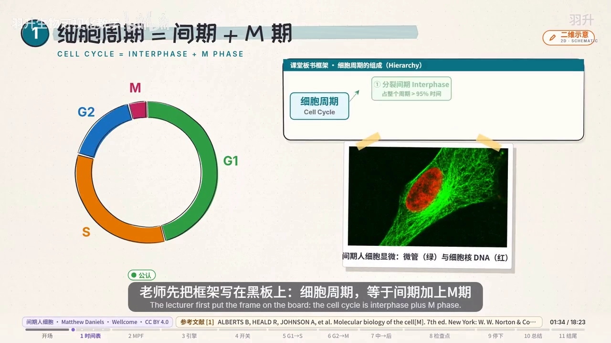

### 1.2 DNA 含量 2C → 4C，是状态最直接的「物理读数」

G1 是 2C，S 期从 2C 涨到 4C，G2 是 4C，分完之后每个子细胞又回到 2C。[【跳转到 01:58】](https://www.bilibili.com/video/BV1tosg63Ec3/?t=118) 换句话说，不用看蛋白质、也不用看形态，只要量一下 DNA 含量，就能大致判断它处在周期的哪一段——这是把「状态」变成一个数字的第一步。

### 1.3 时间表：约 24 小时一圈，差别主要落在 G1

一个快速增殖的人体细胞约 24 小时转一圈：G1 约 11 小时、S 约 8 小时、G2 约 4 小时、M 只要 1 小时左右。不同细胞的周期长短差别很大，而差别主要落在 **G1** 上，S、G2 和 M 相对恒定。[【跳转到 02:18】](https://www.bilibili.com/video/BV1tosg63Ec3/?t=138)

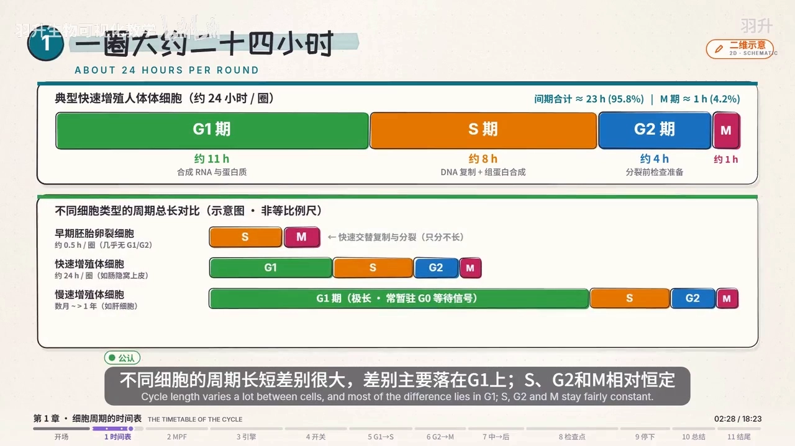

这张对比图正好点出「状态」和「类型」的关系：同一套周期机器在各个细胞类型里都在跑，但**不同细胞类型的周期长度不同**——早期胚胎卵裂细胞一圈只要半小时（几乎只复制和分裂、不长），快速增殖的上皮细胞约 24 小时，而肝细胞这类慢速增殖细胞要数月到一年以上。周期长度是可变的，可变的正是 G1。

细胞要完成三件事：DNA 必须复制完、分配必须准确、推进必须协调。前两件在前两个专题已经讲过，本期讲第三件——推进力从哪来、出了错靠什么叫停。[【跳转到 02:33】](https://www.bilibili.com/video/BV1tosg63Ec3/?t=153)

---

## 二、状态的推进力：从细胞融合实验找到 MPF

### 2.1 实验一（1970）：M 期细胞质里有一种可扩散的推进因子

把 M 期细胞和一个间期细胞融合在一起（仙台病毒诱导膜融合），结果间期细胞核里松散的染色质也提前凝聚，成了染色体的样子。[【跳转到 02:54】](https://www.bilibili.com/video/BV1tosg63Ec3/?t=174) 推理很直接：M 期细胞里一定有某种东西，能让细胞核进入 M 期。[【跳转到 03:12】](https://www.bilibili.com/video/BV1tosg63Ec3/?t=192)

### 2.2 顺带发现：染色体的形态能反过来暴露细胞的时相（PCC 三种形态）

这种「间期核被提前拉进 M 期」的现象叫**早熟染色体凝集（PCC）**。有意思的是，不同时相的核被拉进来以后，凝集出来的样子不一样：G1 核 → 单线状（1 条染色单体）；S 核 → 粉粒碎片状（正在复制中）；G2 核 → 双线状（2 条姐妹染色单体）。[【跳转到 03:12】](https://www.bilibili.com/video/BV1tosg63Ec3/?t=192)

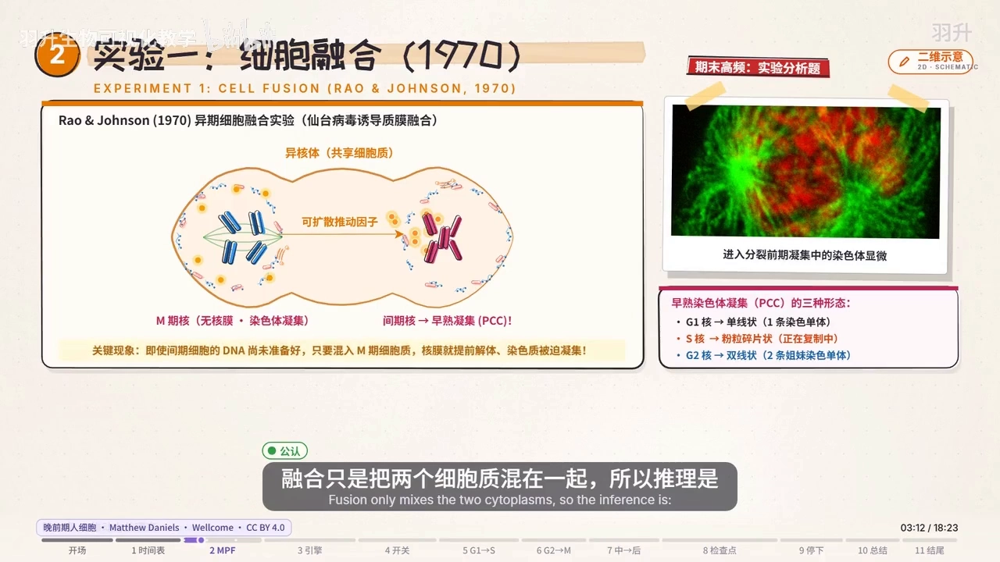

对「细胞状态」来说，这一点很关键：**同一个操作，能从染色体的形态读回它原本处在哪个时相**——这就是「从形态读出状态」最经典的一个例子。G2 核之所以是双线状，正是因为它已经复制过、带着两条姐妹染色单体。

### 2.3 实验二（1971）：把成熟卵的胞质注射进去，卵母细胞自己就成熟了

蛙的卵母细胞停在减数第一次分裂前期，DNA 早已复制（相当于 G2），它会重新启动分裂，这一步叫「成熟」。把成熟卵的胞质注射进还没成熟的卵母细胞，它自己就成熟了，这个因子被叫做 **MPF**。MPF 最早是 maturation promoting factor（促成熟因子），后来在体细胞里也找到了它，就被读成 M 期促进因子——老师说写哪个都行。[【跳转到 03:24】](https://www.bilibili.com/video/BV1tosg63Ec3/?t=204)

### 2.4 MPF 到底是什么：生化线与遗传线汇合

答案来自两条线。一条是海胆卵：Tim Hunt 发现一种蛋白每次卵裂前被合成、卵裂时又被降解，他把它叫做 **cyclin（周期蛋白）**；另一条是酵母：Hartwell 和 Nurse 找到一批控制分裂的基因，其中 cdc2 编码一个蛋白激酶。1988~1990 年纯化出来的 MPF 被证明正好是这两样：**周期蛋白 B 加上 CDK1**。三位科学家后来共同获得了 2001 年的诺贝尔奖。[【跳转到 04:07】](https://www.bilibili.com/video/BV1tosg63Ec3/?t=247)

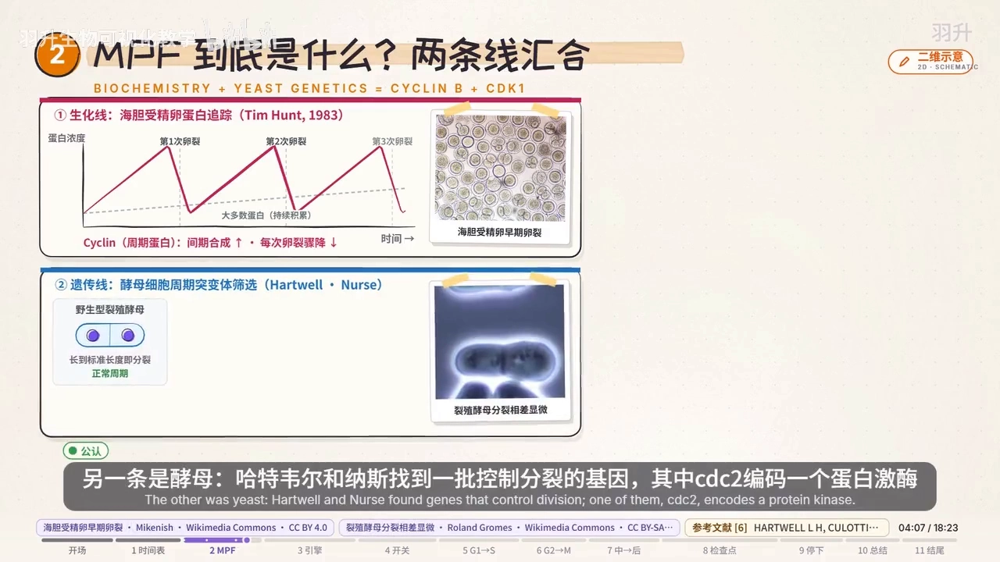

---

## 三、MPF 的真身：周期蛋白 + CDK 全酶

MPF 告诉我们，推动周期的是一个复合物：周期蛋白加上周期蛋白依赖性激酶（CDK）。用酶学的话说，它是一个**全酶**：CDK 是催化亚基，cyclin 是调节亚基。[【跳转到 04:32】](https://www.bilibili.com/video/BV1tosg63Ec3/?t=272)

把 CDK 拆开读：C 是 cyclin，D 是 dependent（依赖），K 是 kinase（激酶）。激酶做的事，是把 ATP 末端的 γ 磷酸基团转到底物蛋白上。[【跳转到 04:45】](https://www.bilibili.com/video/BV1tosg63Ec3/?t=285)

看真实结构就很清楚为什么非得两样凑一起：单独的 CDK2，催化口袋的入口被一段叫 T 环的肽链挡着，旁边一根 α 螺旋也朝外偏着，ATP 的磷酸摆不到能反应的位置，所以它几乎没有活性；周期蛋白 A 贴上来以后，这根螺旋被推向里面，T 环也让开了，口袋打开，CDK 才有活性。[【跳转到 05:02】](https://www.bilibili.com/video/BV1tosg63Ec3/?t=302)

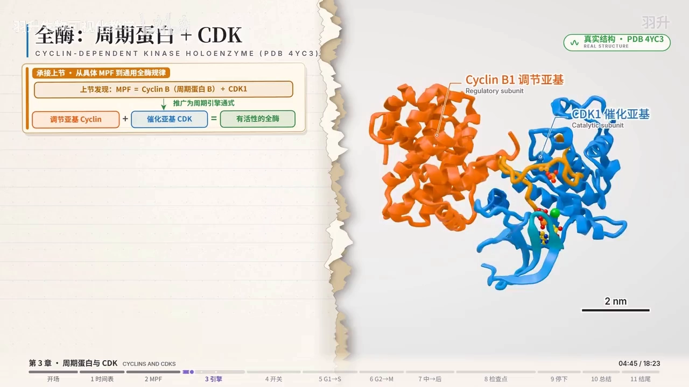

---

## 四、状态的分子读出：周期蛋白的「表达波」与配对规律

cyclin 和 cycle 长得像，因为它的含量随着周期起起落落：合成时升高、降解时降下来；而 CDK 本身的量差不多不变，它的活性跟着 cyclin 一起起落。[【跳转到 05:26】](https://www.bilibili.com/video/BV1tosg63Ec3/?t=326)

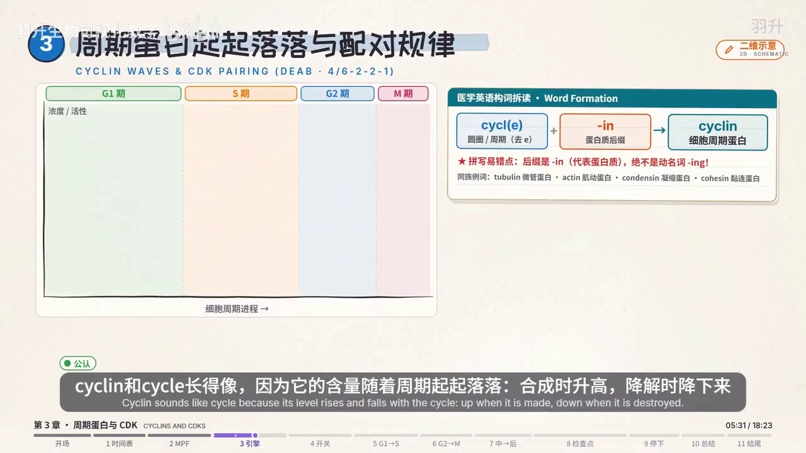

这一点其实就是「细胞状态的分子读出」：**不用看形态，只看几种周期蛋白的相对含量，就能读出这批细胞主要停在周期的哪一段**。

配对规律也不难记：cyclin 记字母 D、E、A、B，CDK 记数字 4、6、2、1，也就是 **4/6-2-2-1**。G1 期是 cyclin D 配 CDK4 或 6；G1 到 S 的转化是 cyclin E 配 CDK2；S 期是 cyclin A 配 CDK2；到 G2 和 M 期是 cyclin B 配 CDK1，也就是 MPF。[【跳转到 05:31】](https://www.bilibili.com/video/BV1tosg63Ec3/?t=331) 而且前一个复合物出现以后会促进下一个 cyclin 的转录，一个接一个，周期就被推着往前走。[【跳转到 05:52】](https://www.bilibili.com/video/BV1tosg63Ec3/?t=352)

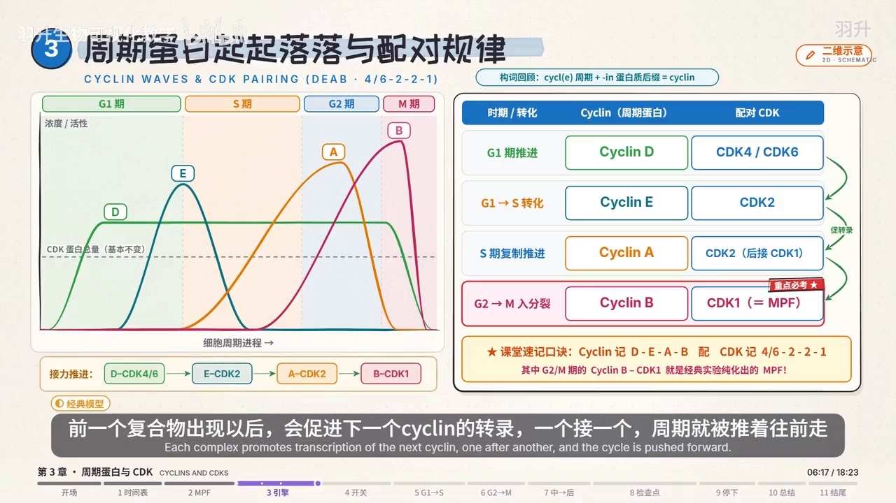

---

## 五、状态的刹车与开关：CDK 活性还要过三道关

cyclin 结合上去只是前提（老师的原话是「结合是前提，不结合没得玩」），但不是一结合就有活性。CDK 的活性还有另外两个开关。[【跳转到 06:22】](https://www.bilibili.com/video/BV1tosg63Ec3/?t=382)

**第一个是磷酸化**，要分清两层：CDK 给底物加磷酸，那是它的工作；CDK 自己身上也会被加上磷酸，那是别人在调节它。一个叫 CAK 的激酶在 T 环的第 160 位苏氨酸上加一个磷酸，T 环被拉平，底物更容易结合，活性再升一大截；另一边 Wee1 激酶在 ATP 结合处的第 14、15 位加上抑制性的磷酸，只有 Cdc25 磷酸酶把它们去掉，CDK 才真正打开。[【跳转到 06:27】](https://www.bilibili.com/video/BV1tosg63Ec3/?t=387)

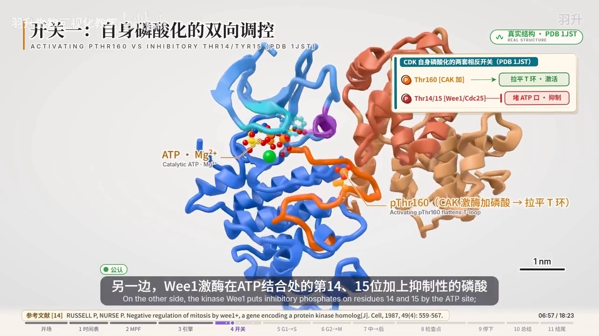

**第二个开关是 CKI（CDK 抑制因子）**。重点记 p21：p 代表 protein，21 是它在电泳上的分子量（约 21 千道尔顿），它几乎能抑制所有的 CDK；近亲 p27 有真实结构——像一根绳子，一头压在 cyclin 上，另一头直接塞进 CDK 的口袋，把 ATP 的位置占掉。[【跳转到 07:11】](https://www.bilibili.com/video/BV1tosg63Ec3/?t=431)

这里有一个关键区别：磷酸化可以加上、也可以去掉，是**可逆**的；而把 cyclin 拆掉用的是另一种办法——先给它挂上一串泛素做标签，再送进蛋白酶体降解，**降解是不可逆的**。正是因为不可逆，周期才只能朝一个方向走、回不了头。[【跳转到 07:37】](https://www.bilibili.com/video/BV1tosg63Ec3/?t=457)

---

## 六、让状态单向前进的三个关键转化

### 6.1 G1 → S：先问外面的条件允不允许

复制 DNA 之前，细胞先要问外界条件允不允许。外界的生长因子很多属于促有丝分裂因子（mitogen），它结合受体、经过 Ras-MAPK 这条信号通路，让 cyclin D 升高、激活 CDK4 和 6。[【跳转到 07:57】](https://www.bilibili.com/video/BV1tosg63Ec3/?t=477)

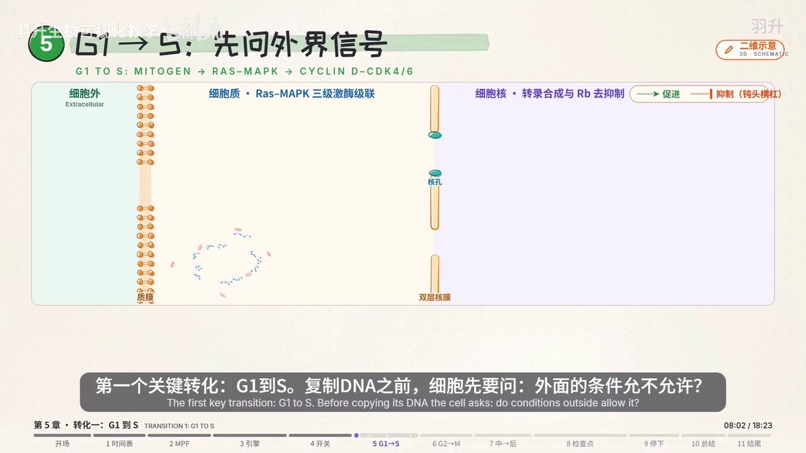

CDK4/6 的底物是 RB 蛋白。没有磷酸化的 RB 紧紧抓住转录因子 E2F，让它没法开启 S 期需要的基因；RB 被加上一个又一个磷酸就松开了 E2F。这里要纠正一个说法：**磷酸化不等于激活、也不等于失活**，它只是改变了蛋白的活性、位置或状态，要看具体是哪个蛋白。[【跳转到 08:22】](https://www.bilibili.com/video/BV1tosg63Ec3/?t=502)

被放出来的 E2F 开启 S 期基因，其中最关键的产物是 cyclin E；cyclin E 配上 CDK2，反过来再给 RB 加磷酸、放出更多 E2F，这是**正反馈**。正反馈让 RB-E2F 成了一个开关：要么关着、要么打开，不会停在半中间。[【跳转到 08:47】](https://www.bilibili.com/video/BV1tosg63Ec3/?t=527)

这就引出了**限制点（R 点）**：在限制点之前撤掉生长因子，细胞停在 G1；一旦过了限制点再撤掉，细胞也会义无反顾地进入 S 期。[【跳转到 08:52】](https://www.bilibili.com/video/BV1tosg63Ec3/?t=532)

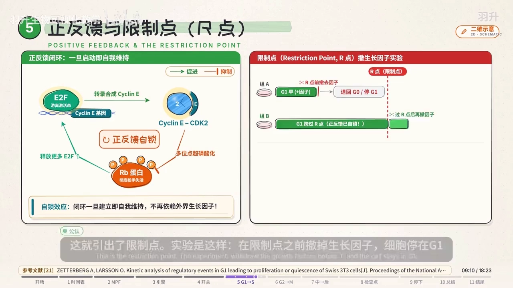

进入 S 期，cyclin A 配 CDK2 接班，它点燃复制起点，又不让用过的起点重新装好复制机器，保证一个周期里 DNA 只复制一次。[【跳转到 09:23】](https://www.bilibili.com/video/BV1tosg63Ec3/?t=563)

### 6.2 G2 → M：MPF 的活性必须在很短时间内「冲顶」

G2 期细胞要检查 DNA 复制完了没有、有没有损伤，两样都没问题才能进入 M 期。[【跳转到 09:37】](https://www.bilibili.com/video/BV1tosg63Ec3/?t=577) 这时 cyclin B 越积越多，和 CDK1 结合成 MPF。可刚形成的 MPF 身上带着 Wee1 加的抑制性磷酸，先攒着不发作；等 Cdc25 去掉磷酸，有活性的 MPF 反过来激活更多 Cdc25、压住 Wee1，**正反馈**让 MPF 的活性在很短时间里冲上去，细胞一下子进入 M 期。[【跳转到 09:52】](https://www.bilibili.com/video/BV1tosg63Ec3/?t=592)

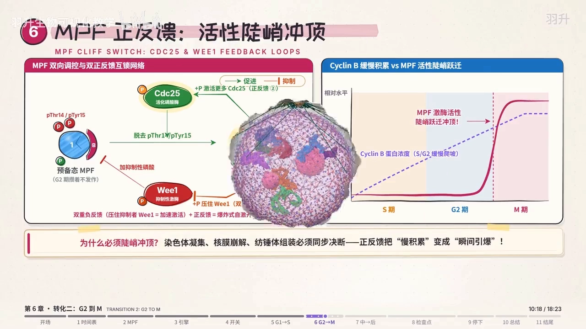

为什么必须陡峭冲顶？因为染色体凝集、核膜崩解、纺锤体组装必须同步决断。[【跳转到 10:18】](https://www.bilibili.com/video/BV1tosg63Ec3/?t=618) MPF 磷酸化很多底物，老师要求记三个：**凝缩蛋白**让染色体凝集；**核纤层蛋白**让核膜崩解；**微管相关蛋白**让纺锤体组装起来。[【跳转到 10:23】](https://www.bilibili.com/video/BV1tosg63Ec3/?t=623)

顺带分清两个容易混的名字：凝缩蛋白（condensin）让染色体变粗变短，黏连蛋白（cohesin）把两条姐妹染色单体绑在一起，两者长得像、作用不同。[【跳转到 10:44】](https://www.bilibili.com/video/BV1tosg63Ec3/?t=644)

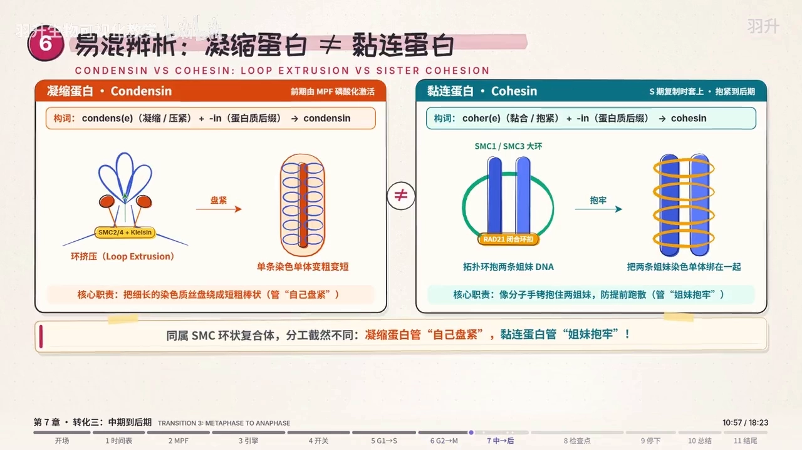

### 6.3 中期 → 后期：靠不可逆的降解「解锁剪刀」

中期的关键不是染色体排到赤道面，而是**所有动粒都连上了动粒微管**，并且两个姐妹动粒连向相反的两极。[【跳转到 11:02】](https://www.bilibili.com/video/BV1tosg63Ec3/?t=662)

这时姐妹染色单体还被黏连蛋白绑着，剪开它的是**分离酶（separase）**，而分离酶平时和它的抑制蛋白 securin 结合在一起，没有活性。放开分离酶的是 **APC/C（后期促进复合物）**，它是一种 E3 泛素连接酶，给靶蛋白挂上泛素送去蛋白酶体；APC/C 先被 MPF 磷酸化，再结合激活亚基 Cdc20 才开始工作。[【跳转到 11:21】](https://www.bilibili.com/video/BV1tosg63Ec3/?t=681) 它的第一个目标是 securin：securin 一降解，分离酶被放出来剪断黏连蛋白，姐妹分开，后期开始。[【跳转到 11:35】](https://www.bilibili.com/video/BV1tosg63Ec3/?t=695)

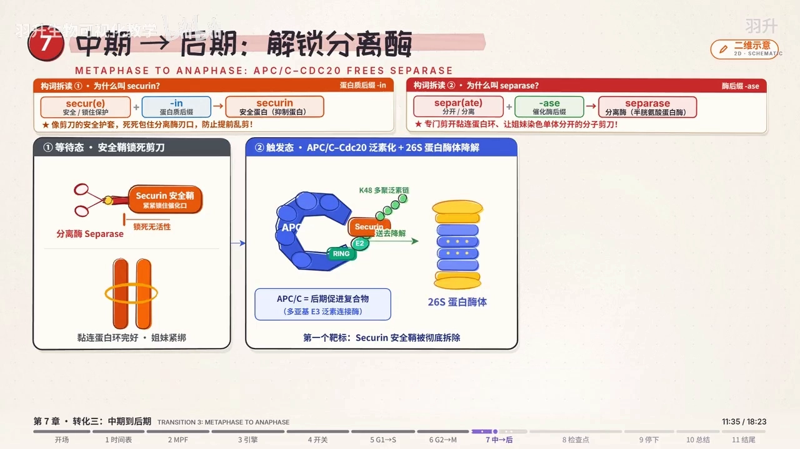

APC/C 的第二个目标是 cyclin B：cyclin B1 降解，CDK1 失去搭档，MPF 的活性掉下来，它加过的磷酸被磷酸酶去掉，染色体去凝集、核膜重新组装、收缩环把细胞分开，细胞退出 M 期。[【跳转到 11:57】](https://www.bilibili.com/video/BV1tosg63Ec3/?t=717)

这三个转化把「状态为什么只能单向前进」说透了：**推进靠合成，退出靠不可逆的降解**。

---

## 七、检查点：状态走错时的「紧急叫停」

前面讲的是油门，cyclin-CDK 推着周期走；**检查点是刹车**，发现异常先让周期停下，等问题处理好再走。老师说这是两层不同的概念。[【跳转到 12:24】](https://www.bilibili.com/video/BV1tosg63Ec3/?t=744)

老师讲了三个：DNA 损伤检查点、DNA 复制检查点、纺锤体组装检查点；书上还多一个染色体分离检查点，管末期能不能开始。[【跳转到 12:29】](https://www.bilibili.com/video/BV1tosg63Ec3/?t=749)

**DNA 损伤检查点**：双链断裂这类严重损伤出现后，信号传到一个叫 p53 的蛋白。p53 平时很快就被降解，损伤时它被稳定下来、越积越多。p53 是转录因子，它开启的基因里最关键的是 p21，p21 抑制 CDK，让 G1 到 S、G2 到 M 都停下来，给修复争取时间。修好了刹车松开、周期继续；修不好有两条出路——凋亡（宁可让这个细胞死掉，也不让损伤传下去）或衰老（细胞活着，但不再分裂）。老师强调：p53 是转录因子、p21 是 CKI，这两点必须掌握。[【跳转到 12:57】](https://www.bilibili.com/video/BV1tosg63Ec3/?t=777)

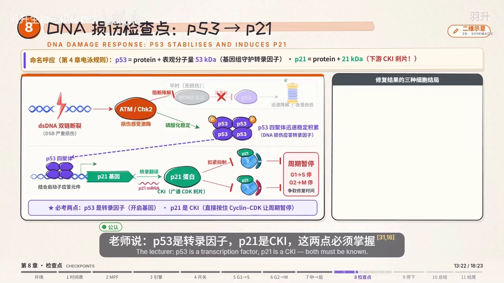

**复制检查点**管的是 S 期：还没复制完、还有复制叉在走，细胞就不准进 M 期。它通过 ATR 和 CHK1 两个激酶让 Cdc25 失活，MPF 就打不开。[【跳转到 13:37】](https://www.bilibili.com/video/BV1tosg63Ec3/?t=817)

**纺锤体组装检查点**的原则是：只要还有一个动粒没连上，后期就不开始。老师只要求记头和尾——头是没连上的动粒，尾是 APC/C 被抑制。[【跳转到 13:51】](https://www.bilibili.com/video/BV1tosg63Ec3/?t=831) 中间是这样的：没连上的动粒像一块模板，把 Mad2 一个接一个地变成激活的形状，激活的 Mad2 和 Mad3 一起抓住 Cdc20，组成有丝分裂检查点复合物；Cdc20 被扣住，APC/C 就拆不了 securin，姐妹就不分开。[【跳转到 13:56】](https://www.bilibili.com/video/BV1tosg63Ec3/?t=836)

再补一条前沿：守护神蛋白（shugoshin）护住的着丝粒黏连蛋白，到了减数第二次分裂怎么放开？一种解释是有一个抑制因子把守护神带来的磷酸酶关掉，黏连蛋白就能被分离酶解开了；这还在研究，先当作前沿了解。[【跳转到 14:28】](https://www.bilibili.com/video/BV1tosg63Ec3/?t=868)

---

## 八、状态的三种结局：持续增殖、G0、终末分化

人体里所有细胞都在不停转圈吗？老师按两个问题来分：**还在不在周期里、停了以后还能不能回来**。[【跳转到 14:47】](https://www.bilibili.com/video/BV1tosg63Ec3/?t=887) 这三类就是「细胞状态」在增殖维度上最实用的一个分类：

- **持续增殖**：比如小肠隐窝里的干细胞和祖细胞、皮肤基底层细胞、造血祖细胞，一直在周期里转，终生不断更新组织。
- **G0（暂不增殖）**：暂时退出周期，比如成纤维细胞和肝细胞，受到适当刺激还能回来。
- **终末分化**：比如成熟的神经元、骨骼肌细胞，一般不再分裂。[【跳转到 14:52】](https://www.bilibili.com/video/BV1tosg63Ec3/?t=892)

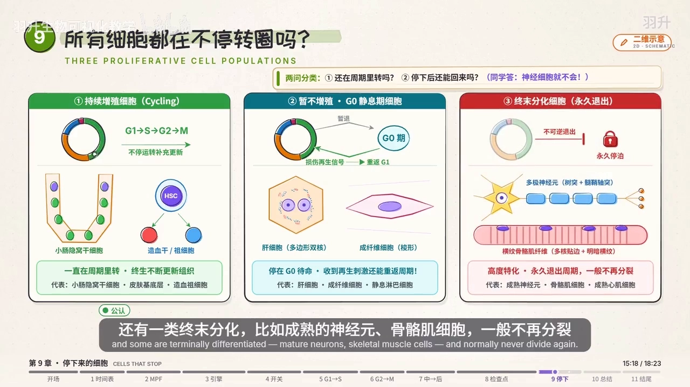

还要分清几个容易混的词：**细胞生长**是体积和质量变大（如骨骼肌、心肌肥大），**细胞增殖**是数目变多；G0、损伤停顿和衰老也不一样——G0 能回去，损伤停顿修好就走，衰老是长期稳定的停滞、通常不再响应促分裂的信号，但细胞仍在代谢。[【跳转到 15:18】](https://www.bilibili.com/video/BV1tosg63Ec3/?t=918)

怎么看出组织里谁在分裂？**EdU** 是一种胸苷类似物，S 期合成 DNA 时会被掺进去。给小鼠打一次 EdU，过几天看小肠，带标记的细胞从隐窝一路爬上了绒毛。老师专门纠正：标记不代表取材时正在复制，而是**给药那一刻处在 S 期的细胞和它们分裂出的后代**。[【跳转到 15:42】](https://www.bilibili.com/video/BV1tosg63Ec3/?t=942)

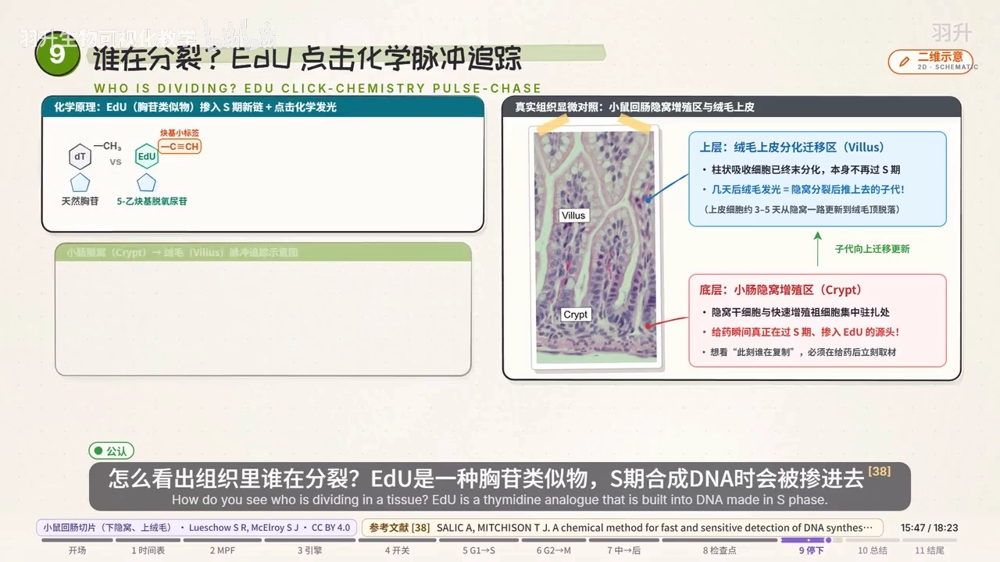

对做单细胞分析的人来说，最后这一段其实是在回答同一个问题：EdU、DNA 含量、周期蛋白含量，都只是在替我们回答「这个细胞此刻处在什么状态」。**先把状态读出来，才不会被状态差异误导成类型差异。**

---

## 小结

- 细胞周期 = 间期（G1/S/G2，占 95% 以上）+ M 期；DNA 含量 G1=2C、G2=4C，是状态最直接的物理读数。
- 同一个细胞在不同时相就是不同状态，而每种状态都有可读出的标记：分子层是周期蛋白的表达波（cyclin 起落、CDK 总量基本不变），形态层是染色体的凝集形态（PCC：G1 单线、S 粉粒、G2 双线）与 EdU 掺入。
- 推动状态前进的是 cyclin–CDK 全酶：CDK 是催化亚基、cyclin 是调节亚基；配对口诀 D-E-A-B / 4/6-2-2-1，其中 cyclin B–CDK1 就是 MPF。
- 三个关键转化：G1→S 由生长因子经 Ras-MAPK 启动 cyclin D-CDK4/6、磷酸化 RB 放出 E2F，并靠 cyclin E 正反馈跨过限制点；G2→M 由 cyclin B-CDK1（MPF）在 Wee1/Cdc25 正反馈下陡峭冲顶；中期→后期由 APC/C-Cdc20 先拆 securin、放开分离酶剪断黏连蛋白。
- 推进靠合成，退出靠不可逆的降解——这是周期只能单向走的原因。
- 检查点是刹车：DNA 损伤检查点（p53→p21）、复制检查点（ATR-CHK1 锁住 Cdc25）、纺锤体组装检查点（Mad2/Mad3 扣住 Cdc20）。
- 周期之外还有三种状态：持续增殖、G0（可逆）、终末分化（不可逆）；生长（体积变大）不等于增殖（数目变多）。
- 对单细胞分析的意义：先分清「状态差异」和「类型差异」，再谈细胞类型注释。

## 关键术语速查

| 术语 | 一句话解释 |
| --- | --- |
| 细胞周期（cell cycle） | 细胞从一次分裂结束到下一次分裂结束的全过程，等于间期加 M 期。 |
| 间期（interphase） | 细胞周期中不分裂的那一段，分 G1、S、G2，占 95% 以上时间。 |
| G1 / S / G2 / M 期 | 间隙期（合成 RNA 与蛋白）/ DNA 合成期 / 分裂前检查准备期 / 有丝分裂期。 |
| 2C / 4C | DNA 含量的标记；G1 为 2C，S 期从 2C 涨到 4C，G2 为 4C，分裂后回到 2C。 |
| MPF | 促成熟因子 / M 期促进因子，等于周期蛋白 B 加 CDK1，是推动 G2→M 的全酶。 |
| 周期蛋白（cyclin） | CDK 的调节亚基，含量随周期起落；记 D、E、A、B。 |
| CDK | 周期蛋白依赖性激酶，催化亚基；记 4/6、2、2、1。 |
| 限制点（R 点） | G1 晚期的一个关卡；过了它，细胞即使失去生长因子也会进入 S 期。 |
| APC/C | 后期促进复合物，多亚基 E3 泛素连接酶；负责降解 securin 与 cyclin B。 |
| 分离酶（separase） | 剪开黏连蛋白环的分子剪刀，平时被 securin 锁住。 |
| 检查点（checkpoint） | 细胞周期的刹车；发现异常就停下，处理完再走。 |
| PCC | 早熟染色体凝集：间期核被拉进 M 期时提前凝集，形态随原时相不同。 |
| EdU | 胸苷类似物，在 S 期掺入新 DNA，用来标记「给药时正在复制」的细胞。 |
| G0 | 暂时退出周期、但仍可被刺激回到周期的一种细胞状态。 |
