# 细胞类型怎么定义、怎么鉴定：从 marker 基因到参考表达谱

> 视频来源：[【单细胞】细胞类型鉴定](https://www.bilibili.com/video/BV1nA411A7vN/)（Bilibili · 诺禾致源官方账号，约 46 分钟）
> 导读（100 字以内）：一支把「细胞注释」讲全的直播课：先讲细胞类型的传统定义，再把 marker 基因、参考表达谱、机器学习三条鉴定路线的原理、工具和验证方法逐个讲清。本文按「为什么难 → 怎么分 → 怎么定 → 怎么验」重排，术语按课件核对。

## 本讲要解决的核心问题（SCQA）

**背景**：单细胞转录组的上游已经很成熟——测序基本走商业平台（自带 barcode 和 UMI 技术），质控出了很多软件，降维和聚类也有成熟的算法。也就是说，把一份数据跑出一条聚类结果，已经不是难事。[【跳转到 00:00】](https://www.bilibili.com/video/BV1nA411A7vN/?t=0)

**冲突**：真正到了讲故事、写文章的时候，会遇到一个很尴尬的问题：聚类结果只是 cluster 0、1、2、3、4、5、6 这样的编号。如果不清楚每一群到底是什么细胞，后面的分析就没法和生物学意义结合。理想上，细胞类型应该是一棵从单个细胞分化出来的树；现实里我们拿到的是一张 UMAP 图，上面只有编号——这就是「现实和理想之间的鸿沟」。[【跳转到 01:25】](https://www.bilibili.com/video/BV1nA411A7vN/?t=85)

**疑问**：这些编号到底对应哪种细胞？怎么把一个 cluster 变成一个有生物学意义的名字？

**回答（中心思想）**：细胞类型鉴定（也就是**细胞注释**）就是把 cluster 映射成生物学名字的过程。现有方法可以归成三条路线：**基于 marker 基因**、**基于表达谱相似性（参考数据集）**、**基于机器学习分类器**。三条路线都依赖同一件东西——**先验知识**（数据库里已知的 marker，或者别人已经测过的参考表达谱）。选哪条路线、用哪个工具，取决于物种、组织和数据质量；而**注释做完一定要验证**，这一步比选哪种方法更重要。

---

## 一、为什么「细胞类型」是个难题：理想的分化树与现实里的编号

### 1.1 传统定义：靠组织、形态和功能来定义

在单细胞技术出现之前，我们理解细胞类型的方式很「生物学」：一个细胞类型是由**它所属的组织、它特殊的功能角色或形态**来定义的。识别的方法则是看**一小组已知标记（known marker）是否存在**。更有一种更严格的表述：细胞类型的生物学定义，应该建立在**发育起源**和**当前功能**这两者的结合上。[【跳转到 02:22】](https://www.bilibili.com/video/BV1nA411A7vN/?t=142)

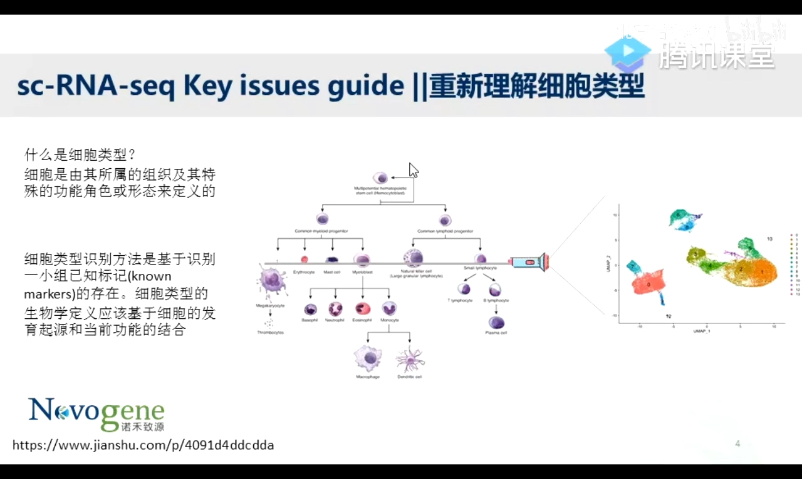

左边是我们期待的样子：多能造血干细胞往下分成髓系、淋巴系祖细胞，再分成红细胞、巨噬细胞、T 细胞、B 细胞等等，每个名字都有明确的功能和来源。右边是我们实际得到的样子：一堆编号。

### 1.2 单细胞带来的现实：编号不是细胞类型

单细胞转录组测序极大地丰富了我们对细胞类型的理解，但它是**无监督**的：它只按细胞之间表达谱的距离（相似程度）来分群，分出来的群默认叫 0、1、2、3……至于这个 cluster 是哪种细胞，它并不知道。

于是「细胞类型鉴定」就成了单细胞分析里第一个重点、也是第一个难点：后面所有的分析，都建立在「这个 cluster 是什么细胞」这个前提上。[【跳转到 02:47】](https://www.bilibili.com/video/BV1nA411A7vN/?t=167)

---

## 二、先分清一对概念：聚类（无监督）与分类（有先验知识）

在这里视频专门澄清了一组容易混的词——**聚类与分类**，它们不是一回事。[【跳转到 05:25】](https://www.bilibili.com/video/BV1nA411A7vN/?t=325)

- **细胞聚类（clustering）**：无监督算法，只看细胞之间的距离。用不同的距离指标来衡量，就会分成不同的群。视频里打了个比方：按今天的时间来算，同一个直播间里的同学时间是接近的；但地理位置上大家天南地北。换一种距离定义，就可能聚成不同的群。[【跳转到 05:50】](https://www.bilibili.com/video/BV1nA411A7vN/?t=350)
- **细胞分类（classification，也就是注释）**：基于先验知识（marker 基因、表达谱、分类器）给细胞贴上已有的名字。它需要我们有相应的生物学知识，才能「精确地鉴定」。[【跳转到 06:15】](https://www.bilibili.com/video/BV1nA411A7vN/?t=375)

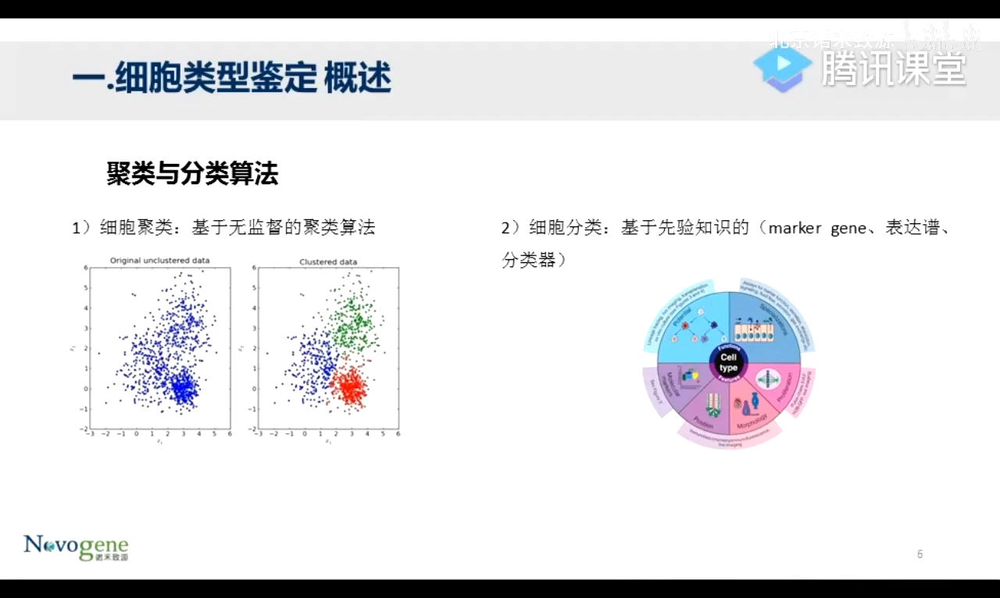

这张图把两者的关系讲得很直白：聚类是「无监督地把点聚起来」，分类是「用已知知识把簇认出来」。**先聚类、再分类**是单细胞注释的标准顺序。

---

## 三、鉴定细胞类型的三条路线

视频把现有的细胞类型鉴定方法归成三大类，这也是理解整节内容的骨架。[【跳转到 04:02】](https://www.bilibili.com/video/BV1nA411A7vN/?t=242)

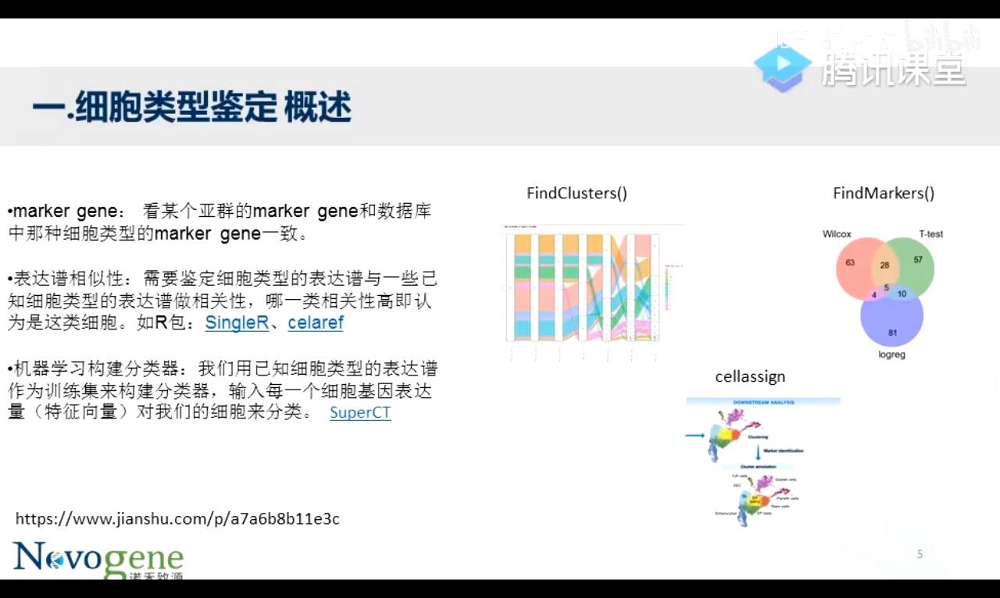

### 3.1 路线一：基于 marker 基因

思路最直白：**我们已经知道某种细胞类型有哪些 marker 是高表达（阳性）的**，那么就看某个 cluster 的 marker 基因，和数据库里哪种细胞类型的 marker 一致。具体做法是先找这一群相对其他群的差异表达基因（`FindMarkers` 这类函数），再拿这份基因列表去和已知 marker 对。

### 3.2 路线二：基于表达谱相似性

**一些细胞类型的转录组已经被测过、知道它的表达谱了**，那么就可以用表达谱相似性去鉴定未知的细胞类型：把待注释细胞的表达谱和参考数据集中各类细胞的表达谱做相关性，哪一类相关性最高，就认为是这一类。代表工具是 SingleR、celaref 等 R 包。

### 3.3 路线三：基于机器学习分类器

用**已知细胞类型的表达谱作为训练集**来构建分类器，再把每个细胞的基因表达量当作特征向量输入进去做分类，比如随机森林一类的分类器（课件上举的例子是 SuperCT）。它其实会同时参考前两类信息——既用 marker 基因，也用表达谱相似性。

### 3.4 marker 这条路线的两个固有短板

视频没有只说好处，它先讲了最经典那条路线的坑。[【跳转到 04:27】](https://www.bilibili.com/video/BV1nA411A7vN/?t=267)

**第一，它依赖聚类和差异分析的结果。** 分群是无监督的，换个参数就分成不同的群；找到群之后去算差异基因，换一种检验方法（比如 Wilcoxon 检验）结果又不一样。单细胞本来就精确到细胞水平，marker 有差异很正常。

**第二，已知 marker 通常很少。** 一个细胞类型可能就十几个 marker，靠这么短的列表做定义，有时候就是定义不清楚。所以视频说，目前主要还是靠 marker，但**随着更多细胞类型被测出来，基于参考数据集的鉴定方法可以成为主流**。

> 顺带一提，同一支团队基于 marker 路线做的一个变体是「超几何检验」：有一个细胞类型与 marker 基因的对应列表，看某一群的 marker 基因集富集到哪个细胞类型上，再用 P 值筛一遍，从而限定细胞类型。

---

## 四、先验知识从哪里来：四个常用数据库

三条路线都要用先验知识，而先验知识主要来自数据库。[【跳转到 06:15】](https://www.bilibili.com/video/BV1nA411A7vN/?t=375)

**CellMarker**：哈尔滨工业大学的老师开发、开源；如果我们自己鉴定出一批 marker，也可以提交到库里供大家使用。视频里给的规模是：人类 158 种组织、467 种细胞类型、13605 个标记基因；小鼠 81 种组织、389 种细胞类型、9148 个标记基因。用法是按组织和细胞类型查它的 marker。[【跳转到 06:40】](https://www.bilibili.com/video/BV1nA411A7vN/?t=400)

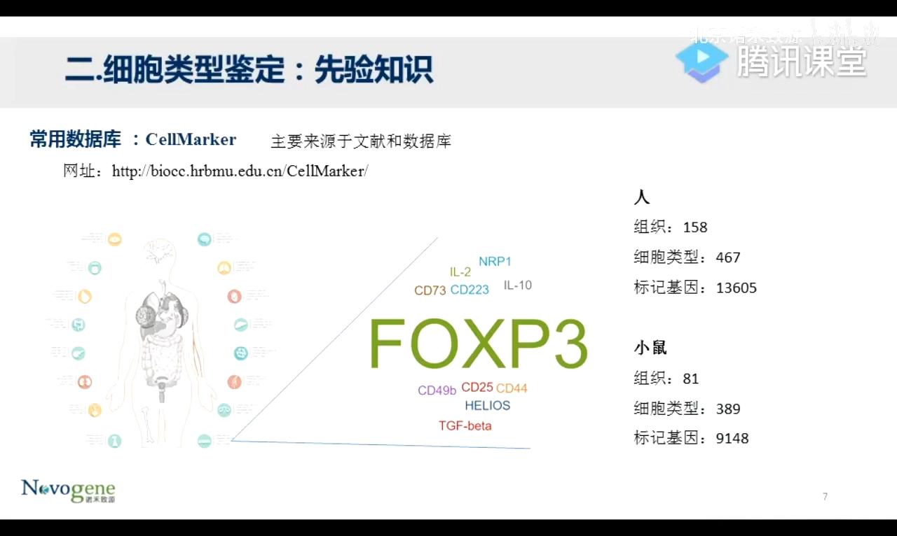

**PanglaoDB**：同样收集人和小鼠的标记基因，特点是**用法示例很丰富**——输入一个基因，它能告诉你这个基因在哪些组织里高表达，给出可视化结果，甚至可以导出图表；每条记录都附有对应文献，可以下载原文。[【跳转到 07:05】](https://www.bilibili.com/video/BV1nA411A7vN/?t=425)

**CancerSEA**：做肿瘤的老师会关心，主要收录肿瘤的单细胞数据，覆盖 20 多种肿瘤类型和许多种**细胞功能状态**。可以输入细胞类型或基因列表，得到与 marker 基因的相关性，再基于相关性做细胞定义。这里「功能状态」这个词很重要——它提示我们：细胞之间除了「是哪种细胞」的差别，还有「处在什么状态」的差别（这条线在 1.3.1 后半部分展开）。[【跳转到 07:30】](https://www.bilibili.com/video/BV1nA411A7vN/?t=450)

**单细胞水平的参考图谱**：有团队把注释做到了单细胞水平（小鼠的 scMCA、人类的 scHCL），表达谱完全公开，可以直接下载来用，也可以下载完自己比较一遍；此外还有人类细胞图谱计划（HCA），里面有大量数据。[【跳转到 08:20】](https://www.bilibili.com/video/BV1nA411A7vN/?t=500)

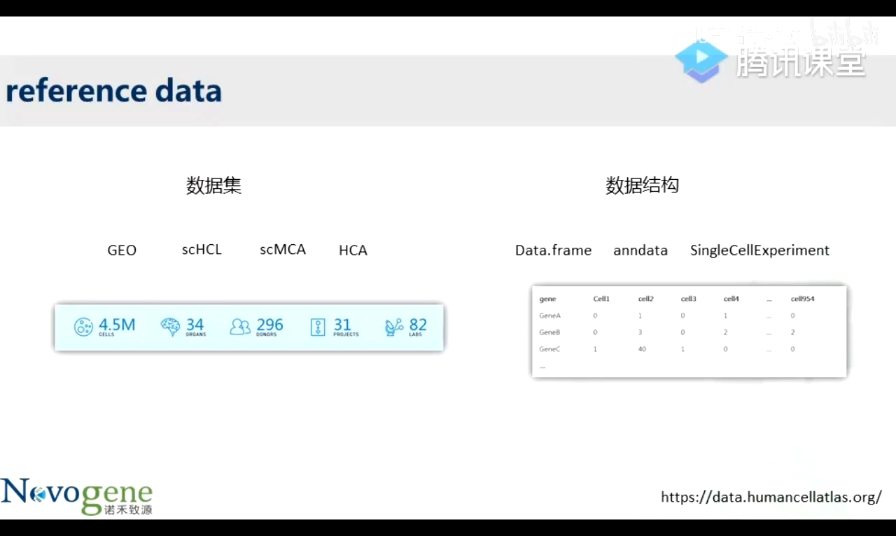

---

## 五、手动注释：把 marker 投到 t-SNE 上，再写回细胞

最经典、也最被高分文章采用的仍然是**人工注释**：准备一个 marker 列表，在可视化软件里逐群看。[【跳转到 10:50】](https://www.bilibili.com/video/BV1nA411A7vN/?t=650)

视频演示的是 Loupe Cell Browser：左边导入 marker 列表（比如 B 细胞选 CD79A、CD79B），右边的 t-SNE 图就会把这些基因的表达量着色出来，哪个群落进去，就说明这一群大概率是 B 细胞；确认之后手动给它命名，软件会把细胞类型标签写回到每个 barcode 上，后续分析就用这个标签。[【跳转到 11:15】](https://www.bilibili.com/video/BV1nA411A7vN/?t=675)

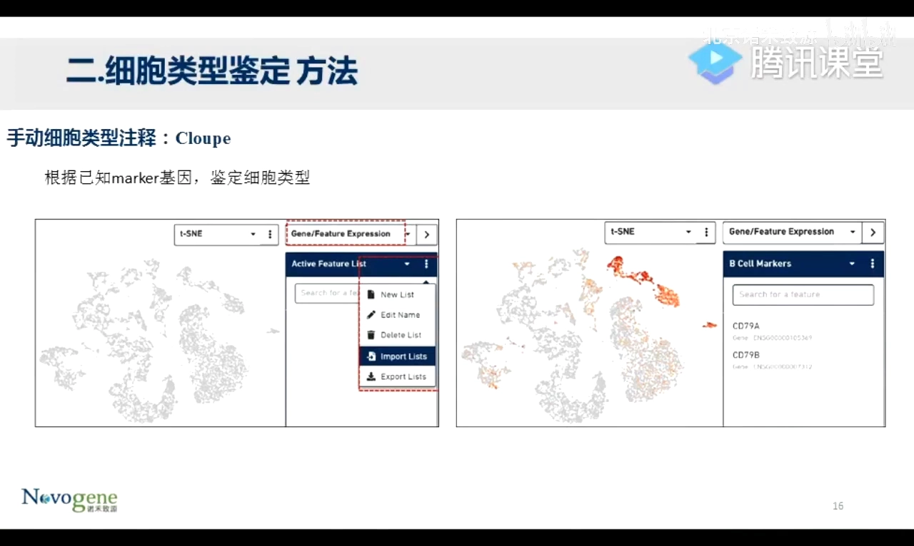

一份典型的 marker 列表长这样：T 细胞用 CD3D、CD3E、CD4，细胞毒性 CD8 T 细胞用 GNLY、GZMB，B 细胞用 CD79A、CD79B，单核细胞用 CD14，增殖红细胞用 HBG1、HBG2——每条都带着 Ensembl 基因 ID。[【跳转到 16:58】](https://www.bilibili.com/video/BV1nA411A7vN/?t=1018)

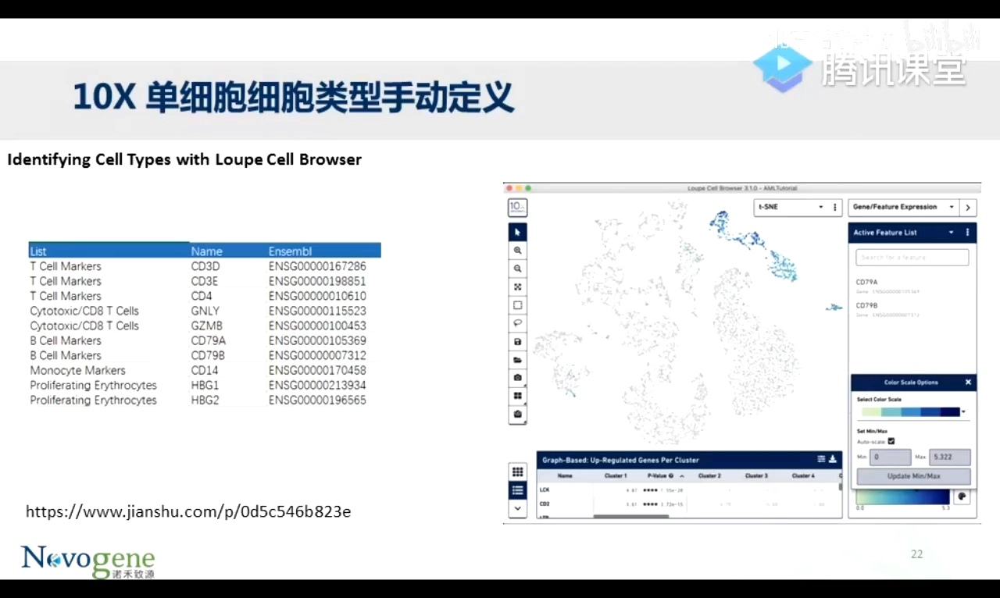

手动注释的好处是**准确、可解释**，缺点是慢、依赖经验，而且不同的人看同一张图可能给出不同的名字。

### 5.1 把工具按原理排一张地图

视频把当时测试过的方法按原理分成了两组。[【跳转到 12:43】](https://www.bilibili.com/video/BV1nA411A7vN/?t=763)

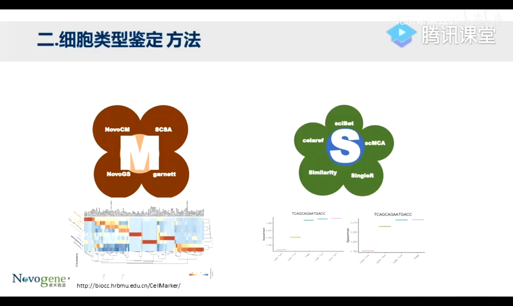

它还给了一张横向对比表，列出每个工具的出处、原理、适用目标（细胞级 / 类级）、优点、局限和**准确率**。视频里念到的准确率大致是：SingleR 约 72.7%、Garnett 约 63.6%、scMCA 约 80.0%、sciBet 约 60.0%、NovoCM 约 83.3%、NovoGS 约 66.7%。[【跳转到 13:24】](https://www.bilibili.com/video/BV1nA411A7vN/?t=804)

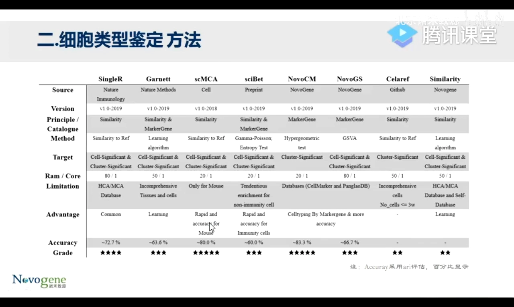

这张表也提醒一件事：**准确率是特定数据集上的成绩，不是通用排名**。视频里推荐的组合是——人的数据用 NovoCM 加 clustermole 加 SingleR；小鼠用 NovoCM 加 clustermole 加 scMCA；肿瘤等特殊类型再加上 scibet。[【跳转到 15:56】](https://www.bilibili.com/video/BV1nA411A7vN/?t=956)

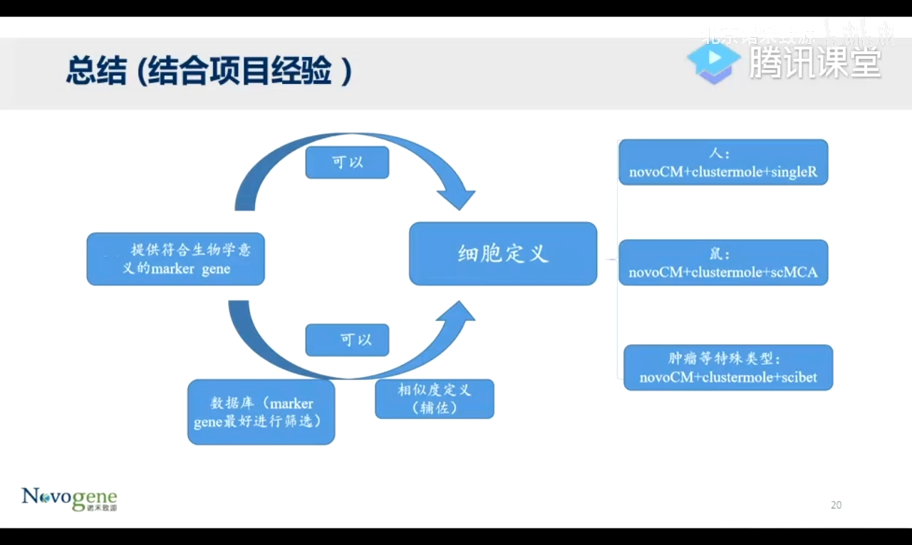

---

## 六、自动注释：以 SingleR 为例

### 6.1 基本假设：把「待注释细胞」和「已知表达谱」放进同一张表

基于参考数据集的方法，思路和生信里的**序列比对**很像：我们拿 reads 去和已知基因组比，通过算法算出相似性，把它比对上去。单细胞这边也一样——如果我们把表达谱想象成一张大表（行是基因、列是细胞），那么只要另外一张表（参考数据集）也是同样的结构、来自同一种组织，它的细胞类型就和我们的预期可比，于是就可以「比」出每一群是什么。[【跳转到 17:23】](https://www.bilibili.com/video/BV1nA411A7vN/?t=1043)

SingleR 是比较早出现的一个，它的算法和整合算法类似：通过找锚点（anchor）做 mapping，只不过算法细节和（Seurat 的整合）不同。[【跳转到 08:45】](https://www.bilibili.com/video/BV1nA411A7vN/?t=525)

### 6.2 用什么衡量「相似」：Pearson 与 Spearman

做相关性时常用两种指标，课件上专门用一页讲了它们的区别。[【跳转到 23:38】](https://www.bilibili.com/video/BV1nA411A7vN/?t=1418)

**算法上完全相同**，区别只在用什么数去算：Pearson 用原来的数值算积差相关，Spearman 用**秩次**算。所以 Spearman 先把表达量排序，再做相关——这就和数据本身的绝对大小没关系了。[【跳转到 24:08】](https://www.bilibili.com/video/BV1nA411A7vN/?t=1448)

$$
r = \frac{1}{n-1}\sum_{i=1}^{n}\left(\frac{X_i-\bar{X}}{s_X}\right)\left(\frac{Y_i-\bar{Y}}{s_Y}\right)
$$

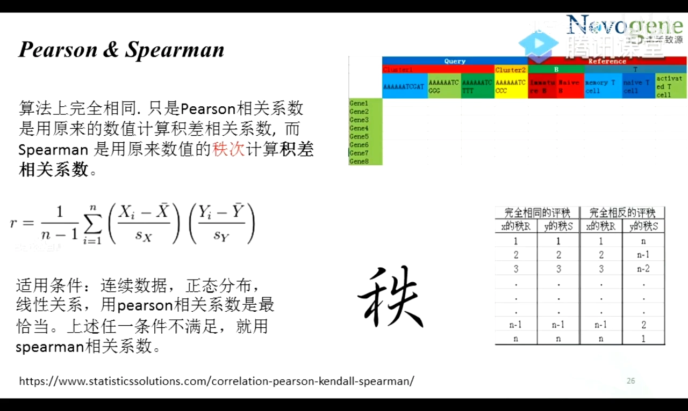

什么时候用哪个？课件给的条件是：**连续数据、近似正态、线性关系**时用 Pearson 最恰当；这三个条件里任意一个不满足，就改用 Spearman。[【跳转到 24:58】](https://www.bilibili.com/video/BV1nA411A7vN/?t=1498)

单细胞数据恰好经常不满足——表达矩阵稀疏、零值很多，绝对数值受测序深度和批次影响大。用秩次来算就稳定得多：原始表达量乘以同一个数、或者减去同一个数，都不会改变结果，因为它只用到数值之间的大小关系（秩次）。

### 6.3 稀疏矩阵的一个补丁：pseudocell（假细胞）

还有一个更实际的困难：同样是同一种细胞类型，**单个细胞之间**的相关性也可能很低（因为很多基因是 0）；而如果拿单细胞矩阵去和 bulk 矩阵（不稀疏）算相关，两边稀疏程度不对等，相关性也很差。

对策是构造 **pseudocell（假细胞）**：在同一种细胞类型里挑若干个（视频提到大约 20 个）细胞，合成一个「假细胞」，再拿这些假细胞去算相关性，从而定义细胞类型。[【跳转到 21:33】](https://www.bilibili.com/video/BV1nA411A7vN/?t=1293)[【跳转到 21:58】](https://www.bilibili.com/video/BV1nA411A7vN/?t=1318)

### 6.4 另一种思路：Seurat 的锚点（anchor）

基于锚点的方法通过找不同细胞类型之间的锚点来建立关系。它有一个**使用前提**：如果某一类细胞特别少，就没法构建这样的结构，找不到相应锚点，也就做不出注释。所以数据里细胞数很少的稀有类型，要特别小心。[【跳转到 22:48】](https://www.bilibili.com/video/BV1nA411A7vN/?t=1368)

### 6.5 SingleR 的三步

SingleR 的算法可以拆成三步（课件原文）：[【跳转到 27:08】](https://www.bilibili.com/video/BV1nA411A7vN/?t=1628)

1. **算相关**：计算参考数据集中每个样本与待注释细胞的 Spearman 相关系数，**只用参考数据集里的变异基因（variable genes）**参与计算；
2. **按细胞类型聚合**：把同一细胞类型下多个相关系数聚合，为每个细胞类型给出一个分数，默认取该类型相关值的 80 百分位数；
3. **微调（fine-tuning）**：只用第 2 步中相关较高的细胞类型重新算一遍，去掉最低的（或比最高低 0.05 的边缘类型），反复迭代直到只剩两种类型，最后把相关最高的那个类型分配给这个细胞。

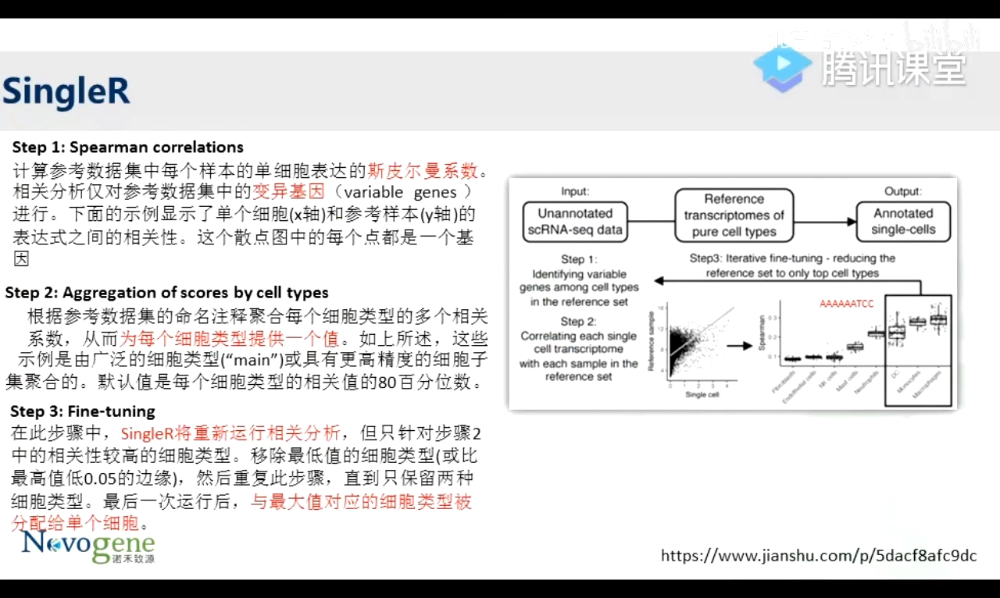

### 6.6 注释到「细胞」还是「类」：两个层次

SingleR 提供两个层次的结果，这是一个很实用的细节：[【跳转到 25:23】](https://www.bilibili.com/video/BV1nA411A7vN/?t=1523)

- **single（细胞水平）**：每个细胞都和参考数据做相关，看哪个相似性最高，因此注释会非常细——甚至同一个 cluster 里会出现好几种细胞类型。这符合直觉：单细胞本来就精确到细胞水平，每个细胞其实都不太一样；
- **cluster（类水平）**：以整个 cluster 为单位去定义，输出更稳定。

视频的建议是：**先按 cluster 做，再按 single 做**，看两者是否一致、或者某个 cluster 里是不是还藏着更细的亚群。[【跳转到 25:48】](https://www.bilibili.com/video/BV1nA411A7vN/?t=1548)

### 6.7 落到操作：结果长什么样、怎么接回分析流程

跑完之后，注释结果会同时给出两份表：每个 barcode 一个细胞类型标签，每个 cluster 一个基本类型。审核完之后用 `AddMetaData` 把这两列写进 Seurat 对象的 metadata，后面的分析和画图就用它。[【跳转到 42:13】](https://www.bilibili.com/video/BV1nA411A7vN/?t=2533)

这里还有一个特别容易被绊住的坑：**同一个工具不同版本的函数名和数据结构会变**。SingleR 早期版本要先用 `CreateSinglerObject`，新版本改成直接调用 `SingleR` 函数并传入 reference、标签和测试集；结果对象的层级结构也在版本升级中简化过。所以看教程、跑代码前，先确认自己的包是哪个版本。[【跳转到 32:44】](https://www.bilibili.com/video/BV1nA411A7vN/?t=1964)

---

## 七、什么才算一份「好」的参考数据

既然参考数据集决定了注释质量，那就得知道怎么挑。课件给了五条标准。[【跳转到 19:03】](https://www.bilibili.com/video/BV1nA411A7vN/?t=1143)

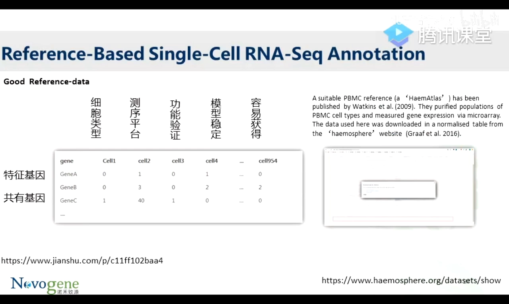

1. **细胞类型要和预期一致**：做血液样本，却拿某个器官的数据当参考，肯定不现实；希望测序平台尽量一致（虽然现在很多算法能弥补这个缺陷）；
2. **有功能验证**：参考数据里的细胞类型本身是被验证过的；
3. **模型要稳定**：如果同一个模型每次跑出来的结果都不一样就不行。验证办法是把参考数据一部分当测试集、一部分当验证集，两个结果都好才说明模型稳定；
4. **容易获得**：如果某个数据库要花钱买、买不到，那这份参考数据就不好用；
5. **基因要有交集**：参考表达谱里的基因要和我们的表达谱大部分重合。如果两边表达的基因完全没有交集，这张表就没法拿来当参考。[【跳转到 19:53】](https://www.bilibili.com/video/BV1nA411A7vN/?t=1193)

这也解释了为什么「针对某一组织类型的数据库」有价值——它把同一组织、同一平台的多种数据都收在一个地方供选择，虽然不一定全，但至少匹配度高。

---

## 八、注释不是终点：验证比方法更重要

定义完细胞类型，并不是「跑出来是什么就是什么」。视频反复强调：**验证这一步，比前面讲的那些方法重要得多**。[【跳转到 13:35】](https://www.bilibili.com/video/BV1nA411A7vN/?t=815)

### 8.1 不做实验的验证：看细胞类型之间的关系合不合理

第一种思路是**规律推断**：看我们定义出来的细胞类型之间的关系。比如干细胞和成纤维细胞之间，按已有的知识，一般应该是干细胞向外分化，反过来就不合理；如果注释结果推出一个说不通的关系，说明注释（或者关系推断本身）有问题。[【跳转到 14:00】](https://www.bilibili.com/video/BV1nA411A7vN/?t=840)

第二种是 **RNA velocity（RNA 速率）**：它可以看出哪些细胞类型更可能出现分化关系。这类方法可以概括为——先用细胞类型之间的关系做一次合理性检验。

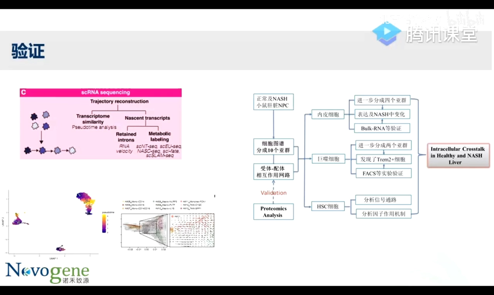

### 8.2 有实验的验证：从大类到亚群，再回到实验台

课件引了一篇文献的做法：先把细胞分成大类，再结合轨迹重建等分析；后面还可以接入更多其他技术手段，不仅是单细胞，比如 FACS 分选，还有 qPCR 验证；最终验证完之后，才能确定这个细胞类型到底是什么。[【跳转到 14:25】](https://www.bilibili.com/video/BV1nA411A7vN/?t=865)

### 8.3 工具会一直变，判断标准不变

视频最后提到：这几年的方法更新很快，2020 年推荐的组合到 2025 年可能就不这样推荐了；自动注释工具也在不断积累数据、更新算法，会越来越准。视频对自动注释有一个预期：等人类细胞图谱完成后，**正常样本**的细胞定义应该可以做得比较好；但肿瘤这类样本异质性太高，可能还要等一段时间。[【跳转到 15:56】](https://www.bilibili.com/video/BV1nA411A7vN/?t=956)

---

## 九、细胞类型不止由转录组决定

最后一段，视频把视角从「算法」拉回「生物学」：细胞类型不只和转录组有关，它和至少五个方向都有关系。[【跳转到 35:42】](https://www.bilibili.com/video/BV1nA411A7vN/?t=2142)

- **位置与微环境**：同一个细胞在不同位置可能发生不同的分化，早期胚胎尤其明显——一个胚胎里的几个细胞，为什么这几个分化成这个、那几个分化成那个，和它在胚胎里的位置关系很大；微环境里的生物化学信号持续影响它，就产生不同的分化方向；
- **疾病**：同一种细胞类型，在不同疾病的诱导下也会走向不同的状态，这也是肿瘤单细胞异质性高、注释更难的原因——早期拿到的样本可能只有一种情况，而不同的环境多种多样。

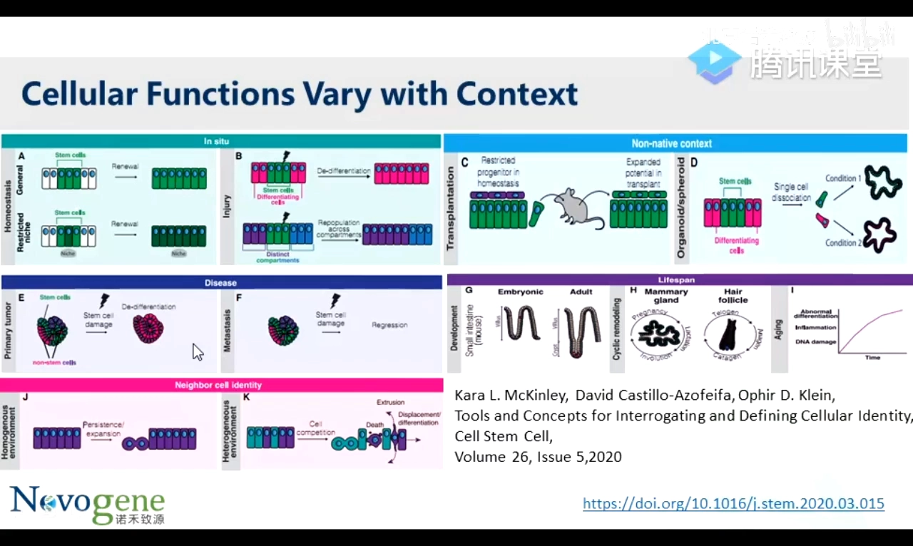

这张图几乎是「细胞类型」这一节最好的注脚：**名字只是坐标，状态才是细胞实际在做的事**。同一种细胞在不同环境下表达的程序不一样，这也正是单细胞扰动组学后面要研究的问题——细胞被扰动之后，是换了类型，还是换了状态？

---

## 小结

- **细胞注释要解决的是一个映射问题**：把无监督聚类得到的 cluster 编号，映射成有生物学意义的细胞类型名字。没有这一步，后面的分析无法和生物学意义结合。
- **先聚类、再分类**：聚类是无监督的（只看距离），分类必须有先验知识（marker、表达谱或分类器）。
- **三条鉴定路线**：基于 marker 基因（最经典，但依赖分群与差异分析、已知 marker 数量少）、基于表达谱相似性（参考数据集，代表是 SingleR）、基于机器学习分类器（把已知谱当训练集）。先验知识来自 CellMarker、PanglaoDB、CancerSEA、scMCA/scHCL、HCA 等数据库。
- **手动注释仍是基准**：在 Loupe 这类软件里把已知 marker 投到 t-SNE 上，逐群确认后命名，再把标签写回每个 barcode。
- **相似性怎么算有讲究**：Pearson 用数值、Spearman 用秩次；单细胞数据稀疏，秩次更稳，所以 SingleR 用 Spearman，并且只对参考集的变异基因计算。
- **两个实用补丁**：pseudocell 缓解稀疏矩阵导致的低相关；Seurat 锚点法在稀有细胞类型上会失效。
- **注释粒度要选**：细胞水平（single）更细、可能一个 cluster 里出现多种类型；类水平（cluster）更稳。建议先 cluster、再 single 交叉确认。
- **参考数据集的质量决定上限**：细胞类型一致、平台一致、有功能验证、模型稳定、容易获得，且基因要有交集。
- **一定要验证**：用细胞类型之间的关系做规律推断（含 RNA velocity），或回到 FACS、qPCR 等实验；验证比方法选择更重要。
- **细胞类型不是全部**：位置、微环境、疾病都会改变细胞的表达程序——类型之下还有**状态**，这正是下一节要展开的内容。

## 关键术语速查

| 术语 | 一句话解释 |
| --- | --- |
| 细胞类型鉴定 / 细胞注释 | 把聚类得到的 cluster 映射为有生物学意义的细胞类型名字 |
| 聚类（clustering） | 无监督算法，只按细胞之间的距离分群，输出 cluster 编号 |
| 分类（classification） | 基于先验知识（marker、表达谱、分类器）给细胞贴上已有的类型标签 |
| marker 基因 | 在某个细胞群里相对其他群显著高表达、可作为该群特征的基因 |
| 参考数据集（reference） | 已知细胞类型、已测过表达谱的数据集，用作相似性比较的「标准答案」 |
| Pearson 相关系数 | 用原始数值计算的相关性，适合连续、近似正态、线性关系的数据 |
| Spearman 相关系数 | 用秩次计算的相关性，对稀疏、非线性数据更稳健 |
| pseudocell（假细胞） | 把同一细胞类型中若干细胞的表达谱合并成一个「假细胞」，再用来算相关性 |
| anchor（锚点） | 基于锚点的注释/整合方法用来建立两个数据集细胞间对应关系的中间结构 |
| 变异基因（variable genes） | 在细胞类型之间表达差异明显、参与相似性计算的基因子集 |
| AddMetaData | 把注释结果（每个 barcode 或每个 cluster 的标签）写回 Seurat 对象 metadata 的函数 |
| RNA velocity | 用新生转录本与已剪接转录本的比例，推断细胞类型之间的分化方向 |
| 超几何检验 | 判断某群的 marker 基因集是否显著富集到某个细胞类型的统计方法 |
