# 细胞分化与干细胞：命运如何被决定，又如何被重编程

> 视频来源：[1500 细胞分化与干细胞](https://www.bilibili.com/video/BV1Kh4y1o7Ku/)（Bilibili · lwt_cell，约 88 分钟，细胞生物学第 15 章课堂实录，中文字幕为自动识别）
> 导读（100 字以内）：这是一堂按教材顺序讲透「分化」与「干细胞」的细胞生物学课：从分化的定义与分子证据，讲到决定与胚胎诱导，再到干细胞分类、核移植、iPSC 与化学重编程。本文按「是什么 → 谁决定 → 干细胞 → 怎么逆转 → 怎么用」重排，把课堂上的实验、年份与争议都保留下来；字幕中的术语错拼已按上下文订正。

## 本讲要解决的核心问题（SCQA）

**背景**：人体大约有 200 多种细胞，它们全部来自同一个细胞——受精卵。这个细胞一边分裂，一边让后代在形态、结构和功能上分化出差异，最终长成皮肤、肌肉、神经、血液。这是多细胞生物发育的基础，也是干细胞研究要回答的核心问题。

**冲突**：分化出来的差异非常稳定——红细胞不会自己变回受精卵，肌肉细胞也不会突然变成神经细胞。于是历史上很自然的一个猜想是：**分化过程中遗传物质被丢掉了**，每种组织只留下自己那一份。这个猜想统治了很长时间，直到克隆实验把它推翻：一个高度分化的体细胞核，居然还能支撑出一个完整的个体。差异如此稳定，却又可以被逆转，这两件事必须同时被解释。

**疑问**：如果基因一个都没丢，那分化到底是怎么发生的？分化方向在什么时候、被什么东西定下来？干细胞为什么既能自我复制、又能分化出别的细胞？人类又怎样绕开「胚胎干细胞拿不到、成体干细胞太少」的困境，把分化这条路倒着走？

**回答（中心思想）**：细胞分化的本质是**基因的选择性表达**——全套基因组都在，只是在特定的时间和空间里各表达一部分，调控主要发生在转录水平。分化方向由**内部因素**（卵裂时细胞质分配不均）与**外部因素**（邻近细胞分泌信号，即胚胎诱导）共同决定，并且在形态上还看不出来的时候就已经被锁定，这一步叫**细胞决定**。**干细胞**是同时具备自我更新与多向分化潜能的细胞，按潜能分全能、多潜能、多能、单能四档，按来源分胚胎干细胞与成体干细胞两类；随着发育推进，潜能总体上是**逐渐变窄**的。而**重编程**（核移植、转录因子、化学小分子）证明了这条变窄的路可以倒着走，从而在源头上解决了干细胞「材料不够」的问题——这也正是这一讲后半段那些诺奖与争议事件的主线。

---

## 一、分化的定义：不是丢掉基因，而是把基因关掉

### 1.1 一个受精卵如何变成两百多种细胞

课堂给出的定义很朴素：**细胞分化**（cell differentiation）是指在个体发育中，由一种相同类型的细胞经细胞分裂后，逐渐在形态、结构和功能上形成**稳定性差异**，产生不同细胞类群的过程。定义里要抓住的关键词是「细胞的后代」和「稳定的差异」：红细胞、骨骼肌细胞一旦分化出来，就不会再变成别的类型。

但「稳定」是相对的。在干细胞这个层面上，还存在横向分化的现象——比如把肌肉干细胞注射进循环系统，它有可能分化成血液细胞。所以更准确的说法是：**差异稳定，但不是绝对不可逆**，这句话为后面整章的「重编程」埋了伏笔。

[【跳转到 04:13】](https://www.bilibili.com/video/BV1Kh4y1o7Ku/?t=253)

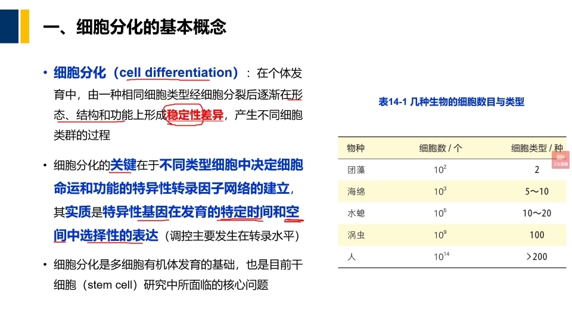

这张表值得多看一眼：从团藻的 2 种细胞类型到人的 200 多种，细胞数量涨了十几个数量级，细胞类型却只涨了两个数量级——**类型是有限的、可穷举的**，这正是「细胞类型」能成为一门分类学的原因。

### 1.2 本质是基因在时间和空间上的选择性表达

分化的关键在于：不同类型细胞中，建立起了决定细胞命运和功能的**特异性转录因子网络**；其实质是特异性基因在发育的**特定时间**和**特定空间**中选择性表达，而调控主要发生在转录水平——也就是基因转录出 mRNA 这一步。

「时空」这两个字是重点：

- **时间**：同一个基因在个体发育的不同阶段表达情况不同；
- **空间**：同一个基因在不同部位、不同细胞里表达情况不同。

同一个受精卵的基因组完全相同，差异只能来自「哪些基因被打开、什么时候打开、在哪个细胞里打开」。

### 1.3 一个错了半个世纪的答案：种质学说与马蛔虫

人类对分化本质的认识并不是一开始就对的。德国细胞学家魏斯曼（August Weismann）在 1883 年提出**种质学说**（germ plasm theory），并据此认为：细胞的分化是由于**遗传物质的丢失**造成的，每一种组织只保留了其特有的遗传物质。

这个观点误导了很长时间。推翻它的证据来自克隆：无论是植物的组织培养，还是动物的克隆，一个高度分化的体细胞（或它的细胞核）都能再生出一个完整的个体——说明里面**含有全套基因组**，遗传物质并没有丢失。

[【跳转到 07:37】](https://www.bilibili.com/video/BV1Kh4y1o7Ku/?t=457)

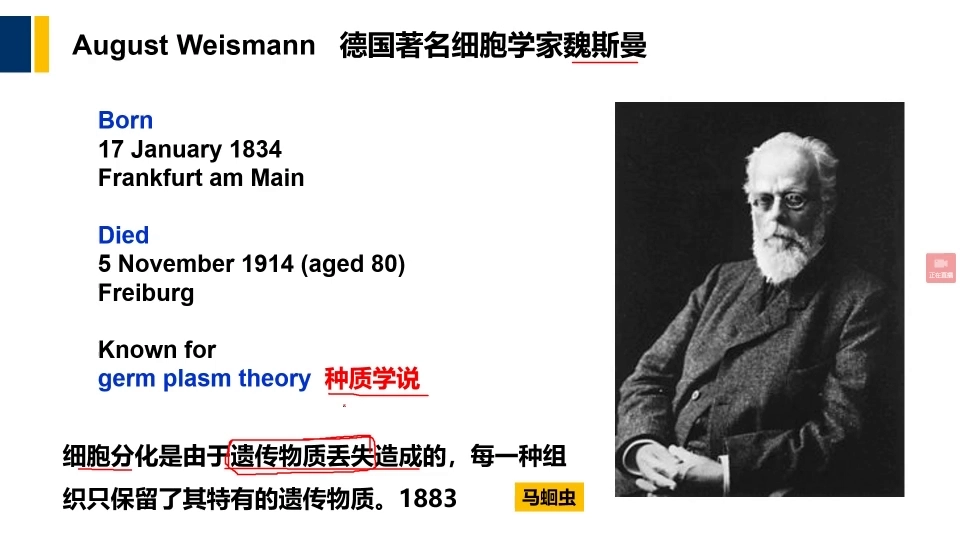

那魏斯曼为什么会得出错误结论？因为他选了一个**特殊的实验材料**——马蛔虫。马蛔虫在发育过程中确实存在遗传物质丢失的现象：只有生殖细胞得到完整的染色体，体细胞会随机丢失一些染色体片段。从一个特例推广到所有细胞的分化本质，结论就错了。课堂反复强调这一点，其实是在教一种研究习惯：**先问结论的适用范围，再看材料是否特殊**。

### 1.4 分子层面的铁证：DNA 都在，mRNA 各不相同

除了克隆，还有分子水平的证据。教材用两种杂交检测三种细胞、三种基因：

- 三种细胞：输卵管细胞、网织红细胞、胰岛 β 细胞；
- 三种探针：卵清蛋白基因、β-珠蛋白基因、胰岛素基因；
- 两种方法：**Southern 杂交**检测 DNA，**Northern 杂交**检测 RNA（顺带复习：Western 杂交用抗体检测蛋白，原位杂交检测基因在染色体上的定位）。

结果是：**检测 DNA 时，三种细胞里三个基因全部为阳性**；而检测 RNA 时，每种细胞只表达自己那一套——输卵管细胞有卵清蛋白 mRNA，网织红细胞有 β-珠蛋白 mRNA，胰岛 β 细胞有胰岛素 mRNA，另外两个都检测不到。

[【跳转到 10:20】](https://www.bilibili.com/video/BV1Kh4y1o7Ku/?t=620)

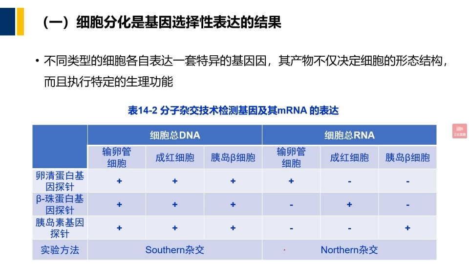

一句话总结这张表：**基因都有，但 mRNA 不一定都转录**。这就是「分化是基因选择性表达」在分子水平上的直接证据。

### 1.5 管家基因与组织特异性基因：也是实验里的内参

与分化配套的是一对基因分类：

- **管家基因**（housekeeping gene）：几乎所有细胞中都表达，产物是维持细胞基本生命活动所必需的，比如肌动蛋白（actin）、糖代谢相关的酶。它们只占基因总数很少一部分，一般在 S 期**早期**复制。
- **组织特异性基因**（tissue-specific gene，旧称「奢侈基因」）：在不同类型细胞中特异性表达，产物赋予各类细胞特异的形态结构特征与特异功能。它们占基因总数的绝大多数，调控并参与了细胞分化和组织器官的构建；一般在 S 期早期复制，但在**不表达**这类基因的细胞里，则推迟到 S 期**晚期**复制。

[【跳转到 13:03】](https://www.bilibili.com/video/BV1Kh4y1o7Ku/?t=783)

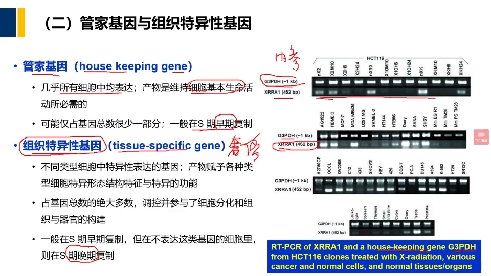

这张电泳图还带出一个非常实用的实验常识：**管家基因可以当内参**。你要比较某个基因在不同组织里的表达量差异，就得先排除「RNA 提多提少」这种操作误差——把管家基因和目的基因一起跑电泳，如果管家基因条带在各样本里一致，那么目的基因的差异就可以归因于选择性表达，而不是手抖。

---

## 二、分化的边界比想象中宽：单细胞会分化，成年后也在分化

### 2.1 分化不是多细胞生物的专利

教材特别提醒：细胞分化**并不是多细胞生物的专利**。单细胞的有机体（包括原核生物）在特定条件下适应不同环境时，也会出现分化现象。这一点常出现在判断题里。

同时，分化也不只发生在胚胎发育时期。胚胎发育当然是最典型的阶段——从一个受精卵分化出一个个体；但个体出生以后同样存在分化。

### 2.2 出生之后仍在分化：造血干细胞

最直观的例子是血液：红细胞的寿命约 120 天，白细胞约 7 天。这些细胞死亡之后，血液里的细胞含量并不会减少，原因是**造血干细胞**在不断地分裂和分化，补充死掉的细胞。这就是「成体也存在细胞分化」的标准例子，也是后面讲成体干细胞的引子。

[【跳转到 17:22】](https://www.bilibili.com/video/BV1Kh4y1o7Ku/?t=1042)

### 2.3 四个容易混的概念：转分化、去分化、重编程、再生

课堂明确列出四个概念，要求能区分：

| 概念 | 英文 | 一句话定义 | 课堂例子 |
| --- | --- | --- | --- |
| 转分化 | transdifferentiation | 一种类型的分化细胞转变成另一种类型的分化细胞 | 肾上腺嗜铬细胞在去除糖皮质激素并加入神经生长因子后，转分化为交感神经元 |
| 去分化 | dedifferentiation | 分化细胞失去其特有的结构与功能，变成具有未分化细胞特征的过程 | 植物组织培养中，高度分化的植物组织先回到类似受精卵的状态 |
| 重编程 | reprogramming | 涉及 DNA 与组蛋白修饰改变，使分化状态被逆转的过程 | 体细胞核移植、iPS 细胞 |
| 再生 | regeneration | 生物体缺失部分后重建的过程 | 蝾螈肢体切除后重新长出 |

[【跳转到 18:35】](https://www.bilibili.com/video/BV1Kh4y1o7Ku/?t=1115)

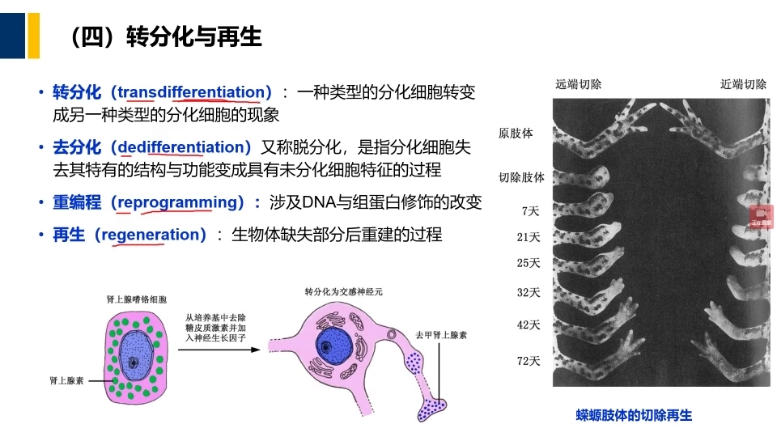

这四个概念的关系可以这样理解：**去分化**是「往回退一步」，**转分化**是「横着跨一步」，**重编程**是「一路退回起点」，**再生**是这些过程在组织层面上的结果。植物组织培养是「去分化 + 再分化」的经典组合：高度分化的植物细胞先回到未分化状态，再重新分化出完整植株。
---

## 三、命运由什么决定：细胞质、邻居，以及更早发生的「决定」

课堂先给了一个诚实的提醒：细胞分化的分子机制，目前了解得**远不如细胞增殖调控清楚**。上一章讲细胞周期，内部引擎是 CDK 与 cyclin 复合物，刹车是信号转导通路，机制相对明确；而分化这一章，内部因素和外部因素都还停留在「基本概念」的层面。所以这一节的重点不是背通路，而是理解**影响分化的两类来源**——内部因素与外部因素，并且外部因素最终也要落到内部因素上，也就是落到基因的选择性表达上。

### 3.1 内部因素：卵裂时细胞质分配不均

目前了解得比较清楚的一条内部机制是：**受精卵在卵裂过程中，细胞质分配不均匀**，而不同细胞质成分会决定细胞的分化方向。

果蝇是研究这个问题的经典材料。果蝇受精卵在受精后两小时内只进行核分裂、胞质不分裂，形成**合胞体胚**（一个细胞里有多个细胞核）；随后细胞核向卵的边缘迁移，细胞膜开始把每个核包裹起来，形成细胞。关键在于：**不同的核落进了不同的细胞质区域**，而这些区域里的成分不一样，于是分化命运也不一样。迁入卵后端生殖质（pole cells）的细胞最终分化为生殖细胞。

[【跳转到 22:34】](https://www.bilibili.com/video/BV1Kh4y1o7Ku/?t=1354)

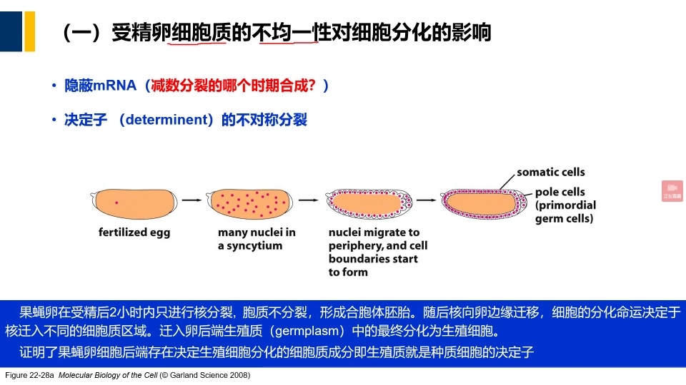

那「细胞质不一样」为什么能决定命运？课堂上把这条线索接到了减数分裂那一章：卵母细胞在减数分裂**双线期**进行活跃转录，形成的「灯刷染色体」就是活跃转录的形态表现；这些转录产物以 mRNA 的形式储存在卵母细胞里，有时被称为**隐蔽 mRNA**。受精后卵裂时，这些 mRNA 被分配到不同细胞中，翻译出的蛋白就去调控这些细胞的分化方向。承担这个调控角色的物质，叫**决定子**（determinant）。

这条链路可以概括为：**母源 mRNA → 不均等分配到子细胞 → 翻译成决定子蛋白 → 决定分化方向**。这也解释了为什么「细胞质分配」这种看起来纯物理的事件，能产生如此稳定的生物学后果。

### 3.2 外部因素：胚胎诱导

外部因素的代表概念是**近端组织相互作用**（proximate tissue interaction），也叫近端诱导或**胚胎诱导**（embryonic induction）：在胚胎发育过程中，一部分细胞通过分泌信号分子影响周围的细胞（靶细胞），使其向一定方向分化。

[【跳转到 26:07】](https://www.bilibili.com/video/BV1Kh4y1o7Ku/?t=1567)

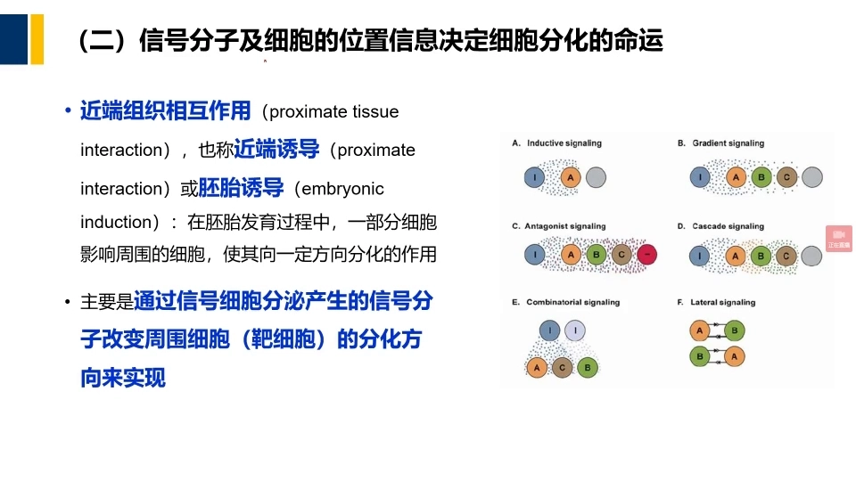

这张图把「邻居怎么影响你」拆成了六种模式，从最简单的 A 诱导 B，到靠浓度梯度定位、靠拮抗划定边界、靠级联放大、靠多个信号组合编码、以及相邻细胞互相通知。初学者不必记住每一种的名字，但要抓住共同点：**分化的位置信息，很大程度上是由细胞所处的信号环境给出的**。

### 3.3 决定早于分化：成虫盘移植实验

有了内部与外部两类因素，还有一个时间问题：分化方向是什么时候被定下来的？

课堂给了一对必须区分的概念。**分化**是细胞后代在形态、结构和功能上产生稳定差异的过程；而**决定**（determination）是指一个细胞接受了某种指令后，它及其子代细胞将区别于其他细胞而分化成某种特定类型——换句话说，**在形态、结构与功能等分化特征尚未显现之前，细胞的分化命运就已经确定了**。一句话：**决定早于分化**。

证据是果蝇的**成虫盘**（imaginal disc）移植实验。成虫盘是果蝇幼虫体内一些未分化的细胞群，在幼虫变态为成虫的过程中，不同的成虫盘发育成成虫不同的器官（翅、腿、眼触角、口器、平衡棒、生殖器等）。实验把幼虫的成虫盘切成两半：一半留在原幼虫体内，正常发育成对应器官；另一半移植到另一只幼虫的腹腔里连续传代，**传了 150 代之后**再取出来移植到新的幼虫体内——结果它依然发育成原来对应的那个器官。

[【跳转到 28:40】](https://www.bilibili.com/video/BV1Kh4y1o7Ku/?t=1720)

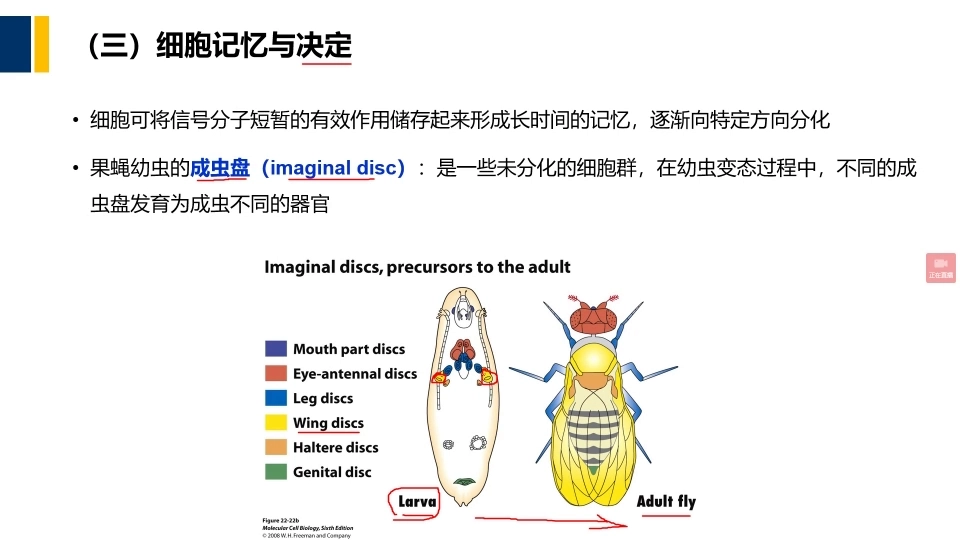

150 代传代都不改方向，说明这个「方向」被稳定地记住了。课堂把这种稳定性归给**细胞记忆**，并给出两条可能途径：

1. **正反馈途径**：细胞接受信号刺激后激活某个转录调节因子，该因子不仅诱导自身基因表达，还诱导其他组织特异性基因表达——一旦开起来就自己维持自己；
2. **染色体结构变化**：DNA 与蛋白质相互作用及其修饰的信息，随细胞分裂传给子代细胞。

[【跳转到 30:47】](https://www.bilibili.com/video/BV1Kh4y1o7Ku/?t=1847)

这两条途径也解释了为什么分化状态如此稳定，同时又可以被重编程打破：**记忆是写在染色质状态上的，而染色质状态可以被改写**。

### 3.4 两个特例：染色体丢失与基因重排

前面说「分化不是基因丢失」，但课堂特意保留了两个**特例**，用来提醒「规律总有例外」：

- **染色体丢失**：马蛔虫发育过程中，只有生殖细胞得到完整染色体，体细胞中的染色体只是部分染色体片段。这是「遗传物质丢失导致分化」唯一站得住的场景，但它只发生在特殊物种的特殊细胞里。
- **基因重排**：B 淋巴细胞分化过程中，DNA 通过体细胞重组，把不同部位的部分基因片段连接在一起，组成产生抗体 mRNA 的 DNA 序列。抗体多样性不是靠基因数量堆出来的——人体基因只有 3 万个左右，而自然界抗原的种类远多于此；真正产生多样性的是 V、D、J 片段的不同组合方式。

[【跳转到 32:56】](https://www.bilibili.com/video/BV1Kh4y1o7Ku/?t=1976)

顺带一个免疫学常识：T、B 淋巴细胞在体内通常处于 G0 期，只有抗原刺激之后才被激活、增殖分化，产生抗体或杀伤性 T 细胞。**「分化」在这里是被外部信号触发的**，与 3.2 节的胚胎诱导是同一个逻辑。

---

## 四、干细胞：两个特性、两种分裂、两套分类

### 4.1 定义：自我更新 + 多向分化潜能

干细胞（stem cell）目前是一个**描述性概念**：一般认为同时具备两个特性的细胞才叫干细胞——

1. **自我更新**：一个干细胞通过一次分裂可以产生两个干细胞，即自己复制自己；
2. **多向分化潜能**：不仅能自我复制，还能分化成其他类型的细胞。

在细胞分化、个体发育和成体维持等生命过程中，干细胞起关键和决定性的作用。

[【跳转到 35:47】](https://www.bilibili.com/video/BV1Kh4y1o7Ku/?t=2147)

### 4.2 对称分裂扩增数量，不对称分裂产生分化细胞

「既能复制自己、又能分化」这两个看似矛盾的能力，靠**两种分裂方式**实现：

- **对称性分裂**：一个细胞变成两个一样大的细胞，主要作用是**增加干细胞数量**；
- **不对称性分裂**：分裂沟的位置由纺锤体位置决定——纺锤体偏向一侧，就形成一个大细胞和一个小细胞；其中一个维持干细胞特性，另一个命运改变，走向分化。

[【跳转到 37:30】](https://www.bilibili.com/video/BV1Kh4y1o7Ku/?t=2250)

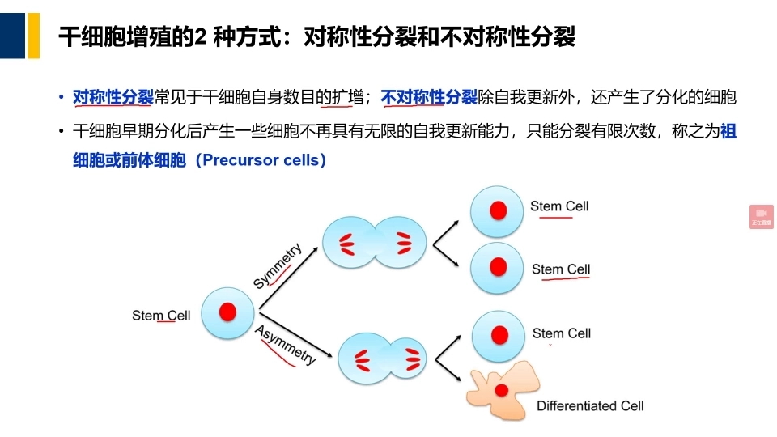

课堂还补了一个概念：干细胞早期分化后产生的一些细胞不再具有无限的自我更新能力，只能分裂有限次数，这类细胞叫**祖细胞**或**前体细胞**（precursor cells）。这解释了为什么「干细胞 → 终末细胞」之间往往不是一步，而是一串逐级收窄的中间态。

### 4.3 按潜能分四档：全能、多潜能、多能、单能

按分化潜能不同，干细胞分四类，其中两个中文名极易混淆：

| 类型 | 英文 | 能做什么 | 课堂例子 |
| --- | --- | --- | --- |
| 全能干细胞 | totipotent | 能分化出一个完整的个体 | 受精卵 |
| 多潜能干细胞 | pluripotent | 几乎能分化出人体所有类型的细胞，但**不能**分化成完整个体 | 胚胎干细胞 |
| 多能干细胞 | multipotent | 能分化出多种类型，但局限于某个系统 | 造血干细胞（红细胞、白细胞、淋巴细胞） |
| 单能干细胞 | unipotent | 只能分化出一种类型 | 皮肤干细胞、肌肉干细胞 |

区分 pluripotent 与 multipotent 的实用判据是：**能不能跨系统**。造血干细胞再怎么能干，也变不出肌肉细胞，所以它是多能而不是多潜能。

[【跳转到 39:12】](https://www.bilibili.com/video/BV1Kh4y1o7Ku/?t=2352)

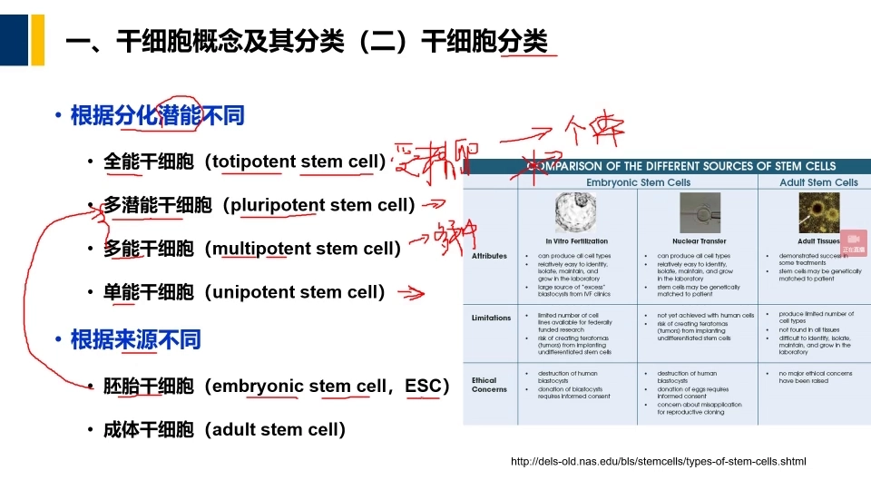

### 4.4 按来源分两类：胚胎干细胞与成体干细胞

教材更常用的分类是按来源：

- **胚胎干细胞**（embryonic stem cell，ESC）：来自胚胎时期，是多潜能干细胞，几乎能分化出人体所有类型细胞。它有两个来源——体外受精获得受精卵后培养到囊胚阶段，取囊胚的**内细胞团**（inner cell mass，ICM）；或通过体细胞核移植获得重组胚，同样培养到囊胚取内细胞团。
- **成体干细胞**（adult stem cell）：出生后机体组织中的干细胞，从相应组织器官中分离，如造血干细胞、皮肤干细胞、肠道干细胞、肌肉干细胞等。

### 4.5 总趋势：潜能随发育变窄，但植物细胞是例外

把四档潜能排到时间轴上，就是一条**逐渐变窄**的曲线：全能（桑葚胚 8 细胞期之前的细胞）→ 三胚层形成后潜能受限，只能向本胚层组织和器官方向分化（多能）→ 器官发生后各种组织细胞的命运最终确定，呈单能化。课堂把这条规律称为细胞分化的一般规律：**由「全能」到「多能」，最后向「单能」**。

[【跳转到 43:52】](https://www.bilibili.com/video/BV1Kh4y1o7Ku/?t=2632)

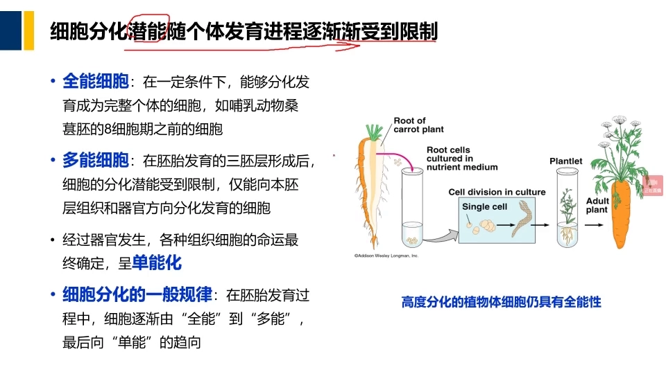

但有两个例外必须记住：

- **植物细胞**：高度分化的植物细胞或组织，在体外能再生出完整植株，这是细胞全能性最好的实验证明（图中胡萝卜的单个细胞培养成完整植株就是经典实验）。
- **动物细胞核**：完整的动物细胞没有这种全能性，但通过克隆证明了**高度分化的动物体细胞的细胞核具有全能性**。所以严谨的说法是「动物细胞核有全能性」，而不是「动物细胞有全能性」——这句话在考试里经常埋坑。

---

## 五、干细胞研究的两个卡点：材料太少、伦理太难

### 5.1 胚胎干细胞的来源与伦理困境

胚胎干细胞的两个来源前面已经提过：体外受精 → 囊胚 → 内细胞团；体细胞核移植 → 重组胚 → 囊胚 → 内细胞团。两条路都指向同一个结构：囊胚里那一团细胞。

问题在于，取内细胞团意味着**破坏一个胚胎**。对动物来说争议相对小，对人的胚胎干细胞来说，这就成了伦理问题——尤其在西方基督教、天主教传统中，破坏一个胚胎等于破坏一个个体。因此「怎样获得足够多的胚胎干细胞作为实验材料」长期是干细胞研究的一大障碍。

### 5.2 成体干细胞的三个短板

那能不能改用成体干细胞？课堂列了三个现实困难：

1. **并非所有组织里都存在干细胞**——成体干细胞广泛存在于造血系统、皮肤、肠、卵巢、睾丸、肌肉，甚至成年脑的某些部位，但并非处处都有；
2. **潜能有限**——成体干细胞多为多能或单能，不像胚胎干细胞那样是多潜能，只能分化一种或几种类型；
3. **数量极少**——要从整体组织里分离出足够多、可用于研究的细胞，通常很困难。

课堂还留了一句诚实的注脚：某些组织中已分化的细胞仍具有很强的再生能力，其中**是否存在成体干细胞仍未定论**（例如肝脏和胰岛）。这句话在 5.4 节会变成一个真实的教训。

### 5.3 1998 年之后为什么突然热起来

人的干细胞研究从 1998 年开始热起来，原因是**人的干细胞在体外培养成功了**，研究者终于能拿到实验材料。细胞培养在上个世纪就做成功了，为什么干细胞培养这么难？难点在于：干细胞有两种分裂方式，体外培养时你必须**只让它做对称分裂、维持干性而不分化**——「怎么保持它的干细胞特性」是核心难题。这个问题在 1998 年之后被较好解决，学科随之快速发展。

### 5.4 一个反面教材：心肌干细胞

课堂用 2018 年的一桩轰动事件做警示：一位美国的心脏专家从 2003 年起提出心肌里存在干细胞（心肌干细胞），并因此获得约 1000 万美元资助；经过十多年研究，2018 年人们发现**真正的心肌干细胞并不存在**，其结论被完全推翻。课堂的提醒是：**「某个组织里有没有干细胞」本身就是一个需要严格验证的科学问题**，不能因为「理论上应该有」就默认成立。

### 5.5 再生医学的设想

随着干细胞学科发展，2001 年 B. Haseltine 提出**再生医学**（regenerative medicine）的概念：把**治疗性克隆**技术与胚胎干细胞的制备结合起来，用体外构建的自体组织或器官让患者康复。

逻辑链条是这样的：取患者体细胞 → 把细胞核移植到去核卵母细胞 → 发育到囊胚 → 取内细胞团获得胚胎干细胞（与患者基因型一致，可避免免疫排斥）→ 体外**定向诱导分化**成所需细胞类型 → 移植回患者。

课堂举的例子是 1 型糖尿病：患者胰岛 β 细胞受损、胰岛素绝对缺乏，如果能定向诱导胚胎干细胞分化出胰岛 β 细胞再移植回去，就有望治疗。更进一步，还可以用组织工程在体外再生出完整的器官或组织用于移植。这就是「干细胞 + 再生医学」描绘的前景，也是这个领域从 1998 年起持续热门的原因。

---

## 六、重编程：把「潜能变窄」这条路倒着走

前面所有内容都在讲一件事：潜能如何随发育逐渐变窄。这一节讲相反的方向——**重编程**（reprogramming），即一个高度分化的体细胞（或体细胞的细胞核）恢复到没有分化状态的过程，也叫细胞分化的逆转。它之所以重要，是因为它直接解决了第五节的两个卡点：**不用胚胎，也能拿到多潜能的干细胞**。

### 6.1 Gurdon 1962：第一个把分化逆转的实验

John Gurdon 在 1962 年做了爪蟾的核移植实验：取蝌蚪小肠上皮细胞（高度分化的体细胞）的细胞核，移植到经紫外线破坏染色体、已经去核的卵母细胞里。结果这个重组细胞发育成了正常的蝌蚪，后续的系列核移植实验还得到了克隆的成体。

[【跳转到 57:43】](https://www.bilibili.com/video/BV1Kh4y1o7Ku/?t=3463)

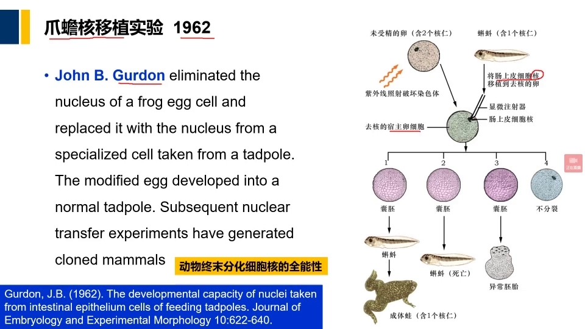

这个实验的结论只有一句，但分量极重：**两栖类动物高度分化的体细胞，其细胞核具有全能性**。它同时也给第一节那个「遗传物质丢失」的旧观点判了死刑——核里什么都在，只是被关掉了。

### 6.2 多莉：哺乳动物也能克隆，但为什么没拿诺奖

1996 年，Wilmut 团队把一只白面羊（Finn Dorset）**乳腺上皮细胞**的细胞核，移植到去核的黑面羊卵母细胞中，体外刺激发育成早期胚胎，再移植到代孕的黑面羊子宫里，最终产下一只白绵羊——多莉（Dolly）。

[【跳转到 59:49】](https://www.bilibili.com/video/BV1Kh4y1o7Ku/?t=3589)

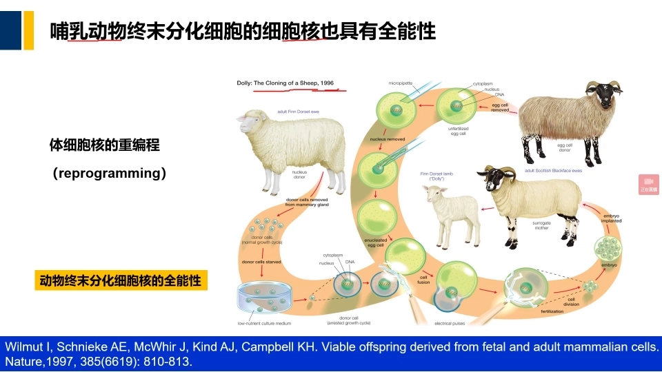

时间线值得记清：多莉 1996 年 7 月 5 日出生，论文 1997 年 2 月 23 日发表在 Nature 上，所以是 1997 年才引起轰动；2003 年 2 月 14 日死亡。课堂还留了一个常被问到的问题：**克隆羊引起那么大轰动，为什么没有得诺贝尔奖？** 课堂给的答案很直接——技术不是原创，1962 年 Gurdon 就已经做成功了体细胞核移植，Wilmut 只是把它在哺乳动物上做成了。

### 6.3 多莉身上的两个争议：细胞来源与早衰

**争议一：那个核到底是谁的？** 供核的白面羊在取乳腺上皮细胞时是一只怀孕的母羊，而 19 世纪末就有人发现，怀孕母体体内会有少量胎儿细胞经胎盘进入母体（今天我们知道这叫作微嵌合，产前诊断正是利用母血中的胎儿细胞做检测）。于是有人怀疑：用于克隆的「乳腺上皮细胞」会不会其实是胎儿的细胞？Wilmut 团队后来通过实验证明，用的是母体自身的体细胞。

**争议二：克隆动物会不会早衰？** 多莉只活了六岁多（正常绵羊寿命约十一二岁），且是死于安乐死——因为它出现了早衰症状和老年绵羊才有的病症。当时一个流行解释是**端粒**：端粒是细胞分裂的计时器，正常体细胞没有端粒酶活性，端粒随分裂次数增加而变短；供核母羊当时可能已经六七岁，克隆个体相当于「继承」了偏短的端粒。但这个解释后来被反证：多莉的四个克隆姐妹（Daisy、Diana、Debbie、Denise，来自同一细胞系）衰老进程正常，关节、心脏、代谢等指标均正常；在小鼠上连续克隆多代，后代寿命也没有缩短。所以多莉早衰的确切原因，至今没有明确说法。

多莉之后，哺乳动物克隆迅速铺开（牛等），2018 年中国科学家还做出了体细胞克隆猴「中中」和「华华」。课堂顺势点了一句：既然灵长类都能克隆，**克隆人从技术上说是可行的**，但因为伦理问题不能做。

### 6.4 山中伸弥的四因子：重编程从「换核」变成「加几个基因」

2006 年，日本京都大学的**山中伸弥**（Shinya Yamanaka）做了另一件事：他从 24 个对维持胚胎干细胞状态十分重要的候选基因出发，在小鼠成纤维细胞中逐个筛选，最终发现**同时转入 4 个基因——Oct4、Sox2、c-Myc、Klf4**——就能把分化的体细胞变成多潜能干细胞，命名为**诱导性多潜能干细胞**（induced pluripotent stem cell，iPS 细胞）。

[【跳转到 1:09:47】](https://www.bilibili.com/video/BV1Kh4y1o7Ku/?t=4187)

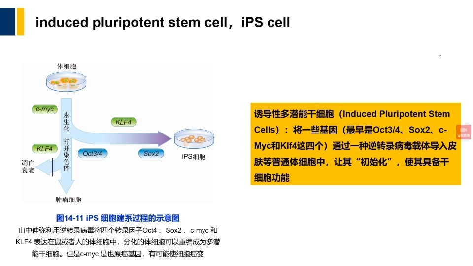

这个工作 2006 年发表在 Cell 上，2012 年就拿了诺贝尔生理学或医学奖（与 Gurdon 共享）。课堂专门解释了「为什么这么快」：诺贝尔奖通常要等几十年，而山中伸弥解决的是**干细胞的来源问题**——胚胎干细胞受伦理限制，成体干细胞数量少、潜能窄，而 iPS 只需要一个体细胞加四个基因，来源问题一下子被打通了。

不过课堂也没回避隐患：四个基因里 **c-Myc 是原癌基因**，有可能使细胞癌变；而且导入用的是**逆转录病毒载体**，在应用上仍受限制。这两点正是后续十几年改进的方向。

### 6.5 一次著名的翻车：STAP 与小保方晴子

2014 年，日本理化研究所的小保方晴子（Haruko Obokata）在 Nature 连续发表两篇论文，提出 **STAP**（stimulus-triggered acquisition of pluripotency）：体细胞在体外经过简单刺激（例如改变培养基 pH）就能被逆转成多潜能干细胞。如果成立，它比山中伸弥的方法更进一步——不用转基因、不用病毒载体。但后续研究证明论文造假，论文被撤，她的导师也因此自杀。这是干细胞领域最沉痛的一次教训，也解释了为什么这一章反复强调「证据」与「可重复」。

### 6.6 化学小分子重编程：不用转基因也能逆转

山中伸弥的技术公开后，很多实验室在重复并改进它，方向之一是**用化学小分子替代转基因**。课堂举的代表是北京大学邓宏魁课题组：先用小分子组合把人/鼠的体细胞诱导成多潜能干细胞，即**化学诱导多潜能干细胞**（chemically induced pluripotent stem cell，CiPS）；更进一步提出**原位重编程**——不把细胞拿出来培养，而是直接在组织损伤部位，把该部位其他种类的细胞重编程成需要的功能细胞。

[【跳转到 1:14:45】](https://www.bilibili.com/video/BV1Kh4y1o7Ku/?t=4485)

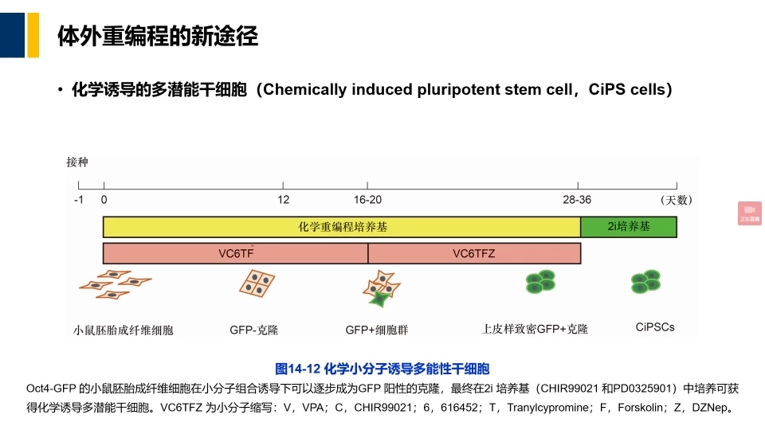

从「换核」到「加四个基因」再到「加几个小分子」，重编程的操作门槛一路下降，而它要达成的目标始终是同一个：**把已经关掉的基因程序重新打开**。

---

## 七、从干细胞到临床：一个成功案例与一条争议边界

### 7.1 最成功的干细胞治疗：造血干细胞移植

课堂明确说：干细胞治疗相关疾病，最早、也是目前为止**最成功**的例子是**造血干细胞移植**治疗白血病，相关工作获得了 1990 年诺贝尔生理学或医学奖（Donnall Thomas）。它的逻辑很朴素：输入健康的造血干细胞，让供体的干细胞在患者体内重建血液系统。

### 7.2 柏林病人与伦敦病人：CCR5 缺失带来的「副作用」

近年关于干细胞移植治疗艾滋病的报道，把这个逻辑推到了一个新场景。先看 HIV 怎么进门：HIV 感染 CD4 阳性的 T 淋巴细胞，需要 **CD4 作为受体**，还需要一个**辅助受体（co-receptor）CCR5**；只有病毒表面蛋白同时结合受体与辅助受体，才能完成膜融合、把病毒送进细胞。CCR5 是一个**七次跨膜**的蛋白，氨基端在胞外、羧基端在胞内——看到这个结构就该想到，它是 **G 蛋白偶联受体**，属于趋化因子受体家族。

[【跳转到 1:18:44】](https://www.bilibili.com/video/BV1Kh4y1o7Ku/?t=4724)

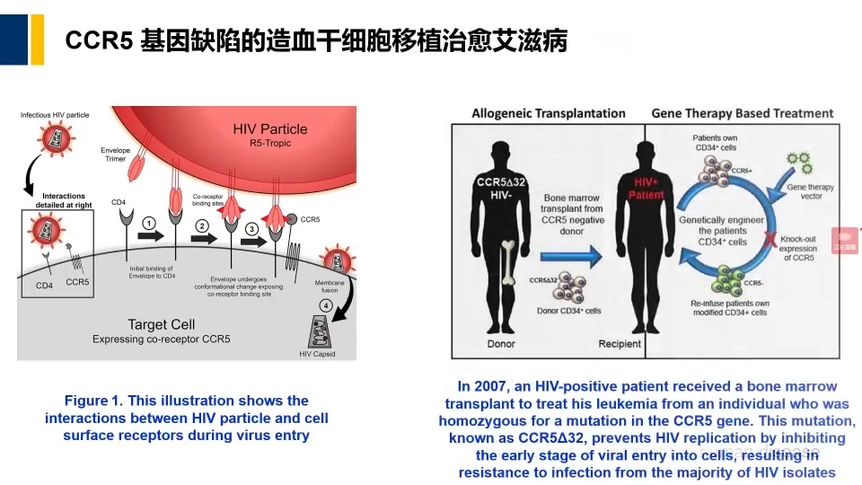

2007 年的「柏林病人」（Timothy Brown）同时患白血病与 HIV 感染，接受造血干细胞移植后，白血病治好了，艾滋病也「治愈」了。原因后来查明：供者的 CCR5 基因是 **CCR5Δ32** 突变（32 个碱基缺失导致读码框错位，CCR5 蛋白无法正常穿膜表达），病毒进不了门。2020 年报道的「伦敦病人」是第二例：同样接受了 CCR5Δ32/Δ32 供者的造血干细胞移植，在停止抗病毒治疗后仍长期未检出病毒。

这个「副作用」直接启发了新思路：**如果把 CCR5 敲掉，是不是就能让细胞抵抗 HIV？**

### 7.3 同一种技术，两条伦理边界

于是有了两件必须放在一起对比的事：

- **2018 年**，贺建奎的「基因编辑婴儿」事件：在**受精卵**水平上编辑 CCR5，引起巨大轰动与谴责；
- **2019 年**，邓宏魁课题组与多家医院合作，在《新英格兰医学杂志》发表工作：用 CRISPR 在**成体造血干细胞**上编辑 CCR5，移植给一位同时患艾滋病与急性淋巴细胞白血病的患者，实现了基因编辑后造血干细胞在人体内长期稳定的重建，且对其它组织器官及生殖系统没有影响。

课堂把两者的差别点得很清楚：**技术相似，操作对象不同**——一个改的是受精卵（改动会进入生殖系、传给后代），一个改的是成体体细胞（改动不进生殖系）。这正是伦理争议的分界线所在。

课堂最后给了本章的收束，也给了几个名词解释题：cell differentiation、管家基因与组织特异性基因、细胞决定（cell determination）、干细胞（stem cell）；以及一个思考题——为什么柏林病人和伦敦病人在治疗白血病的过程中，HIV 感染也被治好了？答案就藏在 CCR5 这个辅助受体上。课堂还提到国内两个值得关注的干细胞研究团队：中科院动物所的周琪院士、广州生物医药与健康研究院的裴端卿。

---

## 小结

- **分化的本质不是丢基因，而是关基因**：全套基因组都在，差异来自特异性基因在特定时间、特定空间的选择性表达，调控主要发生在转录水平。Southern 与 Northern 杂交的对照表是最直接的证据。
- **旧观点错在把特例当通例**：魏斯曼的种质学说依据的是马蛔虫这个染色体丢失的特例；克隆与植物组织培养证明遗传物质并未丢失。
- **分化贯穿一生，且不止于多细胞生物**：单细胞生物在特定条件下也会分化；成体靠造血干细胞持续补充寿命只有几天到一百多天的血细胞。
- **四个概念要分清**：去分化是往回退一步，转分化是横着跨一步，重编程是一路退回起点，再生是组织层面的结果。
- **命运由内部与外部共同决定**：内部是卵裂时细胞质（含母源 mRNA 与决定子）的不均等分配，外部是邻近细胞的胚胎诱导；而**决定早于分化**，方向在形态可见之前就被锁定，靠的是正反馈与染色质修饰形成的细胞记忆。
- **干细胞 = 自我更新 + 多向分化潜能**：对称分裂扩增数量，不对称分裂产生分化细胞；按潜能分全能、多潜能、多能、单能四档，按来源分胚胎干细胞与成体干细胞两类；潜能随发育总体变窄，但植物细胞与动物细胞核是例外。
- **干细胞研究的瓶颈是材料**：胚胎干细胞受伦理限制，成体干细胞数量少、潜能窄、并非处处都有；1998 年人胚胎干细胞体外培养成功与「维持干性」问题的解决，是这个领域起飞的转折点。
- **重编程把这条路倒着走**：Gurdon 的爪蟾核移植（1962）证明细胞核全能性，多莉（1996/1997）证明哺乳动物可行，山中伸弥的四因子（2006）把重编程简化成四个基因并因此快速获得 2012 年诺奖，化学小分子（CiPS、原位重编程）进一步去掉了转基因。STAP 造假事件则提醒：越是「更简单、更漂亮」的结论，越需要可重复的证据。
- **临床转化已有真实案例**：造血干细胞移植治疗白血病是最成功的例子；CCR5Δ32 供者移植治愈柏林病人与伦敦病人，既启发了「敲除 CCR5 抗 HIV」的思路，也划出了「改体细胞」与「改受精卵」这条伦理分界线。

## 关键术语速查

| 术语 | 一句话解释 |
| --- | --- |
| 细胞分化（cell differentiation） | 同一来源的细胞后代在形态、结构和功能上产生稳定差异，形成不同细胞类群的过程 |
| 管家基因（housekeeping gene） | 几乎所有细胞都表达、维持基本生命活动所必需的基因，常作实验内参 |
| 组织特异性基因（tissue-specific gene） | 只在特定类型细胞中表达、赋予该细胞特异形态与功能的基因，旧称奢侈基因 |
| 决定（determination） | 在分化特征尚未显现之前，细胞及其子代的分化命运就已被确定，决定早于分化 |
| 决定子（determinant） | 卵母细胞中储存并随卵裂不均等分配、能决定子细胞分化方向的物质（如母源 mRNA 翻译出的蛋白） |
| 胚胎诱导（embryonic induction） | 一部分细胞通过分泌信号分子影响周围细胞，使其向特定方向分化 |
| 去分化（dedifferentiation） | 分化细胞失去特有结构与功能，回到未分化状态 |
| 转分化（transdifferentiation） | 一种已分化的细胞直接转变成另一种类型的分化细胞 |
| 重编程（reprogramming） | 通过 DNA 与组蛋白修饰的改变，使高度分化的体细胞（核）恢复到未分化状态 |
| 干细胞（stem cell） | 同时具备自我更新与多向分化潜能的细胞 |
| 全能 / 多潜能 / 多能 / 单能 | 能形成完整个体 / 几乎能形成所有细胞类型但不能成个体 / 只能形成同一系统的多种细胞 / 只能形成一种细胞 |
| 内细胞团（inner cell mass, ICM） | 囊胚内部的一团细胞，是胚胎干细胞的主要来源 |
| 诱导性多潜能干细胞（iPS cell） | 转入 Oct4、Sox2、c-Myc、Klf4 四个因子后，由体细胞重编程得到的多潜能干细胞 |
| 化学诱导多潜能干细胞（CiPS） | 仅用小分子化合物组合即可把体细胞重编程为多潜能干细胞 |
| 治疗性克隆 | 用患者体细胞的核移植获得基因型一致的胚胎干细胞，再定向分化用于治疗 |
| 再生医学（regenerative medicine） | 把治疗性克隆与胚胎干细胞制备结合，用自体组织或器官使患者康复 |
| CCR5Δ32 | CCR5 基因 32 个碱基缺失的突变，使 HIV 无法利用 CCR5 作为辅助受体进入细胞 |
