# 同一个细胞类型内部也不一样：异质性来自表达噪音、细胞周期与亚群结构

> 视频来源：[Understanding Cellular Heterogeneity - Sarah Teichmann - Keynotes - ISMB 2016](https://www.youtube.com/watch?v=4V-h8EOWITg)（YouTube · ISCB 年会主题报告，讲者 Sarah Teichmann，Wellcome Trust Sanger Institute）｜时长约 54 分钟
> 导读：这是一场把"细胞异质性"从现象讲到测量、再讲到生物学解释的大会主题报告。前半段回答"我们测到的细胞间差异里，有多少是技术噪音、多少是真生物学"；后半段用小鼠胚胎干细胞与小鼠 T 细胞两个案例，说明异质性具体长什么样（亚群、连续谱、细胞周期混入、外部信号塑形）。字幕为 YouTube 自动字幕，人名与术语（Teichmann、GATA3、TBX21、spike-in、pluripotency 等）已按上下文订正。

## 本讲要解决的核心问题（SCQA）

**背景**：你已经知道细胞有类型之分——T 细胞、B 细胞、肝细胞、神经元，各有各的标志基因。做实验时，我们也习惯把一管细胞当成"一种细胞"来处理，测一个 bulk 表达值代表它。

**冲突**：但把镜头拉到单个细胞，同一管细胞里每个细胞的荧光亮度都不一样，同一个"管家"转录因子的 mRNA 数量能差几十倍甚至几百倍。更麻烦的是，单细胞测序本身有很低的捕获效率，测出来的差异里混着大量技术噪音——你没法一眼分清哪些差异是真的、哪些是仪器造成的。

**疑问**：同一群细胞内部的差异到底从哪来？哪些差异值得当成生物学信号去研究？如果差异是连续的、没有清晰边界，那"细胞类型"这个概念还站得住吗？细胞自身之外的因素——比如周围其他细胞发出的信号——又在多大程度上决定了单个细胞的状态？

**回答（中心思想）**：细胞异质性不是"测量不够准"的副产品，而是细胞状态的真实属性，它至少有四个来源：**基因表达的随机噪音**、**细胞周期所处时相**、**群体内真实存在的亚群与连续状态谱**、以及**细胞外部环境（其他细胞发出的信号）**。要研究它，第一步必须用 spike-in 之类的内参把技术噪音标定出来，只留下超出技术噪音的那部分变异；第二步要用潜变量模型把细胞周期这类"与主题无关的变异"剥离掉；剩下的差异，才是可以拿去解释细胞命运与组织功能的生物学信号。

## 一、把镜头拉到单细胞：同一群细胞，每个都不一样

### 1.1 起点是一张荧光图

报告开场放的不是测序结果，而是一组荧光显微镜照片：同一批细胞、同样的染色，但每个细胞的荧光强度（反映蛋白丰度）差别很大。[【跳转到 04:55】](https://www.youtube.com/watch?v=4V-h8EOWITg&t=295)

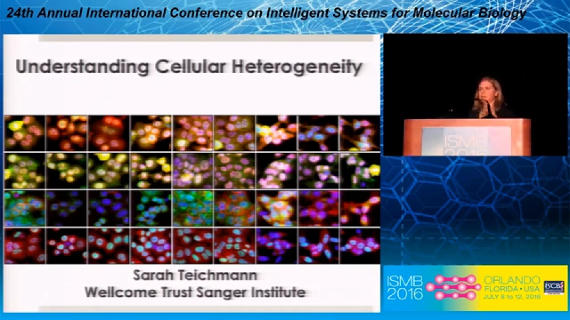

这些细胞并不是"混进了别的类型"，它们来自同一个细胞系、同一个培养条件。所以问题变成：**这种差异是有意义的，还是只是噪音？** 这个问题贯穿了整个报告。

### 1.2 一个数字：500 个 Th2 细胞里的 GATA3

讲者回到自己做 bulk RNA 测序的年代。当时她研究的是 Th2 细胞，关注两个关键转录因子：GATA3（Th2 谱系的主调控因子）和 TBX21（也叫 T-bet，是另一个谱系 Th1 的主调控因子，一般认为被 GATA3 抑制）。

bulk 测序给的是一个平均值。而与 Alexander van Oudenaarden 合作、用单分子 RNA FISH 去看同一批约 500 个细胞时，画面完全不同：每个细胞的 GATA3 mRNA 数量从 1 条到接近 350 条，呈一个很宽的分布。[【跳转到 06:09】](https://www.youtube.com/watch?v=4V-h8EOWITg&t=369)

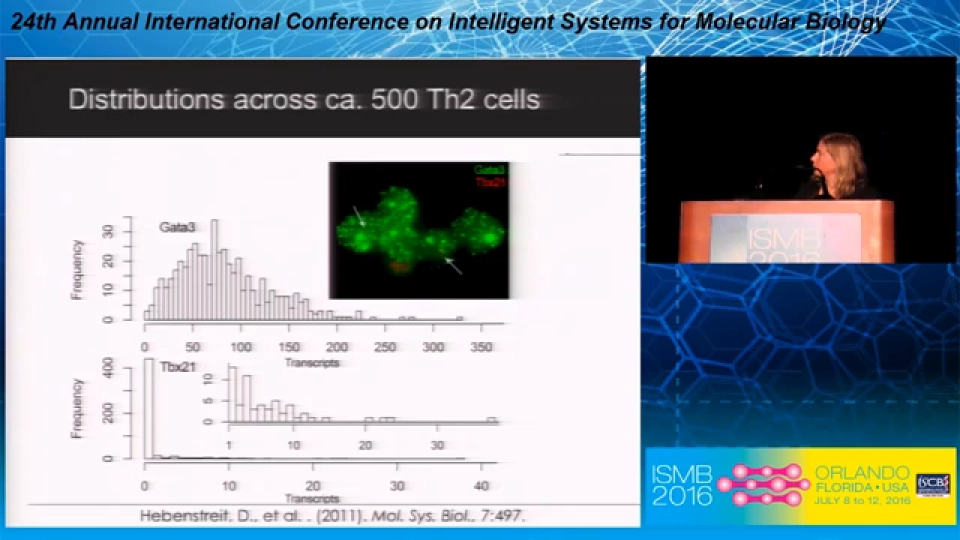

讲者的预期是：既然是主调控因子，就该被严格调控，每个细胞里应该差不多。事实并非如此。而且这个宽度不能只用细胞增殖来解释——细胞在生长分裂，拷贝数最多也就翻倍（约 2 倍变化），可实际分布宽得多。

TBX21 的分布更有意思：约 400 个细胞里一条转录本都没有，但仍有约 100 个细胞（约 20%）有 1 到 40 条——而且这已经扣除了显微成像的技术噪音。也就是说，**一个本该被沉默的、属于另一条谱系的主调控因子，在这些细胞里是随机"冒"出来的**。[【跳转到 06:59】](https://www.youtube.com/watch?v=4V-h8EOWITg&t=419)

### 1.3 为什么 bulk 看不见：平均值把分布压成了一个点

讲者用一句话概括了方法学上的分水岭：如果一群细胞是异质的，bulk RNA 测序得到的是各亚群表达的加权平均，**关于群体多样性的信息在取平均的那一刻就丢掉了**。[【跳转到 07:49】](https://www.youtube.com/watch?v=4V-h8EOWITg&t=469)

她给了一个类比：把纽约时代广场跨年夜的人群排成一队，按年龄排序，你就得到一幅"人类生命周期"的平均画像；再按族裔分组，就得到各组特征的平均画像。单细胞分析做的事本质上就是这种"排序 + 分组"，只不过对象是细胞、坐标是表达谱。区别在于：单细胞是**无偏**的——每个细胞测的是完整转录组，不需要事先指定抗体或 marker 面板。

## 二、先分清技术噪音与生物学噪音

### 2.1 用 spike-in 画一条"噪音基线"

讲者坦言，刚开始做单细胞时最让她焦虑的问题是：**测到的细胞间差异，是芯片腔室之间的技术差异，还是真实的生物学差异？** 这个判断直接决定后面所有结论。

解决办法是外源 RNA 内参（ERCC spike-in）：往每个细胞的反应里掺入一组已知浓度、已知序列的合成 RNA，然后看测出来的表达量与实际浓度的偏差有多大。

她与统计学家 John Marioni（当时在 EBI，办公室邻居）、Simon Anders 等人一起，建立了一个标准框架：横轴是基因表达量（对数标度），纵轴是细胞间变异（变异系数的平方，即标准差除以均值再平方）。spike-in 的点（图中红点）拟合出一条二次曲线，这条曲线就是"纯技术噪音"的期望水平——**表达量越低，噪音越大**。[【跳转到 13:38】](https://www.youtube.com/watch?v=4V-h8EOWITg&t=818)

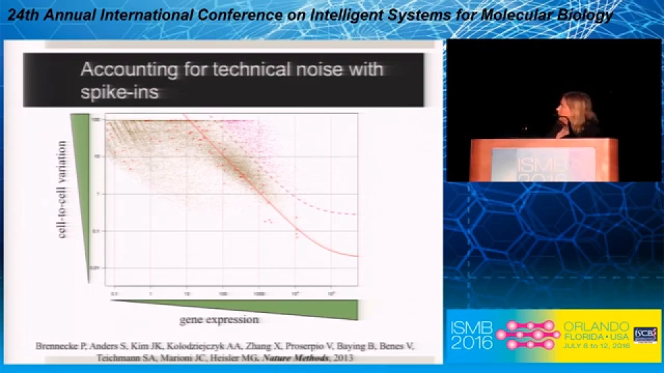

这条曲线不好的一面是：噪音主要由表达丰度决定，低表达基因天然更"吵"。好的一面是：有了这条置信区间，就能把**变异显著超出技术噪音**的基因挑出来。在那批小鼠 T 细胞数据里，这样的基因约 900 个，而且它们富集在细胞增殖相关功能上——这直接指向了细胞周期。[【跳转到 14:28】](https://www.youtube.com/watch?v=4V-h8EOWITg&t=868)

### 2.2 顺便量一下：各种单细胞方案到底有多灵敏

讲者说自己"体内有个量化的灵魂"，所以顺手做了一件对整个领域都有用的事：把公开数据里带 spike-in 的数据集汇总起来，比较不同建库方案的灵敏度与精度。

做法是用逻辑回归估计**检测下限**——一个细胞里至少要有多少个 mRNA 分子，才能被测序在末端检测到。结论是各方案差距很大：CEL-Seq 的检测下限约 100 个分子，MARS-seq 在树突状细胞的数据里约 100 到 1000，Smart-seq 是当时唯一的全长转录本方案（这一点在后面 T 细胞受体序列重建时会用到）。精度方面，用 92 个 spike-in 的已知相对丰度算相关系数，多数方案在 0.7 以上，好的能到 0.9 以上；低丰度分子的定量精度明显更差。[【跳转到 16:13】](https://www.youtube.com/watch?v=4V-h8EOWITg&t=973)

还有一个很实用的结论：做下采样实验会发现，把每个细胞的 reads 从很低加到约 100 万条时，检测下限明显改善；**超过 100 万条 reads 之后基本饱和，再测就是浪费钱**。[【跳转到 18:43】](https://www.youtube.com/watch?v=4V-h8EOWITg&t=1123)

## 三、案例一：小鼠胚胎干细胞里的亚群与连续谱

### 3.1 三种培养条件，三种"看起来的均一度"

第一个生物学案例是小鼠胚胎干细胞（mESC）。当时研究所里到处都在养 mESC，大家关心的是"怎么养最好"。传统培养是用含血清加 LIF 的培养基；后来 Austin Smith 提出加两个小分子抑制剂（2i，抑制 GSK3 和 MEK），细胞在显微镜下看起来更均一、Nanog 表达更稳定；再后来又出现了另一种 2i 组合。[【跳转到 21:13】](https://www.youtube.com/watch?v=4V-h8EOWITg&t=1273)

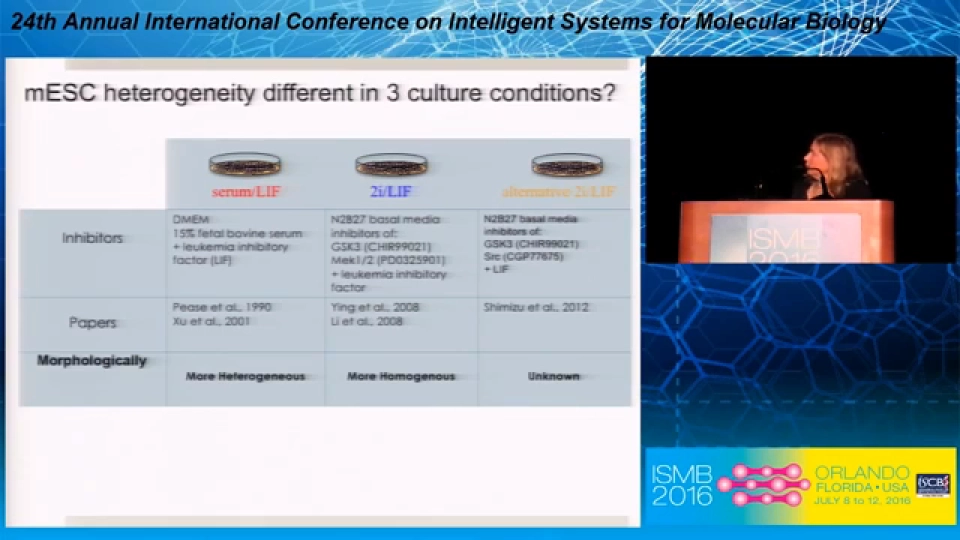

于是问题被提得很具体：**既然形态上血清组更异质、2i 组更均一，那转录组层面的细胞间噪音是不是也这样？**

### 3.2 先把细胞放到体内的坐标里看

把三种条件下的单细胞投影到主成分空间，再把体内早期胚胎发育各阶段的细胞（受精卵、2 细胞、4 细胞……直到囊胚）投影到同一空间做参照，可以看到：2i 培养的细胞更靠近囊胚/多能性状态，血清组的细胞则散开成几团。[【跳转到 22:42】](https://www.youtube.com/watch?v=4V-h8EOWITg&t=1362)

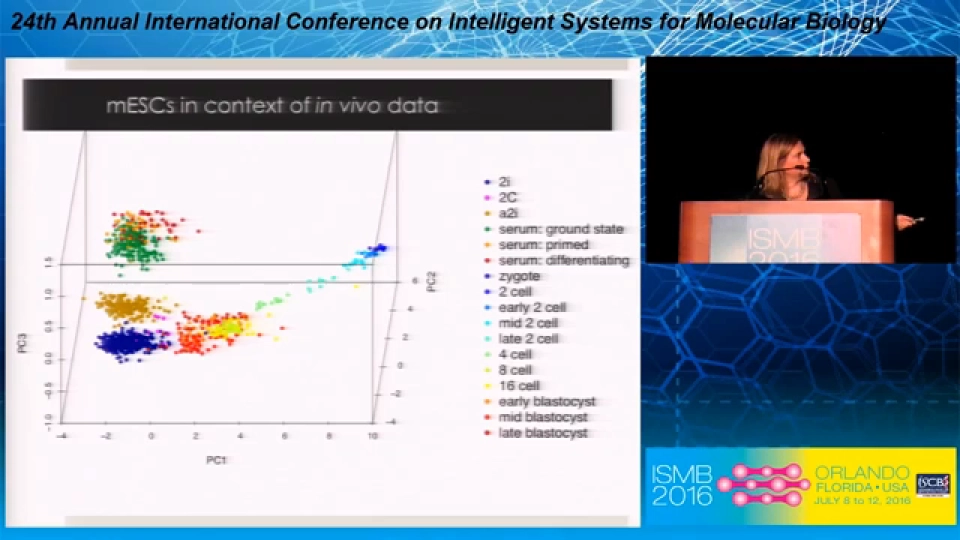

这里有个值得记住的教训：文献里 1966 年就描述过一类"2C 细胞"（表达内源逆转录病毒、约占群体百分之几），它们本该出现在这个分析里，却**一开始没通过质控**——因为它们有大量 reads 落在内源逆转录病毒序列上、没比对到小鼠基因组，被当成了坏细胞。意识到这一点后把它们"救"回来，才发现它们靠近的是囊胚阶段而不是 2 细胞阶段。[【跳转到 24:22】](https://www.youtube.com/watch?v=4V-h8EOWITg&t=1462)

> 这一点对做单细胞分析的人很实际：质控过滤掉的"异常细胞"里，可能恰好藏着最有生物学意义的稀有亚群。

### 3.3 反直觉的结果：总体噪音一样，但来源不同

用前面那套"距离中位数的变异系数平方"（DM）指标去量化不同条件下的基因噪音，结果出乎意料：**血清组和 2i 组的总体噪音水平几乎一样**。可形态学上明明 2i 更均一、Nanog 也更稳定。[【跳转到 26:14】](https://www.youtube.com/watch?v=4V-h8EOWITg&t=1574)

把基因按功能类别拆开看，答案浮出来了：在 2i 条件（本该最均一的那组）里，最"吵"的一类基因是**有丝分裂/细胞周期**基因。[【跳转到 27:29】](https://www.youtube.com/watch?v=4V-h8EOWITg&t=1649)

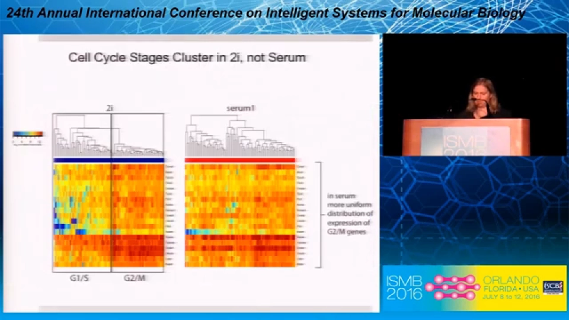

再往下追一层：两种条件下细胞都在增殖，但这一批 2i 细胞的周期速度只有血清组的一半。血清组细胞周期跑得快，各个细胞周期阶段的基因模块"来不及"在某个阶段稳定升高就被推进下一阶段，于是表达看起来反而均匀；2i 组周期慢，细胞有足够时间停在各阶段、把该阶段的基因表达拉高，于是细胞之间就按周期时相分开了。[【跳转到 28:46】](https://www.youtube.com/watch?v=4V-h8EOWITg&t=1726)

讲者由此给出一个可复用的推论：**你可以从单细胞数据的细胞周期基因噪音里，反过来估计细胞群体的相对增殖速度**。增殖快 → 周期基因表达被"抹平"；增殖慢或不增殖 → 周期基因表达要么不出现、要么按阶段分明。

### 3.4 把细胞周期当成一个潜变量减掉

既然细胞周期是一个混在所有数据里的强变异源，就需要一个能在分析中"扣掉它"的工具。讲者提到 Florian Buettner 等人做的潜变量模型：先用一组已知的细胞周期基因训练出这个变量，再把它从数据中回归掉，剩下的部分就能更清楚地显示其他生物学过程。[【跳转到 30:54】](https://www.youtube.com/watch?v=4V-h8EOWITg&t=1854)

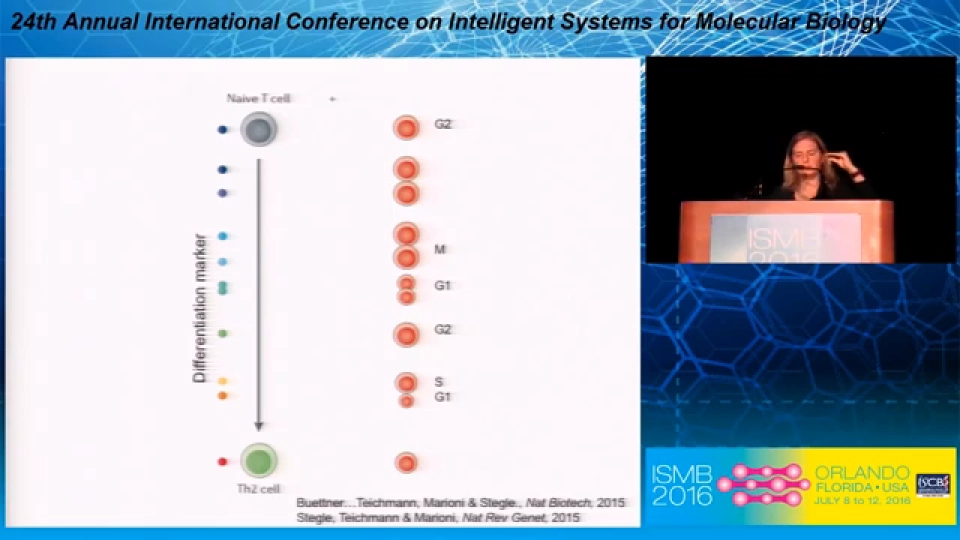

效果是：去掉细胞周期后，即便数据本身比较吵，分化 marker 也变得清楚多了。讲者说这件事让她意识到潜变量建模有多强大，后面 T 细胞的分析里也一直在用。

### 3.5 血清培养里的三个亚群

扣掉细胞周期之后，血清/LIF 培养的 mESC 群体清楚地分成三组：真正处于多能性基态（ground state）的细胞；一群分化 marker 已经部分表达的中间态细胞；以及一群已经完全逃逸出多能性、不再 cycling 的细胞。[【跳转到 32:44】](https://www.youtube.com/watch?v=4V-h8EOWITg&t=1964)

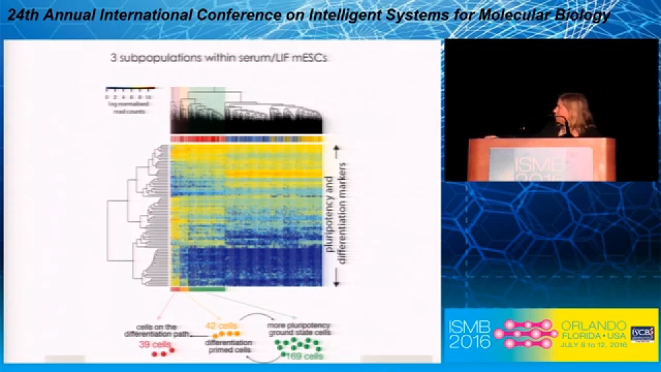

为了验证这不是聚类算法的假象，他们又做了一批 400 个细胞的"从多能态向神经前体细胞分化"的时间序列，发现血清静置培养里的细胞，正好落在这条分化轨迹上——也就是说，**那"第三个亚群"确实是正在自发分化的细胞**，而不是培养污染的杂细胞。后续还用 CRISPR 沉默做了功能验证。

这一段是本报告对"异质性"最直白的回答：一个培养皿里的"一种细胞"，实际上是一个**由基态细胞、正在分化的细胞和已分化细胞组成的连续谱**，聚类只是在这个连续谱上切了几刀。

## 四、案例二：T 细胞——连续状态、并行轨迹与外部信号

### 4.1 两个潜变量：增殖与活化

第二个案例换成免疫学：CD4 T 细胞在感染后被激活，从 naive 前体分化出 Th1、Tfh 等亚型。这里用的是小鼠疟疾感染模型，供体小鼠带转基因 TCR，可以确定哪些细胞是在响应疟原虫。

用高斯过程潜变量模型（GP-LVM）把约 450 个细胞、15000 个基因压到两个潜变量上，两个轴大致对应"增殖"和"T 细胞活化"，颜色标的是感染后的天数。[【跳转到 42:26】](https://www.youtube.com/watch?v=4V-h8EOWITg&t=2546)

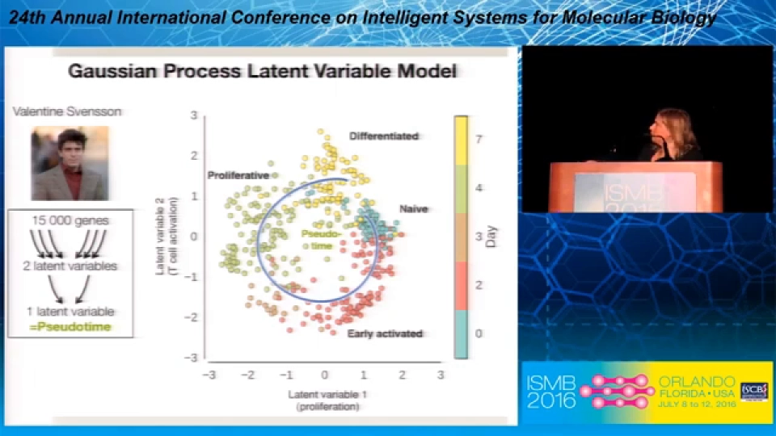

在这个空间里，同一个时间点的细胞并不重叠在一起，而是沿轨迹错开——**同一天取样的细胞，活化速度并不一致**。所以用单一伪时间（pseudotime）去描述会丢掉信息。

### 4.2 两条并行的轨迹，而不是一条分叉的树

讲者团队用重叠高斯过程混合（OMGP）来自动判断到底有几条轨迹。结果不是一条、也不是三条，而是**两条**：一条走向 Th1，一条走向 Tfh。[【跳转到 43:46】](https://www.youtube.com/watch?v=4V-h8EOWITg&t=2626)

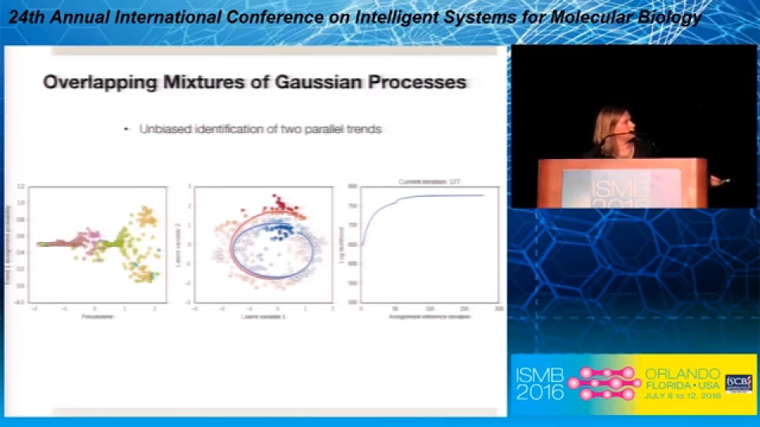

顺带一个与异质性直接相关的观察：从静息前体到中间的增殖爆发期，再到终末分化后减速，**每个细胞表达的基因数**先升后降，与增殖 marker KI67 的表达一致，也能用流式验证。这说明"细胞状态"不只是某几个基因的高低，还包括整体转录活性的水平。

### 4.3 外部信号：微环境如何塑造单个细胞的状态

报告最后落到本节最关心的一层：细胞自身的状态，有多少是由**周围其他细胞**决定的。

他们注意到第 3 天出现了一群单核细胞，其中一个亚群高表达趋化因子 CXCL9，而活化的 T 细胞上正好有对应受体 CXCR3。用白喉毒素做单核细胞清除实验验证后，结论是：**炎性单核细胞促进 Th1 而不促进 Tfh**——也就是说，组织里"邻居"发出的信号，偏置了 T 细胞的状态走向。[【跳转到 50:57】](https://www.youtube.com/watch?v=4V-h8EOWITg&t=3057)

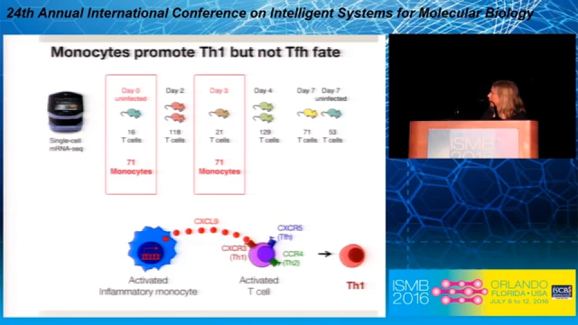

讲者的总结是：细胞命运的决定，是**细胞内在因子（可从单细胞数据统计推断的调控因子）与细胞外在信号（来自微环境中其他细胞）的组合**。

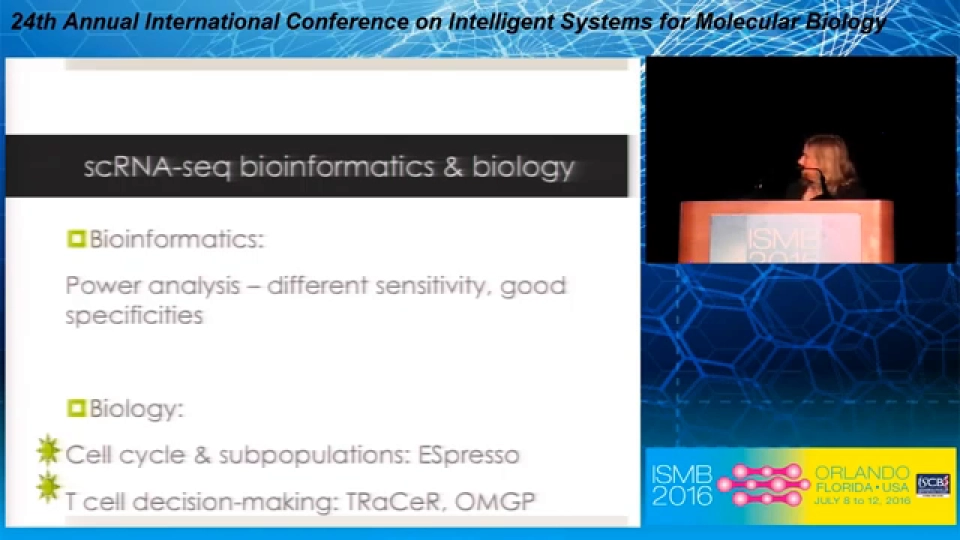

## 小结

- **异质性是真实属性，不是测量误差**。500 个 Th2 细胞里 GATA3 的转录本数从 1 到 350，连被沉默的 TBX21 也有约 20% 的细胞随机表达。
- **bulk 测序在取平均时丢掉了分布信息**；单细胞的价值在于保留每个细胞的位置，且不需要预设 marker 面板。
- **先标定技术噪音，再谈生物学**。用 ERCC spike-in 拟合"表达量—细胞间变异"曲线，只有超出这条曲线的基因才值得解释；那批数据里约 900 个基因显著超噪，功能指向细胞增殖。
- **细胞周期是最容易被误读的异质性来源**。2i 培养"看起来更均一"，但总体噪音并不比血清组低，因为慢周期让细胞按周期时相分开；反过来，细胞周期基因的噪音水平还能用来估计群体增殖速度。
- **亚群常常是连续谱上切出来的段**。血清培养的 mESC 里同时存在多能性基态、正在分化、已逃逸多能性三类细胞，第二套分化时间序列数据验证了这一点。
- **质控会误杀稀有亚群**。2C 细胞一开始因为 reads 落在内源逆转录病毒上被当成坏细胞过滤掉。
- **状态由内在因子与外在信号共同决定**。炎性单核细胞通过 CXCL9–CXCR3 偏向性地推动 Th1 状态，这是微环境塑造细胞异质性的直接证据。

## 关键术语速查

| 术语 | 一句话解释 |
| --- | --- |
| 细胞异质性（cellular heterogeneity） | 同一群、同一类型的细胞之间在表达与状态上的差异 |
| 单分子 RNA FISH | 直接在显微镜下数单个细胞内某个 mRNA 的拷贝数，不需要测序 |
| ERCC spike-in | 掺入已知浓度与序列的合成 RNA，用来标定技术噪音与检测下限 |
| 变异系数的平方（CV²） | 标准差除以均值再平方，衡量细胞间相对变异大小 |
| 距离中位数的变异系数（DM） | 把每个基因的 CV² 与同表达量基因的中位数比较，判断它是否"异常地吵" |
| 潜变量模型（latent variable model） | 把数据中某个已知干扰因素（如细胞周期）表示成一个隐变量并回归掉 |
| 伪时间（pseudotime） | 把细胞按状态变化排成一条序列得到的时间轴，不等于真实取样时间 |
| GP-LVM / OMGP | 高斯过程潜变量模型 / 重叠高斯过程混合，前者做降维与伪时间，后者自动判断有几条并行轨迹 |
| 基态多能性（ground state） | 用 2i 等抑制剂维持的、更接近体内着床前状态的多能性 |
| 2C 细胞 | 表达内源逆转录病毒、类似早期胚胎程序的一小群 mESC，常被质控误滤 |
| 微环境信号（extrinsic signal） | 由其他细胞分泌的配体等外部因子，影响目标细胞的状态与命运 |