# 细胞通讯与微环境：细胞之间怎么"对话"，我们又怎么从表达数据里把它推断出来

> 视频来源：[Cell-cell communication models - January 2025 (9 of 9)](https://www.youtube.com/watch?v=8O8auXCsy70)（YouTube · SIB Swiss Institute of Bioinformatics 培训课程第 9 讲，讲者来自 NicheNet 团队）｜时长约 70 分钟
> 导读：这是一门空间组学课程收尾的一讲，主题是"细胞间通讯建模"。它先讲清细胞通讯在生物学上有哪几种方式、一次完整的信号传递要经过哪些环节，再逐个拆解从转录组数据推断通讯的三类主流做法（配体-受体打分、胞内信号建模、空间/niche 结合），最后诚实地讨论这些工具目前有多不可靠。字幕为 YouTube 自动字幕，配体、NicheNet、Kupffer 细胞等术语已按上下文订正。

## 本讲要解决的核心问题（SCQA）

**背景**：单细胞和空间组学已经把"组织里有哪些细胞、各在哪里"描述得相当清楚——你会得到一张细胞类型清单，外加一张空间地图。

**冲突**：但清单和地图回答不了组织为什么能工作。一块肝、一个肿瘤，功能不是由某个细胞单独完成的，而是由细胞之间**互相发信号**实现的。更麻烦的是，我们手上最普遍的数据是转录组（mRNA），而细胞间对话的介质是蛋白质——用转录组去推断蛋白层面的相互作用，本身就带着一层假设。

**疑问**：细胞之间到底有哪几种通讯方式？一次"对话"在分子层面要经过哪些环节？我们究竟能从表达矩阵里推断出什么、推断不出什么？"微环境/niche"这个概念在数据上该怎么落地？

**回答（中心思想）**：细胞通讯是一个**从配体到受体、经胞内信号级联到转录因子、再到靶基因表达变化**的完整链条，而目前绝大多数工具只截取了链条的一小段——只看配体和受体的表达量，因此只能给出"很粗糙"的通讯估计。要往前走有两条路：一是把下游靶基因也纳入模型（胞内通讯建模，如 NicheNet），二是把空间位置纳入模型（用 niche 做前置或后置过滤）。而"niche"应当被定义为一群**在空间上受约束、共同完成某项生物学功能的细胞**，它可以小到一个 Kupffer 细胞与它紧邻的星状细胞。

## 一、先看清楚：细胞之间到底怎么"说话"

### 1.1 五种通讯方式，从"自言自语"到"长途广播"

讲者开篇先给了一张分类图，把细胞通讯按**距离**和**是否需要接触**排成一条谱：[【跳转到 13:26】](https://www.youtube.com/watch?v=8O8auXCsy70&t=806)

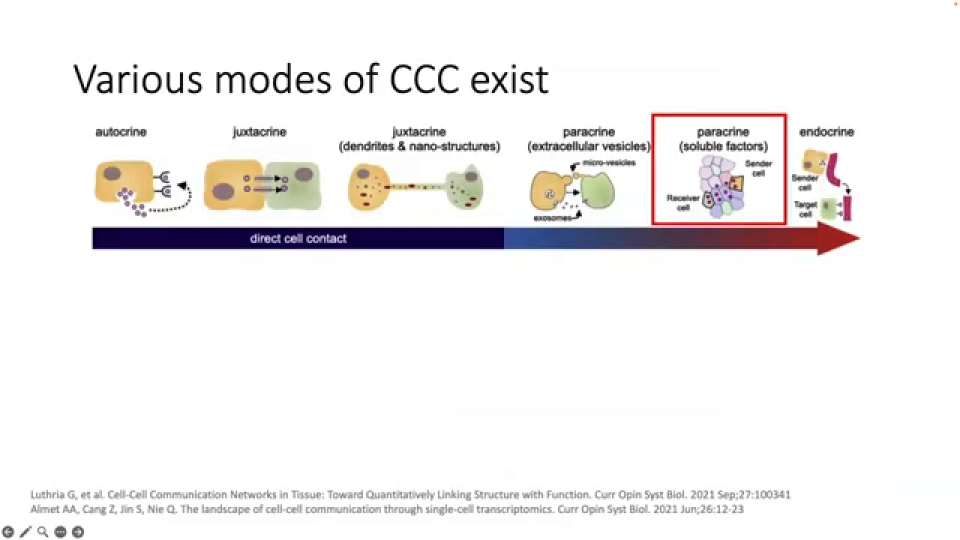

- **自分泌（autocrine）**：细胞分泌的配体作用于自己的受体，相当于"自言自语"，是自我调节。
- **接触依赖（juxtacrine）**：两个细胞膜贴在一起直接对话，配体就长在对方膜上。
- **树突与纳米管**：细胞伸出细长的结构去够远处的细胞，仍属于直接接触。
- **囊泡介导的旁分泌**：通过微囊泡把货物送到邻近细胞。
- **可溶因子的旁分泌（paracrine）**：发送细胞分泌可扩散的配体，接收细胞用受体接住——这是本讲的主角，也是绝大多数计算工具默认建模的模式。
- **内分泌（endocrine）**：配体进入血液循环等通道，作用于远处组织，是"长途广播"。

### 1.2 一次完整的对话，其实是一条很长的链

如果只盯着"配体表达高、受体表达高"，你会漏掉真正决定细胞反应的部分。讲者用一张图把整条链摊开：[【跳转到 19:05】](https://www.youtube.com/watch?v=8O8auXCsy70&t=1145)

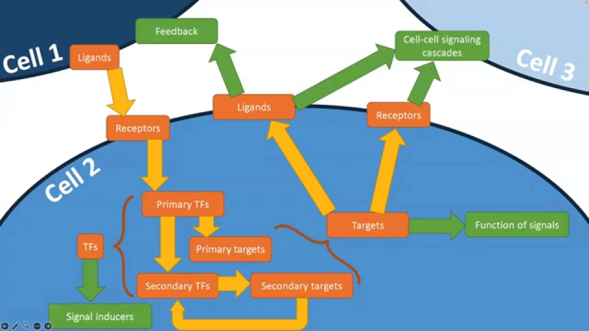

链条是这样的：细胞 1 产生配体 → 细胞 2 的受体（可以是表面受体，也可以是胞内受体）接住 → 胞内一系列信号级联（大量蛋白-蛋白相互作用）→ 激活初级转录因子 → 打开初级靶基因 → 再激活次级转录因子与次级靶基因 → 最终表现为细胞功能改变。

而靶基因的产物本身可能就是新的配体，反馈给原来的发送细胞，或者上调新的受体让这个细胞能接收别的消息——于是形成细胞间的复杂动态网络。[【跳转到 19:55】](https://www.youtube.com/watch?v=8O8auXCsy70&t=1195)

> 这里有一个对初学者很重要的判断：**"配体-受体都表达了"只是这条链的第一个环节**，离"细胞真的发生了功能改变"还有好几步。

### 1.3 想测全这条链，需要几乎所有组学手段

讲者顺势列了理想情况下需要的数据：配体可能是细胞因子、蛋白、代谢物，要靠蛋白质组、代谢组、成像；受体要靠蛋白质组、流式、CITE-seq（转录组 + 表面蛋白同时读）；胞内信号与基因调控网络要靠转录组、ATAC-seq、ChIP-seq；靶基因在组织里的位置要靠空间转录组；而通讯是动态过程，还需要时间序列或扰动实验（比如用 CRISPR 敲掉某个受体看效果），或者活体成像。[【跳转到 21:35】](https://www.youtube.com/watch?v=8O8auXCsy70&t=1295)

现实中当然拿不到全部。这就是为什么后面所有方法本质上都是**在缺信息的条件下做尽量合理的推断**。

讲者也指出这个领域正在往"功能空间组学"走：不是只测出有哪些分子，而是把多种模态、空间上下文、以及细胞互作与基因调控的模型放在一起，去解释细胞状态与功能。[【跳转到 05:46】](https://www.youtube.com/watch?v=8O8auXCsy70&t=346)

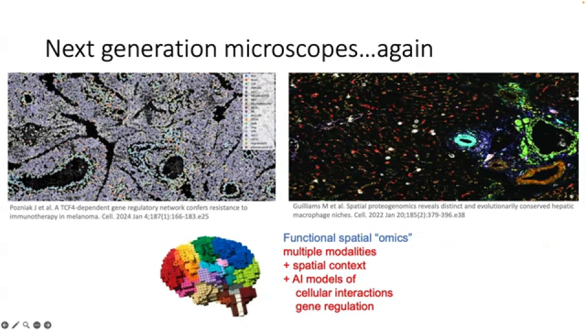

### 1.4 一个类比：细胞的"语言"

讲者把这件事类比成自然语言处理：处理一句话你要知道"谁、对谁、做了什么、在哪、何时"；研究细胞通讯你要知道哪个细胞在对哪个细胞说话、说了什么、为什么、什么时候。他提到领域里正在往"细胞语言模型"的方向走，但前提是先把测量手段补齐。[【跳转到 24:24】](https://www.youtube.com/watch?v=8O8auXCsy70&t=1464)

## 二、第一类方法：只看配体-受体的表达量

### 2.1 标准配方：五步走

这是目前论文里最常见的做法，代表工具是 CellPhoneDB、CellChat、SingleCellSignalR 等。讲者把它们的共同流程总结成五步：[【跳转到 25:48】](https://www.youtube.com/watch?v=8O8auXCsy70&t=1548)

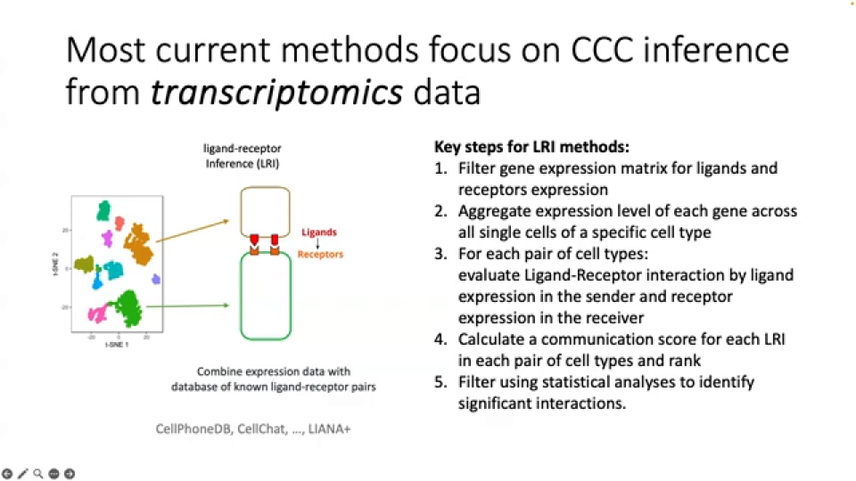

1. 用配体-受体数据库把表达矩阵**过滤**成只含配体和受体基因；
2. 把每个基因的表达在**同一细胞类型的所有细胞上聚合**（取平均或类似统计量）；
3. 对每一对"发送细胞类型—接收细胞类型"，取出配体在发送方、受体在接收方的表达；
4. 把两者组合成一个**通讯分数**，对所有配体-受体对排序；
5. 用统计检验（如置换检验）过滤出显著的那些。

### 2.2 为什么按"细胞类型"聚合，而不是按单个细胞

很多人的直觉是"细胞通讯当然要逐细胞算"，但讲者提醒要考虑信噪比：**把细胞按类型聚起来，信号会强得多**。而且现实中细胞通讯确实发生在单细胞分辨率上——"A 型细胞对 B 型细胞发信号"并不意味着所有 B 型细胞反应相同，这取决于它们所处的环境和内部状态。[【跳转到 15:31】](https://www.youtube.com/watch?v=8O8auXCsy70&t=931)

所以现在的工具分两派：多数仍在细胞类型层面建模；也有不少工具支持单细胞层面，但"不可避免地吵得多"。分组方式也不止一种——可以按聚类得到的细胞类型分，也可以按空间上相邻的细胞群分。

### 2.3 一个具体的例子：CellChat 怎么算分

CellChat 是这类工具里建模最细的一个。它的特点是考虑了**多亚基复合物**：一个受体如果是几个亚基组成的，就用各亚基表达的几何平均来代表整个复合物的表达水平；然后用 Hill 函数把配体、受体（以及拮抗剂、共抑制/共刺激亚基）的表达组合成一个相互作用活性分数，最后用标签置换（label switching）做置换检验给出显著性。[【跳转到 30:38】](https://www.youtube.com/watch?v=8O8auXCsy70&t=1838)

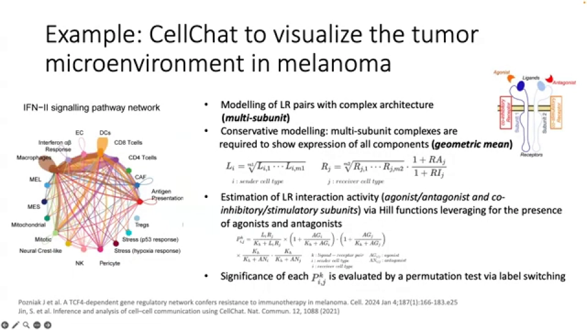

注意这张图的标题——它演示的正是"用细胞通讯图去刻画**肿瘤微环境**"：哪些细胞类型之间连得最密、哪条通路在主导。这也是这类工具在论文里最常见的用法：一张圈图或弦图，把"谁在和谁说话"画出来。

### 2.4 这一类方法的软肋

讲者非常直接地说：**目前所有这类工具都是非常粗糙的通讯估计**。[【跳转到 30:23】](https://www.youtube.com/watch?v=8O8auXCsy70&t=1823)

- 只看配体、受体的表达，**完全看不到下游发生了什么**——可能配体和受体都表达了，但下游什么也没发生。
- 配体-受体本质上是**蛋白-蛋白相互作用**，而转录组测的是 mRNA；转录本在，不代表蛋白在，更不代表蛋白之间发生了功能性结合。
- 结果**高度依赖数据库**：数据库的覆盖度、是否细胞类型特异，直接决定结果好坏；而且早期很多数据集的靶向 panel 根本没包含配体和受体，压根不适合做这类分析。
- 不同工具用的数据库、打分函数、过滤规则、统计检验都不一样，所以**同一份数据跑两个工具，结果差别可以非常大**。

## 三、第二类方法：把下游靶基因也纳入模型

### 3.1 NicheNet 的思路：反向推理

既然"配体-受体都表达"不等于"真的发生了信号传递"，那就换个角度：**从接收细胞里实际变化的靶基因，反推是哪个配体造成的**。这类方法叫胞内通讯建模（intracellular CCC modeling），代表工具是 NicheNet。[【跳转到 33:55】](https://www.youtube.com/watch?v=8O8auXCsy70&t=2035)

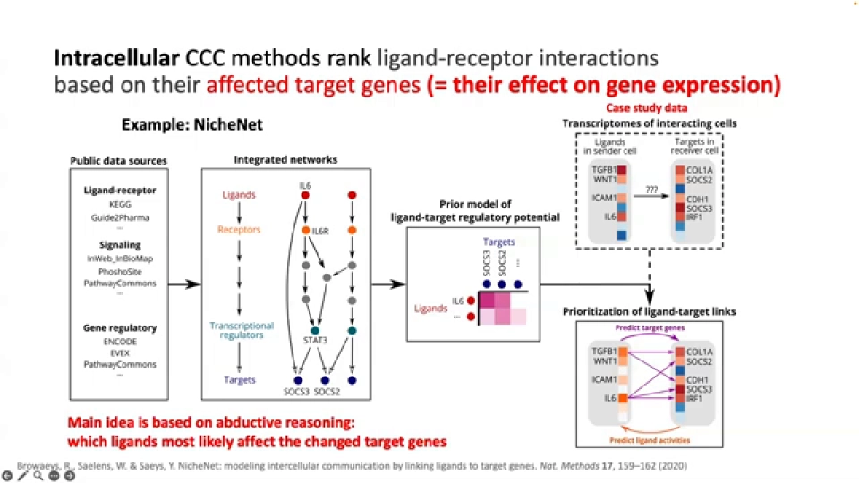

做法是：把三类公共数据库（配体-受体互作、信号通路、基因调控）整合成一张有向图，从配体一路连到靶基因；把这张图压缩成一个**先验模型**——一个"配体 × 靶基因"的概率矩阵；然后拿接收细胞里实测的差异表达基因去和这个矩阵比对，从而给配体排序、预测受影响的靶基因、并把配体与可能的受体配对。

### 3.2 关键概念：溯因推理（abductive reasoning）

讲者强调这套逻辑叫**溯因推理**：观察到的是"果"（靶基因变了），要提出一个最可能的"因"（某个配体-受体互作）。这跟"从因推果"的演绎不同，也和单纯看相关性的归纳不同。[【跳转到 35:10】](https://www.youtube.com/watch?v=8O8auXCsy70&t=2110)

> 对初学者，可以这样记：**第一类方法问"谁在说话"，第二类方法问"谁说的话真的被听进去了"。**

### 3.3 案例：Kupffer 细胞的 niche 如何"刻印"新来的单核细胞

这是全讲最漂亮的一段。合作者 Martin Guilliams 实验室研究肝脏里的 Kupffer 细胞（肝内的一类巨噬细胞）。他们的实验设计很巧：先把肝里原有的 Kupffer 细胞杀掉，新的单核细胞会迁进来，被肝脏的微环境"刻印"（tissue imprinting）成新的 Kupffer 细胞。[【跳转到 39:36】](https://www.youtube.com/watch?v=8O8auXCsy70&t=2376)

于是问题变成：**这些新来的单核细胞，到底接收了哪些邻居发出的信号，才变成了 Kupffer 细胞？**

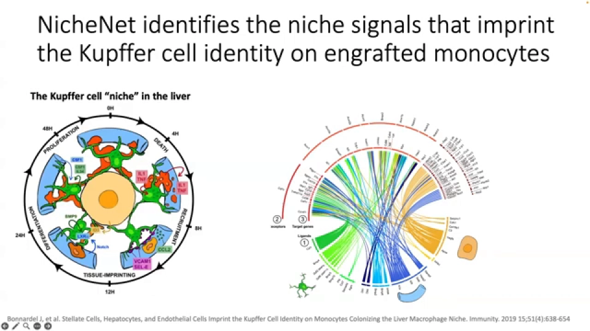

NicheNet 给出的答案是分工明确的：星状细胞主要把单核细胞往"通用巨噬细胞"方向刻印；星状细胞与内皮细胞（LSEC）的组合负责 Kupffer 细胞身份相关的那批基因；肝细胞主要诱导趋化与黏附相关的特征。因为模型输出的是靶基因，还能顺手做通路富集，回答"这些对话在功能上到底做了什么"。[【跳转到 42:31】](https://www.youtube.com/watch?v=8O8auXCsy70&t=2551)

### 3.4 这一类方法的软肋

它比第一类多了下游信息，但同样有短板：不处理多亚基复合物；**更严重地依赖数据库**——现在不只依赖配体-受体数据库，还依赖信号通路和基因调控数据库；而这些数据库往往很通用、不具细胞类型特异性。讲者给的应对办法是：在先验模型里给不同数据源**赋权重**，通过训练过程自动判断哪些数据源更可信；也可以把实验自己的蛋白质组、空间组学数据，或 SCENIC+ 这类方法推断的调控网络加进去，让先验模型更贴合具体实验。

## 四、工具已经多到画成树：但没人验证过它们

### 4.1 一张图看清版图

讲者展示了 2024 年一篇综述里的"工具树"：核心工具是 CellPhoneDB、CellChat、NicheNet、LIANA(+)，往外延伸出空间转录组专用工具、代谢物介导的通讯工具、多条件比较工具、以及各种深度学习模型。[【跳转到 44:57】](https://www.youtube.com/watch?v=8O8auXCsy70&t=2697)

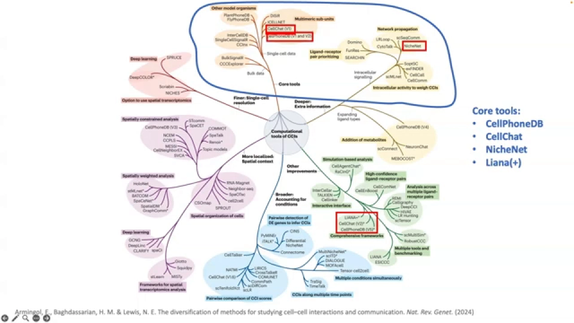

他的判断是：**没有"最好的工具"**，不同工具建模的是链条上的不同环节，理解它们的假设才能把它们组合起来用。例如先用 CellChat 得到配体-受体排序，再用 NicheNet 叠加胞内信号建模进一步精修这个排序。

### 4.2 结果到底可不可信？两组对比数据

讲者在这里说得非常坦率：现在谁都能发一个细胞通讯工具——把已有技术做个变体、挑几个自己表现好的数据集，就能发文章，**但几乎没人真正验证工具的性能**。根本原因是缺少有 ground truth 的数据集。

LIANA 团队的对比给出了两个数字：用**同一个数据库**跑不同方法，结果一致性（Jaccard 指数）很低；用**同一个方法**换不同数据库，一致性同样很低。[【跳转到 61:08】](https://www.youtube.com/watch?v=8O8auXCsy70&t=3668)

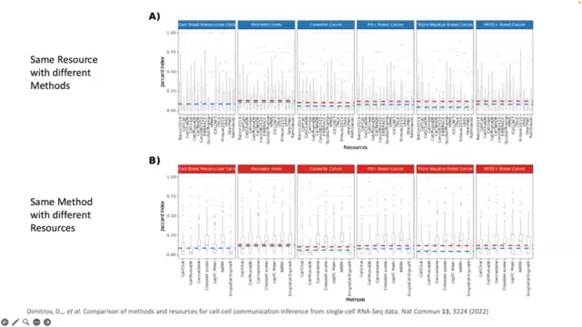

更扎心的是用"配体与受体是否空间共定位"当作代理真值来评估：AUC 只有 0.5 上下，也就是接近随机猜测，有些工具甚至比随机还差。[【跳转到 62:29】](https://www.youtube.com/watch?v=8O8auXCsy70&t=3749)

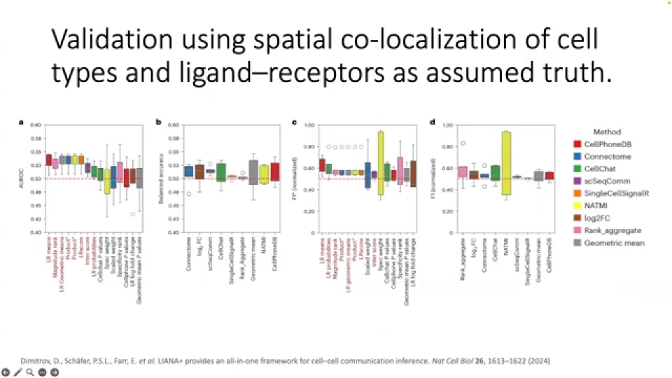

NicheNet 自己的验证方式不一样：收集 111 个"加了某个配体作为处理"的转录组数据集，看模型能不能（a）预测出受影响的靶基因、（b）反过来仅凭差异基因猜出加的是哪个配体。后者在排序靠前部分能到约 90% 的准确率。[【跳转到 64:02】](https://www.youtube.com/watch?v=8O8auXCsy70&t=3842)

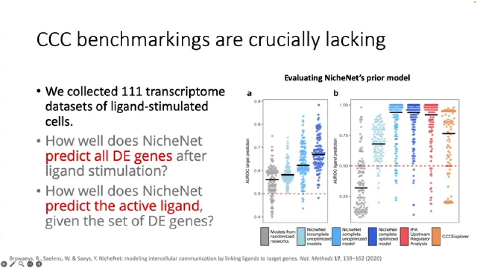

讲者把希望寄托在正在出现的"真值数据集"上，比如 Immune Dictionary 这类能系统测量体内细胞因子响应的资源。

## 五、把空间信息接进来：niche 到底是什么

### 5.1 一个可操作的定义

讲者给了一个自己的定义：**niche 是一群在空间上受约束、共同实现某项生物学功能的细胞**。[【跳转到 49:54】](https://www.youtube.com/watch?v=8O8auXCsy70&t=2994)

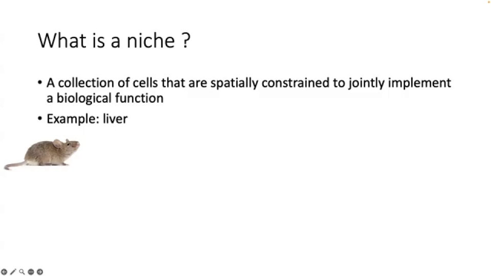

这个定义的关键是"**可以发生在不同尺度**"：整个肝脏是一个 niche；肝小叶里从门静脉到中央静脉的一个六边形单元也是一个 niche；而每一个 Kupffer 细胞身边那个更小的局部，还是一个 niche。[【跳转到 50:19】](https://www.youtube.com/watch?v=8O8auXCsy70&t=3019)

### 5.2 微环境如何塑造细胞状态：一个看得见的梯度

肝小叶是最好的教材：从门静脉到中央静脉存在浓度梯度（例如 Wnt 信号梯度），沿着这条轴，肝细胞、内皮细胞的基因表达都在连续变化。讲者强调：**这种空间特征甚至在普通单细胞转录组里就能看出来**，但用空间转录组能看得更清楚。[【跳转到 52:51】](https://www.youtube.com/watch?v=8O8auXCsy70&t=3171)

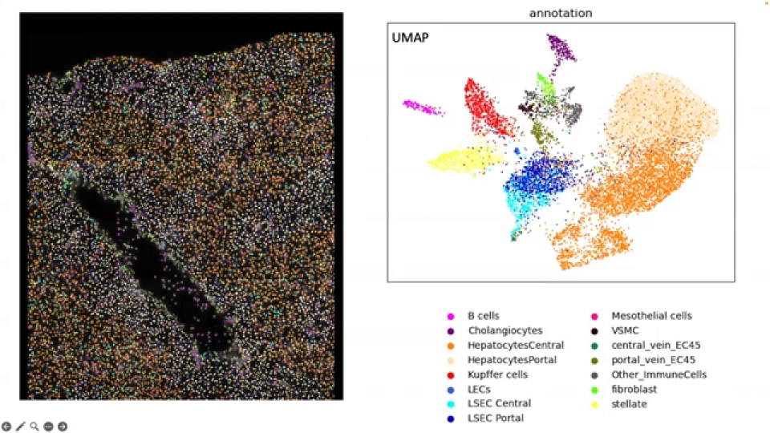

请注意这张图里最有信息量的一点：**同一个"细胞类型"（肝细胞、LSEC）被空间位置切成了不同的状态**。这正是"微环境塑造细胞状态"的直接证据，也是为什么在扰动组学里，如果不记录细胞的空间位置，就会把不同状态的同一类细胞混在一起平均掉。

### 5.3 一个 Kupffer 细胞身边，其实只坐着一个星状细胞

讲者用共聚焦与电镜把这个局部 niche 拍得很清楚：红色的 Kupffer 细胞几乎总是与绿色的星状细胞成对出现，沿肝窦均匀排布；电镜三维重建还能看到 Kupffer 细胞伸出"手臂"探进血管腔。[【跳转到 51:36】](https://www.youtube.com/watch?v=8O8auXCsy70&t=3096)

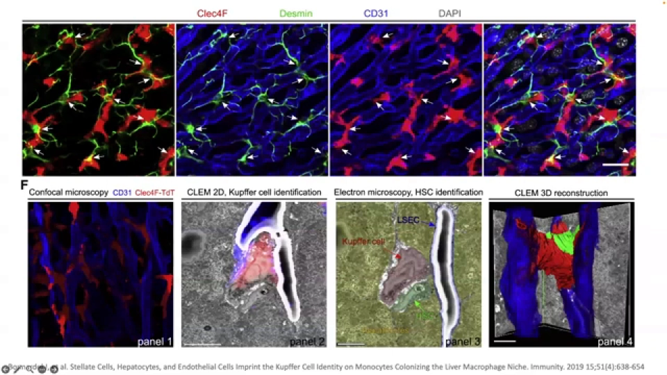

这段还有个技术提醒：这种"细胞紧紧抱住另一个细胞"的形态，在二维切片上会造成严重的分割问题——空间转录组做细胞分割时最容易在这里出错。

### 5.4 把任意工具变成"空间工具"的两种办法

讲者给了一个非常实用的结论：不需要去用那些复杂的空间通讯模型，**任何细胞通讯工具都可以用两种简单方式变成空间工具**。[【跳转到 55:15】](https://www.youtube.com/watch?v=8O8auXCsy70&t=3315)

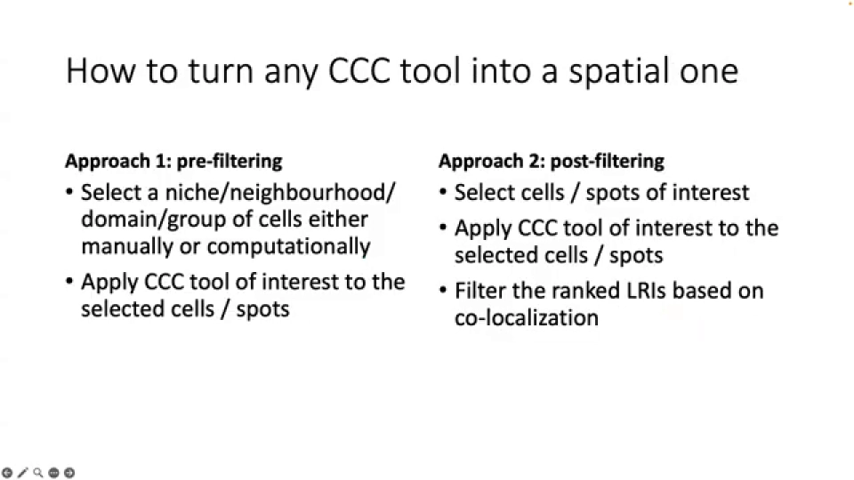

- **前置过滤（pre-filtering）**：先用任意 niche 识别算法选出空间上共处的细胞群，再只在这群细胞上跑通讯工具。
- **后置过滤（post-filtering）**：先跑通讯工具得到配体-受体排序，再用空间共定位信息去筛掉不在同一 niche 的相互作用。

好处是过程可控、可解释——你能确切知道输入是什么；相比之下，那些用最优传输等复杂数学的空间通讯工具，往往很难说清结论是怎么来的。

### 5.5 更大的框架与"下一步"

讲者顺带介绍了 LIANA+ 这类整合框架：它把多种配体-受体打分工具包起来，能做局部/全局空间统计，能用非负矩阵分解把多模态数据拆成"因子"，再看哪些配体-受体互作驱动某个因子——等于给通讯事件一个空间视角。他也提到了差分表达、多条件比较、以及基于微分方程的动态模型（有工作用 1000 个常微分方程、70 个动力学参数去建模 11 个蛋白组分）。[【跳转到 68:29】](https://www.youtube.com/watch?v=8O8auXCsy70&t=4109)

最后指向的方向是多条件比较：比如一批病人里谁对治疗有响应、谁没有，差别出在细胞通讯的哪一环；或者肿瘤里不同的生长模式（replacement growth 与 desmoplastic growth，预后不同）对应哪些不同的 niche 间相互作用。[【跳转到 66:17】](https://www.youtube.com/watch?v=8O8auXCsy70&t=3977)

## 小结

- **细胞通讯有多种模式**：自分泌、接触依赖、纳米管、囊泡、可溶因子旁分泌、内分泌。计算工具绝大多数只建模可溶因子旁分泌。
- **一次对话是一条长链**：配体 → 受体 → 胞内级联 → 转录因子 → 靶基因 → 反馈。只看配体-受体表达，等于只看链条第一环。
- **第一类方法（CellPhoneDB / CellChat）**：筛配体受体 → 按细胞类型聚合 → 逐对打分 → 排序 → 统计检验。简单、通用，但看不到下游效应，且高度依赖数据库。
- **第二类方法（NicheNet）**：用"配体→靶基因"先验模型做溯因推理，从接收细胞实际变化的基因反推配体。能给出功能解释，但更依赖数据库，需要按实验情境加权或补充数据源。
- **第三类做法是加空间信息**：niche 可定义为"空间上受约束、共同完成一项功能的一群细胞"，尺度可大可小；用前置过滤或后置过滤就能把任意工具变成空间工具。
- **微环境确实塑造细胞状态**：肝小叶的门静脉—中央静脉梯度把同一类细胞切成不同状态，这在空间转录组的 UMAP 上直接可见。
- **这类工具目前都很不可靠**：同一数据换工具、换数据库，结果一致性很低；以空间共定位为代理真值评估，AUC 多在 0.5 附近。缺 ground truth 是根本瓶颈。

## 关键术语速查

| 术语 | 一句话解释 |
| --- | --- |
| 细胞通讯（cell-cell communication, CCC） | 一个细胞发出的信号被另一个细胞接收并引起反应的过程 |
| 配体-受体互作（ligand-receptor interaction, LRI） | 信号分子与其对应受体结合，是通讯链条的起点 |
| 旁分泌（paracrine） | 分泌可扩散的配体作用于邻近细胞，是多数工具默认建模的模式 |
| 自分泌 / 内分泌 | 作用于自身 / 通过血液等通道作用于远处组织 |
| 通讯分数（communication score） | 把配体与受体的表达量组合成一个数值，用来排序相互作用的强弱 |
| 多亚基复合物 | 由多个亚基组成的受体或配体，CellChat 用几何平均来代表其整体表达 |
| 溯因推理（abductive reasoning） | 从观察到的结果反推最可能的起因，NicheNet 的核心逻辑 |
| 先验模型（prior model） | 由公共数据库整合出的"配体 × 靶基因"概率矩阵 |
| niche（微环境） | 空间上受约束、共同实现某项生物学功能的一群细胞，尺度可大可小 |
| 组织刻印（tissue imprinting） | 迁入组织的细胞被当地微环境信号改造，获得该组织的细胞身份 |
| 前置过滤 / 后置过滤 | 先用空间信息选细胞再算通讯 / 先算通讯再用空间信息筛结果 |
| Jaccard 指数 | 两组排序结果的重叠程度，用来衡量不同工具结论的一致性 |
| ground truth | 可用来客观评估模型性能的真值数据，细胞通讯领域目前严重缺乏 |