# 正常组织与病变组织的细胞状态差在哪里：肿瘤微环境、癌前中间态与自身免疫重塑

> 视频来源：[单细胞技术在肿瘤和自身免疫疾病中的应用](https://www.bilibili.com/video/BV1Ro4y1L7EU/)（Bilibili · 中国免疫学会临床免疫分会学术年会讲者报告，讲者来自复旦大学附属中山医院团队）｜时长约 31 分钟
> 导读：这是一场用"自己的四个课题"串起来的报告。它不讲测序原理，而是回答一个更基础的问题——**同一群细胞，从正常组织搬到病变组织里，到底变了什么**。四个案例分别覆盖肿瘤（肝癌、肠癌肝转移、胆管癌）、癌前状态（甲状腺乳头状癌）和自身免疫病（MDA5+ 皮肌炎），正好把"正常 / 疾病 / 治疗刺激"三种条件下的细胞变化各演一遍。字幕为 B 站人工字幕，个别基因名（CCL18、SPP1、CD47、SIRPα、ZNF683、ISG15 等）已按上下文订正。

## 本讲要解决的核心问题（SCQA）

**背景**：前面几节已经建立了两个概念——细胞有类型之分（T 细胞、B 细胞、巨噬细胞……），同一类型内部还有状态之分与异质性。做实验时我们习惯拿"癌旁组织"当正常对照、"肿瘤组织"当疾病组，然后比较表达差异。

**冲突**：可一旦把镜头拉到单细胞，就会发现"癌旁 vs 肿瘤"的差别远不止几个差异基因。同一群巨噬细胞，在正常组织里能杀伤肿瘤，在肿瘤里却变成帮肿瘤的；同一群 CD8 T 细胞，有的还在战斗，有的已经耗竭；甚至在形态上看起来完全正常的组织里，已经藏着一群转录组悄悄改变了的"癌前细胞"。而治疗（化疗、免疫治疗）本身又是一次强烈刺激，会把细胞状态重新洗一遍。

**疑问**：从正常到疾病、再到治疗刺激，细胞的哪些属性会变？这些变化能不能被稳定地测出来、并且和病人的结局挂上钩？

**回答（中心思想）**：细胞在正常 / 疾病 / 刺激条件下的变化发生在**三个层次**上——**细胞组成**（哪些亚群变多、哪些变少）、**单个细胞的状态程序**（同一亚群换了一套标志基因和通路）、**细胞之间的相互作用**（谁在和谁对话、谁在抑制谁）。单细胞技术的价值就在于能一次性把这三层都读出来，并且每一层都能对应到临床结局：预后、分型、治疗应答。

## 一、为什么要用单细胞看疾病：从"猜一个分子"到"全拉一遍"

### 1.1 传统做法与组学做法的分工

讲者先交代了实验室的研究范式。传统研究是"聚焦式"的：盯住一条通路、一种细胞，往深里做。但很多疾病我们知道它很重要、知道这个组织已经发生病变，却不知道**是哪个细胞、哪条通路在起作用**。

单细胞提供的是另一种入口：不预设答案，把组织里所有细胞"全部拉一遍"，在这片海量数据里再去找哪些细胞、哪些通路和疾病相关。[【跳转到 01:43】](https://www.bilibili.com/video/BV1Ro4y1L7EU/?t=103)

这个差别值得初学者记住：**bulk 测序是先有假设再验证，单细胞是先无偏扫描再生成假设**。所以讲者反复强调，单细胞测序最主要的角色是"发现工具"（a tool for discovery）——先看这群细胞是不是变多了，再看它有什么特征。

### 1.2 肿瘤微环境：一个把"抗肿瘤"改写成"促肿瘤"的地方

讲者用一张经典示意图说明了肿瘤组织的细胞构成。肿瘤里大致分两大类：

- **非免疫细胞**：肿瘤细胞 + 基质细胞（成纤维细胞、内皮细胞等）；
- **免疫细胞**：天然免疫细胞（巨噬细胞、NK 细胞、DC、中性粒细胞等）+ 获得性免疫细胞（T 细胞、B 细胞）。

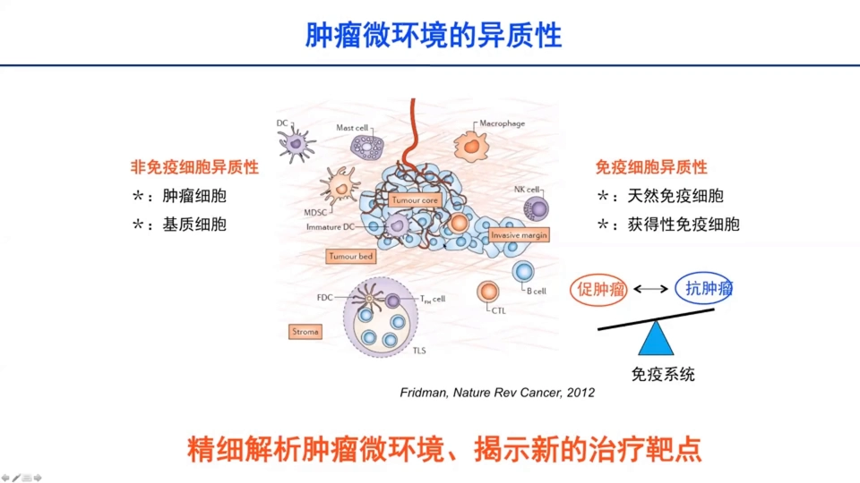

关键在于：这些免疫细胞**一开始是来打肿瘤的**，但肿瘤会造出一个抑制性微环境，用两种手段把它们改造掉。[【跳转到 05:00】](https://www.bilibili.com/video/BV1Ro4y1L7EU/?t=300)

1. **让有战斗力的细胞失去战斗力**：T 细胞、NK 细胞被压制。
2. **"劫持"或"训练"抗肿瘤细胞，让它变成促肿瘤细胞**：CD4 T 细胞本来起辅助作用，在肿瘤微环境里被诱导成调节性 T 细胞（Treg）；巨噬细胞本来在早期肿瘤里可以直接杀伤肿瘤细胞，进了微环境就变成 M2 型，不但不杀肿瘤，还促进肿瘤生长。

这就是本节要讲的第一种"状态变化"：**细胞类型没变，功能方向反了**。

### 1.3 为什么选肝癌做模型

讲者选肝脏肿瘤作为主战场，理由有两个。一是流行病学：全球每年新发肝癌超过 50 万例，我国占 55%，全世界一半以上的新发肝癌在中国，主要与乙肝感染基数有关。[【跳转到 07:00】](https://www.bilibili.com/video/BV1Ro4y1L7EU/?t=420)

二是临床困境：肝癌对 PD-1 / PD-L1 单药免疫治疗的效果并不好，有效率低于 20%；与抗血管生成药物联用能提高一些应答率，但持续性有限，用一年以后往往也就没有特别的效果了。讲者给的解释是**组织本身的特异性**——肝脏本来就是一个免疫耐受（tolerance）的器官，所以肝癌的免疫治疗比别的器官更难。[【跳转到 08:15】](https://www.bilibili.com/video/BV1Ro4y1L7EU/?t=495)

## 二、正常肝 vs 肝癌：同一群免疫细胞，状态被改写了

### 2.1 实验设计：癌旁组织当对照

第一个工作（2020 年发表于 Cell Discovery）取 7 例肝细胞癌（HCC）患者的**肿瘤组织与癌旁肝组织**，消化后分选 CD45 阳性的免疫细胞做单细胞测序，再用流式细胞术、多重免疫组化（mIHC）和临床队列做验证。[【跳转到 09:23】](https://www.bilibili.com/video/BV1Ro4y1L7EU/?t=563)

注意这个设计的含义：**"正常"和"疾病"来自同一个人、同一个器官**，遗传背景一致，差别主要来自"这块组织有没有变成肿瘤"。这是研究"疾病如何改变细胞状态"最干净的对照方式。

### 2.2 两群细胞，两个相反的预后方向

单细胞测序筛出两群免疫细胞，它们的预后价值方向完全相反：

| 细胞亚群 | 表型 | 在肝癌中的意义 |
| --- | --- | --- |
| CCL18+ CD206+ CD68+ 巨噬细胞 | M2 型巨噬细胞的一个亚群，高表达 CCL18 趋化因子 | 预后**不良**，这群细胞高的患者两年生存率低于 50% |
| XCL1+ CD8 T 细胞 | 高表达转录因子 ZNF683（Hobit），属于组织驻留记忆 T 细胞（Trm） | 预后**良好** |

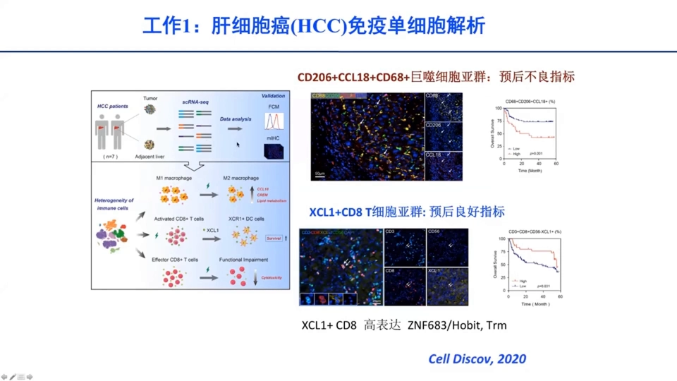

这两群细胞正好演示了"疾病条件下同一类细胞的两个方向"：**巨噬细胞被拉向免疫抑制端（M2），CD8 T 细胞里则有一群被拉向组织驻留、长期驻守的端（Trm）**。前者帮肿瘤，后者帮病人。讲者特别点出，ZNF683 / Hobit 这个概念是这两年很热的"组织驻留记忆"标志——在组织里定位下来的局部记忆 T 细胞，对看住肿瘤非常重要。[【跳转到 10:55】](https://www.bilibili.com/video/BV1Ro4y1L7EU/?t=655)

## 三、原发灶 vs 转移灶：疾病进展带来的组成与状态变化

### 3.1 一个更复杂的对照：四种组织、同一批病人

第二个工作研究的是**肠癌肝转移（CRLM）**。讲者先给了临床背景：我国是大肠癌高发国家，晚期肠癌患者中超过 50% 会发生肝转移，一旦转移预后远差于局限性肠癌。[【跳转到 11:40】](https://www.bilibili.com/video/BV1Ro4y1L7EU/?t=700)

研究用了多组学：单细胞测序打底，加上空间转录组、流式细胞术、多重免疫组化，再配临床队列。样本是四种组织——原发肠癌、肠癌癌旁、肝转移灶、肝癌旁组织。[【跳转到 12:53】](https://www.bilibili.com/video/BV1Ro4y1L7EU/?t=773)

这个设计的巧妙之处在于：**同一个病人的原发灶和转移灶，肿瘤细胞大体相同、遗传背景相同，主要变量变成了"器官/微环境"**——于是可以问一个更精确的问题：细胞状态的变化，是肿瘤细胞带来的，还是新器官的微环境带来的？

### 3.2 转移灶里最突出的变化是巨噬细胞

聚类热图显示，不同组织里高度富集的亚群各不相同。讲者最关心的是转移灶，因为转移之后病人预后很差。结果发现，**转移灶里最突出的是巨噬细胞的高度富集**，而且排名第一的分子特征与上一个工作完全一致——高表达 CCL18 的巨噬细胞；此外还有一群表达 SPP1 的巨噬细胞。[【跳转到 13:10】](https://www.bilibili.com/video/BV1Ro4y1L7EU/?t=790)

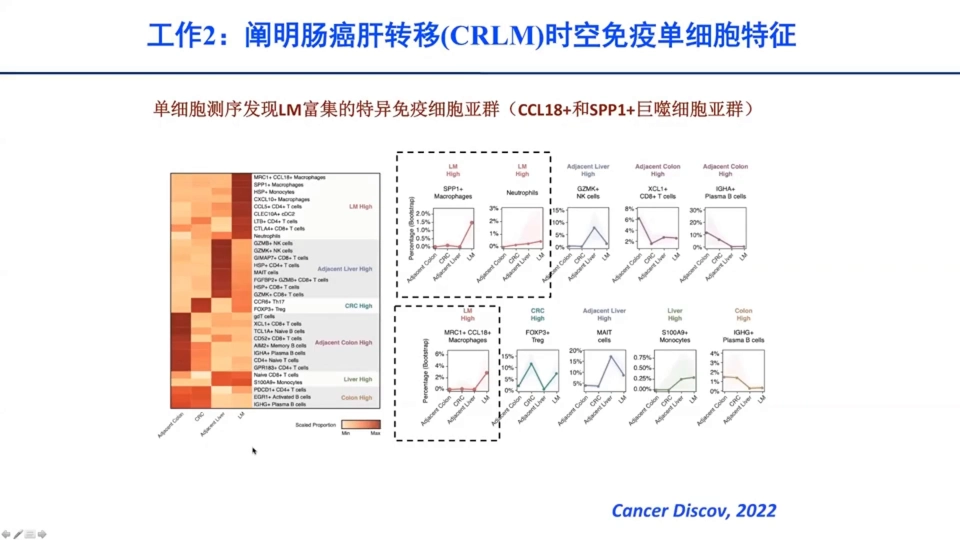

同一个分子特征在两个不同课题、两种不同肿瘤里反复出现，这是很强的信号：**CCL18+ 巨噬细胞可能不是某个癌种的偶然现象，而是"组织变成肿瘤之后"反复被诱导出来的一种状态**。

### 3.3 把"变多了"落实到"在哪里"

单细胞只告诉你比例（frequency / fraction）变了，不告诉你空间位置。所以讲者用空间转录组和多重免疫组化去定位：空间转录组的分辨率还达不到单细胞（大约 1–10 个细胞一个点），但足以看出 CCL18+ 巨噬细胞在**肿瘤组织内部及周边**明显富集，而癌旁组织里颜色很浅。[【跳转到 14:00】](https://www.bilibili.com/video/BV1Ro4y1L7EU/?t=840)

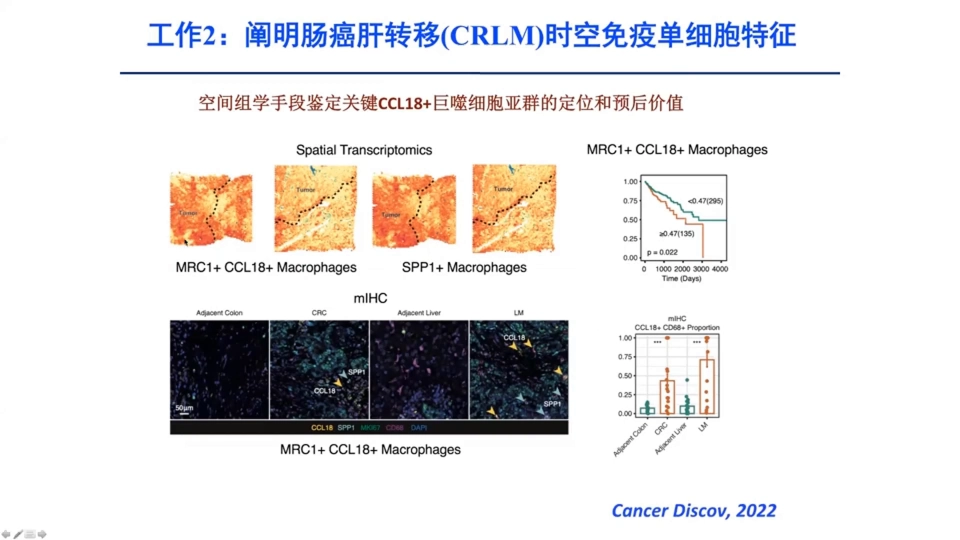

### 3.4 它们和肿瘤细胞在"说什么"

确定细胞变多了、位置也对了，下一步是问功能。讲者做了细胞–细胞相互作用分析，把各细胞类型与肿瘤细胞的相互作用强度排名，结果 **CCL18+ 巨噬细胞与肿瘤细胞的相互作用排第一**。[【跳转到 15:49】](https://www.bilibili.com/video/BV1Ro4y1L7EU/?t=949)

再往下看具体的受体–配体对，有一对特别眼熟：肿瘤细胞表达 **CD47**，巨噬细胞表达 **SIRPα**。这是著名的"别吃我"（don't eat me）信号——CD47 与 SIRPα 结合并不是启动吞噬，而是**阻止巨噬细胞去吞噬肿瘤细胞**。多重免疫组化证实，表达 SIRPα 的 CCL18+ 巨噬细胞与表达 CD47 的肿瘤细胞确实靠得很近，而且这种相互作用在转移灶里比原发灶更强。[【跳转到 16:26】](https://www.bilibili.com/video/BV1Ro4y1L7EU/?t=986)

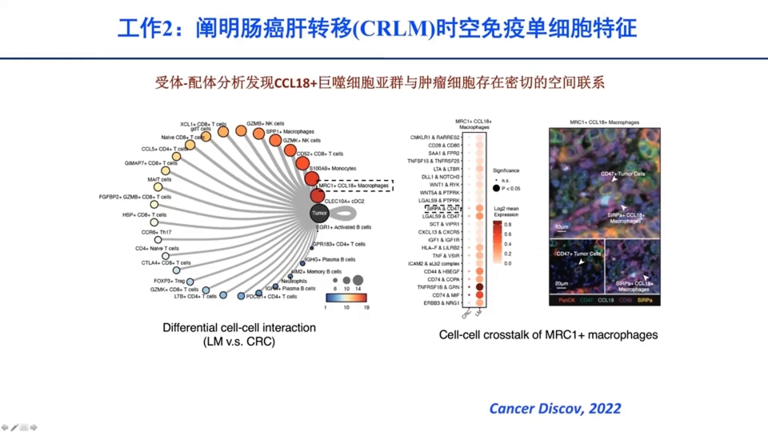

这里体现了一个重要的方法学顺序：**单细胞先算出相互作用（基于受体配体的表达），再用蛋白水平的另一个技术去验证**。算出来的东西必须落地到蛋白和空间，否则只是相关性。

### 3.5 状态变化还写在代谢上

讲者还关心免疫代谢——不只是肿瘤细胞自身的代谢，免疫细胞的代谢状态同样重要。他们自建了一套 pipeline，给不同细胞群体的代谢通路打分并做热图。[【跳转到 17:48】](https://www.bilibili.com/video/BV1Ro4y1L7EU/?t=1068)

结果：**综合代谢打分最高的还是 CCL18+ 这群巨噬细胞**，活化程度远高于其他类型的巨噬细胞和单核细胞。进一步挑出三条高活化的代谢通路，用多重免疫组化在蛋白水平验证，确认这群细胞高表达相应的代谢分子。

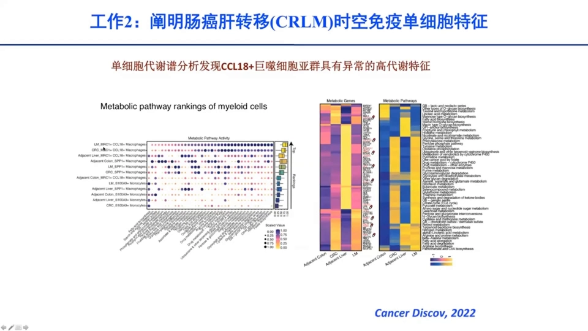

热图上打的"药丸"标记很有信息量：**这些高活化的代谢通路里，有一部分已经有现成的抑制剂**。这就把"细胞状态"直接翻译成了"可干预的靶点"。

## 四、治疗本身也是一种刺激：化疗有效与无效时，细胞状态走向两端

前面讲的都是"疾病 vs 正常"。但临床上还有另一种更强的刺激——**治疗**。讲者用肠癌肝转移的新辅助化疗做了这个对照。

临床场景是这样的：已经发生肝转移、不能直接手术的病人，先做化疗；如果化疗敏感、肿瘤（含转移灶）缩小到可以手术的范畴，再做手术。但化疗有两种结果：有效（肿瘤缩小）和无效（肿瘤不变甚至继续进展）。[【跳转到 20:03】](https://www.bilibili.com/video/BV1Ro4y1L7EU/?t=1203)

比较这两类病人治疗前后的转移灶，结果非常干净：

- **未治疗**的病人转移灶里有大量 CCL18+ 巨噬细胞；
- **化疗有效（PR）**的病人，治疗后转移灶里基本看不到这群巨噬细胞；
- **化疗无效（PD）**的病人，这群细胞不但没减少，反而更多了。

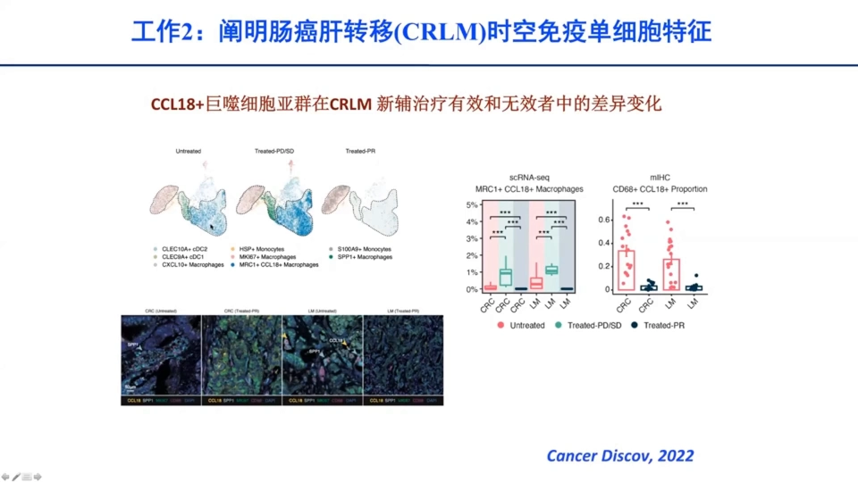

单细胞的计算结果与多重免疫组化的蛋白结果一致，原发灶和转移灶都是同样的趋势。讲者据此给出两个转化方向：一是在治疗前做活检，看这群细胞高不高，作为分层依据；二是**特异性地靶向这群具有强大免疫抑制功能的巨噬细胞**，再叠加代谢检查点抑制剂"多管齐下"，提高治愈率。[【跳转到 22:13】](https://www.bilibili.com/video/BV1Ro4y1L7EU/?t=1333)

## 五、疾病不只有"肿瘤"：分型、癌前状态与自身免疫

### 5.1 肿瘤内部也能再分型：胆管癌的 S100P+ 与 SPP1+

第三个工作转向肝内胆管癌（iCCA）。用单细胞测序，讲者把**肿瘤细胞**本身分成两个亚型：S100P 阳性型和 SPP1 阳性型，并且用免疫组化证明临床上可以直接染出来分型。两型的生存特点不同——**S100P+ 的患者预后更差**。[【跳转到 23:00】](https://www.bilibili.com/video/BV1Ro4y1L7EU/?t=1380)

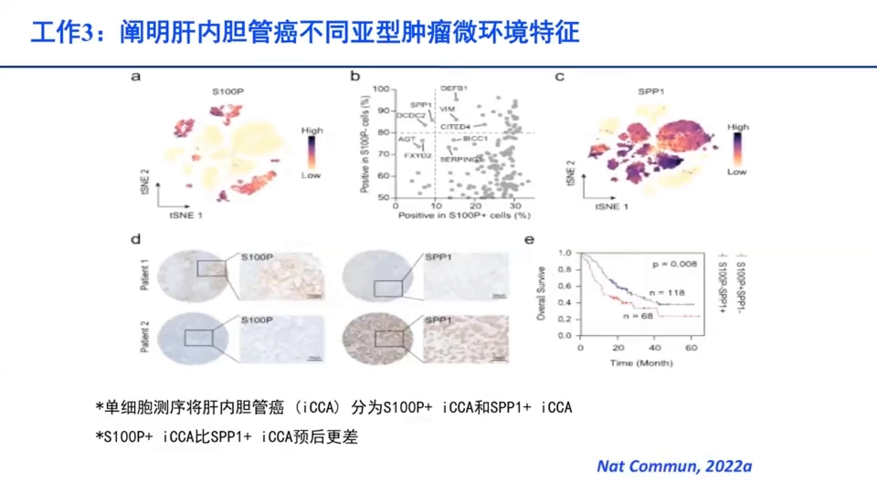

顺着差异往下追，他们还找到了调控 S100P 表达的关键转录因子和相关通路，于是分型不只提高了准确度，还给出了新的治疗靶点方向。这说明**"细胞状态"这个概念不只适用于免疫细胞，肿瘤细胞自己也在不同状态之间切换**。

### 5.2 最像"正常"的那群细胞，其实已经变了：甲状腺癌的癌前状态

第四个工作是甲状腺乳头状癌（PTC）。临床上有经典分型，但单细胞测序带来了一个额外收获：在某些患者的组织里，存在一群**癌前细胞**——它还没有完全变成肿瘤细胞，但已经和健康甲状腺上皮细胞不一样了，处在一个**中间状态**，有非常独特的转录组特征。[【跳转到 25:00】](https://www.bilibili.com/video/BV1Ro4y1L7EU/?t=1500)

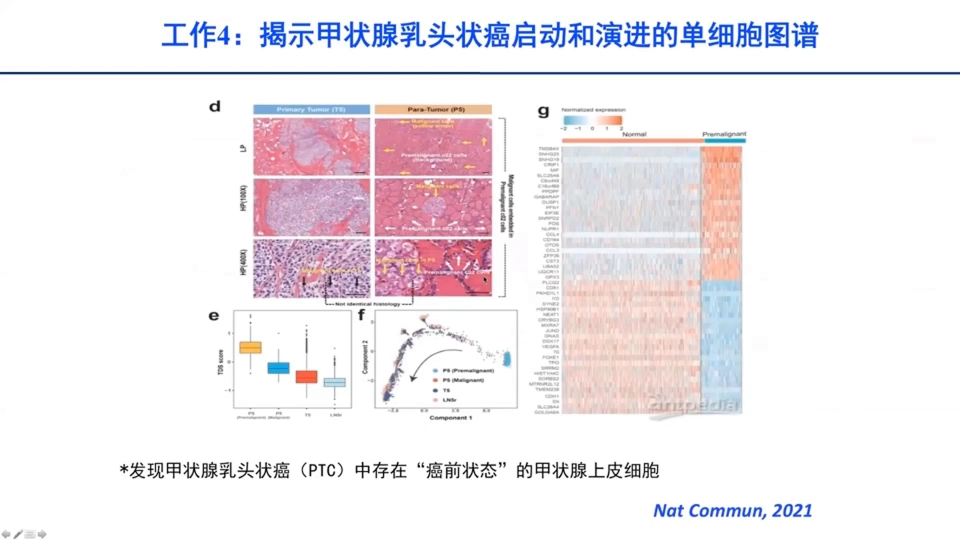

这个发现最有教学价值的地方在于：**形态学上的"正常"不等于分子层面的"正常"**。带着这个线索回到组织切片，确实能在肿瘤旁边看到一群"看上去是正常的、但实际上转录组已经改变"的细胞。于是从健康到肿瘤的发展通路被理清楚了，甲状腺癌的分子分型认识也随之提高。

### 5.3 自身免疫病：另一种"刺激"下的免疫细胞全面活化

报告最后两分钟转向自身免疫病。实验室主攻系统性红斑狼疮，这次讲的是另一个病——**MDA5 阳性的皮肌炎（MDA5+ DM）**。它在风湿科的死亡率排第一，最大的特点是能合并间质性肺炎，进展极快，常在三个月到半年内发生呼吸衰竭而死亡。目前治疗方案停在经验层面，根本原因是致病机制不清楚。[【跳转到 26:06】](https://www.bilibili.com/video/BV1Ro4y1L7EU/?t=1566)

因为这个病与自身抗体相关，他们做了单细胞测序，重点看 B 细胞和 T 细胞，同时做 BCR / TCR 测序。队列设计很讲究，把"正常"和"疾病的不同活动度"分层：

| 组别 | 例数 | 含义 |
| --- | --- | --- |
| 健康供者（HD） | 4 | 真正的正常对照 |
| 疾病对照（Ctrl IM） | 5 | 其他原因间质性肺病 |
| 活动期（MDA5+ DM-Act） | 7 | 疾病正在活动 |
| 缓解期（MDA5+ DM-Rem） | 3 | 治疗后缓解，含 3 对配对样本 |
| 肺组织 | 1 | 病变靶器官 |

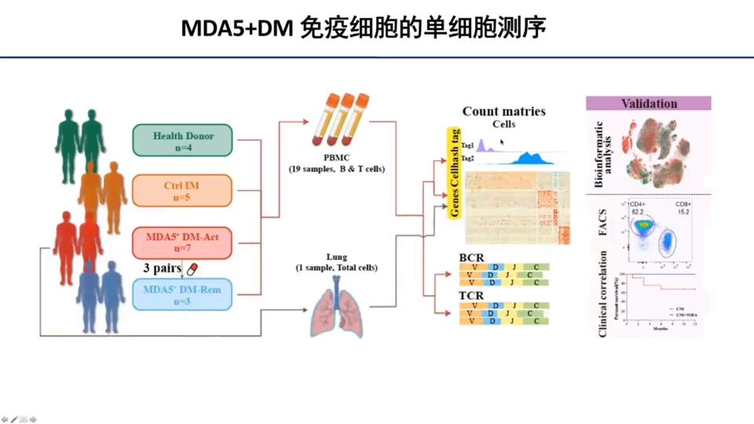

这个设计本身就是本节主题的教科书式示例：**同一疾病的不同活动度，就是一组天然的"刺激强度梯度"**。

结果可以按层次读：

- **细胞组成**：活动期患者外周血**浆细胞增高**（流式验证），并发生 BCR 克隆扩增——针对自身抗原产生了扩增；其中 IGHV4 家族与自身反应性高度相关，明显增高。T 细胞侧则是一群**增殖性 T 细胞**特别高，流式验证显示 CD8 T 高度活化，TCR 也发生了克隆扩增。[【跳转到 27:29】](https://www.bilibili.com/video/BV1Ro4y1L7EU/?t=1649)
- **状态程序**：分子通路上最显著的是 **I 型干扰素通路**，在 T 细胞和 B 细胞里都高度活化；用 Luminex 测血浆，活动期患者比疾病对照和健康人都有一定水平的干扰素。代谢通路同样偏高。[【跳转到 28:20】](https://www.bilibili.com/video/BV1Ro4y1L7EU/?t=1700)
- **空间与相互作用**：在一例活动期患者的肺组织里，**CD8 T 细胞显著增高**，Ki67 阳性的增殖型 CD8 T 细胞浸润很高，I 型干扰素信号也很高；细胞–细胞相互作用分析显示，**干扰素通路与成纤维细胞活化通路高度正相关**——这正好能解释为什么这个病会合并间质性肺炎（成纤维细胞活化 = 纤维化）。

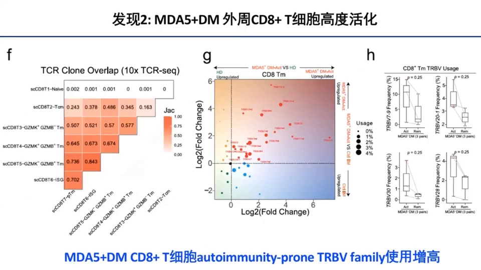

最后一步是把发现做成可用的临床指标。既然 I 型干扰素通路在 T、B 细胞里都这么高，能不能用更简单的方法测出来？他们筛了一批流式抗体，最后锁定 **ISG15** 这个蛋白分子：在活动期患者、特别是 ISG15 阳性的 CD8 T 细胞上测得很清楚。单因素和多因素分析显示，**ISG15+ CD8 T 细胞可以预测病人死亡，预测效果优于临床在用的铁蛋白，AUC 更高且有统计学意义**。[【跳转到 30:00】](https://www.bilibili.com/video/BV1Ro4y1L7EU/?t=1800)

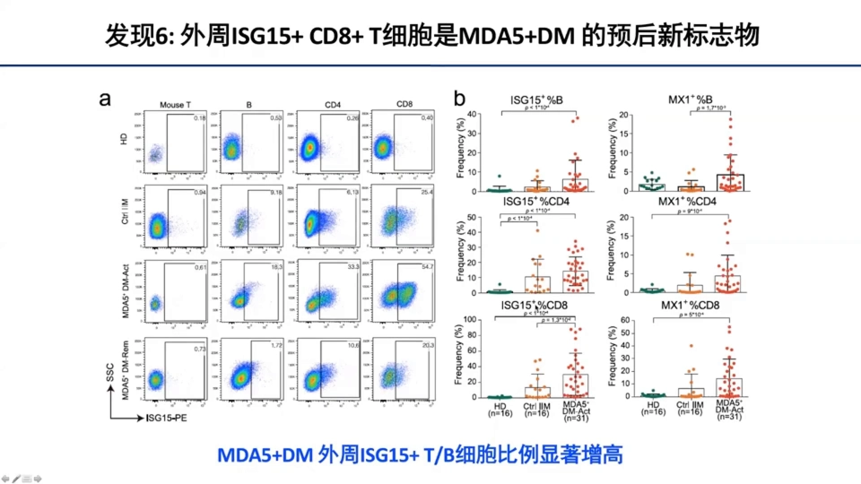

由此他们提出机制假说：这个病可能跟病毒或类似病毒感染导致 I 型干扰素通路增加有关，这是很重要的发病机制之一。

## 六、把三个层次合起来看

讲者的四个课题其实在反复演示同一件事：**疾病不是"某个基因坏了"，而是细胞在组成、状态、互作三个层次上被系统性改写**。

- **组成层**：转移灶里巨噬细胞富集、活动期皮肌炎里浆细胞和增殖性 CD8 T 增多。这一层用比例就能看出来。
- **状态层**：M1 巨噬细胞变成 M2、CD8 T 变成 Trm 或耗竭、肿瘤细胞分成 S100P+/SPP1+、上皮细胞进入癌前中间态。这一层要看标志基因和通路。
- **互作层**：CD47–SIRPα 的"别吃我"、干扰素通路与成纤维细胞活化的正相关。这一层要靠受体–配体分析和空间定位。

而"刺激"（化疗、免疫治疗、自身免疫的炎症活动）的作用，就是在这三层上同时推动细胞往某个方向移动——**推动方向不同，临床结局就不同**。这也正是后面第 3 章要讲的"扰动实验"要研究的对象：如果给细胞一个明确的扰动，我们能不能预测它往哪个状态走。

## 小结

- 单细胞在疾病研究里的第一角色是**发现工具**：不预设哪个细胞重要，先把组织里所有细胞扫一遍，再找与疾病相关的亚群和通路。
- **正常 vs 疾病**最干净的对照是同一个人的癌旁组织 vs 肿瘤组织；**原发 vs 转移**最干净的对照是同一个病人的不同部位——变量被压缩到"器官/微环境"这一个。
- 肿瘤微环境会做两件事：压制有战斗力的 T/NK 细胞，把抗肿瘤的 CD4 T 和巨噬细胞"改造"成 Treg 与 M2 型促肿瘤细胞。
- CCL18+ 巨噬细胞在肝癌与肠癌肝转移两个独立课题中反复出现，预后不良、代谢高度活跃、通过 CD47–SIRPα 阻止巨噬细胞吞噬肿瘤，是一个可靶向的免疫抑制状态。
- 治疗也是刺激：化疗有效者转移灶里 CCL18+ 巨噬细胞显著减少，无效者反而增多——细胞状态的变化方向与治疗应答同向。
- 形态正常的组织未必分子正常：甲状腺癌旁边存在转录组已改变的"癌前状态"上皮细胞，处在健康到肿瘤的连续谱中间。
- 自身免疫病（MDA5+ 皮肌炎）演示了另一种刺激：浆细胞与增殖性 CD8 T 扩增、I 型干扰素通路高度活化、干扰素与成纤维细胞活化正相关（解释间质性肺炎），并最终落到 ISG15+ CD8 T 这个可测的预后标志物。

## 关键术语速查

| 术语 | 一句话解释 |
| --- | --- |
| 肿瘤微环境（TME） | 肿瘤组织里除肿瘤细胞以外的免疫细胞、基质细胞、血管与信号分子共同构成的局部环境，能决定免疫细胞的功能方向 |
| M1 / M2 巨噬细胞 | 巨噬细胞的两种极化状态：M1 偏促炎、可杀伤肿瘤；M2 偏抑制、促组织修复与促肿瘤 |
| Treg（调节性 T 细胞） | 抑制免疫反应的 CD4 T 细胞亚群，在肿瘤里常被诱导出来压制抗肿瘤免疫 |
| Trm（组织驻留记忆 T 细胞） | 长期驻留在组织内、不再循环的记忆 T 细胞，标志基因包括 ZNF683（Hobit）、CD69 等 |
| CCL18 | 一种趋化因子，在肿瘤相关巨噬细胞中高表达，本讲中作为免疫抑制型巨噬细胞的标志 |
| SPP1 | 骨桥蛋白（osteopontin）的基因名，在肿瘤相关巨噬细胞与部分肿瘤细胞中高表达 |
| CD47–SIRPα | "别吃我"信号轴：肿瘤细胞上的 CD47 与巨噬细胞上的 SIRPα 结合，抑制吞噬 |
| mIHC / 多重免疫组化 | 在同一张切片上同时染多个蛋白标志物，用于在组织原位定位细胞亚群 |
| 空间转录组 | 保留组织位置信息的表达测量技术，分辨率通常为 1–10 个细胞一个点 |
| CRLM | 结直肠癌肝转移（colorectal cancer liver metastasis） |
| iCCA | 肝内胆管癌（intrahepatic cholangiocarcinoma） |
| 癌前状态 | 形态上仍接近正常、但转录组已发生改变、位于健康到肿瘤连续谱中间的细胞状态 |
| BCR / TCR 克隆扩增 | 特定 B 细胞受体 / T 细胞受体序列在群体中大量重复出现，说明针对某抗原发生了选择性增殖 |
| I 型干扰素通路 | 抗病毒免疫的核心通路（IFN-α/β 及其下游 ISG 基因），在自身免疫病中常异常活化 |
| ISG15 | 干扰素刺激基因 15，其蛋白水平可作为 I 型干扰素通路活化的读出指标 |