# 肿瘤里的免疫细胞不是一种状态：耗竭、前体与可塑性如何决定免疫治疗成败

> 视频来源：[肿瘤微环境的单细胞解析以及和免疫治疗的相关性](https://www.bilibili.com/video/BV1jR4y1r7k4/)（Bilibili · 中国免疫学会临床免疫分会 2022 年学术年会报告，讲者张泽民，北京大学生物医学前沿创新中心）｜时长约 29 分钟
> 导读：这场报告把"疾病条件下的细胞状态变化"讲到了最细的一层——同样是 CD8 T 细胞，处在"前耗竭"还是"终末耗竭"，决定了病人对 PD-1 抗体有没有反应。讲者用四个层次展开：肿瘤里有哪些特异性细胞类型、这些类型为什么在不同癌种里差别巨大、耗竭状态是怎么一步步走过去的、以及治疗前后细胞状态怎么变。字幕为 B 站 AI 字幕，术语（Tex、TexP、CXCL13、SPP1、LAMP3、TAN 等）已按上下文订正。

## 本讲要解决的核心问题（SCQA）

**背景**：过去二三十年，癌症研究的主战场在癌细胞内部——基因突变、转录因子、膜蛋白，由此找到了一大批靶向药物。免疫治疗（以 PD-1/PD-L1 抗体为代表）改变了这个格局：它攻击的不是癌细胞本身，而是癌细胞与免疫细胞之间的关系。

**冲突**：但免疫治疗的疗效极不均衡，能治愈的病人比例很低，大约只有 20% 多。用肿瘤突变负荷（TMB）或 PD-L1 表达去预测，准确度也只有五六成。为什么同一个药，有人效果惊人、有人完全没反应？只看"T 细胞和癌细胞之间的相互作用"显然解释不了。

**疑问**：肿瘤里的免疫细胞到底有哪些类型？这些类型在不同癌种之间一样吗？同一个类型内部，细胞状态是怎么演变的？治疗（免疫治疗、化疗）又会让这些状态往哪个方向走？

**回答（中心思想）**：肿瘤里的免疫细胞不是"有或没有"，而是**处在一条可分辨的状态谱上**——从"识别肿瘤但还没耗竭"的前体状态，到"识别肿瘤且已耗竭"的终末状态，中间还有可塑的过渡态。**免疫治疗能否起效，取决于治疗前体内还有多少"前耗竭"的肿瘤反应性 T 细胞，以及治疗能不能让它们扩增**。而细胞状态既受癌细胞影响（malignancy-associated），也受所在器官的微环境决定（niche-associated），这解释了为什么同一个细胞类型在不同癌种里功能不同。

## 一、主战场从癌细胞内部转向癌细胞外部

讲者开场做了一个历史划分：癌症研究在过去二三十年主要关注癌细胞内部的变化——激酶、转录因子、膜蛋白发生了一系列改变，导致信号通路变化、信号增长。研究体系也围绕癌细胞本身搭建，比如细胞系（cell culture）和动物模型（xenograft model）。这条路非常成功，找到了大量膜蛋白靶点和小分子靶向药。[【跳转到 03:07】](https://www.bilibili.com/video/BV1jR4y1r7k4/?t=187)

但免疫治疗的到来让人看到一个不同的图景：**克服癌症的主战场可能不在癌细胞内部，而在癌细胞外部**——肿瘤内部有大量免疫细胞，与癌细胞形成非常复杂的相互作用，而免疫细胞的增长离不开免疫逃逸。

问题在于，PD-1 类治疗只对约 20% 多的病人有效，其余病人为什么没有免疫反应，机制并不清楚。讲者的判断是：单靠"T 细胞–癌细胞"这一对相互作用，不可能解释全部现象。[【跳转到 04:16】](https://www.bilibili.com/video/BV1jR4y1r7k4/?t=256)

## 二、肿瘤内部到底有哪些细胞类型

### 2.1 肿瘤不是"一堆癌细胞的集合体"

讲者的表述很形象：肿瘤内部显然不是一个简单的癌细胞组合体，除了癌细胞和常见的内皮细胞之外，还有成纤维细胞等。如果对这些细胞不了解——不知道里面有什么细胞、它们有什么特殊功能、有没有特殊的空间结构、有没有动态的特征变化——就等于对"战场"完全没有了解。[【跳转到 05:04】](https://www.bilibili.com/video/BV1jR4y1r7k4/?t=304)

于是他们近几年做的最基础的一件事是 **composition（组成）**：通过一系列单细胞测序，搞清楚肿瘤里到底有什么细胞、有没有特异性。

### 2.2 一批"肿瘤富集"的细胞类型

结果确实找到了一批在肿瘤里特异性富集的细胞类型：**耗竭性 T 细胞（Tex）、被激活的 Treg、Th1-like 细胞**（和传统的 Th 细胞不太一样，接近 Th1 但又不完全相同）、**LAMP3+ DC、SPP1+ 巨噬细胞**等。[【跳转到 06:04】](https://www.bilibili.com/video/BV1jR4y1r7k4/?t=364)

**特异性就意味着可操作性**：这些细胞在肿瘤内部行使了一定功能——可能促肿瘤，也可能抑制肿瘤，但显然大部分情况下不会是"什么也不做"。所以只要对它们的功能有所了解，就有可能把这种细胞类型当作靶点：如果是促肿瘤的，就敲掉它、阻止它的形成。

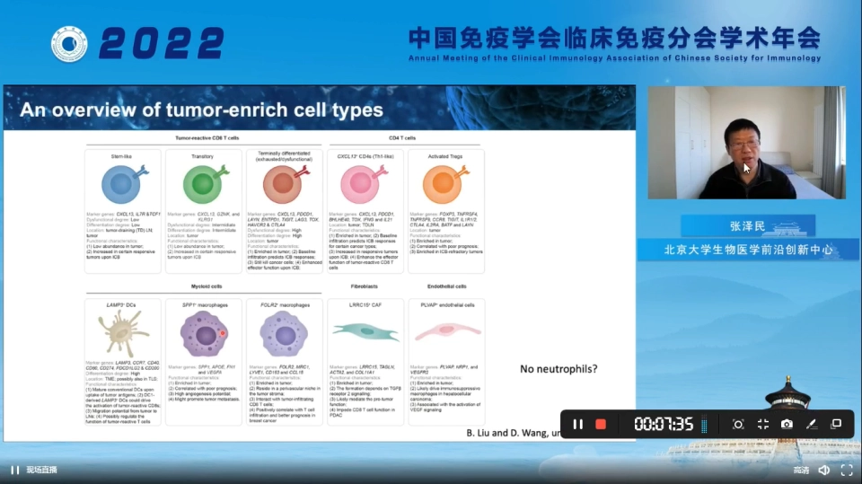

这张图值得初学者仔细看：它把"细胞类型"和"功能方向"直接对应起来了。比如 SPP1+ 巨噬细胞标注的是促肿瘤、免疫抑制；LAMP3+ DC 标注的是调节 T 细胞激活。这就是"状态"这个概念的实际用途——**名字背后是一套可检验的功能假设**。

### 2.3 一个插曲：被漏掉的中性粒细胞

讲者顺带讲了一个方法学故事。他们与张宁老师合作，做了大规模肝癌单细胞分析，除了常见的 T 细胞、NK 细胞、B 细胞、巨噬细胞之外，还拿到了**中性粒细胞**。把中性粒细胞单独拿出来分析，发现它其实有很多亚型。[【跳转到 07:59】](https://www.bilibili.com/video/BV1jR4y1r7k4/?t=479)

为什么以前发现得少？**因为以前的技术确实抓不到**——早期单细胞研究里，中性粒细胞常常在质控环节被当作低质量细胞丢掉，所以很多文章里根本找不到这一群。把它们的分布图在癌组织、癌旁、血液几个位置画出来之后，才发现有一两群是**肿瘤特异**的，被定义为 TAN（tumor-associated neutrophil，肿瘤相关中性粒细胞）。

这些 TAN 亚型功能各不相同。举一个例子：高表达 **PD-L1** 的那一群 TAN 能够抑制 CD8 T 细胞的杀伤功能。体外把 TAN 和 CD8 T 放在一起共培养，可以看到 PD-L1 表达升高、CD8 T 功能下降。功能验证也证实，把这群 TAN 敲掉之后，能观察到抑制肿瘤生长的效果。[【跳转到 08:52】](https://www.bilibili.com/video/BV1jR4y1r7k4/?t=532)

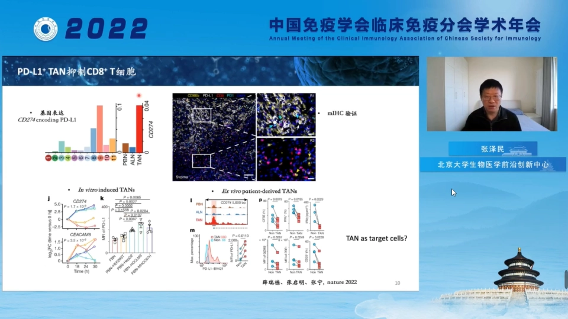

这个故事的意义不只是"多了一种细胞"，而是提醒：**细胞类型的清单本身在随技术更新**。所谓"肿瘤里没有中性粒细胞"，可能只是当年测不到。

## 三、同一个细胞类型，在不同癌种里差别巨大

### 3.1 差异有多大

讲者接着问了一个更麻烦的问题：这些细胞类型在不同肿瘤里的分布一样吗？答案是很不一样。[【跳转到 10:38】](https://www.bilibili.com/video/BV1jR4y1r7k4/?t=638)

- **SPP1+ 巨噬细胞**只在接近一半的癌种中大量存在，其他癌种里根本发现不了这种细胞类型；
- **LAMP3+ DC** 虽然在多个肿瘤里都存在，但相对数量差别非常大——鼻咽癌、胃癌、食管癌里比较高，乳腺癌、肾癌里特别低；
- **终末耗竭 T 细胞**在食管癌、肝癌、黑色素瘤中比例较高，在乳腺癌、多发性骨髓瘤中特别低；
- **Treg** 虽然普遍略高，但高的一档和低的一档能差两倍以上。

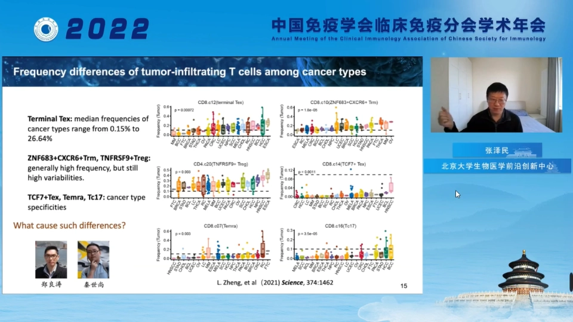

这个结论有直接的临床含义：目前大部分免疫治疗的靶点（PD-1、PD-L1、CTLA-4 等）调节的都是**耗竭性 T 细胞**。如果某个癌种里这群细胞本来就极少，那么针对它的药物效果自然有限。**"同一个靶点在不同癌种里效果不同"，一部分原因就写在这里。**

### 3.2 是什么造成了这种不同

讲者坦承这个问题很难回答。当你比较两种不同的肿瘤时，可能造成差异的因素太多了：癌细胞本身不一样、组织器官的位置不一样（肠道和肝脏本来就不同）、每个人的遗传背景也不一样——变量太多，没法做干净的比较。[【跳转到 12:26】](https://www.bilibili.com/video/BV1jR4y1r7k4/?t=746)

于是他们设计了一个能把变量压缩到最少的系统：**一个结直肠癌病人，既有原位癌，又有肝转移**。这时候遗传背景是一样的，癌细胞大体也一样，主要的不同就只剩**器官/微环境**。

具体做法是收集不同部位的单细胞数据（18 例 CRC 患者 49 个样本、16 例 HCC 患者 51 个样本、17 例 CRLM 患者 101 个样本），统一分选 CD45+ 细胞做单细胞测序。

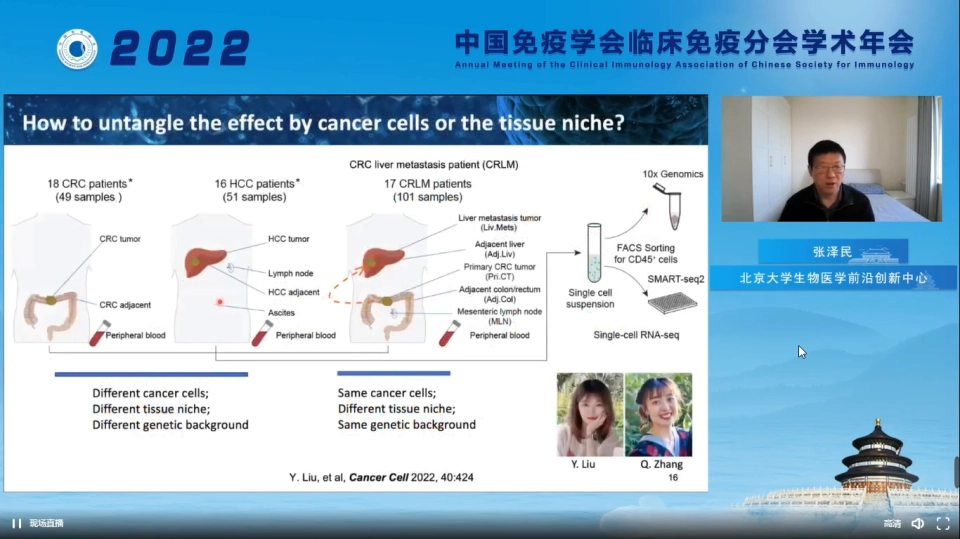

### 3.3 把每个细胞判给"癌细胞"还是"微环境"

分析上他们开发了一个方法（PhenoAlign）：以肝转移灶的细胞为查询集（query），以其他组织为参考集（reference），用 kNN 把每个细胞映射到最相似的组织，再逐一判断这个细胞更像"跟着癌细胞走的"还是"跟着组织走的"。[【跳转到 13:29】](https://www.bilibili.com/video/BV1jR4y1r7k4/?t=809)

于是细胞类型被分成两类：

- **M-type（malignancy-associated，癌细胞相关）**：不管在哪个器官，只要那里有这种癌细胞，这群细胞就出现。典型代表是**耗竭性 T 细胞**和 **SPP1+ TAN**。
- **N-type（niche-associated，微环境相关）**：主要由所在组织决定，跟癌细胞是什么关系不大。典型代表是**肥大细胞、上皮内 NK 细胞、部分亚型的巨噬细胞**。
- 还有一些复杂的细胞类型是两者的组合（combination），两种因素都有影响。

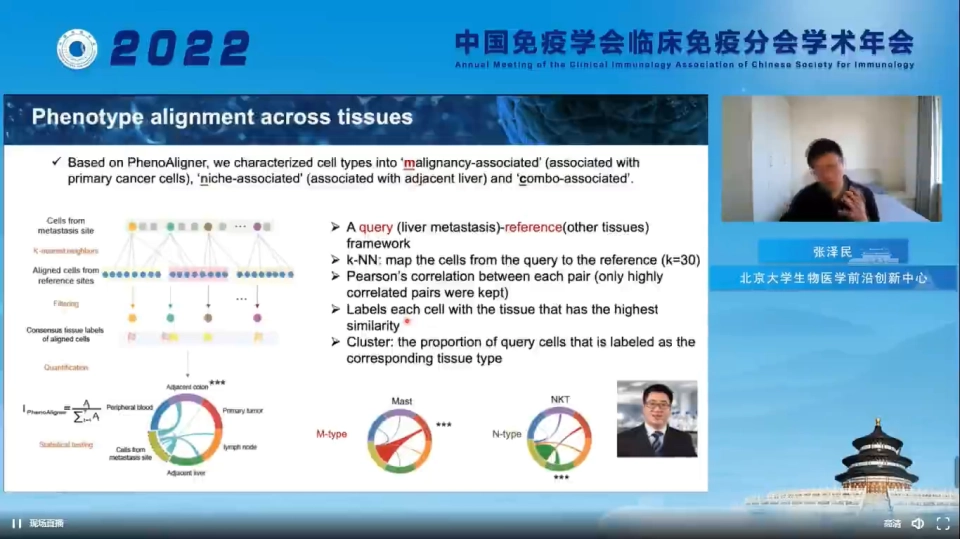

## 四、耗竭状态是怎么走过去的：一个不可逆的终点

### 4.1 一个悖论：转移灶里的耗竭 T 细胞和原发灶一模一样

讲者举了耗竭性 T 细胞作为例子。在原发灶里找到耗竭 T 细胞不奇怪，奇怪的是**在转移灶里也能找到，而且两处的细胞几乎一模一样**——不只是表达谱一样，连 TCR 都一样。[【跳转到 15:17】](https://www.bilibili.com/video/BV1jR4y1r7k4/?t=917)

最简单的模型是：原发灶的耗竭 T 细胞转移过去了。但讲者认为没那么简单，因为他们早几年就发现：**耗竭性 T 细胞是一个非常特殊的状态，一旦进入耗竭，就失去了转移能力，运动性（mobility）特别差。**

### 4.2 真正的搬运工是"可塑的中间态"

通过多个位点的分析，他们拼出了一条完整的路径：

- 有一个细胞状态叫**近期激活的效应记忆 T 细胞（recently activated effector memory T）**，它能**双向**分化：一头走向记忆/杀伤性的 Tem 样细胞，一头走向终末耗竭。
- **Tem 样细胞**进入肿瘤内部后，很容易变成耗竭状态；而一旦变成终末耗竭（Tex），就是**单向、不可逆**的——进去就耗竭了，回不来。
- 关键在于：**Tem 在外周血里流动性非常高**，而终末耗竭 T 细胞流动性很差。于是 Tem 在血液中到处流动，到了新的部位（比如肝转移灶），遇到同样的肿瘤抗原，就在那里**重新变成新的耗竭 T 细胞**。

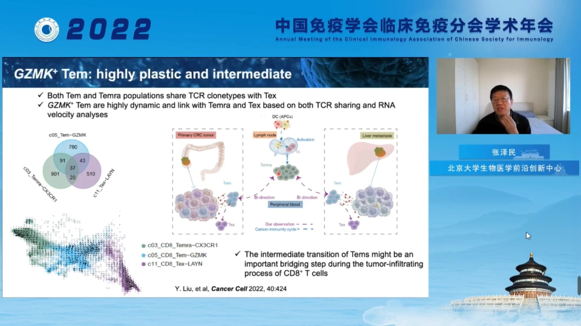

这就解释了两处耗竭 T 细胞为什么"一模一样"：**它们不是搬过去的，而是在两个地方分别由同一批流动的前体细胞就地生成的**。这个结论对治疗很关键——如果终末耗竭不可逆，那么治疗能起作用的地方只能是**它之前的那一步**。

## 五、把"识别肿瘤的细胞"找出来：CXCL13 作为统一标志

### 5.1 为什么需要一个标志

要研究治疗前后细胞状态怎么变，需要做配对活检：治疗前用穿刺针取一块组织，治疗三四周后再取一次，比较应答者和耐药者的差别。[【跳转到 18:36】](https://www.bilibili.com/video/BV1jR4y1r7k4/?t=1116)

问题是：耗竭性 T 细胞通常被认为是识别肿瘤的那群细胞，但**并不是所有识别肿瘤的细胞都进入耗竭状态**，而测序数据里的 T 细胞也不都是识别肿瘤的（很多是针对无关抗原的）。怎么把"识别肿瘤的细胞"单独拿出来？

他们的切入点是 TCR：**与终末耗竭 T 细胞共享 TCR 的细胞，一定也是识别同一个肿瘤抗原的**。用这个策略筛出肿瘤反应性细胞后，发现它们有一个共同特征——**高表达 CXCL13**。[【跳转到 19:36】](https://www.bilibili.com/video/BV1jR4y1r7k4/?t=1176)

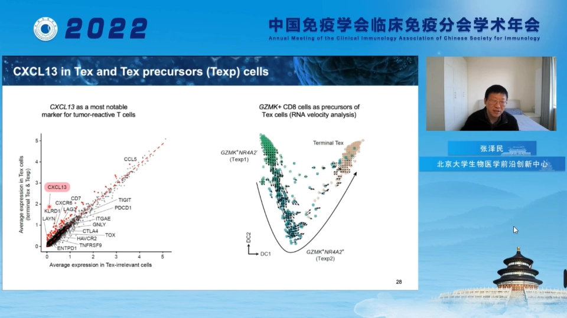

### 5.2 耗竭状态内部的细分

把识别肿瘤的这群细胞再细分，可以看到一条清晰的状态梯度：

- **TexP1（GZMK+ NR4A2−）** 与 **TexP2（GZMK+ NR4A2+）**：两个"前耗竭"（pre-exhausted，Tex precursor）亚群，都高表达 CXCL13，但耗竭标志还不高；
- **终末耗竭 Tex**：高表达 ENTPD1（CD39）、HAVCR2、LAYN、TIGIT、PDCD1 等一套经典耗竭标志。

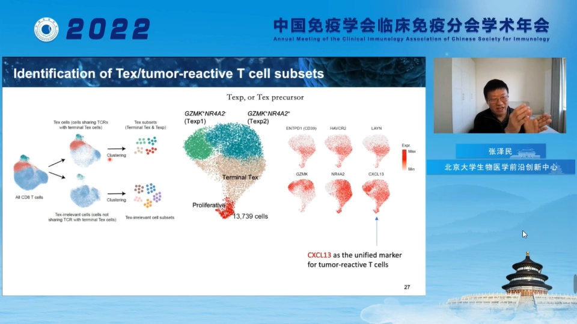

### 5.3 前耗竭细胞是免疫治疗的"火种"

接下来是这场报告最核心的临床发现（肺癌研究）：

- 这群**前耗竭细胞在治疗前就存在，但不同病人水平不一样**。治疗前水平低的病人，通常对免疫治疗不太应答；有应答的病人，治疗前这群细胞本来就稍高一些。
- 治疗后，应答者体内这群细胞**大幅增加**——它们识别肿瘤、但还没有进入耗竭状态，所以还能干活。
- 这群细胞不仅在肿瘤里存在，**在血液中也能找到一模一样的细胞**；治疗过程中它们发生克隆增生，讲者称之为 clone revival（克隆复苏）——不是"找不到"，而是原来数量少，治疗后扩增起来了。[【跳转到 20:37】](https://www.bilibili.com/video/BV1jR4y1r7k4/?t=1237)

## 六、治疗本身就是一次扰动：状态往哪边走，决定疗效

### 6.1 三阴性乳腺癌：把"预测"和"疗效"拆成两个指标

在乳腺癌（与刘志华团队合作）里，他们做了一个更系统的设计：三阴性乳腺癌患者接受抗 PD-L1 抗体治疗，同时设化疗组作比较；治疗前后配对取样，共 74 例配对活检、463,404 个高质量免疫细胞。[【跳转到 21:53】](https://www.bilibili.com/video/BV1jR4y1r7k4/?t=1313)

分析上他们把问题拆成两个可量化的指标：

- **预测指标（predictive index）**：治疗前某群细胞的比例，能不能预测肿瘤缩小程度；
- **疗效指标（therapeutic index）**：治疗过程中某群细胞的变化幅度，能不能对应肿瘤缩小程度。

结论有两条：**治疗前 B 细胞基线越高，肿瘤缩小越多；治疗过程中 T 细胞扩增越明显，肿瘤缩小越多**。

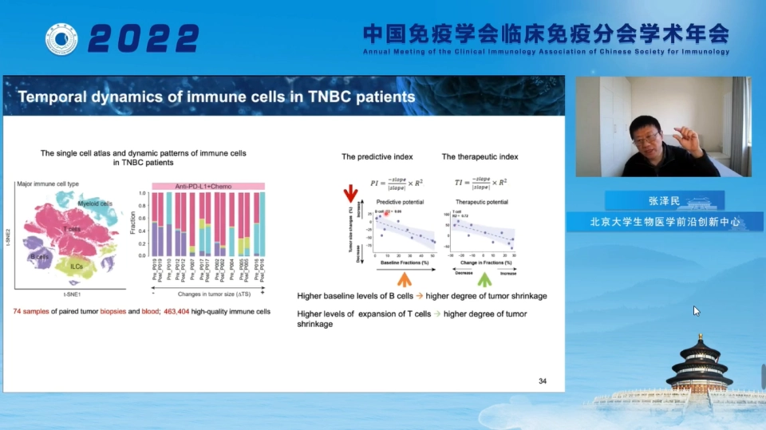

### 6.2 一个反直觉的发现：化疗可能杀掉"火种"

在免疫治疗中，最重要的两群细胞都是高表达 CXCL13 的 CD8 与 CD4 T 细胞。它们本身在治疗前的水平很重要，治疗过程中又发生了巨大变化。

但化疗组出现了一个问题：这两群细胞本身处在增生过程中，状态并不稳定。**只加化疗的时候，反而把这两群细胞杀掉了**——加化疗之后的效果还不如不加，起到了相反的作用。[【跳转到 23:07】](https://www.bilibili.com/video/BV1jR4y1r7k4/?t=1387)

讲者的比喻很到位：这两群细胞是免疫治疗的"**火种**"，有它才能让免疫治疗发挥作用；你把它杀掉了，作用反而变小。所以 combo therapy（联合治疗）在某些情况下可能是**帮倒忙**的——除非能找到一种方式，在杀癌细胞的同时保住这些免疫细胞。

### 6.3 跨癌种验证：从个例到普适规律

为了检验这个结论是不是只在肺癌、乳腺癌成立，他们把已发表的数据集重新分析：9 个数据集、覆盖 5 种细胞类型（癌种）。结论基本一致——**CXCL13+ 的 CD8 与 CD4 T 细胞，在应答者中治疗前就更高，治疗后进一步增加；无应答者基线低、治疗后也没变化**。[【跳转到 24:49】](https://www.bilibili.com/video/BV1jR4y1r7k4/?t=1489)

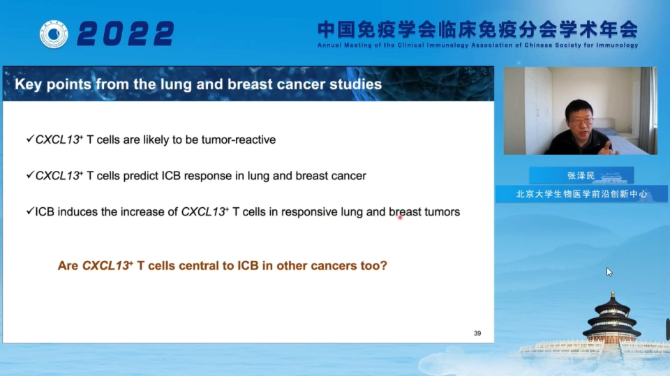

把 CD8 和 CD4 两层 CXCL13+ 细胞放在一起做预测，准确度可能接近 90%；而 TMB 之类的突变负荷指标只有五六成。

### 6.4 能不能只抽血就看出来

最后一个问题：能不能从血液里找到这些细胞？答案是能——通过 TCR 共享，可以在血液里找到识别肿瘤的 T 细胞。**有应答的病人，血液中这群细胞基线本来就比较高，治疗过程中还越来越高；无应答的则比较低，也没什么变化。** 这为"用血液检测监测免疫治疗应答"提供了依据。[【跳转到 26:34】](https://www.bilibili.com/video/BV1jR4y1r7k4/?t=1594)

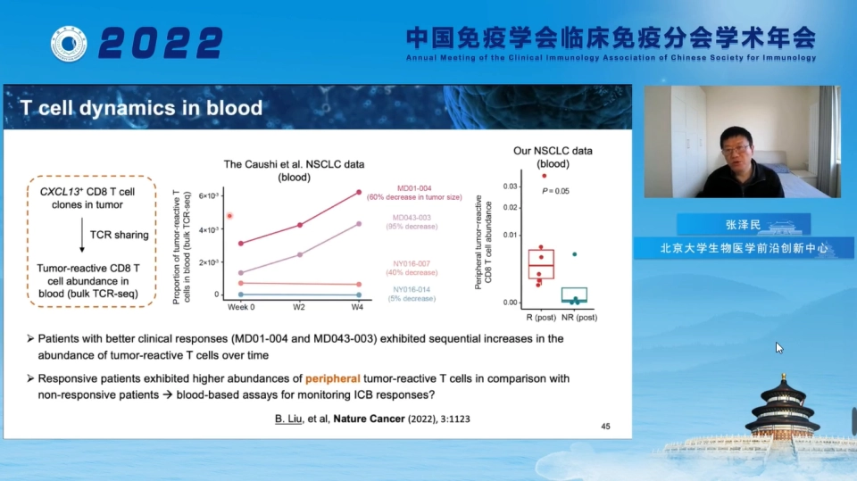

## 七、这套结论对"细胞状态"意味着什么

把整场报告压缩成一句话：**在肿瘤这个疾病条件下，免疫细胞的状态不是随机分布的，而是沿着一条有方向、有瓶颈、部分不可逆的路径演化**。

- 方向：从"识别肿瘤但未耗竭"（TexP）→"终末耗竭"（Tex）。前者能干活，后者不能。
- 瓶颈：终末耗竭不可逆，且运动性差。所以转移灶里的耗竭细胞是**就地重新生成**的，由血液中流动的、可塑的 Tem 前体送过去。
- 可干预点：既然终点不可逆，治疗只能作用在**前耗竭阶段**——扩大这批"火种"、保住这批"火种"。
- 语境依赖：同一个细胞类型在不同癌种里数量差几十倍（终末耗竭 Tex 的中位频率从 0.15% 到 26.64%），而且一部分由癌细胞决定（M-type）、一部分由器官微环境决定（N-type）。所以免疫治疗必须个体化。

这也正好接上本系列的主线：如果细胞状态的变化是有方向、可测量、且与扰动（药物、抗体、化疗）强相关的，那么"给一个扰动、预测细胞状态怎么变"就是一个可计算的问题——这是后面第 3 章和第 5 章要处理的事。

## 小结

- 免疫治疗把研究主战场从癌细胞内部推到癌细胞外部；PD-1 类治疗只对约 20% 多的病人有效，单靠"T 细胞–癌细胞"一对相互作用解释不了。
- 肿瘤里有一批特异性富集的细胞类型：耗竭 T 细胞、活化 Treg、Th1-like、LAMP3+ DC、SPP1+ 巨噬细胞、PD-L1+ TAN 等；**特异性就意味着可操作性**。
- 细胞类型清单随技术更新：中性粒细胞过去因为技术限制被漏掉，如今发现存在肿瘤特异的 TAN 亚型，其中 PD-L1+ TAN 能抑制 CD8 T 功能。
- 同一细胞类型在不同癌种里差别巨大（终末耗竭 Tex 中位频率 0.15%–26.64%），这直接限制了"同一靶点通用"的思路。
- 差异来源可以拆成两类：**M-type（癌细胞相关）**与 **N-type（微环境相关）**，用同一病人的原发灶与肝转移灶可以把变量压缩到"器官"这一项。
- 耗竭是一条**单向不可逆**的路：终末耗竭细胞运动性差，转移灶里的耗竭细胞是由血液中可塑的 Tem 前体就地重新生成的。
- **CXCL13** 是肿瘤反应性 T 细胞的统一标志；前耗竭（TexP1/TexP2）细胞是免疫治疗的"火种"，基线高、治疗后扩增者应答好。
- 化疗可能杀掉这批"火种"，联合治疗不一定总是更好；CXCL13+ CD8/CD4 T 细胞在跨 9 个数据集、5 种癌种的验证中都能预测免疫治疗应答，且可在血液中追踪。

## 关键术语速查

| 术语 | 一句话解释 |
| --- | --- |
| TME（肿瘤微环境） | 肿瘤内部由癌细胞、免疫细胞、成纤维细胞、内皮细胞及信号分子共同构成的局部环境 |
| Tex（耗竭性 T 细胞） | 长期受抗原刺激后功能衰退的 T 细胞，高表达 PDCD1、HAVCR2、LAYN、ENTPD1、TIGIT 等 |
| TexP（前耗竭 T 细胞） | 识别肿瘤但尚未进入终末耗竭的 T 细胞前体，是免疫治疗起效的关键细胞群 |
| Tem / Temra | 效应记忆 T 细胞 / 近期激活的效应记忆 T 细胞，后者可塑性高、在血液中流动性强 |
| CXCL13 | 趋化因子，本讲中作为"肿瘤反应性 T 细胞"的统一标志基因 |
| TCR 共享 | 两个细胞拥有相同的 T 细胞受体序列，说明它们识别同一抗原、来自同一克隆 |
| TAN | 肿瘤相关中性粒细胞；其中 PD-L1+ 亚群可抑制 CD8 T 细胞功能 |
| SPP1+ 巨噬细胞 | 高表达 SPP1（骨桥蛋白）的肿瘤相关巨噬细胞亚群，多与免疫抑制、促肿瘤相关 |
| LAMP3+ DC | 一类在肿瘤中富集的树突状细胞亚群，与 T 细胞激活调节相关 |
| Treg（调节性 T 细胞） | 抑制免疫反应的 CD4 T 细胞亚群，肿瘤中常增多并压制抗肿瘤免疫 |
| M-type / N-type | 癌细胞相关（malignancy-associated）/ 微环境相关（niche-associated）的细胞类型分类 |
| ICB | 免疫检查点阻断（immune checkpoint blockade），如 PD-1/PD-L1、CTLA-4 抗体治疗 |
| TMB | 肿瘤突变负荷，用突变数量预测免疫治疗应答，准确度通常只有五六成 |
| 克隆复苏（clone revival） | 治疗前数量很少的肿瘤反应性 T 细胞克隆，在治疗后被扩增出来 |
| 配对活检 | 同一病人在治疗前和治疗后各取一次组织，用于比较治疗引起的细胞状态变化 |