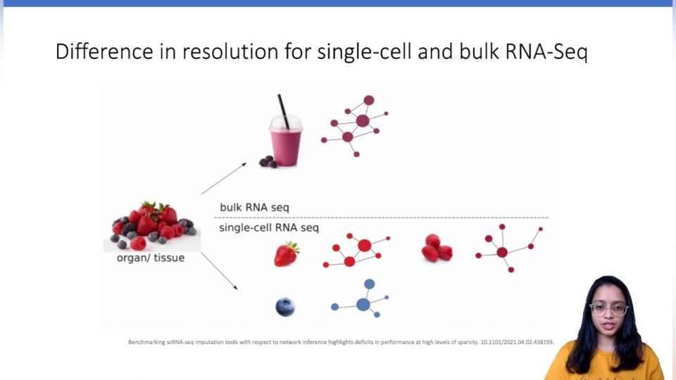
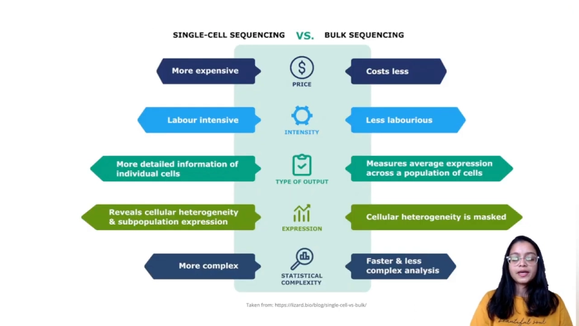
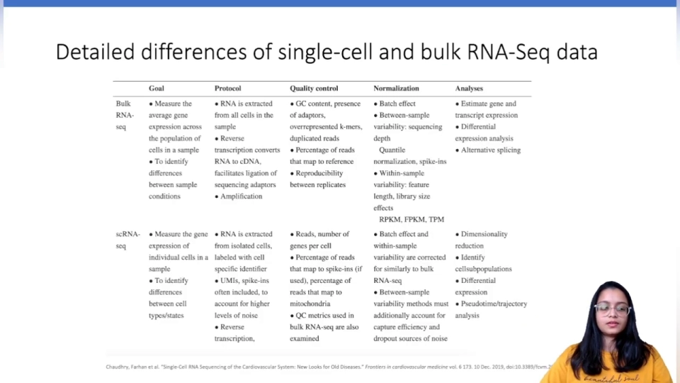
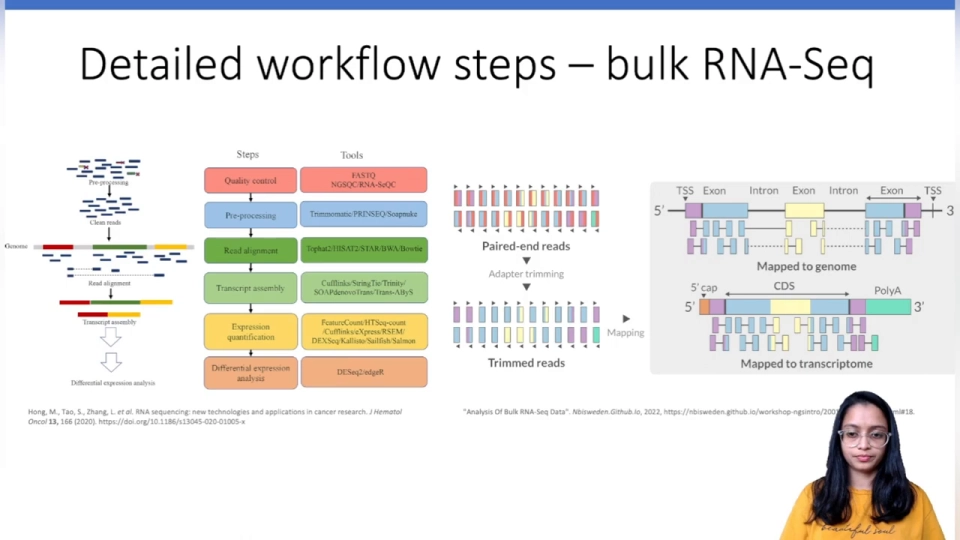
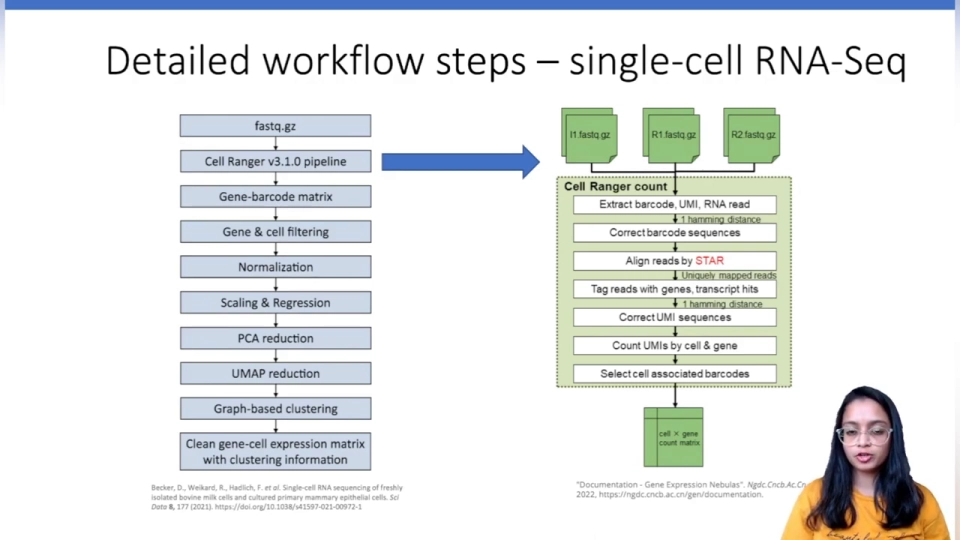
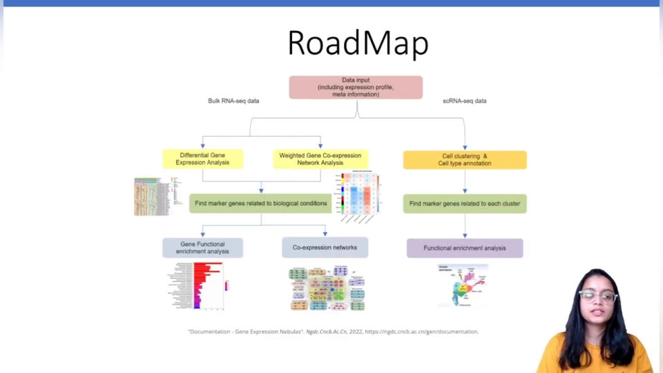

# Bulk 与单细胞 RNA-seq 的分辨率差异与适用场景

> 视频来源：[The Beginner's guide to bulk RNA sequencing vs single-cell RNA Sequencing](https://www.youtube.com/watch?v=bMf1cnttuPk)（YouTube · Bioinformagician）｜时长约 12 分钟
> 导读：这支视频不做操作教学，而是把 bulk 与单细胞两种转录组数据**逐项对照**：分辨率、成本、建库协议、质控指标、归一化方式、计算流程与下游分析。本文按它的对照顺序整理，重点在「同一件事两种数据各自怎么做、各自能回答什么问题」。比对定量、UMI 去重、cell calling 的算法细节留给第 2 章，分析建模留给第 5 章。

## 本讲要解决的核心问题（SCQA）

**背景**：bulk RNA-seq 和单细胞 RNA-seq 测的是同一个分子——RNA，用的也是同一台测序仪。名字相似，很多人以为它们是同一件事的两种叫法。

**冲突**：实际上两者的**数据单位**完全不同：bulk 的一个样本是一管细胞，单细胞的一个样本是一个细胞。这导致建库协议、质控指标、归一化方式、计算流程、能做的下游分析全都不一样。用 bulk 的分析习惯去处理单细胞数据，或者反过来，都会出错。

**疑问**：这两种数据到底在哪些层面上不同？什么情况下 bulk 就够用，什么情况下必须上单细胞？

**回答（中心思想）**：两种技术的根本差别是**分辨率**——bulk 测的是群体平均表达，单细胞测的是每个细胞各自的表达。分辨率决定了你能问什么问题：比较**样本之间/条件之间**的差异，bulk 又快又便宜；比较**细胞类型之间/细胞状态之间**的差异，必须用单细胞。其余所有差异（成本、协议、质控、归一化、分析流程）都是这一条差别的下游后果。

## 一、分辨率：果昔与水果的区别

讲者用一杯果昔开场。把多种水果和别的配料一起放进搅拌机打成一杯果昔，这个过程类似生成 bulk RNA-seq 数据：起始材料是一块**同质化的混合样本**（比如一块组织），处理后得到的是基因表达定量值，而这些定量值是**在所有细胞上平均过的**——就像你尝到的是所有水果混合后的味道。

单细胞数据则保留每个细胞各自的信息。在果昔的例子里，相当于**保留了每一种水果各自的味道**。落到基因表达上，这意味着三件 bulk 做不到的事：

- 能识别样本里有哪些细胞类型；
- 能把一群细胞和另一群细胞放在一起比较；
- 能看出不同细胞类型之间表达模式的差异。

[【跳转到 01:33】](https://www.youtube.com/watch?v=bMf1cnttuPk&t=93)

### 1.1 分辨率决定能回答什么问题

讲者给了一个很实际的例子：手上有一批肺癌病人的样本，如果只想知道「病人和健康人整体上有什么表达差异」，用 bulk 测序把两组比一比就够了——这类平均层面的差异足以支撑**生物标志物的发现**。

但很多时候答案藏在**某一类细胞**里。比如某个基因在肿瘤细胞里没变，只在肿瘤浸润的免疫细胞里变了；这种差异在平均之后会被稀释掉。这时就必须下沉到细胞层面，比较不同细胞群之间的表达，才能找到只与特定细胞类型相关的差异。

[【跳转到 02:02】](https://www.youtube.com/watch?v=bMf1cnttuPk&t=122)

## 二、非技术层面的五点差异

在进入协议细节之前，讲者先摆了五个「非技术」维度的对照：

| 维度 | 单细胞 RNA-seq | Bulk RNA-seq |
| --- | --- | --- |
| 价格 | 更贵 | 更便宜 |
| 人力投入 | 更费人工 | 更省人工 |
| 输出类型 | 单个细胞的详细信息 | 群体平均表达 |
| 表达异质性 | 能揭示细胞异质性与亚群表达 | 细胞异质性被掩盖 |
| 统计复杂度 | 更复杂 | 更快、更简单 |

这五条其实互为因果：因为要保留每个细胞的信息，所以建库更贵、更费人工、数据更复杂；而 bulk 因为直接平均掉了个体差异，所以便宜、快、分析简单——代价是异质性被掩盖。

[【跳转到 03:07】](https://www.youtube.com/watch?v=bMf1cnttuPk&t=187)

## 三、技术层面的逐项对照

讲者用一张表把两种数据在五个技术维度上并列：目标（Goal）、协议（Protocol）、质控（Quality control）、归一化（Normalization）、分析（Analyses）。

[【跳转到 03:56】](https://www.youtube.com/watch?v=bMf1cnttuPk&t=236)

### 3.1 目标：比较样本，还是比较细胞

- **bulk**：测量一个样本内**细胞群体**的平均基因表达；用于识别**样本之间/条件之间**的差异。
- **单细胞**：测量样本内**每个细胞**的基因表达；用于识别**细胞类型之间/细胞状态之间**的差异。

这条差别决定了后面所有流程的设计取向。

[【跳转到 04:41】](https://www.youtube.com/watch?v=bMf1cnttuPk&t=281)

### 3.2 协议：RNA 从哪来、有没有细胞标签

- **bulk**：从样本里**所有细胞**一起提取 RNA，反转录成 cDNA，扩增。反转录这一步同时起到「把 RNA 变成可测序的 DNA、并接上测序接头」的作用。
- **单细胞**：从**单个细胞**提取 RNA，并且给每个细胞的 RNA 打上**细胞特异的标识（barcode）和 UMI**；这些标识是在反转录、扩增过程中被写进 cDNA 的。

UMI（unique molecular identifier）的作用是标记「原始分子」而不是「PCR 拷贝」，因此可以区分真正的表达量与扩增偏好；barcode 的作用是把混合测序数据按细胞拆开。这两样东西是单细胞数据多出来的信息层，也是它后续分析更复杂的原因。

[【跳转到 04:57】](https://www.youtube.com/watch?v=bMf1cnttuPk&t=297)

### 3.3 质控：看 read 的质量，还是看每个细胞的捕获

- **bulk**：分比对前与比对后两段看。比对前检查 read 的质量分数、GC 含量、接头污染、是否出现过度呈现的 k-mer；比对后看能唯一比对到参考基因组的 read 比例，以及重复实验之间的可重复性。
- **单细胞**：看**每个细胞的 read 数和基因数**，看比对到 spike-in（外源对照转录本）的 read 比例，以及比对到**线粒体**的 read 比例（线粒体比例高通常意味着细胞膜破损、胞质 RNA 流失）。此外，bulk 的那套质控指标在单细胞里同样要看。

一句话概括：bulk 的质控对象是「一个文库」，单细胞的质控对象是「成千上万个细胞」，所以必须逐细胞评估。

[【跳转到 05:41】](https://www.youtube.com/watch?v=bMf1cnttuPk&t=341)

### 3.4 归一化：目标相同，噪声来源不同

归一化的目标在两种数据里一致：让归一化后的计数能反映**真实的表达差异**，从而能跨样本做有意义的比较。两者都有方法处理**样本间变异**和**样本内变异**，具体选哪种取决于你要做的比较类型。

差别在噪声结构：

- **bulk** 的样本内变异主要来自特征（基因）长度和文库大小，用 RPKM、FPKM、TPM 这类长度与深度归一化就能处理；样本间变异主要来自测序深度和批次效应，可用分位数归一化、spike-in 等方法处理。
- **单细胞** 的批次效应与样本内变异可以按类似 bulk 的思路处理，但**样本间变异必须额外考虑捕获效率（capture efficiency）和 dropout 造成的噪声**——也就是「一个基因明明有表达，却因为没被捕获到而记成 0」的问题。

[【跳转到 06:01】](https://www.youtube.com/watch?v=bMf1cnttuPk&t=361)

### 3.5 分析：能做的下游分析不一样

- **bulk**：估计基因与转录本水平的表达量、做条件间的差异表达分析、检测**可变剪接**事件。
- **单细胞**：降维、识别细胞亚群、做**簇与簇之间**的差异表达、做拟时序/轨迹分析（考察处于不同发育阶段的细胞里基因表达如何变化）。

注意「可变剪接」这一项是 bulk 的专属优势：单细胞常用的 3′ 端计数建库只测转录本的一端，拿不到完整的剪接信息。

[【跳转到 06:34】](https://www.youtube.com/watch?v=bMf1cnttuPk&t=394)

## 四、Bulk 的计算流程：从 FASTQ 到计数矩阵

讲者把 bulk 的流程拆成五步，每步都点了常用工具：

1. **质控与预处理**：评估并清洗原始测序数据（通常是 FASTQ），去掉低质量碱基、切掉接头序列。常用 FastQC、NGS QC、Trimmomatic、PRINSEQ、SolexaQA。
2. **比对**：把清洗后的 read 比对到基因组或转录组。TopHat2、HISAT2、STAR 可把 read 比对到基因组；STAR 与 Bowtie 也可比对到转录组。
3. **转录本组装**：用 Cufflinks、StringTie、Trinity 从短读长组装出转录本模型。
4. **表达定量**：有了转录本模型后，可在基因、转录本、外显子三个层级定量。基因水平常用 featureCounts、HTSeq-count；转录本水平用 Cufflinks、RSEM；DEXSeq 提供外显子水平的定量。此外还有**免比对（alignment-free）**工具 Kallisto、Salmon，计算资源消耗更低。
5. **计数矩阵 → 下游分析**：把基因/转录本水平的定量存成计数矩阵，再做差异表达分析等。

[【跳转到 07:31】](https://www.youtube.com/watch?v=bMf1cnttuPk&t=451)

## 五、单细胞的计算流程：Cell Ranger 把 FASTQ 变成基因×细胞矩阵

单细胞（这里特指 10x Genomics 的 Chromium 数据）的流程由 **Cell Ranger** 统一完成，具体用哪条 pipeline 取决于文库类型。它的内部步骤是：

1. 从 read 中**提取** barcode、UMI 和生物学 read 序列；
2. **纠正 barcode 序列**（按 1 个碱基的汉明距离容忍测序错误）；
3. 用 **STAR** 把 read 比对到基因组，只保留唯一比对上的 read；
4. 给 read 打上基因与转录本的标签；
5. **纠正 UMI 序列**（同样按 1 个碱基的汉明距离）；
6. 按细胞与基因**计数 UMI**；
7. **筛选细胞相关的 barcode**（区分真细胞与空液滴的背景）；
8. 输出 **feature-barcode 矩阵**：行是基因、列是细胞 barcode、值是定量结果——这就是 bulk 里计数矩阵的对应物。

拿到矩阵之后，才进入常规处理：过滤、归一化、缩放、降维，最终把数据可视化到二维平面上；这些步骤在 Seurat 包里都有对应函数。

[【跳转到 09:01】](https://www.youtube.com/watch?v=bMf1cnttuPk&t=541)

对比两条流程可以看出关键区别：bulk 的流程终点是「基因 × 样本」的计数矩阵，样本数通常是个位数到几十；单细胞的终点是「基因 × 细胞」的矩阵，列数动辄上万，而且每一列都要先经过「这到底是不是一个真细胞」的判定。

[【跳转到 10:16】](https://www.youtube.com/watch?v=bMf1cnttuPk&t=616)

## 六、拿到矩阵之后：两条下游分析路线

讲者最后画了一张路线图，把两种数据的分叉点讲清楚。

**bulk 路线**：从表达谱与元数据出发，做差异基因表达分析（如 R 包 DESeq2）或**加权基因共表达网络分析（WGCNA）**——后者用来找高度相关的基因模块。两条路都通向「与生物学条件相关的候选标志基因」，再往下是基因功能富集分析和共表达网络构建。这些结果通常用于筛选候选生物标志物或治疗靶点。

**单细胞路线**：先做细胞聚类与细胞类型注释，再找**每个簇**的标志基因，然后做功能富集分析，看哪些通路在哪些细胞簇里富集；此外还可以做拟时序/轨迹分析，研究处于不同发育阶段的细胞里基因表达如何变化。

[【跳转到 10:21】](https://www.youtube.com/watch?v=bMf1cnttuPk&t=621)

## 小结

- 两种技术的根本差别是**分辨率**：bulk 的一个样本是一管细胞，单细胞的一个样本是一个细胞；前者给平均表达，后者给每个细胞各自的表达。
- 分辨率决定问题类型：比较**样本/条件之间**的差异用 bulk，比较**细胞类型/状态之间**的差异用单细胞。平均会稀释甚至抵消只发生在少数细胞里的变化。
- 非技术代价：单细胞更贵、更费人工、数据更复杂；bulk 更便宜、更快、分析更简单，但细胞异质性被掩盖。
- 协议差别在于单细胞多了一层**细胞 barcode 与 UMI** 的信息，这层信息既是它能拆分细胞的原因，也是它分析更复杂的根源。
- 质控对象不同：bulk 质控一个文库（read 质量、GC、接头、唯一比对率、可重复性），单细胞必须逐细胞质控（每细胞 read 数/基因数、spike-in 比例、线粒体比例）。
- 归一化目标相同但噪声不同：单细胞必须额外处理捕获效率与 dropout。
- 计算流程的终点都是计数矩阵，但一个是「基因 × 样本」，一个是「基因 × 细胞」，后者还多一步「判定哪些 barcode 是真细胞」。
- 下游分析分叉：bulk 走差异表达 + 共表达网络 + 可变剪接，单细胞走聚类注释 + 每簇标志基因 + 拟时序。

## 关键术语速查

| 术语 | 一句话解释 |
| --- | --- |
| 分辨率 | 一次测量对应的最小单位；bulk 的分辨率是「一管细胞」，单细胞的分辨率是「一个细胞」 |
| 细胞 barcode | 一段短 DNA 序列，同一个细胞的所有转录本共享，用于把混合测序数据按细胞拆分 |
| UMI | 唯一分子标识，标记原始 RNA 分子而非 PCR 拷贝，用于去除扩增重复 |
| spike-in | 外源加入的已知量对照转录本，用来估计捕获效率与绝对表达量 |
| dropout | 某个基因明明有表达，却因捕获不到而在数据里记为 0 的现象 |
| 计数矩阵 | 行是基因、列是样本或细胞、值是计数（或定量）的表格，是下游分析的输入 |
| 免比对定量 | 不把 read 比对到基因组，而是直接对转录本序列做伪比对来定量的方法，如 Kallisto、Salmon |
| 可变剪接 | 同一个基因通过不同的外显子组合产生多个转录本；bulk 数据可以检测，3′ 端计数的单细胞数据通常不能 |
| WGCNA | 加权基因共表达网络分析，把高度相关的基因聚成模块，用于找候选标志物与靶点 |
| 拟时序 / 轨迹分析 | 按表达相似度把细胞排成一条发育或状态转变的路径，观察基因表达如何随时间变化 |
| Cell Ranger | 10x Genomics 提供的单细胞数据处理流程，从 FASTQ 输出基因 × 细胞矩阵 |