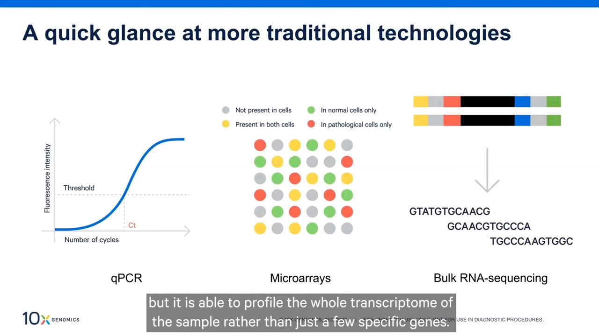
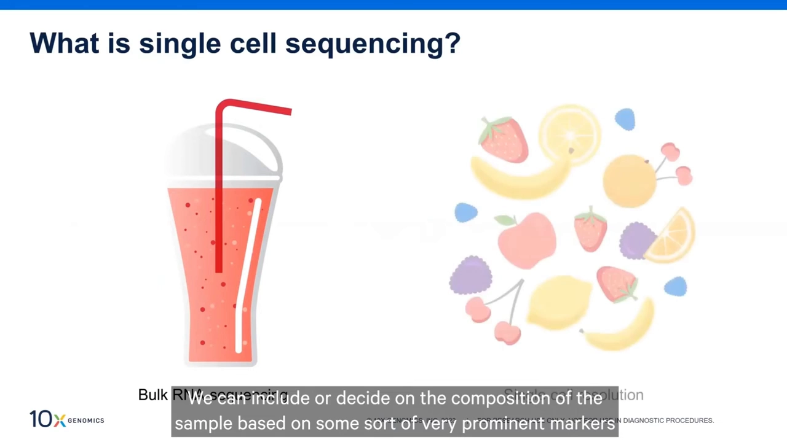
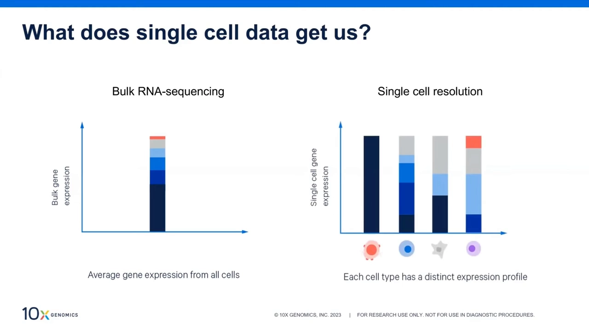
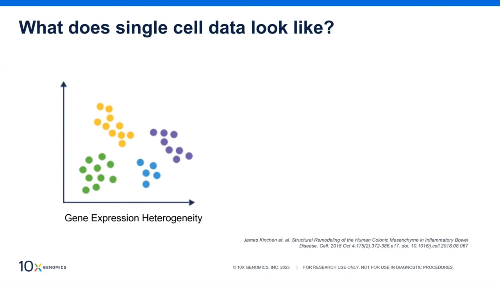
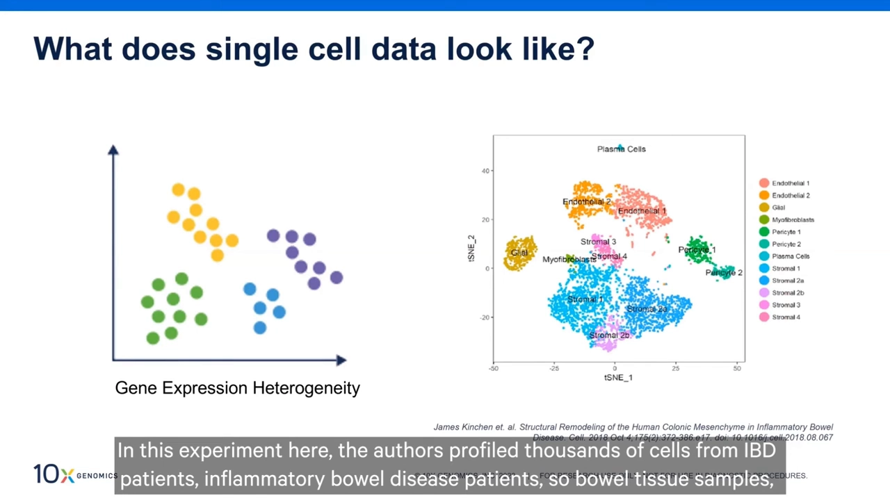
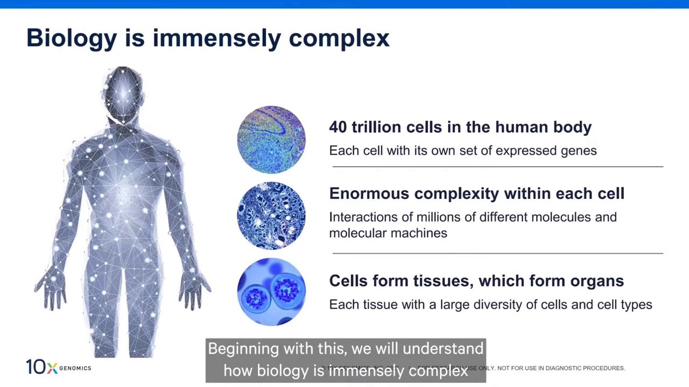
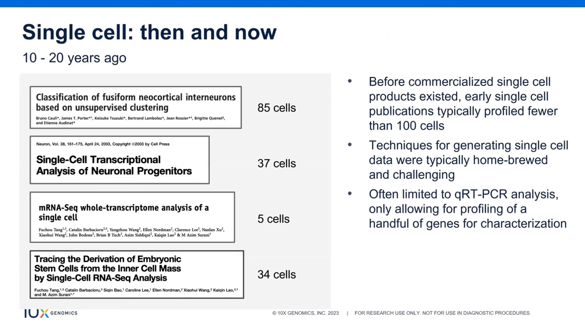
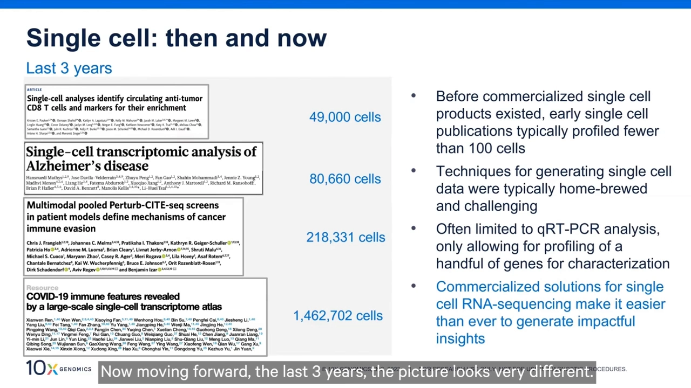

# 为什么需要单细胞：从 qPCR、bulk 到百万细胞图谱

> 视频来源：[What is single cell and why does it matter?](https://www.youtube.com/watch?v=pKngHhBCnHU)（YouTube · 10x Genomics《Getting Started with Single Cell Analysis》Part 1）｜时长约 9 分钟
> 导读：这支短片用"工具演进"的线索回答一个问题——既然已经有 qPCR、芯片和 bulk RNA-seq，为什么还要单细胞？它把三代传统技术各自的局限讲得很清楚，再用一个果昔与水果盘的比喻说明单细胞多买到了什么。本文按原片顺序整理，并在结尾把"价值"放回取舍里；代价与坑的细节见同小节另一篇《单细胞数据能支撑什么结论》。

## 本讲要解决的核心问题（SCQA）

**背景**：qPCR、流式细胞术、bulk RNA 测序这些工具，已经把生物学研究带到了今天的位置，绝大多数实验室都熟悉它们。

**冲突**：生物学本身极其复杂——人体约有 40 万亿个细胞，每个细胞有自己的一套表达基因，细胞内的分子机器之间还有海量相互作用，而细胞组成组织、组织组成器官。面对这种复杂度，"把一堆细胞混起来测"得到的只是一个平均值。

**疑问**：如果目标是看清这种复杂度，我们需要什么样的工具？单细胞测序究竟比现有工具多给了什么？

**回答（中心思想）**：三代传统工具的共同短板是**分辨率**——qPCR 和芯片只能看你事先知道的少数基因，bulk RNA-seq 能看全部基因但把细胞混成了平均值。单细胞测序补的正是这一层：**在保留全转录组广度的同时，把每个细胞的表达单独记录下来**，于是"哪一类细胞在表达哪个基因"第一次可以被直接读出来。

## 一、三代传统工具，卡在同一个地方

### 1.1 RT-qPCR：便宜、准，但只能问"你已经知道的问题"

RT-qPCR 是 bulk 方法：先从样本里提取总 RNA，反转录成 cDNA，再用事先设计好的基因特异性引物定量目标基因。它的优点是**便宜**——看几个感兴趣的基因非常划算 [【跳转到 00:54】](https://www.youtube.com/watch?v=pKngHhBCnHU&t=54)。

但它的局限也很明确 [【跳转到 01:44】](https://www.youtube.com/watch?v=pKngHhBCnHU&t=104)：

- 它是 bulk 方法，**样本的异质性被抹掉了**；
- 一次只能看少数几个选定的基因；
- 最关键的是，**这些基因必须是你已经知道的**——所以你没法用它发现新的生物标志物。

一句话：qPCR 是很棒的验证工具，但它不是发现工具。

### 1.2 微阵列：广度上去了，"必须事先知道"没变

微阵列（microarray）同样是 bulk 方法，但一次能看几千个基因：玻璃片上印着成千上万个位置固定的小点，每个点是一段已知的 DNA 序列或基因，作为探针去捕获样本中的表达信号，读出方式是荧光 [【跳转到 02:34】](https://www.youtube.com/watch?v=pKngHhBCnHU&t=154)。

它的问题和 qPCR 同源：**你仍然得先知道要测哪些基因**。所以微阵列是很好的验证工具，作为发现工具则不太合适 [【跳转到 02:59】](https://www.youtube.com/watch?v=pKngHhBCnHU&t=179)。

### 1.3 bulk RNA-seq：终于能"发现"，但仍然是一个平均值

bulk RNA 测序依然是 bulk 方法，但它能测**整个转录组**，而不只是少数指定基因：先按 mRNA 的 polyA 尾巴构建 cDNA 文库，加上引物后上下一代测序，于是全转录组都被读到——这才真正让"发现新的重要基因"成为可能 [【跳转到 03:24】](https://www.youtube.com/watch?v=pKngHhBCnHU&t=204)。

代价还是同一件事：**样本的完整轮廓、完整异质性，丢了** [【跳转到 03:49】](https://www.youtube.com/watch?v=pKngHhBCnHU&t=229)。

### 1.4 果昔与水果盘：一个值得记住的比喻

讲座用了一个很好用的比喻 [【跳转到 04:02】](https://www.youtube.com/watch?v=pKngHhBCnHU&t=242)：

- **bulk RNA-seq 像一杯果昔**：所有水果被打碎混在一起，你只能测到"这杯的总糖度"。你可以根据几个特别显眼的 marker 去猜里面放了什么，但**因为缺乏细分辨率，完整画面很难还原**；
- **单细胞测序像直接看那盘水果**：哪一种水果、各有多少、分别是什么味道，一目了然，**不需要靠猜和假设**。

## 二、单细胞数据多给了什么

### 2.1 从"一个平均值"到"每个亚群各自的表达"

讲座把"单细胞数据给了我们什么"讲成一句话：**当我们用 bulk 方法测一份异质样本时，测到的是异质性的平均值**；换成单细胞测同一份样本，就能看到**每个亚群**，并知道**哪一类细胞在表达哪个基因** [【跳转到 05:12】](https://www.youtube.com/watch?v=pKngHhBCnHU&t=312)。

这就是单细胞在这个系列里的位置：它不是为了"更精确地测同一个平均值"，而是为了**换一个测量单位**——从"一份样本"换成"一个细胞"。

### 2.2 t-SNE 图怎么读：每个点是一个细胞

单细胞数据的常见呈现方式是 t-SNE 图（一种把高维表达数据压到二维的方法）[【跳转到 05:47】](https://www.youtube.com/watch?v=pKngHhBCnHU&t=347)：

- **每个点代表一个细胞或一个细胞核**；
- 靠得近的点，说明它们的转录谱更相似；离得远的，差异更大；
- 表达谱相似的细胞被聚成簇（图上用不同颜色表示）；
- 这些簇再根据**已知细胞类型的特征 marker 基因**去注释命名。

### 2.3 一个真实例子：炎症性肠病的肠组织

讲座给了一个真实数据的例子：研究者对炎症性肠病（IBD）患者的肠组织样本测了数千个细胞，在 t-SNE 图上分辨出多种细胞类型，并按特征 marker 给每一群命名 [【跳转到 07:02】](https://www.youtube.com/watch?v=pKngHhBCnHU&t=422)。

这张图的意义不在于"图好看"，而在于：**同一个样本里的不同细胞类型，第一次可以被逐个点名、逐个比较**。而如果用 bulk 测同一块组织，这些类型只会被压成一根柱子。

### 2.4 别忘了它解决的是"复杂度"这个前提

讲座开场那页幻灯片值得单独记住：人体约 40 万亿个细胞，每个细胞有自己的一套表达基因，细胞内有数百万分子与分子机器的相互作用，细胞组成组织、组织组成器官，而每种组织里都有大量不同的细胞与细胞类型 [【跳转到 00:10】](https://www.youtube.com/watch?v=pKngHhBCnHU&t=10)。

**正因为研究对象是这种层级结构，"平均值"才不够用**——这是整支视频的立论基础。

## 三、十年之间：从不到 100 个细胞到百万细胞

讲座最后用两张幻灯片对比了技术演进的速度。

**10 到 20 年前**：早期单细胞论文通常只测不到 100 个细胞（幻灯片上列出的四个早期研究分别测了 85、37、5、34 个细胞）；方法是各家实验室自己搭的（homebrew），难度很高，往往只有非常熟练的研究者才能做；分析手段常常局限于 qRT-PCR，只能刻画少数几个基因 [【跳转到 07:36】](https://www.youtube.com/watch?v=pKngHhBCnHU&t=456)。

**最近三年**：论文里的细胞数到了数万、数十万，甚至上百万（幻灯片上举的例子从 4.9 万、8 万、21.8 万一直到 146 万细胞）；主要推动力是**商业化的单细胞 RNA 测序方案**，让普通实验室也能上手做自己的研究 [【跳转到 08:26】](https://www.youtube.com/watch?v=pKngHhBCnHU&t=506)。

讲者最后提到自家产品已助力超过 5000 篇论文发表 [【跳转到 08:59】](https://www.youtube.com/watch?v=pKngHhBCnHU&t=539)。这一页属于厂商宣传，读的时候知道它的立场即可；真正有用的信息是前面那两张"细胞数对比"。

## 四、把"价值"放回取舍里

这支视频是厂商出品的入门课，立场明确：它系统讲了单细胞**多买到了什么**，但没有展开讲**代价**。为了不被单方面的叙述带走，这里把两边对齐一下（代价部分的细节见同小节另一篇《单细胞数据能支撑什么结论》）：

| 你要回答的问题 | 更合适的工具 | 理由 |
| --- | --- | --- |
| 少数已知基因在两组样本间是否变化 | qPCR | 便宜、快速、定量可靠 |
| 全转录组筛查 + 大样本量 + 需要稳健的组间差异 | bulk RNA-seq | 更深、更便宜、重复更容易做够 |
| 有哪些细胞类型、各占多少 | 单细胞 | 只有单细胞能逐个细胞分辨 |
| 同一类细胞内部是否存在不同状态 | 单细胞 | 需要单细胞分辨率才能看到群内异质性 |
| 稀有细胞类型 / 新细胞状态的发现 | 单细胞 | bulk 里会被多数细胞稀释掉 |
| 每个细胞带一个扰动、读出各自的响应 | 单细胞（Perturb-seq 一类） | 扰动标签与表达读出必须在同一细胞里对应 |

判断口诀可以压成一句：**先问"我要的是平均值，还是要分布"**。要平均值，bulk 又便宜又深；要分布、要亚群、要"哪个细胞在做什么"，才轮到单细胞——而且必须接受它每个细胞测得更浅、零值更多这个代价。

## 小结

- **三代传统工具的共同短板是分辨率**：qPCR 与芯片只能问"你已经知道的问题"，bulk RNA-seq 能发现新基因但把细胞混成了平均值。
- **单细胞的增量是"换测量单位"**：从"一份样本一个值"变成"一个细胞一个值"，于是亚群、细胞类型、群内异质性第一次可读。
- **t-SNE 图的读法**：一个点一个细胞，距离代表转录谱相似度，簇要靠 marker 基因注释，而不是靠颜色好看。
- **真实数据的价值**：同一块 IBD 肠组织里，内皮、基质、周细胞、浆细胞等类型可以被逐个点名比较。
- **十年间的变化主要在通量与门槛**：从不到 100 个细胞、自建方法，到百万细胞、商业化方案。
- **取舍**：要平均值选 bulk，要分布与亚群选单细胞；两者常常配合使用，而不是互相替代。

## 关键术语速查

| 术语 | 一句话解释 |
| --- | --- |
| RT-qPCR | 反转录后用引物定量少数已知基因，便宜但只能问已知问题 |
| 微阵列（microarray） | 玻璃片上印成千上万个已知探针，一次测几千个基因，仍需事先知道测什么 |
| bulk RNA-seq | 测整块组织的全部转录组，广度最好，但结果是所有细胞的平均 |
| 异质性（heterogeneity） | 同一份样本里细胞之间的差异；bulk 会把它平均掉 |
| 单细胞分辨率 | 以单个细胞为测量单位，能分辨亚群与细胞类型 |
| t-SNE | 把高维表达压到二维的投影方法，常用于展示单细胞聚类 |
| marker 基因 | 某类细胞特征性高表达的基因，用来给簇命名 |
| 亚群（subpopulation） | 同一类细胞里表达谱仍有区别的一小群细胞 |