# 单细胞数据能支撑什么结论：从计数矩阵到可验证的生物学主张

> 视频来源：[Single-cell RNA sequencing explained: from one cell to a count matrix, a cell map and an atlas](https://www.youtube.com/watch?v=4uVNXrxRJvE)（YouTube · 生物資訊博士談科學）｜时长约 32 分钟
> 导读：这是一支**批判性阅读**单细胞论文的讲座，不教软件操作，而是沿「样本 → 计数矩阵 → 细胞地图 → 图谱」四步追问：每一步的推断强度有多高？哪些结论数据真的支撑得起，哪些只是分析选择的结果。本文按原片顺序整理，术语在首次出现处解释。

## 本讲要解决的核心问题（SCQA）

**背景**：单细胞 RNA 测序（scRNA-seq）现在很便宜也很常见，一张 UMAP 图加上几个 marker 基因，就能讲出一个"发现了新细胞亚群"的故事。

**冲突**：同一份数据，换一套过滤阈值、换一个聚类分辨率、换一种差异检验方法，结论就可能变；而很多论文里最抓人的那张图，本身只是一个二维投影，并不是实验证据。

**疑问**：拿到一份单细胞数据（或一篇单细胞论文），我们究竟能从中得出多强的生物学结论？哪些说法有数据支撑，哪些只是"看起来像"？

**回答（中心思想）**：单细胞数据的**真正增量**是把"组织平均信号"拆成"细胞组成"与"细胞内表达"两件事；而它的**代价**是每个细胞只测到少量转录本、每个样本只代表一个样本。因此判断一份单细胞结论是否可信，只需要沿着四步走：**样本设计 → 计数矩阵 → 细胞地图 → 图谱与比较**，在每一步问一句"这里的统计单位是谁、证据来自哪里"。

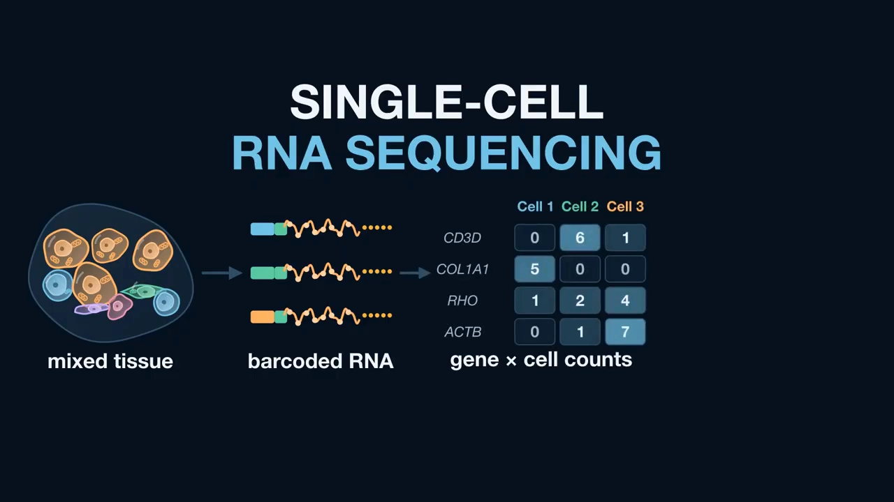

## 一、为什么值得一个细胞一个细胞地测

### 1.1 组织平均信号会藏住两件完全不同的事

讲座用一个具体场景开场：一份肿瘤样本里同时有癌细胞、免疫细胞、血管内皮细胞和成纤维细胞。用 bulk RNA 测序（把整块组织的 RNA 混在一起测）时，这些细胞的信号被合并成一个平均值。此时如果某个基因升高了，我们**无法判断**是"每个细胞都多表达了一点"，还是"样本里某一类细胞变多了" [【跳转到 00:30】](https://www.youtube.com/watch?v=4uVNXrxRJvE&t=30)。

单细胞数据之所以有用，就在于它能把这两种情况分开：一边看**细胞组成**（哪些细胞、各占多少），一边看**同一类细胞内部的表达**（这类细胞的基因程序变没变）。只要组织是异质的——肿瘤、免疫样本、视网膜都算——这个区分就成立 [【跳转到 01:23】](https://www.youtube.com/watch?v=4uVNXrxRJvE&t=83)。

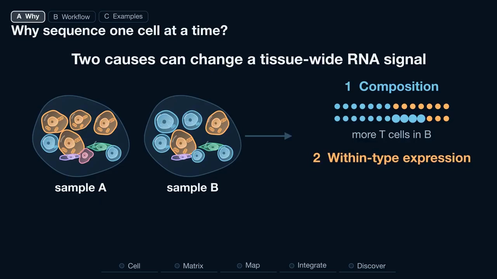

### 1.2 一个能算清的小例子

讲座给了一个极简的数值例子，值得记住：

- 样本 A：20 个 T 细胞 + 80 个肿瘤细胞；
- 样本 B：40 个 T 细胞 + 60 个肿瘤细胞；
- 两个样本里，**每个 T 细胞的免疫基因表达完全一样**。

结果组织平均的免疫基因信号在 B 里更高——纯粹因为 T 细胞占比从 20% 变成 40%。如果只看 bulk 数据，很容易误判为"免疫反应被激活了" [【跳转到 02:03】](https://www.youtube.com/watch?v=4uVNXrxRJvE&t=123)。

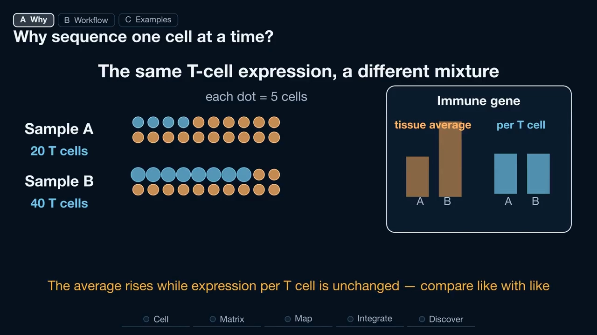

这张幻灯片右下角的两组柱状图是全文的缩影：左边"tissue average"里 A 与 B 有明显差异，右边"per T cell"里两根柱子几乎一样高。**要区分丰度与表达，必须先认细胞身份，再同类比同类**。

### 1.3 单细胞买到的是"每个细胞各自的表达"，代价是"每个细胞测得更浅"

这正是本小节的核心命题。讲座没有停留在"单细胞更精细"的口号上，而是把它拆成可检验的收益与代价：

- **收益**：能定义细胞群、能看群内的连续状态、能在同一个实验里同时观察 malignant 区室与免疫区室；
- **代价**（后文逐一展开）：捕获不完整（零值多）、细胞回收受解离影响、每样本只有一个生物学重复、以及分析选择（过滤、聚类、整合）会改变结论。

## 二、先定问题，再收细胞：设计阶段就决定了结论上限

### 2.1 三类问题对应三种读出

讲座强调，动手之前先写清楚"对比是什么"。因为不同问题需要的样本、对照和元数据完全不同 [【跳转到 02:08】](https://www.youtube.com/watch?v=4uVNXrxRJvE&t=128)：

1. **有哪些细胞类型？**（组成问题，读出是细胞比例）
2. **某个处理是否改变了某一类细胞内的表达？**（调控问题，读出是同类细胞内的差异表达）
3. **一个发育过程有几个状态？**（连续性问题，读出是轨迹/拟时序）

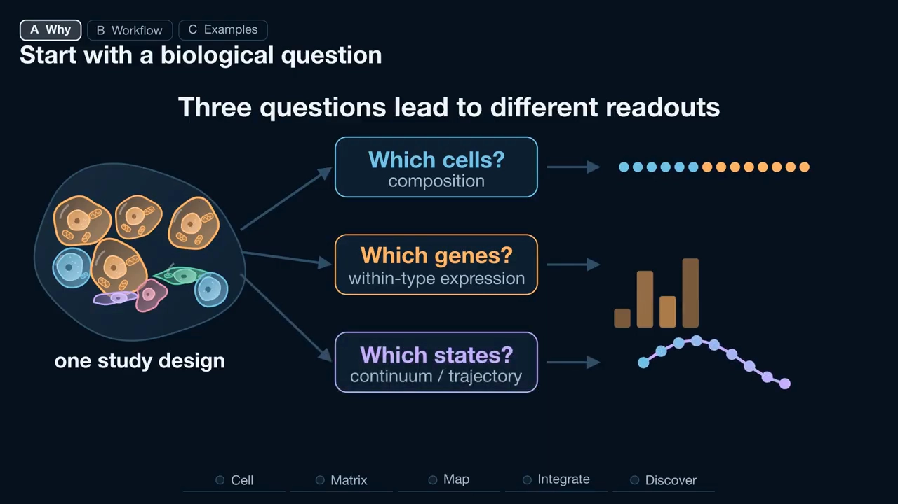

这三类问题混在一起问，就会得到"看起来有差异、其实说不清差异来自哪里"的结果。

### 2.2 一千个细胞仍然只是一个供体

这是全片最容易被忽略、也最致命的一条：**从一个人身上测一千个细胞，统计上仍然只是一个人**。细胞数量改善的是"样本内的测量精度"，只有独立的供体才能支撑"人群层面"的比较 [【跳转到 02:23】](https://www.youtube.com/watch?v=4uVNXrxRJvE&t=143)。

因此要严格区分三个标识符：**供体（donor）、样本（sample）、文库（library）**。当一个供体同时贡献了配对条件、多个取材区域或多次时间点时，这三者尤其不能混。

### 2.3 元数据与批次：写进解释，而不是当"实验室细节"

讲座要求把取材区域、供体、条件、制备方法都记录下来，因为**细胞回收率取决于解离方式**，而解离方式会决定"哪些细胞进了矩阵"。这些不是隐形的操作细节，而是结论的一部分 [【跳转到 02:47】](https://www.youtube.com/watch?v=4uVNXrxRJvE&t=167)。

紧接着是一条设计红线：**把条件分散到不同批次里**。如果所有病例都在一个批次、所有对照都在另一个批次，那么"条件"和"批次"在这份数据里就永远无法分开——后面再怎么做整合也补不回来 [【跳转到 03:37】](https://www.youtube.com/watch?v=4uVNXrxRJvE&t=217)。

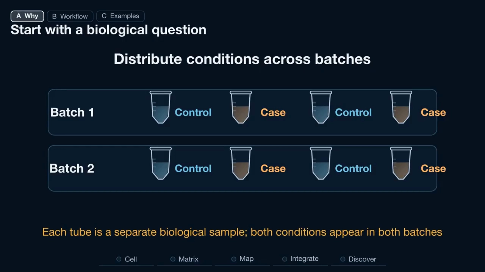

此外，预算要优先给**生物学重复**，而不是给"同一个样本更多细胞"；对稀有类型，先做小规模预实验估计回收率，再决定采样量。
## 三、一次单细胞实验到底测到了什么

### 3.1 从"手工挑一个细胞"到"液滴里几万个细胞"

讲座回看了三个里程碑式的实验策略，它们的目的相同、手段不同 [【跳转到 03:42】](https://www.youtube.com/watch?v=4uVNXrxRJvE&t=222)：

- **Tang 2009**：手工挑取单个小鼠卵裂球，裂解后反转录、加尾、扩增、测序。关键突破是"从一个细胞里拿到较宽的转录组轮廓"；
- **Tirosh 2016**：把新鲜肿瘤组织解离、分选活细胞，逐个进入建库流程——**样本处理永远发生在任何聚类图之前**；
- **Li 2026（视网膜图谱）**：在液滴里以细胞核为单位大规模并行测量。

三者捕获的东西并不完全一样：细胞核里未剪接（内含子）RNA 更多，RNA 组成也不同。所以**跨数据集比较时，必须保留制备方法与内含子计数设置**，否则差异可能只是"测的是细胞还是核" [【跳转到 05:05】](https://www.youtube.com/watch?v=4uVNXrxRJvE&t=305)。

### 3.2 液滴里的三样东西：液滴、珠子、分子标签

现代 3′ 端建库的物理过程可以概括为：微流控芯片把细胞/细胞核悬液与带条形码的凝胶珠一起挤进油相，形成"凝胶珠-乳液"液滴（GEM）。由于上样很稀疏，大量液滴只有珠子没有细胞，少数液滴里有两个或更多细胞——**Cell calling 与 doublet 检测只能估计这些情况，无法完美区分** [【跳转到 05:58】](https://www.youtube.com/watch?v=4uVNXrxRJvE&t=358)。

每个液滴内，珠子释放的引物有三个关键部件：

1. **poly-dT 段**：抓取带 polyA 尾巴的 mRNA（这一点后面会变成一条明确的局限：非 polyA 转录本测不到）；
2. **细胞条形码（cell barcode）**：同一个液滴内的引物共享，用来标记"这条读段来自哪个分区"；
3. **UMI（唯一分子标识）**：每根引物随机不同，用来区分"原始分子"与"PCR 拷贝"。

UMI 是有限随机标签，会出现碰撞与测序错误，因此需要计算层面处理。反转录之后，cDNA 上就同时带上了液滴身份与分子身份 [【跳转到 06:34】](https://www.youtube.com/watch?v=4uVNXrxRJvE&t=394)。

### 3.3 三个标识符各管一件事

讲座专门用一页强调标识符的分工，这在合并多个文库时最容易出错 [【跳转到 08:03】](https://www.youtube.com/watch?v=4uVNXrxRJvE&t=483)：

| 标识符 | 回答的问题 | 常见误用 |
| --- | --- | --- |
| Sample index | 这条读段来自哪个测序文库 | 把文库当成样本 |
| Cell barcode | 来自该文库里的哪个分区 | 把条形码当成供体（不同文库的条形码会重复） |
| UMI | 同一基因、同一条形码下数到几个原始分子 | 用读段数代替分子数 |

一句话：**细胞条形码单独不能标识一个供体**。合并文库时必须保留样本身份。

### 3.4 3′ 计数法测的是"丰度"，不是"全长异构体"

这套化学只读转录本靠近 3′ 端的一小段，因此对"细胞×基因的丰度"很有力，但**不等于测到了每个全长异构体**。Tang 早期的方案刻意追求较宽、常常是全长的 cDNA，用的是另一套建库方式——两者不能混为一谈 [【跳转到 08:12】](https://www.youtube.com/watch?v=4uVNXrxRJvE&t=492)。

同理，比对与计数之后还要检查测序质量、比对率、落到细胞上的读段比例、文库复杂度，并记录基因组与注释版本、是否计入内含子读段。**加测深度能捞回更多分子，但把 PCR 重复测得更深不会产生新的生物学信息** [【跳转到 09:02】](https://www.youtube.com/watch?v=4uVNXrxRJvE&t=542)。

### 3.5 计数矩阵：一个数就是一个观测

最终产物是一张表：行是基因、列是细胞（或细胞核），格子里是 UMI 计数。讲座给了两个必须记住的解读 [【跳转到 09:45】](https://www.youtube.com/watch?v=4uVNXrxRJvE&t=585)：

- 一个计数是**测序实验的一次观测**，不是蛋白量，也不是细胞功能；
- 矩阵是**稀疏**的，大量格子是 0。**0 表示"这个细胞里没观测到这条转录本"，不等于"这个基因在生物学上不存在"**，因为捕获与测序本来就不完整 [【跳转到 10:46】](https://www.youtube.com/watch?v=4uVNXrxRJvE&t=646)。

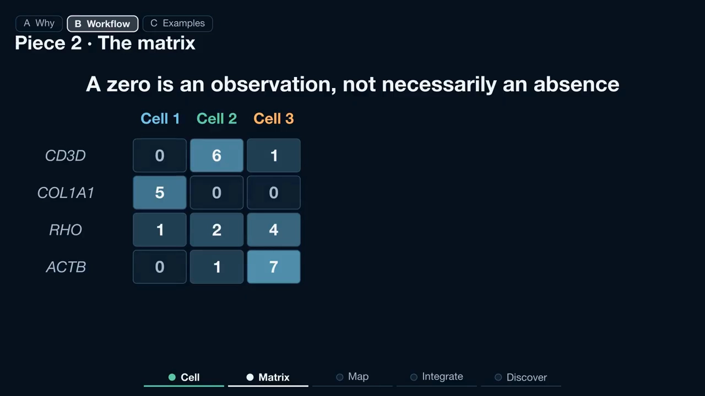

## 四、矩阵里的三类技术坑，以及质控的副作用

### 4.1 空液滴、环境 RNA、双细胞：三个问题要三套检查

讲座把污染问题拆成三件互不相同的事 [【跳转到 11:11】](https://www.youtube.com/watch?v=4uVNXrxRJvE&t=671)：

- **空液滴（empty droplets）**：没有细胞、只有背景 RNA，靠 cell calling 处理；
- **环境 RNA（ambient RNA）**：来自裂解细胞释放到缓冲液里的游离 RNA，会污染本来真实的细胞；
- **双细胞（doublets）**：两个细胞共用一个条形码，**可能伪装成一个"中间状态"的新细胞类型**。

关键是：**单一基因计数阈值无法同时解决这三件事**。要把总 UMI 数、检出基因数、线粒体基因占比放在一起看，并且按样本分别看——因为低复杂度/高线粒体占比可能提示细胞受损，而高复杂度可能提示双细胞，但这些信号本身也随生物学状态变化 [【跳转到 11:36】](https://www.youtube.com/watch?v=4uVNXrxRJvE&t=696)。

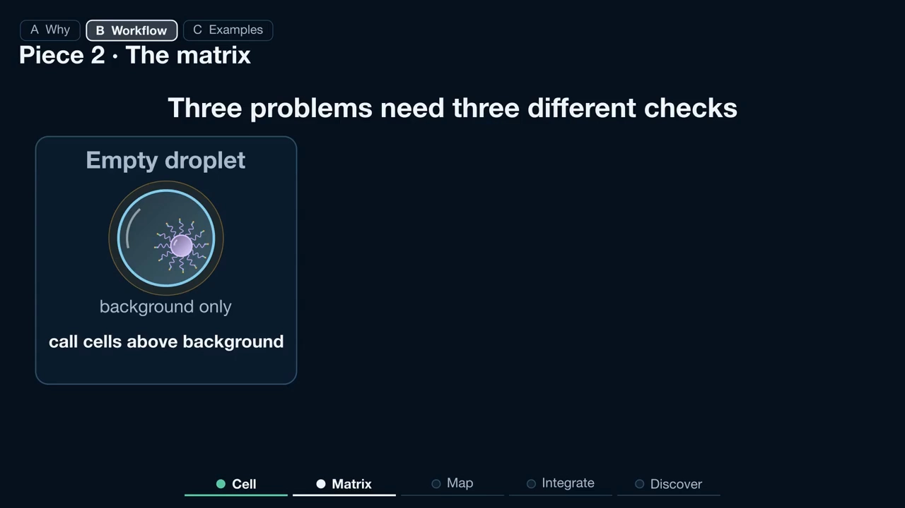

### 4.2 过滤会连生物学一起删掉

这是本讲最"反直觉"的一页：质控阈值不是普适的，**没有哪个线粒体百分比能定义"好细胞"**；细胞核样本的期望值又和完整细胞不同。讲座的建议是：记录每个样本、每个群体被过滤掉多少细胞与基因，比较过滤前后的分布，并检验几组合理的替代阈值 [【跳转到 12:01】](https://www.youtube.com/watch?v=4uVNXrxRJvE&t=721)。

原因很直接：**如果某个阈值不成比例地删掉了某一个条件、或者删掉了某类本来 RNA 就少的合法细胞类型，生物学结论就被改写了**。双细胞预测同样需要人工复核，尤其是形态相近的细胞类型之间。

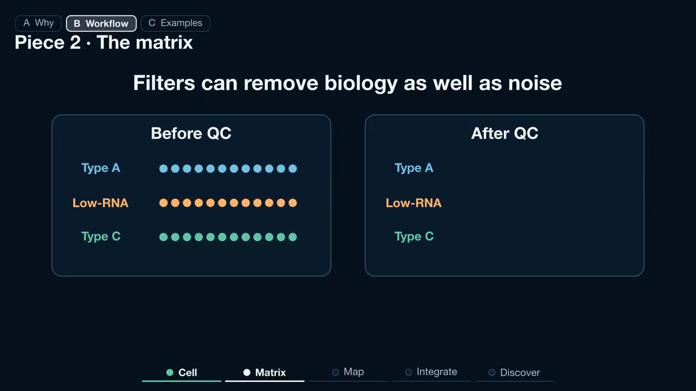

### 4.3 归一化得到的是"相对表达"

常用的可视化路线是：每个细胞除以自己的文库大小因子，取 log(1+x)，再挑高变基因。讲座提醒三件事 [【跳转到 12:51】](https://www.youtube.com/watch?v=4uVNXrxRJvE&t=771)：

- 深度归一化做的是**相对表达**比较，它既不测量每个细胞的绝对 RNA 量，也不能消除所有技术效应；
- 如果一个条件整体 RNA 量发生大幅变化，等总量缩放反而会把这个真实差异掩盖掉；
- 要分清**原始计数、归一化表达、降维坐标**三种表示，不同下游问题要用对应的那一种（例如差异检验要回到计数）。

高变基因的选择也要跨样本评估，避免某个批次主导特征选择；后续差异检验则应该考虑所有适当表达的基因，而不只是这批被选中的基因 [【跳转到 13:16】](https://www.youtube.com/watch?v=4uVNXrxRJvE&t=796)。

## 五、从矩阵到"细胞地图"：图能说什么、不能说什么

### 5.1 聚类不是"在 UMAP 上圈岛"

分析链条是连通的：计数 → 质控 → 归一化与特征选择 → PCA 或其它隐变量表示 → 最近邻图 → 社区发现（如 Leiden）→ UMAP 展示。讲座特别强调：**簇是在图上找社区找出来的，不是在 UMAP 上画圈画出来的**；边界会随表示、邻居数、聚类分辨率变化，因此要检查这些设置下的稳定性，并跨供体检查 [【跳转到 15:49】](https://www.youtube.com/watch?v=4uVNXrxRJvE&t=949)。

UMAP 或 t-SNE 只是把关系画出来：**页面不是组织地理，视觉上的远近没有简单的生物学单位**，点密度或"岛的面积"也不能直接当丰度 [【跳转到 16:14】](https://www.youtube.com/watch?v=4uVNXrxRJvE&t=974)。

### 5.2 同一批坐标，换一种着色就是一次证伪

一个非常实用的自查动作：把**完全相同的坐标**分别按样本、按簇、按某个 marker 基因着色。如果某个群是"某个样本特有"的，那它既可能是批次效应，也可能是真实生物学——只有找到一致的 marker、并在独立样本里复现，才能下判断 [【跳转到 16:39】](https://www.youtube.com/watch?v=4uVNXrxRJvE&t=999)。

### 5.3 身份与状态是两个问题

- **细胞类型（identity）**：相对稳定的身份，例如 T 细胞、视网膜视杆细胞；
- **细胞状态（state）**：同一类型内部可变化的东西，例如激活、耐药相关程序。

标注要靠多个阳性 marker 加排除性 marker、看检出比例、看跨样本一致性；参考映射能帮忙，但参考里可能没有新状态或疾病状态，**证据弱时应当保留"未定"标签** [【跳转到 17:04】](https://www.youtube.com/watch?v=4uVNXrxRJvE&t=1024)。

还有一句关键限定：**簇的 marker 检验只是在描述这个群，它不构成"条件效应"的证据**——后者需要跨供体的比较 [【跳转到 17:29】](https://www.youtube.com/watch?v=4uVNXrxRJvE&t=1049)。

## 六、组成与表达：两个必须分开问的问题

### 6.1 细胞比例是一个"相对"测量

有了细胞类型标签之后，可以问两类问题 [【跳转到 17:54】](https://www.youtube.com/watch?v=4uVNXrxRJvE&t=1074)：

1. 某个细胞类型的**比例**在两个样本之间变了吗？
2. 在这个类型**内部**，基因或表达程序变了吗？

把两者混起来，就会把"组成漂移"说成"调控变化"，或者在一个稳定的总平均值里掩盖掉真实的状态变化。

但比例本身也不是绝对的：**回收到的比例是相对于"被采样并被保留的细胞"而言的**。一个类型扩增，其它类型的比例就会下降，即使它们一个都没有减少；富集、解离偏好、过滤都会改变回收 [【跳转到 18:19】](https://www.youtube.com/watch?v=4uVNXrxRJvE&t=1099)。所以声称"绝对丰度改变"时，需要独立的测量方式支持。

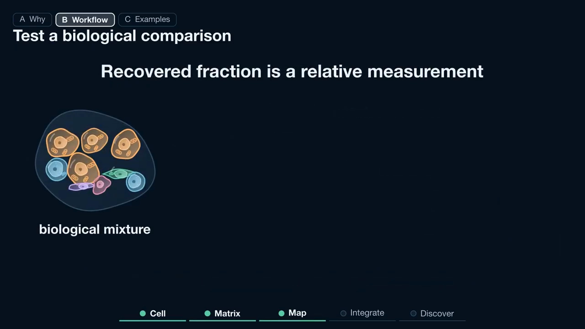

### 6.2 差异表达要回到样本层面：pseudobulk

这是"统计功效"那条局限的具体解法。讲座的表述很干脆 [【跳转到 18:44】](https://www.youtube.com/watch?v=4uVNXrxRJvE&t=1124)：

- 先定义生物学重复与对比，纳入有理由的协变量，处理同一供体的配对/重复样本；
- 对每个生物学样本、每个细胞类型的计数**加总（pseudobulk）**，保留条件、区域、时间点信息；
- 用合适的计数模型检验（如 edgeR、DESeq2），配对设计仍需供体区组或重复测量模型；
- 报告效应量、不确定性与多重检验校正，再回头看单个样本的表达分布。

用数学写出来，pseudobulk 就是把同一 (样本, 细胞类型) 下的细胞计数相加：

$$
c_{g}^{\,(s,t)} = \sum_{i \in \text{cells}(s,t)} x_{g,i}
$$

其中 $x_{g,i}$ 是基因 $g$ 在细胞 $i$ 的 UMI 计数，$s$ 是样本、$t$ 是细胞类型。这样每个样本每类细胞只有一个观测，统计单位回到"供体"而不是"细胞"。

为什么必须这样？因为**把同一个样本里的细胞当成独立重复，会系统性高估显著性**——细胞数越多，假阳性越容易出现。讲座还提醒：一个很小的校正后 p 值，不等于一个很大或可复现的生物学效应；要检查是不是某一个供体独自驱动了结果 [【跳转到 19:34】](https://www.youtube.com/watch?v=4uVNXrxRJvE&t=1174)。

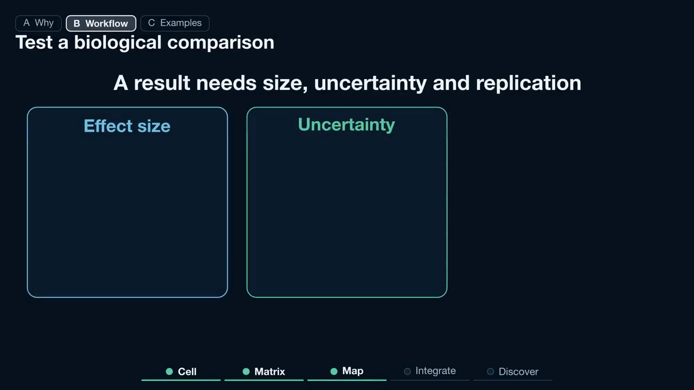

## 七、轨迹、整合与图谱：推断强度是分级递减的

### 7.1 拟时序排的是"快照的顺序"，不是真实时间

轨迹分析把细胞沿表达渐变排序，可以提示发育路线或响应连续谱。但讲座的限定非常明确：**拟时序（pseudotime）排的是采样快照之间的相似顺序，它不建立真实经过的时间、谱系关系或共发生关系** [【跳转到 19:59】](https://www.youtube.com/watch?v=4uVNXrxRJvE&t=1199)。它更适合当作"假设生成器"。

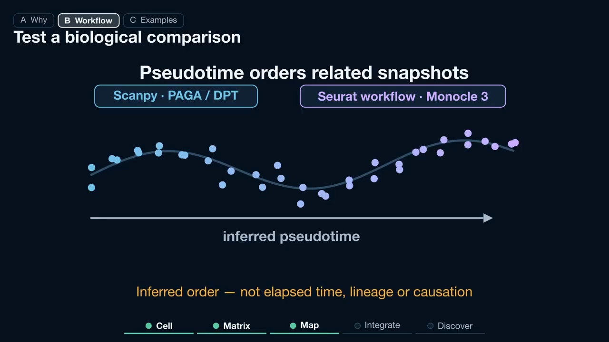

### 7.2 黑色素瘤案例：单细胞能看到"类型"和"状态"两层

讲座用 Tirosh 等 2016 年的黑色素瘤数据演示了三层递进 [【跳转到 20:24】](https://www.youtube.com/watch?v=4uVNXrxRJvE&t=1224)：

1. **哪些细胞在肿瘤里**：先用 RNA 推断的大尺度拷贝数模式把恶性细胞与非恶性细胞分开。这个模式在两个肿瘤里与全外显子测序一致，但**它仍然是从表达推断出来的，不是对每个细胞直接测 DNA** [【跳转到 20:29】](https://www.youtube.com/watch?v=4uVNXrxRJvE&t=1229)；
2. **恶性细胞内部有什么程序**：把每个恶性细胞按 G1/S 与 G2/M 细胞周期特征打分，可以看到不同肿瘤里增殖细胞的比例差别很大（并用 Ki-67 染色做了独立验证）；再用 MITF 与 AXL 两个程序的负相关，说明**同一个肿瘤内部的细胞也不处在同一状态** [【跳转到 21:25】](https://www.youtube.com/watch?v=4uVNXrxRJvE&t=1285)；
3. **状态与治疗的关系**：把治疗前与复发后的活检配对比较，看到 AXL/MITF 比值在复发后升高。但讲座立刻补了一句：**这只是关联，它没有追踪单个细胞穿过治疗过程，也没有证明耐药是如何产生的** [【跳转到 21:49】](https://www.youtube.com/watch?v=4uVNXrxRJvE&t=1309)。

同一份数据里还包含来自 15 个肿瘤的 T 细胞。把 CD8 T 细胞按细胞毒性与耗竭两个程序打分，可以看到**即使在这么窄的群体内部，细胞之间仍然有差异**；而且单个耗竭 marker 很难解释，因为它的表达也可能伴随激活——所以论文用多个基因来分离程序 [【跳转到 23:02】](https://www.youtube.com/watch?v=4uVNXrxRJvE&t=1382)。

这一段的真正教学点是"问题在变"：第一张图回答"有哪些细胞群"，后面的图回答"恶性细胞内部有什么状态""T 细胞内部有什么状态"。**同一个计数矩阵支撑得起每一种视角，但解释取决于你放进了哪些细胞、用什么证据验证了标签**。

### 7.3 整合：可以对齐共享状态，但补不出缺失的实验

跨供体、跨日期、跨实验室的数据放在一起时，技术差异会让相似的细胞离得很远。整合的做法是找"锚点"（anchors）把共享状态对齐，同时保留真正不同的群体。讲座提醒两个检查 [【跳转到 24:25】](https://www.youtube.com/watch?v=4uVNXrxRJvE&t=1465)：

- 可比的细胞是否跨批次混起来了？
- 有意义的差异是否还看得见？

而且锚点本身会出错：**独特群体本不该形成锚点，但实际会出现少量错误锚点**，所以每对锚点要按邻域一致性打分。视网膜图谱的例子更直接：作者发现细胞与细胞核数据无法充分对齐，于是**分别构建了细胞参考与细胞核参考**——这是一个有用的结果，说明整合是可选项，**强行把不同测量揉在一起会丢信息** [【跳转到 25:05】](https://www.youtube.com/watch?v=4uVNXrxRJvE&t=1505)。

还有一条工程性红线：**整合后的嵌入可以支持近邻、聚类与标签转移，但它不是给 edgeR / DESeq2 用的基因计数矩阵**。做差异检验要回到合适的计数与样本设计 [【跳转到 25:44】](https://www.youtube.com/watch?v=4uVNXrxRJvE&t=1544)。

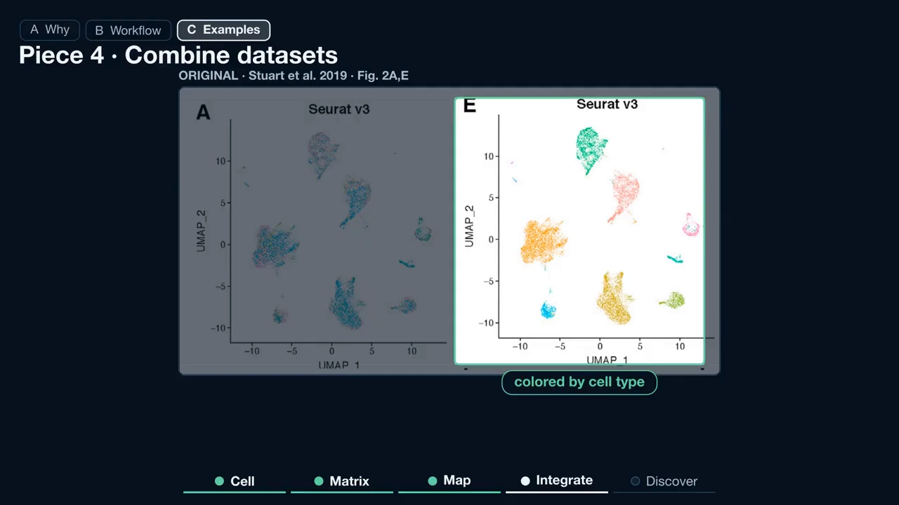

### 7.4 图谱：规模带来能力，但规模不是证据

人类视网膜图谱包含约 344 万个细胞与细胞核转录组、280 个样本、122 位供体，最终给出超过 130 种视网膜细胞类型；部分样本刻意富集了特定细胞类别以解析稀有类型，**因此它们回收到的比例并不直接等于视网膜的自然组成** [【跳转到 26:44】](https://www.youtube.com/watch?v=4uVNXrxRJvE&t=1604)。

讲座总结图谱带来两种能力：**足够的细胞去分辨稀有或近缘类型**，以及**足够多有注释的样本去跨供体特征比较**（例如按年龄比较各细胞类型的基因表达，用混合模型纳入协变量和批次随机效应）。但紧接着一句是关键限定 [【跳转到 28:38】](https://www.youtube.com/watch?v=4uVNXrxRJvE&t=1718)：

> **规模本身不是证明。** 每一个比较仍然需要元数据、站得住脚的统计单位，以及"技术效应解释不了这个模式"的检查。

## 八、结论：一张图能支撑多强的结论

### 8.1 三种输出，三种强度

讲座把"图能说什么、不能说什么"压缩成一页，非常好用 [【跳转到 29:40】](https://www.youtube.com/watch?v=4uVNXrxRJvE&t=1780)：

| 输出 | 它是什么 | 它能支撑的最强结论 |
| --- | --- | --- |
| Map（细胞地图） | 基于计算相似度的分组 | "样本里存在这些表达上可区分的群体" |
| Pseudotime（拟时序） | 推断出的顺序 | "这些状态之间可能存在渐变关系" |
| Association（关联） | 需要独立样本检验的关系 | "这个程序与临床变量相关" |

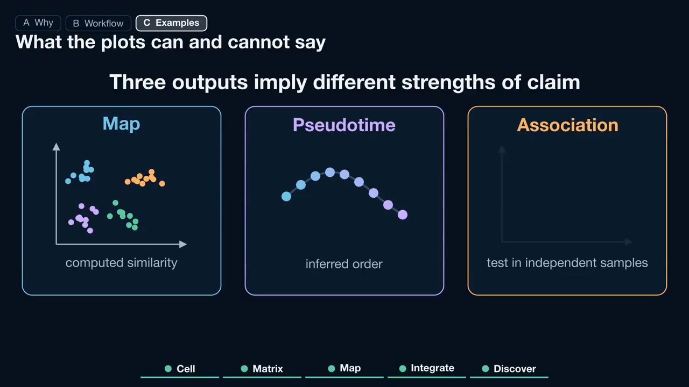

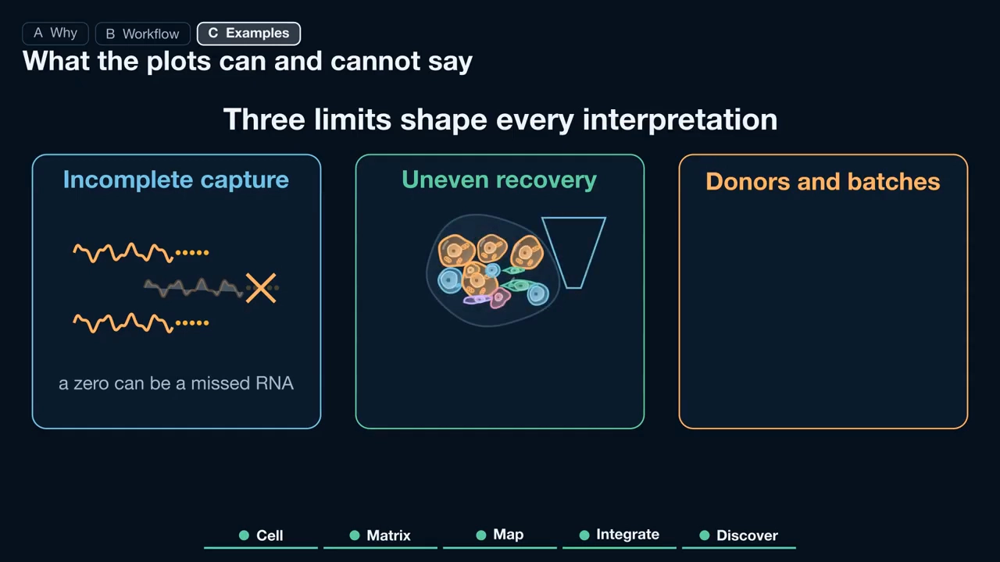

### 8.2 三条限制塑造每一次解读

讲座把限制归成三条 [【跳转到 29:15】](https://www.youtube.com/watch?v=4uVNXrxRJvE&t=1755)：

1. **捕获不完整**：单细胞实验是观测到的 RNA 的一个快照，检测本身不完整；
2. **回收不均**：组织制备会改变"哪些细胞被回收"；
3. **供体与批次差异**：不同供体的样本既可能有生物学差异，也可能有技术差异。

所以在把一个簇解释成"生物学发现"之前，这些问题都要先被排除。同理：**轨迹只是排序，不是拍摄；marker 支撑注释，但很少足以构成完整身份检验；程序与临床结果的关联只是提示需要进一步验证，而不是证明因果**。

### 8.3 看到一张漂亮的图，问四个问题

讲座给出的检查清单可以直接抄下来用 [【跳转到 30:05】](https://www.youtube.com/watch?v=4uVNXrxRJvE&t=1805)：

1. 哪些结论被**独立重复**过？
2. 哪些细胞/基因**通过了筛选**才留下来（选择效应有多大）？
3. 有哪些**替代解释**被检验过？
4. 除了同一张 RNA 矩阵之外，还有什么**外部证据**支持这个主张？

组织染色、独立队列、恰当的扰动实验，都比"同一份矩阵里再算一遍"更有说服力。一个可复用的分析还应当保留：计数矩阵、细胞与样本元数据、过滤决策、注释及其置信度、参考版本、软件版本、参数与随机种子 [【跳转到 30:58】](https://www.youtube.com/watch?v=4uVNXrxRJvE&t=1858)。

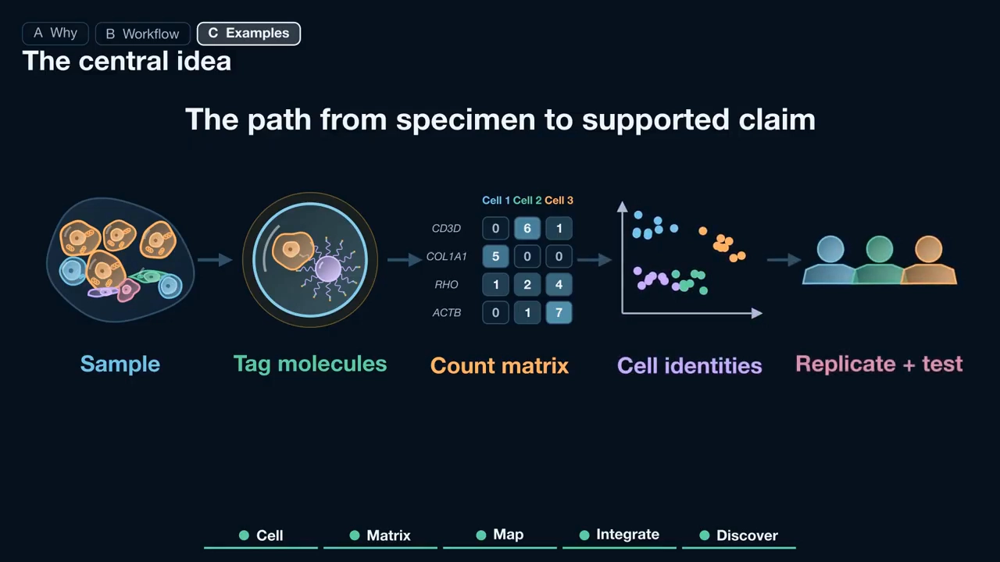

## 小结

- **单细胞的增量在于"拆开"**：把组织平均拆成细胞组成与细胞内表达，这两件事必须分开问、分开检验。
- **统计单位决定结论上限**：一千个细胞仍是一个供体；差异表达要回到样本层面的 pseudobulk，否则显著性会被细胞数"吹大"。
- **零值不是生物学**：稀疏矩阵里的 0 是"未观测"，捕获不完整是这套技术的固有代价。
- **三类污染三套检查**：空液滴、环境 RNA、双细胞不能用一个阈值解决；而过滤本身可能删掉真实生物学。
- **图是推断，不是证据**：聚类是图上的社区，UMAP 的距离没有生物学单位，拟时序只是排序。
- **整合补不出缺失的对照**：条件与批次完全混淆时，任何算法都救不回来。
- **规模带来能力，不带来证明**：百万细胞图谱能分辨稀有类型，但每个比较仍需元数据、统计单位与技术效应检查。
- **取舍判断**：要回答"组成/状态/稀有类型"的问题，单细胞是唯一选择；要回答"某个条件下的稳健表达差异"，更深、更便宜、重复更多的 bulk 往往更可靠——两者常常配合使用。

## 关键术语速查

| 术语 | 一句话解释 |
| --- | --- |
| bulk RNA-seq | 把整块组织的 RNA 混在一起测，得到的是所有细胞的平均值 |
| 细胞组成（composition） | 样本里各类细胞的比例；单细胞能测，但回收比例是相对的 |
| 类型内表达（within-type expression） | 同一类细胞内部基因表达的变化，与组成变化是两件事 |
| Cell barcode | 标记"这条读段来自哪个液滴/分区"的序列，不标识供体 |
| UMI | 唯一分子标识，用来把 PCR 拷贝折回原始分子数 |
| GEM | gel bead in emulsion，凝胶珠与细胞/细胞核共处的液滴 |
| Ambient RNA | 裂解细胞释放到缓冲液中的游离 RNA，会污染真实细胞 |
| Doublet | 两个细胞共用一个条形码，可能伪装成中间状态 |
| Pseudobulk | 把同一（样本, 细胞类型）的细胞计数加总，使统计单位回到样本 |
| Pseudotime | 按表达相似度推断出的细胞排序，不是真实时间 |
| Anchor | 整合时被判定为"共享同一状态"的跨数据集细胞对 |
| UMAP / t-SNE | 二维可视化投影；距离与面积不能当生物学量 |
