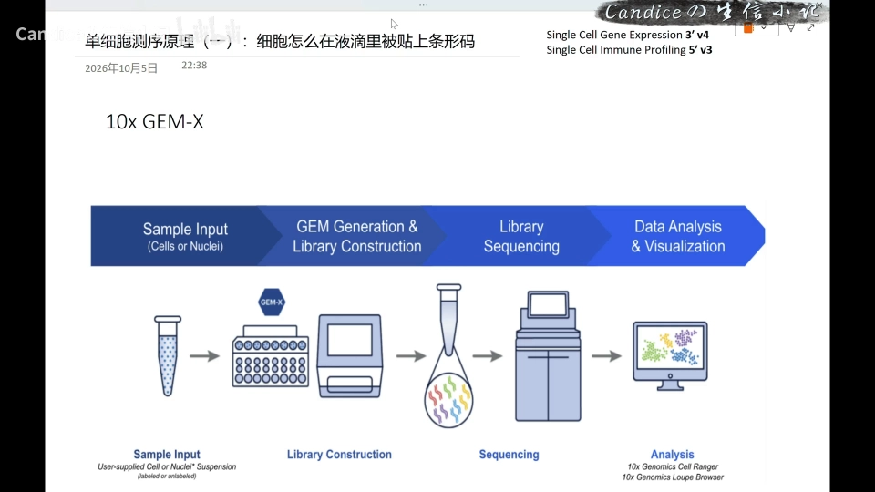
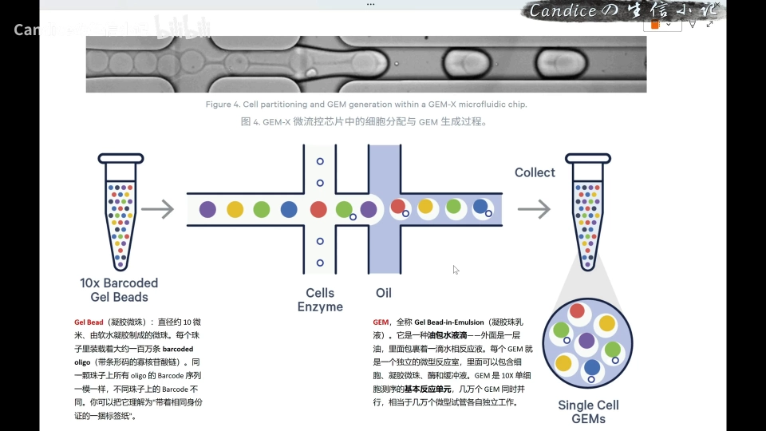
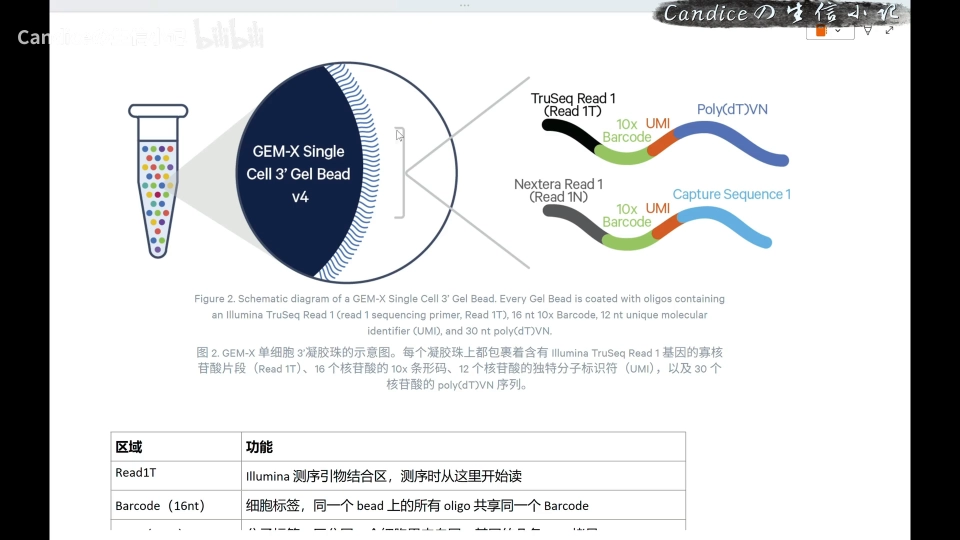
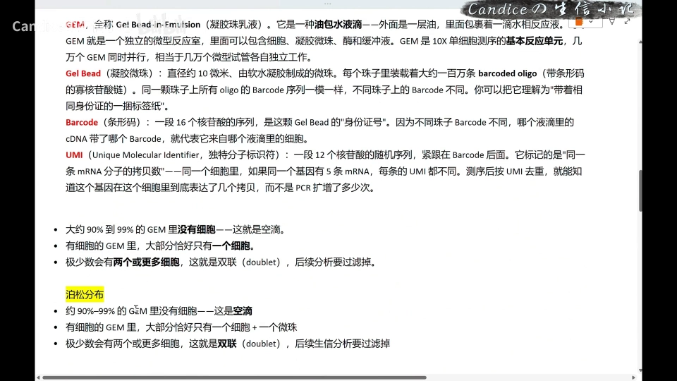
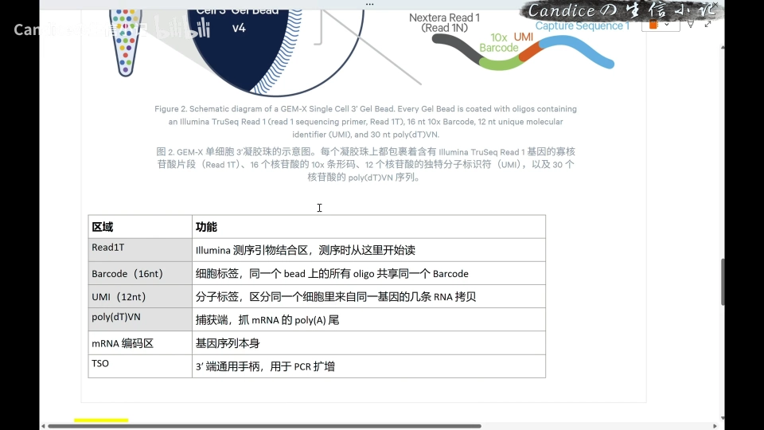
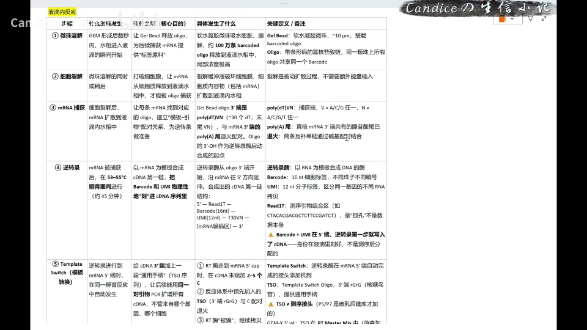
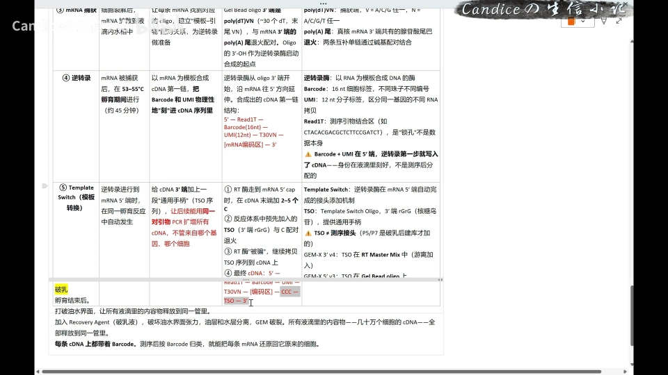
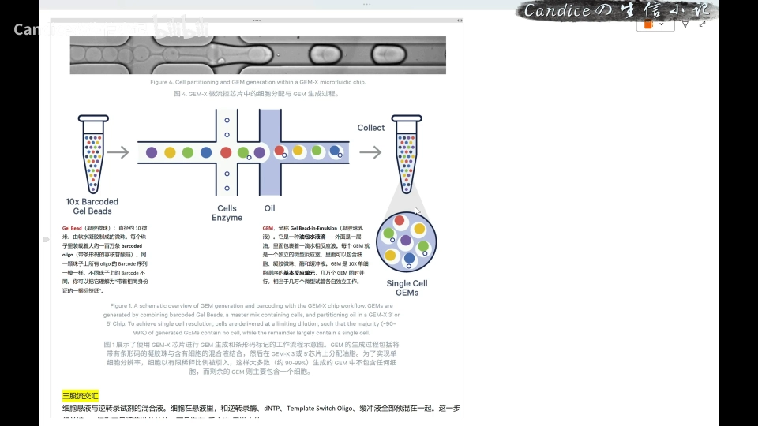

# 10x 单细胞测序的分子原理：Barcode 与 UMI 如何在液滴里写进 cDNA

> 视频来源：[10X单细胞原理（一）破乳前：Barcode 是怎么写进 cDNA 的](https://www.bilibili.com/video/BV1F9Hf6oE2J/)（B 站 · UP 主「Candiceの生信小记」）｜时长约 11 分钟
> 导读：这支视频只讲 10x Genomics 单细胞 3′ 建库流程里「破乳之前」的那一段，也就是液滴生成、凝胶微珠寡核苷酸结构、逆转录与模板转换。它把「细胞身份是什么时候写进数据的」这个问题讲到了分子层级，正好补上本系列上一节（bulk 与单细胞的对比）没有展开的那一层。破乳之后的 cDNA 纯化、扩增、加接头与上机测序，视频作者留给下一期，本文只讲到破乳为止。

## 本讲要解决的核心问题（SCQA）

**背景**：上一节已经确立，单细胞测序的本质是给每个细胞的转录本打上只属于这个细胞的条形码（barcode），把「一个细胞一个样本」的物理隔离换成「一个 barcode 一个样本」的信息隔离。

**冲突**：可是「打条形码」这句话太轻了。几万个细胞各自在一颗油包水液滴里反应，最后所有 cDNA 被倒进同一根管子、一起扩增、一起测序——物理隔离在破乳那一刻就彻底消失了。如果身份是在测序之后才「分配」的，那它凭什么分配得准？更麻烦的是，同一个基因在一个细胞里可能只有几条 mRNA，而 PCR 会把它扩增成成千上万条 reads，测出来的「表达量」到底是原始分子数还是扩增次数？

**疑问**：液滴里究竟发生了哪些分子事件，让「这条序列来自哪个细胞」和「这个基因原本有几个分子」这两条信息被同时、且不可逆地写进 cDNA？

**回答（中心思想）**：这两条信息都不是测序后分配的，而是在液滴内、**逆转录那一步就被写进了 cDNA 的序列里**。凝胶微珠上的寡核苷酸链用四个功能区各管一件事——poly(dT) 负责「从哪里捕获」，Barcode 负责「来自哪个细胞」，UMI 负责「这是第几个原始分子」，Read1 与 TSO 负责「怎么被测到、怎么被扩增」。破乳之后物理隔离消失，但信息隔离已经固化在序列里，所以 10x 不需要真的把细胞一个个分开。

## 一、为什么不能一个个挑细胞：把物理隔离换成信息隔离

### 1.1 从「平均值」到「给每条 mRNA 贴身份证」

做过 bulk RNA 测序的人都知道它的局限：测出来的常常是几百万个细胞混在一起的平均值。想知道每个细胞分别表达什么基因，最直白的思路是「大不了把每个细胞的 mRNA 单独测一遍」。

[【跳转到 00:05】](https://www.bilibili.com/video/BV1F9Hf6oE2J/?t=5)

但现实问题立刻出现：我们不可能用移液枪把细胞一个一个挑出来。那样不仅成本高，通量也低到无法支撑「几万个细胞」这种量级的研究。

[【跳转到 00:30】](https://www.bilibili.com/video/BV1F9Hf6oE2J/?t=30)

10x 给出的思路不是「挑细胞」，而是**把细胞随机关进几万个微型反应室里，在每个反应室里给 mRNA 贴上身份证标签，最后把 cDNA 混在一起测序**。这就是本节要拆解的 GEM-X 化学体系。

### 1.2 流程的四步与本节的边界

官方的流程是四步：制备单细胞悬液或单细胞核悬液作为样本输入 → 液滴生成与反应 → 文库构建 → 上机测序，最后用 Cell Ranger 做分析。

[【跳转到 01:30】](https://www.bilibili.com/video/BV1F9Hf6oE2J/?t=90)

视频作者明确划定了范围：**这一期只讲到第二步「破乳」之前**，破乳之后的 cDNA 纯化、扩增、加测序接头、上机测序留给下一期。本文守住同一条边界——这些步骤在分子层面「为什么存在」，本文会点到，但具体流程与计算细节属于后续小节。

## 二、液滴是怎么造出来的：三股流交汇与泊松分布

### 2.1 微流控芯片上的三股流

10x 是怎么把细胞、凝胶微珠和油三样东西凑在一起，变成几万个独立液滴的？答案在微流控芯片里。芯片上有三行加样孔，分别加入三种液体：

1. **细胞与酶体系**：细胞悬液里已经预混了逆转录酶、dNTP、模板转换寡核苷酸（TSO）和缓冲液。这一点很关键——细胞不是「裸着」进芯片的，而是泡在反应液里进去的。
2. **凝胶微珠（Gel Bead）**：带着条形码的寡核苷酸链的载体。
3. **油（Partitioning Oil）**：加了表面活性剂的分相油，用来稳定液滴。

芯片启动后，油从两侧高速进入，把中间汇合的水相剪成一个个小反应体系，也就是油包水的小液滴。

[【跳转到 02:45】](https://www.bilibili.com/video/BV1F9Hf6oE2J/?t=165)

静态地看一个「合格」的液滴：里面有一颗凝胶微珠、一个细胞以及反应体系，外面是油包裹着它们——所以叫**油包水结构**。这个液滴在 10x 的术语里叫 **GEM**（Gel Bead-in-Emulsion，凝胶珠乳液），它就是一个独立的微型反应室，里面可以包含细胞、凝胶微珠、酶和缓冲液。几万个 GEM 同时并行，相当于几万个微型试管各自独立工作。

### 2.2 泊松分布：90% 以上的液滴是空的

看示意图会发现一个反直觉的现象：很多液滴里根本没有细胞，包进去的细胞似乎比液滴少得多。

这不是操作失误，而是统计规律的必然结果。官方也说明：**大部分 GEM 里不包含任何细胞，剩余的 GEM 里只包含一个细胞**。这引出微流控单细胞技术中最关键的一条统计规律——**泊松分布**：

- 约 90%～99% 的 GEM 里没有细胞，这就是**空滴**；
- 有细胞的 GEM 里，大部分恰好只有一个细胞、一颗微珠，这是**理想的 GEM**，也是后续分析中主要使用的 GEM；
- 极少数 GEM 里有两个或更多细胞，这就是常说的**双细胞（doublet）**，分析时会在 R 或 Python 里通过质控去除。

[【跳转到 05:31】](https://www.bilibili.com/video/BV1F9Hf6oE2J/?t=331)

空液滴怎么识别、双细胞怎么过滤，属于数据质控的内容，本节不展开；这里只需要记住一件事：**空滴占绝大多数，是这套原理的直接推论，而不是失败**。

## 三、凝胶微珠上的那条寡核苷酸链：四个功能区各管一件事

### 3.1 结构：Read1T–Barcode–UMI–poly(dT)VN

凝胶微珠是用软水凝胶做的微型载体，直径约 10 微米，里面装载了大约 **100 万条**带条形码的寡核苷酸链。这条链的结构（从 5′ 到 3′）是：

$$
5^{\prime}\text{—Read1T—Barcode(16 nt)—UMI(12 nt)—poly(dT)VN—}3^{\prime}
$$

[【跳转到 04:53】](https://www.bilibili.com/video/BV1F9Hf6oE2J/?t=293)

各区段的分工可以对照下面这张表理解：

| 区段 | 在分子层面干什么 |
| :--- | :--- |
| Read1T | Illumina 测序引物的结合位点，测序仪从这里开始读 |
| Barcode（16 nt） | 细胞标签：同一颗微珠上所有 oligo 共享同一个 Barcode，不同微珠的 Barcode 不同 |
| UMI（12 nt） | 分子标签：区分同一个细胞里来自同一基因的不同 RNA 拷贝 |
| poly(dT)VN | 捕获端：抓 mRNA 的 poly(A) 尾 |
| mRNA 编码区 | 逆转录之后才接上的基因序列本身 |
| TSO | 3′ 端通用手柄，用于 PCR 扩增 |

### 3.2 Barcode：同一颗珠子共享、不同珠子不同

Barcode 就是这颗珠子的身份证。规则只有两条：**不同的凝胶微珠，Barcode 不同；同一颗微珠上所有寡核苷酸链的 Barcode 都相同。**

这两条规则为什么够用？因为 cDNA 不可能一直待在反应体系里，后面要通过破乳释放出来再去测序。一旦释放出来、不再在同一个反应体系里，判断「它原来属于哪个细胞」的唯一线索就只剩序列本身。只要每颗微珠上所有 oligo 共享同一个 Barcode、不同微珠的 Barcode 不同，就可以**仅凭转录本上的 Barcode 是否相同，判断它们是否来自同一个细胞**——这就是识别细胞来源的全部机制。

### 3.3 UMI：同一细胞内的分子计数标签

Barcode 解决了「哪个细胞」，但同一个细胞里，一个基因往往有多个 mRNA 拷贝。这时需要第二个标签：**UMI 在同一颗凝胶微珠内是各不相同的**，因为它要区分的是转录本分子。

破乳之后所有 cDNA 混在一起时，判断顺序是两级：

1. 先看 **Barcode** 是否相同，判断它来自哪个细胞；
2. 把细胞划分好之后，再在同一个细胞里看 **UMI**，判断这些 reads 是否来自相同或不同的原始转录本分子。

这一步为什么非要不可？因为后续还要做 PCR 扩增和测序。同一个原始分子会被扩增成很多条 reads，如果直接数 reads，数到的是「扩增了多少次」；而按 UMI 去重之后，数到的才是「这个基因到底表达了几个原始分子」。**UMI 是把 reads 换算回分子的那把尺子。**

### 3.4 poly(dT)：捕获端

poly(dT) 的作用相当于结合 mRNA 的多聚 A 尾巴。它是整条链上唯一负责「抓」的区段——没有它，后面的 Barcode 和 UMI 都无从附着。

## 四、液滴内的五步分子反应

进入一个「完美」的 GEM（恰好一个细胞、一颗凝胶微珠、一套反应体系），液滴内会依次发生五件事：

[【跳转到 06:06】](https://www.bilibili.com/video/BV1F9Hf6oE2J/?t=366)

### 4.1 微珠溶解与细胞裂解

GEM 形成数秒之后（也就是从芯片出来数秒之后），水相进入液滴，让凝胶微珠溶解。软水凝胶吸水膨胀、崩解，**100 万条带 Barcode 的寡核苷酸链被释放到水相中**，为后续捕获 mRNA 提供「标签原料」。

接着，裂解缓冲液破坏细胞膜，让细胞内容物（包括 mRNA）扩散到液滴的水相里。注意裂解是被动扩散过程，不需要额外能量输入。

### 4.2 逆转录：身份就是在这一步被写进 cDNA 的

寡核苷酸链 3′ 端的 poly(dT) 与 mRNA 3′ 端的多聚 A 尾退火配对，形成「oligo–mRNA」的杂交双链。因为反应体系在加样时就与细胞混在一起、里面本来就有逆转录酶，所以一捕获就开启逆转录。

逆转录酶从寡核苷酸链的 3′ 端开始，沿着 mRNA 向 5′ 端方向延伸，合成 cDNA 的第一条链，结构是：

$$
5^{\prime}\text{—Read1T—Barcode—UMI—poly(dT)—}[\text{mRNA 编码区}]\text{—}3^{\prime}
$$

**关键就在这一步**：第一次逆转录的时候，Barcode 和 UMI 就已经被写进了 cDNA。这就是 10x 测序技术的核心——细胞身份不是在测序之后才分配的，而是在液滴里、在分子合成阶段就已经写入了序列。

[【跳转到 07:15】](https://www.bilibili.com/video/BV1F9Hf6oE2J/?t=435)

### 4.3 模板转换：TSO 给 cDNA 补上另一端手柄

逆转录酶进行到 mRNA 的 5′ 端时，会自动发生**模板转换**：酶在 cDNA 的 3′ 端额外加上 2～5 个非模板的 C 碱基；反应体系里预先加入的 TSO（3′ 端带 rGGG 核糖鸟苷）就与这些 C 配对退火，逆转录酶随即「跳」过去，继续拷贝 TSO 序列到 cDNA 上。

最终 cDNA 变成这个样子：5′–Read1T–Barcode–UMI–poly(dT)–mRNA 编码区–CCC–TSO–3′。原来逆转录到 mRNA 编码区就结束了，因为碰到了 5′ 帽，所以加了三个 C，再通过 TSO 继续延伸然后结束。

TSO 有什么用？**它让 PCR 能用同一对引物扩增所有 cDNA，不管它们来自哪个基因、哪个细胞。** 这是「几万个细胞的 cDNA 混在一起还能一起扩增」的前提。

这里必须强调一个容易混淆的点：**TSO 不是我们常说的测序接头。** 测序接头（P5/P7）是破乳之后建库时才加的；TSO 只是让 cDNA 能被 PCR 扩增的通用手柄。视频作者专门澄清了这一点，因为两者在示意图上都表现为「cDNA 末端多出来的一段序列」。

### 4.4 孵育：为什么液滴必须撑到反应结束

逆转录和模板转换都是酶促反应，需要一定的时间和温度才能完成。所以 GEM 生成之后，要在 50 多摄氏度孵育 40 多分钟。

孵育期间液滴必须保持完整：里面的微珠可能破了、细胞也破了，但它们仍然在这一小块反应室内进行反应——**两个内容物并没有混到一起，而是在各自的区室里反应**。液滴就是那个「微型试管的管壁」。

## 五、破乳：物理隔离消失，信息隔离接管

反应完成后要送去测序，这些内容物肯定得混在一起，于是进入**破乳**：加入 Recovery Agent 破坏油水界面的张力，使油层和水层分离，GEM 破裂，所有内容物——几十万个细胞的 cDNA——同时释放到同一个管子里。

此时管子里有所有细胞的 cDNA，还有微珠碎片、酶和缓冲液，但**每一条 cDNA 都已经带着我们想要的 Barcode**。测序之后按 Barcode 归类，就能把每条 mRNA 还给原来的细胞。

[【跳转到 08:30】](https://www.bilibili.com/video/BV1F9Hf6oE2J/?t=510)

这就是为什么 10x 不需要真的把一个个细胞分开：**它在序列标签里就已经做到了——物理上混合了，信息仍可以通过 Barcode 和 UMI 分离。**

[【跳转到 09:30】](https://www.bilibili.com/video/BV1F9Hf6oE2J/?t=570)

## 六、这套原理直接推出的三个后果

把上面的机制串起来，会发现单细胞数据里最常见的三个「麻烦」，其实都是原理的必然产物，而不是实验做坏了：

1. **大量空液滴**：泊松分布决定了 90% 以上的 GEM 不含细胞。它们会被测序、占据 reads，但不产生任何细胞数据，因此需要在下游按 Barcode 的 reads 数把它们识别出来剔除。
2. **双细胞**：极少数 GEM 里进了两个细胞，它们的转录本共享同一个 Barcode，会被误当成「一个细胞」。这类细胞只能在下游通过质控识别并去除。
3. **PCR 重复**：同一个原始分子被扩增成多条 reads。若不去重，表达量反映的是扩增效率而不是分子数；UMI 的存在正是为了让这一步可逆。

[【跳转到 10:45】](https://www.bilibili.com/video/BV1F9Hf6oE2J/?t=645)

## 小结

- 单细胞测序不靠「挑细胞」，而靠**把细胞随机关进几万个液滴，在液滴里给 mRNA 贴身份证**，最后把 cDNA 混在一起测序。
- 液滴由微流控芯片上三股流（细胞+酶、凝胶微珠、油）交汇剪切成形；液滴里是否含细胞服从**泊松分布**，约 90%～99% 是空滴，少数是双细胞。
- 凝胶微珠上约 100 万条寡核苷酸链的结构是 **Read1T–Barcode–UMI–poly(dT)VN**：poly(dT) 负责捕获，Barcode 标记细胞，UMI 标记分子，Read1T 供测序读取。
- 液滴内依次发生微珠溶解、细胞裂解、poly(dT) 捕获、逆转录、模板转换五步。**Barcode 与 UMI 在逆转录第一步就被写进 cDNA**，细胞身份不是测序后分配的。
- **TSO 是 PCR 扩增用的通用手柄，不是测序接头**；P5/P7 接头是破乳后建库才加的。
- 破乳让物理隔离消失，但信息隔离已经固化在序列里：按 Barcode 分细胞、按 UMI 数分子。

## 关键术语速查

| 术语 | 一句话解释 |
| :--- | :--- |
| GEM | Gel Bead-in-Emulsion，油包水液滴，10x 单细胞测序的基本反应单元 |
| 凝胶微珠（Gel Bead） | 直径约 10 微米的软水凝胶微球，装载约 100 万条带 Barcode 的寡核苷酸链 |
| Barcode | 16 nt 细胞标签，同一颗微珠共享、不同微珠不同，用于回溯细胞来源 |
| UMI | 12 nt 随机分子标签，区分同一细胞里同一基因的不同 RNA 拷贝，用于去重计数 |
| poly(dT)VN | 寡核苷酸链的捕获端，与 mRNA 的 poly(A) 尾配对 |
| TSO | 模板转换寡核苷酸，逆转录到 mRNA 5′ 端时接上，为 PCR 提供通用手柄（不是测序接头） |
| 泊松分布 | 液滴中细胞数的统计分布，决定了绝大多数液滴为空、极少数为双细胞 |
| 破乳 | 加入 Recovery Agent 破坏油水界面，把全部液滴内容物释放到同一管中 |