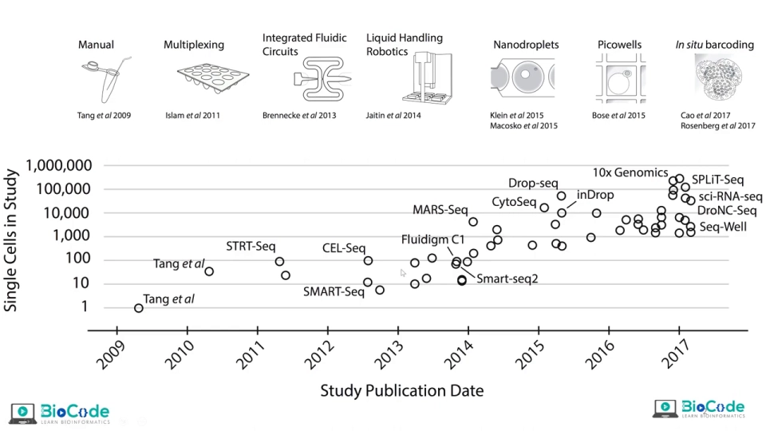
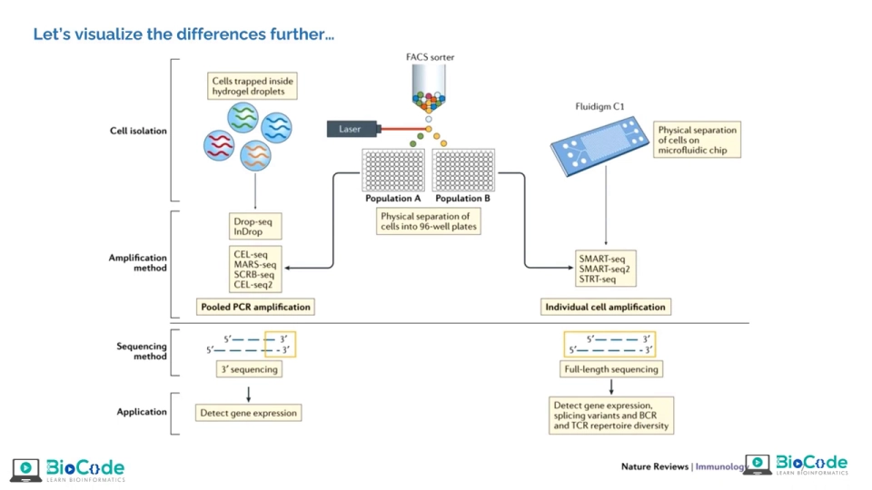
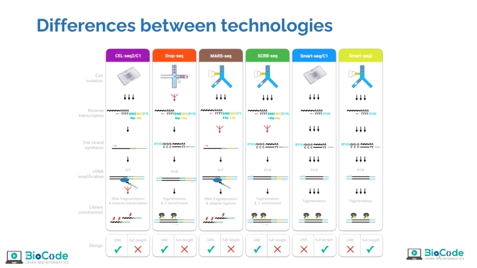
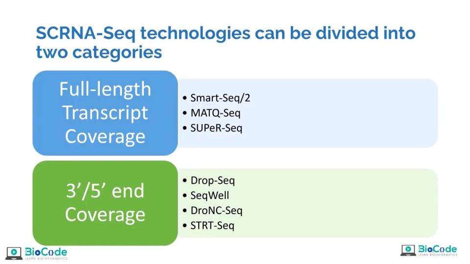
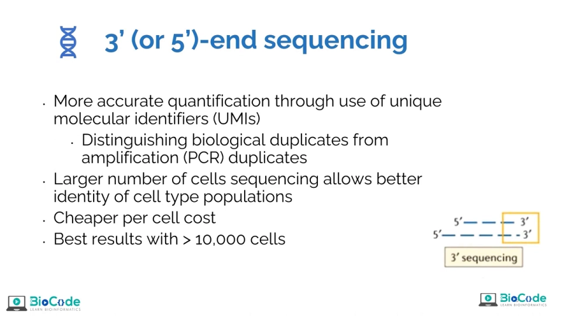
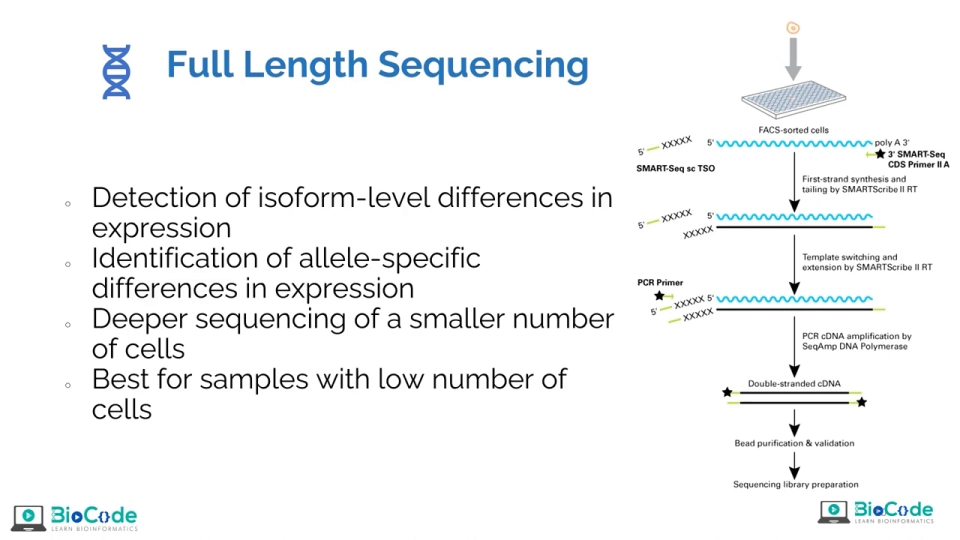
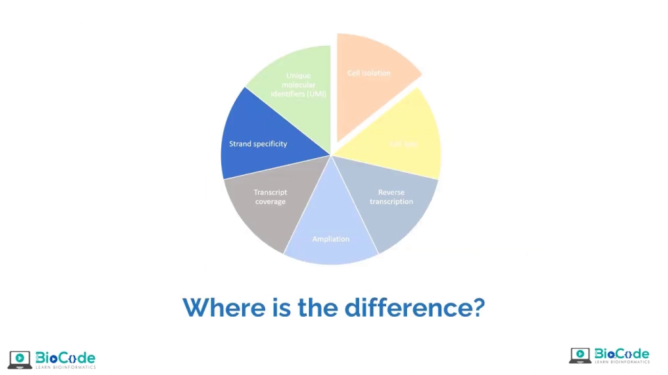
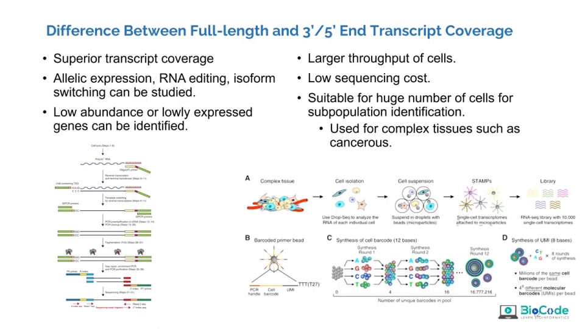
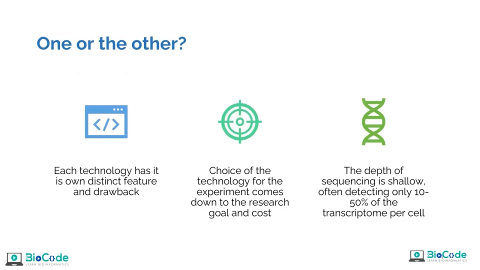

# 全长还是 3′ 端：单细胞 RNA 测序技术路线的分野与选择

> 视频来源：[Single-Cell RNA-seq Technologies (10x Genomics, Smart-Seq, Drop-seq and more)](https://www.youtube.com/watch?v=SUM9NbAflsY)（YouTube · BioCode）｜时长约 17 分钟
> 导读：这支视频横向比较了单细胞 RNA 测序的几条主流技术路线，主线是「所有方法共用五步流程，差别只在每一步怎么做」。它把「全长转录本」与「3′/5′ 端」这两条路线的取舍讲得最清楚，正好回答本节要处理的问题：同一批细胞，为什么不同技术测出来的东西不一样、能回答的问题也不一样。本文不讨论具体平台与设备（那是后续小节的内容），也不展开比对定量与矩阵构建的计算流程。

## 本讲要解决的核心问题（SCQA）

**背景**：单细胞 RNA 测序发展十几年，出现了 Smart-seq、Smart-seq2、CEL-seq、MARS-seq、SCRB-seq、Drop-seq、inDrop、10x Genomics 等一大批方法。它们都能给出「每个细胞 × 每个基因」的表达量，看起来是同一件事。

**冲突**：但它们测的并不是同一段序列。有的方法把整条转录本读下来，有的只读转录本的一端；有的带 UMI，有的不带；有的把细胞一个个分到孔里单独扩增，有的把几万个细胞混在一起扩增。这些差别决定了同一份样本在不同技术下会给出不同的问题答案——甚至同一个基因的表达量都可能对不上。

**疑问**：这些技术到底差在哪几个环节？差别会怎样传导到「能测到什么、测不到什么」上？做实验时又该按什么标准选？

**回答（中心思想）**：所有单细胞 RNA 测序技术都走同一条五步流水线——**细胞分离 → 逆转录 → 二链合成 → cDNA 扩增 → 文库构建**，技术的分野只在每一步的「做法」上。真正决定能力边界的是两个开关：**转录本覆盖范围（全长 vs 3′/5′ 端）** 与 **是否使用 UMI**。前者决定你能否看见剪接异构体与等位基因差异，后者决定你能否把 reads 换算回原始分子数、从而用极低成本换取极高通量。

## 一、技术为什么这么多：同一套五步流程的不同实现

### 1.1 从手工挑细胞到几十万细胞并行

最早的单细胞测序靠手工劳动：从组织里把细胞裂解出来，再手工为单细胞测序做准备。这在二代测序的早期都算很超前。此后全世界的研究者基于已有方法不断改造，才有了今天这些技术。

[【跳转到 04:54】](https://www.youtube.com/watch?v=SUM9NbAflsY&t=294)

图上的纵轴是单次研究的细胞数（对数刻度），横轴是发表年份。可以看到通量在十年里涨了六个数量级，而每一次跃升背后都是一次「并行化」的方法创新。

### 1.2 五步流程：所有技术都逃不掉

不管哪种单细胞技术，都必然包含这五步，且顺序固定：

1. **细胞分离（cell isolation）**：细胞怎么从样本、从组织里被分离出来；
2. **逆转录（reverse transcription）**：把 RNA 变成 cDNA；
3. **二链合成（second strand synthesis）**：把单链 cDNA 补成双链；
4. **cDNA 扩增（cDNA amplification）**：把极微量的 cDNA 放大到可建库的量；
5. **文库构建（library construction）**：加上测序所需的接头等元件。

技术之间的差别，就是这五步各自「怎么做」的差别。而视频作者强调了一个重要判断：**除了这几步，不同技术产生的数据在下游分析上差别并不大**——分析流程和分析步骤几乎是相似的，不同的只是细胞怎么获得、测序文库怎么准备、RNA 怎么提取。

### 1.3 第一步的分岔：FACS 分选 vs 微流控 vs 液滴

细胞分离方式直接决定了通量和成本，视频把它归成三类：

- **FACS 分选 + 多孔板**：用流式分选仪按细胞的性状把细胞分到 96 孔板，每个孔一个细胞。Smart-seq2、MARS-seq、SCRB-seq 都用这条路。
- **微流控芯片**：Fluidigm C1 这类芯片把细胞物理分离到独立的反应腔里，通常搭配 Smart-seq、STRT-seq。
- **液滴/微珠**：Drop-seq、inDrop、10x Genomics 用带条形码的微珠，把细胞包进水凝胶液滴里，然后一起收集、一起处理。

[【跳转到 11:14】](https://www.youtube.com/watch?v=SUM9NbAflsY&t=674)

这张图把整支视频的骨架画全了：左边是液滴路线（细胞被包进水凝胶液滴），中间是 FACS 路线（激光分选，细胞落进 96 孔板），右边是 Fluidigm C1（芯片上物理分离）。往下每一层分别是扩增方式、测序方式和最终能做的分析。

## 二、第二步逆转录：UMI 与细胞条形码在这里被接上

不管细胞怎么分离，接下来都要做逆转录。而在这一步，不同技术接上的「标签」不一样：

- **Smart-seq 与 Smart-seq2**：只接 PCR 接头，**不带 UMI、不带细胞条形码**；
- **SCRB-seq**：接 UMI、细胞条形码和 PCR 接头；
- **MARS-seq**：接 UMI、条形码和 T7 接头；
- **Drop-seq 类技术**：接 UMI、条形码和 PCR 接头；
- **CEL-seq**：同样带 UMI 与条形码。

所以真正的分野不在「接不接标签」，而在**接的是哪几种标签、以及这些标签能不能承担计数功能**。

[【跳转到 06:34】](https://www.youtube.com/watch?v=SUM9NbAflsY&t=394)

### 2.1 UMI 到底解决什么问题

**UMI（unique molecular identifier，独特分子标识符）** 是一段随机序列，在逆转录时被接到每一条转录本上。它的作用是给「原始分子」发号牌：

- 如果多条 reads 来自同一个原始转录本分子，它们会带**相同的 UMI**；
- 因此测序之后可以按 UMI 把 reads 归并，**区分「生物学重复」与「PCR 扩增重复」**，再把 PCR 重复去掉。

这一步之所以关键，是因为扩增不可避免：一个片段可能被扩增到 100 倍，为的是让测序有足够深度。扩增之后如果不做去重，数到的就是「扩增了多少次」，而不是「原来有几个分子」。**有了 UMI，表达量才能被还原成分子计数。**

[【跳转到 09:04】](https://www.youtube.com/watch?v=SUM9NbAflsY&t=544)

### 2.2 细胞条形码解决什么问题

**细胞条形码（cellular barcode）** 是另一种标签：每个细胞有自己的一条条形码。这样即使几万个细胞的 cDNA 被混在一起测序，也能在测序之后按条形码把转录本分回各自的细胞，从而识别「这条 read 来自哪个细胞、属于哪个转录本」。

[【跳转到 07:49】](https://www.youtube.com/watch?v=SUM9NbAflsY&t=469)

## 三、第三到第五步：二链合成、扩增与建库

### 3.1 二链合成

无论接的是条形码、UMI 还是 PCR 接头，下一步都必须做**二链合成**——把单链 cDNA 补成双链，才能作为后续扩增的模板。

### 3.2 cDNA 扩增：PCR 还是 IVT

扩增方式有两种：

- **PCR 扩增**：绝大多数常用技术走这条路；
- **IVT（体外转录）**：CEL-seq 与 MARS-seq 采用。

扩增的目的很直接：一个片段扩增到 100 倍，测序数据才有足够的深度。而扩增带来的重复，正是上一节 UMI 与细胞条形码要处理的问题。

### 3.3 文库构建

扩增之后还要做 3′ 端富集等处理，才算完成文库构建。到这一步，不同技术之间的差别已经基本定型——因为「测哪一段」在文库构建时就被决定了。

## 四、真正的分水岭：全长覆盖 vs 3′/5′ 端覆盖

单细胞 RNA 测序技术可以分成两大类：

[【跳转到 01:59】](https://www.youtube.com/watch?v=SUM9NbAflsY&t=119)

- **全长转录本覆盖（full-length transcript coverage）**：把整条转录本都测下来，代表技术是 Smart-seq、Smart-seq2、MATQ-seq、SUPeR-seq。
- **3′/5′ 端覆盖（3′/5′ end coverage）**：只测每条转录本的一端，代表技术是 Drop-seq、SeqWell、DroNC-seq、STRT-seq。这类技术通常也被叫作液滴技术。

这个区别听起来只是「测多长」，实际上决定了三件事：能不能看见剪接异构体、单个细胞要花多少测序成本、以及一次能测多少个细胞。

### 4.1 3′/5′ 端路线：用 UMI 换通量

3′/5′ 端测序的优势可以归成四条：

- **定量更准**：靠 UMI 区分生物学重复与 PCR 重复，因此表达量可还原为分子数；
- **细胞数越多，细胞类型划分越可靠**：更大的细胞数允许更好地识别细胞类型群体；
- **每个细胞的成本更低**；
- **在超过 10,000 个细胞的场景下效果最好**。

[【跳转到 14:34】](https://www.youtube.com/watch?v=SUM9NbAflsY&t=874)

### 4.2 全长路线：用深度换信息

全长测序走的是另一条路：FACS 分选出细胞后，把整条转录本测下来，合成双链、验证、建库、上机。

[【跳转到 15:24】](https://www.youtube.com/watch?v=SUM9NbAflsY&t=924)

它换来的是：

- 能检测**异构体（isoform）层面**的表达差异；
- 能识别**等位基因特异（allele-specific）** 的表达差异；
- 能对**较少的细胞做更深的测序**；
- **最适合细胞数少的样本**。

视频还给了一个具体比较：Smart-seq2 能找到更多「真正表达」的基因，因为做的是全长转录、测序深度更高；而 MARS-seq 在低丰度基因的检出上更好。两条路线都能捕获 poly(A) 区域，差别在于你到底想回答什么问题。

## 五、怎么选：先问要回答什么问题

### 5.1 差别可以从七个维度拆开

视频把技术差异归纳成七个维度：细胞分离、细胞裂解、逆转录、扩增、转录本覆盖范围（全长还是 3′/5′）、链特异性（是否定位在负链），以及是否接 UMI。

[【跳转到 10:44】](https://www.youtube.com/watch?v=SUM9NbAflsY&t=644)

### 5.2 选型规则：只要基因表达，还是要剪接与免疫组库

选型的判断标准非常直接：

**如果只需要基因表达**——做细胞分型、细胞群体分析、肿瘤异质性分析、基因表达分析，那么 3′ 或 5′ 端测序就够了，而且是在保证结果的前提下**总成本最低**的选择。

**如果还需要更多**——变异、异构体切换、可变剪接、BCR/TCR 多样性分析，那么必须做**全长转录本测序**。

[【跳转到 13:19】](https://www.youtube.com/watch?v=SUM9NbAflsY&t=799)

[【跳转到 16:28】](https://www.youtube.com/watch?v=SUM9NbAflsY&t=988)

### 5.3 一个必须承认的天花板：单细胞测序深度很浅

视频反复强调一个容易被忽略的事实：**单细胞测序的深度是浅的，每个细胞通常只能检测到转录组的 10%～50%。**

不管用哪种技术，单细胞都做不到「每个细胞测到 100% 的转录组」，只能做到 10%～50%。即使数据集很大、细胞数以千计，测序深度依然不够。这带来两个直接后果：

1. 大量基因在单个细胞里表现为「0」，而这个 0 可能只是没测到，不代表没表达；
2. 技术的选择不能只比「谁测得全」，还要比「谁在给定预算下测得够用」。

[【跳转到 03:49】](https://www.youtube.com/watch?v=SUM9NbAflsY&t=229)

## 小结

- 所有单细胞 RNA 测序技术共用五步流程：细胞分离 → 逆转录 → 二链合成 → cDNA 扩增 → 文库构建；差别只在每一步怎么做，下游分析流程反而高度相似。
- 细胞分离分三条路：FACS 分选进多孔板、微流控芯片物理分离、液滴/微珠包裹。
- 逆转录这一步决定接哪些标签：Smart-seq/2 只接 PCR 接头，SCRB-seq、MARS-seq、Drop-seq、CEL-seq 都接 UMI 与细胞条形码。
- **UMI 的作用是把 reads 换算回原始分子数**：相同 UMI 的 reads 来自同一原始分子，据此去除 PCR 重复、保留生物学重复。
- 技术分成两大阵营：**全长覆盖**（Smart-seq/2、MATQ-seq、SUPeR-seq）与 **3′/5′ 端覆盖**（Drop-seq、SeqWell、DroNC-seq、STRT-seq）。
- 3′/5′ 端路线用 UMI 换通量：定量更准、单细胞更便宜、适合上万细胞；全长路线用深度换信息：能看异构体、等位基因差异，适合细胞数少的样本。
- 选型只看一件事：**要回答什么问题**。只要基因表达就选 3′/5′；要看变异、剪接、BCR/TCR 就必须全长。
- 天花板始终存在：单细胞测序每个细胞只能覆盖转录组的 10%～50%。

## 关键术语速查

| 术语 | 一句话解释 |
| :--- | :--- |
| 全长转录本覆盖 | 把整条转录本都测下来的策略，能看异构体与等位基因差异 |
| 3′/5′ 端覆盖 | 只测每条转录本一端的策略，用通量和成本换覆盖范围 |
| UMI | 独特分子标识符，逆转录时接到每条转录本上的随机序列，用于把 reads 换算回分子数 |
| 细胞条形码 | 每个细胞独有的序列标签，用于在混合测序后把转录本分回各自的细胞 |
| FACS 分选 | 荧光激活细胞分选，把细胞按性状分到多孔板，每孔一个细胞 |
| Fluidigm C1 | 用微流控芯片把细胞物理分离到独立反应腔的平台 |
| IVT | 体外转录扩增，CEL-seq 与 MARS-seq 采用的扩增方式 |
| 二链合成 | 把逆转录得到的单链 cDNA 补成双链，作为扩增模板 |
| 双细胞（doublet） | 一个液滴/孔里进了两个细胞，转录本被误当成一个细胞 |