# CITE-seq：把抗体变成可测条码，蛋白与转录组同时读

> 视频来源：[Scientist Stories: Marlon Stoeckius, Inventor of CITE-seq](https://www.youtube.com/watch?v=H61NGZIkFps)（YouTube · Axial 频道，讲者 Marlon Stoeckius，纽约基因组中心）｜时长约 24 分钟
> 导读：这是 CITE-seq 发明人本人讲这项技术的一支访谈式报告——从「流式和单细胞 RNA 测序各缺一半」讲到 ADT 的三段结构、建库流程、与流式的定量对照，再到 cell hashing 与超载上样。本文只讲**多模态信号怎么被编到同一个细胞上**：scRNA-seq 自己的建库原理见 2.1.1，scATAC-seq 见 2.1.2，液滴与平台参数对比见 2.1.4，比对定量与 Cell Calling 见 2.2。字幕为自动生成，术语已按上下文订正（sideseq/sideseek → CITE-seq，siteof → CyTOF，ADT 等）。

## 本讲要解决的核心问题（SCQA）

**背景**：免疫学有一整套成熟的分型语言——CD4、CD8、CD19、CD14 这些细胞表面蛋白标记。流式细胞术（flow cytometry）用荧光抗体读这些标记，能轻松把初始、记忆、效应等状态分开；单细胞 RNA 测序则能一次读出成千上万个细胞的全转录组，无偏地聚类出细胞类型。

**冲突**：两边都只对了一半。流式只能看你事先选好、而且仪器通道数允许的那几个蛋白，看不到转录组；单细胞 RNA 测序看不到蛋白，而**转录上非常相似的细胞类型它分不开**——比如 CD4 与 CD8 T 细胞，在表达谱上彼此穿插，聚不到一起。讲者给了一个具体数字：早期 7 万个 PBMC 的数据集里只能分出约 5 个 T 细胞亚群，而流式里很容易刻画的那些亚群远不止 5 个。

**疑问**：蛋白不是核酸，测序仪读不到它。怎么才能让「一次抗体结合」变成「一段可以测序的序列」，并且这段序列还能被同一个细胞的条码收走？

**回答（中心思想）**：**给抗体接上一条「伪装成 mRNA」的寡核苷酸**。这条 oligo 带 polyA 尾巴，所以在任何基于 oligo-dT 的单细胞流程里都会被当成 mRNA 一起逆转录、一起加上细胞条码；它中间那段抗体条形码则记录「这是哪个抗体」。这样，一个细胞里的 mRNA 和几十上百种抗体读数就被写进了同一套细胞条码之下——这就是 CITE-seq（cellular indexing of epitopes and transcriptomes by sequencing），而那类抗体上的标签就叫 **ADT（antibody-derived tag，抗体衍生标签）**。它带来的不只是「多一个模态」：ADT 几乎没有 dropout，能把 RNA 里漏掉的信号补回来；把蛋白和 RNA 一起用于聚类，同一批 PBMC 能分出 13 个 T 细胞亚群；同一个条码还能反过来当样本标签用（cell hashing），让仪器超载上样。

## 一、两个世界：流式读蛋白，scRNA-seq 读转录组

### 1.1 流式细胞术：几个好标记就能切出亚群

讲者开场先承认流式的强大。取一群细胞，用几个大家非常熟悉的标记做双参数散点图，就能把 CD4 T 细胞、CD8 T 细胞、初始型（naive）、记忆型（memory）、效应型（effector）分开，B 细胞和 NK 细胞也各有自己的门（gate）。

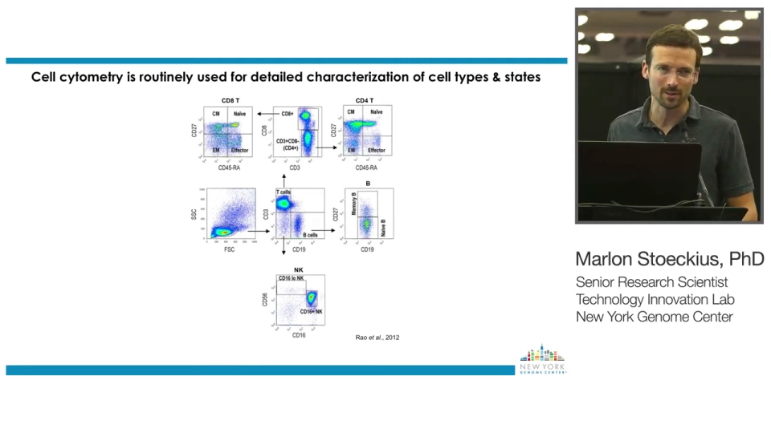

[【跳转到 00:47】](https://www.youtube.com/watch?v=H61NGZIkFps&t=47)

代价是：你只能看少数几个你非常了解的标记，能同时测多少个取决于仪器通道数。

### 1.2 scRNA-seq：无偏，但转录相似的细胞分不开

单细胞 RNA 测序反过来：一次读出很多细胞的全转录组，按表达谱聚类，每个点是一个细胞。B 细胞和成纤维细胞这种差别巨大的类型一眼就分开了。

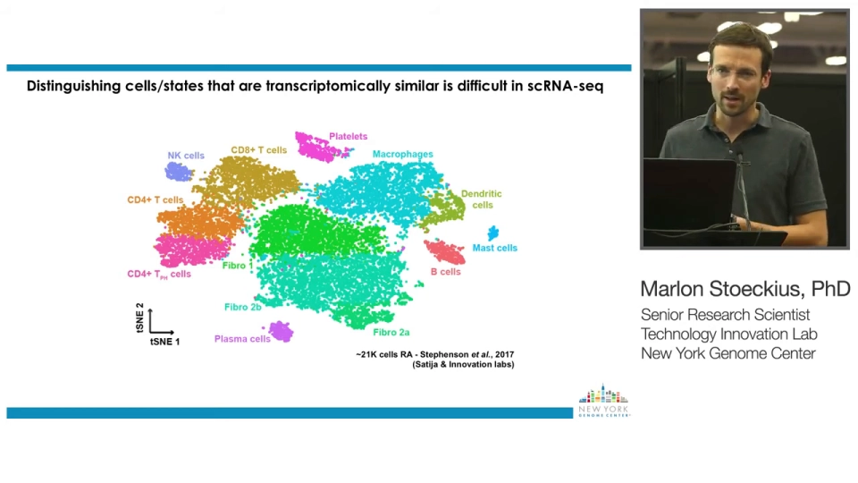

[【跳转到 02:02】](https://www.youtube.com/watch?v=H61NGZIkFps&t=122)

问题出在「转录上相似」这件事上。CD4 与 CD8 T 细胞、初始与记忆 T 细胞，它们的表达谱差别很小，测序深度和实验质量一波动就分不出来。讲者给的两个数字很能说明问题：他们早期只看 RNA 的数据集里只有 3 个 T 细胞 cluster；即便是 10x 那个 7 万 PBMC 的经典数据集，也只分出约 5 个——而免疫学知道真实存在的 T 细胞亚群远多于 5 个。

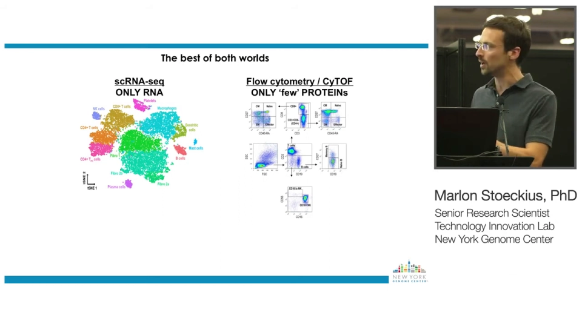

[【跳转到 02:52】](https://www.youtube.com/watch?v=H61NGZIkFps&t=172)

于是问题变成：能不能把两边的长处合到一个检测里？

## 二、把抗体翻译成测序仪能读的东西：ADT 的三段结构

### 2.1 关键一步：让抗体结合事件产生一段序列

人们测蛋白标记用的是偶联了荧光基团或镧系元素的抗体——这些在测序里读不出来。讲者把问题摆成一句话：**怎么从一次抗体结合事件里拿到一段可测序的 read？**

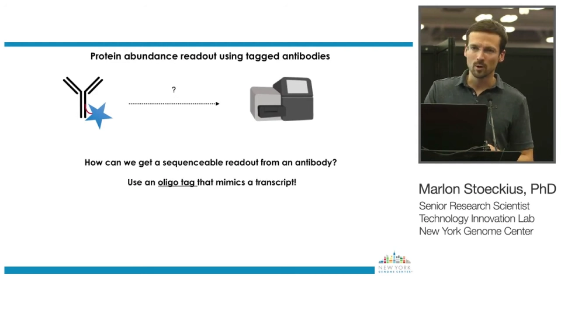

[【跳转到 03:17】](https://www.youtube.com/watch?v=H61NGZIkFps&t=197)

答案利用了单细胞领域的一个既成事实：绝大多数单细胞流程都是 **oligo-dT 起始**的——逆转录引物上挂着一串 T，专门抓 mRNA 的 polyA 尾巴。既然如此，只要给抗体接一条**带 polyA 尾巴的寡核苷酸**，它就能混进同一套逆转录反应里，被当成一个 mRNA 处理。

### 2.2 一条 ADT 上有什么

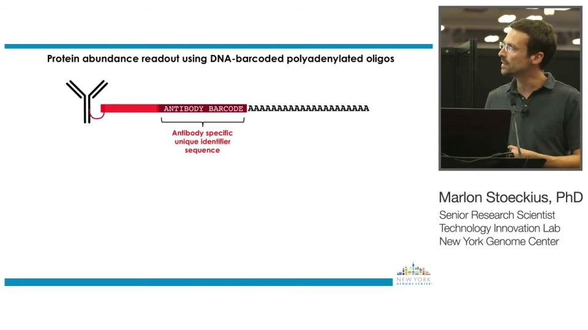

[【跳转到 03:42】](https://www.youtube.com/watch?v=H61NGZIkFps&t=222)

一条 ADT 上的 oligo 可以拆成三段，每段各管一件事：

| 片段 | 作用 | 类比 |
| --- | --- | --- |
| polyA 尾巴（末尾一串 A） | 让这段 oligo 被 oligo-dT 引物抓住、被逆转录 | 伪装成 mRNA 的「帽子」 |
| 抗体条形码（antibody barcode） | 标识这是哪一个抗体，比如 10 个核苷酸 | 抗体身上的身份证号 |
| PCR handle | 建库时用同一对引物把它扩增出来、送去测序 | 通用把手 |

讲者特意算了一笔账：10 个核苷酸的条形码有 $4^{10} \approx 10^6$ 种组合，12 或 15 个核苷酸就更不用说——**序列组合数远远多于地球上现有的抗体种类**，所以编码空间完全不是瓶颈。

### 2.3 为什么这件事能成立：两种分子长度差一个量级

这一点是整项技术在工程上最巧妙的地方，值得单独说。建库时，一个液滴里同时存在两类分子：

- 全长 cDNA：来自 mRNA，长度 1.5 kb 甚至更长；
- 抗体 oligo：约 180 个核苷酸。

标准单细胞建库会做**片段筛选（size selection）**，把长的 cDNA 留下、把短的当「垃圾」丢掉。CITE-seq 的做法是：**从这份「垃圾」里把抗体文库单独扩增出来**。因为两者长度差一个量级，物理上就分开了，所以加一个模态几乎不干扰原来的 RNA 文库。

## 三、一次染色、一个液滴：CITE-seq 的完整流程

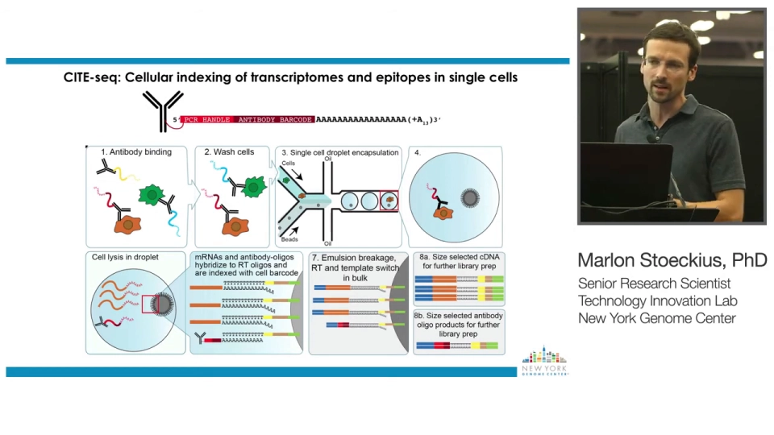

[【跳转到 05:22】](https://www.youtube.com/watch?v=H61NGZIkFps&t=322)

把整条链路摊开，它其实是「流式的染色 + 单细胞的建库」两段拼起来：

1. **抗体结合**：把一批 DNA 条形码抗体混成 pool，按流式的方式染细胞；
2. **洗细胞**：洗掉没结合的抗体，只留特异结合的；
3. **液滴包裹**：把细胞送进任何基于 oligo-dT 的单细胞平台（讲者最早用 Drop-seq，后来主要是 10x），一个细胞配一颗带细胞条码和逆转录引物的凝胶珠；
4. **液滴内裂解**：细胞破了，mRNA 和抗体 oligo 都通过各自的 polyA 尾巴退火到珠子上那些带细胞条码的引物；
5. **破乳 + 逆转录**：在液滴里（微流控）或破乳后（Drop-seq）做逆转录，两类分子都被写上同一个细胞条码；
6. **分头建库**：8a 是片段筛选后的 cDNA 文库，8b 是被筛掉的那部分里扩出来的抗体文库。

到这一步，「哪个细胞」和「哪个抗体」这两件事就被同一套条码绑在一起了。注意这里并没有引入新的化学：**细胞条码、UMI、oligo-dT 逆转录全部沿用原有流程**，新增的只是「多带了一种能被同一套引物抓住的分子」。

## 四、先证明信号是真的：人鼠混合与 13 个标记的 PBMC

### 4.1 人鼠混合：抗体读数必须和转录组读数对上

任何新模态都要先回答「你测到的到底是不是真信号」。讲者用了单细胞领域最标准的基准实验——人鼠混合：把人和小鼠细胞混在一起，用分别针对人 CD29 和小鼠 CD29 的条形码抗体染色，故意过载上样以造出大量混合液滴。

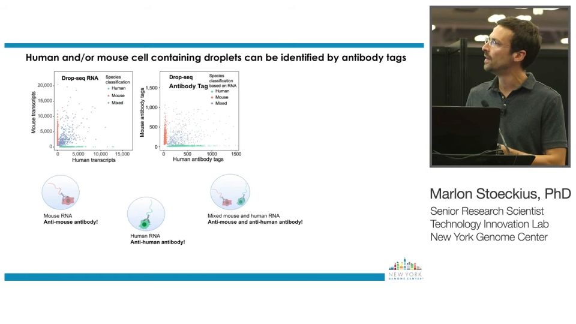

[【跳转到 07:23】](https://www.youtube.com/watch?v=H61NGZIkFps&t=443)

结果是一张漂亮的互斥图：转录组判为人的液滴，抗体信号也在人轴上；判为鼠的在鼠轴上；转录组判为混合的，抗体信号也是混合的。而且**按 RNA 数和按 ADT 数出来的群体数目非常接近**——这一点后面还会反复出现，它意味着 ADT 几乎没有漏检。

### 4.2 13 个标记的 PBMC：mRNA 与 ADT 逐格对照

第二个实验更贴近真实使用：一个 13 个抗体的 panel，染约 8000 个脐血单个核细胞，先按 RNA 聚类，再逐个标记比较 mRNA 与 ADT 的分布。比如 CD19 的 mRNA 与 ADT 都精确落在 B 细胞群上，CD11c、CD14 都落在髓系细胞上——两种读数指向同一群细胞。

[【跳转到 09:03】](https://www.youtube.com/watch?v=H61NGZIkFps&t=543)

把 8 个标记排成网格看，结论更清楚：

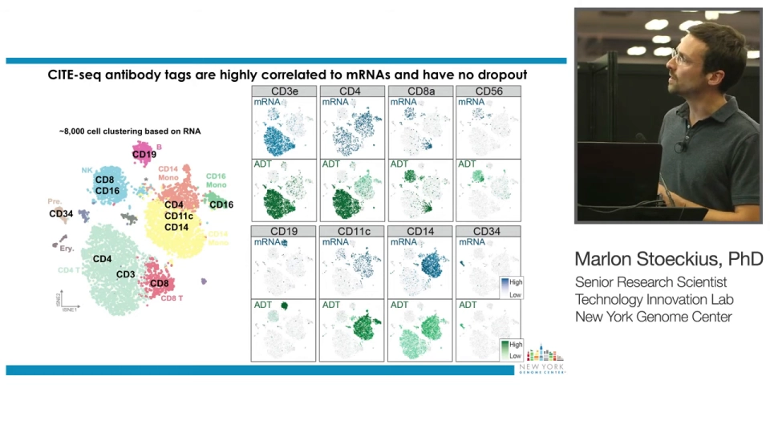

[【跳转到 09:53】](https://www.youtube.com/watch?v=H61NGZIkFps&t=593)

- 两种读数落在**同一群细胞**上，方向一致；
- 差别在于**密度**：mRNA 那一行到处是空洞，ADT 那一行几乎每个细胞都亮；
- 连 CD34 这种只占不到 1% 细胞的稀有群体，mRNA 和蛋白都能抓到。

这就是本节最值得记住的一句话：**单细胞 RNA 测序的零膨胀（dropout）不是「没有」，而是「没测到」；蛋白读数把这块补上了。**

## 五、ADT 补上了 dropout，也带来新问题：背景在哪里

### 5.1 用流式的方式画 CITE-seq 数据

既然 ADT 是「蛋白丰度」的读数，那它就应该能画成流式那种双参数散点图。讲者把同一份样本一半送流式、一半送 CITE-seq，用同一套标记，画出 CD4 对 CD8 的图：

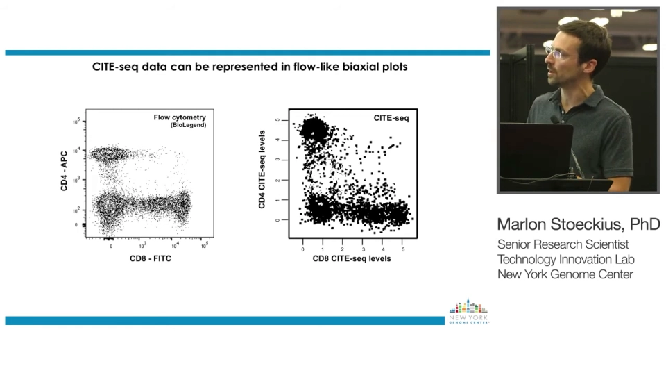

[【跳转到 11:08】](https://www.youtube.com/watch?v=H61NGZIkFps&t=668)

两者的结构几乎一样：CD4 单阳、CD8 单阳、双阴三团分得清清楚楚。**这意味着做免疫学的人可以沿用自己熟悉的读图方式**，只是横纵坐标从荧光强度变成了 ADT counts。

### 5.2 一个流式里也难回答的问题：哪一块是背景

流式里最难判断的是「这块淡淡的信号到底是真表达还是背景」。CITE-seq 反而能回答，因为它可以**掺入一群本应为阴性的细胞**：讲者掺的是小鼠细胞（转录组上极易识别），把小鼠细胞画在人细胞的背景上，它们给出的 CD4/CD8 信号范围，就是背景应有的范围。

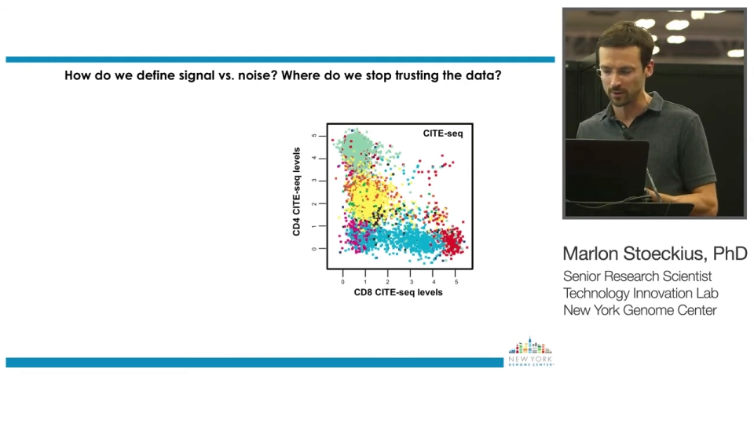

有了这条「阴性基准线」，就可以为 panel 里每个标记用计算的方式划阈值，判断哪些是真信号、哪些只是背景。这是一个很实用的思路：**用已知阴性的群体当标尺，而不是凭经验画门**。

### 5.3 与流式的定量对照：比例和动态范围都对得上

只画得像还不够，还得数字对得上。讲者做了两个对照：

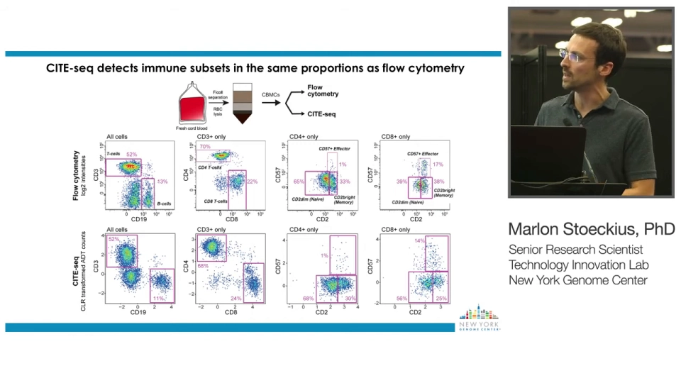

[【跳转到 13:38】](https://www.youtube.com/watch?v=H61NGZIkFps&t=818)

- **比例**：T 细胞流式 52%、CITE-seq 52%；CD4 T 细胞 70% 对 68%；按流式不到 1% 的稀有群体，CITE-seq 也抓到了；
- **动态范围**：把 CD8 按强度分选成不同 bin，一半送流式一半送 CITE-seq，相对比例高度相似。

所以可以说 CITE-seq 给出的蛋白读数和流式**可比**，而它额外给了你每个细胞的无偏转录谱。

## 六、蛋白读数让聚类更细：从 3 个到 13 个 T 细胞亚群

### 6.1 多模态聚类：把两层信息「配平」

这是 CITE-seq 在分析上最直接的回报。前面说过，CD4 与 CD8 T 细胞在 RNA 上互相穿插、聚不开。

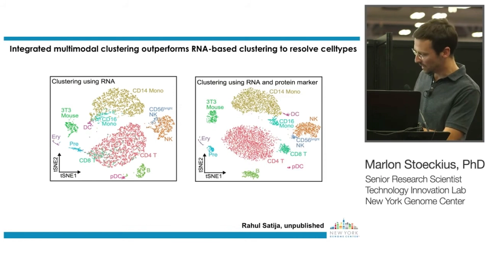

[【跳转到 15:18】](https://www.youtube.com/watch?v=H61NGZIkFps&t=918)

讲者的说法是「把两层信息平衡起来」（balance the clustering）——不是简单地把蛋白矩阵拼到 RNA 矩阵后面，而是让两个模态各自贡献、共同决定细胞之间的距离。效果是：不只 CD4/CD8 分开了，单核细胞的分布也更合理。

### 6.2 结果：7 万 PBMC、83 个标记、13 个 T 细胞 cluster

把规模放大到 7 万个 PBMC、83 个标记，多模态聚类分出约 13 个 T 细胞 cluster——早先只看 RNA 是 3 个，10x 的经典数据集是 5 个。

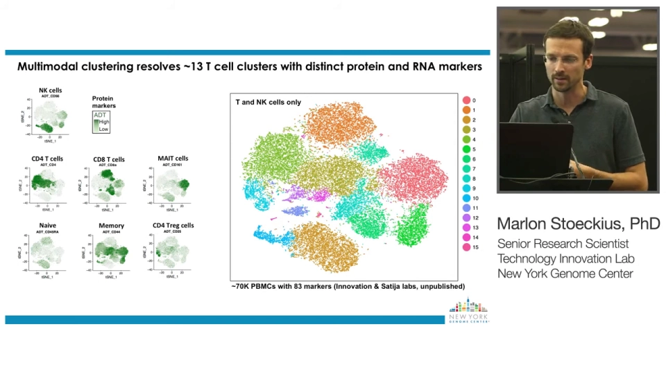

[【跳转到 16:27】](https://www.youtube.com/watch?v=H61NGZIkFps&t=987)

讲者强调：这基本覆盖了健康个体里所有已知、被描述过的 T 细胞 cluster；连平时很难看见的 CD4 调节性 T 细胞（Treg）都被漂亮地抓了出来。还有一个反向的好处：既然聚类部分由蛋白驱动，那些被蛋白定义出来的群体，其 RNA 标记也会随之变得特异——**于是可以回头去找这些细胞类型的新表面标记**。

## 七、同一个条码还能当样本标签：cell hashing 与超载上样

### 7.1 把「抗体条形码」换成「样本条形码」

既然能给抗体打条形码，就能给**样本**打条形码。做法是拿一种在所有细胞上都表达的标记（讲者提到类似 CD45 的思路），给每个样本偶联一个不同的 hashtag oligo（HTO），染完把多个样本合并进同一个 run，测完再按 HTO 拆回各自的样本。

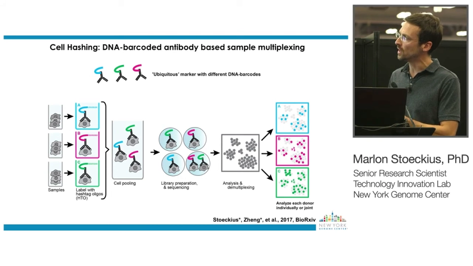

[【跳转到 17:42】](https://www.youtube.com/watch?v=H61NGZIkFps&t=1062)

这一步的意义不只是省钱：**它把「样本」也变成了一个可测的模态**。

### 7.2 双细胞从「无法识别」变成「可以减掉」

讲者用一段很清楚的算术说明了它的用处。单细胞仪器的分区数远多于实际细胞数：10x 里上样约 5000 个细胞，双细胞率略低于 5%；如果上 25000 个，双细胞率就是 20%——每五个细胞里有一个是双细胞，而且你不知道是哪个。

[【跳转到 18:32】](https://www.youtube.com/watch?v=H61NGZIkFps&t=1112)

有了 hashtag，双细胞就变成了**两个 hashtag 同时出现的信号**，可以被识别并扣除。用 10 个标签能识别约 90% 的双细胞，于是「上 25000 个、有效双细胞率 2.5%」这种组合就成立了——等于把一台仪器的通量提高了好几倍。

### 7.3 原理验证：8 个供体、一个 lane、双细胞数正好对上

他们用 8 个遗传上不同的供体各自打标、合并、超载上样一个 10x lane，然后既按 hashtag 拆分，也按基因型去多重化（用 UCSF Jimmie Ye 实验室的 demuxlet 方法）做交叉验证。

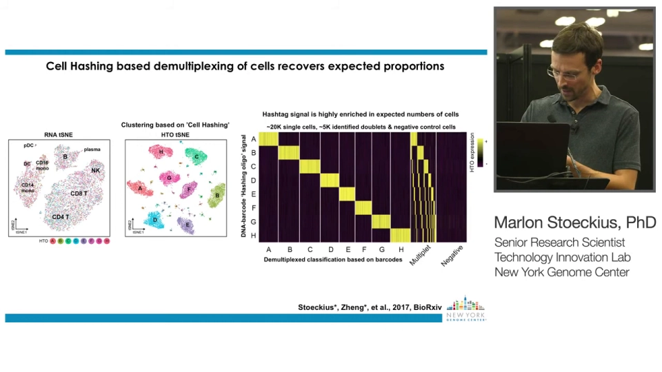

[【跳转到 19:44】](https://www.youtube.com/watch?v=H61NGZIkFps&t=1184)

结果是：细胞数正好是预期值，落在两种条形码组合中间的双细胞群体数目也正好对得上，hashtag 分类与基因型分类高度重叠。而 hashtag 比基因型方法多一个好处——**不需要供体在遗传上不同**，同一批细胞拆成几份做不同处理也能用。

### 7.4 附带的三件小事

讲者顺手讲了三个衍生用途，都挺实用：

- **抗体滴定可以一次做完**：流式里要试很多个抗体浓度才能找到信号与背景比最好的点，CITE-seq 做 10 次实验太贵；用 10 个 hashtag 把 10 个浓度并成一个 run 就行，而且得到的推荐浓度与流式接近；
- **救回低 UMI 的小细胞**：UMI 数与基因数都很低的那一片，通常被当作环境 RNA（ambient RNA）背景丢掉，但其中也可能有体积很小、测得很浅的真细胞。有了 hashtag，可以挑出那些对某个 hashtag 有特异信号的液滴，再看它们是否落进预期的细胞类型群体里；
- **判断双细胞与背景**：双细胞/大细胞在高 UMI 高基因数一侧，真细胞在中间，背景在底下——hashtag 让这条分界线有了分子依据。

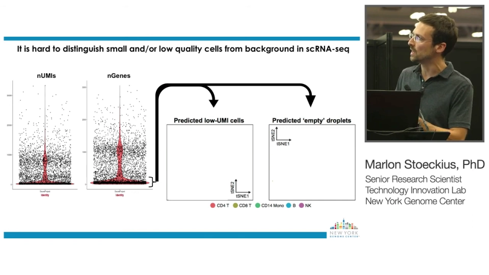

[【跳转到 22:10】](https://www.youtube.com/watch?v=H61NGZIkFps&t=1330)

## 八、它比单测 RNA 多回答了什么

回到本节的主线：CITE-seq 不是「顺便多测一个模态」，它改变了三件事。

**第一，它把「蛋白丰度」变成了一个可计算、可存档的矩阵。** 流式的数据是一次性的门控图，而 ADT 是一个细胞 × 抗体的计数矩阵，可以和其他模态放进同一个对象里做联合分析、可以重跑、可以共享。

**第二，它填掉了 RNA 的 dropout 空洞。** 同一个标记，RNA 上稀疏、ADT 上致密。对低表达基因、对表达量本来就低的表面蛋白（如 CD4 在单核细胞上的低水平表达），这一点尤其关键。

**第三，它让「细胞身份」有了两条独立的证据链。** 一条是转录组（细胞在做什么），一条是表面蛋白（细胞长什么样）。两条链互相印证时，稀有亚群才敢下结论；两条链冲突时，往往提示有生物学或技术上的故事。

同时也要看清它的边界：

- **它只测你放进 panel 里的抗体**，本质上是「有靶向的」测量，和 RNA 的无偏性不是一回事；panel 设计好不好直接决定能发现什么；
- **ADT 也有背景**，需要阴性群体或空液滴来定阈值；
- **它依赖 oligo-dT 流程**，所以只适用于能抓到 polyA 的体系（讲者也强调兼容任何 oligo-dT 的单细胞甚至 bulk 流程）；
- 讲者提到现在已经能轻松做到 90 个以上标记，但**每个抗体都要单独验证特异性**，这是实验侧的主要成本。

## 小结

- **核心思路一句话**：给抗体接一条带 polyA 尾巴、带抗体条形码、带 PCR handle 的 oligo（ADT），它就会被 oligo-dT 单细胞流程当成 mRNA 一起条码化，于是蛋白和转录组共享同一个细胞条码。
- **工程关键**：ADT 约 180 nt、cDNA 1.5 kb 以上，长度差一个量级，所以能从片段筛选的「垃圾」里单独扩出抗体文库，几乎不干扰 RNA 文库。
- **验证逻辑**：人鼠混合实验证明抗体读数与转录组读数一一对应；13 个标记的 PBMC 网格证明 mRNA 与 ADT 落在同一群细胞上，但 mRNA 有大量 dropout、ADT 几乎没有。
- **定量可比**：与流式同批对照，细胞比例（52% 对 52%、70% 对 68%）和动态范围都对得上，稀有群体也能抓到。
- **分析回报**：把蛋白纳入聚类后，7 万 PBMC 从 3～5 个 T 细胞 cluster 变成约 13 个，还能反过来发现新的 RNA 标记。
- **样本维度**：cell hashing 用同一套条码逻辑给样本打标，把双细胞从「无法识别」变成「可以减掉」，从而支持超载上样；顺带还能救回低 UMI 的真细胞。
- **边界**：panel 决定视野，ADT 有背景，方法依赖 oligo-dT 体系。

## 关键术语速查

| 术语 | 一句话解释 |
| --- | --- |
| CITE-seq | cellular indexing of epitopes and transcriptomes by sequencing，用测序同时读出同一细胞的表位（蛋白）与转录组 |
| ADT | antibody-derived tag，抗体上那段带条形码和 polyA 的寡核苷酸，测到的 counts 就是蛋白丰度读数 |
| antibody barcode | ADT 中间那段标识「这是哪个抗体」的序列，10～15 nt 就足够覆盖所有抗体 |
| PCR handle | ADT 两端用于建库扩增的通用序列，让抗体文库能被单独扩出来 |
| oligo-dT 起始 | 逆转录引物带一串 T、专抓 polyA 尾巴的建库方式，ADT 靠它「伪装成 mRNA」 |
| dropout / 零膨胀 | 分子其实存在但没被测到，矩阵里表现为零；ADT 的 dropout 远低于 RNA |
| cell hashing | 用带不同 hashtag oligo（HTO）的抗体给样本打标，实现样本多重化与双细胞识别 |
| HTO | hashtag oligo，cell hashing 用的样本条形码 |
| doublet | 一个液滴里进了两个细胞，表现为两种 hashtag 或两种基因型同时出现 |
| ambient RNA | 环境 RNA，游离在液滴里的背景转录本，是低 UMI「空液滴」的主要来源 |
| demuxlet | 按遗传变异给混合样本去多重化的计算方法（Jimmie Ye 实验室） |
| 多模态聚类 | 把 RNA 与蛋白两层信息一起用于计算细胞间距离的聚类方式 |