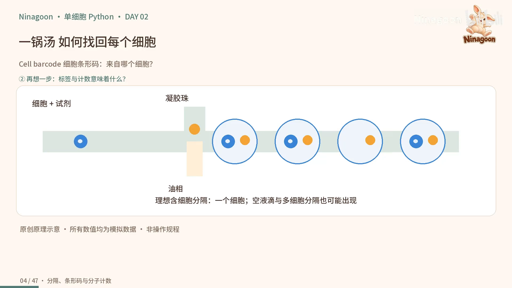
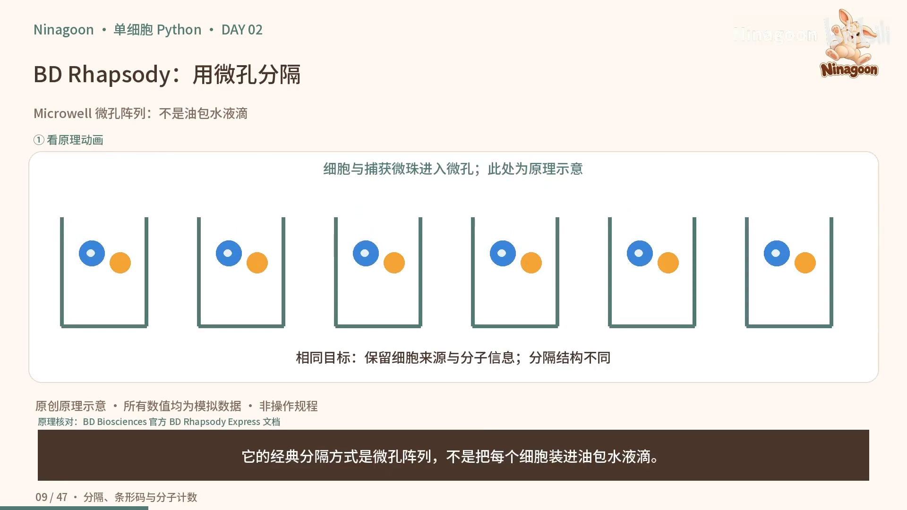
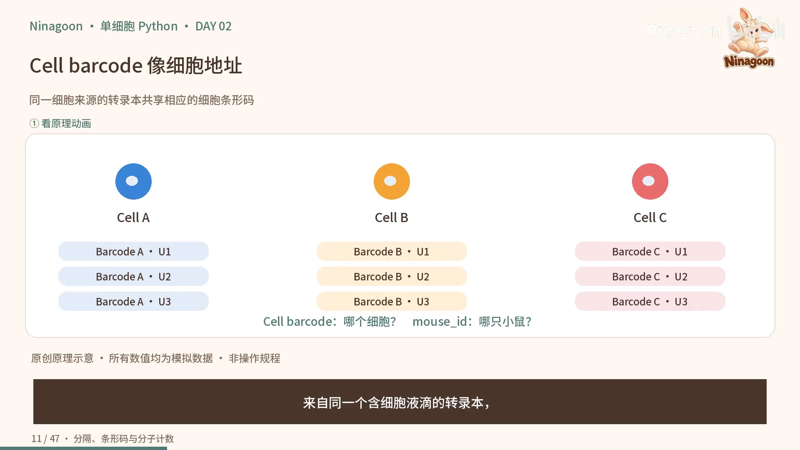
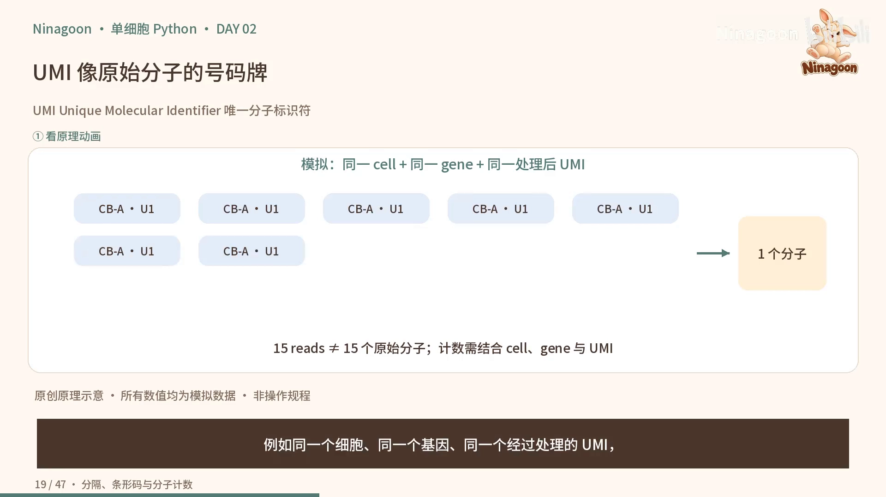
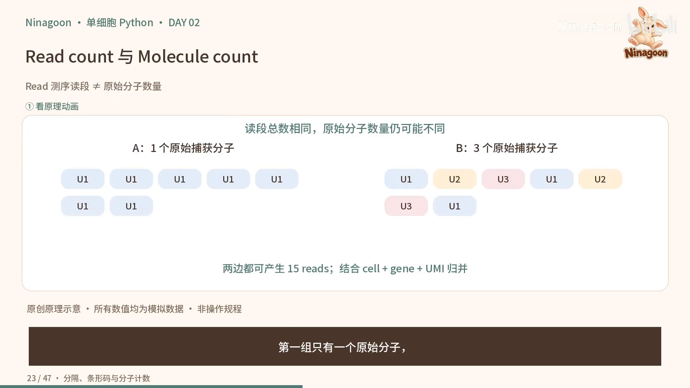
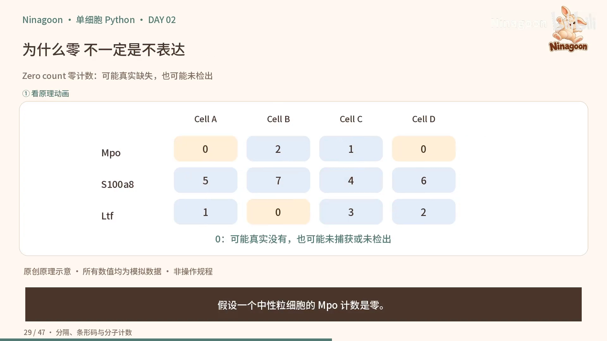
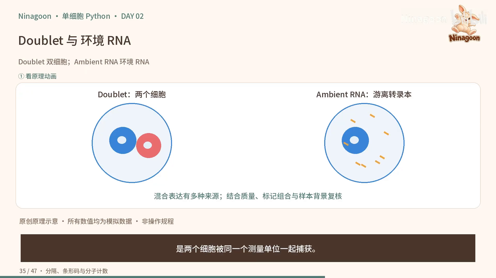
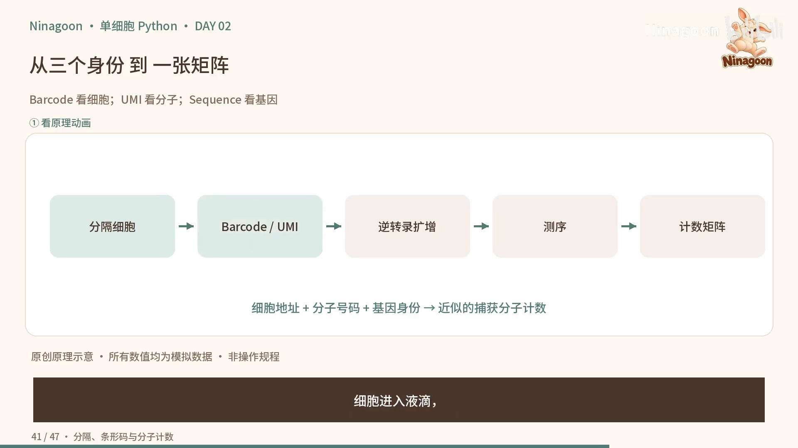

# Barcode 与 UMI：一锅细胞汤如何被还原成计数矩阵

> 视频来源：[Day02 Droplet scRNA-seq: Barcode, UMI & Count Matrix — 每天10分钟，15天学单细胞](https://www.bilibili.com/video/BV1qGxw6AE8w/)（B 站 · UP 主「Ninagoon」）｜时长约 9.5 分钟
> 导读：这支短视频不讲实验操作，只讲一件容易被跳过的事——表达矩阵里的数字到底在数什么。它用「邮袋里的信件」和「分子号码牌」两个比喻，把 cell barcode、UMI、基因序列这三种身份分开，再说明空液滴、双细胞、环境 RNA 和零值分别是怎么来的。视频中的图形、数字与序列都是原理示意，不是真实数据；本文沿用它的示意口径，并把相邻小节（比对与定量、cell calling 算法、质控方法）的内容只点到为止。

## 本讲要解决的核心问题（SCQA）

**背景**：单细胞测序的产物是一张「基因 × 细胞」的计数矩阵。我们习惯把它当成一张普通的表格：行是基因，列是细胞，格子里是数字。

**冲突**：可这张表其实是被「混合」过的。几万个细胞各自在一颗液滴里反应，之后所有 cDNA 被倒进同一根管子、一起扩增、一起测序。物理隔离在破乳那一刻就消失了，矩阵里的列（细胞）在测序结果里并不天然存在。更麻烦的是，为了让信号足够强，建库必须扩增，而扩增会让一个原始分子变成很多条读段——那么格子里的数字，究竟是「测到几条读段」还是「有几个原始分子」？

**疑问**：测序仪只吐出几百万条短序列，我们凭什么把它们还原成「哪个细胞、哪个基因、几个分子」？

**回答（中心思想）**：靠三把互相独立的尺子。**cell barcode 回答「来自哪个细胞」，UMI 回答「是第几个原始分子」，基因序列回答「属于哪个基因」**。矩阵里的每个数字，都是这三者相乘的结果：同一个 `(barcode, gene)` 组合下，**不同 UMI 的个数**才是表达量。所以矩阵里的数字是**分子计数**，不是读段计数；它是「捕获到的分子数」的近似统计，而不是细胞里 RNA 的绝对数量。

## 一、三个标签，三种身份

### 1.1 邮袋里的信件：为什么需要身份标签

视频开场给了一个很好用的比喻：把许多人的信件装进同一个邮袋，只要每封信上都写了寄件地址，混在一起之后我们仍然能分清来源。

[【跳转到 00:05】](https://www.bilibili.com/video/BV1qGxw6AE8w/?t=5)

液滴单细胞测序面对的是同一个问题：细胞被一起裂解、cDNA 被一起扩增、一起测序，最后只剩下一堆短序列。要让这堆序列还能「按细胞归位」，就必须在混合发生**之前**，把身份信息写进分子本身。

### 1.2 Barcode 看细胞、UMI 看分子、序列看基因

视频把这件事拆成三个问题，并且强调**不要把这三种身份混在一起**：

1. **cell barcode（细胞条形码）**：回答「来自哪个细胞」；
2. **UMI（unique molecular identifier，唯一分子标识符）**：帮助区分原始捕获分子；
3. **基因序列**：帮助判断这条序列属于哪个基因。

[【跳转到 00:50】](https://www.bilibili.com/video/BV1qGxw6AE8w/?t=50)

这三者分别落在测序读段的不同位置上，所以后面解析时也是分三步走：先从读段里切出 barcode 和 UMI，再把剩下的 cDNA 序列比对到基因上，最后按 `(barcode, gene)` 聚合 UMI 集合。

## 二、细胞捕获在数据上留下了什么

### 2.1 两种「小房间」：液滴与微孔

视频用两个平台代表两种隔离思路。10x Genomics Chromium 用**液滴**：细胞、带条形码的凝胶珠和试剂在油相中形成微小的反应空间，称为 GEM（Gel Beads-in-emulsion）。

[【跳转到 01:12】](https://www.bilibili.com/video/BV1qGxw6AE8w/?t=72)

BD Rhapsody 用**微孔阵列**：细胞和捕获微珠一起沉进微孔，细胞释放的 RNA 在孔里被捕获并带上标签，而不是把每个细胞装进油包水液滴。

[【跳转到 01:38】](https://www.bilibili.com/video/BV1qGxw6AE8w/?t=98)

视频特意提醒：两种平台像使用不同的小房间，目的都是保留细胞来源和分子信息，**不能因为都使用微珠和条形码，就把它们划成同一种「液滴技术」**。对数据来说，这一点很实际——不同化学体系的读段结构、barcode 长度都不一样，解析规则不能混用。

### 2.2 空液滴与双细胞：条形码只是「候选细胞」

更关键的是下一句：理想情况下一颗液滴里是一个细胞，但**不是每颗液滴都有细胞，也不能保证每次都只有一个**。

于是捕获这一步在数据上留下两类「杂质」：

- **空液滴**：没有细胞，却依然捕获了环境里游离的 RNA，于是也带上了某个 barcode；
- **双细胞（doublet）**：两个细胞进了同一颗液滴，共享同一个 barcode。

这两件事直接决定了后面所有分析的起点：**一个 barcode 并不自动等于一个细胞**，它只是一个「候选细胞」。谁是真细胞，要靠 cell calling 和质量控制去判定（判定算法属于后续小节，这里只记住这个因果）。

## 三、Barcode 是地址，不是身份证明

### 3.1 同一液滴的转录本共享同一个条形码

来自同一个含细胞液滴的转录本，通常带有相同的细胞条形码。测序之后，软件据此把许多读段分回一个候选细胞——这就是 barcode 的作用：**它像地址，帮助我们在混合的数据中恢复来源**。

[【跳转到 02:04】](https://www.bilibili.com/video/BV1qGxw6AE8w/?t=124)

注意这里说的是「候选」：条形码相同只能说明「这些读段来自同一颗液滴」，不能说明这颗液滴里恰好是一个健康细胞。空液滴和双细胞都会让这个地址指向错误的对象。

### 3.2 条形码不是生物学重复编号

视频还专门区分了两个容易混淆的层级：

- **cell barcode** 回答「哪个细胞」；
- **mouse_id 之类的样本字段**回答「哪只小鼠」（也就是哪个生物学样本）。

[【跳转到 02:49】](https://www.bilibili.com/video/BV1qGxw6AE8w/?t=169)

把不同样本合并时，必须同时保留样本信息，否则**不同文库中相同的条形码会被误认为同一个细胞**。这是「多个样本一起分析」时最常见的坑之一：条形码只在单个文库内部唯一。

## 四、UMI 是分子号码牌

### 4.1 扩增把 1 个分子变成 15 条读段

UMI 的英文全名是 unique molecular identifier。它要解决的问题是：建库必须扩增，而扩增会让同一个原始分子产生许多测序读段。

视频给了一个具体例子：同一个细胞、同一个基因、同一个处理后的 UMI 出现了 15 条读段——这些读段可能主要来自**一个**原始捕获分子的扩增，不能简单算成 15 个原始分子。

[【跳转到 03:36】](https://www.bilibili.com/video/BV1qGxw6AE8w/?t=216)

### 4.2 read count 与 molecule count 是两回事

视频用两组「模拟信件」把这个区别讲得很清楚：

- A 组：只有 **1 个**原始捕获分子，被扩增出 15 份；
- B 组：有 **3 个**不同原始分子，各被扩增出几份。

两组的读段总数都可以是 15，但原始分子数一个是 1、一个是 3。**只看读段总数，根本分不出这两种情况**；标签提供了额外的信息。

[【跳转到 04:23】](https://www.bilibili.com/video/BV1qGxw6AE8w/?t=263)

这正是 UMI 存在的全部理由：它把「扩增了多少次」这个与实验操作有关、与生物学无关的量，从计数里剔除了出去。

### 4.3 归并规则：cell + gene + UMI 三者同时相同

归并计数时，必须**同时**考虑细胞、基因和处理后的 UMI。视频把两条错误做法点得很明白：

- 不能看到不同细胞用了同一个 UMI，就把它们合成一个分子；
- 也不能不看基因和软件规则，仅仅凭字符串相同就手工删除所有重复。

[【跳转到 04:40】](https://www.bilibili.com/video/BV1qGxw6AE8w/?t=280)

用公式写出来就是：细胞 $c$ 中基因 $g$ 的表达量，等于在 `(c, g)` 这个组合下观测到的**不同 UMI 的个数**：

$$
C_{c,g} = \#\{\, u : (c, g, u) \in R \,\}
$$

其中 $R$ 是全部「带标签的读段」的集合，$u$ 是处理后的 UMI 序列。注意这个定义里没有出现「读段条数」——读段只是用来投票的，投完票就被折叠掉。

## 五、UMI 是近似统计，不是绝对计数

### 5.1 测序错误与碰撞

UMI 不是完美的。视频提到两件真实软件必须处理的事：

1. **条形码和 UMI 的测序错误**：读段上的 UMI 序列本身可能被读错一个碱基，需要纠错才能归并到正确的分子上；
2. **不同分子碰巧使用相同标签**：UMI 是随机序列，分子数很多时，两个不同的原始分子可能抽到同一个 UMI，于是被误当成一个分子（这就是 UMI 碰撞）。

[【跳转到 03:53】](https://www.bilibili.com/video/BV1qGxw6AE8w/?t=233)

### 5.2 为什么矩阵里的数字不是绝对分子数

所以视频给了一个很克制的结论：**UMI 计数是对捕获分子的近似统计，不是细胞里所有 RNA 分子的绝对数量**。

[【跳转到 03:58】](https://www.bilibili.com/video/BV1qGxw6AE8w/?t=238)

这句话值得记住，因为它同时解释了两件事：

- 为什么矩阵里的数字不能和 bulk 测序的 read count 直接比较——两者量的根本不是同一个东西；
- 为什么同一个基因在不同细胞里的计数差异，既有生物学原因，也有捕获与扩增的技术原因。

## 六、零不一定是不表达

### 6.1 一勺汤里的玉米

视频用了一个很生动的类比：用小勺从汤里取样，没有捞到一粒玉米，不代表整锅汤里没有玉米。测序也有捕获和检测的限制。

[【跳转到 05:23】](https://www.bilibili.com/video/BV1qGxw6AE8w/?t=323)

假设一个中性粒细胞的 `Mpo` 计数是零，先不要马上说这个细胞完全不表达 `Mpo`。零可能对应**真实没有表达**，也可能是**表达量低、没有被捕获或没有被检测到**。单个细胞的一次观察，通常无法把这些情况完全分开。

### 6.2 怎么处理这种不确定性

视频给出的做法是「多证据合并判断」：结合相似细胞、多个标记、样本质量与整体表达模式来判断。

[【跳转到 05:50】](https://www.bilibili.com/video/BV1qGxw6AE8w/?t=350)

对 RNA 含量较低的中性粒细胞，这一点尤其重要：不要因为一个标记是零就立刻排除细胞身份；同时也不能把所有零都解释成漏检。两种极端都会让结论失真。

## 七、双细胞与环境 RNA：混合表达的两个来源

一个细胞的表达谱看起来「混了两种细胞的特征」，有两种完全不同的原因：

- **doublet（双细胞）**：两个细胞被同一个测量单位一起捕获，例如一个中性粒细胞和一个单核细胞共享一个条形码，表达谱就会混合两种细胞的特征，甚至被误认为一个特殊的新状态；
- **ambient RNA（环境 RNA）**：细胞外游离的转录本进入液滴，给原本的细胞信号添上背景。

[【跳转到 06:28】](https://www.bilibili.com/video/BV1qGxw6AE8w/?t=388)

视频强调：**它和双细胞不是同一个问题**，混合表达可能有多个来源，不能只看到两个基因就下确定结论。判断时要结合总计数、检测基因数、双细胞评分、互相不相容的标记组合、批次分布和生物学背景；软件预测是线索，仍然需要复核。

## 八、把三个身份连起来：从液滴到矩阵

把今天的过程串起来，就是一条很短的链：

1. 细胞进入液滴（或微孔），与带标签的微珠一起被分隔；
2. 转录本被捕获，带上 barcode 与 UMI；
3. 逆转录生成 cDNA，扩增后测序；
4. 软件根据基因序列、细胞条形码和 UMI 构建表达计数矩阵。

[【跳转到 07:38】](https://www.bilibili.com/video/BV1qGxw6AE8w/?t=458)

拿到矩阵以后要保留一层含义：**数字通常代表检测到的分子计数，而不是细胞内全部 RNA 的绝对数量**。保留这一层含义，既能避免把技术采样直接理解成细胞真实的分子总量，也能帮助理解为什么会出现零。

[【跳转到 07:58】](https://www.bilibili.com/video/BV1qGxw6AE8w/?t=478)

今天最重要的三个对应关系是：**哪个细胞（barcode）、哪个分子（UMI）、哪个基因（序列）**；再加上「来自哪只小鼠」这样的样本字段，我们才能把分子、细胞和独立样本连起来。

[【跳转到 08:20】](https://www.bilibili.com/video/BV1qGxw6AE8w/?t=500)

## 小结

- 表达矩阵里的每个数字，是「哪个细胞 × 哪个基因 × 几个原始分子」三者的结果；三把尺子分别由 cell barcode、基因序列、UMI 提供。
- barcode 只是「候选细胞」的地址：空液滴会带上游离 RNA 的标签，双细胞会让两个细胞共享一个地址，所以还需要 cell calling 与质控来判定真细胞。
- barcode 只在单个文库内部唯一，跨样本合并时必须同时保留样本字段，否则相同条形码会被误认为同一个细胞。
- UMI 的作用是剔除扩增偏差：同一个 `(cell, gene, UMI)` 的 15 条读段只算 1 个分子，因此矩阵里是**分子计数**而不是**读段计数**。
- UMI 计数是近似统计：测序错误需要纠错，分子数多时还会发生 UMI 碰撞，所以它不等于细胞内 RNA 的绝对数量。
- 零值可能是真不表达，也可能是没捕获到；双细胞与环境 RNA 则是「混合表达」的两种不同来源，都要靠多证据复核。

## 关键术语速查

| 术语 | 一句话解释 |
| --- | --- |
| cell barcode（细胞条形码） | 一段短序列，同一颗液滴里的转录本共享它，用来回答「来自哪个细胞」；它只标识候选细胞，不保证是健康单细胞 |
| UMI（unique molecular identifier） | 随机序列标签，在扩增之前贴到每个原始分子上，用来把同一分子的多个拷贝折叠成一个 |
| molecule count（分子计数） | 同一 `(cell, gene)` 下不同 UMI 的个数，也就是矩阵格子里真正记录的量 |
| read count（读段计数） | 测序得到的读段条数，受扩增效率和测序深度影响，不能当作表达量 |
| doublet（双细胞） | 两个细胞被同一颗液滴或同一个微孔一起捕获，共享一个 barcode，表达谱混合 |
| ambient RNA（环境 RNA） | 细胞外游离的转录本进入液滴，给该液滴的表达谱加上背景 |
| dropout / 零值 | 低表达基因没有被捕获或没有被检出，导致矩阵中出现零 |
| GEM | Gel Beads-in-emulsion，10x Chromium 里油相包裹细胞与凝胶珠形成的微小反应空间 |
| cell calling | 判断哪些 barcode 对应真细胞、哪些只是空液滴背景的步骤（算法见后续小节） |