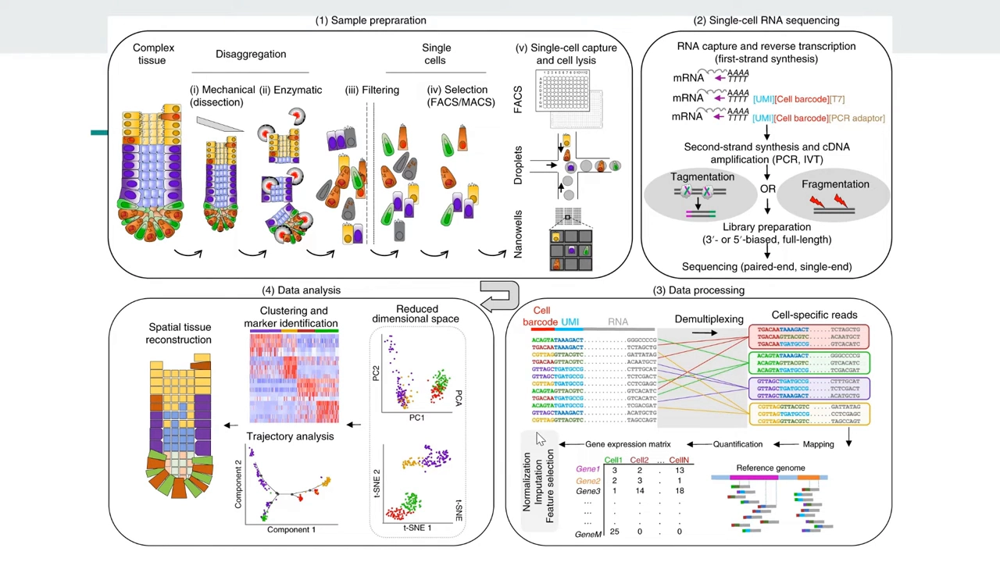
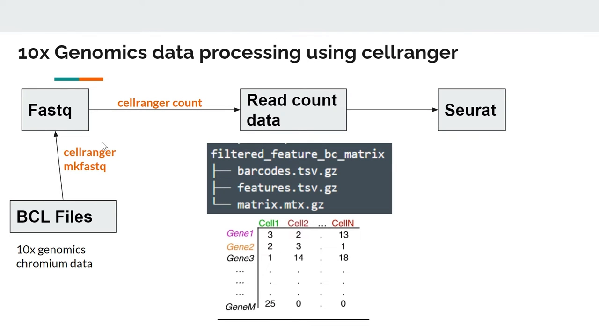
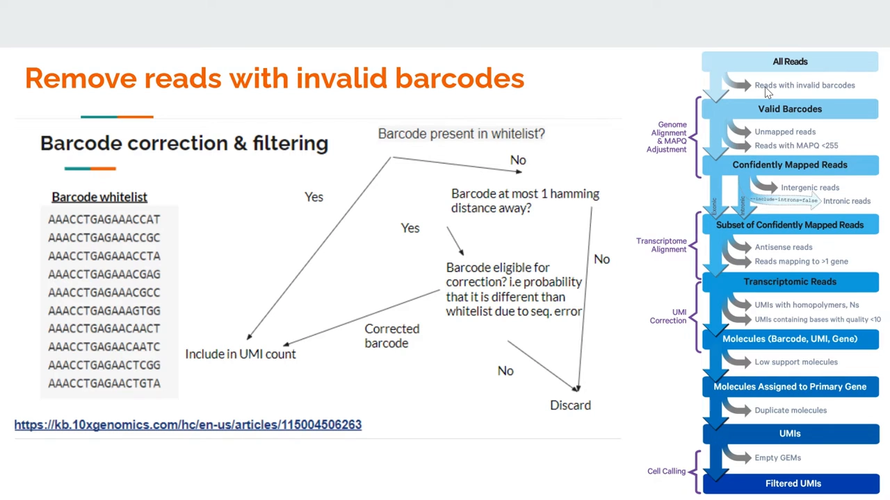
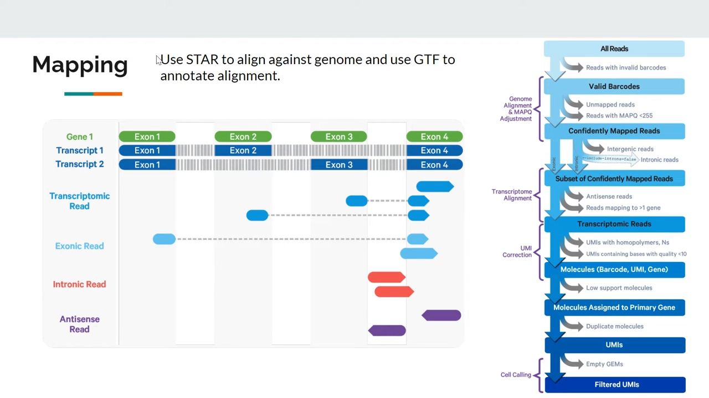
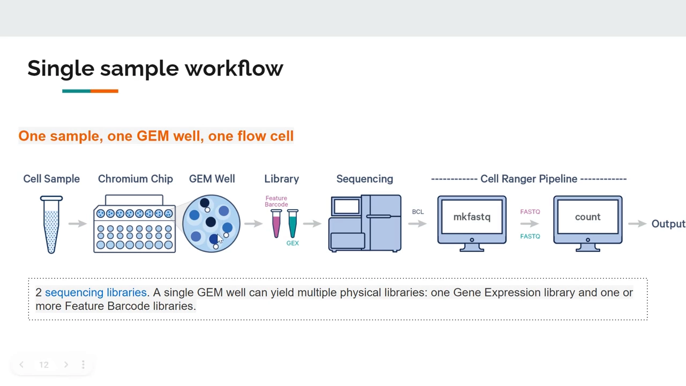
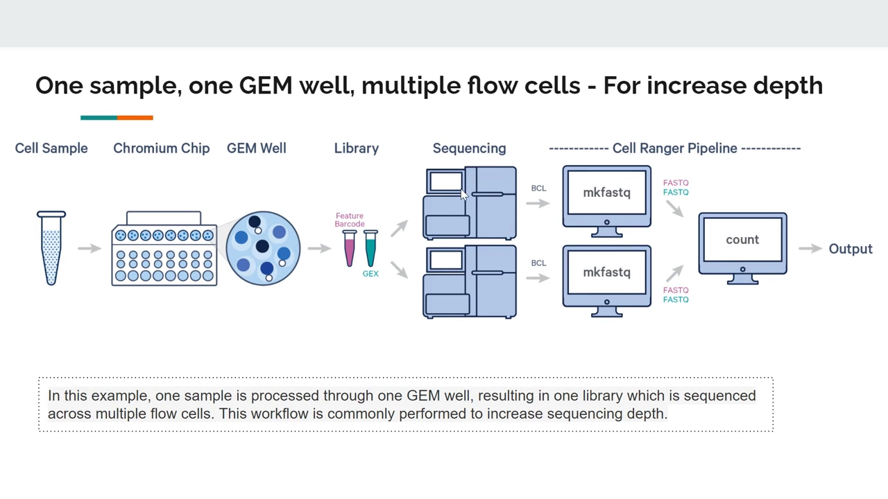
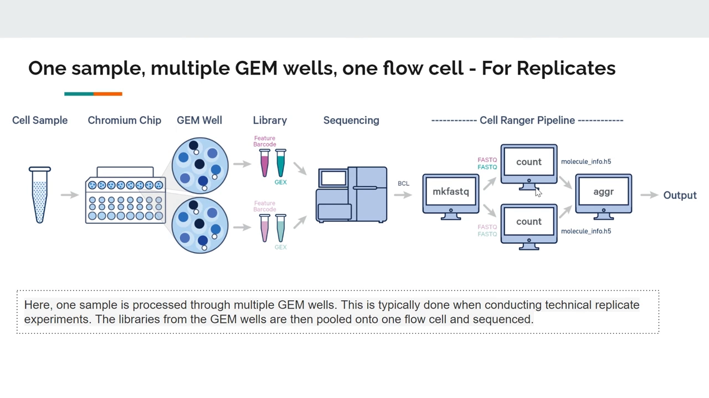
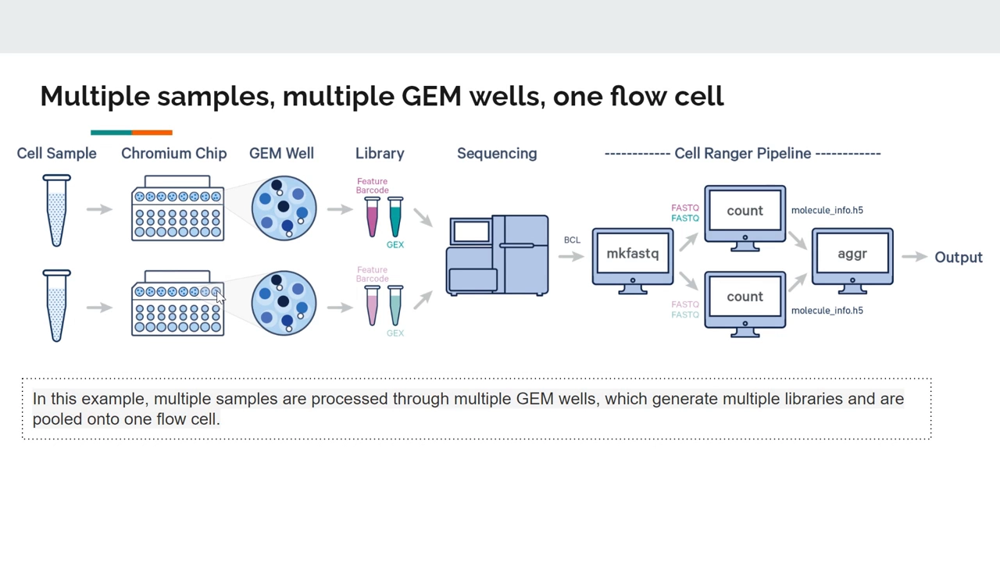

# Cell Ranger 如何把 FASTQ 变成表达矩阵：拆标签、比对与计数

> 视频来源：[Cell Ranger - Process 10x genomics data (Part1)](https://www.youtube.com/watch?v=xA4TrXrNfvU)（YouTube · BioinfQuests）｜时长约 20 分钟
> 导读：这是一支「只讲算法、不讲命令行」的 Cell Ranger 讲解，把 `count` 内部从 reads 到表达矩阵的每一步拆开：barcode 校验、STAR 比对、read 分类、UMI 过滤与去重。它的价值在于把「一个参数会怎样改变矩阵里的数字」讲得很具体。本文只覆盖计算流水线本身：barcode 与 UMI 的语义属于 2.2.1，cell calling 的算法属于 2.2.3，矩阵文件格式属于 2.2.4，本文都只点到为止。

## 本讲要解决的核心问题（SCQA）

**背景**：测序仪交给你的是 FASTQ——几千万到几亿条带质量值的短序列。而下游分析（Seurat、Scanpy）拿到的是「基因 × 细胞」的整数表，每个格子是一个数字。

**冲突**：这两样东西之间隔着一整条流水线，而流水线里每一步都在做判断：barcode 差一个碱基算不算同一个细胞？read 落在两个基因之间算谁的？落在内含子里要不要数？同一个 UMI 出现两次是同一个分子还是两个分子？这些判断没有唯一正确答案，只有「工具默认怎么选」。

**疑问**：一条 read 从进入流水线到变成一个计数，中间到底被检查、被改写、被丢弃了多少次？哪些环节会真正改变矩阵里的数字？

**回答（中心思想）**：Cell Ranger 的 `count` 是一条**逐级过滤 + 逐级归属**的流水线：**拆标签（barcode 校验与纠错）→ 定位（STAR 剪接感知比对 + GTF 注释分类）→ 归属与计数（UMI 过滤、去重、按 barcode 与基因聚合）**。每一级都会丢弃一部分 reads，也都会做一次归属判断；矩阵里的每个整数，都是这条链上所有默认参数共同的结果，所以**换工具或换版本，矩阵就会变**。

## 一、表达矩阵不是测出来的，是算出来的

### 1.1 Cell Ranger 接手的起点与终点

单细胞实验的完整链条是：解离组织得到单细胞悬液 → 捕获细胞 → 建库（接上 cell barcode 与 UMI）→ 上机测序 → **数据处理** → 下游分析。视频把「数据处理」这一段完整地划给了 Cell Ranger：从原始测序数据到 count 数据，全部由它完成；拿到 count 数据之后，才交给 Seurat 之类的工具做分析。

[【跳转到 01:50】](https://www.youtube.com/watch?v=xA4TrXrNfvU&t=110)

而「数据处理」这一段本身又可以拆成四件事：**细胞 demultiplexing → UMI 去重 → 比对到参考基因组 → 定量**，最后得到一张矩阵——每一列是一个细胞，每一行是一个基因，格子里的数字是支持这个基因在这个细胞里的 UMI 个数。

[【跳转到 02:15】](https://www.youtube.com/watch?v=xA4TrXrNfvU&t=135)

### 1.2 输出的三个文件：谁、什么基因、几个分子

`count` 的产物不是一个文件，而是三份信息拼起来的一张表：

1. **barcodes.tsv**：有哪些细胞（列名）；
2. **features.tsv**（旧版本叫 genes.tsv）：有哪些基因，以及这个基因是什么类型、位于哪里（行名）；
3. **matrix.mtx**：真正的计数，以稀疏矩阵形式存放。

[【跳转到 02:45】](https://www.youtube.com/watch?v=xA4TrXrNfvU&t=165)

这三份文件合起来才是「表达矩阵」。理解这一点很重要：矩阵的行列名不是装饰，它们决定了你后面能不能把这张表和别的数据对齐——同一个基因在不同注释版本里可能叫不同的 ID，同一个细胞在不同工具里可能被赋予不同的 barcode 集合。

## 二、第一步：拆标签——从 BCL 到带 barcode 的 reads

### 2.1 BCL 只是「按测序循环存的原始信号」

Illumina 测序仪吐出的原始文件是 **BCL**，它不是按 read 组织的，而是按测序循环（cycle）组织的一堆碱基信号。要变成大家熟悉的 FASTQ，需要一次格式转换，工具可以是 Illumina 自带的 `bcl2fastq`，也可以是 Cell Ranger 提供的 `mkfastq`（它内部就是包装了 bcl2fastq）。

这一步不改变序列内容，只改变组织方式：把「按循环」重排成「按 read」，每条 read 四行——`@` 开头的 header、序列、`+` 分隔行、与序列等长的质量字符串。

### 2.2 barcode 校验与纠错：白名单 + 汉明距离

进入 `count` 之后，第一件事不是比对，而是**判断这条 read 属于哪个细胞**。10x 的 barcode 来自一个预先设计好的白名单（whitelist），所以判断逻辑是一个决策树：

- barcode **精确命中**白名单 → 有效，进入后续计数；
- 与白名单中某个 barcode **只差一个碱基**（汉明距离为 1）→ 尝试纠错：判断这个差异更可能来自测序错误，还是本来就是个无效 barcode；能纠就纠，纠不了就丢；
- 差得更多 → 直接丢弃。

[【跳转到 06:09】](https://www.youtube.com/watch?v=xA4TrXrNfvU&t=369)

这张图右侧的竖条值得记住：它把整条流水线的每一级过滤都画出来了，从上到下依次是「无效 barcode 的 reads」「未比上的 reads」「MAPQ < 255 的 reads」「基因间区 reads」「反义 reads」「多重比对 reads」「含 homopolymer 或 N 的 UMI」「低支持度的分子」「重复分子」「空液滴」。**每一级都会掉一批 reads**——这些掉落比例，就是判断一次实验质量好坏最直接的信号。

> barcode 白名单怎么设计、汉明距离为什么是 1、UMI 的计数语义——这些属于 2.2.1 的内容，这里只引用结论：**barcode 标识细胞，UMI 标识分子**。

### 2.3 为什么单细胞 FASTQ 特别大

一个 10x 样本的 FASTQ 动辄几十 GB，原因不只是细胞多：**每条 read 都要先被拆标签**。barcode 与 UMI 写在 read 的一端，cDNA 片段写在另一端，两边都要读进来、都要判断。所以单细胞上游流程的第一笔开销不是比对，而是「把几亿条 read 的标签切出来、查白名单、纠错、重新组织」。

## 三、第二步：定位——为什么必须是剪接感知的比对

### 3.1 STAR + GTF：比对只是第一步，注释才是分类

比对用的是 **STAR**，一个剪接感知（splice-aware）的比对器。为什么必须剪接感知？因为真核生物的转录本经过剪接，一条 read 完全可能横跨两个外显子——在基因组坐标上它是一段「不连续」的比对，中间要跳过一段内含子。剪接感知比对器能把这个跳跃表达出来（就是 CIGAR 里的 `N`），而普通比对器只会认为这条 read 比不上。

比对完成后，Cell Ranger 用 **GTF 注释文件**给每条 read 分类：它落在外显子上、内含子上、基因间区，还是与基因方向相反（反义 read）。

[【跳转到 08:19】](https://www.youtube.com/watch?v=xA4TrXrNfvU&t=499)

这一步是「比对」和「定量」之间的桥：比对只告诉你 read 在基因组的哪个位置，**注释才告诉你这个位置属于哪个基因的哪个部分**。矩阵里的数字因此同时依赖两个东西——比对器的结果，和注释文件的版本。

### 3.2 四类 read，四种命运

| read 类型 | 位置 | Cell Ranger 默认处理 |
| --- | --- | --- |
| 外显子 read（exonic） | 落在外显子区 | 计入 |
| 内含子 read（intronic） | 落在内含子区 | **默认计入**（可用 `include-introns=false` 关掉） |
| 基因间区 read（intergenic） | 落在基因之间 | 丢弃 |
| 反义 read（antisense） | 与基因方向相反 | 丢弃 |

反义 read 的定义很直白：基因在正链上，而 read 比对到了负链（或反之），这条 read 就不属于这个基因。丢弃它是为了避免把「反向转录」或「重叠基因的另一个方向」的 reads 错误地算进来。

[【跳转到 09:34】](https://www.youtube.com/watch?v=xA4TrXrNfvU&t=574)

### 3.3 MAPQ 255 与多重比对

比对质量（MAPQ）反映「这条 read 比到这个位置有多确定」。Cell Ranger 的判据是 **MAPQ 必须等于 255**：低于这个值的 read 一律丢弃，因为它们可能来自重复序列、可能落在多个位置，归属不可信。

多重比对（一条 read 同时命中多个基因）也是直接丢弃——视频的解释是：这种情况下总有一个是 primary、一个是 secondary，Cell Ranger 不去做概率分配，直接放弃这条 read。

[【跳转到 10:24】](https://www.youtube.com/watch?v=xA4TrXrNfvU&t=624)

这里有一个值得记住的取舍：**丢弃多重比对 reads 是保守策略**。它避免了把 reads 随便分给某个基因造成的假阳性，代价是基因家族（序列高度相似的旁系同源基因）的定量会被系统性低估。不同工具在这件事上的策略不同，这也是「不同工具给出的矩阵不能混着比」的原因之一。

### 3.4 一个参数就能改变数字：`include-introns`

视频特别点出了 `include-introns` 这个参数：**默认情况下外显子 reads 和内含子 reads 都会被计入**；如果设成 `false`，内含子 reads 会被丢弃。

为什么这件事重要？因为内含子 reads 来自**未剪接的 pre-mRNA**，它在总 RNA 里的比例因基因而异、因细胞状态而异。对单细胞核（single-nucleus）数据来说，内含子 reads 甚至是主要信息来源；而对某些基因（比如核内滞留的 lncRNA、转录非常活跃的基因），把内含子算进来会明显抬高它的丰度。所以「默认值」不是中性选择，它会系统性改变一批基因的相对丰度。

## 四、第三步：归属与计数——UMI 过滤与去重

### 4.1 UMI 也要过质量关

比对完成、read 有了基因归属之后，还不能直接数。因为 UMI 本身也会被测错，Cell Ranger 会先过滤三类 UMI：

1. 含 **homopolymer**（比如连续一长串 A 或 T）的 UMI——这种位置测序容易出错；
2. 含 **N**（模糊碱基）的 UMI；
3. 含有质量值低于 10 的碱基的 UMI。

[【跳转到 11:39】](https://www.youtube.com/watch?v=xA4TrXrNfvU&t=699)

质量值用的是 Phred 分数，定义为

$$
Q = -10 \log_{10} p
$$

其中 $p$ 是该碱基被判错的概率。$Q=10$ 意味着错误率约 10%，$Q=30$ 意味着约 0.1%。所以「质量低于 10」这条线，等于说「这个碱基的可靠性还不如瞎猜」——这种 UMI 拿去做去重只会制造假分子。

### 4.2 从「分子」到「计数」：三元组去重

过滤之后，每条 read 都带齐了三样东西：**barcode（哪个细胞）、UMI（哪个原始分子）、gene（哪个基因）**。计数规则就是一句话：**同一个 (barcode, gene, UMI) 组合只算一次**，重复出现的 reads 视为 PCR 扩增产生的拷贝。

[【跳转到 12:29】](https://www.youtube.com/watch?v=xA4TrXrNfvU&t=749)

这一步之后得到的是 **gene × droplet** 矩阵——注意是 droplet，还不是 cell。因为液滴法里绝大多数液滴是空的，或者只包住了环境 RNA，它们同样会积累一些 UMI。

### 4.3 最后一步：cell calling 把 droplet 变成 cell

Cell Ranger 用**基因表达谱**来判断一个液滴是不是细胞：一个真正的细胞会表达一组有结构的基因，而空液滴里的 UMI 分布更像随机背景。基于这个逻辑，它在「细胞」和「背景」之间划一条边界。

[【跳转到 14:09】](https://www.youtube.com/watch?v=xA4TrXrNfvU&t=849)

cell calling 的具体算法（包括那条著名的 knee 曲线怎么画、空液滴模型怎么拟合）属于 2.2.3，这里只需要记住一件事：**矩阵的列数不是由实验决定的，而是由这一步的判定决定的**。同一批 FASTQ，换一个 cell calling 策略，你会得到不同数量的细胞，以及每个细胞不同的表达谱。

## 五、同一套算法，四种跑法

流水线是固定的，但实验设计会变，于是 Cell Ranger 有四种常见跑法。

### 5.1 单样本、单 GEM 孔、单 flow cell

最直接的一条路：一个样本进一个 GEM 孔 → 建库 → 一个 flow cell 测完 → 一个 BCL → `mkfastq` → 一个 FASTQ → `count`。

[【跳转到 15:55】](https://www.youtube.com/watch?v=xA4TrXrNfvU&t=955)

### 5.2 同一样本、多个 flow cell：为了加深测序深度

如果测完发现深度不够，可以拿同一份文库分到两个 flow cell 上测，得到两个 BCL、两个 FASTQ。这时**不能跑两次 count**——那会得到两张各自不完整的矩阵。正确做法是把所有 FASTQ 一起喂给**同一个** `count` 命令，让它知道这些不是不同样本，而是同一个样本的不同测序批次。

[【跳转到 16:40】](https://www.youtube.com/watch?v=xA4TrXrNfvU&t=1000)

### 5.3 技术重复：分开 count，再用 aggr 合并

如果目的是做技术重复，同一样本会被分到多个 GEM 孔、各自建库、混在同一个 flow cell 里测。因为不同 GEM 孔的 barcode 集合不同，`mkfastq` 会按 barcode 把数据拆成多个 FASTQ，**每个重复必须单独跑 count**，最后再用 `aggr` 把多张矩阵合并成一张。

[【跳转到 17:55】](https://www.youtube.com/watch?v=xA4TrXrNfvU&t=1075)

### 5.4 多样本：同样的分与合

多个样本（不同芯片，或同一芯片的不同孔）也是同一条逻辑：先各自 `count`，再 `aggr`。区别只在于，合并之后矩阵的列来自不同样本，需要额外的样本标签来区分——否则下游分析会把它们当成同一批细胞。

[【跳转到 18:45】](https://www.youtube.com/watch?v=xA4TrXrNfvU&t=1125)

这四种跑法背后的同一条原则是：**`count` 的输入边界 = 一个 barcode 空间的边界**。同一个 barcode 空间（同一个 GEM 孔）的数据必须一次跑完；不同 barcode 空间的数据必须先分开跑、再在矩阵层面合并。

## 小结

- Cell Ranger 的 `count` 是一条**逐级过滤 + 逐级归属**的流水线：barcode 校验与纠错 → STAR 剪接感知比对 → GTF 注释分类 → UMI 过滤与去重 → 按 (barcode, gene, UMI) 聚合 → cell calling。
- 输出不是一张表，而是三份文件：`barcodes.tsv`（谁）、`features.tsv`（什么基因）、`matrix.mtx`（几个分子）。
- 比对必须剪接感知，因为 read 会跨外显子；比对之后还要靠 GTF 把 read 分成外显子、内含子、基因间区、反义四类，**每一类的去留都由参数决定**。
- `include-introns` 默认把内含子 reads 计入，这会系统性改变一批基因的丰度；关掉它，矩阵就变了。
- 多重比对 reads 被直接丢弃，是保守但会低估基因家族的策略。
- UMI 先过质量关（homopolymer、N、低质量碱基），再按 (barcode, gene, UMI) 去重；质量值用 Phred 分数 $Q = -10\log_{10} p$ 衡量。
- 矩阵的列数由 cell calling 决定，不由实验决定——同一批 FASTQ 换策略就换细胞集。
- 四种跑法（单样本、跨 flow cell、技术重复、多样本）遵循同一条原则：一个 barcode 空间一次 `count`，不同空间先分开再 `aggr`。

## 关键术语速查

| 术语 | 一句话解释 |
| --- | --- |
| BCL | Illumina 测序仪的原始输出，按测序循环存放碱基信号，需要转成 FASTQ |
| FASTQ | 每条 read 四行的文本格式：header、序列、分隔符、逐碱基质量值 |
| Phred 质量值 | $Q = -10\log_{10} p$，把碱基错误概率换算成整数分数 |
| mkfastq | Cell Ranger 里把 BCL 转成 FASTQ 的子命令（内部包装 bcl2fastq） |
| count | Cell Ranger 的核心子命令：FASTQ → 基因×细胞计数矩阵 |
| aggr | 把多个 `count` 结果合并成一张矩阵的子命令 |
| barcode 白名单 | 10x 预先设计的所有合法细胞 barcode 列表，用于校验与纠错 |
| 剪接感知比对 | 能识别 read 跨外显子、在 CIGAR 里用 `N` 表示跳跃的比对方式 |
| GTF | 基因注释文件，定义外显子、内含子与基因边界，决定 read 归给谁 |
| MAPQ 255 | Cell Ranger 只接受 MAPQ 为 255 的比对，其余视为归属不可信 |
| 内含子 reads | 来自未剪接 pre-mRNA 的 reads，默认计入，可用 `include-introns=false` 关闭 |
| 多重比对 | 一条 read 同时命中多个基因/位置；Cell Ranger 直接丢弃 |
| homopolymer | 连续重复的同一碱基，测序易错，含此类模式的 UMI 会被过滤 |
| cell calling | 判断哪些液滴是真细胞、哪些是背景的算法，决定矩阵的列 |