# 从 CellRanger 三件套到 Seurat 对象：矩阵如何被装进一个对象

> 视频来源：[From CellRanger to Seurat Object | Single-Cell RNA-seq in R using Seurat](https://www.youtube.com/watch?v=xUThJg5GV_I)（YouTube · BioinfQuests）｜时长约 19 分钟
> 导读：上一支视频讲「矩阵有哪几种外壳」，这一支讲「矩阵怎么被装进分析对象」。讲者用 Seurat 官方的 pbmc3k 数据，从 CellRanger 输出的三个文件讲起，一步步走到 `Read10X` → `CreateSeuratObject` → 对象内部的 `counts` / `data` / `scale.data` 三层，最后用 `meta.data` 里每个细胞的 `nCount_RNA` 与 `nFeature_RNA` 演示「怎么读一张矩阵」。

## 本讲要解决的核心问题（SCQA）

**背景**：CellRanger 跑完，你会得到一个文件夹，里面是 `barcodes.tsv.gz`、`features.tsv.gz`、`matrix.mtx.gz` 三个文件——这就是那张「基因 × 细胞」的计数矩阵，只是被拆成了三份。

**冲突**：这三个文件不能直接拿去做分析。你需要一个能装下矩阵、又能装下后续所有结果（归一化、降维、聚类）的容器，而且容器里必须分清「哪一层是原始计数、哪一层是处理后的值」。

**疑问**：三个文件怎么合并成一张矩阵？矩阵进对象之后放在哪个位置？对象的哪些槽位存矩阵、哪些槽位存细胞信息？怎么把矩阵里的数字读成对数据的直觉？

**回答（中心思想）**：`Read10X()` 负责把三件套还原成一张**稀疏计数矩阵**，`CreateSeuratObject()` 负责把这张矩阵放进对象的 `assays$RNA@counts` 层，并在放进去的同时按 `min.cells` / `min.features` 做第一次过滤。此后 `counts` 永远是原始整数，`data` 存归一化后的值，`scale.data` 存标准化后的值——**三层各司其职，混用就是错误**。

## 一、CellRanger 交出来的就是一张矩阵，只是拆成了三个文件

讲者先回顾了 10x 的完整数据流：拿到 **BCL 文件**（测序仪原始输出），用 `cellranger mkfastq` 转成 **FASTQ**，再用 `cellranger count` 转成**计数数据**，最后才进 Seurat。

[【跳转到 02:22】](https://www.youtube.com/watch?v=xUThJg5GV_I&t=142)

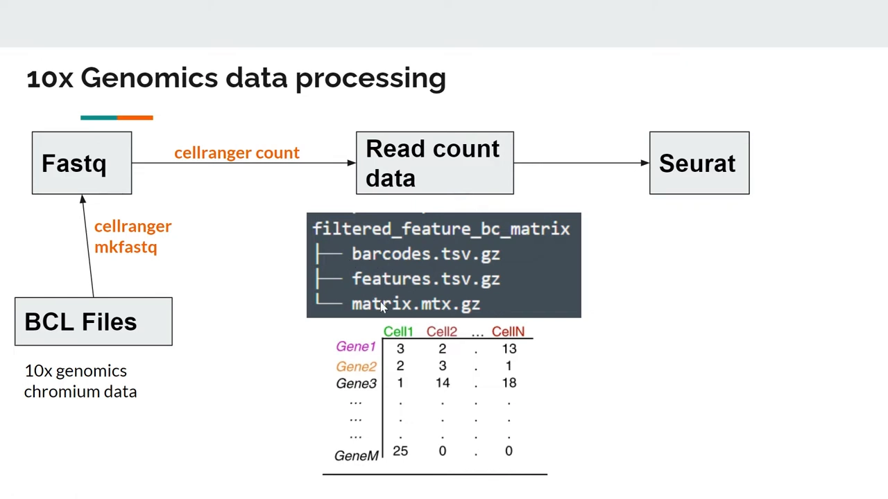

图里那个 `filtered_feature_bc_matrix` 文件夹，正是本小节的主角：

| 文件 | 装什么 | 对应矩阵的哪一维 |
| :--- | :--- | :--- |
| `barcodes.tsv.gz` | 每个细胞的 barcode | 列（细胞） |
| `features.tsv.gz` | 每个基因的 id 与 symbol | 行（基因） |
| `matrix.mtx.gz` | 非零位置的「行号、列号、值」 | 矩阵内容本身 |

讲者的原话很直接：**「this is the count matrix, each column corresponds to a cell or barcode, while each row corresponds to a gene or feature」**——列是细胞、行是基因。

[【跳转到 04:59】](https://www.youtube.com/watch?v=xUThJg5GV_I&t=299)

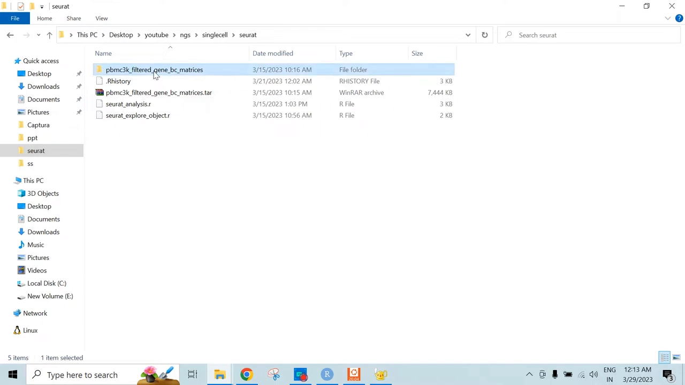

关键点：**这三个文件必须作为一个文件夹整体喂给 Seurat**。讲者强调它们「usually stored in a single folder, and we will be uploading this folder into Seurat directly」——因为 `matrix.mtx` 里只有数字索引，行列名全靠另外两个文件按顺序对应，拆开混用就会整体错位。

### 1.1 用的是哪份数据、哪套工具

讲者全程用 Seurat 官方的教学数据 **pbmc3k**：外周血单个核细胞（PBMC），约 **2700 个细胞**，在 Illumina NextSeq 500 上测序，数据可以从 Seurat 教程页直接下载 tar 包、解压即用。

工具只有两样：R 里的 `Seurat` 包（`install.packages("Seurat")` 安装，`library(Seurat)` 加载）和辅助用的 `dplyr`（用于 `%>%` 管道查看数据框）。

### 1.2 矩阵进对象之后，后面还有哪些步骤

讲者把完整的 Seurat 流程列了一遍，本讲只做第一步：

1. **载入数据**（本讲内容）→ 2. 质控与预处理（去掉低质量细胞）→ 3. 归一化 → 4. 标准化（scaling）→ 5. 降维（PCA）→ 6. 聚类 → 7. 用 tSNE 等方法可视化 → 8. 找每个 cluster 的标志基因 → 9. 注释细胞亚型。

他特别强调学每一步都要问两个问题：**为什么做**、**怎么做**。这也是理解「矩阵为什么分三层」的关键——`counts`、`data`、`scale.data` 三层，正好对应第 3、4 步各自需要的那份数据。

## 二、`Read10X()`：三个文件合并成一张稀疏矩阵

读数据只需要一行：

```r
datadir  <- "./pbmc3k_filtered_gene_bc_matrices/filtered_gene_bc_matrices/hg19"
pbmc.data <- Read10X(data.dir = datadir)
```

[【跳转到 05:28】](https://www.youtube.com/watch?v=xUThJg5GV_I&t=328)

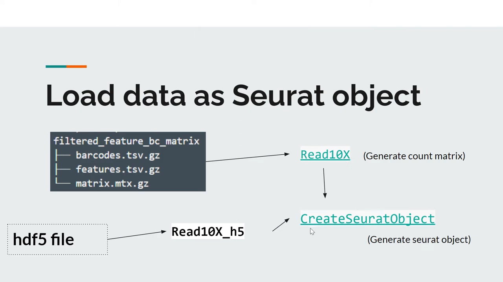

这张图把两条路线并列画出来，值得记住：

- **MEX 三件套** → `Read10X()` → count matrix；
- **HDF5 单文件** → `Read10X_h5()` → count matrix；
- 两条路最后都汇到 `CreateSeuratObject()`。

`Read10X()` 做的正是「合并」这件事：把三个文件拼回一张矩阵。读进来的东西在 RStudio 环境面板里显示为 `Large dgCMatrix`——**稀疏矩阵**。

[【跳转到 07:44】](https://www.youtube.com/watch?v=xUThJg5GV_I&t=464)

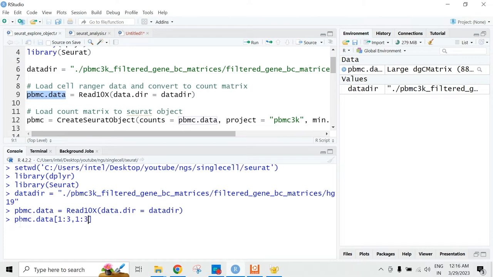

### 2.1 点号就是 0，而 0 有两种含义

讲者特意停下来解释稀疏矩阵怎么读：

> 「This is a sparse matrix. This is not an ordinary matrix; instead it is a reduced representation of matrix which basically saves a lot of memory. Instead of zero we are having dots. Dot means that gene is either not detected, or the gene count is a dropout.」

这段话里有两个要点：

1. **稀疏是省内存的表示法**：普通矩阵要为每个格子分配内存，稀疏矩阵只记录非零的位置和值；
2. **点号（0）有两种来源**：这个基因在这个细胞里**真的不表达**，或者**表达了但没测到**（dropout）。

打印矩阵的一小块就能看到：

```
> pbmc.data[1:3, 1:3]
3 x 3 sparse Matrix of class "dgCMatrix"
                AAACATACAACCAC-1 AAACATTGAGCTAC-1 AAACATTGATGAGC-1
MIR1302-10                      .                .                .
FAM138A                         .                .                .
OR4F5                           .                .                .
```

[【跳转到 09:24】](https://www.youtube.com/watch?v=xUThJg5GV_I&t=564)

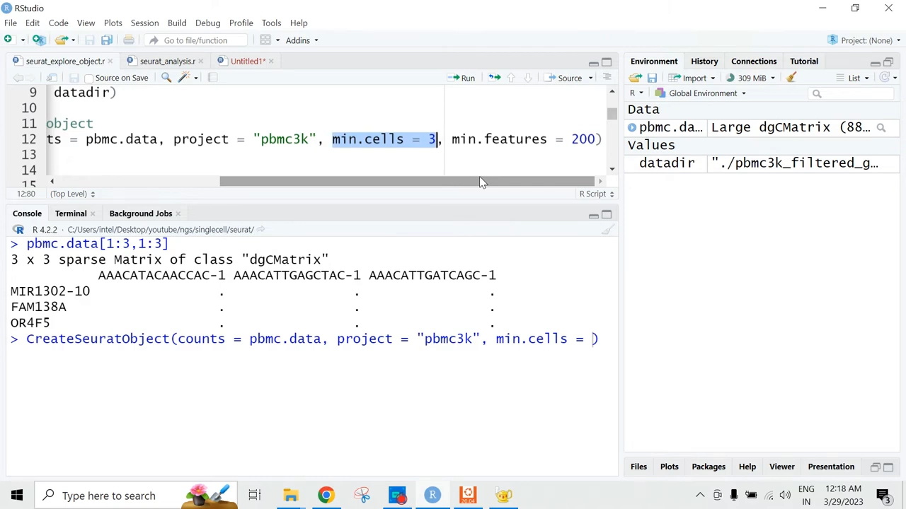

前三个细胞、前三个基因全是 0，这不是巧合——`MIR1302-10`、`FAM138A`、`OR4F5` 是基因组最前端的基因，在 PBMC 里本来就不表达。**矩阵的行序是按基因组坐标排的，行序本身没有生物学含义**，所以「前几行是 0」很正常。

## 三、`CreateSeuratObject()`：矩阵进对象，同时做第一次过滤

第二步只有一行，但参数值得逐个看：

```r
pbmc <- CreateSeuratObject(
  counts       = pbmc.data,
  project      = "pbmc3k",
  min.cells    = 3,
  min.features = 200
)
```

[【跳转到 08:34】](https://www.youtube.com/watch?v=xUThJg5GV_I&t=514)

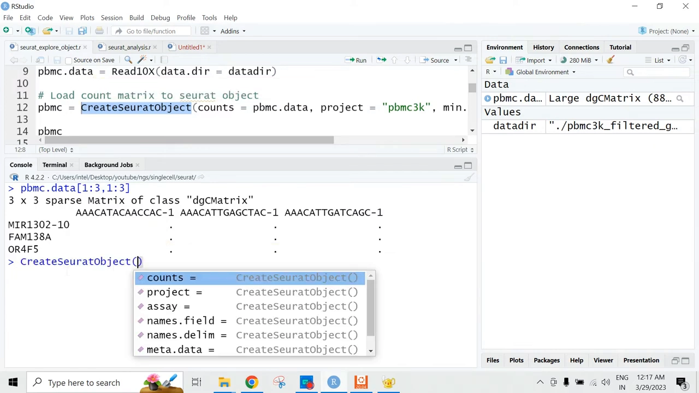

- `counts = pbmc.data`：**矩阵从这里进对象**，进的是 `counts` 这一层。参数名本身就是提醒——这一层装的是原始计数。
- `project = "pbmc3k"`：项目名，会写进 `meta.data` 的 `orig.ident` 列，是**样本标签的雏形**。多样本合并时，靠它区分来源。
- `min.features = 200`：一个细胞至少要测到 200 个基因才被保留。讲者的解释是「if a cell does not have this many genes detected, we can discard those cells」——测到的基因太少，通常意味着这个液滴里没有完整细胞（空液滴或细胞碎片）。
- `min.cells = 3`：一个基因至少要在 3 个细胞里出现才被保留。反过来，只在一个细胞里冒出来的基因对分析没有帮助，反而会撑大矩阵。

**这一步就是「矩阵 → 对象」和「第一次过滤」同时完成的地方**。注意它发生在质控之前：这里的过滤只按「基因数」和「出现细胞数」两个粗指标，真正的质控（线粒体比例、doublet 等）是下一支视频的内容。

### 3.1 对象摘要怎么读

输入对象名，Seurat 会打印一份摘要：

```
> pbmc
An object of class Seurat
13714 features across 2700 samples within 1 assay
Active assay: RNA (13714 features, 0 variable features)
> dim(pbmc)
[1] 13714  2700
```

[【跳转到 10:14】](https://www.youtube.com/watch?v=xUThJg5GV_I&t=614)

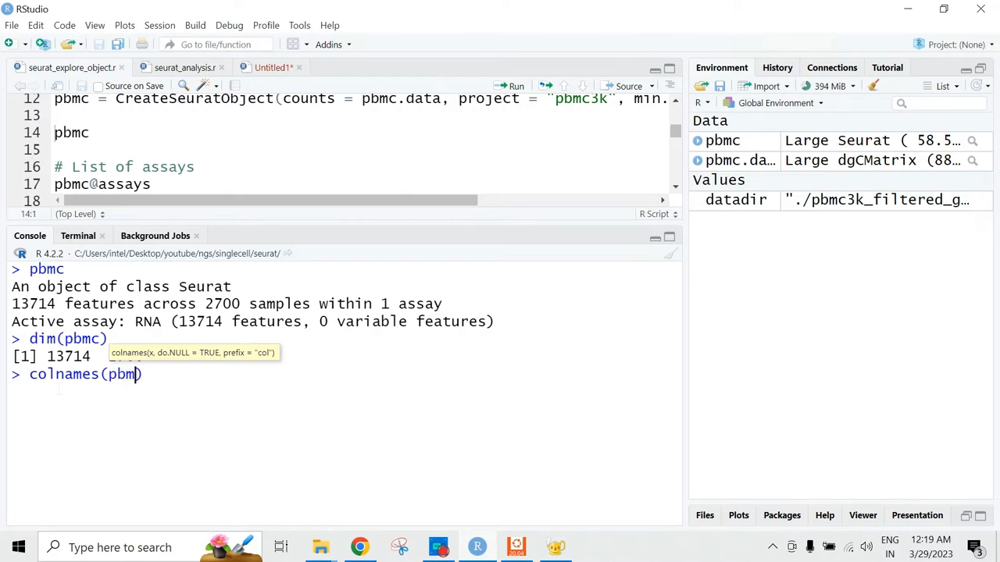

这份摘要一次回答了四个问题：

1. **维度**：`13714 features across 2700 samples`——**先基因后细胞**，和矩阵的行列顺序一致（`dim()` 也是 `13714 2700`）。这是判断方向有没有反的最快办法：2700 是细胞数，13714 是过滤后的基因数。
2. **几个 assay**：`within 1 assay`——这份数据只有基因表达一种测量，所以只有一个 assay。
3. **assay 叫什么**：`RNA`。
4. **有没有做过可变基因分析**：`0 variable features`——还是 0，说明这是**刚建好的空对象**，还没做任何分析。

`colnames(pbmc)` 给出细胞 barcode（`AAACATACAACCAC-1`、`AAACATTGAGCTAC-1`…），`rownames(pbmc)` 给出基因名（`AL627309.1`、`AP006222.2`、`RP11-206L10.2`…）。**一个 barcode 是一列，一个基因名是一行**——名字认出来了，方向就不会错。

## 四、矩阵在对象里的位置：assays → RNA → counts / data / scale.data

Seurat 对象是 S4 对象，用 `@` 访问槽位。讲者把结构一层层展开：

```
pbmc
 └─ @assays            # 一个列表，装所有 assay（每种测量技术一个）
     └─ $RNA           # 这份数据里唯一的 assay：基因表达
         ├─ @counts        # 原始计数矩阵（整数）
         ├─ @data          # 归一化后的表达矩阵
         ├─ @scale.data    # 标准化（z-score）后的矩阵
         ├─ @key           # "rna_"
         └─ @var.features  # 高变基因列表
```

[【跳转到 13:59】](https://www.youtube.com/watch?v=xUThJg5GV_I&t=839)

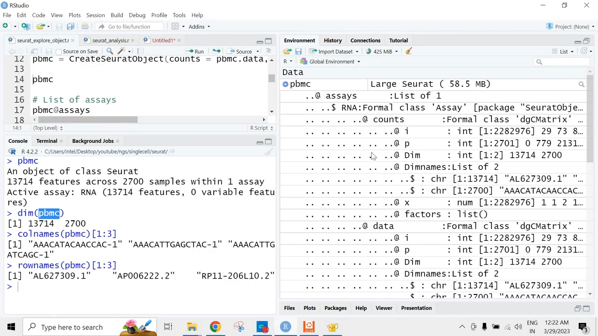

这张 `str()` 截图信息量很大，逐项读：

- `@assays : List of 1` → `$ RNA: Formal class 'Assay'`：**assays 是一个列表**，所以可以有多个（比如 RNA + ADT 的 CITE-seq 数据就有两个 assay）。
- `@counts : Formal class 'dgCMatrix'`，`@Dim : int [1:2] 13714 2700`：**counts 层就是那张稀疏矩阵**，维度与对象摘要一致。
- `@data : Formal class 'dgCMatrix'`，同样是 13714 × 2700：**data 层是另一个同形状的矩阵**，此刻内容和 counts 相同（还没归一化）。
- `@scale.data : num[0, 0]`：**空的**。因为标准化还没做，而且标准化后的矩阵只保留高变基因，形状会变小。
- `@meta.features : 'data.frame'`：基因层面的元数据。

讲者对这一层的总结是：**counts 存原始计数，归一化的结果进 data，标准化的结果进 scale.data**。三层形状相近、含义完全不同——这就是为什么「把归一化后的矩阵当原始计数再归一化一次」是最常见的翻车方式。

[【跳转到 15:59】](https://www.youtube.com/watch?v=xUThJg5GV_I&t=959)

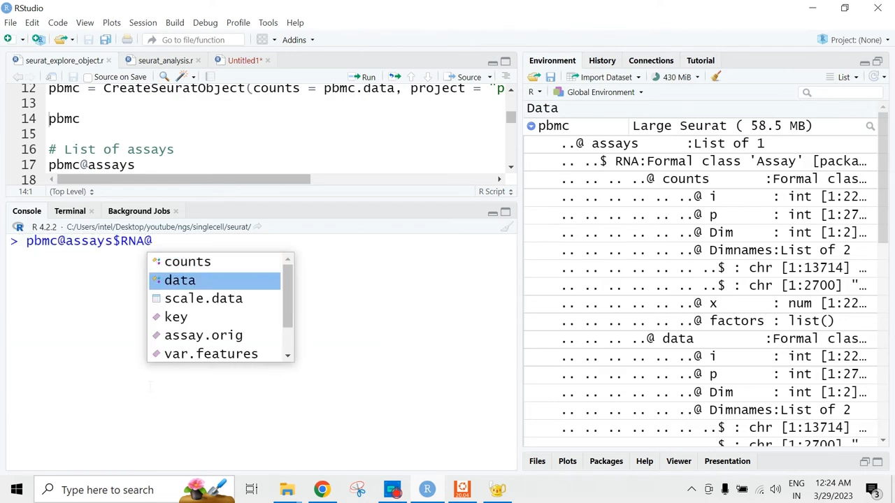

讲者用自动补全演示了这一点：敲到 `pbmc@assays$RNA@` 时，RStudio 直接列出这个 Assay 的所有槽位。**这是探索陌生对象最快的方式**——不用背结构，敲到 `@` 让编辑器告诉你有什么。

### 4.1 为什么要有 assay 这层

讲者的解释是：一次单细胞实验可以有多种测量（转录组、蛋白、ATAC），**一个 assay 就是一次实验/一种测量**，它们的结果可以放在同一个对象里一起分析。这份 pbmc3k 只有基因表达，所以只有一个 `RNA` assay；如果是 CITE-seq 数据，就会有 `RNA` 和 `ADT` 两个 assay，各有一份自己的 counts 矩阵。

## 五、`meta.data`：把矩阵读成直觉的地方

对象里第二个重要槽位是 `@meta.data`——**每个细胞一行**的数据框。

```r
> pbmc@meta.data %>% head
                orig.ident nCount_RNA nFeature_RNA
AAACATACAACCAC-1      pbmc3k       2419          779
AAACATTGAGCTAC-1      pbmc3k       4903         1352
AAACATTGATGAGC-1      pbmc3k       3147         1129
AAACCGTGCTTCCG-1      pbmc3k       2639          960
AAACCGTGTATGCG-1      pbmc3k        980          521
AAACGCACTGGTAC-1      pbmc3k       2163          781
```

[【跳转到 16:47】](https://www.youtube.com/watch?v=xUThJg5GV_I&t=1007)

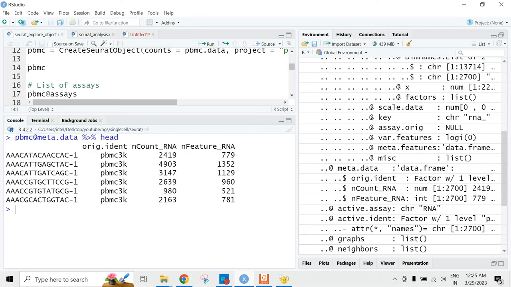

这三列是「读矩阵」的入口，讲者逐列解释：

- `orig.ident`：细胞来自哪个样本（这里是 `pbmc3k`）；
- `nCount_RNA`：**这个细胞所有基因的计数之和**，也就是总 UMI 数；
- `nFeature_RNA`：**这个细胞里计数大于 0 的基因个数**，也就是测到了多少种基因。

前六个细胞就能看出两件重要的事：

1. **细胞之间差异很大**：`nCount_RNA` 从 980 到 4903，**相差约 5 倍**；`nFeature_RNA` 从 521 到 1352。这正是「原始计数不能直接比较」的直接证据——一个细胞测到的分子多，所有基因的计数都会偏高，这是**测序深度差异**，不是生物学差异。
2. **两个指标高度相关**：`nCount` 高的细胞，`nFeature` 一般也高。所以质控时通常把这两个分布画在一起看，而不是只看一个。

`dim(pbmc@meta.data)` 是 `2700 3`——**2700 行对应 2700 个细胞，与矩阵的列数一致**。这个「行数 = 列数」的对应关系，就是矩阵与元数据对齐的凭据；一旦对不上，说明细胞被过滤过但元数据没同步，或者合并时 barcode 撞车了。

## 六、三种访问方式：`@`、`$`、`[[]]`、`GetAssayData()`

对象里的东西有四种取法，讲者都演示了一遍：

| 写法 | 取什么 | 例子 |
| :--- | :--- | :--- |
| `pbmc@assays` | S4 槽位，取列表本身 | 取出所有 assay |
| `pbmc@assays$RNA@counts` | 顺着槽位 + 列表名往下钻 | 取 counts 矩阵 |
| `pbmc@meta.data` 或 `pbmc[[]]` | 细胞元数据（数据框） | 取每个细胞的 `nCount_RNA` |
| `GetAssayData(object, slot = "counts")` | 用函数取某一层 | 推荐写法 |

[【跳转到 18:02】](https://www.youtube.com/watch?v=xUThJg5GV_I&t=1082)

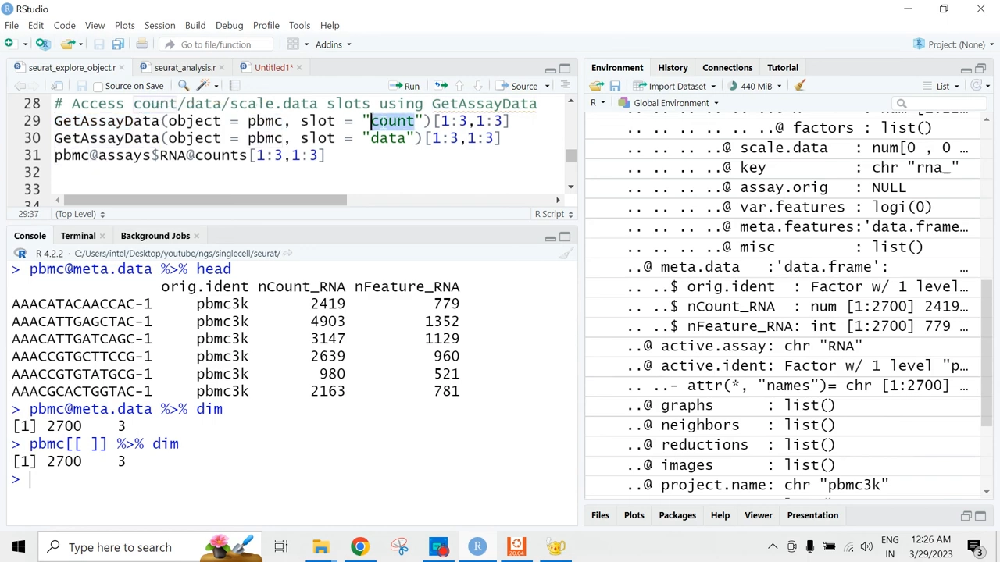

讲者的建议是：**`@` 适合探索结构，正式代码用函数**。原因是 `@` 直接依赖对象的内部布局，Seurat 版本升级时槽位名称可能变化；`GetAssayData()` 这种访问函数是官方接口，更稳。

三种写法在控制台的输出也印证了前面说的对齐关系：

- `pbmc@assays$RNA@counts[1:3, 1:3]` → 3 × 3 的稀疏矩阵；
- `pbmc@assays$RNA@data[1:3, 1:3]` → 同样 3 × 3，此刻数值与 counts 相同；
- `dim(pbmc@meta.data)` → `2700 3`，行数等于矩阵列数。

## 七、五个常见坑

| 坑 | 表现 | 怎么避开 |
| :--- | :--- | :--- |
| 把 `data` 层当原始计数 | 又归一化一次，数值被压两遍 | 明确 `counts` 才是原始整数；用 `GetAssayData(slot = "counts")` 取 |
| 三件套拆开混用 | 行列标签错位，数值却「看起来正常」 | 整个 `filtered_feature_bc_matrix` 文件夹一起喂给 `Read10X()` |
| 行列方向搞反 | 把基因数当细胞数，`CD3D` 找不到 | 看摘要里的 `13714 features across 2700 samples` 与 `dim()` |
| `min.cells` / `min.features` 设得太松或太紧 | 保留了大量空液滴，或删掉了真实细胞 | 先不过滤建对象，看完 `nFeature_RNA` 分布再定阈值 |
| 多样本合并时不加样本标签 | barcode 撞车，两个细胞被当成一个 | 靠 `project` / `orig.ident` 与 `names.delim` 保留样本来源 |

还有一条容易被忽略：**`min.features = 200` 这类过滤会改变矩阵的维度，但不会改变矩阵的含义**。过滤后的 `13714 × 2700` 依然是「基因 × 细胞、值为原始计数」——过滤只是删掉了行和列，没有做任何数值变换。

## 小结

- CellRanger 的交付物是 `barcodes.tsv.gz` + `features.tsv.gz` + `matrix.mtx.gz` 三件套，**必须作为同一个文件夹整体读入**。
- `Read10X()` 把三件套合并成一张 `dgCMatrix` 稀疏矩阵；点号（0）既可能是真不表达，也可能是 dropout。
- `CreateSeuratObject(counts = ...)` 是「矩阵进对象」的唯一入口，同时用 `min.cells` / `min.features` 做第一次过滤。
- 对象摘要 `13714 features across 2700 samples` 与 `dim()` 都是**先基因后细胞**，这是核对方向最快的方式。
- 矩阵在 `assays$RNA` 下分三层：`counts`（原始整数）、`data`（归一化）、`scale.data`（标准化）；三层含义不同，混用即错。
- `meta.data` 每行一个细胞，`nCount_RNA`（总 UMI）与 `nFeature_RNA`（测到多少基因）是读矩阵的第一组指标；前六个细胞的总 UMI 就相差约 5 倍，这就是后面必须归一化的原因。
- 访问对象优先用 `GetAssayData()` 等函数，`@` 只用来探索结构。

## 关键术语速查

| 术语 | 一句话解释 |
| :--- | :--- |
| BCL | 测序仪输出的原始碱基识别文件，`cellranger mkfastq` 把它转成 FASTQ |
| `filtered_feature_bc_matrix` | CellRanger 过滤后的输出文件夹，含 barcodes / features / matrix 三个文件 |
| `Read10X()` | 把 MEX 三件套合并成一张稀疏计数矩阵的函数 |
| `Read10X_h5()` | 从 CellRanger 的 HDF5 单文件读矩阵的函数 |
| `CreateSeuratObject()` | 把矩阵放进 Seurat 对象，`counts =` 接收原始计数 |
| assay | 对象里的一种测量（如 RNA、ADT），各自带一份 counts 矩阵 |
| `counts` 层 | 原始整数计数矩阵，所有分析的起点 |
| `data` 层 | 归一化后的表达矩阵，与 counts 同形状 |
| `scale.data` 层 | 标准化（z-score）后的矩阵，只保留高变基因 |
| `meta.data` | 细胞级元数据表，每行一个细胞，含 `orig.ident`、`nCount_RNA`、`nFeature_RNA` |
| `nCount_RNA` | 每个细胞的总 UMI 数（该细胞所有基因计数之和） |
| `nFeature_RNA` | 每个细胞中计数大于 0 的基因个数 |
| `GetAssayData()` | 按 `slot` 取 counts / data / scale.data 的官方访问函数 |
