# 读懂单细胞计数矩阵：feature-barcode 矩阵与五种输入格式

> 视频来源：[Reading single-cell data in R: H5AD, loom, MEX, AnnData formats](https://www.youtube.com/watch?v=3xcTpqQzUwQ)（YouTube · Bioinformagician）｜时长约 17 分钟
> 导读：本讲不写分析代码，只解决一件事——把「计数矩阵」这件交付物本身看明白。讲者用同一批公开数据集的五种文件格式（`.rds`、`.h5`、`.mtx`、`.loom`、`.h5ad`）逐一读进 R，反复确认「行是基因、列是细胞、值是计数」，并演示怎么把读进来的东西变成 Seurat 对象。本文按「矩阵长什么样 → 为什么是稀疏的 → 五种外壳怎么读 → 读进来后怎么核对」重组内容。

## 本讲要解决的核心问题（SCQA）

**背景**：Barcode 与 UMI 已经数完、细胞也已经挑出来了，测序流水线最后交到你手上的东西只有一样——一张矩阵。它记录「哪个细胞里、哪个基因、被数到多少个分子」。

**冲突**：真正拿到手时，你看到的往往不是一张表，而是一堆后缀不同的文件：`.rds`、`.h5`、`matrix.mtx.gz` 加两个 `.tsv.gz`、`.loom`、`.h5ad`。有的能直接读成对象，有的要三个文件一起喂进去；有的行是基因、有的是细胞；有的打开就是一张稀疏矩阵，有的打开已经是一个处理完的对象。

**疑问**：这张矩阵到底长什么样？五种格式之间是什么关系？读进来之后，怎么确认自己没有把行列弄反、没有把「已经处理过的数据」当成原始计数？

**回答（中心思想）**：单细胞计数矩阵是一张**行 = 基因（feature）、列 = 细胞（cell barcode）、值 = 原始整数计数**的**稀疏**矩阵；`.rds`/`.h5`/`.mtx`/`.loom`/`.h5ad` 只是同一张矩阵的五种外壳。读数据这一步的全部功夫，就是**把外壳剥掉、把行列名对上、把稀疏矩阵放进对象里**，并且在读进来之后立刻核对维度、行列名与数据类型。

## 一、矩阵的形状与方向：行是基因，列是细胞

### 1.1 一个格子 = 一个基因在一个细胞里被数到的分子数

讲者给出的定义非常直接：单细胞测序的输入文件格式叫 **feature-barcode matrix（特征-条形码矩阵）**，它可以类比 bulk RNA-seq 里的 count matrix（计数矩阵）——本质上就是一张很大的表：

- **行（rows）= features，也就是基因**；
- **列（columns）= cell barcodes，也就是细胞**；
- **格子里的值 = counts，也就是计数**。

[【跳转到 01:09】](https://www.youtube.com/watch?v=3xcTpqQzUwQ&t=69)

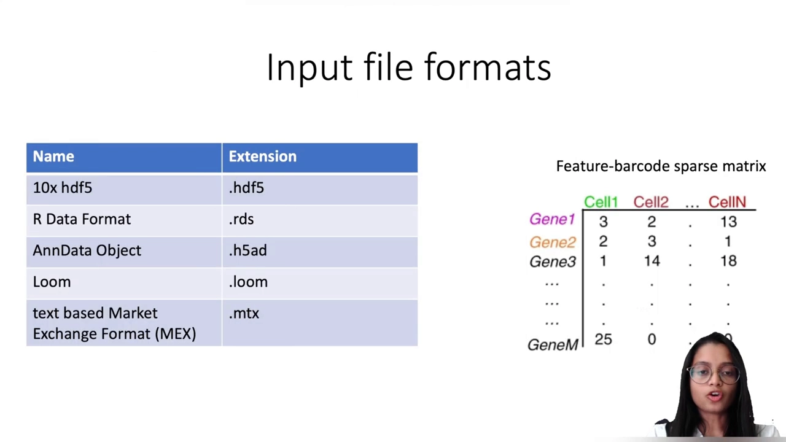

这张示意图值得多看两眼：`Gene1`…`GeneM` 排成行，`Cell1`…`CellN` 排成列，格子里是 3、2、13 这样的整数，而大量位置画的是「·」——那就是 0。**「行是基因、列是细胞」不是随便定的**：一个细胞测到的基因数（几千）远小于全基因组基因数（两万多），而细胞数可以到几万甚至上百万；把基因放行、细胞放列，正好对应「每个细胞是一列向量」的直觉——下游做质控、归一化、降维时，都是沿着列（细胞）算统计量。

### 1.2 方向搞错会怎样

方向这件事在不同工具里并不统一，讲者的演示里能直接看到证据：

- 从 CellRanger 的 `.h5` 读进来的对象，环境面板显示 `Large dgCMatrix (87245 …)`——第一位是**基因数**（约 8.7 万条 feature，含非编码与未定名条目）；
- 从 `.loom` 读进来的对象，`Connect()` 打印的 `dataset.dims` 是 **59065 × 58347**——同样第一位是基因、第二位是细胞。

[【跳转到 12:34】](https://www.youtube.com/watch?v=3xcTpqQzUwQ&t=754)

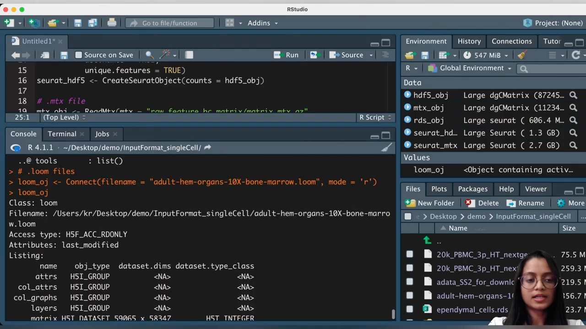

所以「基因 × 细胞」是这些文件格式的默认朝向；而 AnnData（Scanpy）习惯把观测（细胞）放在行上，是「细胞 × 基因」。同一个数据集换个工具打开，行列就可能对调。**判断方法只有一个：看行列名**——名字长得像 `AAACCCAAGAGCAGCT-1` 的是细胞 barcode，长得像 `MIR1302-2HG`、`FAM138A`、`OR4F5` 的是基因。名字认出来了，方向就不会错。

### 1.3 矩阵只是数据的一半

讲者在创建 Seurat 对象时用的函数是 `CreateSeuratObject(counts = ...)`，函数签名里除了 `counts`，还有 `project`、`assay = "RNA"`、`names.field`、`names.delim`、`meta.data` 这些参数。

[【跳转到 10:29】](https://www.youtube.com/watch?v=3xcTpqQzUwQ&t=629)

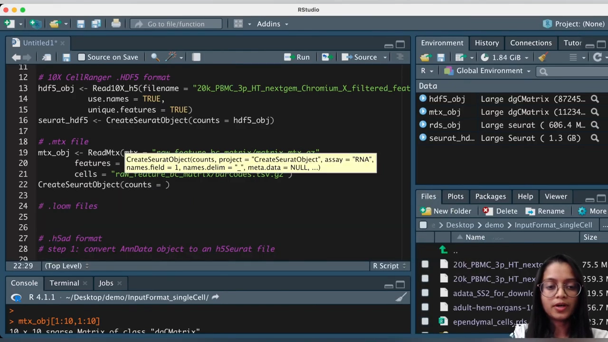

这提示了一件事：**矩阵本身不是完整的数据集**。一张矩阵 + 细胞层面的信息（barcode、样本、批次）+ 基因层面的信息（gene id 与 symbol）才构成可分析的数据。`names.field` / `names.delim` 就是用来从 barcode 字符串里切出样本标签的——barcode 后缀 `-1`、`-2` 正是不同样本的标记，这一点后面「常见坑」还会再提。

## 二、值是原始计数，而且绝大多数格子是 0

### 2.1 计数是「数出来的整数」，不是丰度

讲者对格子里放什么说得同样直接：**「the values in this matrix are the counts」**。计数是一颗一颗数出来的整数——某个 barcode 下、某个基因上，落了多少条带这个 UMI 的读段，就记多少。它不是 TPM、不是 FPKM、也不是 CPM，这些是**经过长度或深度折算的相对丰度**，而矩阵里的值是**原始计数（raw counts）**。

这个区别决定了后续所有操作：归一化、标准化、差异表达、pseudobulk 加总，都要从原始计数出发。判断手里这份是不是原始计数，看两点——**是不是整数**、**最大值的量级是否远大于 1**（归一化后的值通常是 1 附近的小数，或者取过对数的非整数）。

### 2.2 稀疏：为什么它必须以稀疏格式存在

讲者紧接着说了一句关键的话：这张矩阵「is called a sparse matrix, because majority of the values are zeros」。

[【跳转到 01:34】](https://www.youtube.com/watch?v=3xcTpqQzUwQ&t=94)

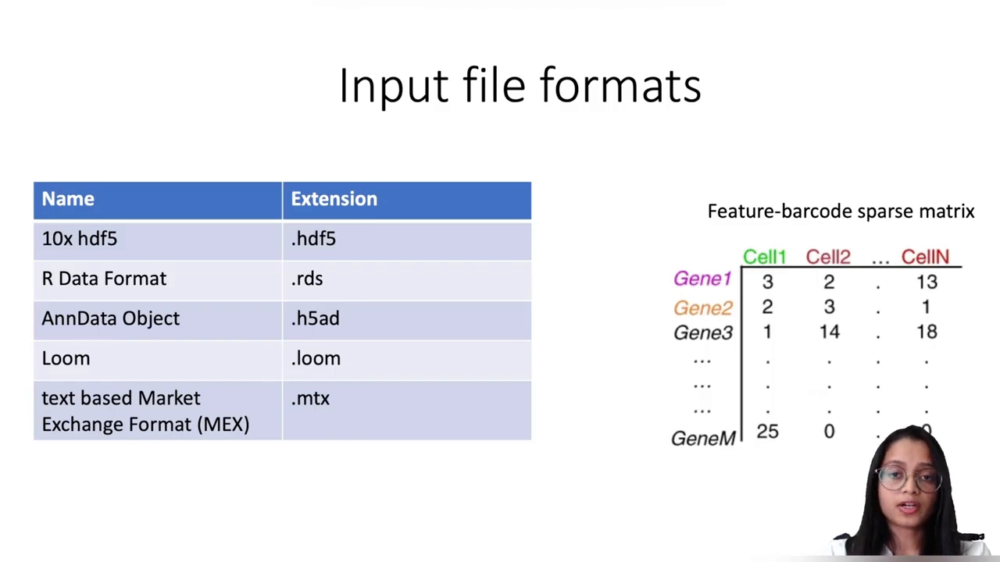

零多到什么程度？讲者演示里读进来的 `.h5` 对象在 R 里是 `dgCMatrix`——**dgCMatrix 就是 R 里「稀疏、双精度、按列压缩」的矩阵类**。R 之所以不给你一个普通 `matrix`，是因为普通矩阵要为每个格子分配内存：一个 87245 × 几万的矩阵如果按稠密存，内存会直接爆掉；而稀疏格式只记录非零位置和它们的值。

[【跳转到 06:11】](https://www.youtube.com/watch?v=3xcTpqQzUwQ&t=371)

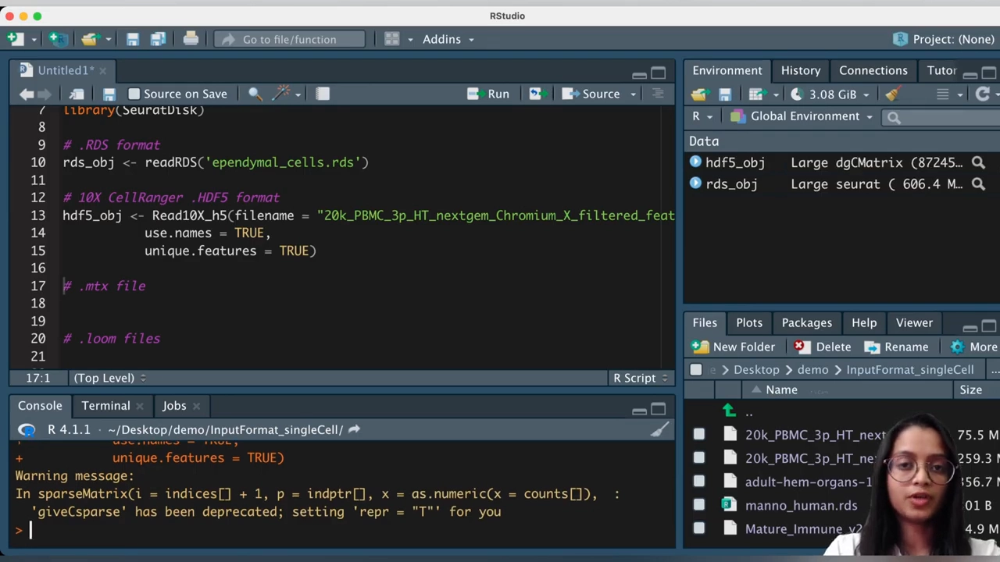

这些 0 有两个来源，读数据时心里要有数：一是**真的不表达**（这个细胞里这个基因确实没有转录本），二是**没测到**（分子在建库、扩增、测序过程中丢了，也就是 dropout）。矩阵本身不区分这两种 0——这也是为什么下游需要专门的模型去处理零值，而不是简单地「把 0 当成 0 表达」。

> 补充说明：稀疏矩阵的具体存储格式（CSR/CSC、MTX、HDF5 内部布局）属于「数据结构与文件格式」一节的内容，这里只需要记住一个结论——**你看到的 0，绝大多数是「没记下来」，所以矩阵必须用稀疏结构装**。

## 三、五种输入格式，其实是同一张矩阵的五种外壳

### 3.1 一张对照表

讲者把常见的输入格式列成了一张表，并说明这些 feature-barcode 矩阵「often stored in one or many of these formats」：

| 格式名 | 扩展名 | 一句话说明 |
| :--- | :--- | :--- |
| 10x hdf5 | `.h5` | CellRanger 直接输出的单文件矩阵，一个文件装下矩阵 + barcode + feature |
| R Data Format | `.rds` | R 的序列化对象，可能是一张矩阵，也可能是一个已经处理完的 Seurat 对象 |
| AnnData Object | `.h5ad` | Scanpy（Python）生态的存储格式 |
| Loom | `.loom` | 面向大型单细胞数据集的 HDF5 变体，公共平台常见 |
| text based Market Exchange Format (MEX) | `.mtx` | 纯文本稀疏矩阵，配 `barcodes.tsv` 与 `features.tsv` 两个索引文件 |

[【跳转到 02:19】](https://www.youtube.com/watch?v=3xcTpqQzUwQ&t=139)

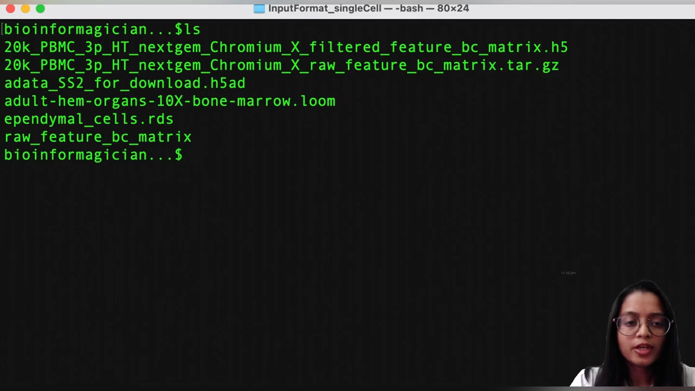

这张终端截图很能说明问题：同一个 `20k_PBMC_3p` 数据集，既有 `..._filtered_feature_bc_matrix.h5`（过滤后的矩阵），又有 `..._raw_feature_bc_matrix.tar.gz`（未过滤的原始矩阵），还有 `.h5ad`、`.loom`、`.rds` 和 `raw_feature_bc_matrix` 目录。**内容同源，外壳不同**——读哪个取决于你手上有什么、以及下游要用什么工具。

### 3.2 最容易被忽略的一点：`.rds` 里可能不是矩阵

讲者特别强调：不是只有 feature-barcode 矩阵会被存成 `.rds`。从公共数据库下载时，**别人已经处理完的 Seurat 对象**也常常存成 `.rds`。

[【跳转到 04:06】](https://www.youtube.com/watch?v=3xcTpqQzUwQ&t=246)

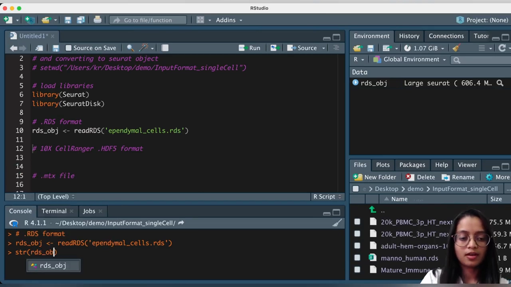

这是本讲最实用的一条经验：**先看清楚 `.rds` 里装的是什么，再决定要不要当成原始计数用**。如果它已经是一个跑过归一化、降维、聚类的对象，你拿它当 raw counts 再归一化一次，就会犯「重复归一化」的错误。

## 四、`.rds`：一行 `readRDS`，但要先看清里面装的是什么

读 `.rds` 只需要一个 R 自带函数 `readRDS()`，把文件名给它、赋给一个变量即可：

```r
library(Seurat)
library(SeuratDisk)

rds_obj <- readRDS("ependymal_cells.rds")
str(rds_obj)
```

[【跳转到 02:51】](https://www.youtube.com/watch?v=3xcTpqQzUwQ&t=171)

讲者读完后先做了一件事：`str(rds_obj)` 看结构。控制台输出的顶部会标明对象类型——这里显示它是 `Seurat` 包里的一个 Seurat 对象，而且是一个**已经处理过**的数据集，不是原始 count matrix。

[【跳转到 04:31】](https://www.youtube.com/watch?v=3xcTpqQzUwQ&t=271)

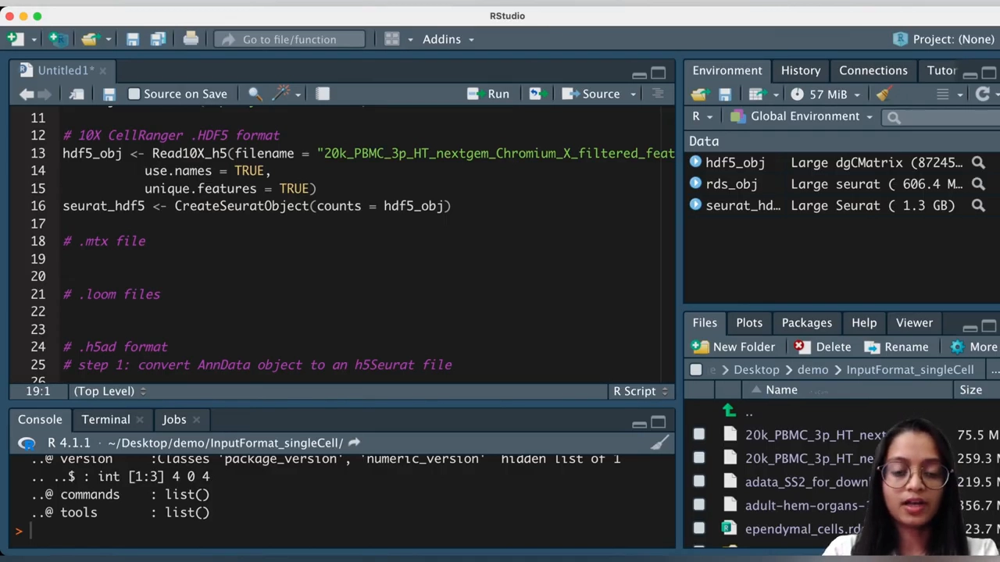

**这一步「先 `str()` 再干活」的习惯，比读数据的函数本身更重要**。`str()` 会告诉你三件事：对象的类（是 matrix 还是 Seurat）、维度（多少基因 × 多少细胞）、以及里面挂了哪些 slot（counts、data、scale.data 等）。看到 `data` 或 `scale.data` 里已经有内容，就该意识到这份数据不是「刚出炉的原始计数」。

## 五、`.h5`：CellRanger 的单文件输出，用 `Read10X_h5`

CellRanger 会把 feature-barcode 矩阵输出成一个 `.h5` 文件，读它的函数是 `Read10X_h5()`：

```r
hdf5_obj <- Read10X_h5(
  filename = "20k_PBMC_3p_HT_nextgem_Chromium_X_filtered_feature_bc_matrix.h5",
  use.names         = TRUE,
  unique.features   = TRUE
)
```

[【跳转到 05:21】](https://www.youtube.com/watch?v=3xcTpqQzUwQ&t=321)

两个参数值得解释：

- `use.names = TRUE`：用**基因名（symbol）**而不是 Ensembl ID 作为行名。这一步决定了你后面写 `CD3D`、`MS4A1` 能不能直接对上——如果行名是 `ENSG00000167286` 这样的 ID，写 symbol 就找不到基因。
- `unique.features = TRUE`：把重复的 feature 名去重。基因 symbol 会重名（不同 Ensembl ID 对应同一个 symbol），不去重的话 Seurat 后面建对象会报错。

讲者读这个文件时控制台弹出一条警告：

```
In sparseMatrix(i = indices[] + 1, p = indptr[], x = as.numeric(x = counts[]), :
  'giveCsparse' has been deprecated; setting 'rep = "T"' for you
```

这条警告来自底层稀疏矩阵构造函数，**不影响数据正确性**，讲者选择忽略它。读大文件通常要等一两分钟，这是正常的。

读进来之后，讲者立刻做了「验货」：取前 10 行、前 10 列看一眼。控制台打印出来是：

```
10 x 10 sparse Matrix of class "dgCMatrix"
  [[ suppressing 10 column names 'AAACCCAAGAGCAGCT-1', 'AAACCCAACAATACCTG-1', ... ]]
MIR1302-2HG  . . . . . . . . . .
FAM138A      . . . . . . . . . .
OR4F5        . . . . . . . . . .
```

[【跳转到 06:11】](https://www.youtube.com/watch?v=3xcTpqQzUwQ&t=371)

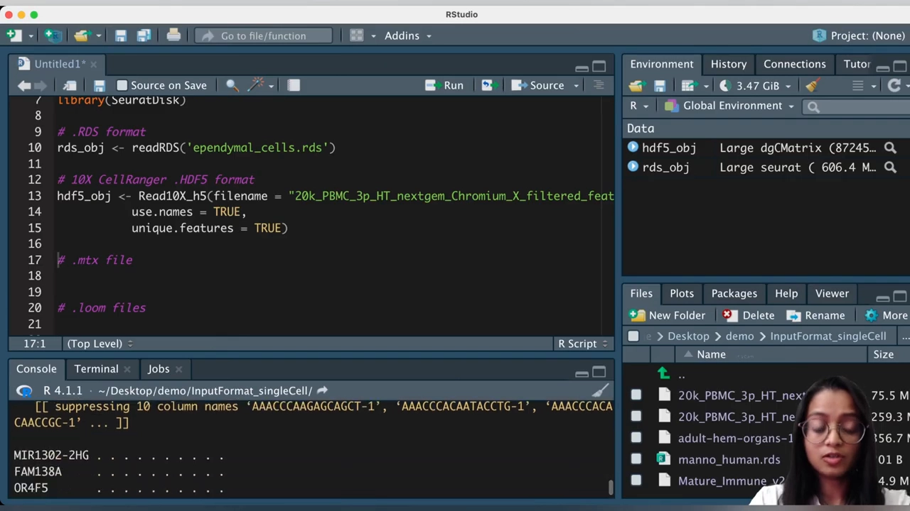

这一小段输出信息量极大，值得逐项读：

1. **`10 x 10 sparse Matrix of class "dgCMatrix"`**：这是稀疏矩阵，不是普通矩阵；
2. **列名 `AAACCCAAGAGCAGCT-1`**：16 个碱基的 barcode + `-1` 后缀。后缀是**样本编号**，多个样本合并时靠它区分；
3. **行名 `MIR1302-2HG`、`FAM138A`、`OR4F5`**：这些是基因组上排在最前面的基因，说明行是按基因组坐标排的，**行序本身没有生物学含义**；
4. **满屏的点号**：前 10 个细胞里，这几个基因一个都没测到——稀疏性直观可见。

确认无误后，才把它变成 Seurat 对象：

```r
seurat_hdf5 <- CreateSeuratObject(counts = hdf5_obj)
```

[【跳转到 07:01】](https://www.youtube.com/watch?v=3xcTpqQzUwQ&t=421)

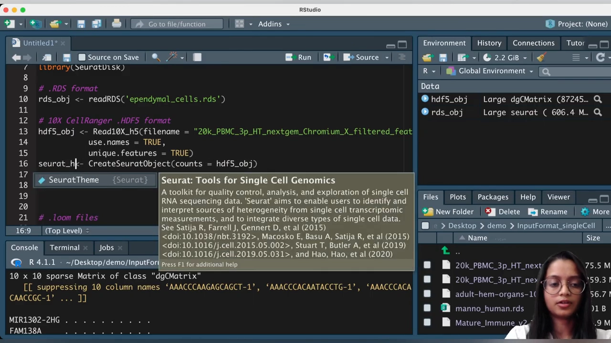

注意 `counts = ` 这个参数名：**矩阵进对象时进的是 counts 这一层**，它保留原始整数值；后面归一化产生的是另一层（`data`）。分不清这两层，就会出现「把归一化后的矩阵当原始计数」的经典错误。

## 六、`.mtx`：MEX 三件套，三个文件缺一不可

CellRanger 另一种输出是 **MEX（Market Exchange Format）**：矩阵本身存成纯文本的 `matrix.mtx`，行列的**名字**分别存在另外两个文件里——`barcodes.tsv`（细胞）和 `features.tsv`（基因）。

[【跳转到 08:10】](https://www.youtube.com/watch?v=3xcTpqQzUwQ&t=490)

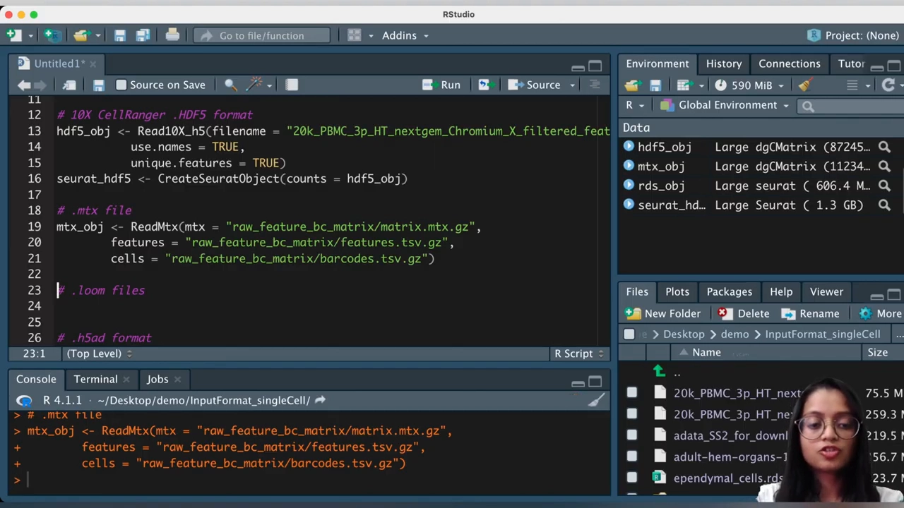

```r
mtx_obj <- ReadMtx(
  mtx      = "raw_feature_bc_matrix/matrix.mtx.gz",
  features = "raw_feature_bc_matrix/features.tsv.gz",
  cells    = "raw_feature_bc_matrix/barcodes.tsv.gz"
)
```

这就是 MTX 格式最容易踩坑的地方：**`matrix.mtx` 里只有「第几行、第几列、值是多少」，没有名字**。行列号是纯数字索引，名字全靠另外两个文件按顺序对应。所以：

- 三个文件必须**来自同一次运行**，混用不同目录的文件，行列标签就会整体错位；
- 文件名和顺序不能凭感觉——`features` 对应行（基因），`cells` 对应列（细胞），喂反了就是行列颠倒；
- 纯文本 MTX 里的索引是从 1 开始还是从 0 开始，取决于生成工具，读的时候要确认（R 的 `ReadMtx` 有对应参数处理这件事）。

读进来之后同样先验货：`mtx_obj[1:10, 1:10]`，看到的还是 `10 x 10 sparse Matrix of class "dgCMatrix"`、行名基因、列名 barcode。

[【跳转到 09:50】](https://www.youtube.com/watch?v=3xcTpqQzUwQ&t=590)

读完后环境面板里多出一个 `Large dgCMatrix (11234…)`——三件套被正确组装成了一张稀疏矩阵，第一位数字仍然是基因数。

然后照旧：

```r
seurat_mtx <- CreateSeuratObject(counts = mtx_obj)
```

讲者提到，这三个文件读起来「usually takes time」，耗时取决于文件大小——`.mtx` 是纯文本，几万个细胞的数据集解压后可以到几个 GB，慢是正常的。

> 顺带一提：讲者这里读的是 `raw_feature_bc_matrix`（未过滤的原始矩阵，包含空液滴的 barcode），而不是 `filtered_feature_bc_matrix`。两者的区别正是「细胞挑没挑过」——挑细胞这一步属于 cell calling 的内容，这里只需要知道：**同一个数据集，raw 与 filtered 是两个不同的矩阵，别拿错**。

## 七、`.loom`：先连上文件，再转成 Seurat 对象

`.loom` 是公共平台（各种单细胞图谱、数据库）上非常常见的格式，讲者的描述是：它和 Seurat 对象一样，属于「为高效存放大型单细胞数据集而设计」的格式之一。

读 `.loom` 分两步。第一步用 `Connect()` 把文件**连上**（注意 `mode = 'r'`，只读）：

```r
loom_obj <- Connect(filename = "adult-hem-organs-10X-bone-marrow.loom", mode = 'r')
loom_obj
```

[【跳转到 11:44】](https://www.youtube.com/watch?v=3xcTpqQzUwQ&t=704)

打印出来的不是一个矩阵，而是一份**文件结构清单**：

```
Class: loom
Filename: .../adult-hem-organs-10X-bone-marrow.loom
Access type: H5F_ACC_RDONLY
Listing:
        name      obj_type  dataset.dims  dataset.type_class
        attrs     H5I_GROUP       <NA>            <NA>
        col_attrs H5I_GROUP       <NA>            <NA>
        col_graphs H5I_GROUP      <NA>            <NA>
        layers    H5I_GROUP       <NA>            <NA>
        matrix    H5I_DATASET  59065 x 58347    H5T_FLOAT
        row_attrs H5I_GROUP       <NA>            <NA>
        row_graphs H5I_GROUP      <NA>            <NA>
```

[【跳转到 12:34】](https://www.youtube.com/watch?v=3xcTpqQzUwQ&t=754)


这份清单把「矩阵 + 元数据」的结构摊开给你看：

- `matrix`：**59065 × 58347**，即基因 × 细胞；
- `row_attrs` / `col_attrs`：行（基因）与列（细胞）各自的**属性表**——基因名、细胞 barcode、样本来源都在这里；
- `layers`：附加的数据层。

第二步用 `as.Seurat()` 把它转成 Seurat 对象：

```r
seurat_loom <- as.Seurat(loom_obj)
```

讲者在这里还演示了一个真实的小插曲：对象名打错了一个字母，R 直接报错，改对之后又等了几分钟才跑完。这提醒我们，`as.Seurat()` 对 loom 是**真在搬运数据**，不是加个壳——文件大就要等。

## 八、`.h5ad`：Python 生态的矩阵，要经过 h5Seurat 中转

`.h5ad` 是 AnnData 的存储格式，配套的是 Python 的 Scanpy。R 这边不能直接读，讲者给的路线是**两步中转**：

```r
# step 1: 把 AnnData 对象转成 h5Seurat 文件
Convert("adata_SS2_for_download.h5ad", dest = "h5Seurat", overwrite = TRUE)

# step 2: 把 h5Seurat 文件读成 Seurat 对象
seurat_anndata <- LoadH5Seurat("adata_SS2_for_download.h5Seurat")
```

[【跳转到 14:39】](https://www.youtube.com/watch?v=3xcTpqQzUwQ&t=879)

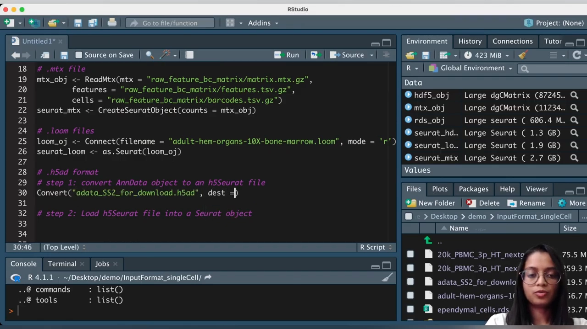

第一步 `Convert()` 不返回对象，而是**在磁盘上生成一个新文件**（同名、扩展名变成 `.h5Seurat`），所以讲者特意说明：这一步不用赋值给变量。跑完回到终端 `ls`，确认新文件确实出现了，再进第二步。

第二步的 `Convert()` 控制台输出很值得看：

```
Adding raw/X as counts
Adding meta.features from raw/var
Merging n_cells-0 from scaled feature-level metadata
Merging n_cells-1 from scaled feature-level metadata
...
```

[【跳转到 15:31】](https://www.youtube.com/watch?v=3xcTpqQzUwQ&t=931)

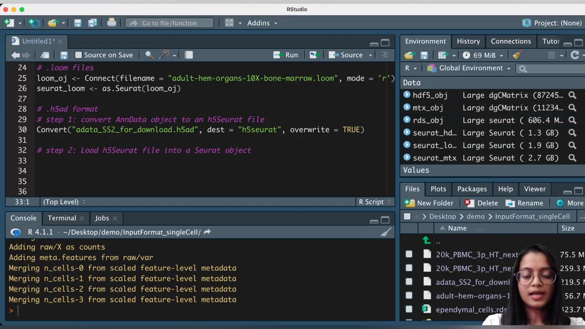

这几行输出恰好把「一张矩阵 + 两套元数据」的结构讲清楚了：

- `Adding raw/X as counts`：AnnData 里的 `raw/X` 被识别为**原始计数**，放进 counts 层；
- `Adding meta.features from raw/var`：**基因元数据**从 `var` 搬过来（行属性）；
- `Merging n_cells-…`：细胞层面的统计量（每个细胞测到多少基因之类）从 `obs` 合并进来（列属性）。

换句话说，**格式转换的过程，本质上是把「矩阵 + 行属性 + 列属性」这三样东西重新对齐**。转换报错，十有八九是这三样里的某一样对不上。

## 九、读进来之后，先做三件核对

讲者全程其实只在重复一个动作：**读完立刻验货**。把五次验货归纳起来，就是三个检查项：

1. **看类**：`str(obj)` 或直接打印，确认是 `dgCMatrix`（稀疏矩阵）还是 `Seurat`（对象）。如果是 Seurat，还要看 `counts` 层是不是原始整数。
2. **看维度**：第一位是基因数（人类全转录组约两万多条 gene symbol，含未定名条目会更多），第二位是细胞数。**两个数字谁大谁小、哪个更像细胞数，一眼就能判断方向对不对**。
3. **看名字**：行名应该像 `MIR1302-2HG`、`FAM138A`、`OR4F5`、`CD3D`；列名应该像 `AAACCCAAGAGCAGCT-1`。名字对了，行列就不会反。

[【跳转到 15:46】](https://www.youtube.com/watch?v=3xcTpqQzUwQ&t=946)

讲者最后把五种格式的完整脚本留在编辑器里，从 `.rds` 到 `.h5ad` 一目了然：

```r
# .RDS format
rds_obj <- readRDS('ependymal_cells.rds')

# 10X CellRanger .HDF5 format
hdf5_obj <- Read10X_h5(filename = "...filtered_feature_bc_matrix.h5",
                       use.names = TRUE, unique.features = TRUE)
seurat_hdf5 <- CreateSeuratObject(counts = hdf5_obj)

# .mtx file
mtx_obj <- ReadMtx(mtx = "raw_feature_bc_matrix/matrix.mtx.gz",
                   features = "raw_feature_bc_matrix/features.tsv.gz",
                   cells = "raw_feature_bc_matrix/barcodes.tsv.gz")
seurat_mtx <- CreateSeuratObject(counts = mtx_obj)

# .loom files
loom_obj <- Connect(filename = "adult-hem-organs-10X-bone-marrow.loom", mode = 'r')
seurat_loom <- as.Seurat(loom_obj)

# .h5ad format
Convert("adata_SS2_for_download.h5ad", dest = "h5Seurat", overwrite = TRUE)
seurat_anndata <- LoadH5Seurat("adata_SS2_for_download.h5Seurat")
```

**五种外壳，剥到最后都是同一件事**：拿到一张「基因 × 细胞」的稀疏计数矩阵，把它交给 `CreateSeuratObject(counts = ...)`。

## 十、五个常见坑

| 坑 | 表现 | 怎么避开 |
| :--- | :--- | :--- |
| 把已处理对象当原始计数 | 读 `.rds` 后直接当 counts 用，后面又归一化一次 | 读进来先 `str()`，看 `data` / `scale.data` 层是否已有内容 |
| 行列颠倒 | 细胞数当成基因数，`CD3D` 找不到 | 看行列名：barcode 长、带 `-1` 后缀；基因名是 symbol 或 Ensembl ID |
| MEX 三件套混用 | 行列标签整体错位，但矩阵值「看起来正常」 | `matrix.mtx` / `features.tsv` / `barcodes.tsv` 必须同源同批 |
| gene id 与 symbol 弄混 | `use.names = FALSE` 时行名是 `ENSG...`，按 symbol 取不到基因 | 读入时明确 `use.names = TRUE`，并处理重名（`unique.features`） |
| raw 与 filtered 拿错 | 细胞数明显偏多、混进大量空液滴 | 文件名里看清 `raw_` 还是 `filtered_` |

还有一条不在表里、但更容易在多样本分析时翻车：**多个样本的矩阵直接拼起来而不加样本标签**。不同样本的 barcode 是各自随机生成的，**会撞车**——两个样本里出现同一个 `AAACCCAAGAGCAGCT-1` 是完全正常的。合并时必须给 barcode 加样本后缀（这正是 `names.field` / `names.delim` 参数的用武之地），否则后续按 barcode 对齐元数据时会把两个不同细胞当成同一个。

## 小结

- 单细胞计数矩阵 = **行是基因、列是细胞、值是原始整数计数**的稀疏矩阵；`dgCMatrix` 这个类名就是「稀疏」的证明。
- 稀疏不是缺陷而是常态：绝大多数格子是 0，这些 0 既可能是真不表达，也可能是没测到（dropout），矩阵本身不区分。
- `.rds`、`.h5`、`.mtx`（MEX 三件套）、`.loom`、`.h5ad` 是同一张矩阵的五种外壳；`.mtx` 只有数字索引，行列名在另外两个文件里，必须同源同批。
- `.rds` 里可能装的是**已经处理完的对象**，不是原始矩阵——读进来先 `str()`。
- 所有格式最终都汇到同一个动作：`CreateSeuratObject(counts = ...)`，矩阵进的是 `counts` 层。
- 读完必做三件核对：**看类、看维度、看名字**。名字对了，方向就不会错。
- 矩阵只是数据的一半：**矩阵 + 行属性（基因元数据）+ 列属性（细胞元数据）**才是完整数据集，格式转换本质上就是把这三样重新对齐。

## 关键术语速查

| 术语 | 一句话解释 |
| :--- | :--- |
| feature-barcode matrix | 单细胞的标准数据表：行是 feature（基因），列是 cell barcode（细胞），值是计数 |
| count matrix | 计数矩阵，泛指「行特征 × 列样本、值为整数计数」的表；bulk 与单细胞都有 |
| raw counts | 原始计数，未经任何归一化的整数，是所有下游分析的起点 |
| barcode | 细胞条形码，16 个碱基的短序列，用来把读段归到某个细胞；`-1`、`-2` 后缀标记样本 |
| dgCMatrix | R 中「稀疏、双精度、按列压缩」的矩阵类，单细胞矩阵读进 R 后的默认形态 |
| MEX | Market Exchange Format，纯文本稀疏矩阵格式，由 `matrix.mtx` + `features.tsv` + `barcodes.tsv` 三件套组成 |
| `.h5` | CellRanger 输出的单文件 HDF5 矩阵，用 `Read10X_h5()` 读 |
| `.loom` | 基于 HDF5 的单细胞数据格式，含 `matrix` 与 `row_attrs` / `col_attrs` 元数据 |
| AnnData / `.h5ad` | Scanpy 生态的数据对象与存储格式，R 侧需经 h5Seurat 中转 |
| h5Seurat | SeuratDisk 提供的中转格式，用于在 `.h5ad` 与 Seurat 对象之间搭桥 |
| `CreateSeuratObject` | 把矩阵放进 Seurat 对象的函数，`counts =` 参数接收原始计数矩阵 |
| metadata | 元数据，细胞层面的 barcode、样本、批次与基因层面的 id、symbol，矩阵要配它才完整 |
