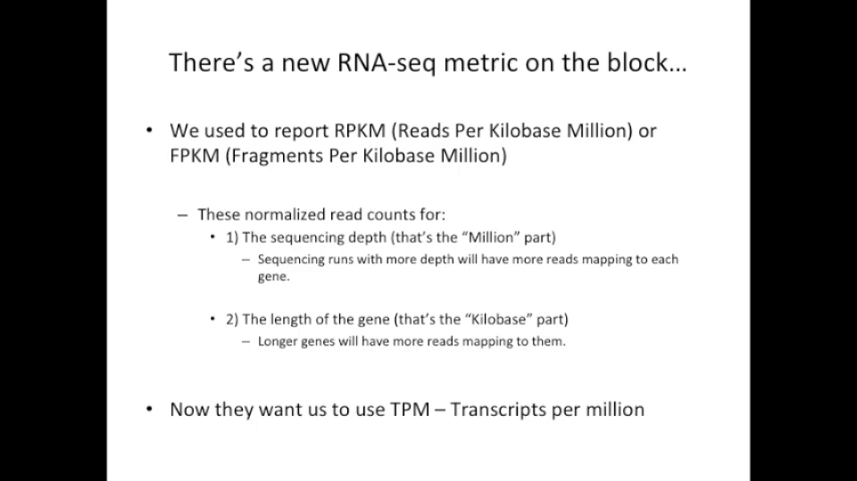
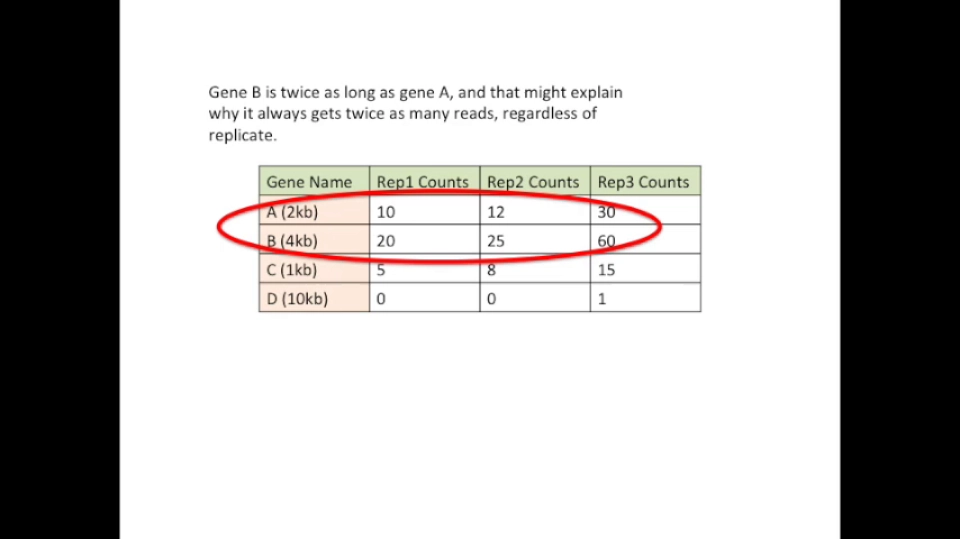
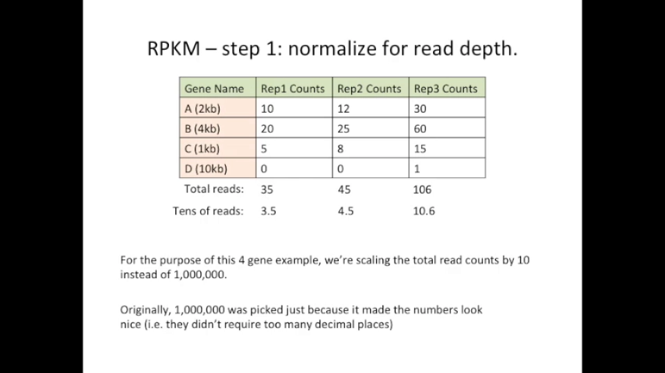
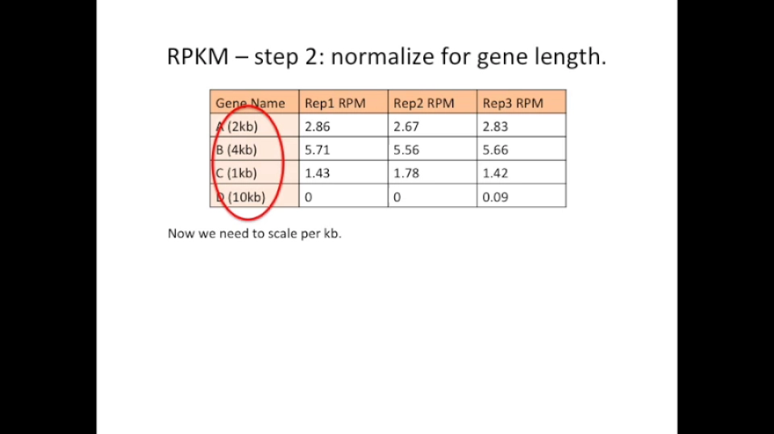
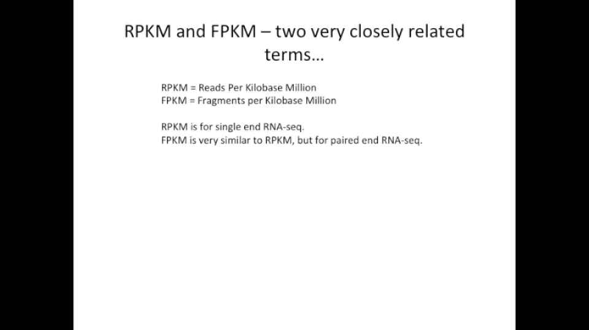
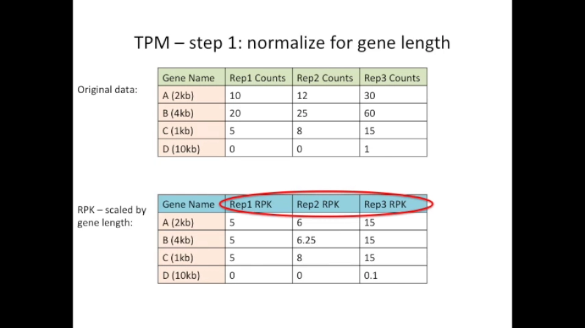
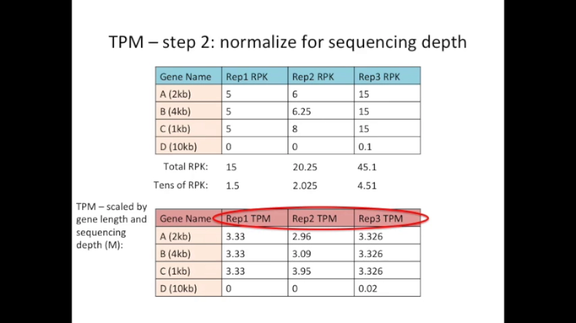
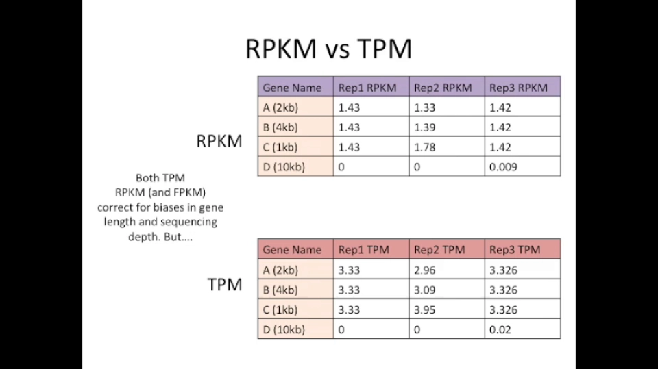
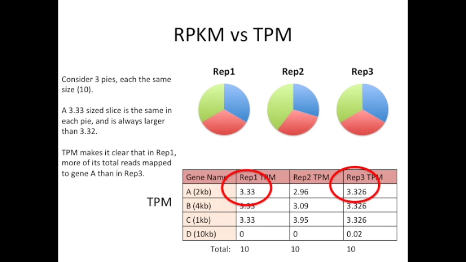
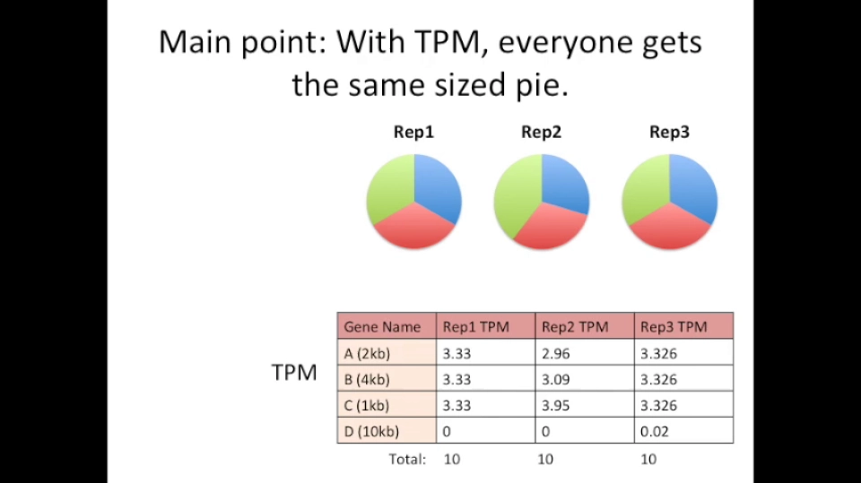

# RPKM、FPKM 与 TPM：测序深度与基因长度怎么校正

> 视频来源：[RPKM, FPKM and TPM, Clearly Explained!!!](https://www.youtube.com/watch?v=TTUrtCY2k-w)（YouTube · StatQuest with Josh Starmer）｜时长约 10 分钟
> 导读：StatQuest 用一个只有 4 个基因、3 个重复的玩具数据集，把 RPKM、FPKM、TPM 的每一步算术都摊开算了一遍。本文照这条算例整理，重点讲清「为什么换个顺序算，结果会完全不同」。视频未涉及 CPM 与单细胞专用的 size factor，本文只在术语表里给出定义性说明。

## 本讲要解决的核心问题（SCQA）

**背景**：RNA-seq 的原始输出是「每个基因上落了多少条 read」。过去大家报 RPKM 或 FPKM，现在更常被推荐的是 TPM。这个原始数字天然带着两种与技术无关的偏差：测序更深的样本，每个基因的 read 都更多；基因更长，能落上去的 read 也更多。

**冲突**：如果直接比较原始 read 数，你会把「测得更深」误当成「表达更高」，把「基因更长」误当成「表达更高」。而且，即便都做了校正，先除深度再除长度、还是先除长度再除深度，得到的数字完全不同。

**疑问**：RPKM、FPKM、TPM 这三个名字到底差在哪？为什么现在更推荐 TPM？

**回答（中心思想）**：三者校正的是同样的两个偏差——**测序深度**与**基因长度**——区别只在**顺序**。RPKM/FPKM 先除深度再除长度，导致每个样本的归一化值总和不一样；TPM 先除长度再除深度，使每个样本的总和恒等于一百万，于是每个数字可以直接读成「这个基因占该样本总表达量的比例」。

[【跳转到 01:50】](https://www.youtube.com/watch?v=TTUrtCY2k-w&t=110)

## 一、原始 read 数带着两种偏差

讲者先摆出这个算例：一个只有 4 个基因的基因组，3 个生物学重复。

[【跳转到 02:40】](https://www.youtube.com/watch?v=TTUrtCY2k-w&t=160)

看这张表能直接读出两件事：

1. **重复 3 的 read 数明显更多**，而且不分基因——这说明它的**测序深度**更高。
2. **基因 B 的长度是基因 A 的两倍**，于是它在每个重复里都恰好拿到 A 的两倍 read 数——这纯粹是长度造成的。

这两种偏差都要校掉。讲者的说法是：RPKM 里的「million」对应测序深度，「kilobase」对应基因长度。

## 二、RPKM：先除深度，再除长度

### 2.1 第一步：按测序深度缩放

先算每个重复的总 read 数：35、45、106。然后按「每百万」缩放——为了这个只有 4 个基因的算例好读，讲者把一百万换成 10，于是缩放因子是 3.5、4.5、10.6。

[【跳转到 03:30】](https://www.youtube.com/watch?v=TTUrtCY2k-w&t=210)

讲者特别说明：一百万这个数字本身没有生物学含义，最初选它只是为了让结果的小数位少一点、好看一点。所以在这个算例里，「几十条 read」和「几百万条 read」可以互换看待。

把每个基因的 read 数除以对应的缩放因子，就得到每个重复的「每百万 read 数」。**如果只做到这一步、不做基因长度校正，得到的就是只校正了测序深度的量**——也就是常说的 CPM（counts per million）。

### 2.2 第二步：按基因长度缩放

接着把上一步的结果再除以基因长度（单位 kilobase）。

[【跳转到 03:55】](https://www.youtube.com/watch?v=TTUrtCY2k-w&t=235)

用公式写出来，$x_{ij}$ 是基因 $j$ 在样本 $i$ 里的 read 数，$\ell_j$ 是基因长度（bp），$N_i$ 是样本 $i$ 的总 read 数：

$$
\mathrm{RPKM}_{ij} = \frac{x_{ij}}{\ell_j / 1000} \cdot \frac{10^6}{N_i}
$$

算完的结果是：基因 A（2kb）在三个重复里都是 1.43 左右；基因 B（4kb）也是 1.43 左右；基因 C（1kb）是 1.43、1.78、1.42；基因 D（10kb）在重复 1、2 里是 0，重复 3 里是 0.009。

注意这里出现了一个很有说服力的结果：**A 和 B 长度差一倍、原始 read 数也差一倍，做完 RPKM 后数值几乎相同**。这正是长度校正生效的证据。

讲者用一张「before / after」的对比收尾：before 是既没校正深度、也没校正长度的原始数据；after 是同时校正了深度与基因长度的 RPKM。

## 三、RPKM 与 FPKM：单端与双端的区别

这两个名字经常被混用，讲者专门澄清：

- **RPKM** = Reads Per Kilobase Million，用于**单端（single-end）**测序。
- **FPKM** = Fragments Per Kilobase Million，用于**双端（paired-end）**测序。

[【跳转到 05:10】](https://www.youtube.com/watch?v=TTUrtCY2k-w&t=310)

为什么要区分？考虑一条待测序的片段：单端测序下，每条片段只测一条 read，要么在这一端、要么在那一端；双端测序下，两端都能比对，于是一条片段会产生两条 read——当然也可能只有一端质量合格、能比对，这时仍只有一条 read。

FPKM 做的事，就是**按「片段」而不是「read」来计数**，避免一条片段因为两端都比对成功而被重复计一次。除此之外，两者的算法完全一样。

## 四、TPM：把两步的顺序调过来

TPM（Transcripts Per Million）和 RPKM/FPKM 做的事**完全相同**，只是**顺序相反**。

### 4.1 第一步：先除基因长度

[【跳转到 06:25】](https://www.youtube.com/watch?v=TTUrtCY2k-w&t=385)

这一步得到的是 RPK（reads per kilobase）：A 是 5、6、15；B 是 5、6.25、15；C 是 5、8、15；D 是 0、0、0.1。

### 4.2 第二步：再除测序深度

关键差别在这里：**先把已经做过长度校正的 RPK 按样本加起来**，得到 15、20.25、45.1，再折算成缩放因子 1.5、2.025、4.51，最后用 RPK 除以这个新的缩放因子。

[【跳转到 07:15】](https://www.youtube.com/watch?v=TTUrtCY2k-w&t=435)

$$
\mathrm{TPM}_{ij} = \frac{x_{ij} / \ell_j}{\sum_{j'} x_{ij'} / \ell_{j'}} \times 10^6
$$

结果是：A 为 3.33、2.96、3.326；B 为 3.33、3.09、3.326；C 为 3.33、3.95、3.326；D 为 0、0、0.02。

## 五、为什么顺序这么重要：总和不一样

把同一份原始数据分别按 RPKM 和 TPM 算完，并排放在一起：

[【跳转到 07:40】](https://www.youtube.com/watch?v=TTUrtCY2k-w&t=460)

两者都校正了基因长度和测序深度，但**每一列的总和差别巨大**：

- **RPKM**：每个样本的归一化值总和都不一样（因为除以的是各自的总 read 数，长度校正之后总和自然散掉了）。
- **TPM**：每个样本的总和都恰好等于 10（在这个算例里；换成真实数据就是恰好一百万）。

### 5.1 三个同样大的饼

讲者用饼图解释这个差别。设想三个大小相同的饼，每个饼的面积都是 10——TPM 的数值就是这些饼里的一片。

[【跳转到 08:05】](https://www.youtube.com/watch?v=TTUrtCY2k-w&t=485)

以基因 A 为例：重复 1 里那片是 3.33，重复 3 里是 3.326。重复 1 的切片略大一点，含义是——**在重复 1 所有比对上的 read 里，落到基因 A 的比例更高**；重复 3 里这个比例略低，因为重复 3 还有一些 read 落到了基因 D 上（重复 1 里基因 D 是 0）。

换成 RPKM，就没法这么比了：每个样本的饼大小不同，切片之间的比例也就失去了共同的分母。

[【跳转到 09:40】](https://www.youtube.com/watch?v=TTUrtCY2k-w&t=580)

讲者的总结是：大家用 TPM，是因为这些数字能直接告诉你「在这个样本里，有多大比例的 read 落到了这个基因上」。而 RNA-seq 本质上就是在比较 read 的相对比例，所以 TPM 这个度量更合适。

## 六、一句话记住三者关系

- **RPKM**：先按测序深度缩放到每百万，再除以基因长度（kb）。用于单端测序。
- **FPKM**：与 RPKM 相同，但按「片段」计数，用于双端测序，避免一条片段被两端的 read 重复计数。
- **TPM**：先除以基因长度，再按样本内总和缩放到每百万。每个样本的归一化值总和恒为一百万。
- **CPM**：只做「按测序深度缩放到每百万」这一步，不做基因长度校正。相当于 RPKM 的第一步。

三者的共同前提是：**它们都是为 bulk RNA-seq 的 read 计数设计的**。它们校正的是「测序深度」和「基因长度」这两种偏差，并不处理单细胞数据里液滴之间的捕获效率差异——那需要另一套做法（例如按细胞的总计数计算 size factor 后再取对数）。

## 关键术语速查

| 术语 | 一句话解释 |
| --- | --- |
| 测序深度 | 一个样本总共测到多少条 read；深度越高，每个基因的 read 数都水涨船高 |
| 基因长度偏差 | 更长的基因能落上更多 read，与表达水平无关 |
| RPKM | Reads Per Kilobase Million：先按深度缩放到每百万，再除以基因长度（kb），用于单端测序 |
| FPKM | Fragments Per Kilobase Million：与 RPKM 相同，但按片段计数，用于双端测序 |
| TPM | Transcripts Per Million：先除以基因长度，再按样本内总和缩放到每百万，每列总和恒为一百万 |
| CPM | Counts Per Million：只按测序深度缩放到每百万，不做基因长度校正 |
| 单端 / 双端测序 | 一条片段只测一端 / 两端都测；双端会产生两条 read，因此需要按片段而非 read 计数 |
| 缩放因子 | 把总 read 数折算成「每百万」时用的除数，每个样本各不相同 |