# 单细胞归一化到底做了什么：缩放、对数变换与 Pearson 残差

> 视频来源：[Normalization methods for single-cell RNA-Seq data (high-level overview)](https://www.youtube.com/watch?v=huxkc2GH4lk)（YouTube · Florian Wagner）｜时长约 27 分钟
> 导读：讲者把「归一化」拆成**缩放**与**变换**两步，用两个玩具例子和一套 10x PBMC 真实数据，把 log、平方根、Pearson 残差三种做法的差别讲透。本文按这条主线整理，公式与结论都对应到原始字幕。

## 本讲要解决的核心问题（SCQA）

**背景**：拿到一份单细胞数据，你手上的原始矩阵里存的是 **UMI 计数**——一个数字就是「在这个细胞的这个基因上，被测序仪数到了几条分子」。这个数字同时被三件事影响：细胞本身的基因表达水平、这个细胞里 mRNA 的总量（细胞大小）、以及这一滴里化学反应和测序的运气。

**冲突**：如果直接拿这个矩阵去做 PCA、t-SNE、UMAP，你看到的「差异」里混着大量与生物学无关的东西。更麻烦的是，高表达基因的计数动辄是低表达基因的上百倍，降维结果会被少数几个高表达基因完全主导。

**疑问**：那么从原始计数到能进 PCA 的矩阵之间，到底该做哪些操作？log 变换和平方根变换差在哪？Pearson 残差又是什么思路？

**回答（中心思想）**：归一化可以拆成**先缩放、再变换**两步。缩放把每个细胞的计数换算成「浓度」，顺带抹掉液滴之间的效率噪声；变换则决定**每个测量值在后续分析里占多大权重**。log 变换让「相同的倍数变化」变成「相同的差值」，平方根变换让权重正比于测量的精度，Pearson 残差则按「这个基因有多强的证据表明它是非均匀表达的」来分配权重。

## 一、先把「归一化」这个词定义清楚

讲者一开场就声明：这不是一篇文献综述，而是他个人对这套方法的一个尽量直观的梳理，很多方法学细节会被简化。

他给「归一化」下的定义很具体：**从你拿到原始 UMI 计数开始，到真正跑 PCA 之前，中间做的所有事情**。之所以以 PCA 为界，是因为 PCA 通常是可视化的第一步——t-SNE、UMAP 都建立在 PCA 之上。

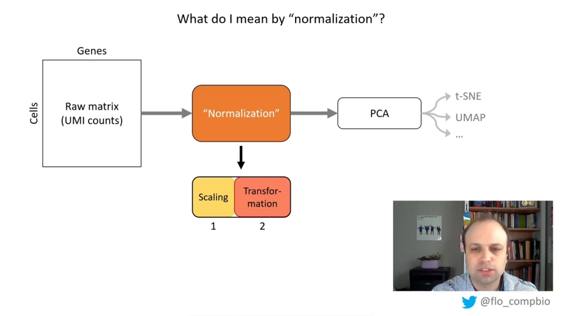

[【跳转到 00:50】](https://www.youtube.com/watch?v=huxkc2GH4lk&t=50)

在这个定义下，归一化被拆成两步：

1. **缩放（scaling）**：把每个细胞的计数乘上一个细胞专属的系数，让所有细胞的总计数拉到同一水平。
2. **变换（transformation）**：对缩放后的数值逐个（或逐基因）做函数变换。

论文里这两步常常混在一起讨论，但拆开看会清楚很多。讲者也说明，本讲大部分时间花在第二步上。

## 二、第一步缩放：把计数换成一万分之一万

### 2.1 细胞之间的总计数差得非常远

讲者先给了一份约 3000 个细胞的数据：横轴是细胞编号，纵轴是「这个细胞里检测到的转录本总数」，也就是把这个细胞所有基因的 UMI 计数加起来。

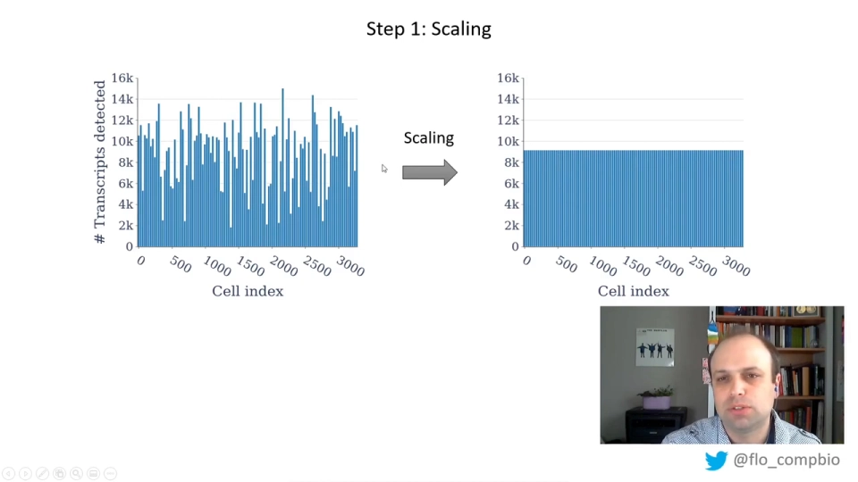

[【跳转到 01:40】](https://www.youtube.com/watch?v=huxkc2GH4lk&t=100)

左图里这个数字在 **2000 到 14000 以上**之间大幅波动。缩放的思路很直接：给计数少的细胞乘一个大于 1 的系数，给计数多的细胞乘一个小于 1 的系数，让它们全部对齐到同一个总和。

### 2.2 为什么要对齐：两个目的，一石二鸟

**第一个目的：我们想比较的是浓度，不是绝对条数。**

单细胞实验里往往同时存在完全不同的细胞类型，而不同细胞类型本身的 mRNA 含量就不一样——有的细胞更大、RNA 更多，有的更少。检测到的转录本条数，首先取决于这个细胞里本来有多少 RNA 可供捕获。

但我们通常并不想比较「谁绝对条数多」，而是想比较**浓度**。把每个细胞缩放到 10000，得到的数字含义就变成「每一万条转录本里，这个基因占了几条」——与细胞类型无关，可以直接横向比较。

**第二个目的：抹掉液滴之间的效率噪声。**

即使所有细胞都是同一个类型，你还是会看到很大的波动。原因不是生物学，而是技术噪声：这一滴里化学反应做得更顺一点，那一滴里差一点，同一个细胞类型也可能出现「两倍的转录本条数」这样的差异。缩放这一步同时把这些差异压下去了。

讲者的原话是「一石二鸟」：既换成了浓度，又去掉了效率噪声。

## 三、第二步变换：三种做法，三种权重观

变换这一步，讲者分了两大类：

- **简单变换**：log 变换、平方根变换。它们的共同点是**对每一个测量值独立地作用同一个函数**。
- **Pearson 残差**：不是逐点作用，而是给每个基因一个专属权重（SCTransform 用的就是它）。

用符号写出来，$i$ 是细胞编号，$j$ 是基因编号，$x_{ij}$ 是缩放后的测量值：

$$
y_{ij} = f(x_{ij}) \quad \text{（简单变换）}
$$

$$
y_{ij} = w_j \cdot x_{ij}, \qquad w_j = \frac{1}{\sqrt{\mu_j}} \quad \text{（Pearson 残差）}
$$

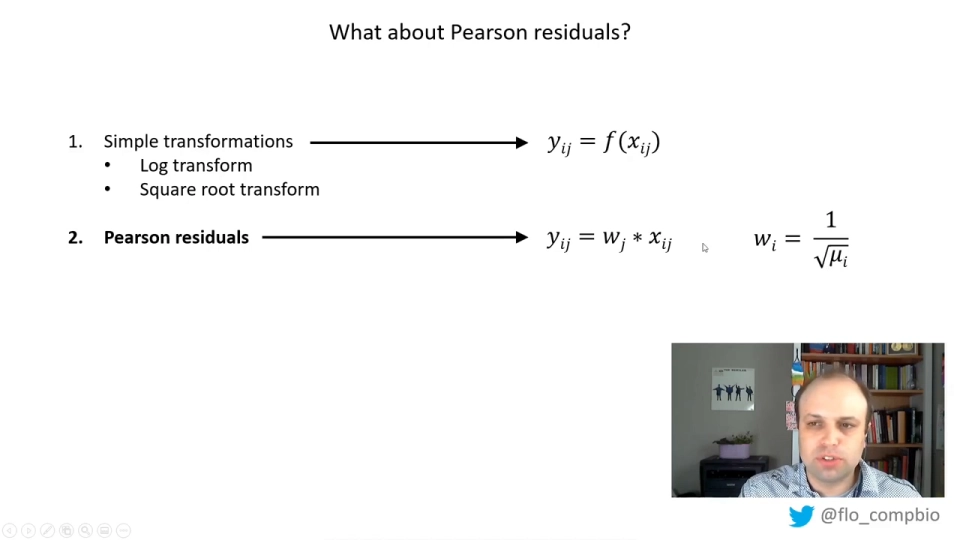

[【跳转到 15:34】](https://www.youtube.com/watch?v=huxkc2GH4lk&t=934)

要理解为什么会有这两种截然不同的思路，得先知道单细胞数据的噪声长什么样。

## 四、单细胞的噪声有多大：一个漂亮的控制实验

讲者引用了一项 2015 年的实验（Klein 等，Cell 2015）。作者把同一份 mRNA 样品稀释后分到大约 1000 个液滴里——**每个液滴里的 mRNA 成分理论上完全相同**。于是液滴之间任何计数差异，都只能是纯技术噪声。

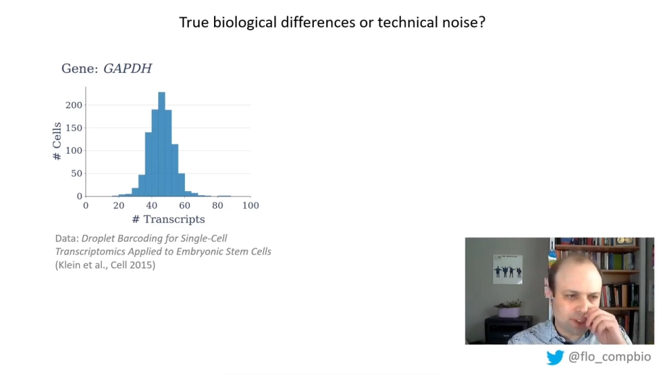

[【跳转到 05:45】](https://www.youtube.com/watch?v=huxkc2GH4lk&t=345)

以高表达的 GAPDH 为例，计数大致分布在 30 到 60 之间。这个实验的价值在于：它让我们**直接量出了**单细胞 RNA-seq 的技术噪声有多大。讲者强调，虽然技术细节一直在演进，但底层仍然是「数分子」，所以这个结论对 2021 年产生的数据依然适用。

由此得到本节最重要的一个判断：

> 在真实组织的数据里，你观察到的表达差异，一部分来自细胞真的表达不同，一部分来自技术噪声；而**很多时候你根本分不清哪一部分贡献更大**。对不少基因来说，技术噪声甚至可能是解释差异的更大因素——这取决于基因、取决于你在比较哪些细胞、也取决于这个基因的表达水平。

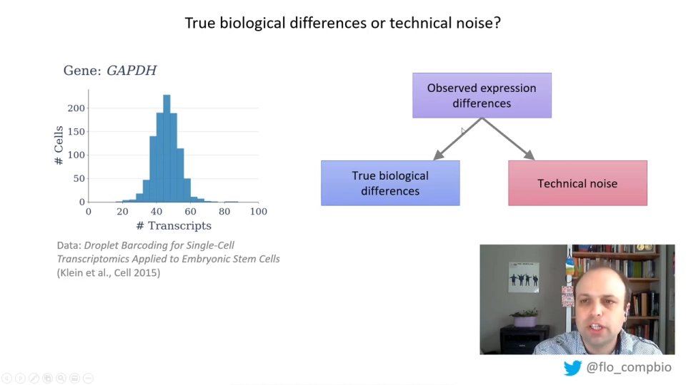

[【跳转到 07:25】](https://www.youtube.com/watch?v=huxkc2GH4lk&t=445)

## 五、变换如何影响真实的生物学差异

先把噪声放一边，假设所有测量值都是真实差异，看三种处理会怎么改变它们。

### 5.1 玩具例子：两个细胞类型、两个基因

设定：细胞类型 A 和 B，基因 1 和基因 2。两个基因在 B 里都是 A 的 **2 倍**。但基因 2 的绝对表达量是基因 1 的 **100 倍**（真实数据里确实存在差 100 倍的基因对）。这是缩放之后的数值。

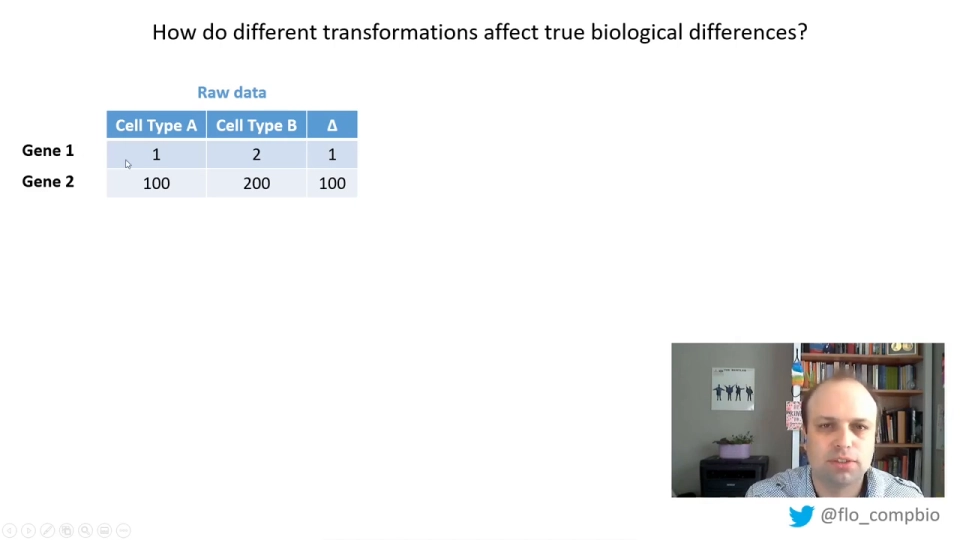

[【跳转到 08:54】](https://www.youtube.com/watch?v=huxkc2GH4lk&t=534)

如果直接对原始数据做 PCA，基因 2 的差异（100）会比基因 1 的差异（1）**重要 100 倍**，整个分析被基因 2 主导。

### 5.2 log 变换：相同的倍数变化变成相同的差值

取以 2 为底的对数后：基因 1 从 1、2 变成 0、1（差 1）；基因 2 从 100、200 变成 6.64、7.64（差 1）。

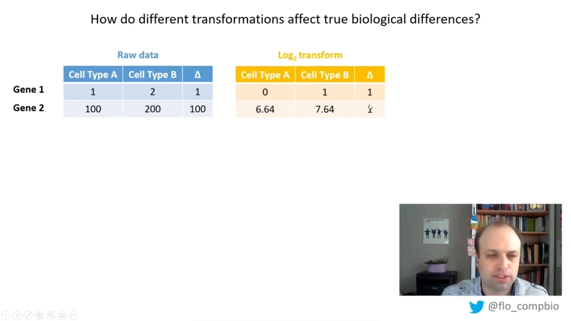

[【跳转到 09:44】](https://www.youtube.com/watch?v=huxkc2GH4lk&t=584)

这就是 log 的核心性质：**它把「倍数」变成「差值」**，于是相同倍数变化在任何表达水平上都占相同权重。

### 5.3 平方根变换：落在两者之间

平方根变换后：基因 1 从 1、2 变成 1、1.41（差 0.41）；基因 2 从 100、200 变成 10、14.1（差 4.1）。

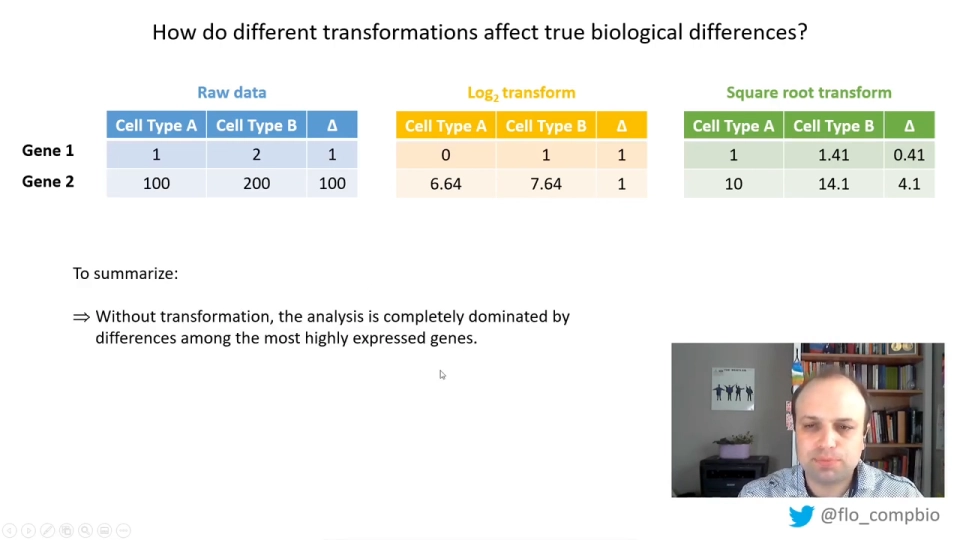

[【跳转到 10:34】](https://www.youtube.com/watch?v=huxkc2GH4lk&t=634)

讲者的总结是：不做变换，分析完全被最高表达的基因主导；做了 log 变换，任意表达水平上的相同倍数变化都变成相同差值；平方根则处在两者之间（这里仍是 10 倍差距，而不是 100 倍，也不是 1 倍）。

## 六、把变换和噪声对上：为什么平方根「更讲道理」

### 6.1 用信噪比量化测量精度

回到 GAPDH 那张直方图。均值 46，标准差 7.4，于是信噪比

$$
\mathrm{SNR} = \frac{\mu}{\sigma} = \frac{46}{7.4} \approx 6.2
$$

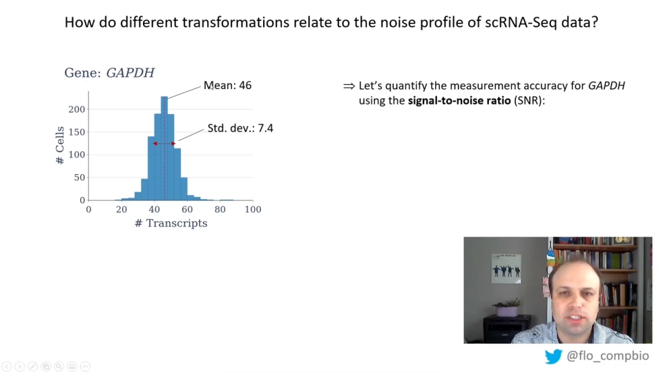

[【跳转到 11:24】](https://www.youtube.com/watch?v=huxkc2GH4lk&t=684)

信噪比越高，测量越准。这个基因的「真实表达水平」是标准差的 6.2 倍，算不错了。

### 6.2 一条非常干净的规律

对数据集里所有基因都算一遍信噪比，横轴取**均值表达量的平方根**，纵轴取信噪比，在双对数坐标下得到一条非常直的线，跨越两个数量级。

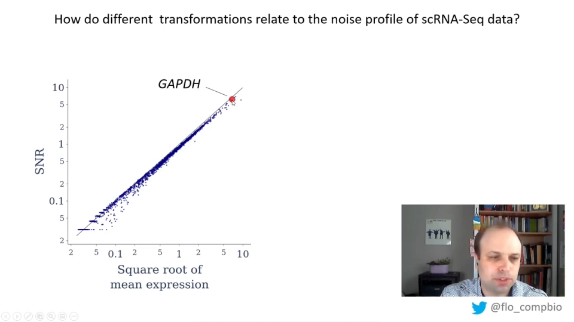

[【跳转到 12:14】](https://www.youtube.com/watch?v=huxkc2GH4lk&t=734)

换句话说：对 UMI 计数而言，**信噪比正比于真实表达水平的平方根**。

$$
\mathrm{SNR} \propto \sqrt{\lambda_{ij}}
$$

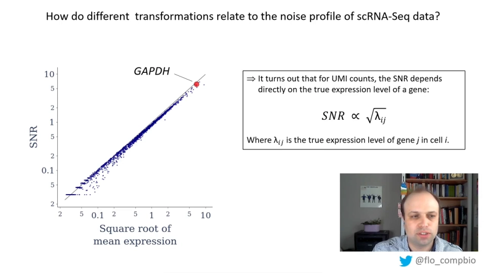

[【跳转到 13:04】](https://www.youtube.com/watch?v=huxkc2GH4lk&t=784)

讲者补充，这对绝大多数 10x 数据近似成立；少数不用 UMI 的技术不适用。

### 6.3 由此推出：平方根变换最匹配这种噪声

既然信噪比正比于 $\sqrt{\lambda}$，那么做了平方根变换之后，每个测量值在分析中获得的权重就**大致正比于它被测量得有多准**——这是很合理的：准的测量该给高权重，噪声大的测量不该和准的测量平起平坐。

而 log 变换的问题在于：它让一个高表达基因和一个低表达基因在「相同倍数变化」时获得相同权重，可高表达基因明明被测量得准得多（在这个例子里准 10 倍）。给它们相同的权重，等于过度压低了高表达基因的可信信息；而反过来，若按原始计数，又会给高表达基因 100 倍的权重——但实际只准了 10 倍。平方根恰好落在中间。

## 七、Pearson 残差：换一套完全不同的权重逻辑

### 7.1 不是逐点变换，而是逐基因加权

Pearson 残差的做法是：给每个基因一个权重 $w_j$，等于该基因均值的平方根倒数，然后把该基因所有细胞的测量值都乘上这个权重。

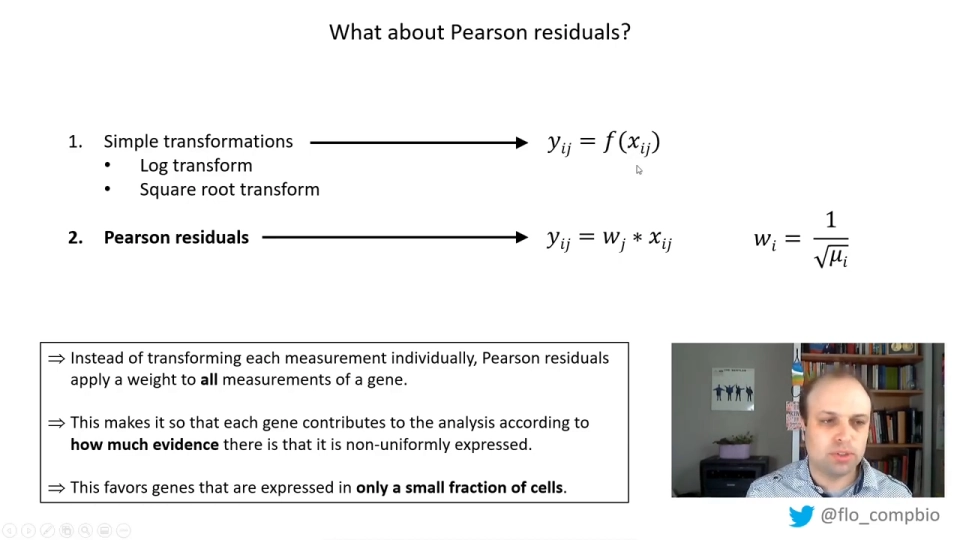

[【跳转到 17:14】](https://www.youtube.com/watch?v=huxkc2GH4lk&t=1034)

这带来一个很不一样的效果：**每个基因对分析的贡献，取决于「有多少证据表明它是非均匀表达的」**。一个只在极少数细胞里表达的基因，均值 $\mu_j$ 很小，权重 $1/\sqrt{\mu_j}$ 就很大——即使它本身表达量很低，也能拿到相当高的权重。

### 7.2 玩具例子：低表达但特异的基因反超

设定：细胞类型 A 占 50%，细胞类型 B 占 50%，但 B 又分两个亚型——亚型 1 占 48%（主导），亚型 2 只占 2%（稀有）。两个基因都只在 B 里表达：基因 1 在 B 的两个亚型里都表达（值 8），基因 2 只在稀有的亚型 2 里表达（值 4.5）。

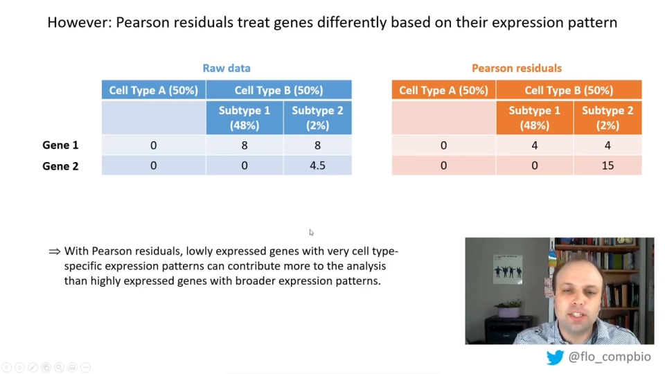

[【跳转到 19:47】](https://www.youtube.com/watch?v=huxkc2GH4lk&t=1187)

转成 Pearson 残差后，基因 1 是 4，基因 2 是 **15**——顺序完全反转，而且按方差贡献算，基因 2 现在比基因 1 更重要。

讲者点出这条规律：**在 Pearson 残差下，表达量低但细胞类型特异性极强的基因，可以比表达量高但分布宽泛的基因贡献更大**。这在真实数据里很有用：一个低表达但只在某个亚型里出现的基因，虽然测量噪声大，但一旦看到它，你就基本能确定这个细胞属于那个亚型。

### 7.3 在真实 PBMC 数据上的对比

用的是 10x Genomics 的 PBMC 数据，约 1 万个细胞，包含 NK 细胞、T 细胞、B 细胞、单核细胞、髓系树突状细胞（mDC）、浆细胞样树突状细胞（pDC）。讲者做了人工注释，黑色是双细胞（doublet），灰色是离群点。

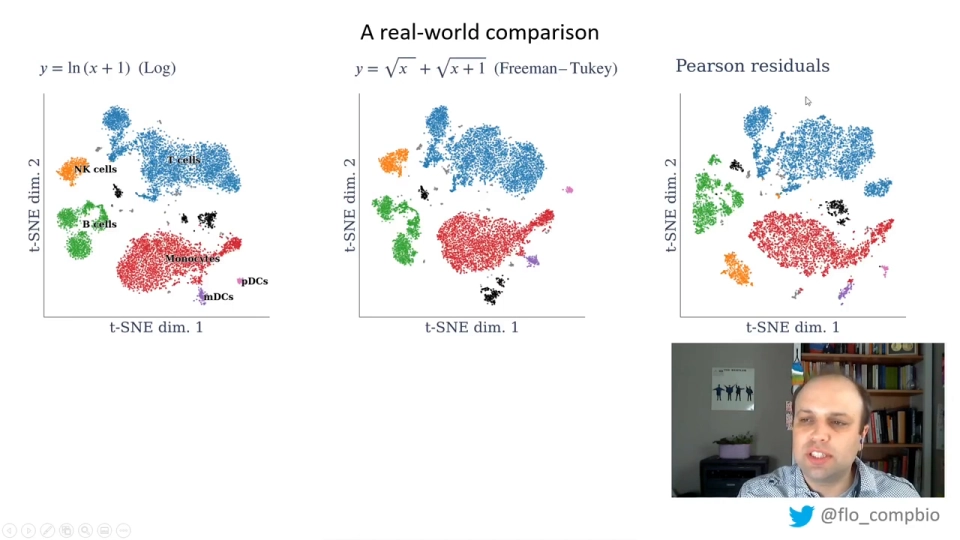

[【跳转到 22:25】](https://www.youtube.com/watch?v=huxkc2GH4lk&t=1345)

- **log 变换**（图注里的 $y=\ln(x+1)$，也就是常说的 log1p）：能把各个细胞类型大致分开，T 细胞和 B 细胞内部都有明显异质性。
- **平方根变换**（讲者常用的是 Freeman–Tukey 形式 $y=\sqrt{x}+\sqrt{x+1}$，即把 $\sqrt{x}$ 和 $\sqrt{x+1}$ 组合起来，让低表达基因和高表达基因被区别对待）：整体结果与 log 相当接近，只是 B 细胞的形状略有不同——因为 log 对高表达基因的压制更狠，而 B 细胞里有些免疫球蛋白基因表达极高。
- **Pearson 残差**：整体结构仍然相似，但出现了两处明显变化。一是 mDC 簇被非常清晰地分开（log 下只是略微分开）；二是**多出一个全新的簇**，讲者查过后发现是 **CD8 阳性初始 T 细胞**（CD4 阳性初始 T 细胞在另一处）。它们和其他初始 T 细胞的整体表达模式非常接近，只差几个基因，但 CD8A、CD8B 虽然表达不高却极具细胞类型特异性，在 Pearson 残差下这点证据就足以把它们单独分出来。

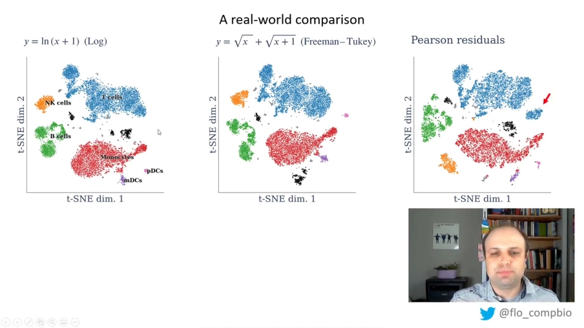

[【跳转到 25:45】](https://www.youtube.com/watch?v=huxkc2GH4lk&t=1545)

### 7.4 Pearson 残差的副作用：会「过度反应」

讲者也提醒了它的代价。Pearson 残差会彻底改变数据的方差结构，有时会走极端：这份数据里混进了极少量红细胞，红细胞有极其独特的表达谱（血红蛋白基因），又极其稀有，于是「这些基因非均匀表达」的证据压倒性地强，纯 Pearson 残差下它们会变成主导方差方向的来源。而通常我们并不关心只有几个细胞的群体。因此后来有人提出对残差做**截断（clipping）**，避免个别基因的影响被放得过大。

## 八、小结：三种做法的取舍

讲者最后用一张总结幻灯片收束：

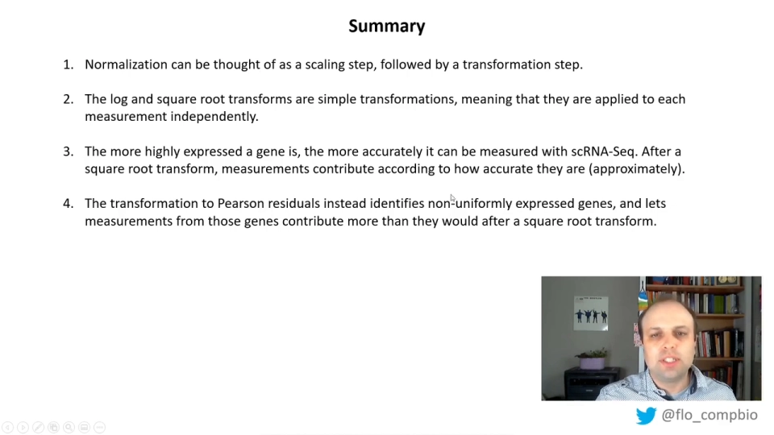

[【跳转到 26:35】](https://www.youtube.com/watch?v=huxkc2GH4lk&t=1595)

- 归一化可以理解为**先缩放、再变换**两步。
- log 与平方根都是**简单变换**，即对每个测量值独立地套同一个函数。
- 单细胞数据里，**基因表达越高，测量越准**；平方根变换后，各测量值的贡献大致与它的精度成正比。
- Pearson 残差则识别出**非均匀表达**的基因，让这些基因的贡献超过它们在平方根变换下的贡献，因而在区分细胞亚型上可能更有效。

## 九、延伸阅读（讲者给出的书单）

1. Grün 等，*Validation of noise models for single-cell transcriptomics*（Nature Methods 2014）——基于实验数据描述单细胞 RNA-seq 的技术噪声特征。
2. Stuart 等，*Comprehensive Integration of Single-Cell Data*（Cell 2019）——包含 Seurat v3 标准分析流程的描述。
3. Wagner 等，*K-nearest neighbor smoothing for high-throughput single-cell RNA-seq data*（bioRxiv 2018）——讨论平方根变换在单细胞数据中的使用。
4. Hafemeister & Satija，*Normalization and variance stabilization of single-cell RNA-seq data using regularized negative binomial regression*（Genome Biology 2019）——提出把 Pearson 残差用于单细胞分析。
5. Lause 等，*Analytic Pearson residuals for normalization of single-cell RNA-seq UMI data*（bioRxiv 2021）——对 Pearson 残差更理论化的讨论。

## 关键术语速查

| 术语 | 一句话解释 |
| --- | --- |
| UMI 计数 | 每个细胞每个基因上被数到的分子条数，是原始矩阵里最底层的数值 |
| 缩放（scaling） | 给每个细胞乘一个专属系数，把所有细胞的总计数拉到同一水平，从而把计数变成浓度 |
| size factor（细胞专属缩放系数） | 就是缩放这一步里每个细胞各自的系数，把这个细胞的总计数拉到统一的目标值 |
| 变换（transformation） | 对缩放后的数值套函数，决定每个测量值在后续分析中的权重 |
| log 变换 | $y=\ln(1+x)$，把倍数变化变成固定差值，压缩高表达基因的影响 |
| 平方根变换 | $y=\sqrt{x}$，让权重约正比于测量精度，与 UMI 计数的噪声结构最匹配 |
| Freeman–Tukey 变换 | $y=\sqrt{x}+\sqrt{x+1}$，讲者常用的平方根变体，对低表达基因略有区别对待 |
| 信噪比（SNR） | 均值除以标准差，衡量一个基因测得多准；对 UMI 计数约正比于真实表达量的平方根 |
| 效率噪声 | 液滴之间化学反应效率不同造成的纯技术差异，缩放可以大幅削弱它 |
| Pearson 残差 | $y_{ij}=w_j x_{ij}$，$w_j=1/\sqrt{\mu_j}$，按基因均值倒数加权，让非均匀表达的基因贡献更大 |
| 双细胞（doublet） | 一个液滴里混进了两个细胞，表达谱是两者的混合 |