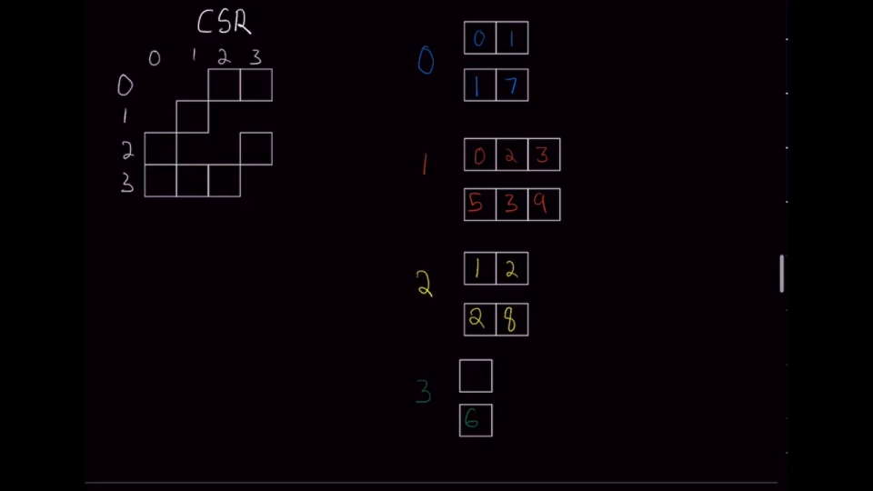
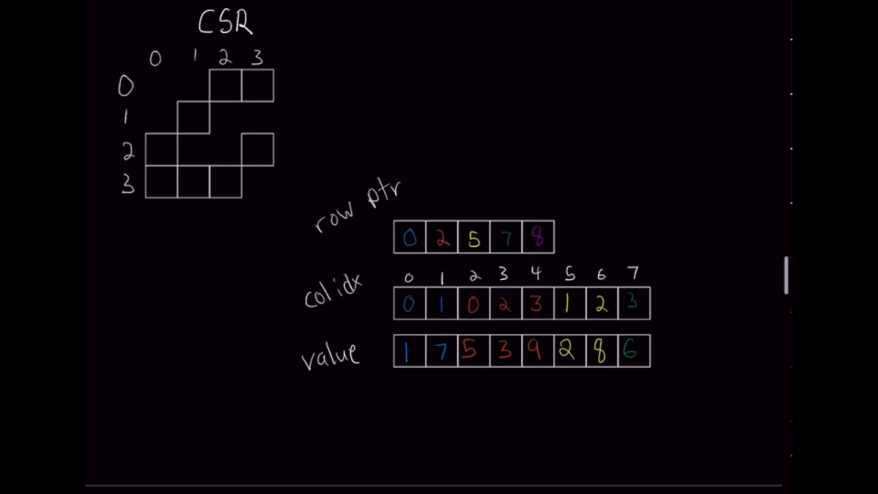
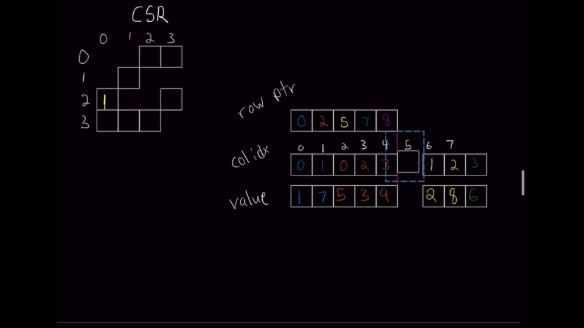
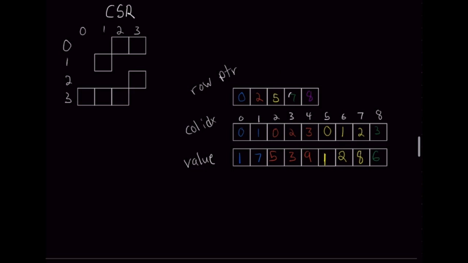

# CSR 是怎么把矩阵压成三个数组的：values、col_idx 与 row_ptr

> 视频来源：[Sparse Matrix Representation: Compressed Sparse Row (CSR)](https://www.youtube.com/watch?v=hlTwhuamoS0)（YouTube · Dayne Guy）｜时长约 7 分钟
> 导读：这是一支纯讲结构的短视频，用一张 4×4 的小矩阵把 CSR（压缩稀疏行）从 COO 一步步推出来：先按行收集值和列号，再补一个行指针数组，最后演示「插入一个非零元素」要付多少代价。本文按它的推演顺序复述，并在末尾说明这套结构对应到「细胞 × 基因」矩阵时意味着什么。为什么需要稀疏存储、CSR 与 CSC 的访问速度差异见同节的另一篇《稀疏矩阵：把「大部分是零」的矩阵塞进内存，代价是什么》。

## 本讲要解决的核心问题（SCQA）

**背景**：COO（坐标格式）是最容易想到的稀疏存法——每个非零元素记一条「行号、列号、值」。

**冲突**：这样能工作，但如果同一行里有很多非零元素，**行号会被重复记录很多遍**。一张按行看很「厚」的矩阵，光行号就占掉一大块空间。

**疑问**：能不能不逐条记行号，而是只记「每一行从哪里开始」？

**回答（中心思想）**：CSR 就是这么做的——它把非零元素**按行分组**存放，用两个等长数组记「值」和「列号」，再用第三个数组 `row_ptr`（行指针）记下每一行在 values 数组里的起始下标。代价是**插入新元素变贵**：要挪动后面的值，还要更新后面所有行指针。

## 一、从 COO 的问题出发

视频开头先回扣上一支视频讲的 COO：

> 前面我们看了 COO 格式：它把每个非零元素连同它的行号、列号和值一起存下来。这样能工作，但如果同一行里有很多项，我们就在反复记录同一个行号。下一种表示叫压缩稀疏行（compressed sparse row，CSR），它把所有非零元素按行分组，从而修掉这个重复。

[【跳转到 00:00】](https://www.youtube.com/watch?v=hlTwhuamoS0&t=0)

也就是说，CSR 的核心动作是**换一个分组维度**：不再按「非零元素的出现顺序」罗列，而是按行把元素聚在一起。这样一来，「这一行有哪些元素」变成了一个连续区间，行号就不再需要逐条重复。

## 二、第一步：逐行收集值和列号

讲者用的是一张 4×4 的小矩阵（下图），非零元素用不同颜色标出：


[【跳转到 00:00】](https://www.youtube.com/watch?v=hlTwhuamoS0&t=0)

$$
A = \begin{bmatrix}
1 & 7 & 0 & 0\\
5 & 0 & 3 & 9\\
0 & 2 & 8 & 0\\
0 & 0 & 0 & 6
\end{bmatrix}
$$

推演的第一步是：**逐行遍历矩阵，收集非零值以及它们对应的列号**（下图，标题为 CSR 的那一页）。


[【跳转到 00:25】](https://www.youtube.com/watch?v=hlTwhuamoS0&t=25)

对第 0 行，我们收集它的非零值，同时收集它们的列号（下图）：


[【跳转到 01:15】](https://www.youtube.com/watch?v=hlTwhuamoS0&t=75)

- 第 0 行有两个非零：值 1、7，列号分别是 0、1；
- 接着第 1 行有三个非零：值 5、3、9，列号分别是 0、2、3（下图）；


[【跳转到 01:40】](https://www.youtube.com/watch?v=hlTwhuamoS0&t=100)

- 第 2 行两个：值 2、8，列号 1、2；
- 第 3 行一个：值 6，列号 3。



[【跳转到 02:30】](https://www.youtube.com/watch?v=hlTwhuamoS0&t=150)

把所有行首尾相接，就得到两个等长数组：

```
value   = [1, 7, 5, 3, 9, 2, 8, 6]
col_idx = [0, 1, 0, 2, 3, 1, 2, 3]
```

注意此时**行号已经消失了**——因为「按行分组」这个动作本身已经隐含了行信息。缺的只是：怎么知道第 1 行从 value 数组的哪个位置开始？

## 三、第二步：补一个行指针 row_ptr

这就是 CSR 最关键的一步。讲者的原话是：

> 接下来是压缩稀疏行最关键的一步：我们构建一个「行指针」（row pointer）数组。行指针里的每一项，标记的是 values 数组中新的一行开始的那个下标位置。

[【跳转到 02:30】](https://www.youtube.com/watch?v=hlTwhuamoS0&t=150)

推演过程：第 0 行从下标 0 开始；把它和第 1 行接起来，可以看到第 1 行从下标 0 开始，第 2 行从下标 2 开始……（下图）


[【跳转到 03:20】](https://www.youtube.com/watch?v=hlTwhuamoS0&t=200)

把四行都补完，得到（下图）：


[【跳转到 04:10】](https://www.youtube.com/watch?v=hlTwhuamoS0&t=250)

```
row_ptr = [0, 2, 5, 7, 9]
```

怎么读这三个数组：

- 第 $i$ 行的元素在 value 数组里的位置是 $\text{row\_ptr}[i]$ 到 $\text{row\_ptr}[i+1] - 1$；
- 第 0 行：位置 0~1，即值 `[1, 7]`、列号 `[0, 1]`；
- 第 1 行：位置 2~4，即值 `[5, 3, 9]`、列号 `[0, 2, 3]`；
- 第 2 行：位置 5~6，即值 `[2, 8]`、列号 `[1, 2]`；
- 第 3 行：位置 7~7，即值 `[6]`、列号 `[3]`。

最后一项 `9` 是**非零元素的总数**——讲者特意点明：「最后一项是 9，它标记非零元素的总数，靠它我们才知道最后一行在哪里结束。」

完整的 CSR 就长这样（下图）：



[【跳转到 05:00】](https://www.youtube.com/watch?v=hlTwhuamoS0&t=300)

讲者的总结是：

> 所以你能看到，CSR 保留了和 COO 一样的列索引数组和值数组，但它多了一个行指针数组。

[【跳转到 04:35】](https://www.youtube.com/watch?v=hlTwhuamoS0&t=275)

用公式写出来，三个数组的长度关系是：

$$
\lvert \text{row\_ptr} \rvert = V + 1, \qquad \lvert \text{col\_idx} \rvert = \lvert \text{value} \rvert = \text{nnz}
$$

其中 $V$ 是行数、nnz 是非零元素个数。也就是说，除了「每个非零元素两个数（值 + 列号）」之外，CSR 只额外付出 $V+1$ 个整数——**行号不再逐条重复**，这正是它比 COO 省的地方。

## 四、代价：插入一个非零元素有多贵

讲者随后问了一个很实际的问题：如果我要往矩阵里新加一个非零元素呢？

> 假设我们往第 2 行第 0 列加一个 1，怎么把它放进 CSR 里？插入元素时，我们必须把它放到行内的正确位置，并保持列索引有序。

[【跳转到 05:00】](https://www.youtube.com/watch?v=hlTwhuamoS0&t=300)

做法是：把对应位置之后的所有值**都向右挪一格**，腾出位置再插入（下图）：



[【跳转到 05:50】](https://www.youtube.com/watch?v=hlTwhuamoS0&t=350)

讲者特意强调「还没完」：把值往右挪会让整个数组的元素总数增加，**行指针也要跟着变——每一个位于该值之后的指针都要加一**（下图）：


[【跳转到 06:15】](https://www.youtube.com/watch?v=hlTwhuamoS0&t=375)

于是新的 CSR 变成（下图）：



[【跳转到 06:40】](https://www.youtube.com/watch?v=hlTwhuamoS0&t=400)

```
row_ptr = [0, 2, 5, 8, 9]     # 原来的 7、9 都加了 1
value   = [1, 7, 5, 3, 9, 1, 2, 8, 6]
col_idx = [0, 1, 0, 2, 3, 0, 1, 2, 3]
```

讲者的结论是：

> 可以看到这比 COO 更贵，但现在我们有了一个更紧凑的格式，可以访问行内的每一个元素。

[【跳转到 06:40】](https://www.youtube.com/watch?v=hlTwhuamoS0&t=400)

这句话把 CSR 的取舍说得很清楚：**读得快、占得少，但写（插入）得慢**。所以 CSR 适合「一次建好、反复读」的场景，不适合「边跑边往里塞元素」的场景——后者用 COO 或按行追加更合适。

## 五、这套结构对应到「细胞 × 基因」矩阵

把上面的推演直接套到本系列的计数矩阵上，只要确定一件事：**谁当行**。

- 若行 = 细胞、列 = 基因，那么 `row_ptr` 的每一项就对应一个细胞，$\text{row\_ptr}[i]$ 到 $\text{row\_ptr}[i+1]-1$ 就是这个细胞测到的所有「基因号 + 计数」——**取一个细胞的完整表达谱是一次连续内存读取**，非常快。
- 反过来，若要按基因（列）取「这个基因在所有细胞里的计数」，CSR 就得逐行扫描，这正是同节另一篇里实测到「按列循环比按行循环慢约 80 倍」的原因；那种访问应该换成 CSC（按列压紧，结构完全对称）。
- `row_ptr` 的最后一个值就是 nnz，也就是**这张矩阵里非零计数的总条数**。它和「细胞数 × 基因数」的比值，就是这张矩阵有多稀疏。

## 小结

- **CSR 用三个数组表示一张矩阵**：`value`（非零值）、`col_idx`（列号）、`row_ptr`（每行在 value 中的起始下标）。
- **它修掉的是 COO 的行号重复**：按行分组之后，行号不再逐条记录，只额外付出 $V+1$ 个整数。
- **`row_ptr` 的最后一项是 nnz**，靠它才知道最后一行在哪里结束。
- **取一行的元素是一次连续读取**：$\text{row\_ptr}[i]$ 到 $\text{row\_ptr}[i+1]-1$。
- **插入很贵**：要右移后面的值，还要更新后面所有行指针——所以 CSR 适合「建好再读」，不适合频繁插入。
- **行与列不对称**：CSR 快在按行访问，按列访问要换 CSC。

## 关键术语速查

| 术语 | 一句话解释 |
| --- | --- |
| COO | 坐标格式，每个非零元素记一条「行号、列号、值」，行号会重复 |
| CSR | 压缩稀疏行，按行分组存非零元素，用行指针代替逐条行号 |
| `value` | 所有非零元素的值，按行优先顺序排列，长度 = nnz |
| `col_idx` | 与 `value` 一一对应的列号数组，长度 = nnz |
| `row_ptr`（行指针） | 长度 $V+1$，第 $i$ 项是第 $i$ 行在 `value` 中的起始下标，最后一项 = nnz |
| nnz | 非零元素个数，也等于 `row_ptr` 的最后一项 |
| CSC | 压缩稀疏列，CSR 的镜像：按列分组，按列访问快 |