# 稀疏矩阵：把「大部分是零」的矩阵塞进内存，代价是什么

> 视频来源：[DSCI 512 Sparse Matrices](https://www.youtube.com/watch?v=T5IYf5rvPfA)（YouTube · UBC Master of Data Science，讲者 Mike Gelbart）｜时长约 75 分钟
> 导读：这是一堂 Python 数据科学课，讲者用「图的邻接矩阵」当例子，把稀疏矩阵这件事从头算了一遍：为什么稠密存不下、scipy.sparse 有哪几种类型、按轴聚合怎么用、按行还是按列访问为什么差 80 倍、索引写法有哪些坑。本文只取稀疏矩阵这部分（约前 42 分钟）；后半段讲 Python 生成器与 map/reduce，与本节无关，不展开。数值含义与归一化见 2.3.1，文件格式见 2.3.3，AnnData/Seurat 对象见 2.3.4。

## 本讲要解决的核心问题（SCQA）

**背景**：单细胞实验最后落到一张「细胞 × 基因」的计数矩阵上（见 2.2.4）。这张矩阵的绝大多数格子里是 0——一个细胞里绝大多数基因根本没被测到表达。

**冲突**：如果按普通二维数组（numpy 的稠密数组）来存，每一个 0 都要占一个位置。矩阵一大，内存立刻不够用：讲者在课上算的例子是，一张十万乘十万的矩阵，稠密存下来要 **80 GB**，而同一份数据用稀疏方式存只要 **7 MB**。

**疑问**：既然大部分是零，能不能只存非零的那些？只存非零之后，矩阵还能不能像原来那样做运算？代价又转移到哪里去了？

**回答（中心思想）**：稀疏矩阵用「只存非零元素 + 它们的位置」换掉了「把所有零都存一遍」，空间从与 $V^2$ 成正比降到与「非零元素个数」成正比。但这笔交易不是免费的：**数据在内存里只能按一个方向排布**，于是沿另一个方向的访问会慢到不可用（讲者实测 8.6 秒 vs 11 分 57 秒）；而且一旦把稀疏矩阵转成稠密数组，之前省下的内存会一次性还回来。

## 一、先看一张图：为什么「稠密」存不下

### 1.1 同一张图，两种存法

讲者用 Network X 里的一张五节点图开场（下图）。同一份信息可以写成两种形式：

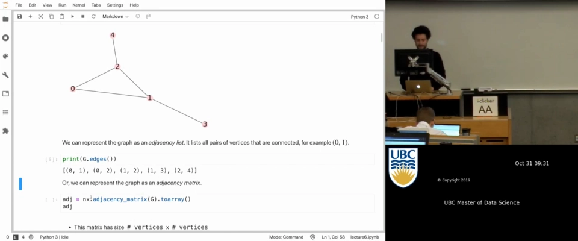

[【跳转到 01:50】](https://www.youtube.com/watch?v=T5IYf5rvPfA&t=110)

- **邻接表**（adjacency list）：把所有相连的点对列出来，比如 `(0, 1)`、`(0, 2)`、`(1, 2)`、`(1, 3)`、`(2, 4)`。两个节点相连就叫 adjacent，这个列表就是全部相邻关系。
- **邻接矩阵**（adjacency matrix）：一个行数=列数=节点数的方阵，有连接就填 1、没有就填 0。

两种写法编码的是同一批边，只是组织方式不同。邻接矩阵的好处是查询极快：想知道节点 1 和节点 3 连不连，直接看第 1 行第 3 列，$O(1)$ 时间就拿到答案。

### 1.2 空间账：$O(E)$ 与 $O(V^2)$

代价出在空间上。设 $E$ 是边的条数、$V$ 是节点数（下图）：

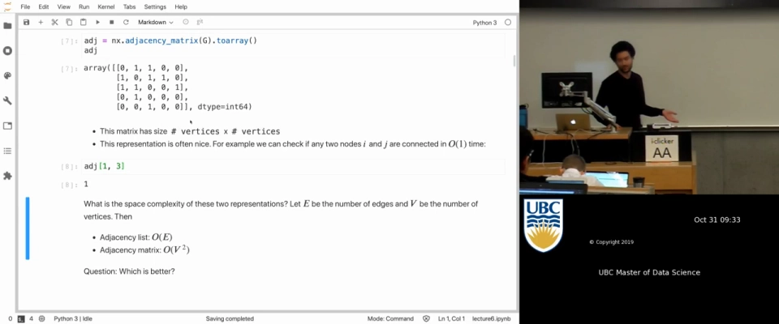

[【跳转到 04:20】](https://www.youtube.com/watch?v=T5IYf5rvPfA&t=260)

$$
\text{邻接表} = O(E), \qquad \text{邻接矩阵} = O(V^2)
$$

邻接表只需要存「有边的那些点对」，条数就是 $E$；邻接矩阵不管你实际有多少条边，都要占满 $V \times V$ 个格子。当图很稠密（边很多）时两者差不多；但当图很稀疏——节点很多、边很少——$V^2$ 会远远大于 $E$，绝大部分格子都是白占的零。

这就是「稀疏矩阵」要解决的问题的雏形：**信息量只有 $E$，但稠密存储要付 $V^2$ 的钱**。

### 1.3 换成真实数字：80 GB 与 7 MB

讲者随后把规模放大到十万个节点（下图）。Network X 返回的邻接矩阵，类型是 `scipy.sparse.csr_matrix`——注意，它默认就不返回 numpy 数组：

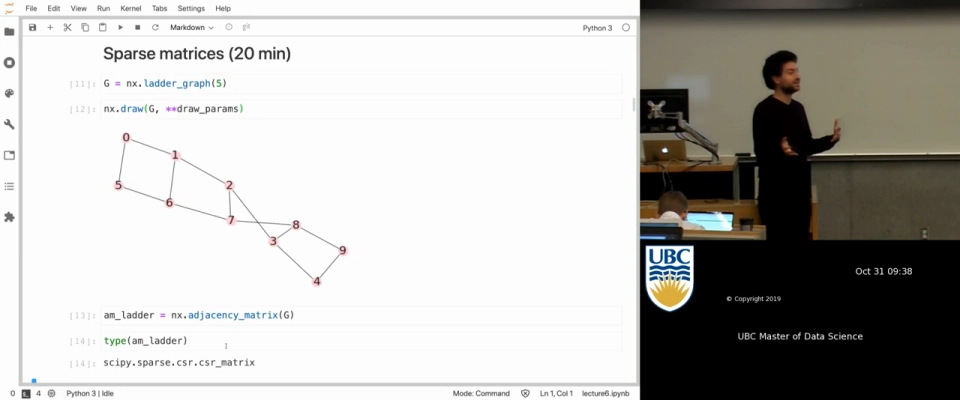

[【跳转到 08:55】](https://www.youtube.com/watch?v=T5IYf5rvPfA&t=535)

原因讲得很直白：如果有一百万个节点，它要是返回一个一百万乘一百万的 numpy 数组，那就是一万亿个元素，根本装不进内存；而你可能只有五百万条边，存五百万个东西就没那么糟。

于是关键的一步是：**先看这张矩阵概念上多大，再看它实际有多少非零元素**（下图）。

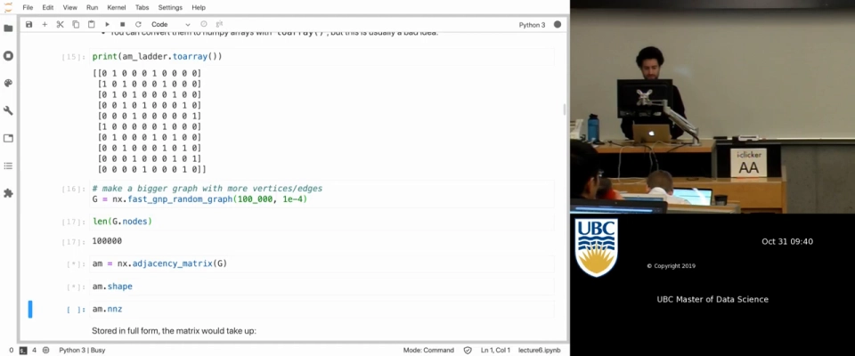

[【跳转到 11:20】](https://www.youtube.com/watch?v=T5IYf5rvPfA&t=680)

- `.shape` 告诉你概念上是 $(100000, 100000)$；
- `.nnz` 告诉你里面只有 **997126** 个非零元素。

也就是说，$10^{10}$ 个格子里，真正有内容的不到百万分之一。稀疏矩阵的做法就是：**只存这一百万个非零元素和它们的位置**，而不是把整个带零的矩阵存下来。

接下来是全场最直观的一张幻灯片（下图）：

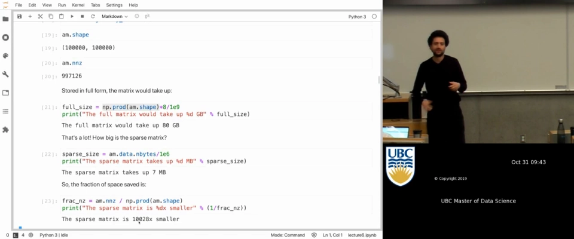

[【跳转到 13:50】](https://www.youtube.com/watch?v=T5IYf5rvPfA&t=830)

$$
\text{稠密大小} = \frac{V \times V \times 8\ \text{字节}}{10^9} = 80\ \text{GB}, \qquad
\text{稀疏大小} = 7\ \text{MB}, \qquad
\text{比值} \approx 10028
$$

这里有两个要记住的口径：

1. **每个数按 8 字节算**。讲者明确说这是本课的估算假设（后面课程会细讲），所以乘 8 再除以 $10^9$ 换算成 GB。
2. **比值是「一万倍」量级**。讲者的原话是：把它存成稀疏矩阵，比存成稠密矩阵小一万倍，这是巨大的收益；而且**零越多，只存非零就越划算，硬存稠密矩阵就越灾难**。

顺带一提，讲者还提醒了「概念稀疏」和「存成稀疏类型」是两件事：同一张矩阵，你可以用 numpy 稠密数组存，也可以用 scipy 稀疏类型存，两种都「能跑」，只是后者才省内存。

### 1.4 这类矩阵到处都是

讲者特意强调，稀疏矩阵远不止用于图。他举了两个例子：

- **用户 × 商品**：一堆商品当列、一堆用户当行，格子里是「这个用户评价过这个商品」。每个用户大概只评价过所有商品里的寥寥几个，所以矩阵绝大部分是空的——把它存成稠密数组很荒唐，而存成稀疏矩阵，占的空间基本只和**评价总数**成正比。
- **文档 × 词**：一百万篇文档、词典里一百万个词，统计每个词在每篇文档里出现多少次。一篇普通文档大概只用到一千个不同的词，所以这张巨表也绝大部分是零。

[【跳转到 41:22】](https://www.youtube.com/watch?v=T5IYf5rvPfA&t=2482)

这两个例子的结构和「细胞 × 基因」完全同构：**行是一个观测单位，列是一个特征，绝大多数「观测-特征」对没有观测值**。所以后面讲的机制可以整体搬过来。

## 二、稀疏矩阵：概念是一回事，实现是另一回事

### 2.1 定义：里面有很多零

讲者给的定义很朴素：**稀疏矩阵就是「里面有很多零」的矩阵**，向量也一样可以稀疏。sparse 这个词的意思就是「这个东西大部分是零」，它对应的是「只在这里那里有几个非零元素」的存储需求。

[【跳转到 05:35】](https://www.youtube.com/watch?v=T5IYf5rvPfA&t=335)

他还特别提醒了一个容易混淆的地方：**「概念上稀疏」不等于「存成了 Python 的稀疏类型」**。

> 概念上 sparse 只是说「里面很多零」；而这样一个概念上稀疏的矩阵，既可以用 Python 的稀疏矩阵数据类型来存，也可以用普通 numpy 数组（我们叫稠密）来存。

[【跳转到 41:06】](https://www.youtube.com/watch?v=T5IYf5rvPfA&t=2466)

这句话在单细胞场景里非常实用：你手上那张计数矩阵**永远是概念上稀疏的**，但你的代码里它到底是不是稀疏类型，取决于读数据的那一步（2.3.3、2.3.4 讲的文件格式和对象决定这件事），而不取决于生物学。

### 2.2 实现：scipy.sparse 里有一整个家族

讲者说，「稀疏矩阵」既是一个概念（就像「字典」「集合」是概念），而 `scipy.sparse` 是这个概念在 Python 里的一个具体实现。打开文档会看到一大堆类型（下图）：

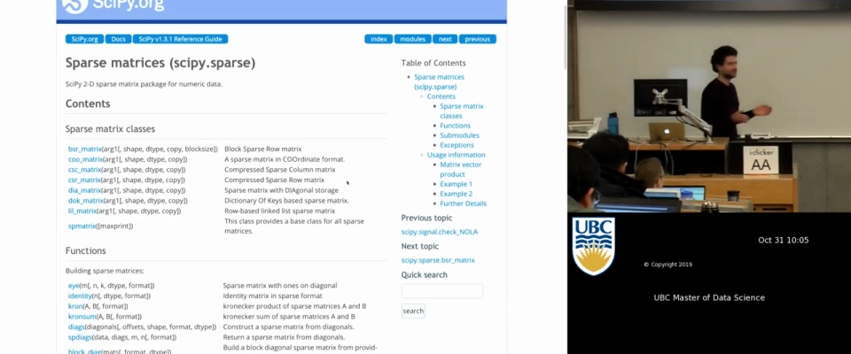

[【跳转到 35:42】](https://www.youtube.com/watch?v=T5IYf5rvPfA&t=2142)

图里能看到 `bsr_matrix`、`coo_matrix`、`csc_matrix`、`csr_matrix`、`dia_matrix`、`dok_matrix`、`lil_matrix` 等一串名字。讲者的态度是：不必现在全看，但要知道**它们存的是同一个概念上的矩阵，只是内存排布方式不同**，而排布方式决定了哪种运算快、哪种运算慢（这一点是第四节的主题）。

### 2.3 `toarray()` 是个危险动作

这些类型都提供 `toarray()`，把稀疏矩阵转成普通二维 numpy 数组（下图）：

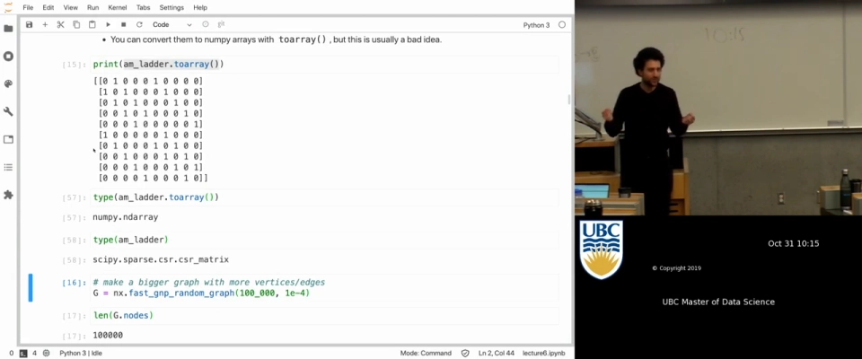

[【跳转到 40:41】](https://www.youtube.com/watch?v=T5IYf5rvPfA&t=2441)

讲者的原话是：这跟你们在数据整理课里对 dataframe 调 `to_numpy` 是一个思路，但**通常是个坏主意，因为矩阵一大就可能直接把内存撑爆**。

道理就是 1.3 节那道算术题：稀疏存 7 MB 的东西，一旦 `toarray()` 就变回 80 GB。这是本节最值得记住的一条操作纪律——**看到 `toarray()` / `.todense()` 就要警觉**，因为它把稀疏省下来的内存一次性还回去了。
## 三、只存非零之后，还能做什么：按轴聚合

省内存只是第一步。真正的问题是：**稀疏存储之后，原来那些矩阵运算还能不能做？** 讲者的答案是「能，但你要用对函数」。

### 3.1 `axis` 这个参数是钥匙

他先用一个普通 numpy 整数数组做铺垫（下图），目的是让大家看清 numpy 里那个反复出现的 `axis` 关键字：

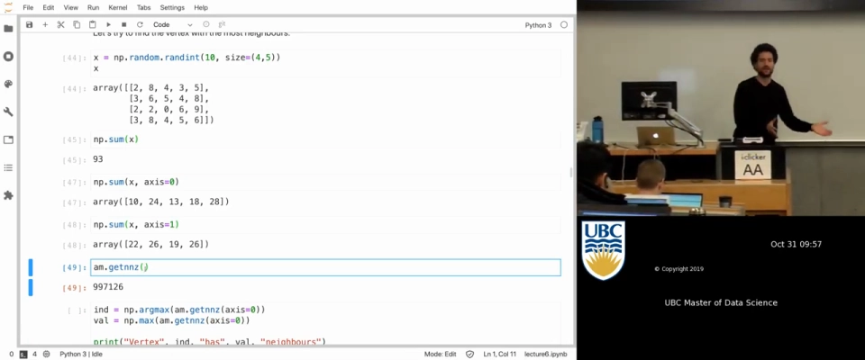

[【跳转到 27:39】](https://www.youtube.com/watch?v=T5IYf5rvPfA&t=1659)

```
np.sum(x)              # 全部加起来 → 93
np.sum(x, axis=0)      # 沿第 0 个轴（竖直方向）求和 → 每一行的和
np.sum(x, axis=1)      # 沿水平方向求和 → 每一列的和
```

讲者强调这是一个**大量 numpy 函数共有的模式**：min、median 等等都有 `axis`——不指定就对所有数一起算，指定了就按行或按列算。

### 3.2 `nnz` 也能按轴算：数非零就是数「有几条记录」

关键的一步来了：这个 `axis` 模式**在 scipy 稀疏矩阵上照样成立**。`am.getnnz(axis=0)` 得到的是每一列的非零元素个数，`axis=1` 得到每一行的（下图）：

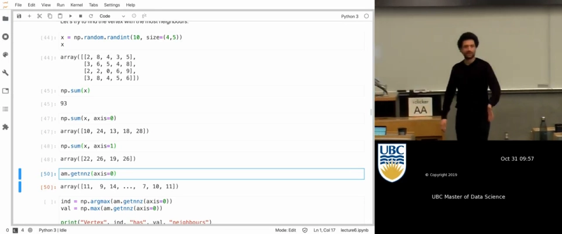

[【跳转到 28:04】](https://www.youtube.com/watch?v=T5IYf5rvPfA&t=1684)

为什么这有用？讲者的推理是：图里「有边记 1、没边记 0」，所以**沿某行或某列数非零元素，就是在数邻居的个数**。他翻回前面那张小矩阵逐格数了一遍：第一行有 2 个非零，所以这个节点有 2 个邻居；另一行有 3 个，就是 3 个邻居。

他还补充了一个细节：在这个例子里也可以用 `sum` 代替 `nnz`，因为你就是在加一堆 1，结果同样是计数；但**一般情况下应该用「非零元素个数」而不是求和**，因为如果矩阵里的值不都是 1（比如带权图），求和就不再是计数了。

### 3.3 找极值：`argmax` 与 `max`

有了「每个节点的邻居数」这个向量，下一步就是找谁最多（下图）：

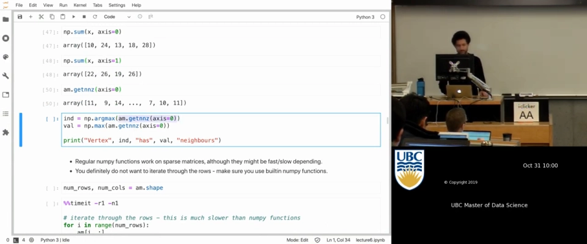

[【跳转到 31:24】](https://www.youtube.com/watch?v=T5IYf5rvPfA&t=1884)

```python
ind = np.argmax(am.getnnz(axis=0))   # 最大值的下标
val = np.max(am.getnnz(axis=0))      # 最大值本身
```

讲者跑出来：顶点 37280 邻居最多，有 25 个。

这一段的方法论意义比结论更重要：**稀疏矩阵上的分析，通常不是「一个个格子去看」，而是「先按轴聚合成一个向量，再在这个向量上做 numpy 运算」**。讲者反复强调这一点——他明确说「你绝对不想用循环去遍历行，一定要用内置的 numpy 函数」。

## 四、代价：存储方向决定了访问速度

### 4.1 稀疏矩阵在内存里只能按一个方向排

到这一步，讲者开始讲「稀疏矩阵为什么比 numpy 数组烦」。原因是一句话：

> 稀疏矩阵在内存里要么按行存、要么按列存——要么是「第 0 项的所有东西、第 1 项的所有东西、第 2 项的所有东西」这样排，要么是反过来的方向。结果就是：**按行循环和按列循环，耗时可能差得非常远**。

[【跳转到 34:44】](https://www.youtube.com/watch?v=T5IYf5rvPfA&t=2084)

这在普通二维 numpy 数组里你根本不用管：按行处理还是按列处理都差不多，不需要想这些事。但稀疏矩阵不一样——`csr_matrix`（Compressed Sparse Row）按行压紧，`csc_matrix`（Compressed Sparse Column）按列压紧，概念上存的是同一个矩阵，实际排布不同，于是**不同运算的快慢也不同**。

### 4.2 实测：8.63 秒 与 11 分 57 秒

讲者做了个对照实验：对同一个十万节点的邻接矩阵，一次按行循环取每一行，一次按列循环取每一列，都用 `timeit` 计时（下图）：

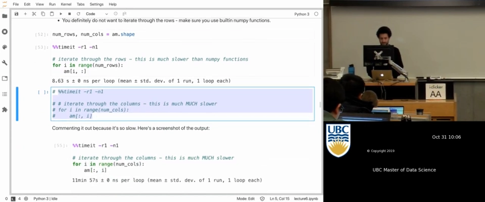

[【跳转到 36:59】](https://www.youtube.com/watch?v=T5IYf5rvPfA&t=2219)

$$
\text{按行循环} \approx 8.63\ \text{s}, \qquad \text{按列循环} \approx 11\ \text{min}\ 57\ \text{s}
$$

差了大约 **80 倍**。讲者说他根本没法现场跑按列那一段，只好把代码注释掉、贴了前一天跑出来的截图。

原因是存储顺序（下图）：它基本是按第一行、第二行、第三行这样排的，所以按行循环很容易，因为内存里就是这个顺序；而当你按列循环时，「给我第 0 列」这句话，它得把每一行都过一遍，在每行里搜「这一行有没有第 0 列的非零元素」，每行都要做一整套查找。

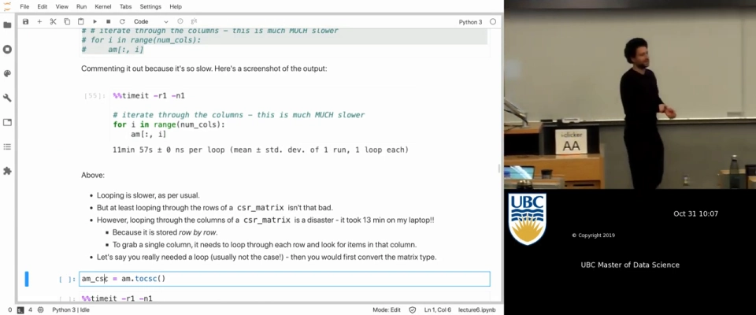

[【跳转到 37:57】](https://www.youtube.com/watch?v=T5IYf5rvPfA&t=2277)

这一页的四条总结值得原样记住：

1. 循环本来就比向量化慢；
2. 但至少对 `csr_matrix` 来说，按行循环还不算太糟；
3. 而按列循环是灾难——他笔记本上花了 13 分钟，**因为它就是按行存的**；取一列需要遍历每一行、在行内找属于该列的元素；
4. 如果你真的需要这种循环（通常并不需要），那应该**先转换矩阵类型**。

### 4.3 解决办法：换存储格式，而不是转置

讲者给的解法是 `am.tocsc()`——把同一个矩阵换成按列存的类型，然后再按列循环：

> 如果我确实需要按列循环，我就会把它换成另一种稀疏矩阵类型，改变存储方式，然后就能按列循环了——**同一份数据，只是换了一种为另一种访问方式优化的存法**。

[【跳转到 38:16】](https://www.youtube.com/watch?v=T5IYf5rvPfA&t=2296)

有同学追问：那为什么不直接转置再按行循环？讲者的回答很关键：在这个例子里矩阵是对称的，转置恰好是特例；但一般情况下**不该转置**，因为转置之后你手上已经是另一个矩阵了，你把「矩阵的语义」和「代码的写法」解耦了，人会被绕晕。**更好的做法是保持矩阵本身不变，只改变它的存储方式。**

这里还有一条隐含的工程结论：**格式转换本身是有代价的**，所以正确做法不是每次访问都来回转，而是想清楚「这段代码主要沿哪个方向访问」，然后选一个格式、一次转好。

## 五、几个会让人抓狂的坑

### 5.1 单行访问返回的不是一行数，而是「(列号, 值) 对」

讲者取邻接矩阵第 0 行打印，出来的东西长这样（下图）：

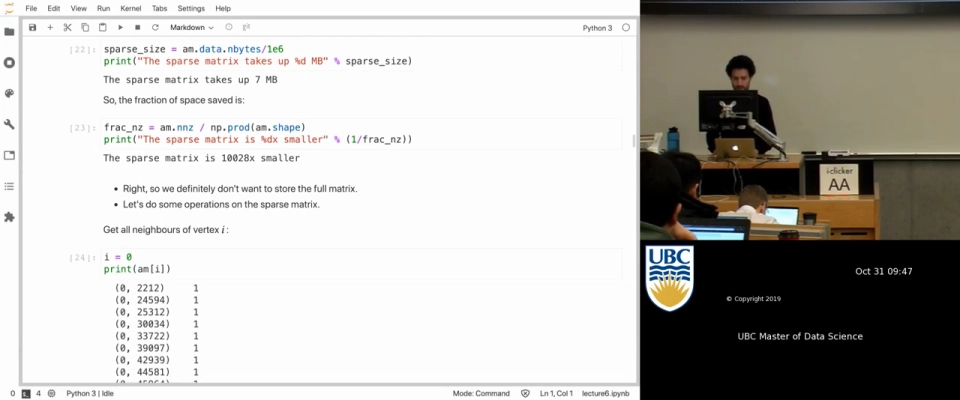

[【跳转到 18:06】](https://www.youtube.com/watch?v=T5IYf5rvPfA&t=1086)

`(0, 2212) 1`、`(0, 24594) 1`、`(0, 25312) 1`…… 讲者解释：因为它并没有存那完整的十万个元素，只存非零的那些，所以它告诉你的其实是「位置 2212 处有一个值」——也就是顶点 0 连到顶点 2212、24594 等等。**这就是它的所有邻居**。

### 5.2 `x[1, 2]` 与 `x[1][2]`：numpy 都行，稀疏矩阵只有一种行

在普通 numpy 数组上，`x[1, 2]` 和 `x[1][2]` 拿到的是同一个值（下图），因为 `x[1]` 本身就是合法语法——它表示第一行，再 `[2]` 就是这一行的第二个元素：

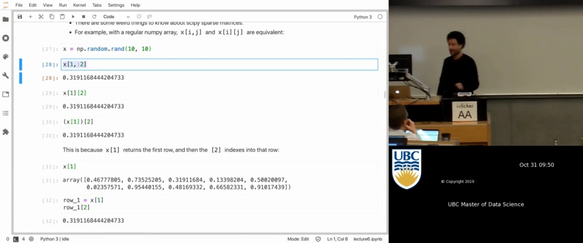

[【跳转到 21:26】](https://www.youtube.com/watch?v=T5IYf5rvPfA&t=1286)

但换成稀疏矩阵，逗号写法照样能取到同一个值，链式写法会**直接报错**。讲者说这种事能把人逼疯，并解释了原因：

> 稀疏矩阵里 `x[1]` 返回的形状是 $1 \times 10$，而不是长度 10。于是你再往里索引，它又去索引第一个维度，就会说「这个维度长度只有 1，你却在索引 2」。

[【跳转到 22:14】](https://www.youtube.com/watch?v=T5IYf5rvPfA&t=1334)

他的猜测是：稀疏矩阵这个类型就是为「矩阵」——也就是二维的东西——设计的，所以它喜欢保持二维。结论是：**用稀疏矩阵时，索引一律用逗号写法 `x[i, j]`**。

### 5.3 概念稀疏 ≠ 稀疏存储（再说一次）

这一条前面提过，但值得单独记住，因为它是最容易在真实项目里悄悄踩到的坑：一张概念上稀疏的矩阵，如果读进来时被转成了稠密 numpy 数组，那 1.3 节那笔内存账会立刻兑现，而且往往不是报错，只是**程序变慢、内存被吃满**。

## 六、把机制搬到「细胞 × 基因」矩阵上

讲者全程用图的邻接矩阵举例，但他自己也说了这套东西远不止用于图（用户×商品、文档×词）。把它套到本系列的计数矩阵上，能直接得到几条结论：

| 图里的说法 | 搬到细胞 × 基因矩阵上 |
| --- | --- |
| 矩阵形状 $V \times V$，非零元素是边 | 矩阵形状是「细胞数 × 基因数」，非零元素是「测到的那个基因-细胞对」 |
| `nnz` 是边的条数 | `nnz` 是**非零计数的总条数**，也就是这张矩阵真正的信息量 |
| 沿某行/某列数非零 = 数邻居 | 沿某行数非零 = 这个细胞测到了多少个基因；沿某列数非零 = 这个基因在多少个细胞里被测到 |
| `toarray()` 会把 80 GB 还回来 | 把稀疏计数矩阵转成稠密数组，内存会按「细胞数 × 基因数」而不是「非零条数」计费 |
| 按行循环快、按列循环慢 | 按细胞（行）遍历便宜，按基因（列）遍历昂贵；要按基因聚合就先换存储方向 |
| 别写循环，用 `axis` 聚合 | 每个细胞的计数总和、每个基因的非零细胞数，都应该用 `getnnz(axis=…)` 或按轴求和一次算完 |

还有一条从定义直接推出来的结论：**凡是会把零变成非零的运算，都会破坏稀疏结构**。比如「每个基因减去它的均值」——原本的 0 会变成 $-\mu_g$，一个非零数，于是这张矩阵立刻从「大部分是零」变成「几乎全是非零」，稀疏存储也就失去意义（这类变换的后果与替代做法属于 2.3.1 的范围，本节只指出它在存储层面的代价）。

## 小结

- **稀疏矩阵解决的是空间问题**：信息量只有「非零元素个数」，稠密存储却要付「行数 × 列数」的钱。讲者的例子是 80 GB 与 7 MB，相差一万倍。
- **先看 `.shape`，再看 `.nnz`**：这两个数一除，就知道这张矩阵值不值得用稀疏格式。
- **概念稀疏 ≠ 稀疏存储**：同一张矩阵可以用 numpy 稠密数组存，也可以用 `scipy.sparse` 存，省内存的只有后者。
- **`toarray()` 是危险动作**：它把稀疏省下的内存一次性还回去。
- **稀疏矩阵上的分析靠按轴聚合**：`getnnz(axis=…)`、按轴求和、`argmax`，而不是逐元素循环。
- **存储方向决定访问速度**：CSR 按行存、CSC 按列存，同一个矩阵按行循环 8.63 秒、按列循环 11 分 57 秒。
- **要换方向就换格式，不要转置**：`tocsc()` 保持矩阵语义不变，只改内存排布。
- **索引一律用逗号写法**：稀疏矩阵的 `x[1]` 返回 $1 \times n$，链式索引会报错。

## 关键术语速查

| 术语 | 一句话解释 |
| --- | --- |
| 稠密矩阵（dense matrix） | 大部分元素非零，每个格子都老老实实占内存 |
| 稀疏矩阵（sparse matrix） | 大部分元素是零，只存非零元素及其位置 |
| `nnz` | number of nonzeros，非零元素的个数，也是稀疏矩阵真正的信息量 |
| 邻接表 / 邻接矩阵 | 图的两种存法，空间分别是 $O(E)$ 与 $O(V^2)$ |
| `scipy.sparse` | Python 里稀疏矩阵的具体实现，含 coo/csr/csc/dok/lil 等多个类型 |
| CSR | Compressed Sparse Row，按行压紧存储；按行访问快、按列访问慢 |
| CSC | Compressed Sparse Column，按列压紧存储；方向与 CSR 相反 |
| `toarray()` | 把稀疏矩阵转成稠密 numpy 数组，大矩阵上会撑爆内存 |
| `axis` | numpy/scipy 的聚合方向参数，`axis=0` 竖直、`axis=1` 水平 |
