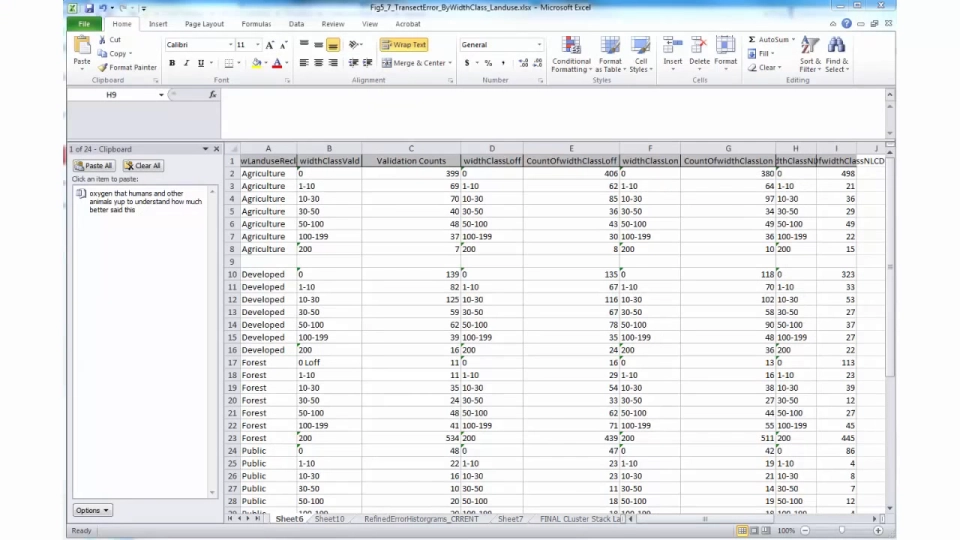
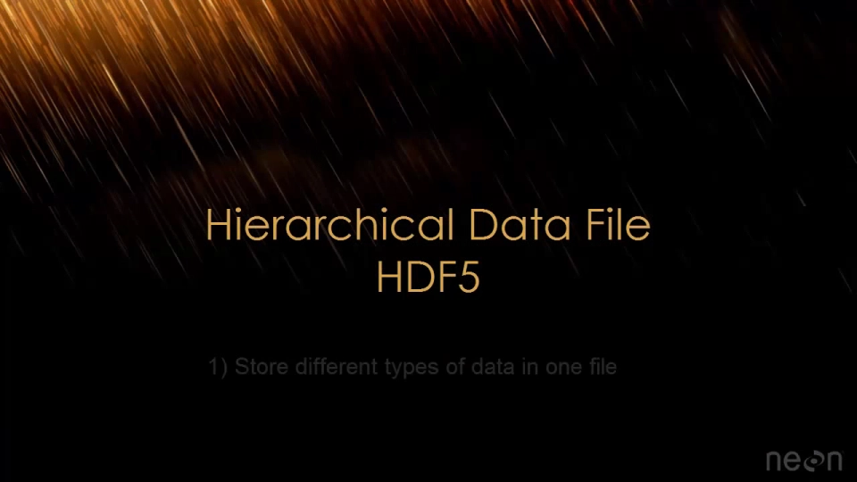
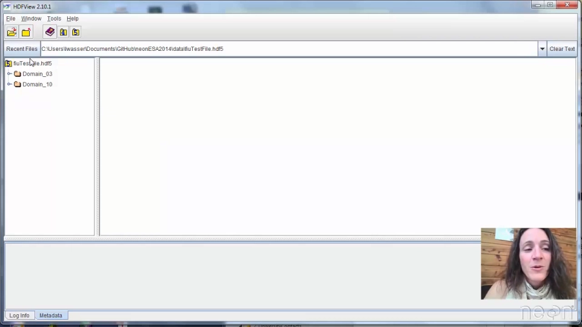
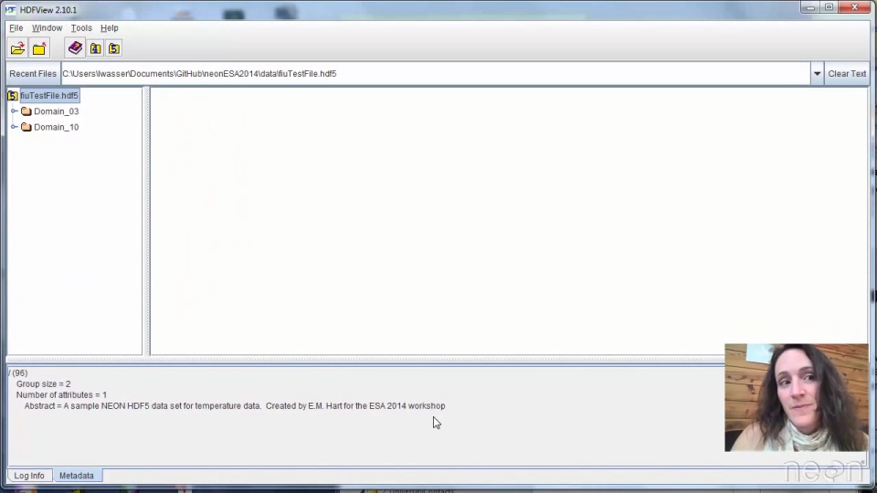
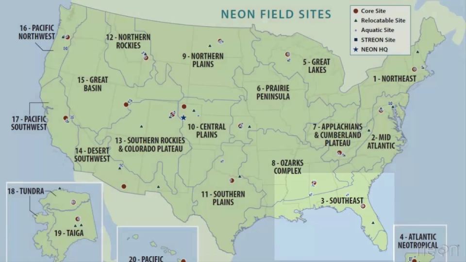
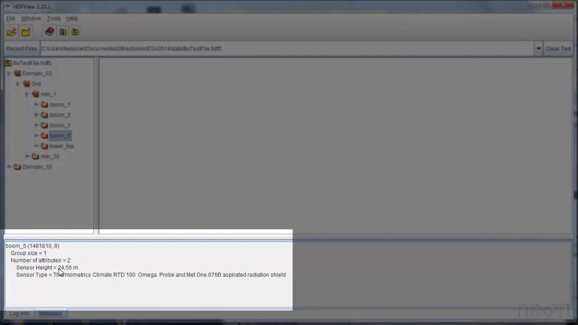
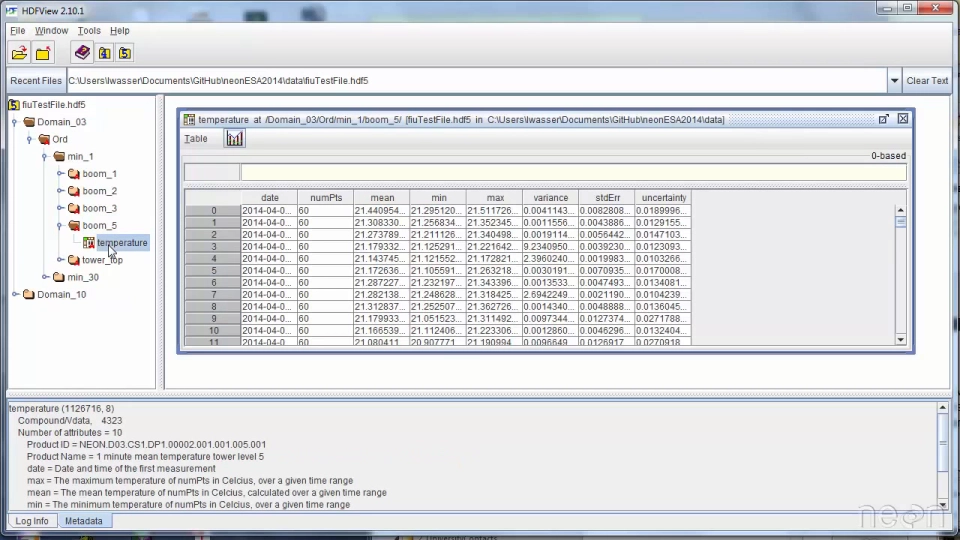
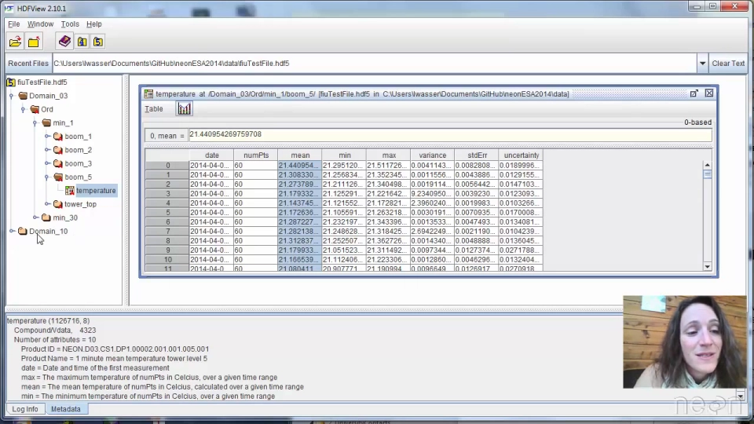

# HDF5 文件内部长什么样：组、数据集与自描述属性

> 视频来源：[A Quick Look at the HDF5 File Format Using HDFView](https://www.youtube.com/watch?v=q14F3WRwSck)（YouTube · NEON Science，讲者 Leah）｜时长约 4 分钟
> 导读：这支短片用一个「多站点、多传感器、多时间粒度」的温度数据集，在 HDFView 里把一个 HDF5 文件的内部结构从头点到尾：文件 → 组 → 组 → 数据集，每一层还挂着属性。它讲的不是单细胞，但 `.h5` 与 `.h5ad` 就是 HDF5 容器（见同节另一篇《同一张表达矩阵的五种落盘方式》），所以这里看到的「组 / 数据集 / 属性」三层，正是单细胞数据文件内部的样子。

## 本讲要解决的核心问题（SCQA）

**背景**：单细胞数据经常以「一个文件装完」的形式交付——Cell Ranger 的 `.h5`、scanpy 的 `.h5ad` 都是这样，一个文件里既有表达矩阵，又有基因名、细胞条形码和各种元数据。

**冲突**：可这种文件用文本编辑器打开是一片乱码，你既看不到行，也看不到列。一旦读不进来、或者想确认「某个字段到底在不在文件里」，就完全无从下手。

**疑问**：这种「一个文件装完所有东西」的容器，内部到底是怎么组织的？为什么它能同时装下好几种不同类型的数据，还能让人知道每一列是什么？

**回答（中心思想）**：HDF5 是**层次化（hierarchical）+ 自描述（self-describing）**的容器。文件内部像文件系统一样有「组」（group，相当于文件夹），组里可以继续套组，也可以放「数据集」（dataset，真正装数值的表格）；**每一个组和每一个数据集还各自挂着一组「属性」（attribute），用来描述自己是什么**。于是「多种数据放一个文件」和「文件自带说明书」这两件事同时成立——这也正是 `.h5ad` 能把矩阵、行名、列名、元数据塞进一个文件的底层原因。

## 一、为什么需要「层次化数据文件」

### 1.1 传统做法：一堆文件 + 一份口头说明

讲者用一个很日常的场景开场。假设你有一批温度数据，来自多个站点、由不同传感器在不同时间采集，现在要分享给同事。第一种办法是：

- 把所有数据存进一个 Excel 表格，里面塞一大堆工作表（tab）；
- 或者存成一堆 CSV 文件，再加几个元数据文件。

问题在于：**交给同事之前，你得把每个文件都写清楚说明；对方拿到手还得把这些文件翻一遍，才能开始干活。** 数据本身没问题，麻烦全在「文件之间怎么对应」这件事上。

[【跳转到 00:25】](https://www.youtube.com/watch?v=q14F3WRwSck&t=25)

[【跳转到 00:35】](https://www.youtube.com/watch?v=q14F3WRwSck&t=35)

### 1.2 层次化文件的两个卖点

第二种办法是把所有信息存进**一个单独的数据文件**——这就是层次化数据文件（hierarchical data file）。讲者点出它的两个好处（下图）：

[【跳转到 00:50】](https://www.youtube.com/watch?v=q14F3WRwSck&t=50)

1. **一个文件装多种类型的数据**：不用再维护「一堆 CSV + 一堆说明文件」的对应关系；
2. **自描述（self-describing）**：文件里还带着描述这些信息的元数据。换句话说，**说明书是文件的一部分，不是外挂的**。

这两点后面会一一落到具体界面上：第 2 节看「文件级的自描述」，第 3 节看「组」，第 4 节看「数据集和它的属性」。

## 二、打开一个 HDF5 文件：先看文件自己怎么说

### 2.1 工具：HDFView

讲者用的是 HDFView，一个免费查看器，可以在 hdf5group.org 网站上下载。打开的文件里存的是科罗拉多和佛罗里达几座 NEON 塔的温度数据（NEON 是美国国家生态观测网络）。

[【跳转到 01:47】](https://www.youtube.com/watch?v=q14F3WRwSck&t=107)

界面分三块，值得记住它们的对应关系：

- **左边是树**：显示文件的层次结构，最上面是文件名，下面挂着组；
- **中间是内容区**：点中某个组或数据集，这里显示它的内容；
- **下面是信息面板**：显示当前选中对象的属性（元数据）。

### 2.2 文件级属性：点一下文件名就能读到说明

讲者的第一个动作是**点文件名本身**，然后信息面板里立刻出现了关于这个文件的信息（下图）：

[【跳转到 02:10】](https://www.youtube.com/watch?v=q14F3WRwSck&t=130)

面板里能看到三样东西：

- `Group size = 2`：这个文件（根组）下面有 **2 个组**；
- `Number of attributes = 1`：这个文件自己挂了 **1 个属性**；
- `Abstract`：一段文字说明，写的是「这是一个 NEON HDF5 温度数据示例，为 ESA 2014 工作坊制作」。

这就是「自描述」最直观的样子：**不用去别处找 README，文件自己写着它是什么。**

### 2.3 自描述的实际价值

讲者紧接着说明了这件事为什么有用：**如果要把数据读到 R 或 Python 里，因为数据是自描述的，可以把这些元数据一起带进来，在处理数据时查看它们。**

这句话对单细胞数据同样成立。`.h5ad` 里那些「这个矩阵是原始计数还是标准化后的」「这一列是细胞类型还是批次」的信息，不是靠文件名猜的，而是作为属性/元数据存在文件里的——所以读进来之后程序能自动知道该把它放在哪一层。

## 三、组：文件里的「文件夹」

### 3.1 第一层：两个地点

左侧树里，文件名下面挂着 `Domain_03` 和 `Domain_10` 两个组。讲者解释：`Domain 3` 是 NEON 的一个生态气候区，位于东南部，这个站点叫 Ordway-Swisher——**她之所以知道，是因为可以查看跟这份数据存在一起的元数据**。

[【跳转到 02:25】](https://www.youtube.com/watch?v=q14F3WRwSck&t=145)

注意这里的方法论：**组名只是标签，真正的含义写在属性里。** 看到 `Domain_03` 这个字符串本身说明不了什么，是元数据让它变成「东南部的 Ordway-Swisher 站点」。

### 3.2 第二层：两种时间粒度

往下展开，是 `Ord` 组（站点缩写），再往下分成 `min_1` 和 `min_30`。讲者的说法是：**这个文件里有两种类型的数据——按每分钟聚合的数据，和按每 30 分钟聚合的数据。**

[【跳转到 02:35】](https://www.youtube.com/watch?v=q14F3WRwSck&t=155)

这一层很能说明「一个文件装多种数据」的价值：如果按传统做法，1 分钟粒度和 30 分钟粒度大概会变成两个 CSV 文件，再加上「它们来自同一个站点、同一批传感器」的说明。**在 HDF5 里，这层关系直接由目录结构表达出来。**

### 3.3 第三层：塔上的传感器，以及组自己的属性

再往下，是 `boom_1` 到 `boom_5`。讲者解释：**boom 就是塔上不同高度上的传感器**。

而且——**她甚至能看到这个高度是多少，因为它就存在文件的元数据里**（下图）：

[【跳转到 03:15】](https://www.youtube.com/watch?v=q14F3WRwSck&t=195)

面板里写着 `Number of attributes = 2`，两条属性分别是：

- `Sensor Height = 24.56 m`——这个传感器离地 24.56 米；
- `Sensor Type = Thermometrics Climate RTD-100 Omega Probe...`——具体型号。

讲者据此给出对比：**Boom 1 离地面很近，大概 4 米；而 Boom 5 已经很高了，离地面差不多 25 米。** 这个高度不是从文件名推出来的，也不是靠外部表格查的，而是**组自己带着的属性**。

**到这里，「组」的三层结构就完整了：文件 → Domain（地点）→ Ord（站点）→ min_1/min_30（粒度）→ boom_N（传感器位置）。** 每一层既是容器，又是语义标签，还能挂自己的属性。

## 四、数据集：真正装数值的地方

### 4.1 双击打开，看到一张表

再往下走一层，就是实际存数据的地方。讲者双击 `boom_5` 下面的 `temperature`，打开后是一张表（下图）：

[【跳转到 03:27】](https://www.youtube.com/watch?v=q14F3WRwSck&t=207)

这张表有 8 列：`date`、`numPts`、`mean`、`min`、`max`、`variance`、`stdErr`、`uncertainty`。行是时间点（2014-04-0x），每行是这个时间窗口内的统计量。

**这就是「数据集」（dataset）**：HDF5 里真正装数值的东西，形态上就是一张表（或者一个多维数组）。**组可以套组，但数值最终落在数据集里。**

### 4.2 数据集也有自己的属性：列的含义写在文件里

更关键的是下面那半个面板。讲者说「数据本身也是自描述的：里面写着各列的含义」，面板里确实逐条列出了：

- `Temperature (1126716, 8)`——这个数据集的形状：**112 万多行、8 列**；
- `Number of attributes = 10`——它挂了 10 条属性；
- `Product ID`、`Product Name`（`NEON.D03.CS01.DP1.00002.001.005.001` 之类）；
- `Units`——单位；
- 以及**逐列的解释**：`date` 是测量时间，`max` 是这段时间内摄氏温度的最大值，`mean` 是平均值，`min` 是最小值……

这一步是整支视频最值得记住的地方：**在一张 CSV 里，「mean 这一列是摄氏度的平均值」这件事只能写在文件名或旁边的说明文档里；在 HDF5 里，它是数据集的一条属性，跟着数据一起走。**

## 五、一个文件装完，好处落在哪

### 5.1 结构可重复

讲者指出：**第二个站点（Domain_10）的结构完全一样。** 这不是巧合，而是层次化格式的设计效果——**同一套实验设计，在文件里就是同一套目录结构**。对单细胞数据，这对应着「每个样本一个组、组里放同样的数据集」这种组织方式。

### 5.2 分享只需要给一个文件

最后讲者回到开场的场景（下图）：

[【跳转到 03:50】](https://www.youtube.com/watch?v=q14F3WRwSck&t=230)

**所有这些信息都存在这一个文件里，而且我可以把这个文件分享给同事、朋友，他们也能直接拿它干活。** 不需要附带一份「文件说明」，因为说明在文件里。

### 5.3 回到单细胞：`.h5` 与 `.h5ad` 为什么是「一个文件」

把这支视频的结构套到单细胞数据上，很多之前只能死记的东西就通了：

| HDF5 里的概念 | 温度数据里的例子 | 单细胞文件里的对应 |
| :--- | :--- | :--- |
| 文件（根组） | `tuTestFile.hdf5` | `xxx.h5`、`xxx.h5ad` |
| 组（group） | `Domain_03` → `Ord` → `min_1` → `boom_1` | `raw`、`obs`、`var`、`obsm`、`uns` 等 |
| 数据集（dataset） | `temperature`（1126716 × 8 的表） | 表达矩阵本身、细胞元数据表、基因元数据表 |
| 属性（attribute） | `Sensor Height`、`Units`、逐列含义 | 矩阵是原始还是标准化、字段含义、版本信息 |

这也解释了同节另一篇里 `Convert` 打印的那几行：`Adding raw/X as counts`、`Adding meta.features from raw/var`——**`raw/X` 和 `raw/var` 就是「组/数据集」这样的路径**。转换器做的事情，本质上是按路径把 HDF5 里的不同数据集，搬到目标对象的对应位置上。

## 小结

- HDF5 是**层次化 + 自描述**的容器：层次化让它能把多种数据装进一个文件，自描述让它自带说明书。
- 内部结构只有三种角色：**组**（像文件夹，可嵌套）、**数据集**（真正装数值的表）、**属性**（挂在组或数据集上的元数据）。
- 打开一个 HDF5 文件，第一件事是**点文件名看文件级属性**：`Group size` 告诉你下面有几个组，`Abstract` 告诉你这个文件是什么。
- 组名只是标签，**含义写在属性里**：`Domain_03` 要配元数据才知道是哪个站点，`boom_5` 要配 `Sensor Height = 24.56 m` 才知道是 25 米高的传感器。
- 数据集是数值的落点，**列的含义也是属性**：`Temperature (1126716, 8)` 加上逐列解释，让数据自带说明。
- 一个文件装完的实际收益：结构可重复、分享只需给一个文件、读进 R/Python 时元数据一起带进来。
- 单细胞里的 `.h5` 与 `.h5ad` 就是这种容器，所以「矩阵 + 行名 + 列名 + 元数据」能共存于一个文件，也所以转换时会出现 `raw/X`、`raw/var` 这样的路径。

## 关键术语速查

| 术语 | 一句话解释 |
| :--- | :--- |
| HDF5 | Hierarchical Data Format 5，层次化二进制数据容器格式 |
| 层次化（hierarchical） | 文件内部像文件系统一样可以层层嵌套，用组来组织 |
| 自描述（self-describing） | 文件里带着描述自身结构和含义的元数据，不需要外挂说明文档 |
| 组（group） | HDF5 里的「文件夹」，可以套组，也可以放数据集 |
| 数据集（dataset） | HDF5 里真正装数值的对象，形态是一张表或多维数组 |
| 属性（attribute） | 挂在组或数据集上的元数据，如单位、传感器高度、列的含义 |
| HDFView | HDF5 官方提供的免费图形查看器，用来浏览文件内部结构 |
| boom | 观测塔上不同高度的传感器支架，本视频里 boom_1 到 boom_5 对应不同离地高度 |
| 聚合粒度 | 同一批观测按不同时间窗口统计（如 1 分钟与 30 分钟）后得到的两套数据 |