# 同一张表达矩阵的五种落盘方式：.rds、.h5、.mtx、.loom、.h5ad

> 视频来源：[Reading single-cell data in R: H5AD, loom, MEX, AnnData formats](https://www.youtube.com/watch?v=3xcTpqQzUwQ)（YouTube · Bioinformagician）｜时长约 17 分钟
> 导读：这是一期纯实操演示：作者手上有一批来自公开数据源、格式各不相同的单细胞数据集，逐个读进 R 的 Seurat 对象。本文按「同一张表达矩阵在硬盘上可以长成什么样」重排了它的内容，讲清每种格式由几个文件组成、读进来是什么类型、以及各格式之间怎么互相转换。数值含义见 2.3.1，稀疏存储原理见 2.3.2，Seurat 对象本身的结构见 2.3.4。

## 本讲要解决的核心问题（SCQA）

**背景**：单细胞实验最后落到一张 feature-barcode 矩阵上：行是基因（feature），列是细胞条形码（cell barcode），格子里是计数（count）。因为绝大多数格子是零，它是一张稀疏矩阵（见 2.3.2）。

**冲突**：同样是这张矩阵，你在硬盘上拿到的东西却五花八门。Cell Ranger 可能给你一个 `.h5`，也可能给你一个装着三个文件的目录；公共数据仓库可能给你 `.loom` 或 `.h5ad`；别人分享给你的可能是 R 的 `.rds`。同一个数据集换个来源就换一种格式，读不进来，后面所有分析一步都走不下去。

**疑问**：这些格式各自把矩阵存在哪里？为什么要有这么多种？拿到一种格式之后，怎么把它读成能继续处理的对象？

**回答（中心思想）**：这五种格式装的都是同一张稀疏计数矩阵，区别只在**「一个文件还是一组文件」**和**「纯文本还是二进制容器」**这两件事上。认清这一点，读法就变成查表：`.mtx` 用 `ReadMtx` 一次喂三个文件，`.h5` 用 `Read10X_h5`，`.rds` 用 `readRDS`，`.loom` 用 `Connect`，`.h5ad` 先用 `Convert` 转成 h5Seurat 再 `LoadH5Seurat`。**读进来的中间产物都是计数矩阵，最后一步才统一转成 Seurat 对象。**

## 一、先看全貌：五种格式装的是同一张矩阵

### 1.1 feature-barcode 矩阵：单细胞数据的「原件」

作者开场先把对象定义清楚（下图）：单细胞的输入格式里有一个 feature-barcode matrix，可以把它理解成 bulk RNA-seq 里的 count matrix——**一张很大的矩阵，行是 feature（基因），列是 cell barcode（细胞），值是 count（计数）**。

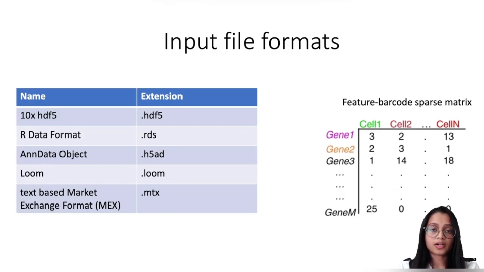

[【跳转到 01:09】](https://www.youtube.com/watch?v=3xcTpqQzUwQ&t=69)

它之所以叫稀疏矩阵，是因为「绝大多数数值都是零」。这句话是本节的出发点：**后面五种格式的差别，全在「怎么把这张以零为主的表写进磁盘、又怎么读回来」，而不在数据本身。**

### 1.2 五种格式一览：名字与扩展名

同一张幻灯片左半边是一张对照表，把今天要处理的五种格式列了出来：

| 名称 | 扩展名 | 硬盘上的形态 |
| :--- | :--- | :--- |
| 10x hdf5 | `.hdf5`（演示里是 `.h5`） | 单个二进制容器文件 |
| R Data Format | `.rds` | 单个 R 序列化文件 |
| AnnData Object | `.h5ad` | 单个二进制容器文件 |
| Loom | `.loom` | 单个二进制容器文件 |
| text based Market Exchange Format（MEX） | `.mtx` | 一组纯文本文件 |

这张表本身就说明了分类逻辑：**四种是「一个文件装完」，只有 MEX 是「一组文本文件」**。而 `.h5`、`.h5ad`、`.loom` 三者又都属于「二进制容器」这一族——它们内部是层次化的结构，不是一张平铺的表。

作者说明了为什么要统一读进 Seurat 对象：**因为后续处理要用 Seurat 这个包**，所以无论原始格式是什么，第一步都是把它变成 Seurat 对象。

### 1.3 演示用的真实文件：一个目录里躺着五种格式

演示不是虚构的例子。作者从公开数据源下载了好几个数据集，每个格式都不一样，先用 `ls` 把目录列了出来（下图）：

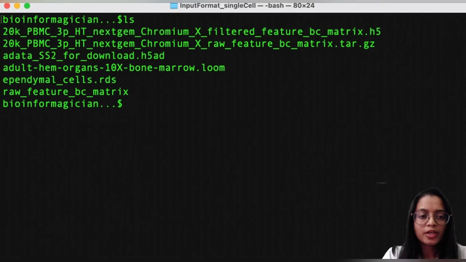

[【跳转到 02:19】](https://www.youtube.com/watch?v=3xcTpqQzUwQ&t=139)

这张图很值得多看两眼，因为它把本节要讲的五种形态一次摆齐了：

- `20k_PBMC_3p_HT_nextgem_Chromium_X_filtered_feature_bc_matrix.h5`——Cell Ranger 输出的 `.h5`；
- `20k_PBMC_3p_HT_nextgem_Chromium_X_raw_feature_bc_matrix.tar.gz`——同样是 Cell Ranger 的输出，但被打包成压缩包，解开后就是 MEX 的三件套目录；
- `adata_SS2_for_download.h5ad`——AnnData 对象；
- `adult-hem-organs-10X-bone-marrow.loom`——loom 文件；
- `ependymal_cells.rds`——R 的数据文件；
- `raw_feature_bc_matrix`——一个目录，里面才是真正的 `.mtx` 三件套。

作者随后在 RStudio 里建了一个脚本，按格式分成几段来写（下图）。这个脚本骨架本身就是本节最好的目录：**`.rds` → 10x Cell Ranger `.hdf5` → `.mtx` → `.loom` → `.h5ad`**。

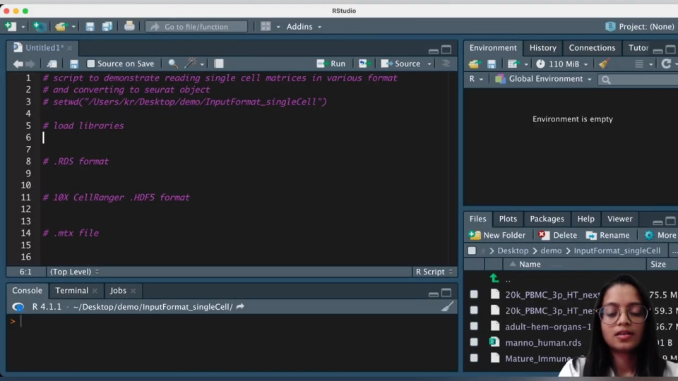

[【跳转到 02:51】](https://www.youtube.com/watch?v=3xcTpqQzUwQ&t=171)

脚本开头加载两个包：`Seurat` 和 `SeuratDisk`。前者负责建对象和处理，后者负责 `.h5ad` 那条路的格式转换——这个分工后面会反复出现。

## 二、.mtx：三个纯文本文件拼成一张矩阵

先讲 MEX，因为它是唯一「不是一个文件」的格式，也最能说明「矩阵被拆开存」这件事。

### 2.1 三个文件分别管什么

作者的说法是：如果你的数据是用 Cell Ranger 流程处理的，它会输出一个 matrix 文件；**除了 matrix 文件，它还会输出 barcodes 文件和 features 文件**。三份信息合起来，才能还原出那张矩阵。

对应到代码里，`ReadMtx` 一次要喂三个路径（下图）：

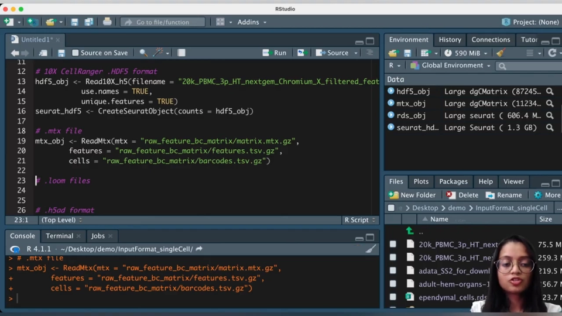

[【跳转到 09:50】](https://www.youtube.com/watch?v=3xcTpqQzUwQ&t=590)

```r
mtx_obj <- ReadMtx(mtx      = "raw_feature_bc_matrix/matrix.mtx.gz",
                   features = "raw_feature_bc_matrix/features.tsv.gz",
                   cells    = "raw_feature_bc_matrix/barcodes.tsv.gz")
```

三个参数正好对应矩阵的三个组成部分：

- `mtx`（`matrix.mtx.gz`）：**数值本体**。它只记「第几行、第几列、值是多少」，行号和列号是数字，不带名字——这就是 2.3.2 讲的坐标式稀疏存储落到了磁盘上。
- `features`（`features.tsv.gz`）：**行名**，也就是基因。矩阵里第 1 行是谁，由这个文件第 1 行说了算。
- `cells`（`barcodes.tsv.gz`）：**列名**，也就是细胞条形码。矩阵里第 1 列是哪个细胞，由这个文件第 1 行说了算。

注意文件名里的 `.gz`：这三个文件都是**压缩过的纯文本**。文本的好处是人人能读、能用 `zcat`/`head` 直接看；代价是体积大、解析慢——所以作者提醒「读这些文件通常要花点时间，具体取决于每个文件的大小」。

### 2.2 读进来之后：行是基因、列是条形码

`ReadMtx` 跑完，数据面板里出现的是一个 matrix 对象。作者特意强调：**这还不是 Seurat 对象，它应该是一个 feature-barcode 矩阵**。检查方式是看前 10 行 10 列（下图）：

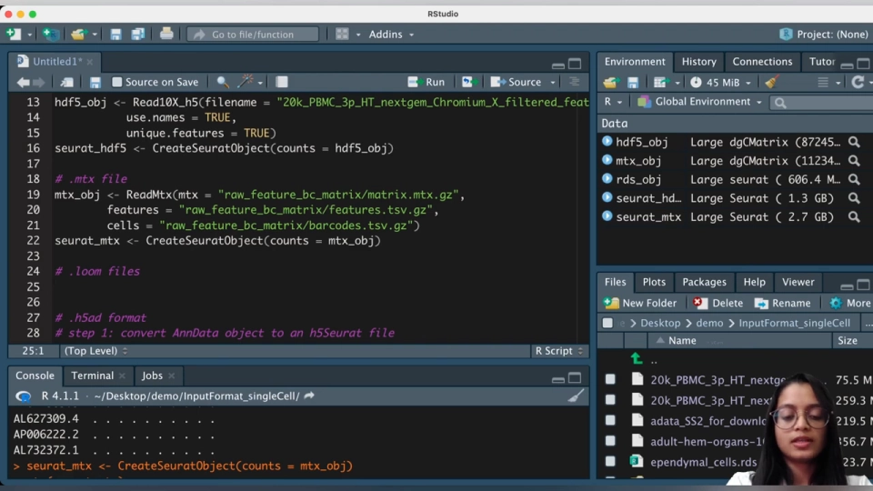

[【跳转到 11:45】](https://www.youtube.com/watch?v=3xcTpqQzUwQ&t=705)

从图里能直接读出来：行名是 `AL627309.4`、`AP000622.2`、`AL732372.1` 这样的基因名，列名是 `AAACCCAAGAGCAGCT-1` 这样的条形码。**三个文件在这里合流了**——`.mtx` 提供了数值和坐标，`features.tsv` 提供了行名，`barcodes.tsv` 提供了列名。

### 2.3 从矩阵到 Seurat 对象

有了 counts，最后一步是 `CreateSeuratObject`，把矩阵传给 `counts` 参数，存成 `seurat_mtx`（下图）。

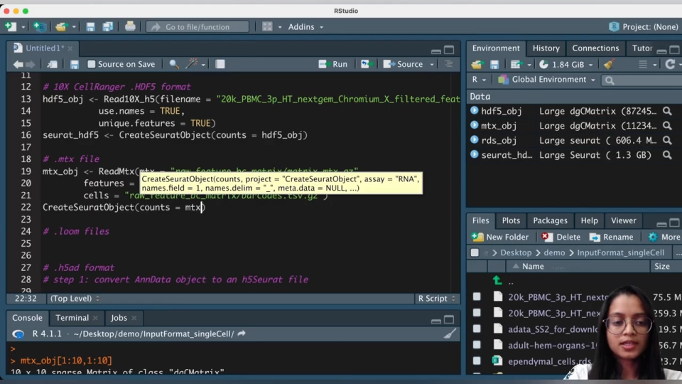

[【跳转到 10:30】](https://www.youtube.com/watch?v=3xcTpqQzUwQ&t=630)

注意控制台最后一行：打印出来的 `mtx_obj` 前 10 行 10 列，类型写着 `10 x 10 sparse Matrix of class "dgCMatrix"`。**`ReadMtx` 读出来的也是稀疏矩阵**，和 `Read10X_h5` 一致——磁盘上的稀疏表示，在内存里对应的是同一类稀疏结构。

作者确认对象建好之后说了一句关键的话：**「现在就可以拿这个对象做下游处理了。」**——不管原始格式是什么，流程都在这里汇合。

## 三、.h5：Cell Ranger 的单文件输出

### 3.1 一个文件装完的 HDF5

作者的说法很直接：**Cell Ranger 会把 feature-barcode 矩阵输出成 `.h5`（HDF5）格式**，读它用 `Read10X_h5`：

```r
hdf5_obj <- Read10X_h5(filename = "20k_PBMC_3p_HT_nextgem_Chromium_X_filtered_feature_bc_matrix.h5",
                       use.names = TRUE,
                       unique.features = TRUE)
```

两个参数值得注意：

- `use.names = TRUE`：**用 feature 的名字**，而不是用行号当行名；
- `unique.features = TRUE`：**要求 feature 唯一**。基因名重复会让「按名字取某一行」这件事变得有歧义，所以读入时就把重复名处理掉。

作者还提醒了一句实务经验：**这类文件稍微大一点，通常要一两分钟才能读进 R**，而且会带一些警告信息，她这里选择先忽略。

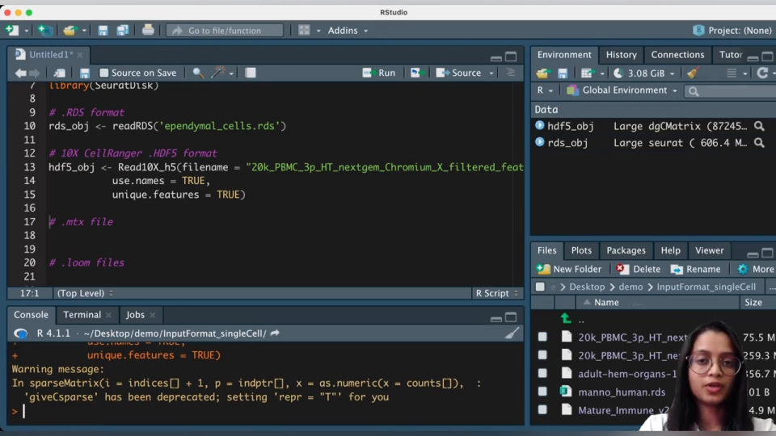

[【跳转到 06:11】](https://www.youtube.com/watch?v=3xcTpqQzUwQ&t=371)

### 3.2 读出来是什么类型：dgCMatrix

读完之后先别急着建对象，看看读到了什么（下图）：

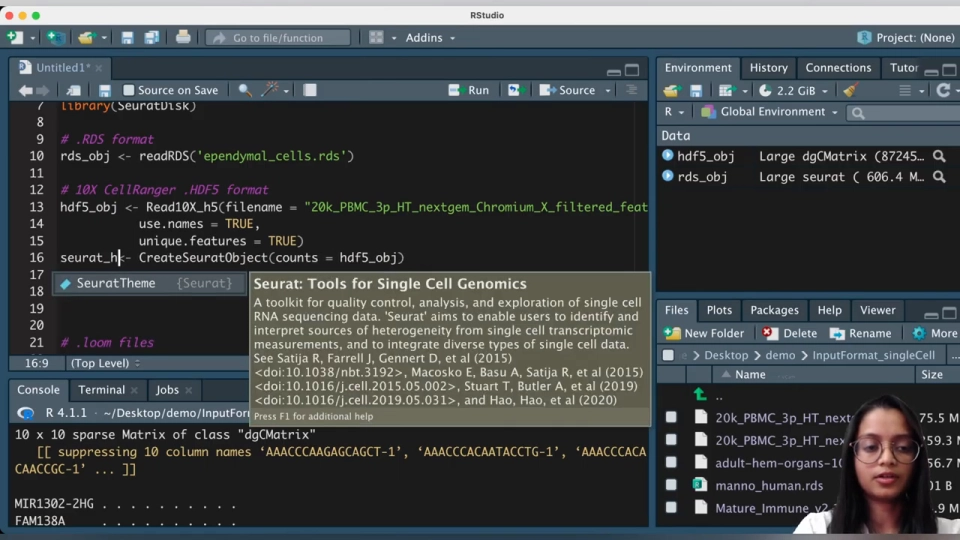

[【跳转到 07:20】](https://www.youtube.com/watch?v=3xcTpqQzUwQ&t=440)

控制台里写着 `10 x 10 sparse Matrix of class "dgCMatrix"`，下面跟着列名 `AAACCCAAGAGCAGCT-1`、`AAACCCACAATACCTG-1` 等等。这条信息很重要：**`.h5` 读进来并不是一张普通的数据框，而是一个稀疏矩阵对象**（`dgCMatrix`，即按列压缩的稀疏矩阵，见 2.3.2）。也就是说，磁盘上的压缩形态在内存里被还原成了对应的稀疏结构，而不是展开成稠密表。

环境面板里还写着这个对象的规模（`87245...`），以及后面几步转换出来的对象大小——同一个数据集，转成 Seurat 对象后是 1.3 GB 量级。**格式转换不是免费的：硬盘上的紧凑表示，读进内存后会膨胀。**

### 3.3 转成 Seurat 对象

同样用 `CreateSeuratObject`，把 `hdf5_obj` 传给 `counts`（下图）：

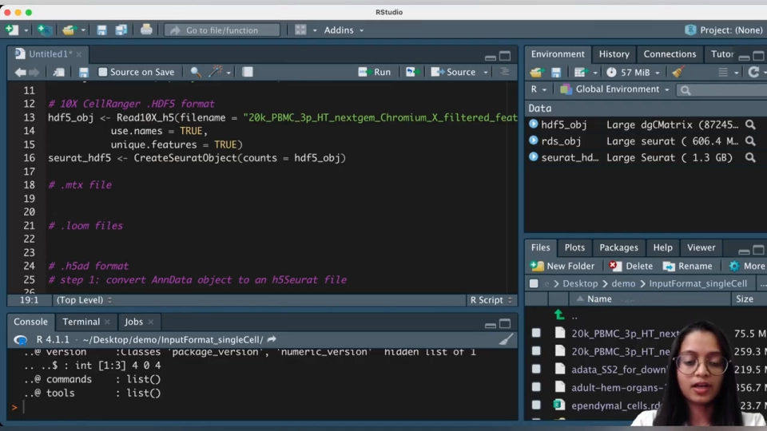

[【跳转到 08:10】](https://www.youtube.com/watch?v=3xcTpqQzUwQ&t=490)

到这里，`.h5` 这条路走完：**一个文件 → 一个稀疏矩阵 → 一个 Seurat 对象**。和 `.mtx` 那条路相比，少了「三个文件要对齐」的麻烦，代价是你没法用文本编辑器直接看一眼里面有什么。

## 四、.rds：R 自己的序列化格式

### 4.1 readRDS：一行读进来

`.rds` 是 R 的数据格式，读它用 `readRDS`：

```r
rds_obj <- readRDS("ependymal_cells.rds")
```

作者强调了一个容易踩的坑：**并不是只有 feature-barcode 矩阵才会被存成 rds**。有时候你从公开数据源下载数据，连已经处理完的、存在 Seurat 对象里的数据，也可能是存成一个 `.rds` 文件。

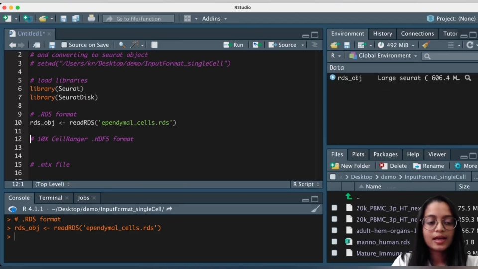

[【跳转到 04:06】](https://www.youtube.com/watch?v=3xcTpqQzUwQ&t=246)

### 4.2 先看清你拿到的是矩阵还是对象

读进来之后第一件事是确认类型。作者的做法是敲 `str` 加上对象名：

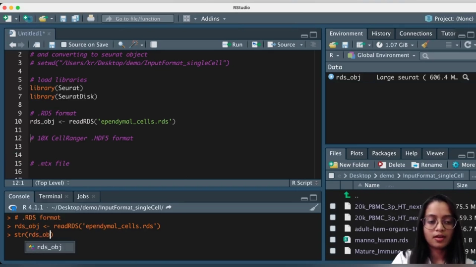

[【跳转到 04:31】](https://www.youtube.com/watch?v=3xcTpqQzUwQ&t=271)

结论是：**这不是 count matrix，而是一个完全处理过的 Seurat 对象**——往上滚到 `str` 输出的最上面，能看到它的类是 Seurat 包里的对象。

这一步对初学者特别重要：`.rds` 只是一个「R 对象的容器」，里面装什么完全取决于当初存的人。**拿到 `.rds` 不要假设它是原始计数**，先用 `str` 看一眼，否则后面把已经标准化过的数据当原始计数用，分析就全错了（原始计数与归一化的区别见 2.3.1）。

## 五、.loom：为大数据集设计的共享格式

### 5.1 为什么会有 loom

作者的解释是：和 Seurat 对象类似，还有别的格式被设计出来，**专门高效地装下大规模单细胞数据集**。而且这不是小众格式——**很多时候你从公开平台或数据仓库取单细胞数据，数据就是存成 `.loom` 格式的**。

如果你打算继续用 Seurat 做下游分析，就需要把 `.loom` 读进 Seurat 对象。读它用 `Connect`：

```r
loom_obj <- Connect(filename = "adult-hem-organs-10X-bone-marrow.loom", mode = 'r')
```

`mode = 'r'` 表示只读。读进来的是一个 **loom 对象**，作者特意说明：**它属于另一个类，和传统的 feature-barcode 矩阵或 Seurat 对象结构完全不同**（下图）。

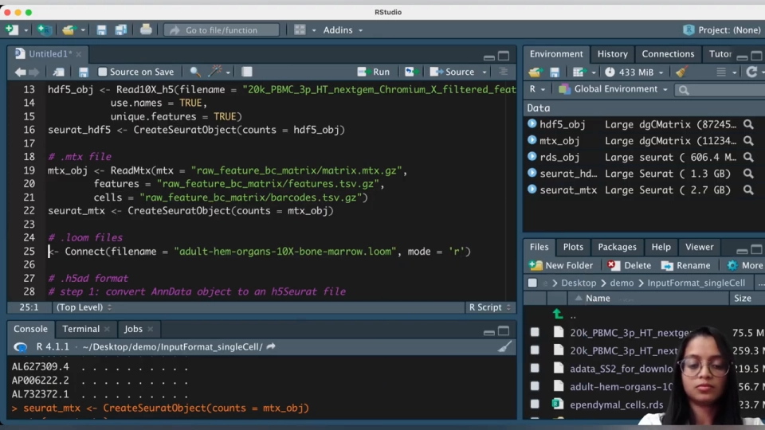

[【跳转到 12:35】](https://www.youtube.com/watch?v=3xcTpqQzUwQ&t=755)

### 5.2 as.Seurat：一行转换

从 loom 对象到 Seurat 对象，作者的写法极简：

```r
seurat_loom <- as.Seurat(loom_obj)
```

她顺带演示了一个真实的小插曲：**对象名拼错了，这一步要跑几分钟才结束**。转换本身是 `as.Seurat` 一行，但耗时和数据集大小直接相关——这也是判断「要不要为了省事而多转一道」的现实依据。

## 六、.h5ad：Python 生态的 AnnData 落盘

### 6.1 先认识 AnnData

最后一种格式是 `.h5ad`，也就是 AnnData 格式。作者交代了它的来历：**AnnData 是另一种用来存单细胞数据的格式，它是 scanpy 这个包使用的存储格式**——scanpy 是一个处理单细胞数据的 Python 包。

这句话点出了本节最重要的一条现实：**`.h5ad` 是 Python 生态的「存档格式」**。你在 Python 里用 scanpy 处理完的数据，落盘就是 `.h5ad`；而 R 这边要读它，就得跨生态。

### 6.2 两步走：先转 h5Seurat，再 LoadH5Seurat

作者把这个跨生态过程拆成两步。第一步，把 AnnData 对象转成 h5Seurat：

```r
Convert("adata_SS2_for_download.h5ad", dest = "h5Seurat", overwrite = TRUE)
```

这里有个细节值得学：**这一步不赋值给变量**，因为它不返回一个内存对象，而是**在硬盘上生成一个新文件**——同名、扩展名换成 `.h5Seurat`。作者跑完后专门回到终端确认（下图）：

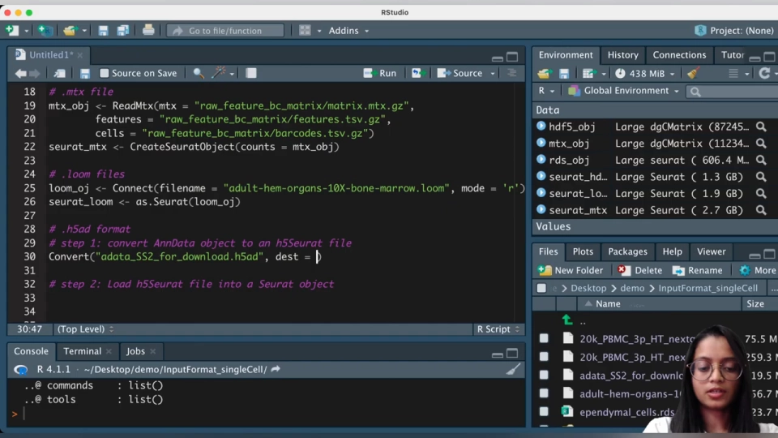

[【跳转到 14:40】](https://www.youtube.com/watch?v=3xcTpqQzUwQ&t=880)

第二步，用 SeuratDisk 包里的 `LoadH5Seurat` 把这个 `.h5Seurat` 文件读成 Seurat 对象：

```r
seurat_annData <- LoadH5Seurat("adata_SS2_for_download.h5Seurat")
```

作者确认：**它已经成功地从 AnnData 对象建出了 Seurat 对象**。

### 6.3 转换时控制台吐出的那几行，暴露了 h5ad 的内部层次

这一步最值得停下来的地方，是 `Convert` 在控制台里打印的内容（下图）：

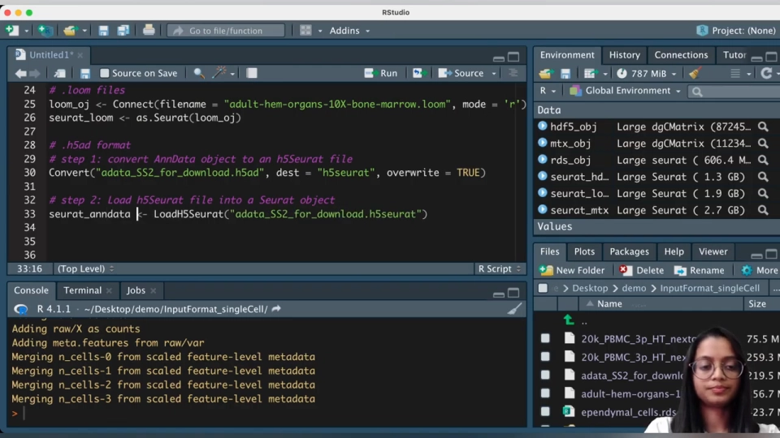

[【跳转到 15:56】](https://www.youtube.com/watch?v=3xcTpqQzUwQ&t=956)

```
Adding raw/X as counts
Adding meta.features from raw/var
Merging n_cells-0 from scaled feature-level metadata
Merging n_cells-1 from scaled feature-level metadata
Merging n_cells-2 from scaled feature-level metadata
Merging n_cells-3 from scaled feature-level metadata
```

这几行说明了两件事：

1. **`.h5ad` 内部不是一张平铺的表，而是分层的**。`raw/X` 是原始计数矩阵，`raw/var` 是基因层面的元数据，`n_cells` 是基因层面的统计量。转换器做的事情，就是把这些层一一对应到 Seurat 对象里该放的位置——`raw/X` 对应 `counts`，`raw/var` 对应 `meta.features`。
2. **`raw` 这个前缀有明确含义**：它装的是未经处理的原始计数，而对象里另外还有一份处理过的 `X`。所以 `.h5ad` 里可能同时存在「原始」和「处理后」两套数值，读的时候要清楚自己拿的是哪一套（两套数值的差别见 2.3.1）。

至于这些层在对象里的完整含义、以及 AnnData 与 Seurat 两套对象模型的逐项对照，属于 2.3.4 的内容，这里只需要记住：**`.h5ad` 是一个分层的二进制容器，层名本身就是元数据的一部分。**

## 七、五种格式怎么选

把整期视频的观察收拢成一张对照表：

| 格式 | 文件数 | 内容形态 | 读入函数 | 典型来源 | 主要代价 |
| :--- | :--- | :--- | :--- | :--- | :--- |
| `.mtx`（MEX） | 3 个（可压缩为 `.gz`） | 纯文本 | `ReadMtx` | Cell Ranger 的 `raw_feature_bc_matrix` 目录 | 三个文件必须对齐，文本解析慢 |
| `.h5` | 1 个 | 二进制容器 | `Read10X_h5` | Cell Ranger 的单文件输出 | 读入要一两分钟，不能直接文本查看 |
| `.rds` | 1 个 | R 序列化 | `readRDS` | R 生态分享 | 里面装什么不确定，需先 `str` 确认 |
| `.loom` | 1 个 | 二进制容器 | `Connect` + `as.Seurat` | 公共平台与数据仓库 | 对象结构自成一套，要额外转一次 |
| `.h5ad` | 1 个 | 二进制容器（分层） | `Convert` + `LoadH5Seurat` | scanpy / Python 生态 | 跨生态，必须两步走 |

三条实用判断：

1. **先看文件数**。看到三个同目录的 `matrix.mtx(.gz)`、`barcodes.tsv(.gz)`、`features.tsv(.gz)`，就是 MEX，三个路径一起喂给 `ReadMtx`；看到一个 `.h5` 或 `.h5ad` 或 `.loom`，就是单文件容器，用各自的函数。
2. **再确认拿到的是矩阵还是对象**。`.rds` 是最容易踩坑的：同一个扩展名，可能是原始计数矩阵，也可能是处理完的 Seurat 对象。用 `str` 看类型是成本最低的保险。
3. **跨生态转换要留出时间和磁盘**。`.h5ad` 那条路会先在硬盘上生成一个 `.h5Seurat` 中间文件，再读进内存；loom 的 `as.Seurat` 也要跑几分钟。环境面板里对象大小的变化（h5 那份数据转成 Seurat 对象后是 1.3 GB 量级，mtx 那份是 2.7 GB）提示：**转换会把内存占用抬上去**。

## 小结

- 单细胞数据在硬盘上有五种常见形态，装的都是同一张 feature-barcode 稀疏计数矩阵：行是基因、列是细胞、值是计数。
- 分类只有两条轴：**一个文件 vs 一组文件**（只有 MEX 是一组），**纯文本 vs 二进制容器**（`.h5`、`.h5ad`、`.loom` 都是容器）。
- `.mtx` 三件套分工明确：`matrix.mtx` 存数值与坐标，`features.tsv` 给行名，`barcodes.tsv` 给列名；三者缺一不可。
- `.h5` 是 Cell Ranger 的单文件输出，`Read10X_h5` 读进来是 `dgCMatrix`（稀疏矩阵），不是稠密表。
- `.rds` 只是 R 对象的容器，里面可能是原始矩阵，也可能是处理完的 Seurat 对象，先 `str` 再动手。
- `.loom` 常见于公共平台和数据库，`Connect` 读入后 `as.Seurat` 一步转换。
- `.h5ad` 是 scanpy 的存档格式，跨到 R 要两步：`Convert` 生成 `.h5Seurat`，再 `LoadH5Seurat`；`Convert` 的控制台输出（`raw/X`、`raw/var`、`n_cells`）直接暴露了 h5ad 的分层结构。
- 无论哪种格式，流程都在同一个地方汇合：**先得到计数矩阵，再用 `CreateSeuratObject` 建对象**。

## 关键术语速查

| 术语 | 一句话解释 |
| :--- | :--- |
| feature-barcode matrix | 行是基因、列是细胞条形码的计数矩阵，单细胞数据的「原件」 |
| 稀疏矩阵 | 绝大多数元素为零的矩阵，只存非零元素和位置（详见 2.3.2） |
| MEX（Market Exchange Format） | 用三个纯文本文件（matrix、features、barcodes）描述一张稀疏矩阵的格式 |
| `.h5` / HDF5 | 层次化二进制容器格式，Cell Ranger 的单文件输出就是它 |
| `.rds` | R 的对象序列化格式，可存矩阵也可存整个 Seurat 对象 |
| `.loom` | 为大规模单细胞数据集设计的二进制容器格式，公共平台常用 |
| `.h5ad` | AnnData 对象的磁盘格式，scanpy（Python）生态的标准存档 |
| h5Seurat | SeuratDisk 引入的中间格式，用来在 h5ad 与 Seurat 对象之间搭桥 |
| `dgCMatrix` | R 里按列压缩的稀疏矩阵类，`Read10X_h5` 与 `ReadMtx` 读出的默认类型 |
| `str()` | R 里查看对象结构的函数，用来确认读进来的到底是矩阵还是对象 |