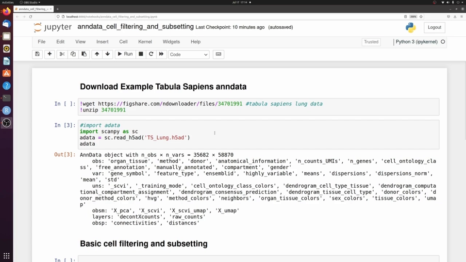
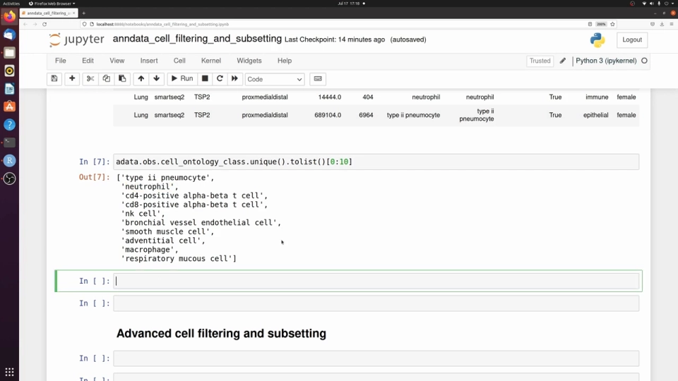
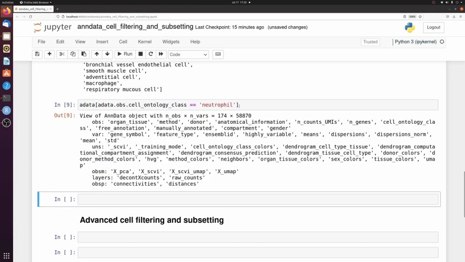
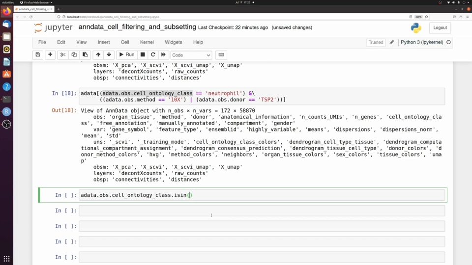
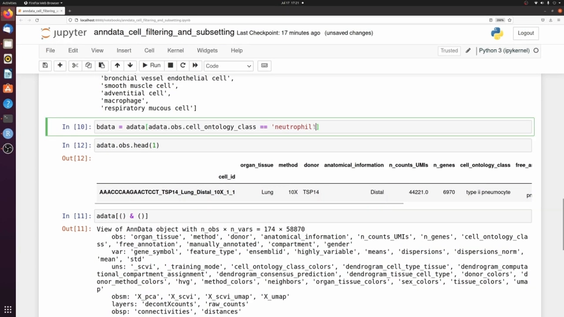
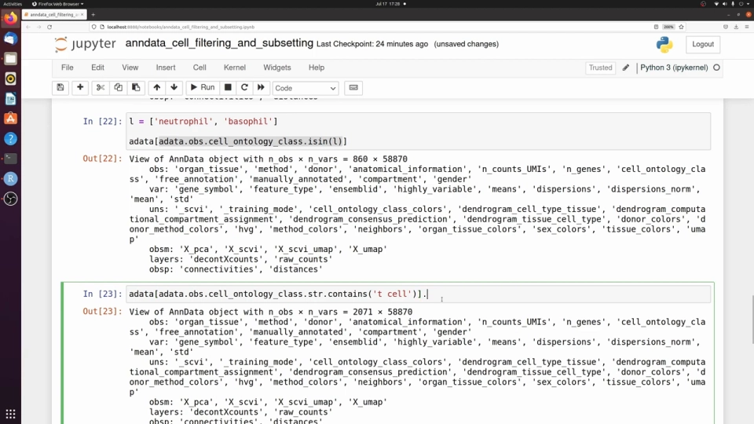
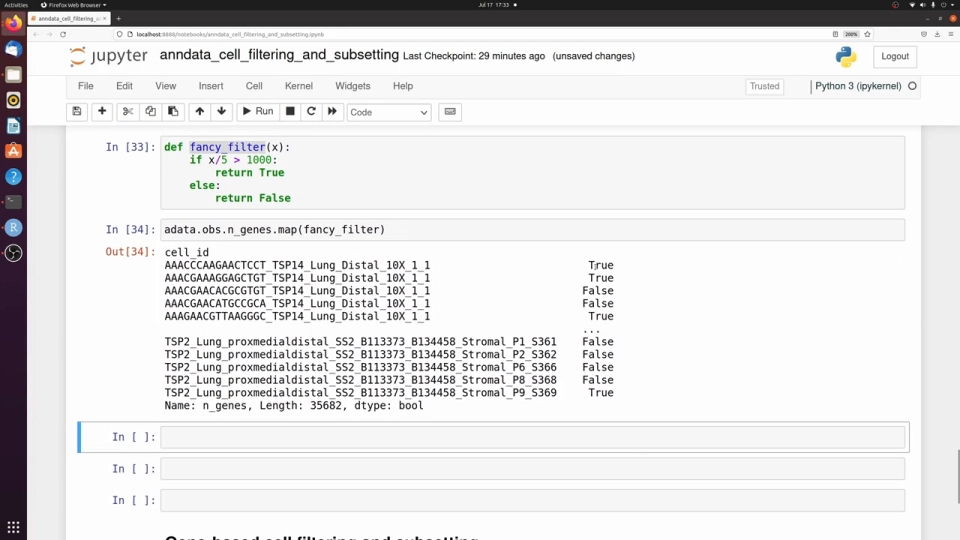
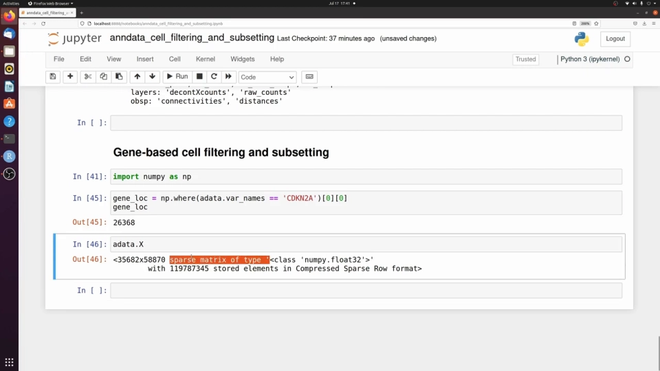

# AnnData 切片：用 obs 与 var 索引表达矩阵的行与列

> 视频来源：[Guide to filtering and subsetting single-cell anndata and pandas objects | basic and advanced | Sanbomics](https://www.youtube.com/watch?v=68ZUcr1rSCU)（YouTube · Sanbomics）｜时长约 12 分钟
> 简要导读：这支视频不讲算法，只讲一件事——**AnnData 对象怎么被"切"**。讲者用一份 35 682 个细胞 × 58 870 个基因的 Tabula Sapiens 肺数据集，把 `obs`、`var`、`X` 三个槽位的关系，用十几种布尔索引写法演示了一遍。字幕由自动识别生成，本文已按上下文订正术语（如 `andata`→AnnData、`a data`→`adata`、`tabulo sapiens`→Tabula Sapiens）。

## 本讲要解决的核心问题（SCQA）

**背景**：单细胞分析里几乎所有操作最终都落到同一个动作上——"把不属于我的细胞去掉、把不关心的基因去掉"。Scanpy 之所以好用，是因为它建在 pandas 之上，`adata.obs` 就是一个普通的 pandas DataFrame。

**冲突**：可是 AnnData 不是一个 DataFrame。表达矩阵 `X` 里只有数字，没有行名也没有列名；行和列的含义完全靠 `obs` 和 `var` 两个 DataFrame 提供。一旦你按 pandas 的习惯去切它，就会遇到两种困惑：切出来的到底是"视图"还是"副本"？我改了下游对象，原对象会不会跟着变？

**疑问**：那么，AnnData 的切片规则到底是什么？哪些写法是合法的布尔掩码，哪些会悄悄返回一个 View？

**回答（中心思想）**：AnnData 的切片语言只有一种——**布尔掩码（或整数下标）**，它同时作用在 `X`、`obs`、`var`、`obsm`、`layers` 等所有槽位上，保证维度永远对齐；而默认的 `adata[mask]` 返回的是**视图**，想留下结果必须 `.copy()`。

## 一、先认清对象：X 是中心，obs 与 var 给行列"上名字"

讲者载入数据后打印的第一样东西，就是 AnnData 对象自身的摘要。这一屏几乎是本节最重要的图：



从这张摘要里可以读出四件事（[【跳转到 00:14】](https://www.youtube.com/watch?v=68ZUcr1rSCU&t=14)）：

- **`n_obs` × `n_vars` = 35682 × 58870**：这是 `X` 的形状，35 682 个细胞、58 870 个基因。注意 Scanpy 的约定是**行=细胞（observation）、列=基因（variable）**，和 Seurat 的"行=基因、列=细胞"正好相反，这是跨工具迁移时最容易翻车的地方。
- **`obs`**：每个细胞一行的 DataFrame，这里是 `organ_tissue`、`method`、`donor`、`n_counts_UMIs`、`n_genes`、`cell_ontology_class` 等列。
- **`var`**：每个基因一行的 DataFrame，这里是 `gene_symbol`、`feature_type`、`ensemblid`、`highly_variable`、`means`、`dispersions` 等列。
- **`obsm` / `layers` / `obsp`**：降维坐标（`X_pca`、`X_umap`）、额外的表达矩阵版本（`counts`、`decountXcounts`）、细胞间关系（`connectivities`、`distances`）。它们都是"挂在同一个对象上的、形状必须与 `X` 对齐的附件"。

一句话概括对象模型：**`X` 是那摞数字，`obs` 和 `var` 是贴在行、列两侧的标签**。所以 `adata.obs` 可以直接当 DataFrame 用（`adata.obs.head()` 就能看到每个细胞的条形码和注释），而 `adata.X` 只能靠位置索引。

`obs` 里最有用的通常是注释列。讲者用下面这一行列出了数据集里的细胞类型（去重后取前十）：

```python
adata.obs.cell_ontology_class.unique().tolist()[:10]
```

结果包括type ii pneumocyte、neutrophil、CD4-positive alpha-beta T cell、nk cell、bronchial vessel endothelial cell……（[【跳转到 01:04】](https://www.youtube.com/watch?v=68ZUcr1rSCU&t=64)）



## 二、切片语言：布尔掩码，一次作用在所有槽位

### 2.1 单列条件：`adata[adata.obs.列名 == 值]`

最基础的写法分两步，讲者特意拆开演示：

1. 先算出一个布尔序列，**长度等于细胞数（35 682）**：

```python
adata.obs.cell_ontology_class == 'neutrophil'
```

2. 再把这个序列塞回 `adata[...]`，只保留 True 的行。

结果是 174 个中性粒细胞（[【跳转到 01:48】](https://www.youtube.com/watch?v=68ZUcr1rSCU&t=108)）。关键细节有两个：

- **`n_obs` 从 35 682 变成 174，而 `n_vars` 仍是 58 870**——切片只动了行。同时 `obs`、`obsm`、`layers`、`obsp` 里的每一张表都跟着缩到 174 行，这正是"行列对齐"的体现。
- 输出类型是 **`View of AnnData object`**（视图），不是新对象。所以讲者紧接着说："it's not in place（它不是原地修改）"——原对象 `adata` 一点没变，要保存结果得另起一个变量，例如 `bdata = adata[...]`。



### 2.2 多条件：括号 + `&` / `|`

要按两列筛选，必须**给每个条件加括号**，再用 `&`（且）或 `|`（或）连接：

```python
adata[(adata.obs.cell_ontology_class == 'neutrophil') & (adata.obs.method == '10X')]
```

讲者在这里踩了一个真实的坑并当场纠正：把 `10X` 写成小写 `10x`，结果返回 0 个细胞——**字符串匹配区分大小写**。改回大写后剩下 138 个细胞（[【跳转到 02:50】](https://www.youtube.com/watch?v=68ZUcr1rSCU&t=170)）。再往上叠一层 `&` 与 `|` 的嵌套，就得到 172 个细胞；`donor == 'TSP14'` 与 `donor == 'TSP2'` 的差别说明这种组合筛选确实在改变结果集。



顺带一提，`obs` 的列名就是筛选时可用的"字段"。讲者用 `adata.obs.head()` 把前几个细胞的所有列摊开，可以看到 `cell_id`、`organ_tissue`、`method`、`donor`、`n_counts_UMIs`、`n_genes`、`cell_ontology_class` 等——每一个都可以拿来当掩码条件。



### 2.3 集合与字符串：`isin` 与 `str.contains`

两个更好用的替代写法（[【跳转到 04:55】](https://www.youtube.com/watch?v=68ZUcr1rSCU&t=295)）：

- **`isin`**：一次匹配多个取值，等价于"或"的列表版，得到 860 个细胞。
- **`str.contains`**：按子串匹配，得到 2 071 个细胞。

```python
adata.obs.cell_ontology_class.isin(['neutrophil', 'basophil'])
adata.obs.cell_ontology_class.str.contains('t cell')
```
但它会顺带命中 `goblet cell` 这类"名字里含 t cell 字样"的类型，所以要再用 `!=` 排掉，或者用 `~` 取反。



### 2.4 取反：`~mask`

`~` 是布尔取反，语义是"保留所有 False 的行"（[【跳转到 06:35】](https://www.youtube.com/watch?v=68ZUcr1rSCU&t=395)）。讲者用 `~` 把 860 个细胞变成 34 000 多个——正好是"除中性粒和嗜碱粒之外的几乎所有细胞"（[【跳转到 06:10】](https://www.youtube.com/watch?v=68ZUcr1rSCU&t=370)）。这个运算符对上面任何一种掩码都适用。

## 三、把筛选逻辑写成函数：`map` 与 `apply`

条件一多，一行表达式就写不下了。讲者的做法是**先写一个返回 True/False 的函数，再把它映射到某一列上**（[【跳转到 07:00】](https://www.youtube.com/watch?v=68ZUcr1rSCU&t=420)）：

```python
def fancy_filter(x):
    if x / 5 > 1000:
        return True
    else:
        return False

adata.obs.n_genes.map(fancy_filter)   # 返回布尔 Series，再喂给 adata[...]
```

单列用 `map`；需要**同时看多列**时改用 `apply`，先取出三列子表，再逐行套用函数（`axis=1` 表示按行）（[【跳转到 09:05】](https://www.youtube.com/watch?v=68ZUcr1rSCU&t=545)）。讲者用这个"玩具规则"筛出 32 个细胞。



这条路径的意义不在于函数本身，而在于**筛选逻辑与对象结构解耦**：只要你的函数最终吐出等长布尔序列，`adata[...]` 就能接受它。

## 四、按基因切列：`var_names` + `np.where` + 稀疏 `X`

前面的切片都在动行（细胞）。要动列（基因），AnnData 没有 `adata.obs` 那样的便利入口，必须直接碰 `X`（[【跳转到 10:20】](https://www.youtube.com/watch?v=68ZUcr1rSCU&t=620)）：

1. **`var_names`** 是所有基因名的列表（等价于 `var` 的索引）；
2. 用 `np.where` 定位基因名，得到该基因的列号（这里返回 26368）；
3. 用二维切片取出这一列——注意是**逗号在前、列在后**，因为 `X` 是"行=细胞、列=基因"；

```python
gene_loc = np.where(adata.var_names == 'CDKN2A')[0][0]
values = adata.X[:, gene_loc]
```

4. 结果是一个**稀疏矩阵列**（`<35682x58870 sparse matrix of type float32 with 11978734 stored elements in Compressed Sparse Row format>`），要转成普通数组得先 `.toarray()`；
5. 拿到数值数组后，`values > 0` 又是一个布尔序列，可以再喂回 `adata[...]`，得到 1 500 个表达该基因的细胞。



这一步把整节串起来了：**`X` 是纯数字的稀疏矩阵，`var_names` 提供列语义，两者配合才能"按基因名取一列"**；而这个布尔序列最后又回到第二节的切片语法。

## 小结

- **对象模型**：`X` 装数字，`obs` 装细胞级元数据（行），`var` 装基因级元数据（列）；`obsm`、`layers`、`obsp` 是必须与 `X` 对齐的附件。
- **方向**：Scanpy 是"行=细胞、列=基因"，与 Seurat 相反，跨工具搬运时先确认方向。
- **切片只认布尔序列**：单列比较、`isin`、`str.contains`、`~` 取反、自定义函数 + `map`/`apply`，产出的都是等长布尔序列，可以直接塞进 `adata[...]`。
- **默认返回视图**：`adata[mask]` 是 View，原对象不变；要保留结果就 `.copy()` 或赋给新变量。
- **对齐是自动的**：切行时 `obs`、`obsm`、`layers`、`obsp` 同步收缩，不需要你手动同步。
- **按基因取列要手动**：`var_names` → `np.where` → `adata.X[:, i]`，并注意稀疏矩阵要 `.toarray()`。

## 关键术语速查

| 术语 | 一句话解释 |
| --- | --- |
| AnnData | Python 单细胞生态（Scanpy）的核心容器，把表达矩阵和两侧元数据绑成一个对象 |
| `X` | 表达矩阵本体，行=细胞、列=基因，通常是稀疏矩阵 |
| `obs` | 细胞级元数据 DataFrame，行数与 `X` 的行数严格相等 |
| `var` | 基因级元数据 DataFrame，行数与 `X` 的列数严格相等 |
| `obsm` | 细胞级的多维数组，如 UMAP/PCA 坐标，行数必须等于细胞数 |
| `layers` | 与 `X` 同形状的额外矩阵，如原始 counts、去卷积结果 |
| 布尔掩码 | 与某一维度等长的 True/False 序列，是 AnnData 唯一的切片条件 |
| View（视图） | 切片返回的轻量引用，不复制数据；修改它不会改原对象，要落地必须 `.copy()` |
| `var_names` | 基因名索引，用于把基因名换算成列号 |
| CSR | 压缩稀疏行格式，`adata.X` 最常见的存储形式 |