# Seurat v5 对象结构：assays 的三层矩阵与 reductions、graphs 槽位

> 视频来源：[Seurat v5: structure and main workflow easily explained!](https://www.youtube.com/watch?v=FgPPXLxZAwM)（YouTube · Biostatsquid）｜时长约 32 分钟
> 简要导读：讲者先用约 10 分钟把 Seurat v5 对象的每个槽位讲清楚，再用 PBMC3k 数据集跑一遍标准流程，演示"每一步的结果分别写进哪个槽位"。本文按"对象结构 → 槽位 → 流程落点"的顺序重组她的讲解，算法细节（PCA、聚类、注释）只讲到"结果存在哪里"为止。字幕为自动识别，本文已订正 ASR 术语（`SRA/Surah/Sora`→Seurat、`atex seek`→ATAC-seq、`SC transform`→SCTransform、`Luven`→Louvain、`TSN`→t-SNE 等）。

## 本讲要解决的核心问题（SCQA）

**背景**：单细胞分析跑完一遍，你会得到一堆东西：原始 counts、归一化后的表达、scale 过的表达、PCA 坐标、UMAP 坐标、最近邻图、聚类标签、细胞注释。它们形状不同、含义不同，却必须始终对应同一批细胞。

**冲突**：如果把这些东西随便存成十几个变量，很快就会对不上号——换了细胞顺序、删了几个细胞，矩阵和标签就错位了。而且 counts 与归一化后的 data 长得几乎一样，混用会直接毁掉下游分析。

**疑问**：Seurat 用什么办法把"同一批细胞的多种矩阵"和"各种派生结果"锁在一个对象里？每一步分析的结果，究竟落在哪个槽位？

**回答（中心思想）**：Seurat 对象是一个**分槽位的抽屉**：`assays` 装表达矩阵（同一个 assay 下用 `counts` / `data` / `scale.data` 三层装同一批基因的不同变换版本），`meta.data` 装细胞级注释，`reductions` 装降维坐标，`graphs` 装细胞间邻接图，`commands` 记录操作历史，`misc` 收留其它结果。**每个分析函数只往固定的槽位写**，因此对象本身就是一份自解释的分析记录。

## 一、抽屉模型：七个槽位各管一类数据

讲者给的第一张结构图，就是 Seurat 对象的槽位清单（[【跳转到 07:04】](https://www.youtube.com/watch?v=FgPPXLxZAwM&t=424)）：

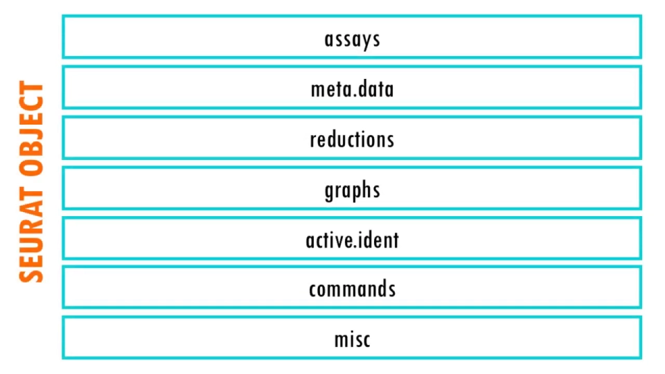

在讲槽位之前，她先回到最朴素的问题：单细胞数据本质上是什么？（[【跳转到 00:55】](https://www.youtube.com/watch?v=FgPPXLxZAwM&t=55)）

- **一张计数表**：行是基因、列是细胞；
- **两套注释**：关于细胞的注释、关于基因的注释；
- **更复杂的结果**：PCA / UMAP / t-SNE 这类降维坐标，以及细胞之间的邻居关系；
- **同一张表的多个版本**：原始 counts、归一化 counts、scale 后的 counts。

Seurat 对象的七个槽位，正好一一对应这四类东西：

| 槽位 | 装什么 | 维度约定 |
| --- | --- | --- |
| `assays` | 一个或多个 assay（RNA、ADT、SCT…），每个 assay 下有多层矩阵 | 行=基因、列=细胞 |
| `meta.data` | 细胞级注释表（DataFrame） | 行=细胞 |
| `reductions` | 降维结果（PCA、UMAP、t-SNE…），含坐标与载荷 | 行=细胞 |
| `graphs` | 细胞间邻接图（KNN、SNN） | 细胞 × 细胞 |
| `active.ident` | 当前"身份"列，决定按什么分组做差异分析 | 行=细胞 |
| `commands` | 生成/修改对象时调用过的函数记录 | — |
| `misc` | 放不进上面任何槽位的自定义结果 | — |

## 二、assays：同一批基因的三种"版本"叠在一起

### 2.1 为什么需要三层

这是整支视频最核心的一张图（[【跳转到 01:56】](https://www.youtube.com/watch?v=FgPPXLxZAwM&t=116)）：

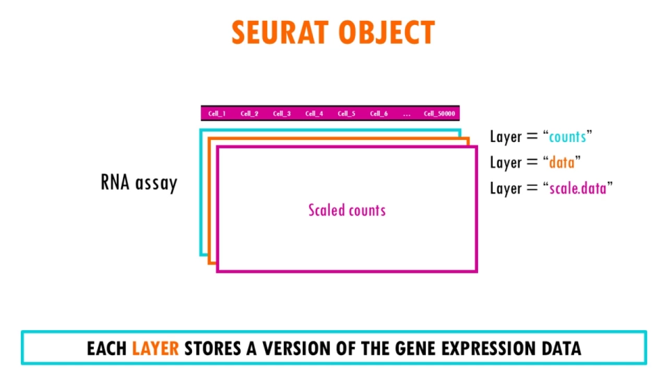

三层各是什么：

- **`counts`**：原始计数，整数，测序仪直接给出的东西；
- **`data`**：归一化后的表达（通常是 log 归一化），用于跨细胞比较；
- **`scale.data`**：按基因中心化、缩放过（均值 0、标准差 1），用于降维和聚类。

为什么要分三层而不是覆盖同一张表？因为**下游步骤需要不同版本**：差异表达要 counts，可视化要 data，PCA 要 scale.data。如果只有一张表，你每做一步就得覆盖一次，回头再想用原始值就没了。

### 2.2 counts 与 data 的差别：测序深度

讲者用两细胞三基因的玩具例子解释归一化的必要性（[【跳转到 03:31】](https://www.youtube.com/watch?v=FgPPXLxZAwM&t=211)）：细胞 2 的 B 基因读数看起来是细胞 1 的 100 倍，但细胞 2 的总读数本来就多得多。归一化（log2 归一化）把总测序深度拉平之后，两个细胞的 B 基因表达其实一样。

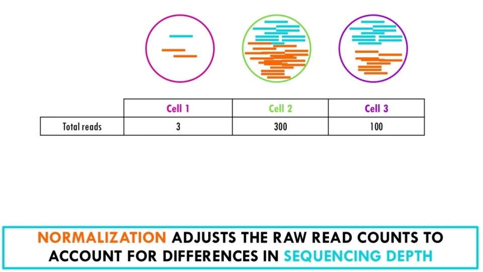

同样的道理在真实数据里可以直接看到。载入 PBMC3k 后，讲者打印了 `counts` 和 `data` 两层的前几行（[【跳转到 10:57】](https://www.youtube.com/watch?v=FgPPXLxZAwM&t=657)）：

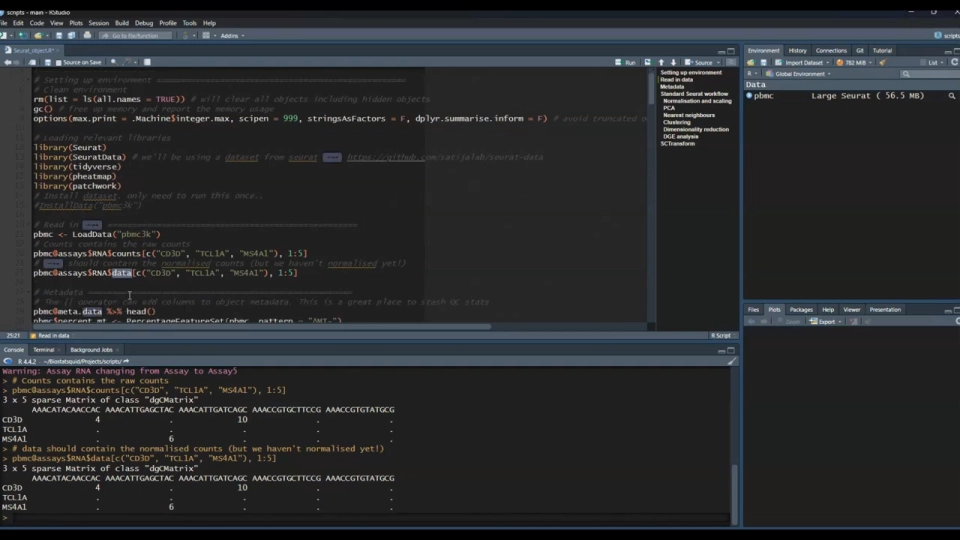

这里有个非常实用的观察：**新建对象时 `counts` 和 `data` 的数值是一模一样的**。讲者的解释是：Seurat 的很多函数默认从 `data` 层取数，所以初始化时先把 counts 复制一份到 data，保证这些函数不至于拿到空矩阵。**一旦跑了归一化，`data` 层才会被真正的归一化值替换**。这也意味着：如果你看到 `data` 层是整数，说明归一化根本没跑。

### 2.3 scale.data：为什么只有部分基因

缩放的做法是：对每个基因，减去它在所有细胞上的均值、再除以标准差，得到均值 0、标准差 1 的分布。这样每个基因在下游分析里"话语权"相同，不会被高表达基因压过去（[【跳转到 04:33】](https://www.youtube.com/watch?v=FgPPXLxZAwM&t=273)）。

但 `scale.data` 有个默认行为容易让人困惑：**它只缩放高变基因（HVG），不是全部基因**。讲者在真实数据里当场撞上了这个现象——查 `CD8A` 时发现它在 `scale.data` 里根本不存在，因为它不是高变基因（[【跳转到 15:37】](https://www.youtube.com/watch?v=FgPPXLxZAwM&t=937)）。想缩放全部基因，得显式传 `features = all`；但她建议保持默认，理由是全量缩放既慢，又会给 PCA 之类的下游步骤引入噪声。

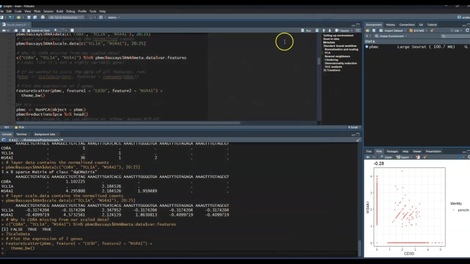

### 2.4 SCTransform：换一套归一化，就多一个 assay

SCTransform 是另一种归一化路线：用正则化负二项回归建模，同时处理技术噪声和生物学变异。它对对象结构的影响是**新增一个 assay**（[【跳转到 06:29】](https://www.youtube.com/watch?v=FgPPXLxZAwM&t=389)）：

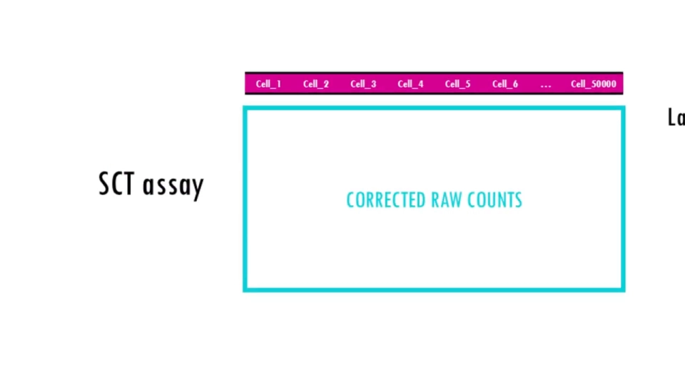

SCT assay 的三层含义与 RNA assay 不同：

- `counts`：校正/变换后的 counts；
- `data`：这些校正 counts 的 log 归一化版本；
- `scale.data`：**Pearson 残差**。

两个必须记住的后果：

1. **SCTransform 一条命令就替代了"归一化 + scale + 找高变基因"三步**，不需要再单独跑那三个函数；
2. **跑完 SCT 后它成为默认 assay**，之后所有函数默认从 SCT 取数。想用回 log 归一化的 RNA 数据，必须显式写 `assay = "RNA"`。跑完 SCT 后对象里就有两个 assay（RNA 与 SCT），各自带着自己的三层。

## 三、meta.data 与基因元数据：注释挂在哪里

### 3.1 meta.data：细胞级注释表

`meta.data` 就是一个 DataFrame：每行一个细胞 ID，每列一种注释——细胞类型、线粒体基因占比、是否处理组（[【跳转到 07:04】](https://www.youtube.com/watch?v=FgPPXLxZAwM&t=424)）。它的用途是"按某种特征取子集""剔除某类细胞""在细胞类型之间做差异表达"。

在 PBMC3k 里，默认就有几列：`nCount_RNA`（该细胞的总读数）、`nFeature_RNA`（该细胞检测到的基因数），以及 `seurat_annotations`（这个经典数据集自带的细胞类型注释）。讲者强调：**自己的数据不会有 `seurat_annotations` 这一列，注释得自己做**。

她还演示了往 `meta.data` 里加列的标准做法：加线粒体占比 `percent.mt` 和核糖体占比 `percent.ribo`——这两个是质控指标，反映细胞活性和技术噪声（[【跳转到 11:38】](https://www.youtube.com/watch?v=FgPPXLxZAwM&t=698)）。

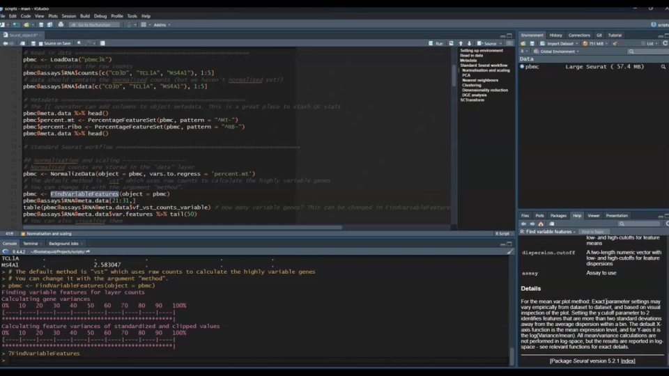

### 3.2 基因元数据：藏在 assay 里

细胞注释在 `meta.data`，但**基因注释不在 `meta.data`，而在 assay 内部**。讲者的说法很干脆："任何与基因或 counts 有关的东西都在 assays 槽位里。"跑完 `FindVariableFeatures` 之后，高变基因信息就写进基因元数据表：每个基因一行，含均值、方差、是否高变（True/False）、排名等列（[【跳转到 14:14】](https://www.youtube.com/watch?v=FgPPXLxZAwM&t=854)）。

默认返回前 2 000 个高变基因，数量可在函数里改；`VariableFeaturePlot` 可以把它们画出来。

## 四、reductions 与 graphs：降维坐标和细胞间关系

### 4.1 reductions：每个降维结果一个子槽位

PCA、UMAP、t-SNE 的结果都进 `reductions`，每个算法一个子槽位（`pca`、`umap`、`tsne`）。每个 reduction 内部再分两块：**细胞嵌入（cell embeddings）**存每个细胞的坐标，**载荷（loadings / feature loadings）**存基因在主轴上的权重（[【跳转到 17:17】](https://www.youtube.com/watch?v=FgPPXLxZAwM&t=1037)）。

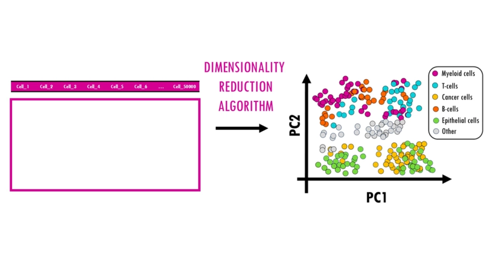

一个容易忽略的细节：**PCA 是在 `scale.data` 上跑的**，所以 scale 那一步的基因选择会一路影响到 PCA 结果。

### 4.2 graphs：KNN 与 SNN 两张图

`FindNeighbors` 把细胞按表达谱的相似度连成图，存进 `graphs` 槽位。讲者展示了两张图（[【跳转到 19:23】](https://www.youtube.com/watch?v=FgPPXLxZAwM&t=1163)）：

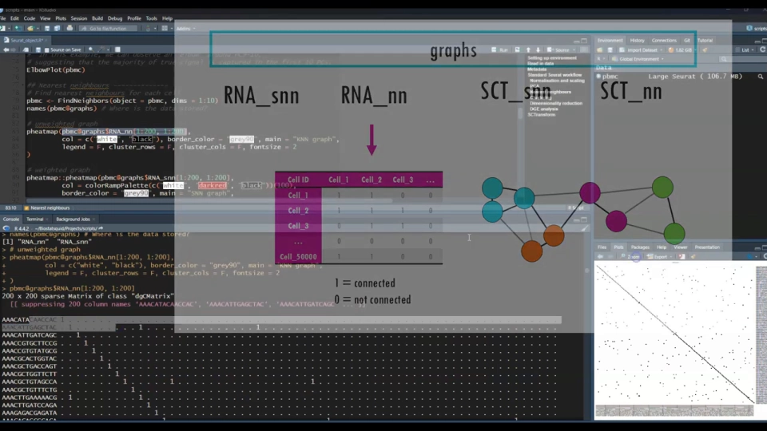

- **`RNA_nn`（KNN 图）**：细胞之间只有"连/不连"，邻接矩阵里是 0 和 1，属于**无权图**，也是 Seurat 的默认；
- **`RNA_snn`（共享最近邻图）**：连边按"共享了多少个邻居"加权，矩阵里是 0 到 1 之间的连续值，属于**加权图**。

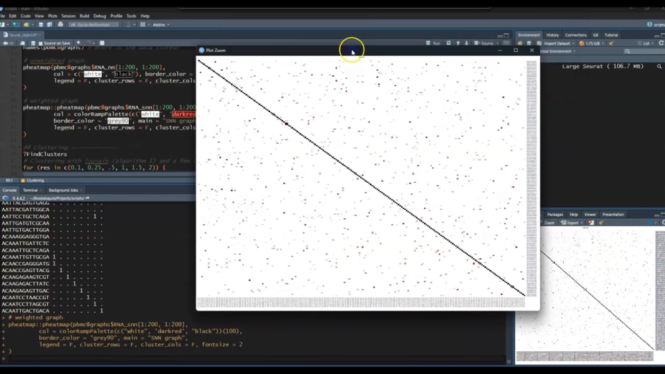

两者都可用于聚类，但**大数据集（十万细胞以上）用无权图聚类更快**。

## 五、commands、misc 与 active.ident

- **`commands`**：记录生成和修改这个对象时调用过的函数，相当于一份操作日志，用于复现。讲者的评价是"一般情况下你并不需要它"。
- **`misc`**：miscellaneous，收留放不进其它槽位的任意内容，比如额外的分析结果或自定义注释。
- **`active.ident`**：当前"身份"列。做差异分析前要先 `Idents()` 指定按哪一列分组——比如按 `seurat_annotations` 比较 B 细胞与 T 细胞，或按聚类结果比较各个 cluster（[【跳转到 26:01】](https://www.youtube.com/watch?v=FgPPXLxZAwM&t=1561)）。

## 六、跑一遍流程：每一步的结果落在哪个槽位

讲者用 PBMC3k 走了一遍标准流程。把她的演示按"函数 → 写入槽位"整理出来，对象结构就彻底清楚了：

| 步骤 | 函数 | 结果写到哪里 |
| --- | --- | --- |
| 载入数据 | `Load10X` / `CreateSeuratObject` | `assays$RNA$counts`（同时复制一份到 `data`） |
| 质控指标 | `PercentageFeatureSet` | `meta.data` 新增列 |
| 归一化 | `NormalizeData` | `assays$RNA$data` |
| 找高变基因 | `FindVariableFeatures` | assay 内的基因元数据 |
| 缩放 | `ScaleData` | `assays$RNA$scale.data` |
| 降维 | `RunPCA` | `reductions$pca`（坐标在 cell embeddings，载荷在 feature loadings） |
| 建图 | `FindNeighbors` | graphs 槽位新增 `RNA_nn`、`RNA_snn` 两张图 |
| 聚类 | `FindClusters` | `meta.data` 新增以 `RNA_snn_res` 开头的若干列 |
| 二维可视化 | `RunUMAP` / `RunTSNE` | `reductions$umap`、`reductions$tsne` |
| 找标记基因 | `FindAllMarkers` / `FindMarkers` | 返回独立 DataFrame（不写回对象） |
| 归一化换路线 | `SCTransform` | 新增 `assays$SCT`，并成为默认 assay |

有两个落点特别值得记住。

**第一，聚类结果不是单独的对象，而是 `meta.data` 里的一列。** 讲者跑 `FindClusters` 时一次试了 `resolution = c(0.1, 0.25, 0.5, 1, 1.5, 2)`，于是 `meta.data` 里多出 `RNA_snn_res.0.1`、`RNA_snn_res.0.25`……一整排列，每列一套划分（[【跳转到 21:22】](https://www.youtube.com/watch?v=FgPPXLxZAwM&t=1282)）。分辨率越高，簇越多；挑哪个分辨率取决于你想分到多细——要区分髓系、T、B 这种大类，0.1 就够；要区分 CD14⁺ 与 FCGR3A⁺ 单核，就得往上调。

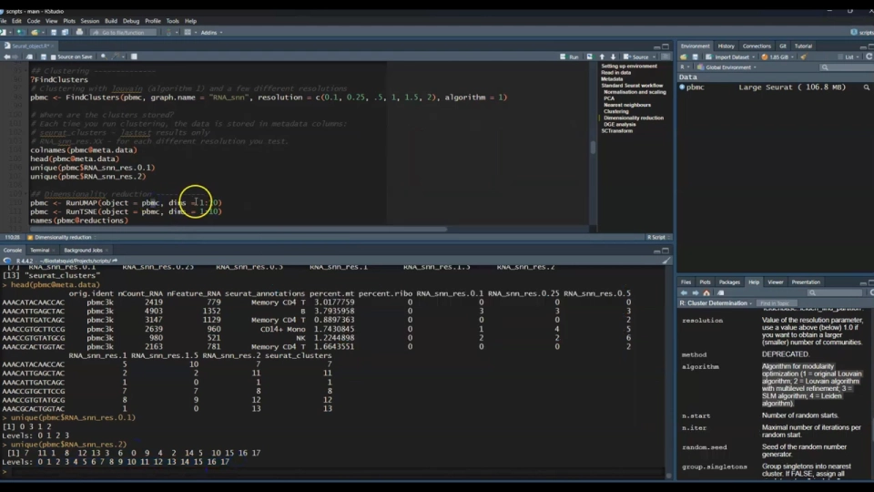

**第二，UMAP 只是 `reductions` 里的另一套坐标。** 换个 `group.by` 就能按不同列上色，同一批坐标反复复用（[【跳转到 23:02】](https://www.youtube.com/watch?v=FgPPXLxZAwM&t=1382)）：

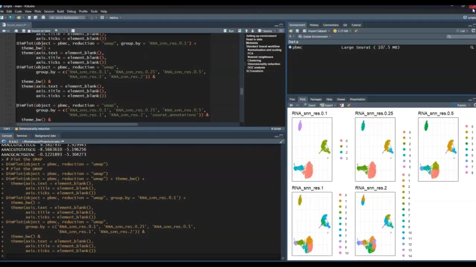

## 七、和 AnnData 的对应关系（编者对照，非视频内容）

同一套对象模型在 Python 生态（AnnData/Scanpy）里有近乎一一对应的槽位，跨语言搬运数据时按这张表核对即可：

| Seurat | AnnData | 说明 |
| --- | --- | --- |
| `assays$RNA$counts` | `layers["counts"]`（或 `X`） | 原始计数 |
| `assays$RNA$data` | `X`（归一化后） | 归一化表达 |
| `assays$RNA$scale.data` | `layers["scaled"]` 或 `obsm` 前的中间态 | 缩放表达，通常只含高变基因 |
| 多个 assay（RNA / SCT / ADT） | 多个 `AnnData` 对象，或 `obsm` 中的模态矩阵 | Seurat 用 assay 分模态，AnnData 常拆成多个对象 |
| `meta.data` | `obs` | 细胞级注释 |
| assay 内基因元数据 | `var` | 基因级注释 |
| reductions 里 pca 的坐标 | `X_pca`（obsm 槽位） | 细胞嵌入 |
| `reductions$pca` 的载荷 | `varm["PCs"]` | 基因载荷 |
| graphs 里的 `RNA_snn` | `connectivities`（obsp 槽位） | 细胞间图 |
| `misc` | `uns` | 杂项与配色等 |

**方向相反**是两者最大的差别：Seurat 的矩阵是"基因 × 细胞"，AnnData 是"细胞 × 基因"。互转工具（SeuratDisk、zellkonverter、sceasy）会自动转置，但如果你手动导出 CSV 再读进来，方向错了不会报错，只会得到一个形状看起来"也能跑"的错误对象。

## 小结

- **一个对象 = 一个抽屉**：`assays`、`meta.data`、`reductions`、`graphs`、`active.ident`、`commands`、`misc` 七个槽位，各管一类数据。
- **assay 是"同一批基因的多个版本"**：`counts`（原始）、`data`（归一化）、`scale.data`（缩放，默认只含 HVG）。新建对象时 counts 与 data 相同，归一化后才分家。
- **换归一化路线 = 多一个 assay**：SCTransform 生成 SCT assay，并成为默认 assay；要用回 RNA 必须显式指定。
- **注释分两处**：细胞注释在 `meta.data`，基因注释在 assay 内部。
- **派生结果有固定落点**：降维进 `reductions`（坐标 + 载荷），建图进 `graphs`（KNN 无权、SNN 加权），聚类进 `meta.data` 的新列。
- **与 AnnData 对照**：槽位几乎一一对应，但矩阵方向相反（Seurat 基因×细胞，AnnData 细胞×基因）。

## 关键术语速查

| 术语 | 一句话解释 |
| --- | --- |
| Seurat 对象 | R 语言单细胞分析的核心容器（S4 对象），按槽位组织表达矩阵与所有派生结果 |
| assay | 一组同源表达数据（如 RNA、SCT、ADT），内部含多层矩阵 |
| `counts` | 原始计数层，整数 |
| `data` | 归一化表达层，跨细胞可比 |
| `scale.data` | 按基因中心化缩放后的层，默认只含高变基因 |
| `meta.data` | 细胞级注释 DataFrame，每行一个细胞 |
| HVG | 高变基因，跨细胞变异最大的基因，用于降维与缩放 |
| SCTransform | 基于正则化负二项回归的归一化方法，会新建 SCT assay |
| reduction | 一次降维的结果，含细胞坐标（embeddings）与基因载荷（loadings） |
| KNN / SNN 图 | 最近邻图（0/1 无权）与共享最近邻图（加权），存在 `graphs` 槽位 |
| `active.ident` | 当前分组身份列，决定差异分析按什么分组 |
| `commands` | 对象操作日志，用于复现 |