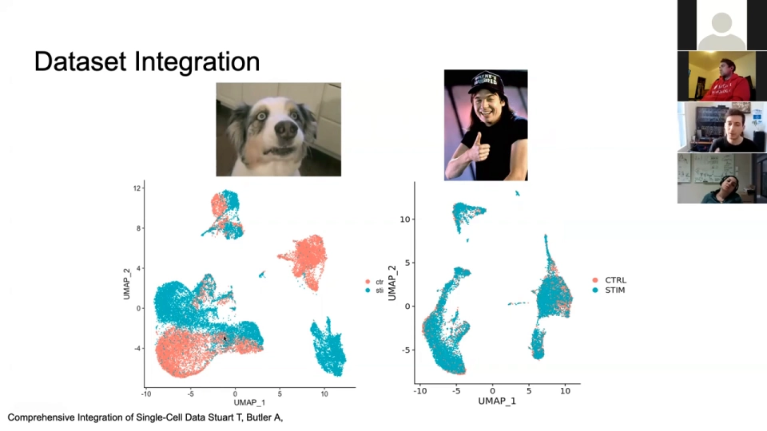
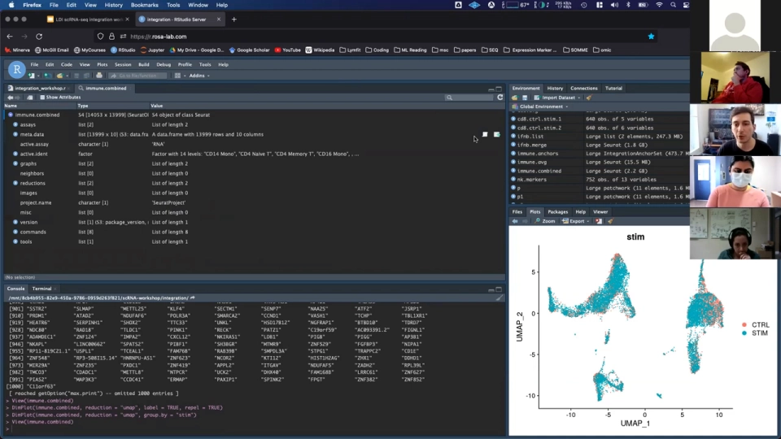
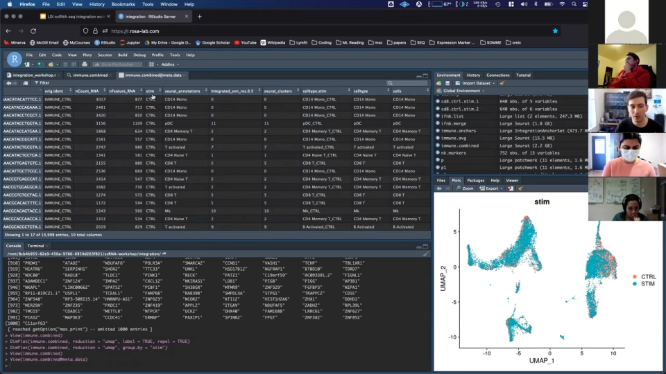
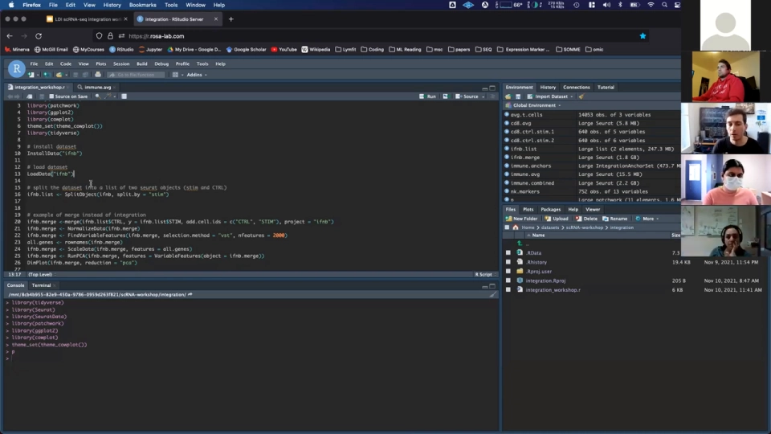
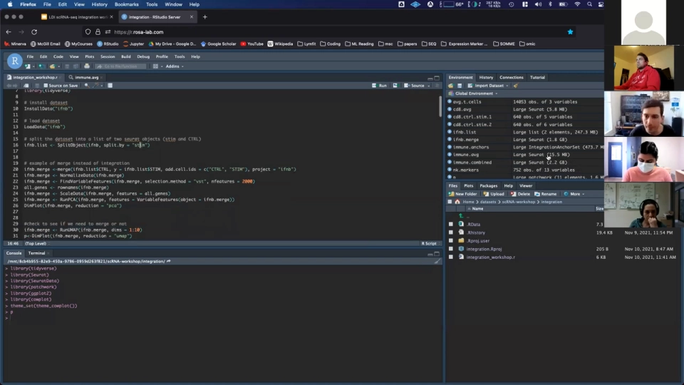
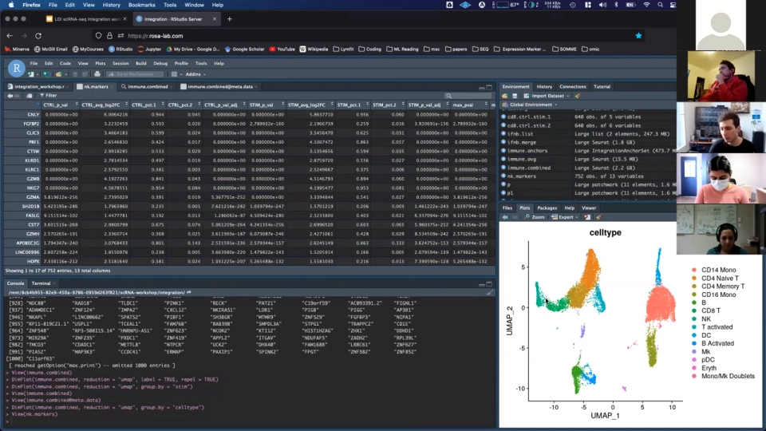
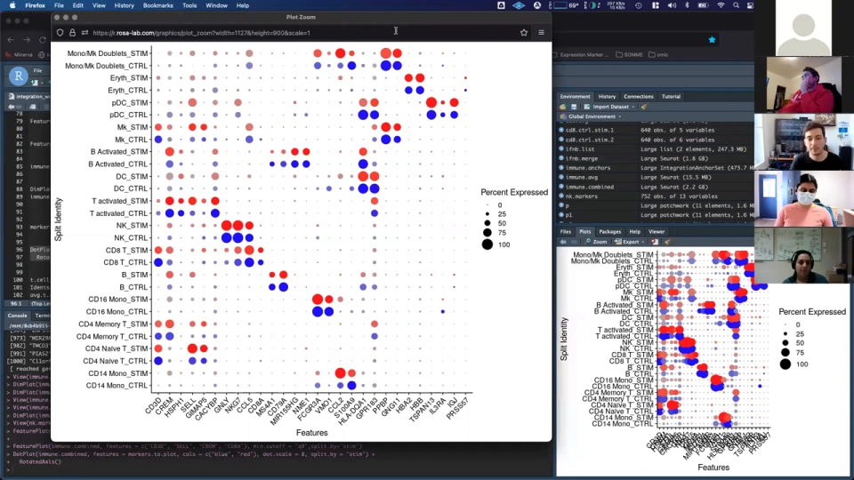
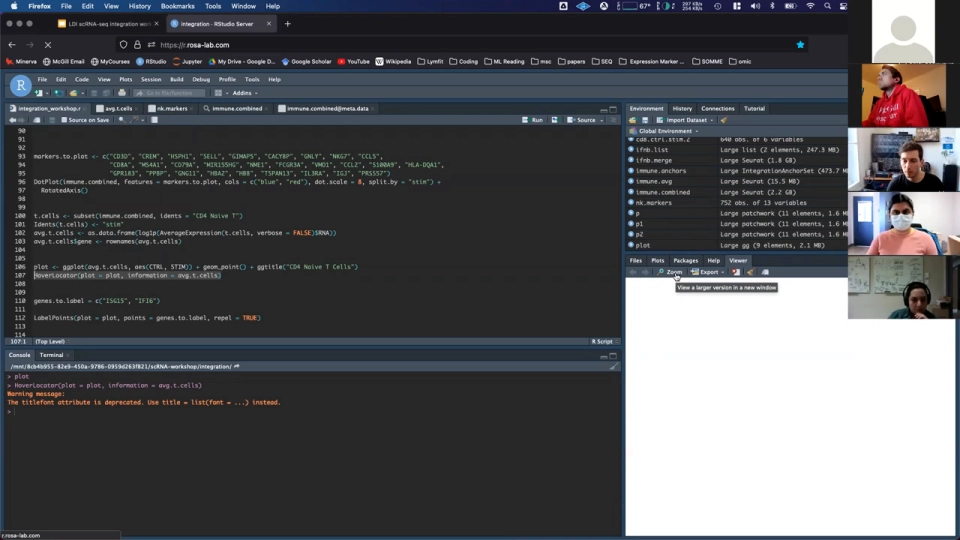
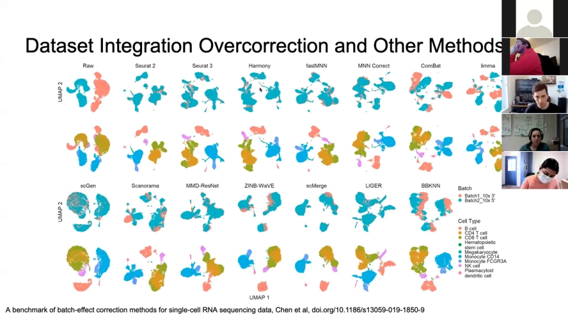
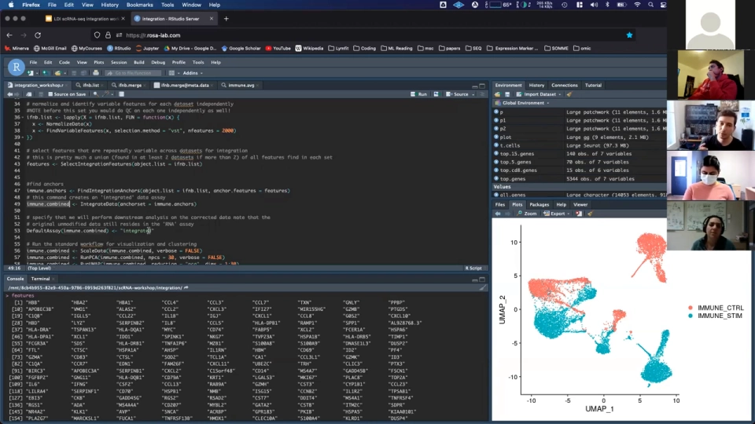

# 细胞元数据：obs 每一列都在决定你能问出什么问题

> 视频来源：[Managing Multiple Datasets: Downstream Analysis for scRNA Sequencing](https://www.youtube.com/watch?v=o-yE5rNfB3g)（YouTube · EMGSS McGill University，讲者 Matt，Johnson lab / LDI）｜时长约 60 分钟
> 导读：这是一场研究生技术研讨会，主题是"多套单细胞数据怎么整合到一起"。本文只取其中**细胞元数据**这一条线：`meta.data` 里那十几列分别是什么、从哪来、可靠到什么程度，以及为什么下游每一步分析（`group.by`、`split.by`、`Idents`）本质上都是在挑某一列。整合算法本身的细节不在本文范围内（属 2.4.4 批次效应与 5.1.3 数据整合）。

## 本讲要解决的核心问题（SCQA）

**背景**：单细胞分析的标准流程已经人人会背——归一化、找高变基因、PCA、聚类、UMAP、注释细胞类型。跑完之后，每个人都得到一张 UMAP 图和一个"细胞类型"标签。

**冲突**：真实研究几乎不会只有一个样本。当你把对照（CTRL）和刺激（STIM）两批数据合并起来跑同一套流程，UMAP 上常常出现"按样本分成两团"的结果 [【跳转到 09:07】](https://www.youtube.com/watch?v=o-yE5rNfB3g&t=547)。这时你面对的问题不是"用什么算法"，而是一个更前置的问题：**这两团到底是生物学差异，还是技术差异？** 而这个问题能不能回答，取决于你的 `meta.data` 里有没有 `stim`、`batch`、`donor` 这几列。



**疑问**：细胞元数据（`meta.data` / `obs`）里到底有哪些列？它们分别从哪里来？哪些能当事实用，哪些只是推断？

**回答（中心思想）**：细胞元数据是"一行一个细胞"的属性表，列按来源分三层——**技术层**（测序自动产生的 `nCount_RNA`、`nFeature_RNA`、样本 ID）、**实验设计层**（人手工维护的 `stim`、`sample_name`、`donor`）、**计算层**（聚类与注释产生的 `seurat_clusters`、`celltype`）。三层的可靠性依次递减：技术层是测量值，实验设计层是事实，计算层是**推断结果**。而下游的每一个操作——画图、分组、找差异基因、算平均表达——都是在挑其中某一列来分组，所以"这张矩阵能问出什么问题"，几乎完全由这张表决定。

## 一、`meta.data` 是一行一个细胞的属性表

### 1.1 打开它只需要点一下

视频里演示得很直接：在 RStudio 的 Environment 里点开 Seurat 对象，展开 `meta.data`，再点右侧的脚本图标，它就作为一个 data frame 打开 [【跳转到 43:32】](https://www.youtube.com/watch?v=o-yE5rNfB3g&t=2612)。

对象结构里能看到 `meta.data` 的规模：13,999 行 × 10 列，同时 `active.ident` 是一个有 14 个水平的 factor（`CD14 Mono`、`CD4 Naive T`、`CD4 Memory T`、`CD8 T`……）[【跳转到 43:57】](https://www.youtube.com/watch?v=o-yE5rNfB3g&t=2637)。



**两个要点**：

- **行数等于细胞数**。这张表的行必须和表达矩阵的列一一对应、顺序一致。行对不上，后面所有按元数据分组的结果都是错的。
- **`active.ident` 不是普通的一列**，它是"当前身份"——Seurat 里所有默认按身份分组的函数（`FindMarkers`、`AverageExpression`、`DimPlot` 的默认配色）都读它。它可以被临时改成任意一列的值，这一点在第五章会反复用到。

### 1.2 十列分别是什么

同一张表打开后，列名一目了然 [【跳转到 44:22】](https://www.youtube.com/watch?v=o-yE5rNfB3g&t=2662)：



| 列名 | 内容 | 来源层 | 可靠性 |
| --- | --- | --- | --- |
| `orig.ident` | 细胞来自哪个样本/对象 | 技术层 | 事实（由建对象时决定） |
| `nCount_RNA` | 该细胞的总 UMI 计数 | 技术层 | 测量值 |
| `nFeature_RNA` | 该细胞检出的基因数 | 技术层 | 测量值 |
| `sample_name` | 样本名（如 `CTRL`、`STIM`） | 实验设计层 | 事实，但靠人填 |
| `seq_annotations` | 测序批次/文库的人工注释 | 实验设计层 | 事实，但靠人填 |
| `integrated_snn_res.5` | 整合后 SNN 图在分辨率 0.5 下的分群 | 计算层 | 推断 |
| `seurat_clusters` | 当前聚类编号 | 计算层 | 推断 |
| `celltype.alt` | 另一套细胞类型注释 | 计算层 | 推断 |
| `celltype` | 细胞类型注释 | 计算层 | 推断 |
| `cells` | 细胞名（barcode + 样本前缀） | 技术层 | 事实 |

这张表就是本小节的核心：**同一个细胞，十列信息里有三列是机器测出来的、三列是人填的、四列是算法算出来的**。它们的可信度完全不在一个量级，但它们在表里长得一模一样，都是普通的一列字符串或数字。

### 1.3 为什么"层"这件事重要

因为下游所有分析都一视同仁地使用这些列。`group.by = "celltype"` 和 `group.by = "sample_name"` 在语法上没有区别，但前者是在用一个**可能错的推断**分组，后者是在用一个**人填的事实**分组。程序不会提醒你，只有你自己知道。

## 二、技术层：测序和建库自动产生的列

`nCount_RNA` 和 `nFeature_RNA` 是每个细胞两个最基本的统计量：这个细胞一共被测到多少个 UMI、测到多少个不同的基因。它们在建对象的那一刻就被算好写进 `meta.data`，不需要你手动添加。

**它们为什么重要**：这两个数就是质控的原始依据。一个 `nFeature_RNA` 只有 200 的细胞，很可能是一个空液滴或破损细胞；一个 `nCount_RNA` 特别高的细胞，可能是两个细胞被包进同一个液滴。视频里提到，作者用的这份 Seurat 示例数据**已经做过质控**——按线粒体基因表达、低 reads、双细胞等标准筛过一遍 [【跳转到 32:00】](https://www.youtube.com/watch?v=o-yE5rNfB3g&t=1920)。

**这里只讲"列的存在与含义"，不讲阈值**：怎么定阈值、用什么算法去双细胞，属于质控那一节的内容。对本文来说要记住的是——**质控的产物本身也是元数据**：被筛掉的细胞从表里消失，剩下的细胞带着它们的 `nCount_RNA` 继续往下走；而线粒体占比这类指标，也是一列 `percent.mt`。

`orig.ident` 是另一个技术层列：它记录"这个细胞来自哪个对象"。合并多个样本后，这一列就是最原始的来源标记——比 `sample_name` 更底层，因为它由建对象的过程自动写入，不依赖人填表。
## 三、实验设计层：人手工维护的那几列

### 3.1 合并样本时，元数据是唯一能区分来源的东西

视频里的数据来自两份对象：一份对照、一份刺激。第一步操作是把它们拆开再合并：

```r
frb.list <- SplitObject(frb, split.by = "stim")            # 按元数据列拆成两个对象
frb.merge <- merge(frb.list[[1]], y = frb.list[[2]],
                   add.cell.ids = c("CTRL", "STIM"), project = "frb")
```



注意 `SplitObject(frb, split.by = "stim")` 这一行：**它拆分的依据是 `meta.data` 里的一列**。如果这份数据当初没有记录 `stim` 这一列，你就没法按条件拆分，也没法按条件合并——你手上只有一张混在一起的矩阵。

合并时的 `add.cell.ids = c("CTRL", "STIM")` 是另一个关键动作 [【跳转到 28:28】](https://www.youtube.com/watch?v=o-yE5rNfB3g&t=1708)：



**为什么必须加前缀**：10x 的 barcode 是**在样本内唯一**的，不是全局唯一。两个不同样本里出现同一个 barcode（比如都是 `AAACATACAAAAACG-1`）是完全正常的事。如果不加前缀就合并，两批细胞会撞名——Seurat 会报重复行名，或者悄悄改名，之后你再也分不清哪个细胞来自哪一批。

合并之后，`cells` 列里就是 `CTRL_AAACATACAAAAACG-1` 这样的名字，前缀本身就是一条元数据。

### 3.2 `sample_name` 与 `seq_annotations`：人填的样本表

`sample_name`（对照还是刺激）和 `seq_annotations`（这批细胞属于哪个测序文库/批次）这两列，**不是测序仪吐出来的**，而是分析者从样本表里手工加进去的。

它们的可靠性取决于人：

- 填对了，它就是整篇分析的地基——所有"对照 vs 处理"的比较都靠它；
- 填错了（比如两个样本的条件标签贴反），**后面每一步分析都会错，而且不会报错**。矩阵本身没有任何信息能告诉你标签贴反了。

这就是实验设计层和计算层的本质区别：计算层的错误可以通过换参数发现（改一次分辨率，聚类编号就变了），实验设计层的错误**无法从数据内部发现**。

### 3.3 一个必须警惕的结构性问题：混淆

视频里有一段很关键的问答。学员问：UMAP 上对照和刺激分成两团，但其中一部分的分开程度和"同一条件内部的分开程度"差不多，**凭什么说这是批次效应而不是生物学差异？** [【跳转到 09:57】](https://www.youtube.com/watch?v=o-yE5rNfB3g&t=597)

讲者的回答很诚实：没有定量方法能直接判定，只能靠**先验知识**——比如你知道这是 PBMC，某个 cluster 应该是 CD8 T 细胞，但它的 marker 里出现了 B 细胞标志，那就说明注释或分群出了问题 [【跳转到 10:47】](https://www.youtube.com/watch?v=o-yE5rNfB3g&t=647)。另一个经验判据是"镜像式"的分离：两团细胞形状几乎对称、像彼此的倒影，那更可能是同一群细胞被某个技术因素（比如细胞周期）推开了，而不是两种不同的细胞状态。

**这条问答的元数据含义**：如果实验设计是"每个供体只做一种条件"，那么 `condition` 和 `donor` 在数据里就是**完全共线**的——条件效应和供体效应在数学上无法分离。这不是算法问题，是设计问题；元数据只是把这个事实暴露出来。想事后补救是不可能的：你没法从表达矩阵反推出"这个细胞来自哪个供体"。

## 四、计算层：聚类与注释是推断，不是事实

### 4.1 同一张表里并存两套注释

回到那张 `meta.data`：`seurat_clusters`、`integrated_snn_res.5`、`celltype`、`celltype.alt` 四列同时存在。前两列是聚类编号（一个整数），后两列是细胞类型名字（一个字符串）。

**它们都是算出来的**：

- `integrated_snn_res.5` 里的 `res.5` 是分辨率参数。分辨率改一下，这一列的值就全变；
- `seurat_clusters` 是"当前"的聚类结果，换一次 `FindClusters` 就覆盖；
- `celltype` 是人工（或自动工具）根据 marker 基因给每个 cluster 贴的标签；
- `celltype.alt` 是另一套标签——同一个对象里存在两套注释，本身就说明**注释是可选的、可争议的**。



**"注释标签不是事实"这句话的具体含义**：`celltype` 列里写着 `CD4 Naive T`，不代表这些细胞真的是 CD4 初始 T 细胞，只代表"按当前参数聚类 + 按当前 marker 列表判断，它们最像 CD4 初始 T 细胞"。改一次聚类参数、换一套 marker，标签就会变。

### 4.2 为什么还要保留这些列

因为推断结果虽然不可靠，但它是**可复现、可追溯**的：只要记下分辨率、marker 列表和注释版本，别人能重跑出同样的标签。所以正确做法不是"不要注释"，而是：

- 保留原始聚类编号（`seurat_clusters`）和注释结果（`celltype`）**两列并存**，随时能回到"未解释"的状态；
- 换一套注释时另开一列（如 `celltype.alt`），不要覆盖旧的；
- 在论文/报告里写清注释依据，而不是只给一个标签。

## 五、下游每一步分析，都是在挑一列

这是整场演讲最实用的一条暗线：所有"高级"分析，落到代码上都只是 `group.by` 或 `split.by` 指向了某一列。

### 5.1 画图：`group.by` 决定颜色代表什么

`DimPlot(..., group.by = "stim")` 按条件上色，`group.by = "celltype"` 按细胞类型上色 [【跳转到 44:22】](https://www.youtube.com/watch?v=o-yE5rNfB3g&t=2662)。同一张 UMAP 坐标，换一列就换一种叙事。

### 5.2 找保守 marker：每个条件一列结果

`FindConservedMarkers` 的输出表里，每个条件各占一组列：`CTRL_p_val`、`CTRL_avg_log2FC`、`CTRL_pct.1`、`CTRL_pct.2`，然后是 `STIM_` 开头的一组，最后是 `max_pval` 和 `minimump_val` [【跳转到 46:27】](https://www.youtube.com/watch?v=o-yE5rNfB3g&t=2787)。

**这张表的意义**：它找的不是"两组之间的差异"，而是"两组里都成立的 marker"，用来确认细胞身份。能这么做的前提是——`stim` 这一列存在且正确，函数才知道要按什么分组。

### 5.3 分组可视化：`split.by` 把同一张图拆成两半

`split.by = "stim"` 会把点图按条件拆开，行标签变成 `CD14 Mono_CTRL`、`CD14 Mono_STIM` 这样成对出现 [【跳转到 50:32】](https://www.youtube.com/watch?v=o-yE5rNfB3g&t=3032)：



这张图里 `CD3D` 在两组几乎一样——讲者特意用它说明"这个基因我没动过，所以应该相同"，作为对照。

### 5.4 改身份：`Idents()` 是"临时换一列当分组依据"

```r
t.cells <- subset(immune.combined, idents = "CD4 Naive T")   # 先按注释取子集
Idents(t.cells) <- "stim"                                     # 再把身份换成条件
avg <- AverageExpression(t.cells, return.seurat = FALSE)      # 于是平均值按条件算
```



这段代码是"元数据即分析"的最纯粹体现：**同一份数据，`Idents` 指向 `celltype` 时算的是"每种细胞类型的平均表达"，指向 `stim` 时算的是"每个条件的平均表达"**。数据一个数都没变，只是换了一列。

### 5.5 差异分析：`group.by` 让"谁和谁比"变成参数

```r
Idents(immune.combined) <- "celltype"
FindMarkers(immune.combined, ident.1 = "CTRL", ident.2 = "STIM", group.by = "stim")

Idents(immune.combined) <- "stim"
FindMarkers(immune.combined, ident.1 = "CD8 T_CTRL", ident.2 = "CD8 T_STIM")
```


同一份数据，第一次比的是"所有 CTRL 细胞 vs 所有 STIM 细胞"，第二次比的是"CD8 T 细胞内部的 CTRL vs STIM"。**"谁和谁比"不是由数据决定的，是由元数据决定的**。

讲者还提到一个细节：这样跑出来的 `FindMarkers` 表里，`pct.1` 和 `pct.2` 的含义变了——不再是"这个 cluster vs 其他所有 cluster"，而是"第一个身份 vs 第二个身份" [【跳转到 58:06】](https://www.youtube.com/watch?v=o-yE5rNfB3g&t=3486)。读表时必须知道分组是怎么设的，否则会把百分比读反。

### 5.6 一张表总结

| 你想做的事 | 需要哪一列 | 代码入口 |
| --- | --- | --- |
| 按条件看分布 | `stim` / `condition` | `group.by`、`split.by` |
| 按细胞类型看 marker | `celltype` | `Idents`、`FindAllMarkers` |
| 条件间的差异基因 | `stim` + `celltype` | `FindMarkers(group.by=)` |
| 每群细胞的平均表达 | 任意一列 | `AverageExpression` |
| 判断是否需要整合 | `batch` / 样本列 | 按样本上色看 UMAP/PCA |

## 六、元数据设计决定可检验性

### 6.1 想比较条件，就必须有 `condition` 列

视频里所有"对照 vs 刺激"的分析，前提都是 `stim` 这一列存在。如果这份数据当初没有记录处理条件，你手上只有 13,999 个细胞和一张矩阵——**你连"哪一半是对照"都不知道**，所有差异分析都无从谈起。

### 6.2 想校正批次，就必须有 `batch` 列

演讲里展示了一张批次校正方法的基准比较图：Raw、Seurat 2、Seurat 3、Harmony、fastMNN、ComBat、limma 等十几种方法，在同一份 PBMC 数据上的效果 [【跳转到 18:56】](https://www.youtube.com/watch?v=o-yE5rNfB3g&t=1136)。



这张图的每一行都按两个元数据上色：**Batch**（`Batch1_10x` / `Batch2_10x`）和 **Cell Type**。没有 `batch` 这一列，你既画不出"按批次上色"的图来诊断问题，也没法把批次作为协变量交给任何算法。

**注意边界**：这里不讨论"选哪个算法""怎么判断过校正"——那是批次效应处理那一节的事。本文只强调一点：**算法能不能用，取决于元数据里有没有那一列**。

### 6.3 整合之后，元数据依然是唯一的解释框架

整合完成的对象里会多出一个 `integrated` assay，只有 2,000 个高变基因，专门用于 PCA/UMAP；做差异分析时要切回 `RNA` assay 才有全部基因 [【跳转到 36:10】](https://www.youtube.com/watch?v=o-yE5rNfB3g&t=2170)。



注意截图右侧那张 UMAP：它按 `IMMUNE_CTRL` / `IMMUNE_STIM` 上色。整合把两批细胞混到了一起，但**"哪个细胞来自哪一批"这条信息仍然完整地存在元数据里**——这正是整合能成立的前提：你可以把技术差异从坐标里抹掉，但不能把样本标签从表里抹掉，否则整合完就再也分不出组了。

### 6.4 扰动实验里，标签本身就是一份带不确定性的元数据

这场演讲用的是"对照 vs 刺激"的简单设计，但它引出的逻辑可以直接推到扰动实验（Perturb-seq）上：

- 普通实验里，`condition` 是一个细胞一个值，人填一次就定死；
- 扰动实验里，每个细胞的"身份"是它携带的 **gRNA**——而 gRNA 归属是**测出来的**：一个细胞可能测到多条 gRNA（多重感染），也可能一条都没测到（漏检）。于是 `guide_assignment` 这一列天生带着不确定性，还会有 `n_guides`、`perturbation_confidence` 这类伴随列。

这是第 3、4 章的地基，此处只点到：**扰动标签不是"实验设计层"那种确定的事实，也不是纯粹的"计算层"推断，而是介于两者之间——它来自测量，但需要推断才能落到每个细胞上。**

### 6.5 缺失的元数据，事后补不回来

这是全文最重要的一条：

| 缺失的列 | 后果 | 能否事后补救 |
| --- | --- | --- |
| `condition` | 无法做任何组间比较 | 不能（矩阵里没有条件信息） |
| `batch` / 文库 ID | 无法诊断或校正批次 | 不能（除非翻实验记录逐样本补） |
| `donor` | 无法做跨供体推断，无法做 pseudobulk | 不能 |
| `celltype` | 可以重跑聚类与注释 | 能（但结果会变） |
| `nCount_RNA` / `nFeature_RNA` | 可以重算 | 能 |

规律很清楚：**计算层的列丢了可以重算，实验设计层的列丢了就是永久损失**。所以数据资源的价值，一半在矩阵，一半在元数据——一个只有矩阵、没有样本表的"公开数据集"，能回答的问题比它看起来少得多。

## 小结

- **细胞元数据是一行一个细胞的属性表**（`meta.data` / `obs`），行数必须等于细胞数、顺序与矩阵列一致。
- **列分三层来源**：技术层（`nCount_RNA`、`nFeature_RNA`、`orig.ident`、barcode）是测量值；实验设计层（`sample_name`、`seq_annotations`、`stim`、`donor`）是人填的事实；计算层（`seurat_clusters`、`celltype`、`celltype.alt`）是推断结果。
- **三层混在同一张表里，可靠性完全不同**。程序不会区分，只有分析者知道哪一列能当事实用。
- **barcode 只在样本内唯一**：合并多样本必须加样本前缀（`add.cell.ids`）或另建 `sample` 列，否则不同细胞的 barcode 会撞在一起。
- **下游每一步分析都是在挑一列**：`group.by` 决定图上颜色代表什么，`split.by` 决定图被拆成几份，`Idents()` 决定"谁和谁比"，`AverageExpression` 决定按什么求平均。数据一个数都没变。
- **注释标签不是事实**：`celltype` 列是聚类 + marker 推断的产物，换参数就变；保留原始聚类编号、另开一列存新注释，是唯一稳妥的做法。
- **条件与批次/供体共线时，数据内部无法区分**——这是实验设计问题，元数据只能把它暴露出来，不能替你解决。
- **元数据缺失事后无法补救**：想比较条件就要有 `condition`，想校正批次就要有 `batch`，想做跨供体推断就要有 `donor`。计算层的列可以重算，设计层的列丢了就是永久损失。

## 关键术语速查

| 术语 | 一句话解释 |
| --- | --- |
| 细胞元数据（`meta.data` / `obs`） | 一行一个细胞的属性表，与表达矩阵的列严格对齐 |
| 基因元数据（`var`） | 一行一个基因的属性表，与矩阵的行对齐（见同小节另一篇） |
| `orig.ident` | 细胞来自哪个样本对象的原始标记，建对象时自动写入 |
| `nCount_RNA` | 每个细胞的总 UMI 计数，质控与归一化的基础 |
| `nFeature_RNA` | 每个细胞检出的基因数，判断空液滴/低质量细胞的依据 |
| `active.ident` / `Idents()` | Seurat 的"当前身份"，所有默认按身份分组的函数都读它，可临时指向任意一列 |
| `group.by` | 按某一元数据列分组配色，同一张 UMAP 换一列就换一种叙事 |
| `split.by` | 按某一元数据列把同一张图拆成多份（如 `_CTRL` / `_STIM`） |
| `add.cell.ids` | `merge` 时给每个样本的 barcode 加前缀，解决 barcode 只在样本内唯一的问题 |
| `FindConservedMarkers` | 找在多个条件里都成立的 marker，输出每个条件一组统计列 |
| `AverageExpression` | 按当前 `Idents` 求每个基因的平均表达，可当简易 pseudobulk 用 |
| 混淆（confounding） | 条件与批次/供体完全绑定，导致两种效应在数据里无法分离 |
| gRNA assignment | 扰动实验中把 gRNA 归属到每个细胞的元数据，天生带漏检与多重感染的不确定性 |
