# 单细胞矩阵里满屏的零：多数不是"不表达"，但也不该被当成缺失值填上

> 视频来源：[Demystifying the drop-outs in single cell RNA-seq data](https://www.youtube.com/watch?v=D-cEpmrwF2s)（YouTube · DahShu 线上研讨会，讲者 Mengjie Chen，芝加哥大学）｜时长约 60 分钟
> 导读：这是一场专门"拆零"的方法学报告。讲者把单细胞领域三个被当成常识的假设——"零来自 dropout"、"变异系数能选高变基因"、"归一化和插补是必要预处理"——逐条用数据检验，结论是三个都不成立。本文覆盖整场报告的主线；末尾约 4 分钟讲者介绍自己实验室的表观转录组平台（REPIC），与本节无关，未纳入。

## 本讲要解决的核心问题（SCQA）

**背景**：单细胞 RNA 测序（scRNA-seq）的输出是一张"细胞 × 基因"的计数矩阵，矩阵里每个数字是"这个细胞里这个基因被测到了几个 mRNA 分子"。做过单细胞的人都知道，这张矩阵里绝大多数格子是 0。

**冲突**：直觉的解释是 dropout——基因其实表达了，只是分子在捕获、逆转录、扩增、测序的某一环被漏掉了。既然零是"技术错误"，那么合理的做法自然是在流水线里补上它：先归一化，再做插补（imputation），然后才聚类。Seurat 这类主流工具的默认流程，正是按这个逻辑搭起来的。

**疑问**：这些零到底是什么？其中有多少真的来自 dropout？"零膨胀"（zero-inflation）是数据里可验证的事实，还是我们强加给数据的建模假设？如果照着"补零"的思路做下去，会不会反而把真实的生物学差异抹掉？

**回答（中心思想）**：零是**"没数到"的删失观测**——它既不是缺失值（missing value），也不能当作"表达量为 0"的观测值。讲者的检验表明：对**同质细胞群**，最简单的泊松模型就足以解释观测到的零比例，额外的零膨胀项几乎没有任何增益；真实数据里那些"多出来的零"主要来自**细胞类型异质性**，而不是 dropout。因此"零膨胀"是一种建模选择，不是数据里可验证的事实；而基于"零是错误"这一前提的归一化与插补，会把细胞类型之间的真实差异压平。正确的顺序是**先承认零的模糊性、先聚类、再谈下游**，而不是先把零填上。

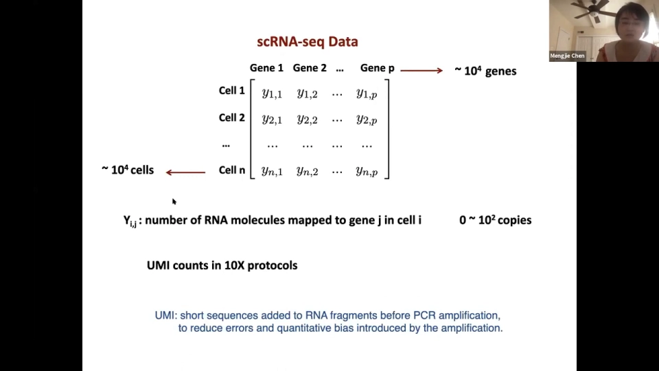

## 一、零的规模：一张单细胞矩阵里，多数条目是零

### 1.1 同一批样本，bulk 与单细胞的稀疏度天差地别

讲者先用一张对比图建立直觉：同一批细胞、同样的 7 种细胞类型，左边是用 bulk RNA-seq 测的，右边是用 scRNA-seq 测的，两张热图的每一行是一个基因、每一列是一个样本或一个细胞。整体模式几乎一样——说明两种技术抓到的是同一套生物学；但右边的单细胞热图出现了大片浅蓝色区块，那是原始数据里的零（画图时加了 0.1 的伪计数并取了对数，所以零显示为浅蓝而不是空白）。[【跳转到 17:19】](https://www.youtube.com/watch?v=D-cEpmrwF2s&t=1039)

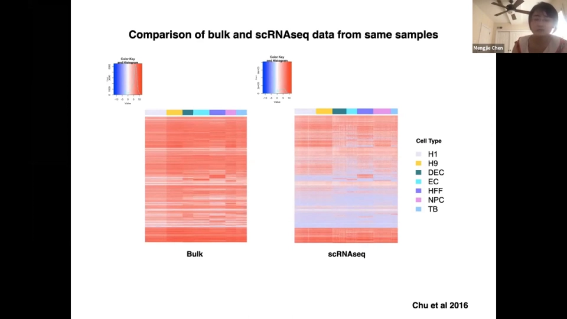

这张图是本节所有讨论的起点：**单细胞数据的稀疏性不是个别基因的问题，而是整张矩阵的普遍特征**。

### 1.2 量化：基因级零检出率的分布

把"零检出率"（zero detection rate，即一个基因在所有细胞里为 0 的比例）当作统计量，对三个不同数据集（Grun、Pollen、Zeisel）画直方图，虚线是中位数。结果很极端：第一个数据集里，50% 的基因零检出率在 75% 左右；另一个数据集里，50% 的细胞零检出率高于 0.85。[【跳转到 18:51】](https://www.youtube.com/watch?v=D-cEpmrwF2s&t=1131)

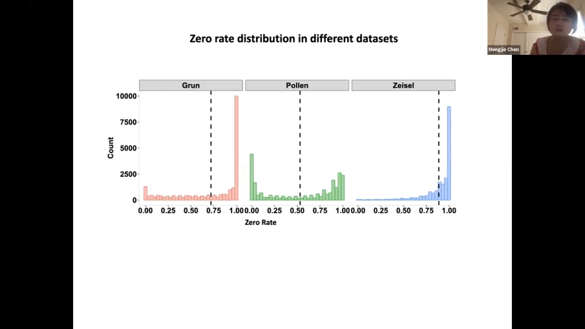

换句话说，**矩阵里大多数格子都是零，这是常态而不是异常**。任何一个关于"零"的假设，都会影响整条分析流水线。

## 二、零是怎么产生的：一条分子计数链上的概率损失

### 2.1 矩阵里的每个数字都是一次"数数"

在 10x Genomics 这类基于液滴的平台上，细胞被加上 barcode、逐个包进油滴，然后裂解、逆转录、扩增、建库、测序。矩阵里的元素 $y_{ij}$ 表示"细胞 $i$ 中比对到基因 $j$ 的 RNA 分子数"，在 10x 数据里它本质上是 **UMI 计数**。UMI（unique molecular identifier）是扩增前加到 RNA 片段上的短序列，作用是消除 PCR 扩增带来的定量偏好——所以 UMI 计数接近"这个细胞里这个基因真实有多少个 mRNA 分子"的绝对量，这是 10x 相对 Smart-seq 的一大优势。

但"接近"不等于"等于"。这条链上每一步都有效率损失：细胞捕获可能失败、裂解可能不完全、逆转录酶效率有限、扩增有偏、测序深度有限、比对可能失败、基因注释可能不全。**每一个环节都在做一次抽样**，一个分子最终被数到的概率是这些环节效率的乘积。

### 2.2 泊松抽样：低表达基因的零是必然

假设捕获效率是 10%，那么一个 mRNA 分子有 90% 的概率被漏掉。如果一个基因在这个细胞里只有 1 个分子，它被数到的概率就是 0.1；如果只有 2 个分子，至少数到一个的概率也只有 $1-(1-0.1)^2 = 0.19$。这就是**零的比例是表达量的函数**这一最本质的特征：

$$
P(y_{ij} = 0) = e^{-\lambda_{ij}}
$$

其中 $\lambda_{ij}$ 是这个细胞里这个基因的期望分子数。表达量越低，$\lambda$ 越小，零的概率越接近 1。所以**零不是随机撒在矩阵里的，它系统性地集中在低表达基因上**——这一点后面会反复用到：任何"零比例 vs 平均表达量"的曲线，都是判断零的性质的核心工具。

### 2.3 三种零，数据本身无法区分

一个零同时可能意味着三件事：

1. **生物学零**：这个细胞类型本来就不转录这个基因。比如成纤维细胞里不该有 CD3E 的转录本。
2. **采样零（dropout）**：基因确实表达了，但分子在计数链的某一环被漏掉。
3. **其它技术零**：比对失败、基因注释不全、UMI 碰撞等。

而数据本身**无法区分**这三者——矩阵里它们长得一模一样，都是 0。这就是本节的核心困境：**零是模糊的**。

还有一类偏差会从**反方向**干扰"零的含义"：环境 RNA（ambient RNA）污染会让一个本来不表达的基因出现少量读数，双细胞（doublet）会让两个细胞的转录组混在一起、把某些基因从零变成非零。这些不是"多出来的零"，而是"假非零"，它们的处理方法属于 2.4.2（低质量细胞与 Doublets）和 2.4.3（Ambient RNA），本节只点到为止：**它们同样破坏"零 = 不表达"这一等式**。

所以正确的表述是：零是**删失（censored）的观测**——我们知道观测值不超过某个检出下限，但不知道真实值是多少。它既不能当缺失值（NaN）直接删掉，也不能当"表达量为 0"的观测值直接参与计算。
## 三、被写进流水线的三个假设

讲者把当前 scRNA-seq 分析里"被当成常识"的说法归纳成三条：[【跳转到 19:41】](https://www.youtube.com/watch?v=D-cEpmrwF2s&t=1181)

1. scRNA-seq 数据含有**过度的零**，原因是 dropout（技术假象），UMI 数据和普通计数数据都一样；
2. **变异系数**（coefficient of variation, CV）可以用来做特征选择，挑出异质性基因；
3. **归一化或插补**应当作为预处理步骤。

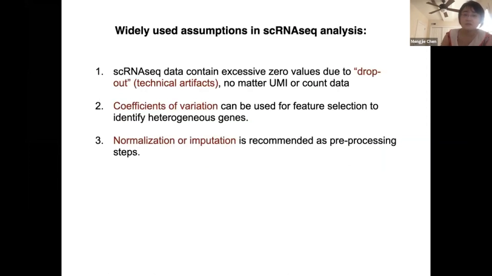

这三条不是随口说说的教条，它们**实实在在地写进了主流工具的默认流程**。以 Seurat 为例：输入 UMI 计数矩阵 → 质控（零检出率、线粒体基因比例等统计量，过滤细胞与基因）→ 归一化 → 特征选择（用方差或 CV 挑高变基因）→ 降维 → 聚类 → 给每个簇指派细胞类型。[【跳转到 20:56】](https://www.youtube.com/watch?v=D-cEpmrwF2s&t=1256)

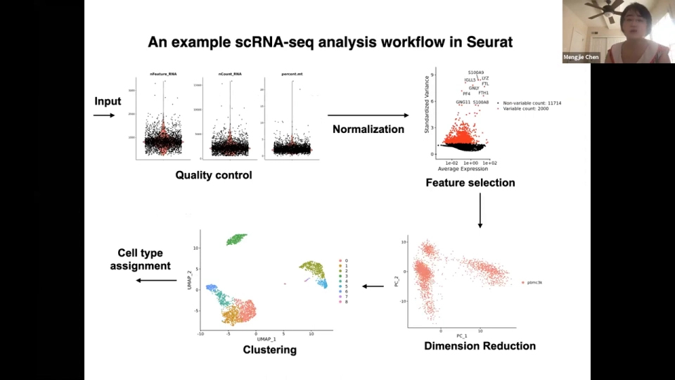

归一化有两大流派：一派沿用 bulk RNA-seq 的思路，为每个细胞估一个缩放因子、按文库大小归一化；另一派试图稳定基因间的方差，也就是 Seurat 里的 SCTransform。特征选择则普遍用方差或 CV。**这条流水线的底层动机就是"零是技术错误，要先修掉它"**——所以如果这个前提错了，后面每一步都值得重审。

## 四、假设一：dropout 会造成"过度零膨胀"吗？

### 4.1 只看一种细胞：三条曲线谁贴得住

检验方法很直接。首先必须**只看同质细胞群**——一次只分析一种细胞类型，否则"细胞类型不同"本身就会制造大量零。讲者取 CD19+ B 细胞，在四个数据集里画"零比例 vs 每个基因的平均 UMI"的散点图，再叠加三条理论曲线：[【跳转到 25:06】](https://www.youtube.com/watch?v=D-cEpmrwF2s&t=1506)

- **泊松（Poisson）**：只假设计数过程是泊松抽样，方差等于均值；
- **负二项（negative binomial, NB）**：额外引入一个"离散度"参数（dispersion）刻画对泊松的偏离，是 bulk RNA-seq 计数数据的标准模型；
- **零膨胀负二项（zero-inflated negative binomial, ZINB）**：在 NB 之上再加一个"结构性零"成分，专门用来建模 dropout。

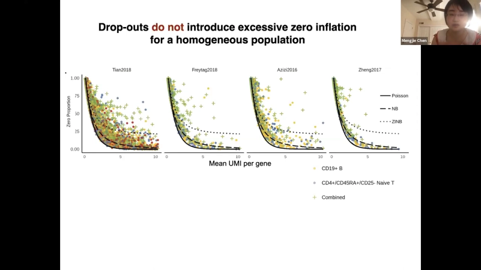

结果很清楚：**对绝大多数基因，泊松曲线就贴住了数据**；少数基因需要负二项；而 ZINB 的曲线整体浮在整个数据分布之上——它假设的"额外零"在数据里根本不存在。[【跳转到 26:46】](https://www.youtube.com/watch?v=D-cEpmrwF2s&t=1606)

### 4.2 似然比检验：ZINB 几乎没有增益

"看着差不多"不够严谨，讲者做了两组似然比检验（likelihood ratio test）：第一组比较 NB 与 Poisson，第二组比较 ZINB 与 Poisson。前者回答"有多少基因值得用更复杂的模型"，后者回答"到底要不要引入一个专门建模 dropout 的成分"。[【跳转到 27:36】](https://www.youtube.com/watch?v=D-cEpmrwF2s&t=1656)

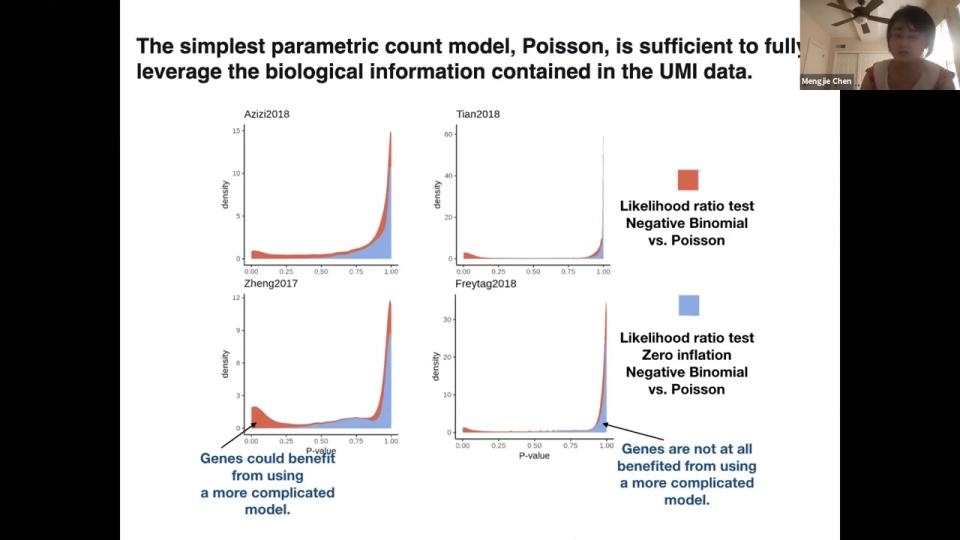

p 值分布说明了问题：**只有一小部分基因能从负二项中获益，但对几乎所有基因来说，引入零膨胀项毫无收益**（p 值堆在 1 附近，即检验不显著）。讲者的总结是：最简单的参数化计数模型——泊松——已经足以提取 UMI 数据里的生物学信息，不需要 ZINB 这个更复杂的模型。[【跳转到 29:16】](https://www.youtube.com/watch?v=D-cEpmrwF2s&t=1756)

### 4.3 那真实的过度零从哪来：细胞类型异质性

上面的分析都限定在**同质细胞群**里。可是真实数据里确实存在"泊松解释不了的过量零"，那是从哪来的？

讲者用 Zheng 2017 的 CD34+ 细胞做演示：总共约 300 个细胞，UMAP 上能清楚地分成三个亚群。把三个亚群**混在一起**画零比例曲线，曲线明显偏离泊松；但**分别**画三个亚群，每一条都紧紧贴着泊松曲线。[【跳转到 30:31】](https://www.youtube.com/watch?v=D-cEpmrwF2s&t=1831)

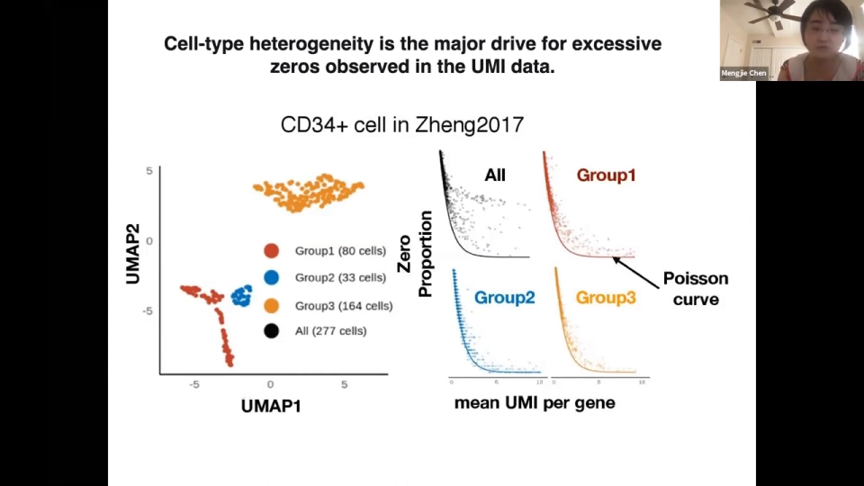

这就是本讲的第一个核心结论：**真实数据里的过量零，主要驱动因素是细胞类型异质性，而不是 dropout**。一个基因在 A 型细胞里高表达、在 B 型细胞里完全不表达，混起来看就是"这个基因有很多零"——这是真实的生物学差异，不是技术假象。所以"零膨胀"不是数据里可验证的事实，而是**你选择在哪个层级上建模**的结果。

### 4.4 少数基因确实偏离泊松：HLA、IG、TR

也不是所有基因都乖乖服从泊松。讲者把"观测零比例 − 泊松期望零比例"作为纵轴，按基因类别画出来，发现有一类基因**持续、系统地**偏离泊松，被框在了红框里：HLA 基因、IG（免疫球蛋白）基因、TR（T 细胞受体）基因。[【跳转到 33:07】](https://www.youtube.com/watch?v=D-cEpmrwF2s&t=1987)

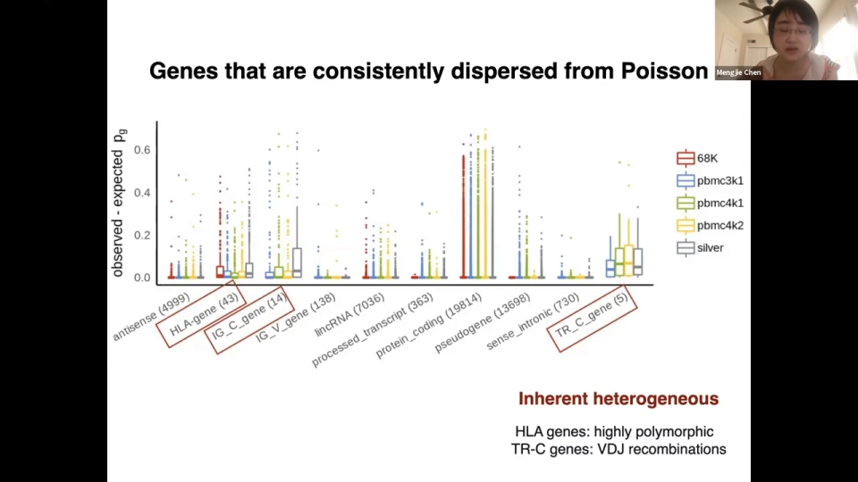

原因不是技术，而是**内在异质性**：HLA 基因高度多态，不同个体的等位基因不同；TR 基因要经历 V(D)J 重组合，每个 T 细胞的序列都不一样。即使你给细胞打了统一的类型标签，这些标签也**捕捉不到这层异质性**。[【跳转到 33:32】](https://www.youtube.com/watch?v=D-cEpmrwF2s&t=2012)

实践建议很具体：分析新数据集时，**预期 HLA、IG、TR 这几类基因的零会比别的基因多**；讲者的论文建议维护一份"已知偏离泊松"的基因黑名单，对它们保持谨慎。

## 五、假设二：变异系数适合选高变基因吗？

### 5.1 CV 的数值不稳定性

第二个假设是"用 CV 挑高变基因"。CV 的定义是方差除以均值，这带来一个数值问题：**均值很小时 CV 极不稳定**，一个平均计数 0.2 的基因，稍微波动一下 CV 就能爆表。

讲者做了一个对比：把零比例、方差、CV 三个指标放在一起，看它们能否区分"单一细胞类型"和"多种细胞类型混合"。理想情况下，混合样本应该在这些指标上明显更高。[【跳转到 35:29】](https://www.youtube.com/watch?v=D-cEpmrwF2s&t=2129)

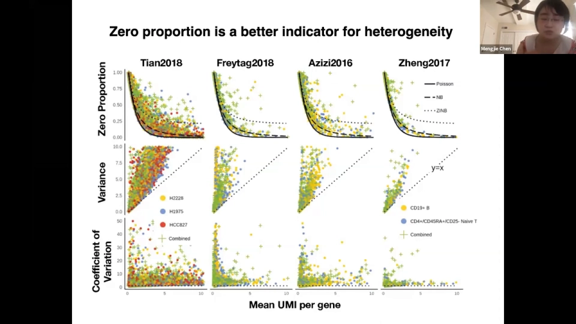

结果是：**零比例能清楚分开两者，方差和 CV 都不能**——混合样本里既有高值也有低值，和单一类型的分布完全重叠。所以零比例反而是更稳健的异质性指标。

### 5.2 零膨胀检验：只数零，不数 1、2、3

既然零比例更好用，就可以把它做成一个正式的统计检验：对每个基因，零假设是"观测到的零比例等于泊松率"，备择假设是"观测到的零比例高于泊松率"：

$$
H_0:\ p_g = e^{-\lambda_g}, \qquad H_A:\ p_g > e^{-\lambda_g}
$$

这里 $p_g$ 是基因 $g$ 的零比例，$\lambda_g$ 是它的平均表达量。注意这个检验**只用了"是不是零"这一位信息**——把计数简化成 0/非零的指示变量，完全不建模 1、2、3、5 这些具体数值。[【跳转到 37:41】](https://www.youtube.com/watch?v=D-cEpmrwF2s&t=2261)

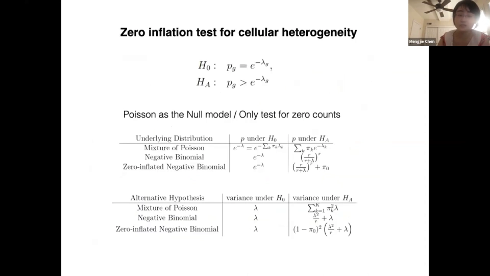

### 5.3 数学上的根据：为什么方差不行而零比例行

为什么方差和 CV 不适合，而零比例适合？讲者给了一个很漂亮的推导。在零假设下，无论底层分布是泊松、负二项还是 ZINB，$p$ 都等于 $e^{-\lambda}$；但在备择假设下：

- 泊松混合：$p = e^{-\sum_k \pi_k \lambda_k}$
- 负二项：$p = \left(\frac{r}{r+\lambda}\right)^r$
- 零膨胀负二项：$p = \left(\frac{r}{r+\lambda}\right)^r + \pi_0$

而方差在备择假设下**不一定更大**——ZINB 的方差是 $(1-\pi_0)^2\left(\frac{\lambda^2}{r}+\lambda\right)$，完全可能比零假设下的 $\lambda$ 还小。**零比例在备择假设下则严格更大**。这就是"零比例能区分、方差不能区分"的数学根据，也是零膨胀检验的理论基础。[【跳转到 39:48】](https://www.youtube.com/watch?v=D-cEpmrwF2s&t=2388)

拿 CD34+ 那个例子验证：对全体 CD34+ 细胞做检验，z-score 高达 1838203（说明整体极度异质，是个危险信号）；拆成三个亚群后，亚群 2 和亚群 3 的 z-score 直接是 0，亚群 1 是 6.19——亚群 1 确实更异质一些。[【跳转到 42:18】](https://www.youtube.com/watch?v=D-cEpmrwF2s&t=2538)

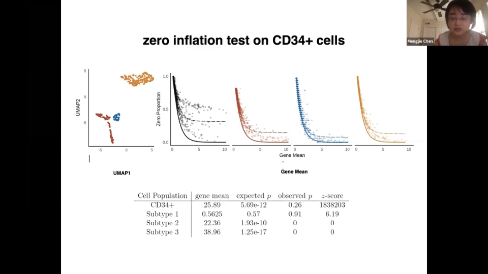

## 六、假设三：归一化与插补是必要的预处理吗？

### 6.1 测序深度与细胞类型混杂

第三个假设最反直觉。基于测序深度的归一化，前提是"每个细胞测到的总计数不同，纯粹是技术波动"。讲者检查了这个前提：比较 CD14+ 单核细胞与 CD19+ B 细胞在多个数据集中的每细胞计数，发现 **CD19+ B 细胞的计数系统性地高于单核细胞，而且每个数据集都是如此**。[【跳转到 44:23】](https://www.youtube.com/watch?v=D-cEpmrwF2s&t=2663)

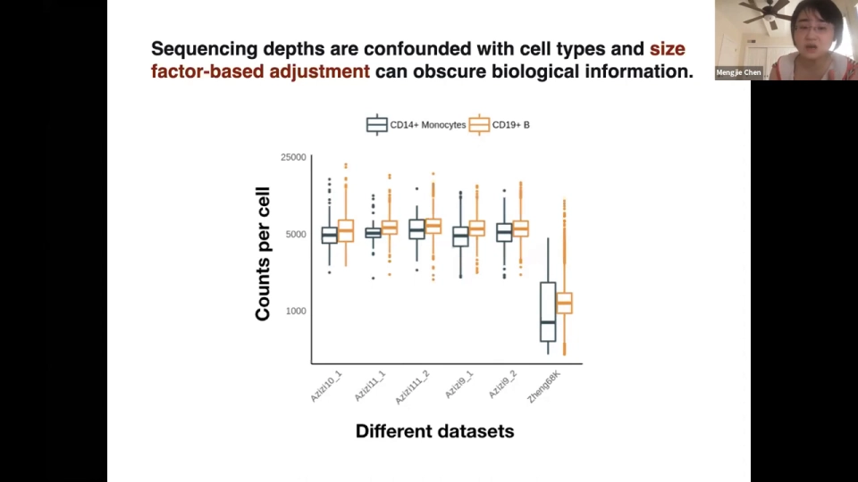

这意味着**测序深度和细胞类型是混杂的**：B 细胞的 RNA 含量本来就高，测到的分子自然多。如果你用一个 size factor 把每个细胞的总计数拉平，你同时也就**抹掉了这部分真实的生物学差异**。

### 6.2 SCTransform 与插补：把差异压平

同样的逻辑适用于 SCTransform 和各种插补方法。讲者展示了一组对比图：原始数据、聚类后、SCTransform 归一化后三种情形下的零比例曲线；以及 CD79A、CD79B、MS4A1 这几个 B 细胞标志物在归一化前后的表达分布。[【跳转到 46:28】](https://www.youtube.com/watch?v=D-cEpmrwF2s&t=2788)

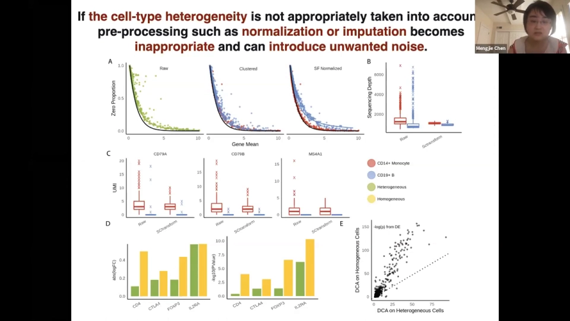

结论是：SCTransform 把所有细胞"拉得像同一个样子"，人为地**缩小了 CD79A/B、MS4A1 这些标志物在不同细胞类型之间的差异**；DCA 这类插补方法同样会消除变异、削弱信号。而下游的差异表达分析恰恰依赖这些差异——**先把信号压平再去找信号，是本末倒置**。

所以讲者的建议是：**不要在聚类之前做归一化或插补**。

## 七、那该怎么办：先聚类，再谈零

### 7.1 HIPPO 的思路：迭代式"选特征—二分聚类"

如果零比例不是 dropout 的产物、而是细胞类型异质性的产物，那么处理零的正确姿势就不是"把零填上"，而是**先把异质性找出来**。讲者团队据此做了 HIPPO（Heterogeneity Induced Pre-Processing tOol）：[【跳转到 48:10】](https://www.youtube.com/watch?v=D-cEpmrwF2s&t=2890)

1. 输入 UMI 计数矩阵；
2. 用零膨胀检验选出当前群体里最能反映异质性的特征基因；
3. 把当前群体一分为二；
4. 找出分出来之后**最异质的那一群**，回到第 2 步；
5. 重复，直到没有可用特征、或簇数达到预设的 $K$。

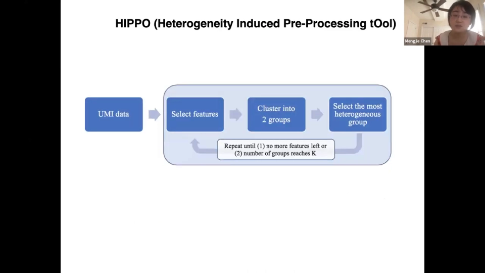

关键点在于**每一步用的特征基因都不一样**：在顶层区分 B 细胞和 NK 细胞用的基因，和在下层区分辅助 T 细胞与记忆 T 细胞用的基因，本来就不该是同一批。而常规做法是全局选一次高变基因、之后所有层级都用这一套——这正是它在细分亚型时吃力的原因。

而且 HIPPO 输出的不是一个"平铺"的簇标签，而是一棵**层次树**。讲者的理由很哲学：细胞类型是相对概念，每个细胞有自己的身份，聚类结构本就是层次化的，**不存在唯一正确的分组**；层次结构描述的才是细胞之间的相对相似性。[【跳转到 50:15】](https://www.youtube.com/watch?v=D-cEpmrwF2s&t=3015)

### 7.2 效果：难分的 T 细胞亚型

最能说明问题的是 T 细胞。记忆 T 细胞、naive T 细胞、调节性 T 细胞（Treg）、辅助 T 细胞彼此非常相似，常规方法很难分开。讲者展示的对比里，HIPPO 能把这几个亚群清楚分开，而用 PCA 或 SCTransform + PCA 的数据则分不开辅助 T 与记忆 T。[【跳转到 52:30】](https://www.youtube.com/watch?v=D-cEpmrwF2s&t=3150)

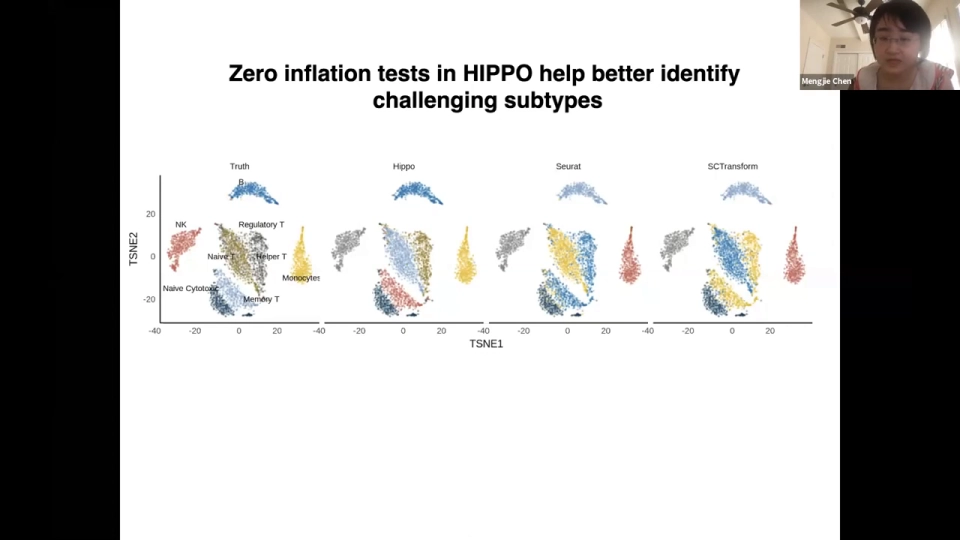

### 7.3 特征 ≠ 差异表达基因

一个容易混淆的地方：HIPPO 选出的"特征基因"和差异表达基因（DEG）**不是一回事**。零膨胀检验只用了"零 / 非零"这一位信息，所以它永远不会告诉你"2 和 10 之间有差异"；差异表达检验才用到具体计数。因此 HIPPO 会同时输出两类结果：基于零检测的特征，以及细胞类型特异的差异基因列表。[【跳转到 55:00】](https://www.youtube.com/watch?v=D-cEpmrwF2s&t=3300)

## 八、回到本节：零值问题的正解不是"把零填上"

把整场报告的结论压缩成一张决策清单（这里只讲策略取向，具体的质控指标与阈值属于 2.4.5，不在此展开）：

- **不要默认插补**。插补会制造数据里不存在的表达值、放大伪相关；上面的实验还显示，它会把标志基因的真实组间差异压平，在差异分析里直接制造假信号或丢失真信号。
- **不要默认"归一化先于聚类"**。当测序深度与细胞类型混杂时（这在 10x 数据里很常见），基于文库大小的归一化会把真实的生物学差异当技术噪声除掉。
- **把零当成信息，而不是噪声**。零比例本身是很好的异质性指标——它比方差和 CV 都稳健，而且在备择假设下严格单调，这正是零膨胀检验能成立的原因。
- **需要"二值化"的场合就大胆二值化**。零膨胀检验把计数压成 0/非零的指示变量，反而得到了更稳的统计量；这说明在很多问题上，"有没有"比"有多少"更可靠。
- **基因过滤与细胞过滤仍然必要**，但目的是去掉信息量过低的单元（几乎全零的基因、`nGene` 过低的细胞），而不是"修补"零——具体阈值见 2.4.5。
- **要做组间比较时，把细胞聚合到样本层面**（pseudobulk）。单细胞层面的检验把每个细胞当独立重复，零一多方差就爆；把细胞按样本聚合能显著降低这种假阳性。具体做法属于 5.2.2，这里只作为"绕过零"的路线提一句。
- **需要建模时，优先考虑过离散（overdispersion）而不是零膨胀**。负二项在少数基因上确有增益，但额外的零膨胀项几乎没有——这是本讲用似然比检验给出的最硬的证据。

一句话总结：**零值问题的正解通常不是"把零填上"，而是"换一个不依赖单细胞单基因精确定量的问题"。**

## 小结

- 单细胞矩阵里多数条目是零：三个数据集的基因级零检出率中位数落在 0.5 到 0.85 之间。
- 零来自一条分子计数链上的概率损失，其比例是表达量的函数：$P(y=0)=e^{-\lambda}$，低表达基因的零是必然。
- 一个零可能是生物学零、采样零（dropout）或其它技术零，**数据本身无法区分**；环境 RNA 与双细胞还会从反方向制造"假非零"。零是删失观测，既不是缺失值，也不等于"表达量为 0"。
- 对同质细胞群，**泊松模型就足够**；似然比检验显示只有少数基因需要负二项，而零膨胀项对几乎所有基因都没有增益。
- 真实数据里的过量零主要来自**细胞类型异质性**：CD34+ 细胞混着看偏离泊松，按亚群拆开就贴合。
- HLA、IG、TR 基因持续偏离泊松，原因是内在异质性（多态性、V(D)J 重组合），值得单独列黑名单。
- 零比例比方差和 CV 更适合做异质性特征选择，因为它在备择假设下严格更大，而方差不一定。
- 测序深度与细胞类型混杂，归一化和插补会压平真实的组间差异；**先聚类、再谈零**，是更稳的顺序。
- 零膨胀是一种建模选择，不是数据里可验证的事实；不要对单个细胞的单个基因下结论。

## 关键术语速查

| 术语 | 一句话解释 |
| --- | --- |
| dropout | 基因确实表达了，但 mRNA 分子在捕获到测序的某一环被漏掉，导致矩阵里出现 0 |
| zero-inflation | 在常规计数分布之上再加一个"结构性零"成分的建模方式，ZINB 即零膨胀负二项 |
| ZINB | zero-inflated negative binomial，零膨胀负二项；本讲用似然比检验说明它在 UMI 数据上通常没有必要 |
| negative binomial | 负二项分布，用离散度参数刻画方差大于均值的过离散现象 |
| overdispersion | 过离散，指观测方差超过均值（泊松的方差等于均值） |
| censored | 删失观测，只知道真实值低于检出下限，不知道具体值；单细胞的零属于这一类 |
| imputation | 插补，用邻近细胞的信息填补零；本讲指出它会压平真实差异、制造假信号 |
| pseudobulk | 把同一细胞类型下的细胞按样本求和/平均，得到类似 bulk 的表达矩阵，降低稀疏性带来的方差 |
| nGene | 一个细胞里检出的基因数，是细胞质量与测序深度的常用指标 |
| UMI | unique molecular identifier，扩增前加到 RNA 片段上的短序列，用于消除 PCR 扩增偏好 |
| ERCC | 外源掺入的标准 RNA，可用于估计检出率与定量下限（本讲未展开，属 2.4.5 的质控话题） |
| pseudo-count | 取对数前加的小常数（如 0.1），避免 $\log 0$ 与比值爆炸 |
| coefficient of variation | 变异系数，标准差除以均值；均值小时数值不稳定，本讲指出它不如零比例适合选特征 |
| zero detection rate | 零检出率，一个基因在所有细胞中为 0 的比例，是本节的核心统计量 |
