# 该不该给单细胞的零做插补？scImpute 的思路，与它顺带暴露的术语争议

> 视频来源：[An accurate and robust imputation method scImpute for single-cell RNA-seq data](https://www.youtube.com/watch?v=lOKEpbEV43o)（YouTube · ISMB 2018 会议报告，讲者 Wei，UCLA 统计系）｜时长约 20 分钟
> 导读：这是"插补"阵营的代表性报告——讲者论证 dropout 让差异表达分析产生大量假阳性与假阴性，因此需要显式的插补；scImpute 的关键设计是"只补最可能是 dropout 的那些值"。文末的提问环节尤其值得看：一位听众直接质疑"dropout event"这个术语本身就不该用。本文与同目录另一篇《单细胞矩阵里满屏的零》互为对照：那篇讲"为什么不该盲目补零"，这篇讲"要补的话该怎么补、以及补的边界在哪"。

## 本讲要解决的核心问题（SCQA）

**背景**：单细胞 RNA 测序能分辨单个细胞的转录组，从而识别新的细胞亚型与标志基因，这是 bulk RNA-seq 做不到的。它的代价是数据极度稀疏：同一个细胞群体里，一个基因在这个细胞里有中等以上表达，在另一个细胞里却精确地是 0。

**冲突**：这些 0 通常被解释为 dropout——转录本确实表达了，但在测序里没被检出。而很多下游分析（尤其是差异表达）依赖基因表达量的准确性，如果零被当成"真实的 0"参与计算，就会得到大量假阳性与假阴性。

**疑问**：既然零有这么大危害，是不是应该先把它们补上？如果要补，补哪些、补多少、怎么补，才不会把数据改成另一副样子？

**回答（中心思想）**：讲者的立场是"**要补，但只补该补的**"。scImpute 的核心不是"把矩阵里的零全部填掉"，而是先用一个混合模型**估计每个值来自 dropout 成分的概率**，只对高概率的那部分做插补，其余保留观测值——因为随意改动已经测准的值，本身就会引入新的偏差、抹掉有生物学意义的变异。这个"只动可疑值"的设计，恰好也是插补这条路线上最需要守住的分寸；而报告最后一位听众的评论则提醒我们：连"dropout 事件"这个说法都可能误导人，它不是一个把数据抹掉的单次事件，而是低表达分子在整条计数链上被系统性漏掉的过程。

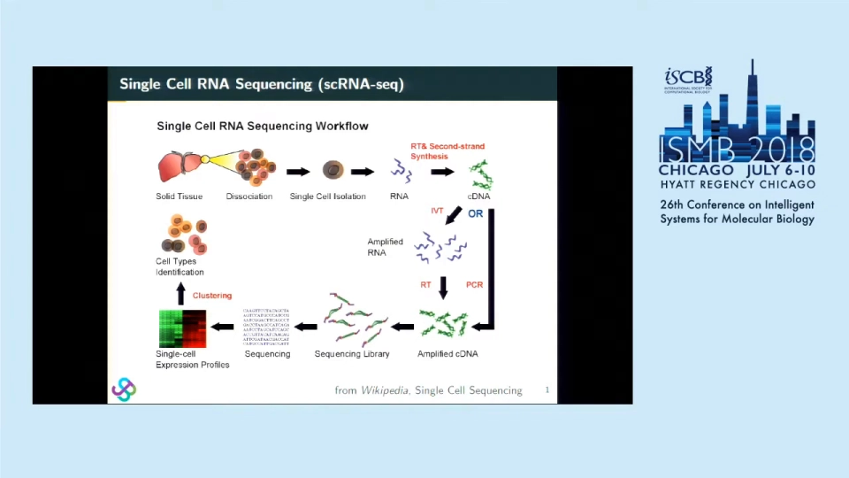

## 一、dropout 是什么，它有多普遍

### 1.1 正式定义：表达了，但没被检出

讲者给出的定义很干净：**dropout 事件发生在一个转录本确实在细胞里表达了，但完全没有出现在它的 mRNA 谱里的时候**。成因是单个细胞里的 mRNA 分子数量本就极少，测序时有一部分分子根本没被采到。[【跳转到 02:51】](https://www.youtube.com/watch?v=lOKEpbEV43o&t=171)

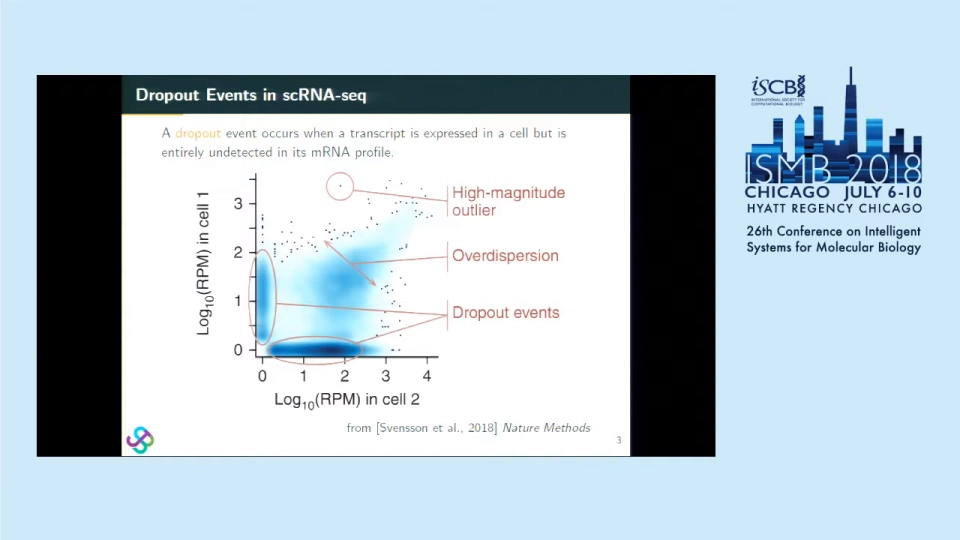

这张图（引自 Svensson 等人的方法学综述）把 dropout 放在了一个更大的框架里：除了贴着两条坐标轴的 dropout 点，还有"过离散"（overdispersion，同一表达水平下方差偏大）和"高幅度离群点"。**三者是不同的现象，但都会让"零"变得难以解释**。

### 1.2 越省钱的方案，dropout 越多

dropout 的频率取决于建库方案。讲者给了两组对比数字：Fluidigm C1 平台一次能测约 100 个细胞，每细胞约 100 万条 reads；液滴微流控（droplet microfluidics）一次能测约 10,000 个细胞，每细胞只有约 10 万条 reads。[【跳转到 03:41】](https://www.youtube.com/watch?v=lOKEpbEV43o&t=221)

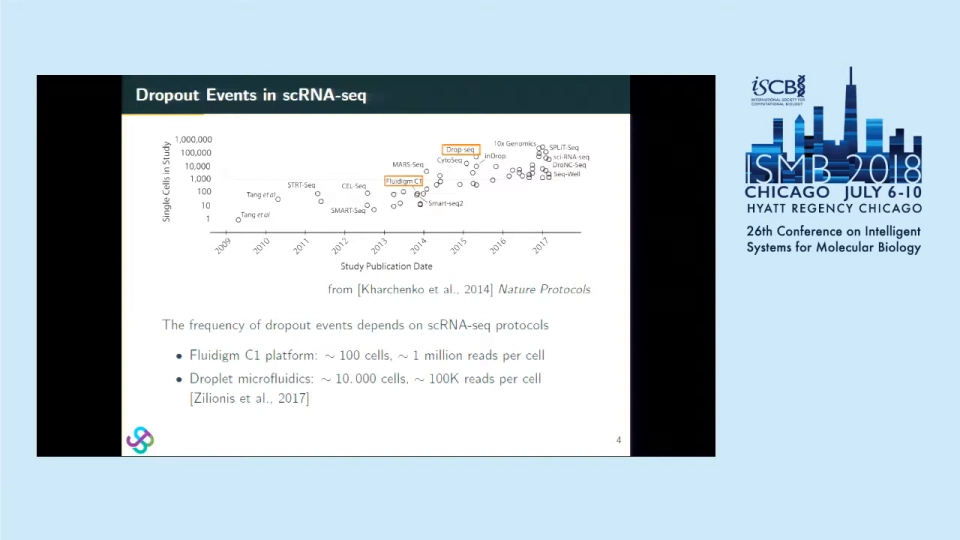

这是一条很朴素的权衡：**通量提高一个数量级，每个细胞能分到的测序量就下降一个数量级，漏掉分子的概率随之上升**。所以"dropout 严重"不是某个平台做错了什么，而是通量与精度之间的必然取舍。（测序深度对 dropout 的影响属于 2.4.4 的话题，这里只作为一个因果链提一句。）

### 1.3 为什么值得为它专门做一个方法

讲者的动机很直接：**很多下游分析依赖基因表达量的准确性**，差异表达分析尤其如此。如果零被当作真实的 0 参与统计，就会在结果里塞进大量假阳性与假阴性。既然 dropout 是系统性的、可建模的，那就应该显式地把它修掉——这就是 scImpute 的出发点。

## 二、scImpute 的核心分寸：只补最可疑的那些值

### 2.1 一个反直觉的设计原则

大多数插补方法（比如后面要对比的 MAGIC、SAVER）会把整张矩阵做一次平滑或重构。scImpute 明确拒绝了这种做法：**有些值本来就已经测得很准，动它们会引入新的偏差、抹掉有生物学意义的变异**。[【跳转到 04:31】](https://www.youtube.com/watch?v=lOKEpbEV43o&t=271)

于是核心思路变成两步：

1. 对**每个基因**，判断哪些表达值最可能是 dropout 造成的；
2. 对**每个细胞**，只插补那些高概率是 dropout 的值，信息从"相似细胞里同一个基因的表达"借过来。

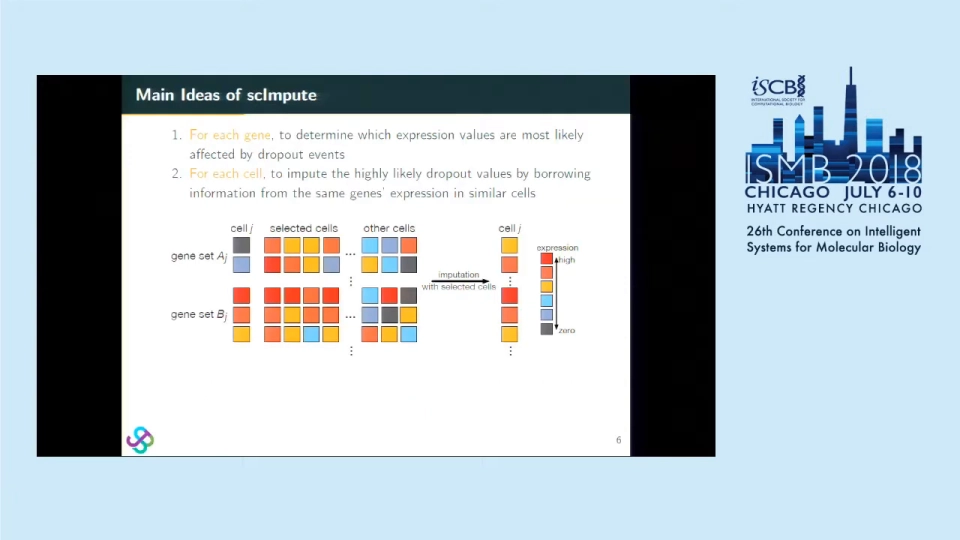

这个设计把"插补"从"全局改写"变成了"定点修复"，风险自然小得多。

### 2.2 为什么可以用"双峰"来区分 dropout 与真表达

讲者展示了人类胚胎干细胞数据里三个基因在三个亚群中的表达分布，有两个观察：第一，同一个基因在不同亚群里的分布不一样；第二，**所有分布都呈现双峰**——第一个峰主要代表 dropout 成分，第二个峰代表真实表达。[【跳转到 05:46】](https://www.youtube.com/watch?v=lOKEpbEV43o&t=346)

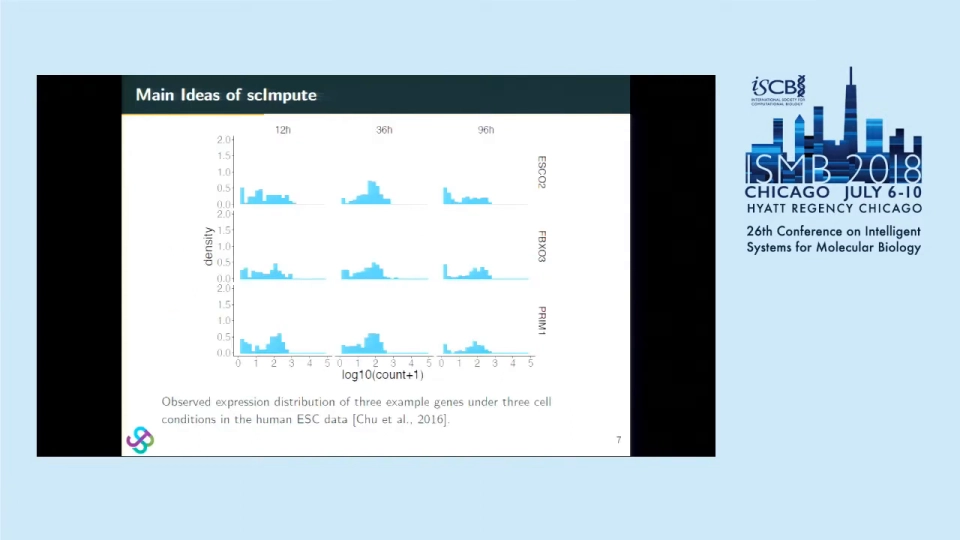

双峰是 scImpute 全部方法的经验基础：**如果 dropout 与真表达在分布上可分，就能用混合模型把它们拆开**。反过来说，这个假设不成立的地方（比如表达量极低、两峰糊在一起的基因），方法的分辨力就会下降——这是这类方法的共同软肋。

### 2.3 三步流程

整个算法分三步：[【跳转到 06:36】](https://www.youtube.com/watch?v=lOKEpbEV43o&t=396)

1. **检测细胞亚群与离群细胞**：先做 PCA 降维（顺便削弱 dropout 值的影响），算细胞间距离矩阵；没有近邻的细胞被标为离群点——它们可能是技术错误，也可能是稀有细胞类型，插补时先排除；
2. **识别 dropout 值**：对每个亚群拟合混合模型，估计每个值是 dropout 的概率；
3. **逐细胞插补**：只对高概率是 dropout 的值做插补。

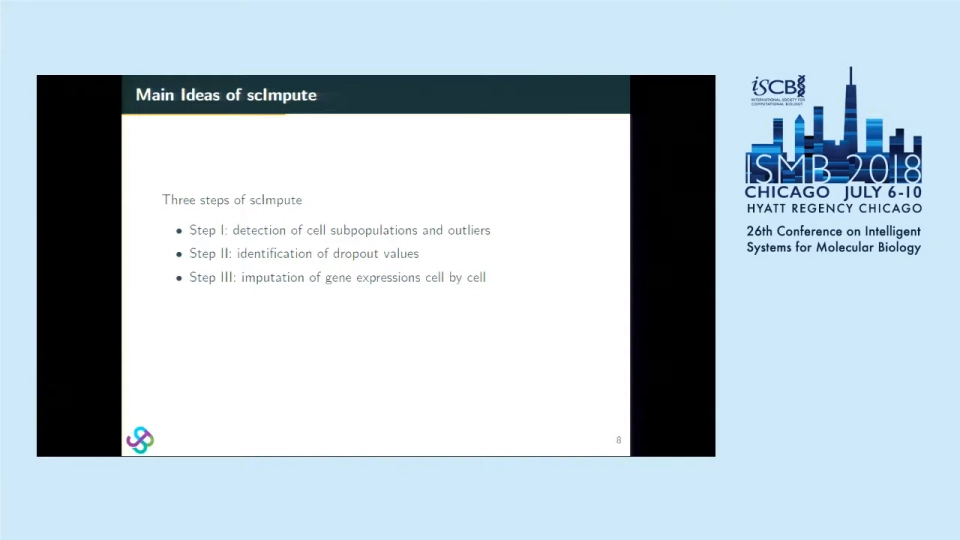

### 2.4 混合模型：用 Gamma 描述 dropout，用正态描述真表达

第 2 步的模型很简洁。对亚群 $k$ 中的基因 $i$，把表达量看成一个随机变量，它是两个成分的混合：

$$
f_{X_i^{(k)}}(x) = \lambda_i^{(k)} \cdot \mathrm{Gamma}\left(x; \alpha_i^{(k)}, \beta_i^{(k)}\right) + \left(1 - \lambda_i^{(k)}\right) \cdot \mathrm{Normal}\left(x; \mu_i^{(k)}, \tau_i^{(k)2}\right)
$$

其中 $\lambda_i^{(k)}$ 是基因 $i$ 在亚群 $k$ 中的 **dropout 率**：以概率 $\lambda$ 这个值来自 dropout 成分（Gamma），以概率 $1-\lambda$ 来自正确扩增的成分（正态）。参数用 EM 算法估计。[【跳转到 07:26】](https://www.youtube.com/watch?v=lOKEpbEV43o&t=446)

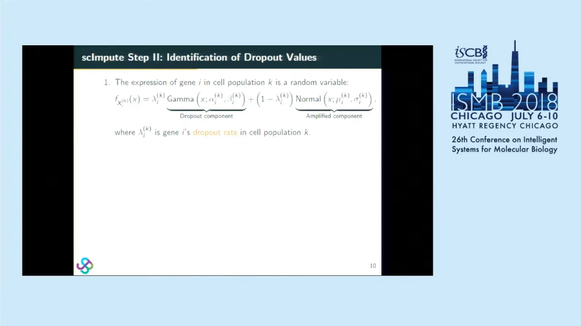

拟合效果可以直观检查：蓝色直方图是观测分布，黑线是混合模型的拟合曲线，两者贴合得相当好。[【跳转到 08:41】](https://www.youtube.com/watch?v=lOKEpbEV43o&t=521)

### 2.5 两个容易混淆的概念：dropout 率 vs dropout 概率

讲者特意强调了一处区分，这也是读这篇论文时最容易搞混的地方：

- **dropout 率** $\lambda_i^{(k)}$：属于基因 $i$ 在亚群 $k$ 的**整体**属性，不随细胞变化；
- **dropout 概率** $d_{ij}$：基因 $i$ 在**具体细胞** $j$ 中来自 dropout 成分的后验概率，逐细胞不同。

真正决定"补不补"的是后者。设定阈值 $t$（程序默认 0.5，可调），把每个细胞的基因分成两组：

$$
A_j = \{ i : d_{ij} \ge t \}, \qquad B_j = \{ i : d_{ij} < t \}
$$

$A_j$ 需要插补，$B_j$ 被认为测得很准、保持原样。[【跳转到 09:31】](https://www.youtube.com/watch?v=lOKEpbEV43o&t=571)

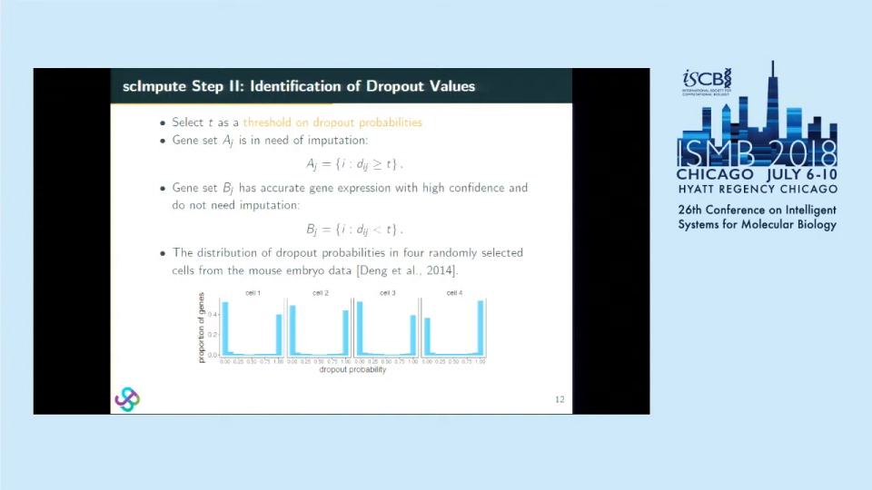

有意思的是，四个随机抽取的细胞里，dropout 概率的分布**几乎全部集中在 0 或 1 附近**——中间地带很少。这意味着阈值取 0.5 还是 0.3，结果差别不大，方法对超参数不敏感。

### 2.6 插补本身：用非负最小二乘挑"真正相似"的细胞

第 3 步要解决一个遗留问题：第一步谱聚类得到的候选邻居集合可能不够准。做法是对每个细胞 $j$，在候选邻居集 $N_j$ 里用**非负最小二乘（NNLS）**回归，解出权重：

$$
\hat{\beta}^{(j)} = \arg\min_{\beta^{(j)}} \left\lVert X_{B_j, j} - X_{B_j, N_j}\beta^{(j)} \right\rVert_2^2 \quad \text{s.t.} \quad \beta^{(j)} \ge 0
$$

注意回归**只在 $B_j$ 这组"测得准的基因"上做**——用可靠的信息去定义"谁和谁相似"，再用这个相似性去补不可靠的部分。权重为正的细胞才算相似细胞；对 $A_j$ 里的基因，用这些相似细胞的加权预测值替换观测值。[【跳转到 09:56】](https://www.youtube.com/watch?v=lOKEpbEV43o&t=596)

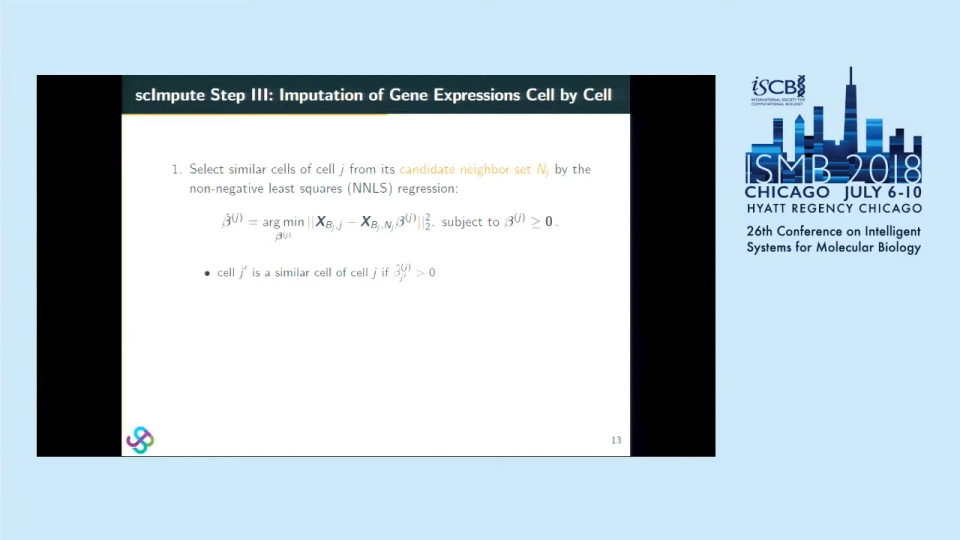

## 三、怎么证明补对了：四组证据

### 3.1 ERCC 掺入：有标准答案的考试

最硬的验证来自 ERCC spike-in——人工合成、浓度已知的转录本。讲者用了小鼠皮层约 3,000 个细胞、57 条 ERCC 的数据：原始数据里，随机抽的四个细胞都存在多个 dropout（spike-in 的读数为 0）；插补之后，读数与真实浓度的相关性明显改善。[【跳转到 10:46】](https://www.youtube.com/watch?v=lOKEpbEV43o&t=646)

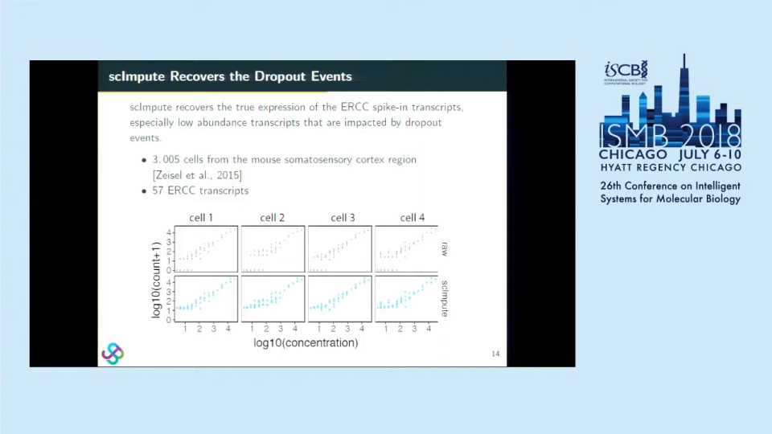

这是本节里最有说服力的一类证据：**因为知道标准答案，所以能直接判断补得对不对**。它同时也说明 dropout 确实存在、确实可以被部分恢复。

### 3.2 合成数据：与 MAGIC、SAVER 对比

第二组是合成数据：3 个细胞类型各 50 个细胞、共 20,000 个基因，其中 810 个基因真正差异表达。先造出"完整数据"（已知真相），再人为引入 dropout，然后比较各方法的恢复能力。[【跳转到 12:01】](https://www.youtube.com/watch?v=lOKEpbEV43o&t=721)

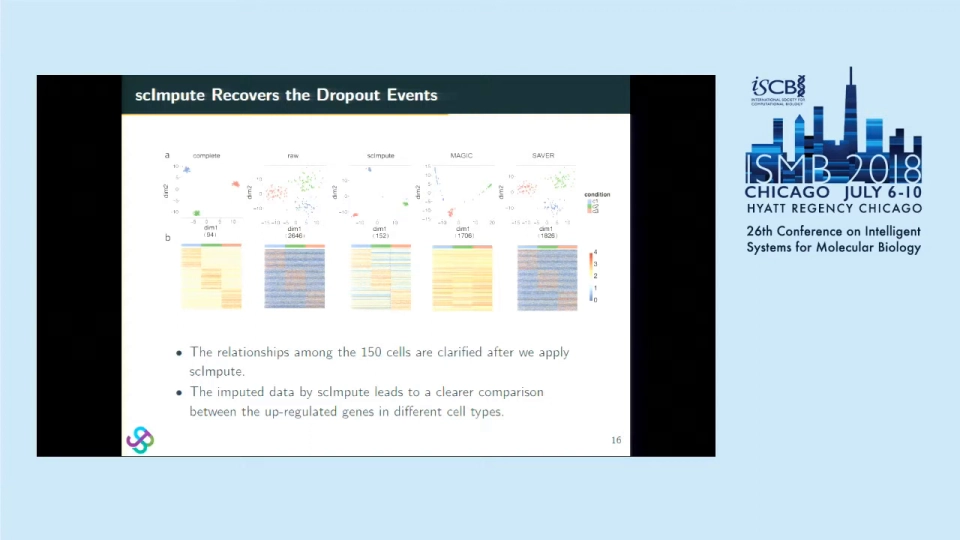

结果值得细看：完整数据里三个细胞类型分得很清楚；引入 dropout 后结构变模糊；scImpute 之后结构重新清晰；**MAGIC 则引入了完整数据里根本不存在的结构**；SAVER 对原始数据几乎没有明显影响。这个对比点出了插补方法最危险的一种失败模式——**不是补得不够，而是补出了假结构**。

### 3.3 真实数据：4,500 个 PBMC，92.6% 是零

第三组是 10x 的 4,500 个外周血单核细胞（PBMC）。讲者给了一个很有冲击力的数字：**原始数据的零比例是 92.6%**。[【跳转到 13:16】](https://www.youtube.com/watch?v=lOKEpbEV43o&t=796)

在原始数据里，几个 T 细胞亚型混在一起、分不开；插补之后才分得开。（讲者也提到 SAVER 在这个数据上跑了一整夜加一周仍没出结果，因此被排除在对比之外——这本身说明了插补方法的计算代价差异之大。）

### 3.4 时间序列：把被零盖住的趋势找回来

最后一组是胚胎干细胞向定型内胚层分化过程中的 bulk 与单细胞配对数据。以左下角那个基因为例：bulk 数据（黑色三角）显示它的表达先降后升，但原始单细胞数据里这个趋势被 dropout 完全盖住了；插补之后趋势重新显现。[【跳转到 14:31】](https://www.youtube.com/watch?v=lOKEpbEV43o&t=871)

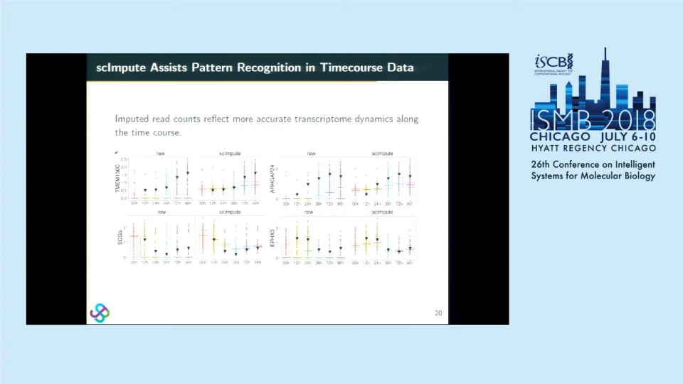

讲者还比较了两种数据各自检出的差异基因，发现插补后多出来的那部分基因富集到的 GO 条目，与内胚层细胞的功能高度相关——也就是说，**补回来的信号是有生物学意义的，不只是数值上的修补**。

## 四、提问环节：两个比方法本身更重要的问题

### 4.1 "dropout 事件"这个说法本身就有问题

一位听众的评论值得完整记下来，因为它直接指向本小节的核心：**用"dropout event"来描述这件事其实相当令人困惑**。导致数据里出现零的并不是某一个单次事件，而是一系列事件——样本里可能存在好几个分子，但它们由于种种原因都没有被测到，于是你看到零。同样的情况也发生在非零的位置上：仅仅因为数据里看到一个计数，并不意味着样本里只有一个分子，实际可能更多。[【跳转到 17:51】](https://www.youtube.com/watch?v=lOKEpbEV43o&t=1071)

所以这是一个**影响所有数据、而不只是影响零**的过程。把它叫做"事件"，会让人以为有某个特殊的东西在任意地抹掉某些位置的数据；而实际发生的是：那里表达量低、分子很少，所以更容易全部漏掉。这位听众的建议是：干脆放弃 "dropout" 这个术语，换一种方式描述这个现象。

这个批评和 scImpute 的模型其实是自洽的——混合模型里那个 Gamma 成分描述的正是"低表达、易漏检"的区域，而不是某个离散的故障。[【跳转到 18:41】](https://www.youtube.com/watch?v=lOKEpbEV43o&t=1121)

### 4.2 插补会不会把连续分布变成离散的簇

第二个问题针对合成数据那张 PCA 图：插补之后细胞群体看起来更"离散"了，这是更好的结果吗？有时候我们恰恰希望细胞分布是连续的，硬把它分成离散的转录亚群可能引入别的问题。[【跳转到 19:31】](https://www.youtube.com/watch?v=lOKEpbEV43o&t=1171)

讲者的回答很谨慎：那张图是 t-SNE 的前两个维度，**在 t-SNE 上比较簇间距离本来就没有太大意义**，它只适合用来识别不同的细胞群体；如果要讨论群体之间的距离，应该看 PCA 的结果。这个回答其实也提示了一个通用原则：**用降维图去论证"插补改善了结构"，本身就有循环论证的风险**。

### 4.3 其它两个实务问题

- **能不能扩展到百万细胞？** 讲者没试过，但按经验运行时间大致随细胞数线性增长，百万级会慢很多。
- **多批次数据怎么办？** scImpute 假设输入是已归一化的矩阵；如果存在批次效应，建议先归一化再插补。

讲者自己的总结是四条：scImpute 针对 scRNA-seq 中普遍存在的 dropout；它只插补 dropout 基因的缺失表达值、保留基本未受 dropout 影响的基因；它能与现有的归一化、差异表达、聚类、分类流程兼容；并且随细胞数增加可以扩展。[【跳转到 15:21】](https://www.youtube.com/watch?v=lOKEpbEV43o&t=921)

## 五、把两篇放在一起看：插补的边界在哪

同目录的另一篇博客记录了一场立场相反的检验（[《单细胞矩阵里满屏的零》](单细胞矩阵里的零从哪里来：Dropout、零膨胀与过度校正.md)）：对同质细胞群，泊松模型就足以解释观测到的零；额外的零膨胀项没有增益；而且归一化和插补会把细胞类型之间的真实差异压平。把两场报告放在一起，可以得到一个比任何一方单独都更稳的结论：

1. **dropout 确实存在，也确实可以被部分恢复**——ERCC 掺入实验是硬证据，这一点不该被否定。
2. **但不是所有的零都是 dropout**。真实数据里大量的零来自细胞类型异质性（某类细胞本来就不表达），把它们当 dropout 补上，就是在制造不存在的表达。
3. **所以插补必须"定点"而不是"全局"**。scImpute 之所以相对安全，恰恰因为它只动高概率是 dropout 的值，并且用"测得准的基因"去定义相似性；而全局平滑类方法（如把整张矩阵做扩散的 MAGIC）的风险在于会引入数据里不存在的结构。
4. **验证插补的方法，比插补本身更重要**。有标准答案的场景（ERCC、合成数据、配对 bulk）可以验证；没有标准答案的真实数据里，"插补后簇更清楚了"不能当作插补有效的证据——降维图上的结构变化可能只是方法的产物。
5. **术语会影响判断**。"dropout event" 听起来像偶发故障，"低表达分子被系统性漏检"听起来像抽样过程——后者才是真相，也才能推出正确的处理方式。

## 小结

- dropout 的定义：转录本表达了，但完全没有出现在该细胞的 mRNA 谱里；成因是单细胞里 mRNA 分子数极少。
- dropout 的频率与建库方案强相关：Fluidigm C1 约 100 细胞 / 每细胞约 100 万 reads；液滴法约 10,000 细胞 / 每细胞约 10 万 reads。
- scImpute 的核心不是"全补"，而是"只补最可疑的"：先估计每个值来自 dropout 成分的概率，只对高概率值插补，其余保留观测值。
- 方法分三步：检测亚群与离群点 → 用 Gamma + 正态的混合模型识别 dropout 值 → 用非负最小二乘挑相似细胞、逐细胞插补。
- 区分两个概念：dropout 率 $\lambda_i^{(k)}$ 是基因在亚群层面的属性；dropout 概率 $d_{ij}$ 是基因在具体细胞里的后验概率，后者才决定补不补。
- 验证证据包括 ERCC 掺入（有标准答案）、合成数据对比（MAGIC 会引入假结构）、4,500 个 PBMC（原始零比例 92.6%）、分化时间序列（恢复被零盖住的趋势）。
- 提问环节的两个批评比方法本身更重要：一是"dropout event"这个术语会误导人，它是低表达分子被系统性漏检的过程，不是偶发故障；二是"插补后簇更清楚"不能直接当作插补有效的证据。
- 插补的合理边界：只在零确实高概率来自 dropout 时补，且必须用有标准答案的场景验证。

## 关键术语速查

| 术语 | 一句话解释 |
| --- | --- |
| dropout | 转录本确实表达了，但完全没被检出，导致矩阵里出现 0 |
| imputation | 插补，用其它细胞或基因的信息填补零值 |
| scImpute | 本讲的插补方法，只对高概率是 dropout 的值做插补，其余保留观测值 |
| dropout rate | dropout 率，基因在某个细胞亚群中来自 dropout 成分的先验概率 |
| dropout probability | dropout 概率，某个基因在某个具体细胞中来自 dropout 成分的后验概率，逐细胞不同 |
| mixture model | 混合模型，用两个分布的加权和描述双峰数据；这里 Gamma 对应 dropout、正态对应真表达 |
| EM algorithm | 期望最大化算法，用于估计混合模型的参数 |
| NNLS | 非负最小二乘，带非负约束的回归，用来在候选邻居中挑出真正相似的细胞 |
| ERCC | 外源掺入的合成 RNA，浓度已知，可用来检验插补是否恢复了真实表达 |
| MAGIC | 一种基于扩散的全局插补方法；本讲的合成数据实验里它引入了原本不存在的结构 |
| SAVER | 另一种插补方法，本讲中它对原始数据的改变不明显，计算代价也很大 |
| overdispersion | 过离散，同一表达水平下观测方差大于模型预期 |
| pseudo-count | 取对数前加的小常数，避免 $\log 0$；本讲输入是已归一化并取过对数的矩阵 |
| t-SNE | 一种非线性降维可视化方法，适合看群体结构，不适合比较簇间距离 |