# DoubletFinder 剔除双细胞：原理、参数与单样本实操

> 视频来源：[【Broca】单细胞测序分析，使用 DoubletFinder 剔除双细胞全流程详解！（附完整代码）](https://www.bilibili.com/video/BV1mavaBWEsW/)（Bilibili · Broca区想发言）｜时长约 21 分钟
> 导读：这支视频把 DoubletFinder 拆成「为什么删 → 算法怎么算 → 三个参数怎么定 → 代码怎么跑」四段，全程在 RStudio 里逐行演示，示例是六个 10x 样本（GSE302285）。本文按这条线索整理，并把讲者反复强调的「必须单样本跑」放在第五章单独说明。

## 本讲要解决的核心问题（SCQA）

**背景**：单细胞测序的每个液滴理论上只装一个细胞、一个 barcode。质控阶段我们已经按线粒体比例、基因数把「破损细胞」筛掉了。

**冲突**：但还有一类细胞，它们的质控指标完全正常——基因数正常、线粒体比例正常、RNA 含量甚至偏高——却是**两个细胞共用一个 barcode**。这类细胞叫 doublet（双细胞）。它们不会被常规质控拦住，却会在聚类图上伪装成「同时表达两套 marker 的新亚群」，在拟时序分析里伪装成「过渡态」。

**疑问**：怎么把这类细胞找出来？DoubletFinder 的三个参数（pN、pK、nExp）各是什么意思、怎么定？为什么官方坚持「必须单样本跑」？

**回答（中心思想）**：DoubletFinder 的思路是**先造假、再比对**——在真实数据里人工合成双细胞，看每个真实细胞在 PCA 空间里「离人工双细胞有多近」，用这个比例（pANN）当双细胞分数。三个参数里只有 pK 需要搜索（用 BCmetric 取最大值），pN 用默认 0.25 即可，nExp 要从 10x 官方表格按细胞数查、并用同型双细胞比例做一次下调。整个流程必须在**质控后的单样本**上跑，跑完再把各样本合并。

## 一、双细胞是什么，为什么必须删

### 1.1 定义：一个液滴装进了两个细胞

讲者的定义很直接：**双细胞就是两个不同的细胞意外地被包裹在了一个液滴里**。测序仪分辨不出来，只能把它们当成一个细胞来测量，结果就是这个 barcode 同时拥有了两套基因的表达谱——「就像一个嵌合体」。

这件事为什么危险？讲者给了两个具体的后果：

1. **伪装成稀有亚群**。在聚类分析中，双细胞往往单独聚成一个小类。如果你正好在研究「某种具有两种特征的细胞」，这个小类看起来就像是你要找的答案，从而得出完全错误的生物学结论。
2. **伪装成过渡态**。在 UMAP 上，双细胞常常落在两个细胞亚群**之间**，形成一座「假桥梁」。拟时序算法看到它，会误认为这是细胞分化的过渡状态或中间阶段，把整条轨迹的方向带偏。

[【跳转到 00:17】](https://www.bilibili.com/video/BV1mavaBWEsW/?t=17)

### 1.2 两类双细胞：异型与同型

这是理解后面所有参数的前提。讲者把双细胞分成两类：

| 类型 | 构成 | 表达谱特征 | 检测难度 |
| --- | --- | --- | --- |
| 异型双细胞（heterotypic） | 两个**不同类型**的细胞，如 T 细胞 + B 细胞 | 同时表达两套谱系 marker，明显异常 | 容易检测 |
| 同型双细胞（homotypic） | 两个**相同类型**的细胞，如两个 T 细胞 | 与单个细胞只有表达量上的差别，没有表达类型上的区别 | 几乎无法用表达谱检测 |

讲者的判断是：**同型双细胞对结果的影响一般不严重**——你最多会认为「这个细胞的表达量更高了」，而不会凭空多出一个细胞类型。所以今天的流程目标是「尽可能剔除异型双细胞」，同型双细胞则通过估算的方式**保留**下来（不强行删除）。

这个取舍直接决定了后面 `nExp` 参数的计算方式：先按 10x 表格估出「总双细胞数」，再乘上「1 − 同型双细胞比例」，得到真正要删的数目。

[【跳转到 02:45】](https://www.bilibili.com/video/BV1mavaBWEsW/?t=165)

## 二、DoubletFinder 的原理：先造假，再比对

讲者对原理的概括只有一句，但很准确：**DoubletFinder 从现有的 Seurat 对象中模拟双细胞的数据，从而进行剔除**。

具体展开是五步（这也是理解三个参数的基础）：

1. **人工合成双细胞**：随机挑两两真实细胞，把它们的表达谱（counts）加起来，造出「人工双细胞」。造多少个由 `pN` 决定——`pN = 0.25` 表示人工双细胞的数量是真实细胞的 25%。
2. **混合并预处理**：把人工双细胞和真实细胞混在一起，走一遍标准的标准化、找高变基因、PCA。
3. **在 PCA 空间里找邻居**：对每个细胞找它的近邻，统计这些近邻里「人工双细胞」占多大比例。这个比例就是 **pANN**（proportion of artificial nearest neighbors）。邻居圈多大由 `pK` 决定。
4. **按预期数目定阈值**：把所有细胞的 pANN 从高到低排序，取前 `nExp` 个判为双细胞（`nExp` = expected number of doublets，预期双细胞数）。
5. **输出结果**：每个细胞得到两个新字段——`Doublet_score`（pANN 分数）和 `Singlet_Doublet`（判定结果）。

直觉上：**一个真实细胞如果和人工双细胞长得像（在 PCA 空间里挨着），它自己也很可能是双细胞**。人工双细胞是「已知答案的考题」，真实细胞是「考生」，pANN 就是「考生和标准答案的接近程度」。

[【跳转到 08:48】](https://www.bilibili.com/video/BV1mavaBWEsW/?t=528)

## 三、三个参数：只有一个需要搜索

讲者把参数逐个拆开讲，这是本文最实用的部分。

### 3.1 `pN`：人工双细胞的比例，用默认值

`pN = 0.25`（默认）表示生成 25% 的人工双细胞。讲者的说明是：DoubletFinder 作者已经验证**算法性能不依赖 pN**，所以官方直接给了默认值 0.25，一般不需要改。

在示例里，控制台打印出 `Creating 11637 artificial doublets`——这就是 `pN × 真实细胞数` 的结果。

### 3.2 `pK`：邻居圈大小，必须搜索

`pK` 决定「参考多少个邻居」来计算 pANN。它是**唯一一个对结果影响很大的参数**，所以必须搜索最优值。

搜索的做法是 `paramSweep()` 扫一遍 pK 的取值，再用 `summarizeSweep()` 汇总，最后用 `find.pK()` 挑出 **BCmetric（bimodality coefficient，双峰系数）最大**的那个 pK。讲者的解释是：BCmetric 衡量的是 pANN 分布「双峰」的明显程度——双峰越明显，说明「单细胞」和「双细胞」两群分得越开，这个 pK 就越好。

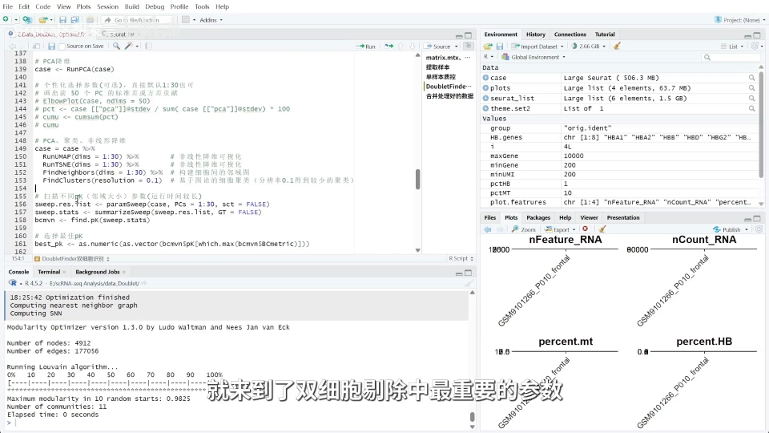

示例里 `best_pk` 落在 **0.23**（讲者口述「best pK 是 0.23」）。代码里用一行 `find.pK()` 的结果取 BCmetric 最大值对应的 pK，并存进 `best_pk` 变量：

```r
best_pk <- as.numeric(as.vector(bcmvn$pK[which.max(bcmvn$BCmetric)]))
```

> 注意：pK 的搜索比较耗时（讲者提示「运行时间比较长，同学们根据自己的电脑情况需要等待一定的时间」）。这是整个流程里最慢的一步。

[【跳转到 10:25】](https://www.bilibili.com/video/BV1mavaBWEsW/?t=625)

### 3.3 `nExp`：预期双细胞数，要查表 + 校正

`nExp` 是最容易被随手写死的参数，讲者专门花时间讲它。

**第一步：查表。** 10x Genomics 的用户指南给出了「上样细胞数 / 回收细胞数 → 双细胞比例」的对照表。讲者在视频里打开了 DoubletFinder 的 GitHub issue，页面上就贴着这张表：


讲者举的例子：测了约 5000 个细胞，双细胞比例大约 2.3%；测 1 万个，比例在 4.6%~5.4% 之间。他给的换算经验是**每多 1000 个细胞，双细胞率大约增加 0.8%**。

**第二步：按自己的细胞数取值。** 示例的样本 1 有 4912 个细胞，落在 2.3%~3.1% 区间，讲者取了 **2.4%**。

**第三步：扣掉同型双细胞。** 因为算法实际只能识别异型双细胞，所以要把「同型双细胞占的比例」从预期数里减掉：

```r
annotations <- case$seurat_clusters                      # 用聚类结果作为细胞类型标签
homotypic.prop <- modelHomotypic(annotations)            # 估算同型双细胞比例
nExp_poi <- round(0.024 * nrow(case@meta.data))          # 按 2.4% 估算总双细胞数
nExp_poi.adj <- round(nExp_poi * (1 - homotypic.prop))   # 扣除同型双细胞
```

示例里 `homotypic.prop` 约为 0.15，`nExp_poi` 为 118，校正后 `nExp_poi.adj` 为 **100**——也就是说，4912 个细胞里真正要删的是 100 个（讲者口述时也说「最后调整过后的双细胞数目其实只有 100 个」）。

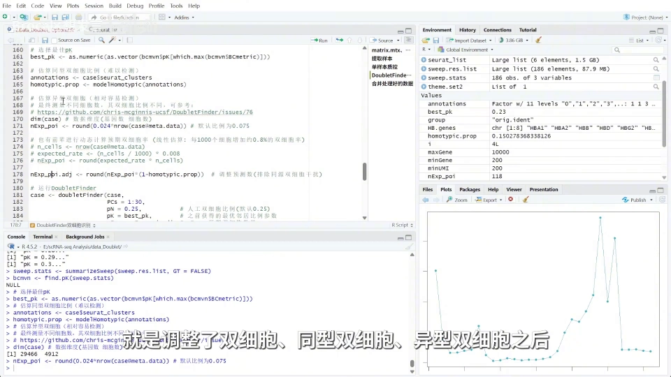

> 讲者提到，有些分享会用「动态计算」代替查表：既然每 1000 个细胞约 0.8% 双细胞率，就直接用细胞数除以 1000 再乘 0.8% 来算比例。这样做的好处是不用每次手动改参数，坏处是偏离了官方表格——两种做法都行，关键是你知道自己在用哪一种。

[【跳转到 12:08】](https://www.bilibili.com/video/BV1mavaBWEsW/?t=728)
## 四、代码流程：为什么必须「单样本」跑

### 4.1 官方立场：不要在整个 Seurat 对象上跑

讲者开场就把这条列为「需要说明的第一件事」：**DoubletFinder 官方强烈建议使用单样本处理**。

什么叫「不是单样本」？读数据时把六个样本用 `merge()` + `joinLayers()` 合并成一个 Seurat 对象，这个对象里 `orig.ident` 有六个取值——这就是多样本对象。在它上面直接跑 DoubletFinder，讲者的评价是「可能会有误差」。

原因不难理解：不同样本的双细胞率不同（取决于上样细胞数），而 DoubletFinder 的 `nExp` 是**一个标量**——它只能给整个对象设定一个预期数目。多样本合并后，你没法对每个样本用各自的比例。

讲者也提到，有些前辈为了省时间会直接在整个对象上跑。他的态度是：可以理解，但本次仍按官方推荐的单样本流程演示。

[【跳转到 05:25】](https://www.bilibili.com/video/BV1mavaBWEsW/?t=325)

[【跳转到 01:51】](https://www.bilibili.com/video/BV1mavaBWEsW/?t=111)

### 4.2 整体骨架：在 merge 之前插入一步

讲者的代码结构很清晰，本质上是把「读数据」和「合并」之间的空隙撑开，插入双细胞剔除：

```
读入 6 个样本 → seurat_list（每个元素是一个单样本 Seurat 对象）
        ↓   ← 在这里插入：单样本质控 + DoubletFinder
   逐样本处理（样本1、样本2、……）
        ↓   ← 处理完回填 seurat_list
merge() + joinLayers() → 最终的 Seurat 对象
```

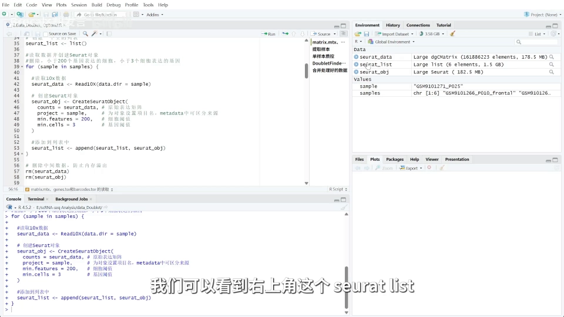

讲者的脚本开头有一段注释，把整个设计意图写得很清楚：

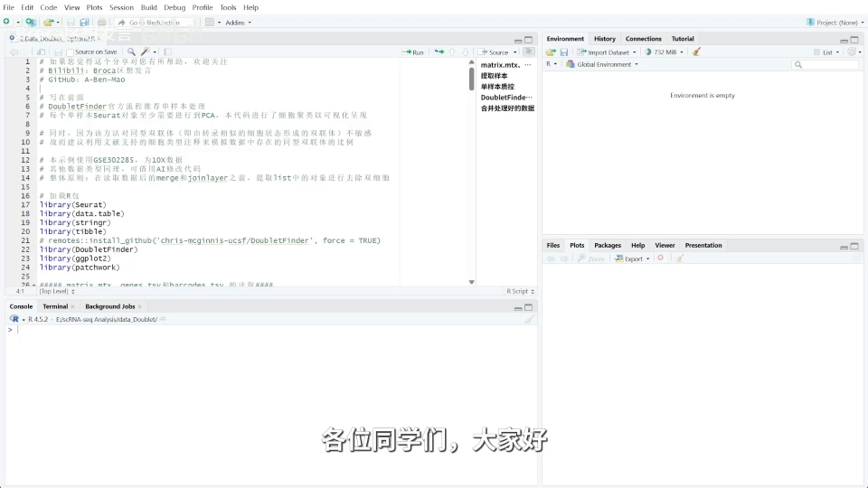

这段注释里有一条容易被忽略但很重要的提醒：**`modelHomotypic()` 的输入是「细胞类型注释」**，而讲者这里用的是聚类得到的 `seurat_clusters`。注释里也承认，更严谨的做法是用「有文献支持的细胞类型注释」——因为同型双细胞的比例取决于真实的细胞类型组成，而不是聚类编号。

### 4.3 单样本质控：先清掉低质量细胞，再谈双细胞

在跑 DoubletFinder 之前，每个样本要先过一遍常规质控。讲者说这一步和之前质控那期视频完全一样，流程是：

1. 看 `nCount` 与 `percent.mt`、`nCount` 与 `nFeature` 的相关性；
2. 画质控前的小提琴图；
3. 按分布定阈值：`nFeature` 保留 90% 以上、线粒体 10% 以下、红细胞（`percent.HB`）1% 以下；
4. `subset()` 过滤，再画一次质控后的小提琴图确认。

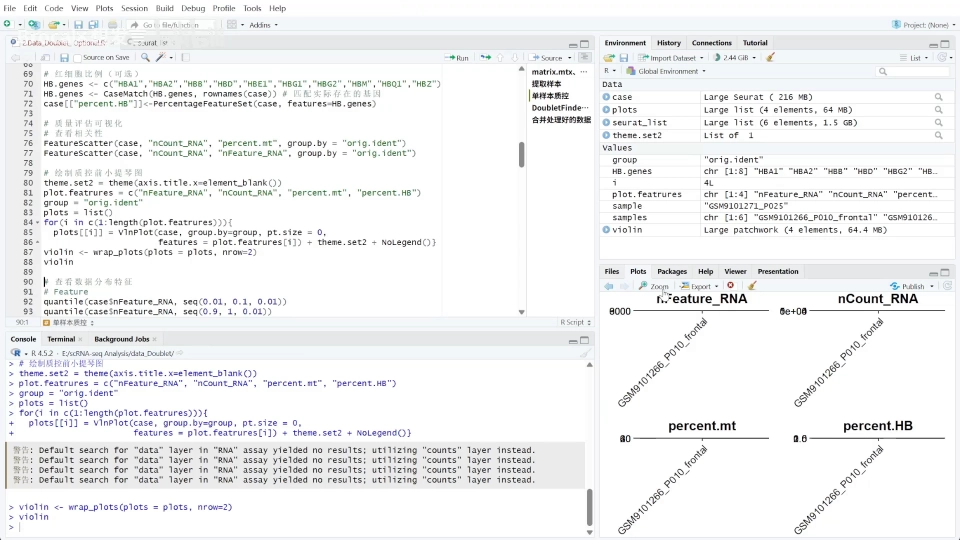

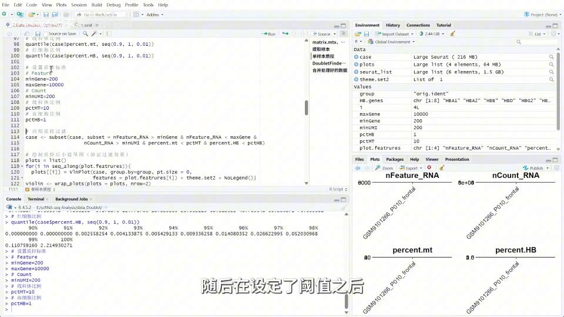

**顺序很重要**：先质控、再双细胞。理由很实在——如果低质量细胞还留在数据里，它们会在 PCA 空间里形成自己的「噪声角落」，干扰 pANN 的计算；而且低质量细胞本身也可能被判成双细胞，让你分不清删掉的是哪种问题。

### 4.4 至少跑到 PCA

DoubletFinder 需要 PCA 空间来计算邻居，所以每个样本至少要跑完：标准化 → 找高变基因 → scale → PCA。

讲者为了后面能可视化双细胞的位置，额外跑了 UMAP、tSNE 和聚类（`FindNeighbors` + `FindClusters`，PC 取 30、resolution 取 0.1）。他明确说：**这些只是为了看图，算法本身只需要 PCA**。

[【跳转到 09:29】](https://www.bilibili.com/video/BV1mavaBWEsW/?t=569)

### 4.5 跑 DoubletFinder 并改列名

核心调用只有一行：

```r
case <- doubletFinder(case,
                      PCs = 1:30,
                      pN = 0.25,              # 人工双细胞比例，用默认值
                      pK = best_pk,           # 上一步搜索到的最优 pK
                      nExp = nExp_poi.adj,    # 校正同型双细胞后的预期数目
                      reuse.pANN = NULL,      # 首次运行，没有历史 pANN 可复用
                      sct = FALSE)            # 未使用 SCTransform
```

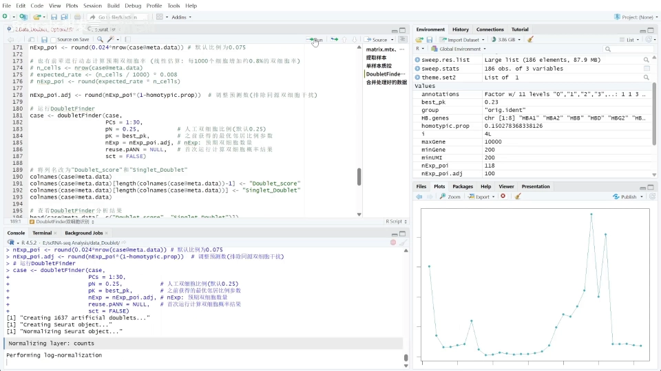

跑完之后，`case@meta.data` 会多出两列：`Doublet_score`（pANN 分数）和 `Singlet_Doublet`（判定结果）。讲者举了个例子：分数 0.3 的细胞被判为 Doublet，0.14 的判为 Singlet。

**这里有个必须处理的坑**：这两列的**列名会带上参数**（比如 `pANN_0.25_0.23_100`），因为 DoubletFinder 要把「用什么参数跑出来的」写进名字里。不同样本的参数不同，列名就不同，后面 `merge()` 时对不上。所以讲者加了一步重命名：

```r
colnames(case@meta.data)[length(colnames(case@meta.data))-1] <- "Doublet_score"
colnames(case@meta.data)[length(colnames(case@meta.data))]   <- "Singlet_Doublet"
```

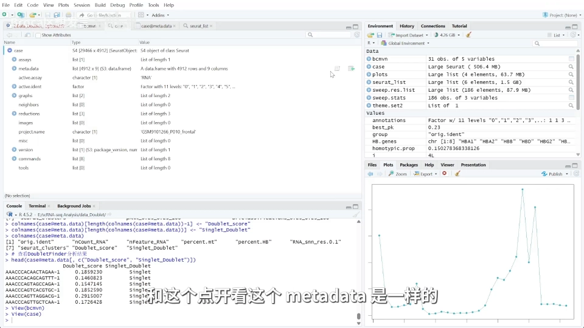

这一步看着琐碎，但它是「单样本逐个跑 → 最后合并」这条路能走通的前提。

[【跳转到 15:55】](https://www.bilibili.com/video/BV1mavaBWEsW/?t=955)

## 五、结果怎么验证：三个角度

讲者没有「跑完就删」，而是先做了三处检查。

### 5.1 双细胞落在 UMAP 的什么位置

把 `Singlet_Doublet` 作为分组变量画 UMAP：

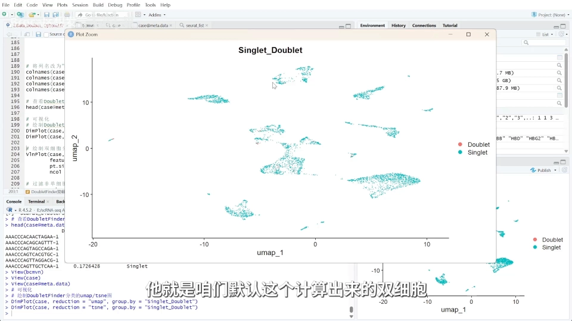

讲者的观察是：双细胞以散在红点的形式出现，**大多落在 cluster 的边缘部位**，也有落在簇与簇之间的。这符合对双细胞的预期——它们本来就该出现在「两个细胞类型的交界处」，而不是某个簇的核心。

### 5.2 双细胞的 count 数和基因数是不是更高

第二个检查更硬：把 `nCount_RNA` 和 `nFeature_RNA` 按 Singlet/Doublet 分组画小提琴图。

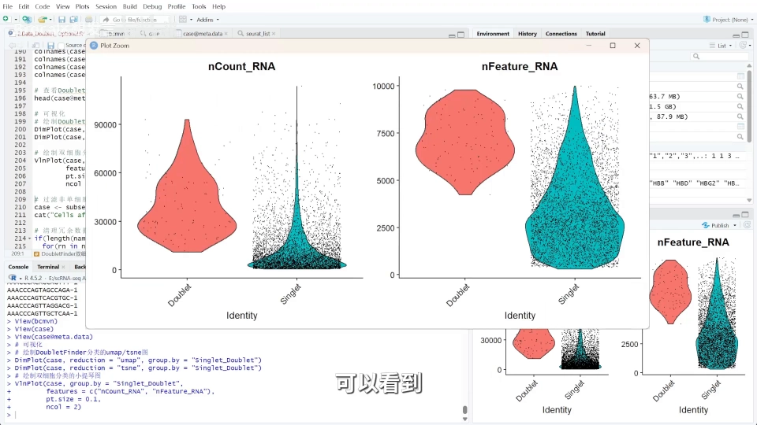

结果非常清楚：**双细胞的 count 数和 feature 数整体比单细胞高一个量级**。这符合物理直觉——两个细胞的内容物合在一起，RNA 总量自然更多。如果画出来发现「被判为双细胞的细胞 RNA 反而更少」，那就要怀疑参数是不是设错了。

### 5.3 数量对不对得上

样本 1 从 4912 个细胞删到 **4812** 个，正好删掉 100 个——与前面算出的 `nExp_poi.adj`（100 个）一致。这种「预期数与实际删除数对得上」的检查很朴素，但能立刻发现「阈值设错导致删多了/删少了」的问题。

[【跳转到 17:02】](https://www.bilibili.com/video/BV1mavaBWEsW/?t=1022)

## 六、收尾：subset、回填、合并

删除双细胞的代码是一行 `subset()`：

```r
case <- subset(case, subset = Singlet_Doublet == "Singlet")
```

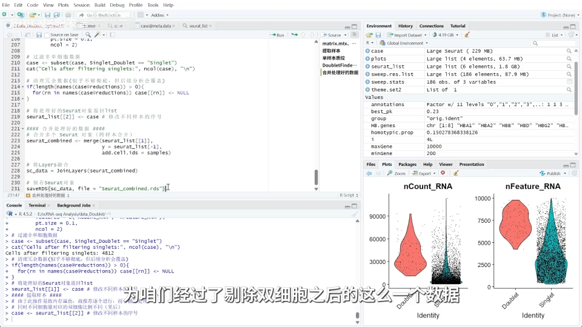

之后是三件收尾的事：

1. **清理中间对象**：把 `plots`、`sweep.res` 这些占内存的中间结果删掉，方便跑下一个样本（讲者提到有些同学电脑配置不高，这一步很必要）；
2. **回填 list**：把处理好的对象放回 `seurat_list` 对应的位置——**改的是第几个样本，就要放回第几个位置**，讲者专门提醒了这一点；
3. **合并**：所有样本都处理完之后，再跑 `merge()` 和 `joinLayers()`，得到最终的对象并保存。

### 6.1 为什么不用循环

讲者的代码里**没有写循环**，每个样本都是复制一遍代码、手动改参数。他的理由有两层：

- **参数必须个性化**：不同样本细胞数不同，`nExp` 的比例就不同（这正是他反复强调查表的原因）。用固定参数的循环，等于给所有样本套同一个双细胞率。
- **内存和算力**：pK 搜索很慢，一次性循环跑六个样本容易把 R 跑崩。

他也给了折中方案：如果一定要循环，可以先把「按细胞数动态算比例」那段代码写好（每 1000 个细胞 0.8%），再套循环，这样至少 `nExp` 是随样本变化的。

[【跳转到 19:03】](https://www.bilibili.com/video/BV1mavaBWEsW/?t=1143)

[【跳转到 13:49】](https://www.bilibili.com/video/BV1mavaBWEsW/?t=829)

## 七、这套方法的边界

讲者在视频里没有回避局限，结合他的说法可以整理出三条：

1. **同型双细胞检测不到**。这是算法结构决定的：两个相同类型的细胞合并后，表达谱与单个细胞只有量的差别，pANN 不会异常。所以他把同型双细胞「估算后保留」，而不是「检测后删除」。
2. **纯细胞类型的数据更难**。如果样本里只有一种细胞（比如纯化的 T 细胞），那么几乎所有双细胞都是同型的，DoubletFinder 基本无能为力。这一点和本小节另一篇博客里 Seurat 讲者的判断一致——那位讲者也因此没有在纯 PBMC 数据上用 doublet 指标。
3. **`nExp` 依赖外部表格**。10x 的比例表是「平均情况」的经验值，如果你的实验上样浓度、细胞大小、组织类型偏离标准流程，实际双细胞率可能不同。所以「查表 + 事后验证（UMAP 位置、count 分布）」两步都不能省。

更可靠的判定需要额外信息：**样本多重标记（cell hashing / MULTI-seq）**能直接看一个 barcode 带了几种 hashtag，**基于 SNP 的 demultiplexing（demuxlet / scSplit）**能按基因型判断一个 barcode 里是不是混了两个供体。这些方法不受「细胞类型是否同质」的限制，但需要相应的实验设计。

[【跳转到 02:00】](https://www.bilibili.com/video/BV1mavaBWEsW/?t=120)

## 小结

- **双细胞 = 一个液滴装了两个细胞**，常规质控指标（线粒体比例、基因数）拦不住它，但 `nCount`/`nFeature` 通常偏高。
- **危害有两个**：伪装成「同时表达两套 marker 的稀有亚群」，以及在 UMAP 上形成「假桥梁」误导拟时序。
- **异型 vs 同型**：异型（T+B）能用表达谱识别，同型（T+T）几乎不能——这决定了整个流程只删异型、保留同型。
- **DoubletFinder 的原理是先造假再比对**：人工合成双细胞 → 混进真实数据 → PCA → 统计每个细胞的 pANN（近邻里人工双细胞的比例）→ 按 `nExp` 取前 N 个判为双细胞。
- **三个参数**：`pN` 用默认 0.25（性能不敏感）；`pK` 必须搜索，取 BCmetric 最大的那个；`nExp` 查 10x 表格后乘以「1 − 同型双细胞比例」。
- **必须单样本跑**：`nExp` 是标量，多样本合并后无法给每个样本设不同比例；跑完再 `merge()` + `joinLayers()`。
- **跑完要验证**：双细胞应落在簇边缘/簇间、count 与 feature 应偏高、删除数应与 `nExp` 对得上。
- **改列名是必要步骤**：DoubletFinder 输出的列名带参数，不改名会导致多样本合并失败。

## 关键术语速查

| 术语 | 一句话解释 |
| --- | --- |
| Doublet（双细胞） | 两个细胞被同一个液泡/barcode 捕获，被测序仪当成一个细胞 |
| 异型双细胞 | 两个不同类型的细胞合并，表达谱同时带两套谱系 marker，容易检测 |
| 同型双细胞 | 两个相同类型的细胞合并，表达谱与单细胞只有量的差别，难以检测 |
| pANN | proportion of artificial nearest neighbors，每个细胞的近邻里人工双细胞所占比例，即双细胞分数 |
| `pN` | 人工双细胞占真实细胞的比例，默认 0.25，算法性能对它不敏感 |
| `pK` | 计算 pANN 时的邻域大小，对结果影响最大，需要用参数扫描找最优值 |
| BCmetric | 双峰系数，衡量 pANN 分布的双峰程度；取最大值对应的 pK 为最优 |
| `nExp` | expected number of doublets，预期双细胞数，决定 pANN 排序后切在哪里 |
| `modelHomotypic()` | 根据细胞类型注释估算同型双细胞比例的函数，用于把 `nExp` 下调 |
| `orig.ident` | Seurat 对象里标识「细胞来自哪个样本」的元数据列，判断是否单样本就看它 |
| `merge()` / `joinLayers()` | 把多个单样本 Seurat 对象合成一个对象的两个步骤 |
| cell hashing | 用抗体-寡核苷酸标签给每个样本打「条形码」，可直接读出 barcode 里有几个细胞 |
| demuxlet / scSplit | 用 SNP 基因型区分供体的方法，可顺带识别「一个 barcode 混了两个供体」的 doublet |
