# scRNA-seq 质控阈值怎么定：Seurat 中识别与剔除低质量细胞

> 视频来源：[Step-by-step how to choose the right QC thresholds for your #scRNAseq in Seurat?](https://www.youtube.com/watch?v=a1NrhM0L8bk)（YouTube · QNNDukeNguyen，讲者 Quang Nguyen，牛津大学 T 细胞免疫学博士生）｜时长约 49 分钟
> 导读：这支视频不讲「标准答案」，而是用 10x PBMC 数据（2700 个细胞）现场演示：每个质控指标看什么图、阈值凭什么定、删完之后怎么回头验证。本文按「先删基因、再删细胞、最后回看」的顺序整理，并把讲者对 doublet 检测取舍的判断放在第 8 章。

## 本讲要解决的核心问题（SCQA）

**背景**：单细胞 RNA 测序（scRNA-seq）的第一步不是聚类、不是画 UMAP，而是**质量控制（QC）**——把「不该进分析」的细胞和基因剔掉。Seurat 里这一步只有几行代码：`subset()`、`min.cells`、`percent.mt`。

**冲突**：几乎所有教程和论文都只写「我用了 `percent.mt < 5`」「我保留了表达基因数大于 200 的细胞」，却不解释这个数字从哪来。初学者照抄这些数字，往往在自己数据上删掉一整类真实细胞，或者留下满屏 doublet。讲者开场就把这件事点破：**QC 是数据特异、细胞类型特异的，别人数据上的阈值不能直接搬到你的数据上**。

**疑问**：既然没有通用阈值，那到底该怎么定？定完之后，怎么向审稿人证明「我删得对」？

**回答（中心思想）**：阈值不是背出来的，是**看自己数据的分布 + 多指标交叉验证 + 删完再回看**三步走出来的。具体做法是：先看单个指标的分布（直方图、小提琴图）确定候选阈值，再用两两指标散点图（`FeatureScatter`）确认「被删掉的细胞在另一个指标上也确实异常」，最后在聚类之后把质控指标投影回 UMAP，检查有没有把真实生物学信号当垃圾扔掉。自动化工具（miQC 等）只能当二次校验，不能替代这个判断过程。

## 一、质控在整条流程里的位置：先删基因，再删细胞

讲者给出的 Seurat 标准流程是一张从左到右的图：左边是 UMI 计数矩阵（行是基因、列是细胞），中间是「去除低质量基因 & 低质量细胞」，右边才是归一化、找高变基因、降维、聚类、差异分析（DEG）与簇注释。

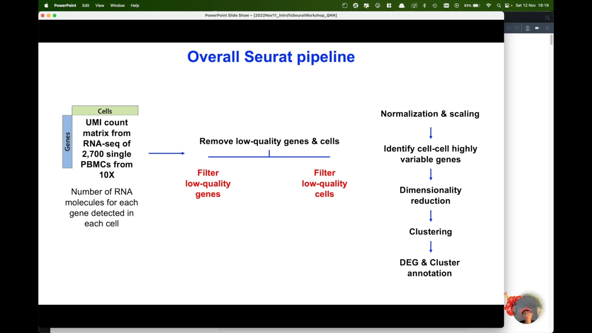

这张图值得记住的地方有两点：

1. **过滤分两层**：先过滤「基因」（在细胞间几乎不表达的基因），再过滤「细胞」（整体测得很差的细胞）。顺序反了也能跑，但先删基因能减少后面计算量，也更符合直觉——一个只在 2 个细胞里出现的基因，本来就没法支撑任何统计。
2. **质控不是一次性动作**。讲者反复强调：QC 是**迭代**的。你聚完类、画完 UMAP，可能会发现某个簇全是高线粒体比例的细胞，或者某个簇在不同样本间严重不平衡——这时要回到最初的质控步骤重新选阈值，甚至回头改流程里别的步骤。不要把 QC 想成一条直线。

[【跳转到 04:09】](https://www.youtube.com/watch?v=a1NrhM0L8bk&t=249)

### 1.1 输入数据长什么样

讲者用的是 10x Genomics 官网的 PBMC 数据（人外周血单个核细胞，2700 个细胞），读进 R 之后是一个 `dgCMatrix` 稀疏矩阵：

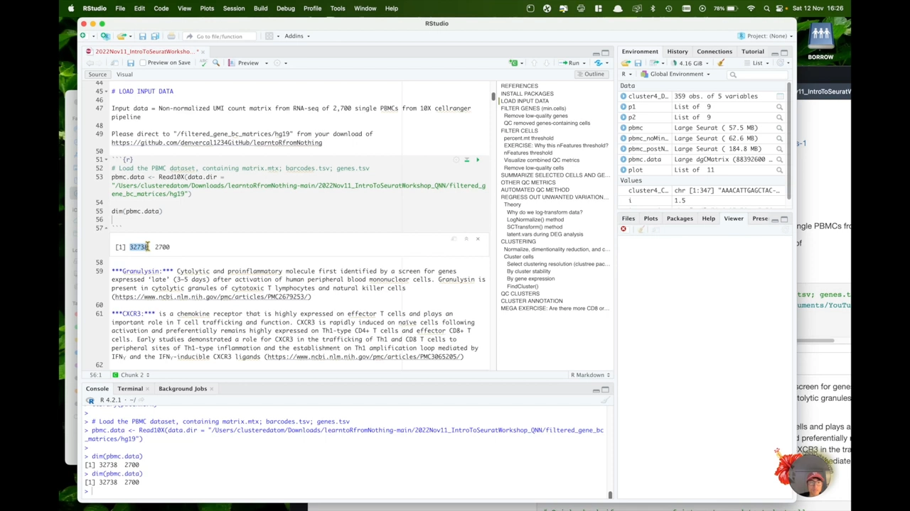

`dim()` 显示 32738 × 2700，也就是 3 万多个基因、2700 个细胞。这个矩阵里绝大多数格子是 0——单细胞数据的稀疏性（sparsity）极高，打印出来满屏都是点，偶尔出现 1、2 这样的计数。讲者提醒：**这是正常的**，不要看到「大部分是 0」就以为数据坏了（零值的成因属于 dropout 问题，见本系列 2.4.1）。

[【跳转到 08:17】](https://www.youtube.com/watch?v=a1NrhM0L8bk&t=497)

### 1.2 动手之前：先确认你关心的基因还在不在

在写任何过滤代码之前，讲者建议先做一件很便宜的事：把研究问题相关的基因列成一个向量（他叫它 `interesting_genes`），用 `%in% rownames(pbmc.data)` 检查它们是否存在于矩阵里。

```r
interesting_genes <- c("CXCR3", "GNLY", "GZMB", "FOXP3", "CTLA4", "S1PR2")
interesting_genes %in% rownames(pbmc.data)
```

这一步的意义是：**如果某个关键基因在你数据里根本不存在（比如参考基因组版本不同、基因名别名不同），那后面所有分析都是白做**。这一步只回答「在不在」，不回答「表达多少」。

[【跳转到 09:32】](https://www.youtube.com/watch?v=a1NrhM0L8bk&t=572)

## 二、第一道过滤：低表达基因该删到什么程度

### 2.1 `min.cells` 在做什么

Seurat 的 `CreateSeuratObject()` 有一个参数 `min.cells`：把 `min.cells` 设为 3，意思是「只保留在至少 3 个细胞中被检测到的基因」。讲者解释了背后的逻辑：如果一个基因只在极少数细胞里出现一次两次，那它要么是测序错误，要么是环境 RNA 之类的噪声，**你无法基于它说任何有统计意义的话**，留着只会增加多重检验负担。

### 2.2 用直方图决定这个「3」从哪来

关键的一步是**先画图再定数**。讲者用 `log10(quantile(Matrix::rowSums(pbmc.data > 0), probs = 0.6))` 画出「基因在多少个细胞中被检测到」的分布直方图：

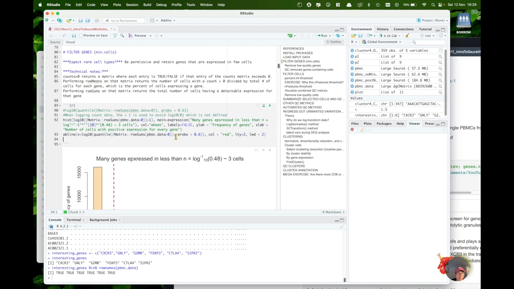

图上红色虚线标在 $\log_{10}(0.48) \approx -0.3$ 的位置，反解回去就是 3 个细胞。也就是说：**这份数据里大部分基因只在不到 3 个细胞里出现过**。讲者特意安抚观众：不要因为「一设阈值就要删掉三分之二的基因」而恐慌，这在当前的单细胞技术下是常态——从 32738 个基因过滤到 13000 个左右，正好是「只剩三分之一」，属于典型情况。

[【跳转到 11:12】](https://www.youtube.com/watch?v=a1NrhM0L8bk&t=672)

### 2.3 为什么是 3，不是 5 或 10

讲者的回答很直接：**没有唯一正确答案，但你必须给出理由**。3 个细胞、5 个细胞、10 个细胞都可以，区别只在于你愿意容忍多少噪声基因。他给出两个可操作的「给理由」的方式：

- **看被删掉的是什么**：把阈值设成 0（不过滤）拿到全量对象，再单独把「只在这些细胞里表达」的基因/细胞拎出来看，确认它们确实是低质量信号而不是稀有细胞类型；
- **用分位数代替常数**：如果实验包含多个供体/多个样本，且细胞类型组成相近（比如都是 PBMC、都是 T 细胞），可以不用「至少 3 个细胞」这种绝对数，而用「60 百分位」这类**相对阈值**，让每个样本用同一套统计口径，避免样本间因为测序深度不同而标准漂移。

```r
# 画出「每个基因在多少个细胞中被检出」的分布，并把 60 百分位标成红线
hist(log10(Matrix::rowSums(pbmc.data > 0)),
     main = "Many genes expressed in less than n ~ 3 cells",
     col = "wheat", labels = FALSE,
     ylab = "Frequency of genes",
     xlab = "Number of cells with positive expression for each gene")
abline(v = log10(quantile(Matrix::rowSums(pbmc.data > 0), probs = 0.6)),
       col = "red", lty = 2)
```

看完分布之后，把这个分位数换算出的细胞数填回 `CreateSeuratObject()` 的 `min.cells` 参数，就得到一套「有图可依」的阈值。

讲者提醒：**分位数阈值只在「各样本细胞类型组成相似」时成立**。如果样本 A 是纯 T 细胞、样本 B 是 PBMC 全谱，两者的基因检出分布本来就不同，硬套同一个分位数反而引入偏差。

[【跳转到 13:35】](https://www.youtube.com/watch?v=a1NrhM0L8bk&t=815)

### 2.4 过滤后回头验证：你关心的基因还在吗

过滤完基因，讲者立刻做了两件验证：

1. 检查 `interesting_genes` 是否还在——结果 `S1PR2` 被删掉了（因为它在这份 PBMC 数据里表达细胞太少）；
2. 统计某个基因到底在多少个细胞里被检出——比如 `FOXP3` 只有 11 个细胞有检出。

第 2 点尤其重要：如果一个你关心的基因只出现在 11 个细胞里，那么**任何基于这个基因的下游分析（比如「Treg 比例」）都不稳**。这时要么换更深的测序数据，要么换研究问题，而不是硬着头皮往下做。

[【跳转到 16:29】](https://www.youtube.com/watch?v=a1NrhM0L8bk&t=989)
## 三、第二道过滤：什么样的细胞算「低质量」

基因过滤只处理「基因维度」，真正决定成败的是细胞维度：**哪些细胞整体不该留**。讲者列了一组指标，每个指标都对应一种具体的物理故障。

### 3.1 线粒体基因比例（`percent.mt`）：最常用的「濒死细胞」代理指标

这是质控里出现频率最高的指标。原理很直观：

- 正常细胞的细胞质里充满各种 mRNA，线粒体只占很小一部分转录本；
- 当细胞膜破损、细胞进入凋亡/坏死过程时，**胞质里的 mRNA 从破口漏到液滴外面**，而线粒体有自己的双层膜包裹，里面的转录本留了下来；
- 于是测序结果表现出「总 counts 变少、线粒体转录本占比升高」的特征。

换句话说，`percent.mt` 高不是「线粒体变多了」，而是**分母（胞质 mRNA）漏掉了**。这就是为什么它能当「破损/濒死细胞」的代理指标。

在 Seurat 里计算它只需要一行：

```r
pbmc[["percent.mt"]] <- PercentageFeatureSet(pbmc, pattern = "^MT-")
```

> 注意 `pattern` 要跟着参考基因组走：人类是 MT- 前缀，小鼠是 mt- 前缀。写错了会得到一列全 0，然后你会误以为「我的数据线粒体比例特别低，质量真好」。

[【跳转到 18:02】](https://www.youtube.com/watch?v=a1NrhM0L8bk&t=1082)

### 3.2 先看分布，再谈阈值

讲者在这里做了一个很值得学的动作：他没有直接说「用 5%」，而是先跑 `summary()` 和 `quantile()` 看这份数据的实际分布，再画小提琴图。

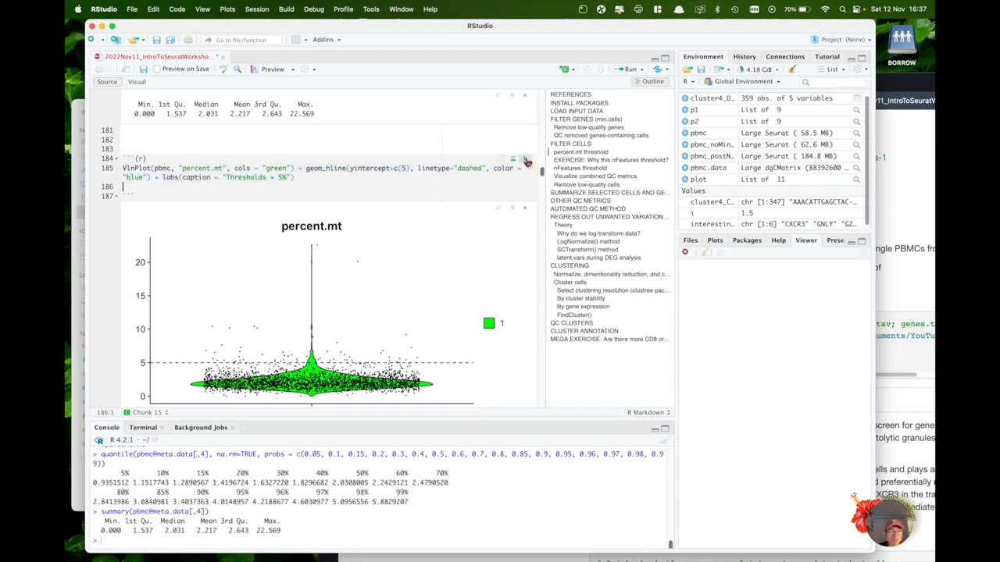

图上的信息很清楚：**主体分布在 5% 以下，右侧拖着一条长尾**，还有个别细胞超过 20%。控制台里的统计量也印证了这一点——中位数约 2.03%，75 百分位约 2.64%，而最大值到 22.57%。这种「主体集中 + 长尾离群」的形态，才是「用 5% 切一刀」这种做法的真正依据：5% 切在了主体分布的右边缘，删掉的是长尾而不是主体。

讲者还展示了另一种画法——用 ggplot 画密度曲线，同样把 5% 竖线标出来：

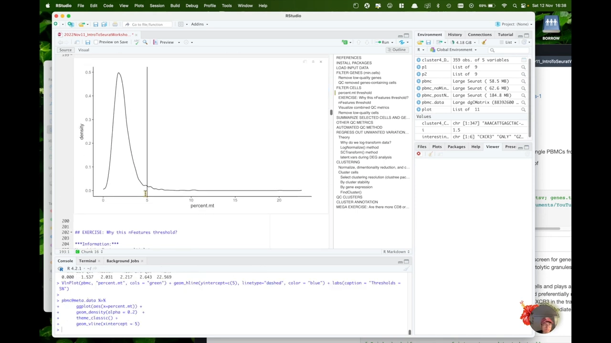

两种图给的信息一样，选哪个只看个人习惯。关键结论是：**阈值应该落在「主体」和「离群尾巴」之间的谷底附近**，而不是某个来自教科书的固定数字。

[【跳转到 19:34】](https://www.youtube.com/watch?v=a1NrhM0L8bk&t=1174)

### 3.3 为什么不能硬套 5%：组织差异

讲者特别提醒（这也是本小节最容易被忽略的一点）：**不同组织、不同解离方案，线粒体比例的正常范围差得很远**。

- 心肌细胞、肝细胞本身线粒体就极其丰富，`percent.mt` 天然偏高；
- 中性粒细胞颗粒多、RNA 少，解离后非常脆弱，往往整体线粒体比例偏高；
- 用强酶解离方案处理的组织，破损细胞比例本来就更高。

在这些数据上硬套 5%，结果不是「质控严格」，而是**把整个细胞类型删光**——这是系统性偏差，比留下几个 doublet 严重得多。判断依据始终是「这份数据的分布长什么样」，而不是「别人论文里写了多少」。

### 3.4 `nFeature_RNA`：每个细胞检出多少个基因

第二个核心指标是 `nFeature_RNA`（等价于 Scanpy 的 `n_genes_by_counts`）——每个细胞中被检出（count > 0）的基因个数。它同时能抓两头：

- **极低**：空液滴（里面只有少量环境 RNA）、细胞碎片、RNA 严重降解的细胞；
- **极高**：可能是 doublet——两个细胞合并成一个液滴，基因数自然翻倍。

讲者同样先画小提琴图看分布：

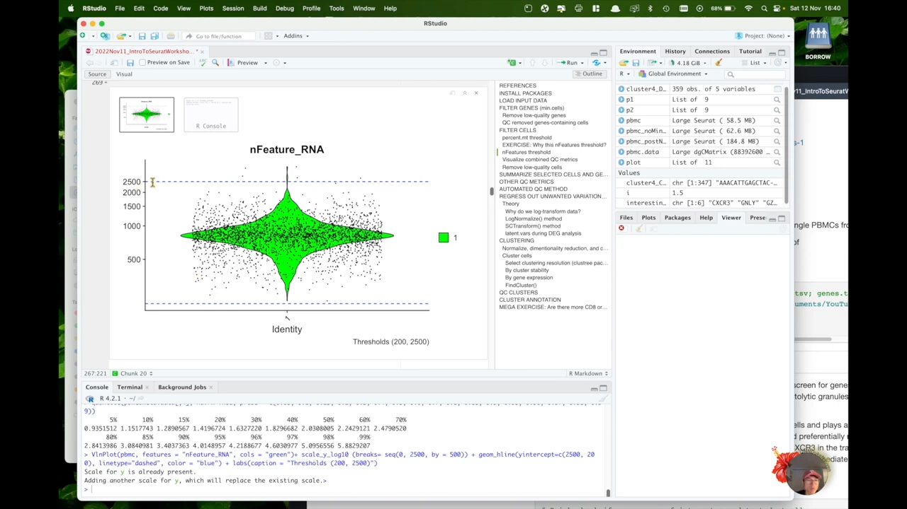

这份 PBMC 数据里，主体集中在 500~2500 之间，所以讲者取了「检出基因数大于 200、小于 2500」这个区间。注意这里的**下界 200 和上界 2500 都是「看图说话」的结果**：下界切在左侧那个明显稀疏的低值区，上界切在分布开始变稀的地方。

[【跳转到 22:20】](https://www.youtube.com/watch?v=a1NrhM0L8bk&t=1340)

### 3.5 `nCount_RNA`：每个细胞测到多少条 UMI

`nCount_RNA`（Scanpy 的 `total_counts`）是每个细胞的 UMI 总数，反映**测序深度/捕获效率**。它和 `nFeature_RNA` 高度相关——捕获到的分子越多，能检出的基因自然也越多。

讲者没有给 `nCount_RNA` 单独设阈值，而是把它当作**交叉验证的工具**（下一章详述）。这是一个很实用的取舍：`nCount` 和 `nFeature` 信息高度重叠，两个都设硬阈值容易「双重惩罚」同一批细胞。

### 3.6 其他指标：讲者列了一张清单

除了上面三个，讲者在他的 R Markdown 里还列了一组「其他质控指标」，并写明了每个指标的判读方式：

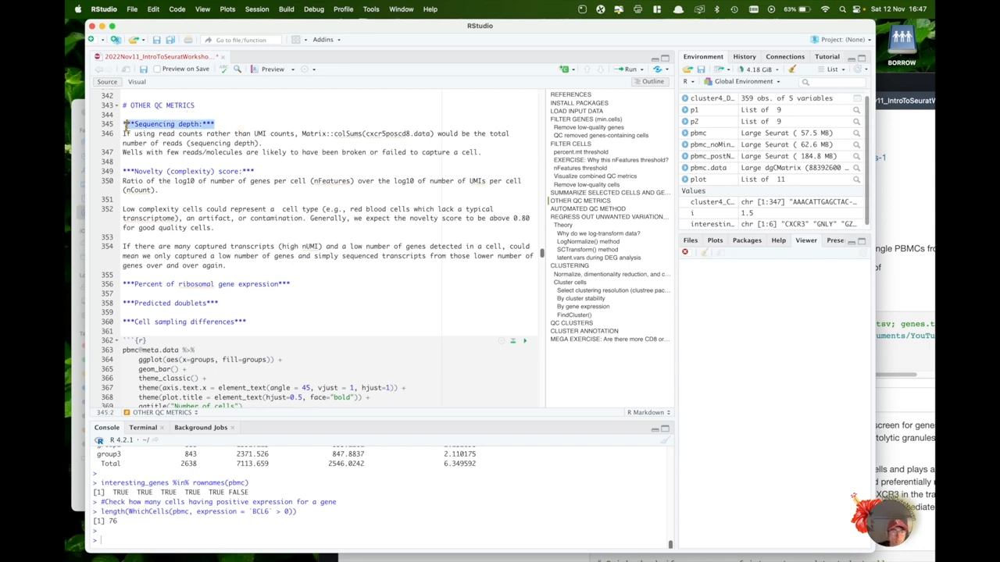

逐条解释一下（这张图信息密度很高，值得细看）：

| 指标 | 怎么算 | 怎么读 |
| --- | --- | --- |
| 测序深度 | `Matrix::colSums(x = pbmc)`，即每列 UMI 总数 | counts 很少的细胞，多半是破损或没抓住细胞 |
| Novelty / complexity score | $\log_{10}(\text{nFeature}) / \log_{10}(\text{nCount})$ | 低复杂度细胞可能是真实细胞类型（如红细胞，转录组本就单一），也可能是污染；讲者给的参考线是「好细胞通常高于 0.80」 |
| 核糖体基因比例 | RP 开头（RPS / RPL 家族）的基因占比 | 核糖体基因占比异常高，常与细胞状态或 rRNA 污染有关 |
| 预测 doublet | DoubletFinder / Scrublet | 见第八章 |
| 样本间细胞数差异 | 按样本分组画柱状图 | 差异过大时要考虑是不是采样/捕获问题，而不是生物学差异 |

关于「高 nCount 但低 nFeature」的情况，讲者的解释是：如果细胞里捕获到的转录本很多，但检出的基因种类很少，说明**同一批少数基因被反复测到**（低复杂度），这通常是质量不佳或污染的信号。

> 顺带一句边界说明：`MALAT1` 异常高、环境 RNA 污染这类问题属于本系列 2.4.3「Ambient RNA」的内容，这里不展开。

[【跳转到 28:57】](https://www.youtube.com/watch?v=a1NrhM0L8bk&t=1737)

## 四、单指标定阈值不够：必须两两联用

这是整支视频里最重要的方法论，讲者用了一句话概括：**不要只靠一个质控指标决定阈值，要把不同指标放在一起看**。

### 4.1 `FeatureScatter`：把两个指标画在一张散点图上

Seurat 的 `FeatureScatter()` 可以同时把两个指标画成散点。讲者画了两张：

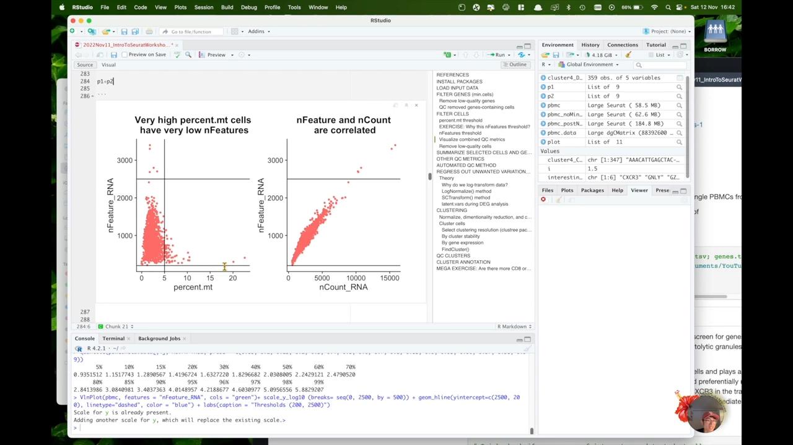

左图回答了「5% 这个阈值合不合理」：**被 5% 切掉的那批细胞（右侧小簇），在 y 轴上（nFeature）也普遍偏低**。也就是说，两个独立的指标同时指向「这批细胞质量差」，删掉它们有双重证据支持。

右图回答了「2500 这个上界合不合理」：`nCount` 和 `nFeature` 呈明显的正相关，说明这两个指标测的是同一件事的不同侧面，因此不需要各自设一套复杂的阈值。

讲者还留了余地：上界设成 2200 也完全可以，只要你能说清理由。**「讲得通」比「最优」更重要**——审稿人不会追问你为什么不是 2400，但一定会追问你为什么没有任何依据。

[【跳转到 23:39】](https://www.youtube.com/watch?v=a1NrhM0L8bk&t=1419)

### 4.2 一个反例：线粒体比例高也可能是真信号

讲者在这里补了一句很重要的提醒：**线粒体基因表达和细胞周期基因一样，本身可能携带生物学信息**，有文献用它们来区分细胞类型或细胞状态（比如代谢活跃的细胞、心肌细胞）。

所以「高 `percent.mt` = 死细胞」是一个**统计上成立、但不是绝对真理**的推断。如果某个高线粒体比例的细胞群在你的研究里恰好是研究对象（比如心肌、肝细胞），那么把它删掉就等于删掉了你的答案。判断方法是：先不删，把它们单独拎出来聚类/看 marker，确认是「破损细胞的噪声」还是「真实的细胞状态」，再决定。

[【跳转到 24:51】](https://www.youtube.com/watch?v=a1NrhM0L8bk&t=1491)

## 五、删多少算合适：做一次「现实检查」

阈值定好之后，讲者建议先算一下**一共会删掉多少细胞**，再决定要不要执行。

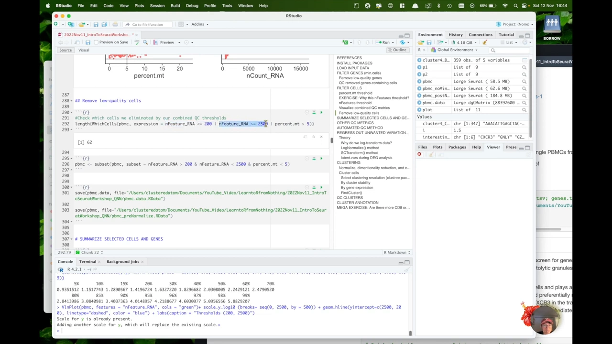

他的组合条件是：

```r
pbmc <- subset(pbmc,
               subset = nFeature_RNA > 200 &
                        nFeature_RNA < 2500 &
                        percent.mt < 5)
```

执行前先用 `WhichCells()` 把「基因数低于 200、高于 2500，或线粒体比例超过 5%」的细胞数一遍，结果是 **62 个**。2700 个细胞里删掉 62 个（约 2.3%），讲者的评价是「这个量级是合理的」。

这个「现实检查」的意义在于：**如果你算出要删掉 60% 的细胞，那问题不在细胞，在你的阈值**。常见原因：参考基因组用错（线粒体基因前缀没匹配上）、`percent.mt` 算成全 0 或全 100、上样时细胞活性本来就极差。先排查这些，再谈阈值。

执行 `subset()` 之后，细胞数从 2700 变成 2638（2700 − 62），与预估一致。讲者顺手提醒：**做完质控立刻保存对象**，否则后面任何一步出错都要从头重跑。

[【跳转到 26:41】](https://www.youtube.com/watch?v=a1NrhM0L8bk&t=1601)

### 5.1 别忘了检查样本间细胞数是否失衡

讲者在这里埋了一个「随机分组」的小设计：他给每个细胞随机打上 group1/group2/group3 的标签，然后画柱状图看各组的细胞数。

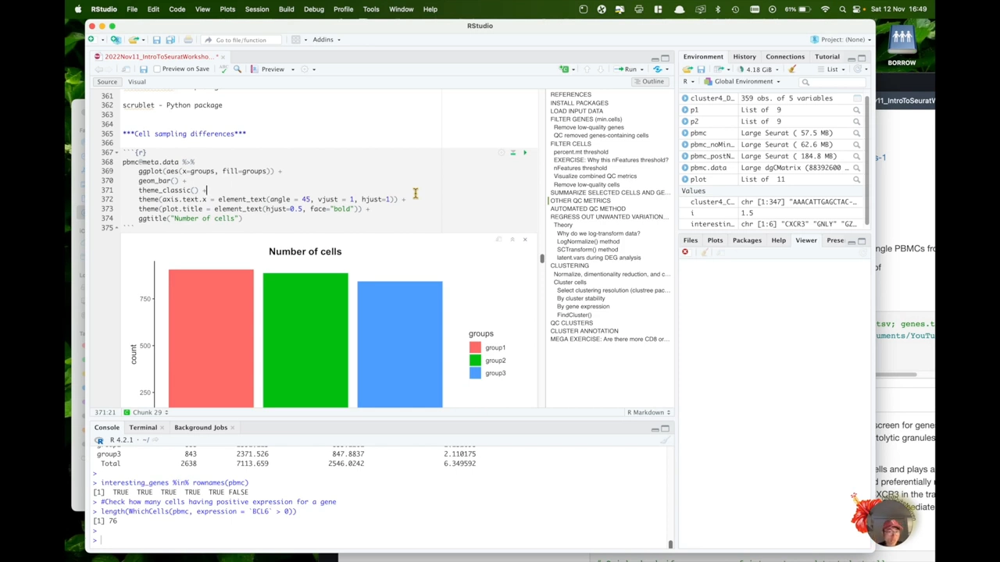

他举的反例是：如果 group1 有 10000 个细胞、group2 有 500 个、group3 有 100 个，那么三组之间「能检测到的 RNA 总量」会有天壤之别。这时候你看到的差异表达，很可能只是**采样误差**（细胞太少的那组，稀有细胞类型根本没被抽到），而不是真实的生物学差异。

质控阶段的处理方式是：**先看各组细胞数，再决定要不要在下游做样本层面的平衡**（比如降采样、或把样本作为协变量）。这一步不属于「删细胞」，但和「删谁」是同一个判断链条上的事。

[【跳转到 31:09】](https://www.youtube.com/watch?v=a1NrhM0L8bk&t=1869)

## 六、自动化工具只能当「二次校验」

### 6.1 miQC：用概率模型同时看线粒体比例和基因数

近些年出现了一类「用建模替代拍脑袋」的工具，讲者点名的是 **miQC**（R 包，GitHub: greenelab/miQC）。它的做法是：

> 把「线粒体 reads 比例」和「检出基因数」放在一个概率框架里联合建模，用混合模型（mixture model）把细胞分成「高质量」和「低质量」两类，从而**针对每个数据集**给出低质量细胞的判定，而不是用一个固定阈值。

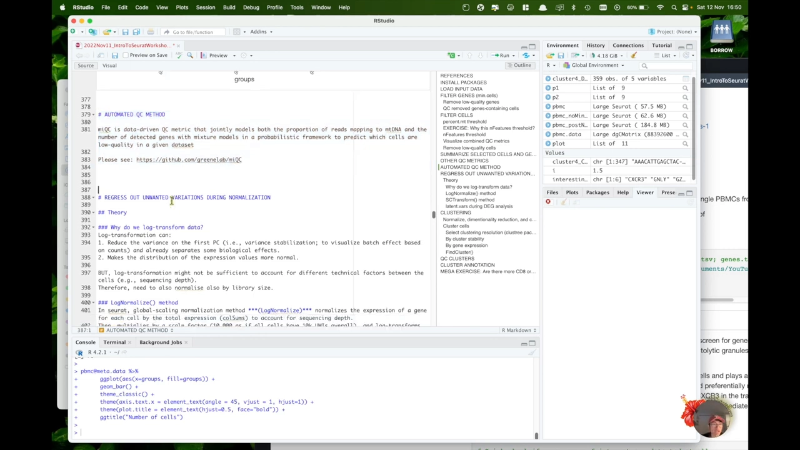

注意它和「固定 5%」的本质区别：固定阈值假设所有数据集的分布形状一样；miQC 假设「低质量细胞在 (percent.mt, nFeature) 平面上形成一条斜带」，这条带的位置和斜率由你的数据自己决定。

### 6.2 讲者的使用建议：先手工，再对照

讲者的态度很明确，也是本文想强调的：

1. **先按今天讲的方法手工走一遍**（看分布 → 定阈值 → 多指标交叉验证）；
2. **再跑 miQC**，把自动判定的结果和手工结果对照；
3. **不要把自动化结果直接当结论**——它的定位是「二次校验」，不是「替代判断」。

理由很实际：自动工具不知道你的生物学背景。它不知道这批细胞里有心肌细胞、不知道你的样本经过了强酶解离、也不知道你真正想研究的是哪一类稀有细胞。这些信息只有你能提供。

[【跳转到 32:09】](https://www.youtube.com/watch?v=a1NrhM0L8bk&t=1929)

## 七、质控不止一次：三个可以「动手」的层次

讲者在视频后半段把质控拆成三个层次，这个框架很值得记住：

| 层次 | 时机 | 手段 | 典型用途 |
| --- | --- | --- | --- |
| 第一层 | 归一化之前 | `subset()` 删细胞 / `min.cells` 删基因 | 剔除空液滴、破损细胞、极低表达基因 |
| 第二层 | 归一化过程中 | `vars.to.regress`（如回归 `percent.mt`） | 不删细胞，而是扣除技术因素对表达量的影响 |
| 第三层 | 聚类之后、差异分析中 | `FindMarkers(latent.vars = ...)` | 在比较簇间差异时，把质控指标作为协变量扣除 |

第二层的逻辑是：**「删掉」和「扣除」是两种不同的处理**。有些细胞整体质量偏低但还没到该删的程度，硬删会损失信息；这时可以在归一化时把 `percent.mt` 作为协变量回归掉（Seurat 的 `vars.to.regress`），或者在用 SCTransform 时把它放进 `vars.to.regress` 参数。

讲者顺带推荐了 **SCTransform** 作为归一化方法，理由是对低表达基因的表现更好（归一化的数学细节属于本系列 2.4.5 的内容，这里不展开）。

第三层的用法是在 `FindMarkers()` 里设置 `latent.vars`，比如把 `percent.mt` 作为潜在变量，让差异分析在「线粒体比例相同的细胞之间」比较。这在两组样本线粒体比例差异很大时特别有用——否则你找到的「差异基因」可能只是「线粒体比例差异」的投影。

[【跳转到 33:02】](https://www.youtube.com/watch?v=a1NrhM0L8bk&t=1982)

## 八、Doublet：讲者为什么「这次不用」，以及什么时候必须用

### 8.1 doublet 是什么，为什么危险

doublet（双细胞）是指**两个细胞被同一个液滴/同一个 barcode 捕获**，测序结果被当成一个细胞。它的危险之处在于「伪装」：

- 表达谱看起来像「同时表达两个谱系 marker 的细胞」，很容易被解读成**中间状态**或**新细胞类型**；
- 在轨迹推断里被当成过渡态，在差异分析里制造假信号；
- 发生率随上样细胞数上升：上样的细胞越多，两个细胞挤进同一个液滴的概率就越高（10x 官方用户指南里给出了按上样细胞数查 multiplet rate 的表格）。

### 8.2 讲者的判断：同质数据里，转录组方法不靠谱

讲者明确说了他这次**没有**用 doublet 指标，理由值得完整引用：

> 目前基于转录组预测 doublet 的包不够稳健（not that robust），**尤其是数据非常同质的时候**。比如你只测了 B 细胞，B 细胞之间的转录组本来就非常相似，那么「两个 B 细胞粘在一起」形成的同型 doublet（homotypic doublet），其表达谱和单个 B 细胞几乎没有区别——模型没有足够的信息把它和真实细胞分开。

这是一个非常关键的边界条件：**doublet 检测方法的灵敏度，取决于两个细胞之间的转录组差异有多大**。异型 doublet（T 细胞 + 单核细胞）很容易被识别，同型 doublet（B 细胞 + B 细胞）几乎不可能只靠表达谱识别。

### 8.3 他推荐的两个工具

如果要用，讲者推荐两个：

- **DoubletFinder**（R 包）：在 Seurat 生态里用，基于人工模拟 doublet + 最近邻；
- **Scrublet**（Python 包）：Scanpy 生态里的对应工具。

他的建议是：**手工质控 + 跑一遍 doublet 检测，然后看两者是否重合**。如果被手工 QC 删掉的细胞同时也被判为 doublet，那你的删除就有了更强的理由——这正是本文反复出现的「多重证据」思路。

> 讲者没有展开 doublet 检测的具体操作，只说「值得一试」。这一节的实操细节（人工 doublet 模拟、doublet score 怎么算、阈值怎么取）属于本小节 Doublets 专题的内容，本文只保留他给出的判断边界。

[【跳转到 29:25】](https://www.youtube.com/watch?v=a1NrhM0L8bk&t=1765)

## 九、聚类之后还要回看：质控的「第二现场」

讲者说了一句很重的话：**聚完类，你的质控工作不是结束了，而是刚刚开始**。原因是：聚类之后你才有机会发现「某些技术因素在驱动分群」。

### 9.1 先选聚类分辨率

在 `FindClusters()` 里，`resolution` 参数决定聚成多少个簇：分辨率越高簇越多，越低簇越少。讲者的建议是**宁可先过聚类（over-cluster），再合并**——过度聚类之后你还可以合并，而聚类不足则会丢失异质性。

他的做法是用 for 循环跑一组分辨率（0、0.5、1、1.5），然后用 **clustree** 包把不同分辨率下的簇关系画成一棵树：

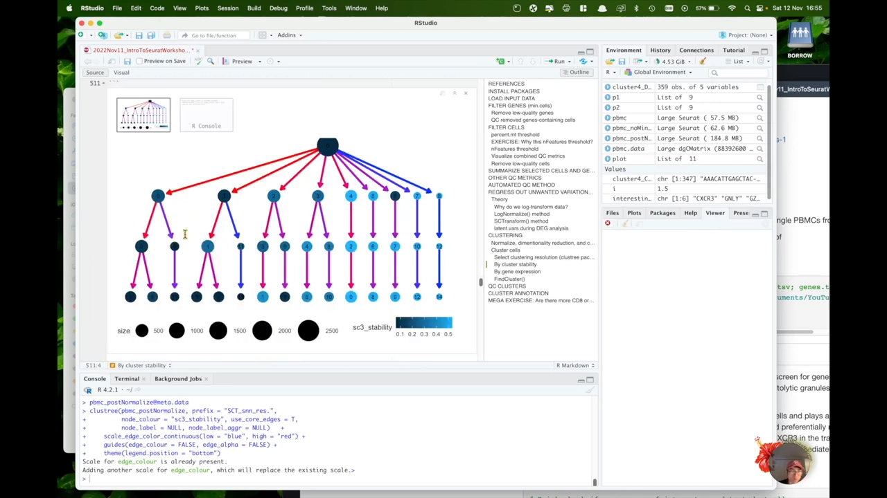

读图方法：**从上往下看**，每一层是一个分辨率。如果某个簇在分辨率升高时「一分为二」，说明这个分裂是有数据支撑的；如果某个簇一路保持一个节点不变，说明它非常稳定。选分辨率的依据就是「你关心的结构在哪个分辨率下稳定出现」。

讲者还演示了另一条判据：把某个感兴趣的基因（他随手挑了 `PPBP`，血小板相关基因）的表达量映射到 clustree 上，看这个基因对应的簇在哪个分辨率下仍然保持独立。如果它在 0.5 就已经是一个独立簇、到 1.0 也没被拆散，那么选 0.5 就足够回答你的问题，没必要为了「更多簇」而选 1.5。

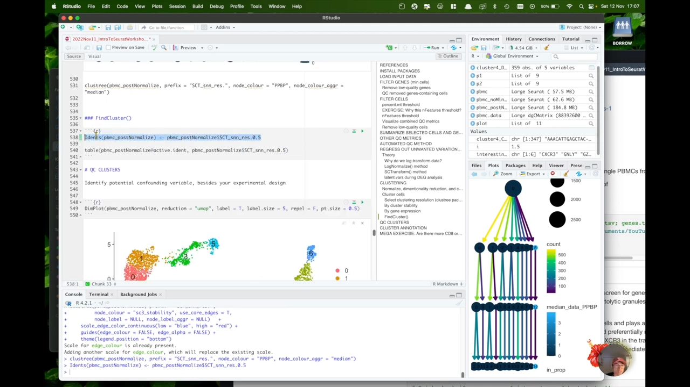

[【跳转到 37:35】](https://www.youtube.com/watch?v=a1NrhM0L8bk&t=2255)

### 9.2 把质控指标投影回 UMAP：找隐藏的混杂因素

聚类完成后，讲者做了两件事：

**第一，按分组着色看批次效应。**

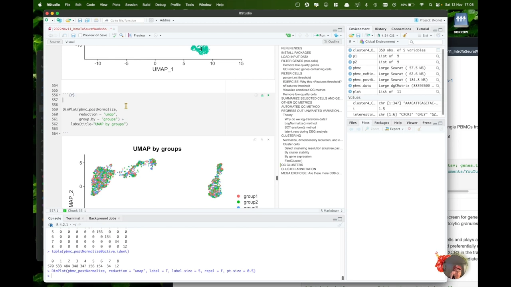

三种颜色在 UMAP 上均匀混合，说明「分组」这个变量没有驱动分群。讲者的结论是：**不需要按组做整合（integration），可以直接合并分析**。反过来说，如果某一块区域被单一颜色占据，那就说明存在批次效应，必须处理。

**第二，把定量指标（如 `percent.mt`）投影到 UMAP 上。**

`FeaturePlot()` 可以把任意一个元数据列画到 UMAP 上。讲者用它检查 `percent.mt` 是否在某个簇里异常集中——如果某个簇整体线粒体比例偏高，那这个簇很可能是「没删干净的破损细胞」，而不是真实细胞类型。

这两个检查的共同逻辑是：**聚类是数据驱动的，它不知道哪些差异是技术性的**。只有把技术变量投影上去，你才能判断「这个簇是生物学发现，还是质控漏网」。

[【跳转到 42:38】](https://www.youtube.com/watch?v=a1NrhM0L8bk&t=2558)

### 9.3 顺带的簇注释演示

视频最后用几分钟演示了簇注释的流程（`CellSelector()` 在 UMAP 上框选细胞 → `FindMarkers()` 找 marker → 小提琴图/`FeaturePlot` 验证）。结论是某个小簇高表达 `MS4A1`、`CD79A`，判定为 B 细胞。

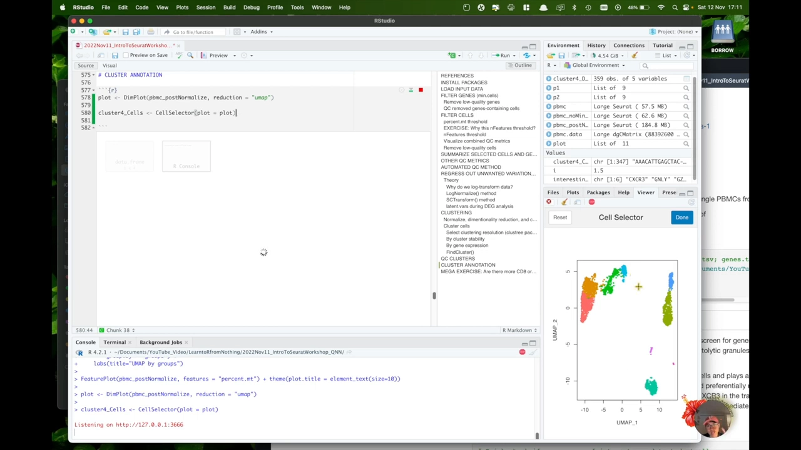

这部分属于「注释」而非「质控」，本文只作流程记录：**注释的可靠性同样建立在「多重证据」上**——差异基因列表 + 小提琴图 + 双基因共表达图，三者一致才下结论。

[【跳转到 44:23】](https://www.youtube.com/watch?v=a1NrhM0L8bk&t=2663)

## 小结

- **QC 是数据特异、细胞类型特异的**：别人论文里的 `percent.mt < 5` 不能直接搬到你的数据上；阈值要落在你自己数据的「主体」与「离群尾巴」之间。
- **先删基因，再删细胞**：`min.cells` 处理「几乎不表达的基因」，`nFeature_RNA` / `percent.mt` / `nCount_RNA` 处理「整体测得很差的细胞」。
- **每个指标都要能说出物理含义**：`percent.mt` 高 = 胞质 mRNA 漏出（膜破损/濒死）；`nFeature` 极低 = 空液滴或碎片；`nFeature` 极高 = 疑似 doublet。
- **单指标定阈值不够，必须两两联用**：`FeatureScatter` 的作用是验证「被一个指标判为异常的细胞，在另一个指标上也异常」。
- **删之前先算总量**：2700 删 62（约 2.3%）是合理量级；要删掉一半以上，先怀疑参考基因组、注释前缀或实验本身。
- **自动化工具（miQC 等）是二次校验，不是替代品**：先手工走一遍，再用它对照。
- **质控有三个层次**：删（`subset`）、扣（`vars.to.regress`）、比（`FindMarkers(latent.vars=)`）。
- **doublet 检测的灵敏度取决于细胞间转录组差异**：同质数据（如纯 B 细胞）里的同型 doublet 几乎无法用表达谱识别，需要 hashtag/hashing 或基因型信息。
- **聚完类要回看**：把分组、`percent.mt` 等变量投影到 UMAP，确认没有技术因素在驱动分群。

## 关键术语速查

| 术语 | 一句话解释 |
| --- | --- |
| QC（质量控制） | 在正式分析前剔除低质量细胞与低表达基因的步骤，决定后续所有结论的上限 |
| `percent.mt` | 线粒体基因转录本占该细胞总 counts 的比例；偏高通常意味着细胞膜破损、胞质 RNA 漏出 |
| `nFeature_RNA` | 每个细胞中被检出（count > 0）的基因个数；过低是空液滴/碎片，过高可能是 doublet |
| `nCount_RNA` | 每个细胞的 UMI 总数，反映捕获到的分子数/测序深度 |
| `min.cells` | `CreateSeuratObject()` 的参数：基因至少要在多少个细胞中被检出才保留 |
| Novelty score | $\log_{10}(\text{nFeature}) / \log_{10}(\text{nCount})$，衡量转录组复杂度；过低提示少数基因被反复测到 |
| `FeatureScatter` | Seurat 里把两个质控指标画成散点图的函数，用于交叉验证阈值 |
| `vars.to.regress` | 归一化时把某个技术变量（如 `percent.mt`）作为协变量回归掉 |
| `latent.vars` | `FindMarkers()` 的参数，在差异分析时把技术变量作为潜在变量扣除 |
| miQC | 联合建模「线粒体比例 + 检出基因数」来预测低质量细胞的 R 包 |
| Doublet | 两个细胞被同一个液泡/barcode 捕获，表达谱看起来像「一个细胞表达两套谱系」 |
| DoubletFinder / Scrublet | 分别对应 R 与 Python 生态的 doublet 检测工具，原理都是模拟人工 doublet 再比对 |
| clustree | 把不同聚类分辨率下的簇继承关系画成树的 R 包，用于选 `resolution` |
