# 用 SoupX 扣除环境 RNA 污染：从 Seurat 到 Scanpy 的完整实操

> 视频来源：[Single-cell background decontamination in R and Python with SoupX](https://www.youtube.com/watch?v=Zs4UEQ9LZ-Y)（YouTube · Sanbomics）｜时长约 14 分钟
> 简要导读：这支视频是一个「跟着敲」的实操教程：用五个小鼠肺的 10x 样本，先在 R + Seurat 里跑通 SoupX 的四行核心 API，再借 rpy2 把同一套流程搬进 Python + Scanpy，最后用二值化前后的 UMAP 对比，直观看到环境 RNA 被扣掉之后哪些细胞「由阳转阴」。本文按视频顺序复述每一步的代码意图，并解释每一步为什么必须那样做。

## 本讲要解决的核心问题（SCQA）

**背景**：单细胞液滴测序（10x Genomics 这类）是在溶液里把细胞和条形码磁珠一起包进油包水液滴。细胞里有我们想测的 mRNA，溶液里还漂着别的 mRNA。

**冲突**：这些漂在溶液里的 mRNA 会跟着细胞一起被包进液滴、一起被建库测序。于是每个细胞的表达矩阵里，除了它自己的转录本，还混进了「别人的」转录本——这就是环境 RNA（ambient RNA）污染。它造成的错误方向和 dropout 正好相反：dropout 是「真表达的分子没测到」（假阴性），环境 RNA 是「不该有的分子被测到了」（假阳性）；而 doublet 是「两个细胞的 RNA 混在一起」的谱系混合，是另一回事。

**疑问**：既然污染源是溶液里的游离 mRNA，我们怎么知道这锅「汤」里有什么？知道了之后，又怎么从每个细胞里把它按比例扣掉？R 用户和 Python 用户分别该怎么做？

**回答（中心思想）**：环境 RNA 可以被**估计**出来，因为有大量空液滴（里面没有细胞、只有汤）白白测了一遍「汤」的成分；SoupX 就是拿空液滴估出汤的表达谱，再估出每个细胞的污染比例 $\rho$，然后按「观测 = 真实 + $\rho \times$ 汤」反解出真实表达。整条流程只有四步核心调用，R 和 Python 都能跑，关键前提是**同时准备 raw 与 filtered 两份矩阵**、并给细胞**先分好聚类**。

---

## 一、环境 RNA 是什么：一锅「细胞汤」污染了每个液滴

### 1.1 液滴是在溶液里形成的，所以必然带上别人的 RNA

视频用了一张很直观的示意图，作者是 decontX 那篇论文的作者（Shiyi Yang 等，*Decontamination of ambient RNA in single-cell RNA-seq with DecontX*）。图里画的是：左边几个液滴，每个蓝色圆圈是一个液滴，液滴里有细胞（Cell）、有条形码磁珠（Barcode bead），还有几段彩色的波浪线——那些波浪线就是环境 RNA（Ambient RNA）。经过细胞裂解（Cell lysis）和 cDNA 合成之后，右边每个液滴里都混进了不属于自己细胞的转录本，图上用红圈标出的那一段就是污染（Contamination）。[【跳转到 00:26】](https://www.youtube.com/watch?v=Zs4UEQ9LZ-Y&t=26)

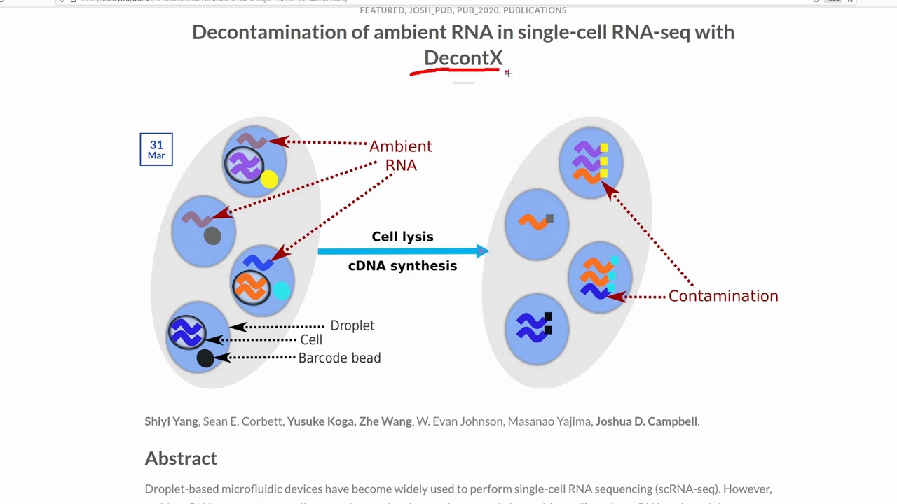

讲者强调：这支视频用的是 SoupX，但 decontX 和 SoupX 是**同一个思路**。真正关心的 RNA 是细胞内部的 RNA；可液滴是在溶液里形成的，而溶液里带着来自随机破裂细胞的环境 RNA。所以当细胞被包进液滴时，细胞自身的 RNA 会和这些不想要的环境背景 RNA 一起被测序。

这里要建立一个直觉：污染不是「某些液滴被污染了」，而是**所有液滴都被污染了**，只是程度不同。一个液滴里进了几个游离转录本，取决于那一瞬间它周围漂着什么。

### 1.2 空液滴是免费的「背景测量仪」

好消息是：还有一批液滴里根本没有细胞。它们通常会在 cell calling 阶段被过滤掉，但**数据其实还在**——原始矩阵里保留着这些 barcode 的 counts。既然空液滴里只有汤、没有细胞，那么把一堆空液滴的 counts 加起来，就得到了这锅汤的表达谱估计。[【跳转到 00:51】](https://www.youtube.com/watch?v=Zs4UEQ9LZ-Y&t=51)

这就是 SoupX 能工作的物理基础：**它不需要额外的实验，只需要你不把原始矩阵丢掉**。这也解释了下一章那个看起来有点奇怪的输入要求——为什么明明已经有 filtered 矩阵了，还要再读一遍 raw 矩阵。

### 1.3 为什么它比 dropout 更「阴险」

dropout 让你**看不见**本该看见的信号（假阴性），你至少知道「这里可能是空的」。环境 RNA 反过来：它让你**看见**本该看不见的信号（假阳性），而且是以低水平、弥散的方式出现在一大片细胞上。所以：

- 一个只该在巨噬细胞里表达的基因，会在内皮细胞里也显示出微弱表达，于是这个 marker「不特异」了；
- 依赖「某基因在某群里为阴性」的细胞注释、差异表达分析，会拿到假信号；
- 稀有细胞类型受害最深——它本来细胞就少，被汤整体抬高的背景一盖，特征就被稀释了。

视频后面用真实数据验证的正是第一点：被 SoupX 扣掉最多的基因里，一眼就能看出巨噬细胞和其他髓系（myeloid）的 marker。

---

## 二、SoupX 的输入：三样东西缺一不可

### 2.1 raw 与 filtered 两份矩阵都要

这次教程用了五个样本，都来自小鼠肺。它们是 10x 的输出目录，每个目录里的 `outs` 文件夹装着结果：

```
Lung1/outs/…
Lung2/outs/…
Lung3/outs/…
Lung4/outs/…
Lung6/outs/…
```

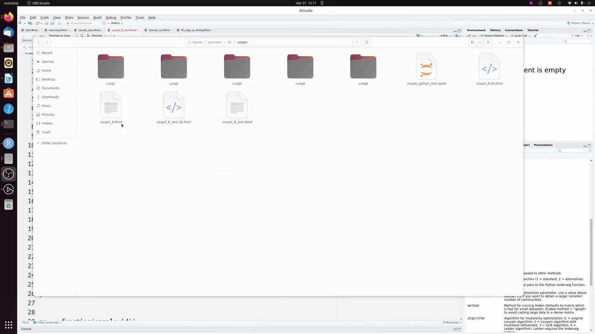

要让 SoupX 正常工作，需要 **filtered feature barcode matrix** 和 **raw feature barcode matrix** 两份矩阵；H5 格式也可以，两种都行。[【跳转到 01:06】](https://www.youtube.com/watch?v=Zs4UEQ9LZ-Y&t=66) 前者是「已经判为细胞」的那部分，后者包含全部 barcode（含空液滴）——空液滴就在这里。

### 2.2 细胞必须先有聚类标签

SoupX 的第二个前提是：**细胞要按细胞类型或聚类分层**。原因其实很自然：一个基因在某群细胞里「本来就不该表达」，那它在那群细胞里出现的 counts 就是污染的证据；不分群，你就没法判断「本来该不该表达」。所以流程里必须先给细胞加一个聚类标签。[【跳转到 02:32】](https://www.youtube.com/watch?v=Zs4UEQ9LZ-Y&t=152)

### 2.3 预处理不是 SoupX 的一部分，但强烈建议先做

讲者反复强调：预处理（去离群细胞）和 SoupX 校正**是相互独立的**，但先做是好习惯。因为极端离群的「细胞」（比如只有几十个 UMI、或线粒体占比 80% 的破损细胞）会把聚类和污染估计都带偏。

---

## 三、R + Seurat 路线：四行核心 API 跑完校正

### 3.1 预处理函数：用 MAD 找离群细胞

R 版本的预处理函数叫 `pp`，接收一个 sample_id，做四件事：拼路径读入 filtered 矩阵、加 QC 指标、按 MAD 找离群细胞、返回干净的 Seurat 对象。[【跳转到 01:49】](https://www.youtube.com/watch?v=Zs4UEQ9LZ-Y&t=109)

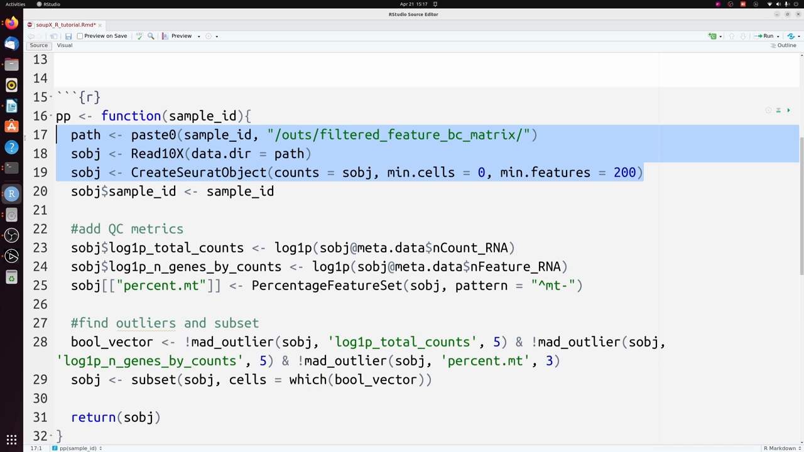

```r
pp <- function(sample_id){
  path <- paste0(sample_id, "/outs/filtered_feature_bc_matrix/")
  sobj <- Read10X(data.dir = path)
  sobj <- CreateSeuratObject(counts = sobj, min.cells = 0, min.features = 200)
  sobj$sample_id <- sample_id

  # 加 QC 指标
  sobj$log1p_total_counts      <- log1p(sobj@meta.data$nCount_RNA)
  sobj$log1p_n_genes_by_counts <- log1p(sobj@meta.data$nFeature_RNA)
  sobj[["percent.mt"]]         <- PercentageFeatureSet(sobj, pattern = "^mt-")

  # 找离群值并取子集
  bool_vector <- !mad_outlier(sobj, 'log1p_total_counts', 5) &
                 !mad_outlier(sobj, 'log1p_n_genes_by_counts', 5) &
                 !mad_outlier(sobj, 'percent.mt', 3)
  sobj <- subset(sobj, cells = which(bool_vector))
  return(sobj)
}
```

注意 `pattern` 里写的是小写 `mt-` 前缀，因为这是小鼠数据（人的线粒体基因前缀是大写 `MT-`）。判断离群用的是**中位数绝对偏差**（MAD，median absolute deviation）：把某个指标偏离中位数超过若干倍 MAD 的细胞当作离群。现成的函数里没有这个，所以讲者自己写了一个 `mad_outlier`，三个指标分别用 5、5、3 倍 MAD 作为阈值。

接着把这五个目录名传进去：

```r
samples   <- c('Lung1', 'Lung2', 'Lung3', 'Lung4', 'Lung6')
data_list <- sapply(samples, pp)
```

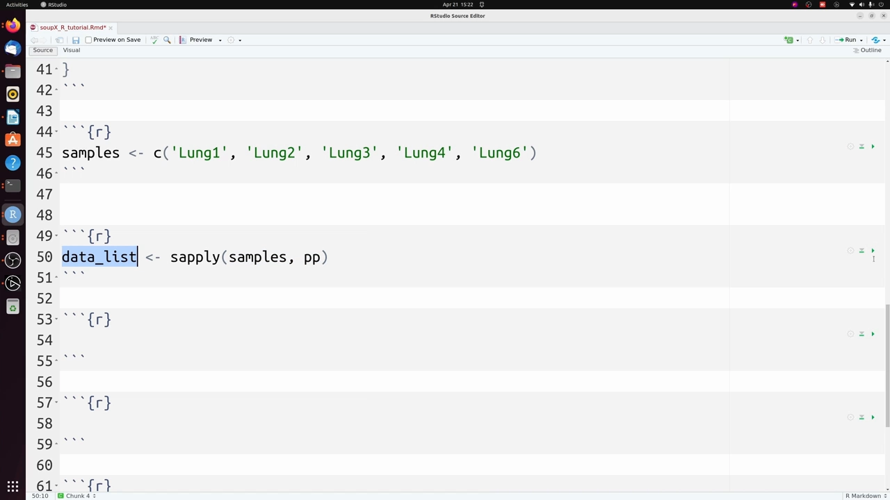

此时的对象**没有做过归一化、也没有做过任何降维聚类**，只是去掉了离群细胞。

### 3.2 加 soup_group：只取聚类那一列，不动原对象

接下来要加聚类标签。讲者的写法很讲究：写一个函数做最基础的 Seurat 归一化 + 聚类，但**只返回聚类新加的那一列**（`seurat_clusters`），这样原始对象不会被归一化、降维这些步骤改动。[【跳转到 03:12】](https://www.youtube.com/watch?v=Zs4UEQ9LZ-Y&t=192)

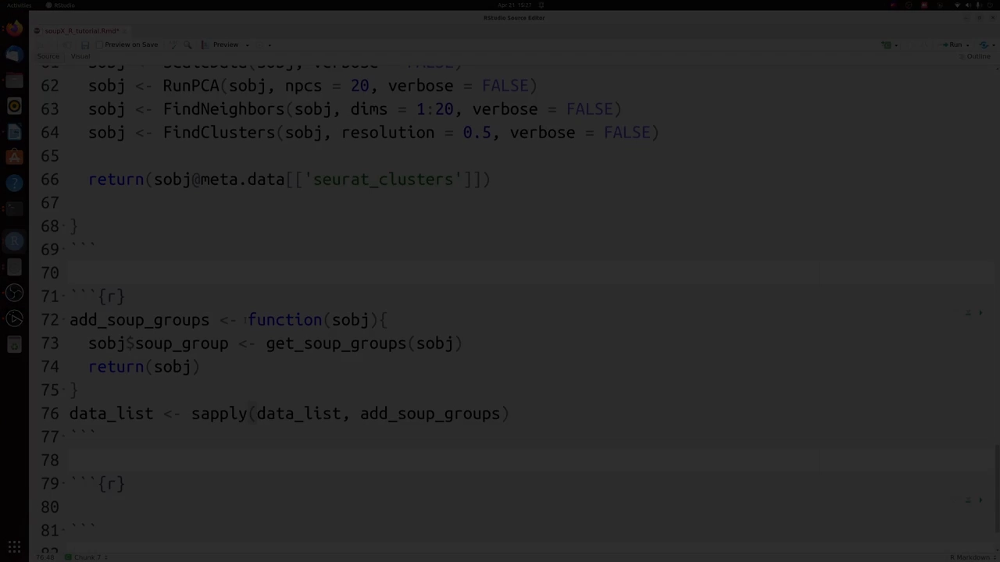

```r
get_soup_groups <- function(sobj){
  sobj <- NormalizeData(sobj, verbose = FALSE)
  sobj <- RunPCA(sobj, npcs = 20, verbose = FALSE)
  sobj <- FindNeighbors(sobj, dims = 1:20, verbose = FALSE)
  sobj <- FindClusters(sobj, resolution = 0.5, verbose = FALSE)
  return(sobj@meta.data[['seurat_clusters']])
}

add_soup_groups <- function(sobj){
  sobj$soup_group <- get_soup_groups(sobj)
  return(sobj)
}
data_list <- sapply(data_list, add_soup_groups)
```

跑完看对象的 metadata，右边多了一列 `soup_group`。到这一步还没用 SoupX 做任何事，只是加了分组。[【跳转到 03:17】](https://www.youtube.com/watch?v=Zs4UEQ9LZ-Y&t=197)

### 3.3 make_soup：SoupX 的四行核心

真正的校正函数 `make_soup` 接收一个 Seurat 对象，返回一个已经去掉环境 RNA 的对象。核心只有四行：

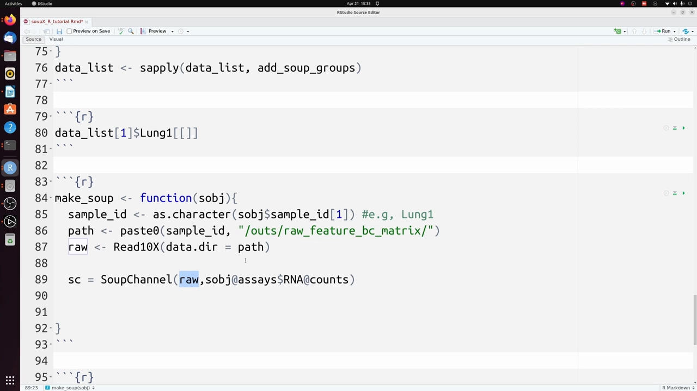

```r
make_soup <- function(sobj){
  sample_id <- as.character(sobj$sample_id[1])          # 例如 Lung1
  path <- paste0(sample_id, "/outs/raw_feature_bc_matrix/")
  raw  <- Read10X(data.dir = path)                      # 不需要建 Seurat 对象，直接用矩阵

  sc <- SoupChannel(raw, sobj@assays$RNA@counts)        # ① 建 channel
  sc <- setClusters(sc, sobj$soup_group)                # ② 告诉它细胞怎么分群
  sc <- autoEstCont(sc, doPlot = FALSE)                 # ③ 自动估污染比例 rho
  out <- adjustCounts(sc, roundToInt = TRUE)            # ④ 反解出干净 counts
  …
}
```

四步各管一件事，缺一不可：

1. **`SoupChannel(raw, counts)`**——把「汤」和「细胞」两份矩阵绑在一起。`raw` 里含空液滴，是汤的来源；`counts` 是 filtered 矩阵，是要被校正的对象。注意这里读 raw 矩阵时**不需要**建 Seurat 对象，直接用矩阵就行。
2. **`setClusters`**——把上一步的 `soup_group` 设进去，让 SoupX 知道细胞分群。[【跳转到 04:07】](https://www.youtube.com/watch?v=Zs4UEQ9LZ-Y&t=247)
3. **`autoEstCont`**——自动估计污染比例 $\rho$（rho）。这是 SoupX 里唯一「有主观性」的一步：它要判断「某个基因在某群细胞里的表达，有多少该归给汤」。视频用的是自动模式，这也是最省事、最常用的模式。一次处理多个样本时，讲者把绘图关掉（`doPlot = FALSE`），免得一堆诊断图把屏幕塞满。
4. **`adjustCounts(sc, roundToInt = TRUE)`**——按「观测 = 真实 + $\rho \times$ 汤」反解出真实表达，并把结果四舍五入回整数，因为下游的 Seurat/Scanpy 都期望 counts 是整数。

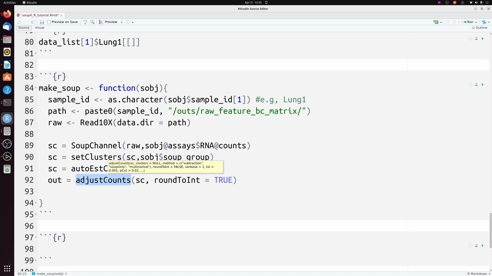

### 3.4 保留原始 counts，否则没法验证

校正完最要紧的一件事是**别把原始数据覆盖掉**。讲者的做法是先把原始 counts 存成一个新 assay `original.counts`，再用校正结果覆盖 `RNA@counts`：[【跳转到 04:57】](https://www.youtube.com/watch?v=Zs4UEQ9LZ-Y&t=297)

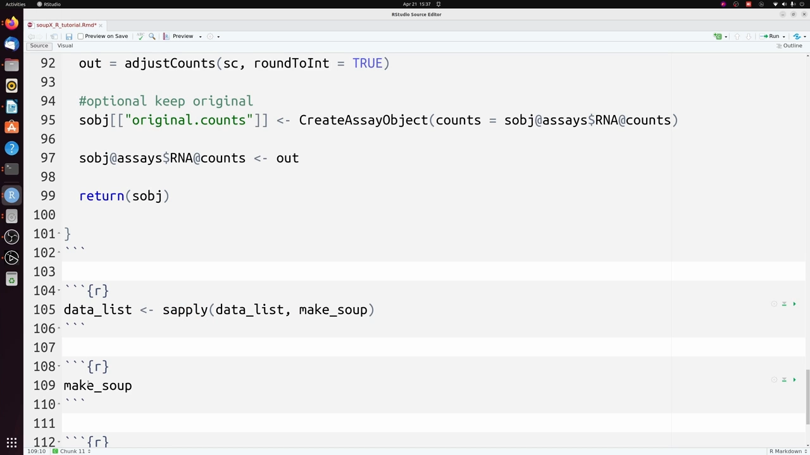

```r
sobj[["original.counts"]] <- CreateAssayObject(counts = sobj@assays$RNA@counts)
sobj@assays$RNA@counts    <- out
return(sobj)
```

讲者在这里吐槽了一个小插曲：他想把原始 counts 存成名为 `original.counts` 的 assay，R 却提示「已经存到别的地方了」，其实并没有——最终还是 `original.counts`。这类提示可以忽略，但**一定要回头确认两个 assay 的数值确实不同**，否则后面所有对比都是假的。

### 3.5 结果：大约 2% 的 UMI 被扣掉

把 `make_soup` 用 `sapply` 应用到整个列表上，然后做一个最粗的体检：看第一个样本 `Lung1` 里 `original.counts` 的 UMI 总和，再看默认 `RNA` assay（也就是 SoupX 的输出）的 UMI 总和。后者明显变小——大约去掉了总 RNA 的 **2%**。[【跳转到 05:22】](https://www.youtube.com/watch?v=Zs4UEQ9LZ-Y&t=322)

这个数字本身就是一个判断依据：2% 属于「轻微污染」，通常不影响大局；如果换成 20%、30%，那就是在动数据的骨架了，得格外小心。讲者在这一段先不做基因层面的绘图，留到 Python 部分末尾一起看——所以即使你不打算用 Python，也建议快进到那一段。

> 顺带一提：讲者说明自己的一部分代码改编自 Theis 实验室的单细胞最佳实践（single cell best practices），那套材料不只讲 SoupX 校正，还覆盖单细胞测序的很多方面，是值得收藏的资源。[【跳转到 05:52】](https://www.youtube.com/watch?v=Zs4UEQ9LZ-Y&t=352)
---

## 四、Python + Scanpy 路线：用 rpy2 把 R 搬进 notebook

### 4.1 为什么必须跨语言

SoupX 只有 R 实现，没有官方 Python 版。所以想在 Scanpy 流程里用它，只能**在 Python 里调用 R**。讲者的方案是 rpy2 + anndata2ri：

```python
import anndata2ri, logging
import rpy2.rinterface_lib.callbacks as rcb
import rpy2.robjects as ro

rcb.logger.setLevel(logging.ERROR)
ro.pandas2ri.activate()
anndata2ri.activate()
%load_ext rpy2.ipython
```

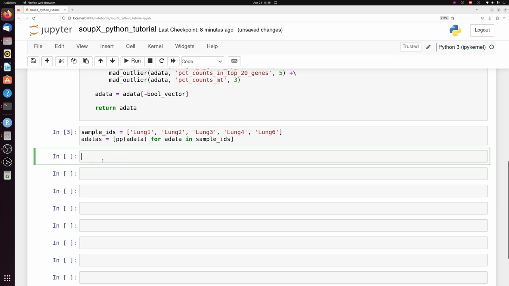

前提条件有两个，缺一个就跑不起来：**系统里装了 R**，并且**R 环境里装了 SoupX**。[【跳转到 06:49】](https://www.youtube.com/watch?v=Zs4UEQ9LZ-Y&t=409) 加载 rpy2 的 IPython 扩展这一行是关键，它注册了后面要用的 `%%R` cell magic 和 `%R` 行 magic。

Python 侧的预处理和 R 侧完全一样：读数据、算 QC 指标、按 MAD 过滤离群细胞，只是把 `mad_outlier` 换成 scipy 的 `median_abs_deviation`：

```python
sample_ids = ['Lung1', 'Lung2', 'Lung3', 'Lung4', 'Lung6']
adatas     = [pp(adata) for adata in sample_ids]
```

### 4.2 prepare_broth：把 AnnData 拆成 R 认识的「高汤配料」

跨语言调用的难点在于：R 函数要的是「基因 × 细胞」的稠密/稀疏矩阵加两个名字向量，而 AnnData 是「细胞 × 基因」。所以讲者写了一个 `prepare_broth`（字面意思是「备高汤」），把 AnnData 拆成五个零件：`data`、`raw`、`genes`、`cells`、`soup_groups`。[【跳转到 08:09】](https://www.youtube.com/watch?v=Zs4UEQ9LZ-Y&t=489)

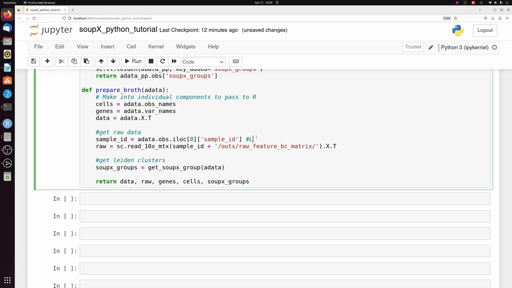

```python
def prepare_broth(adata):
    cells = adata.obs_names
    genes = adata.var_names
    data  = adata.X.T                       # AnnData 是细胞×基因，R 要基因×细胞

    # 取原始矩阵（含空液滴）
    sample_id = adata.obs.iloc[0]['sample_id']
    raw = sc.read_10x_mtx(sample_id + '/outs/raw_feature_bc_matrix/').X.T

    # 取 Leiden 聚类
    soup_groups = get_soup_group(adata)

    return data, raw, genes, cells, soup_groups
```

两个细节值得记住：

- **两次转置**。`adata.X.T` 和 `raw.X.T` 都要转，因为 R 侧要的是「基因 × 细胞」。
- **分组用 Leiden**。R 侧用的是 Seurat 的 `seurat_clusters`，Python 侧换成 Scanpy 的 Leiden 聚类——SoupX 只要求「有分组」，不关心分组是怎么来的。而且为了不改动原始 AnnData，讲者是**复制一份**再算 Leiden，只把标签向量取出来放进 obs 的 soupx_groups 列。

### 4.3 在 %%R cell 里重建 SoupChannel，并自己算 soup profile

R 侧的 `make_soup` 和前面几乎一样，但有一处关键差异：**不再让 SoupX 自己算汤的表达谱**。

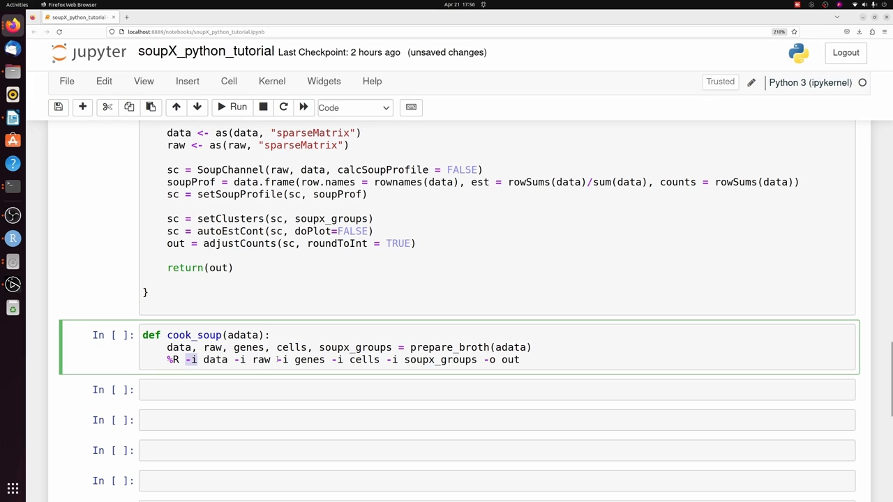

```r
%%R
library(SoupX)

make_soup <- function(data, raw, genes, cells, soup_groups){
  data <- as(data, "sparseMatrix")
  raw  <- as(raw,  "sparseMatrix")

  sc <- SoupChannel(raw, data, calcSoupProfile = FALSE)
  soupProf <- data.frame(row.names = rownames(data),
                         est   = rowSums(data)/sum(data),
                         counts = rowSums(data))
  sc <- setSoupProfile(sc, soupProf)

  sc <- setClusters(sc, soup_groups)
  sc <- autoEstCont(sc, doPlot = FALSE)
  out <- adjustCounts(sc, roundToInt = TRUE)
  return(out)
}
```

为什么要手动算 soup profile？因为拆成零件传进来之后，`SoupChannel` 拿到的 `raw` 已经不是它习惯的形态，让它自己去推容易出问题；索性自己按「每个基因的行和除以总和」算出每个基因的「汤中占比」直接喂进去。这也是讲者说的「剩下的完全一样」。

注意 `doPlot = FALSE`——批量跑多个样本时关掉诊断图。

### 4.4 cook_soup：用 -i / -o 在两个语言之间搬变量

最后用一层 Python 包装把两边缝起来：

```python
def cook_soup(adata):
    data, raw, genes, cells, soup_groups = prepare_broth(adata)
    %R -i data -i raw -i genes -i cells -i soup_groups -o out out = make_soup(data, raw, genes, cells, soup_groups)

    adata.layers["raw_counts"]  = adata.X
    adata.layers["soupX_counts"] = out.T
    adata.X = adata.layers["soupX_counts"]
    return adata
```

`%R` 行 magic 的两个开关是全部魔法所在：

- `-i 变量名`：把 Python 变量**送进** R；
- `-o out`：把 R 里的 `out` **带回** Python。

同一行里接着写 out 等于 make_soup 的调用，就完成了「传参 → 调用 → 取回」一条链。[【跳转到 09:49】](https://www.youtube.com/watch?v=Zs4UEQ9LZ-Y&t=589)

回到 Python 后，和 R 侧一样：原始 counts 存进 raw_counts 这个 layer，校正结果转置回来存进 soupX_counts 这个 layer，再把默认的 `X` 指向校正结果。**保留原始 layer 是后面所有对比的前提。**

### 4.5 结果：3% 到 12%

```python
adatas = [cook_soup(adata) for adata in adatas]
adatas[0].layers['soupX_counts'].sum() / adatas[0].layers['raw_counts'].sum()
# 0.9659912180285126
```

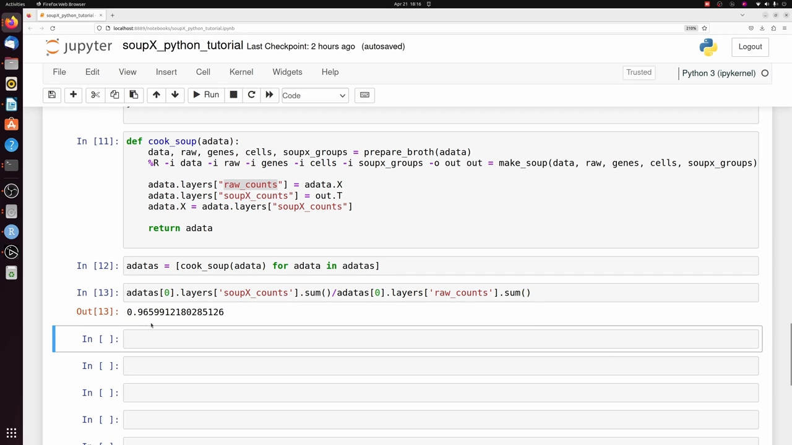

讲者的说法是「至少在这一个 AnnData 对象上，大约去掉了 3% 到 12% 的 reads」。[【跳转到 10:39】](https://www.youtube.com/watch?v=Zs4UEQ9LZ-Y&t=639) 这个数字比 R 侧那个 2% 更能说明问题：**同一套方法、同一批数据，不同样本的污染比例可以差好几倍**。所以「要不要校正」不能一概而论，得逐个样本看。

---

## 五、怎么判断「扣对了」：二值化前后对比

扣掉 3% 的 reads 听起来不多，但**这 3% 分布得极不均匀**——它几乎全部集中在一批「本来一个分子都没有」的基因上。要看清这件事，得把表达矩阵二值化。

### 5.1 Scanorama 整合只是为了可视化

为了把五个样本画在一张 UMAP 上，讲者做了一个「只为可视化」的整合：

```python
def norm_for_integration(adata):
    sc.pp.filter_genes(adata, min_cells = 1, inplace = True)
    sc.pp.normalize_total(adata, inplace = True)
    sc.pp.log1p(adata)
    sc.pp.highly_variable_genes(adata, flavor = "seurat",
                                n_top_genes = 4000, inplace = True, subset = True)
    return adata
```

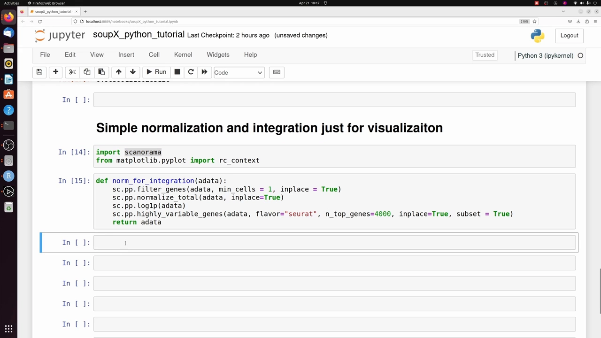

```python
adata = sc.concat(adatas, index_unique = '_')
adata.obsm["X_scanorama"] = np.concatenate(scanorama_int)   # 把 Scanorama embedding 贴回未归一化的数据
sc.pp.neighbors(adata, use_rep = "X_scanorama")
sc.tl.umap(adata)
```

注意这里的分工：**整合和 UMAP 用的是复制出来的归一化数据**，而后面做前后对比用的是**未归一化的原始 counts**。两者不要混。算邻居时要显式指定 use_rep 为 X_scanorama，否则 Scanpy 会用默认的 PCA。[【跳转到 11:25】](https://www.youtube.com/watch?v=Zs4UEQ9LZ-Y&t=685)

### 5.2 before / after 二值化相减：哪些细胞被改判了

核心操作只有五行：

```python
before = adata.layers['raw_counts'].copy()
after  = adata.layers['soupX_counts'].copy()

before.data = np.where(before.data > 0, 1, 0)   # 二值化：有没有表达
after.data  = np.where(after.data  > 0, 1, 0)

diff    = before - after          # 从 1 变 0 的位置 diff = 1，其余是 0 或 -1
changed = (diff == 1).astype(int) # 1 = 这个基因在这个细胞里被扣没了
```

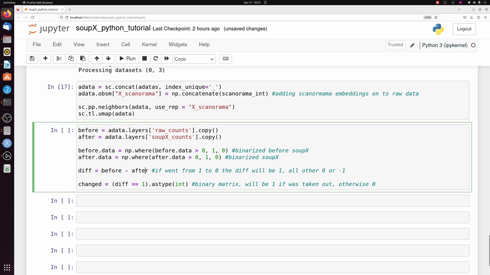

`diff` 的三种取值各有含义：等于 1 表示「原本阳性、校正后阴性」；等于 0 表示「前后一致」；等于 −1 表示「原本阴性、校正后阳性」——后者理论上不该出现（校正只会减不会加），出现了就是异常，值得查。[【跳转到 11:50】](https://www.youtube.com/watch?v=Zs4UEQ9LZ-Y&t=710)

然后按基因汇总，得到「这个基因从多少个细胞里被扣掉了」：

```python
adata.var['soupX_removed'] = changed.sum(axis = 0).A1
adata.var.sort_values('soupX_removed', ascending = False)
```

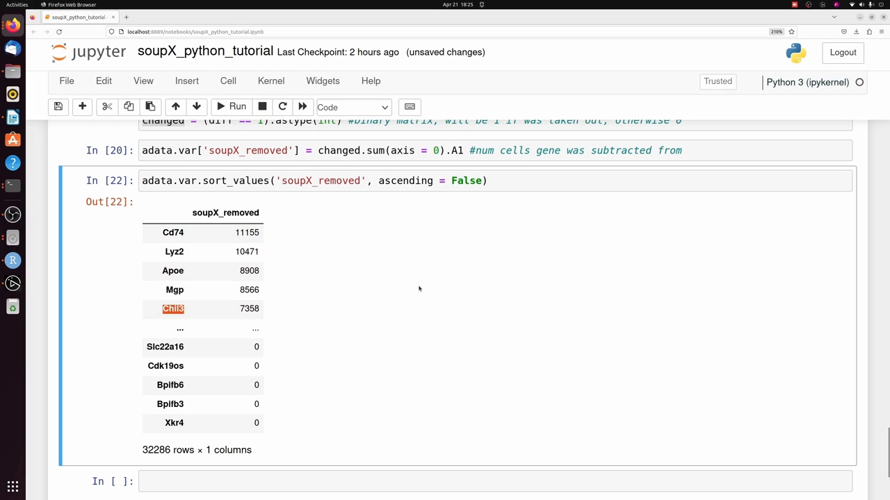

### 5.3 被扣得最多的基因，全是髓系 marker

这张排序表就是最好的诊断工具。[【跳转到 12:15】](https://www.youtube.com/watch?v=Zs4UEQ9LZ-Y&t=735) 排在最前面的 `Cd74`、`Lyz2`、`Apoe`、`Mgp`、`Chil3`——讲者一眼认出其中一些是巨噬细胞和其他髓系（myeloid）的 marker。

这些细胞当初呈阳性，很可能只是**因为某个髓系细胞破裂了**，它的 RNA 落进了比如内皮细胞的液滴里。也就是说：这些「阳性」从来就不是那些细胞自己的表达，而是汤的痕迹。末尾那一批 soupX_removed 为 0 的基因则是另一个极端——它们在所有细胞里都稳定表达，SoupX 一个分子都没动。

### 5.4 Cd74 / Chil3 的 UMAP：从「几乎全阳」到「只剩真阳性」

最后一步是把这件事画出来。先看 log 归一化后的表达：

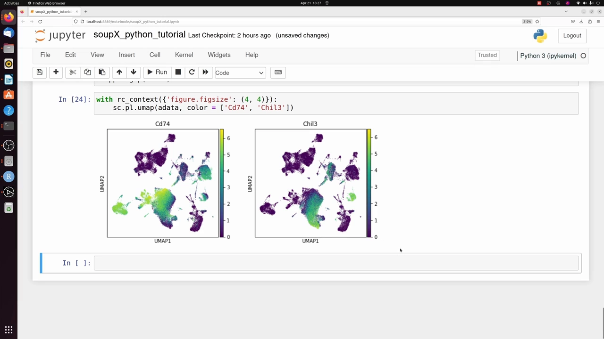

看起来很正常——颜色深的区域就是高表达的那几群。但**这是归一化后的连续值，它会把「低水平污染」和「真表达」混在同一个色阶里**。所以要看二值化版本，把 `vmax` 设成 1、并指定用 `raw_counts` layer：

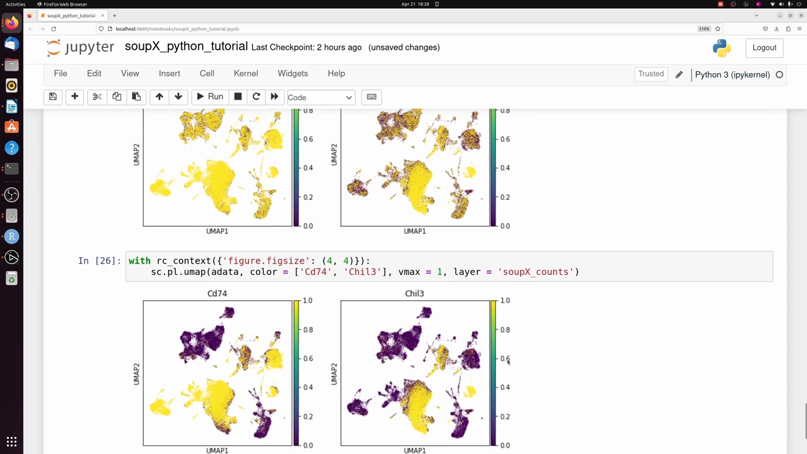

上图的上半部分就是校正前：**绝大多数细胞对 Cd74 和 Chil3 都是阳性的**——一个只该在髓系细胞里表达的基因，居然在几乎所有细胞里都「有表达」。这正是环境 RNA 的典型症状。[【跳转到 13:05】](https://www.youtube.com/watch?v=Zs4UEQ9LZ-Y&t=785)

换成 `soupX_counts` layer 再看一次（同一张图的下半部分）：差别非常大——**那些本来「很多细胞阳性」的簇，现在几乎没有细胞阳性了**，只剩下真正表达它们的区域还是黄的。[【跳转到 13:30】](https://www.youtube.com/watch?v=Zs4UEQ9LZ-Y&t=810)

这就是「3% 的 reads」为什么值得扣：它在总量上微不足道，却把一大批细胞的**定性判断**从阳性改成了阴性。

---

## 六、这套流程的边界与判断依据

视频本身没有长篇讨论「该不该校正」，但从它反复强调的几个动作里，可以提炼出三条判断依据：

1. **先量污染比例，再决定要不要用。** 讲者在 R 侧报了 2%、在 Python 侧报了 3%–12%。这个比例是唯一能直接读出来的「污染有多重」的指标——`autoEstCont` 估出来的 $\rho$ 就是它。比例很小、下游结论也不敏感时，校正带来的扰动可能比污染本身更麻烦。
2. **保留原始 layer / assay，永远可回退。** R 侧存 `original.counts`，Python 侧存 raw_counts 这个 layer。没有原始数据，你既无法验证校正效果，也无法在发现异常时退回。
3. **用「被扣得最多的基因」做体检。** 如果排在最前面的基因符合「已知的高表达、易泄漏基因」（血红蛋白、髓系 marker、组织特异超高表达基因），说明校正抓对了东西；如果排在最前面的是一批你完全没预期的基因，那就要怀疑 $\rho$ 估偏了。

另外要记住校正的代价：`adjustCounts` 是**减**操作，它扣掉的是 counts，其中不可避免会包含一点点真信号。所以校正之后的矩阵适合做聚类、注释、可视化这类「怕假阳性」的分析；如果某个下游分析对 counts 的绝对量很敏感，最好同时保留未校正版本做对照。

> 一点延伸（视频未展开）：decontX（celda 包）、CellBender remove-background 等工具走的是同一个思路——**先估计背景，再从观测里扣掉**，区别只在「怎么估背景」和「在哪一层扣」。选哪个工具不如先把「污染比例是多少」量出来重要。

---

## 小结

- 环境 RNA 来自组织解离和细胞裂解释放到缓冲液里的游离 mRNA；液滴在溶液里形成，所以**每个液滴都会带进几个别人的转录本**，空液滴里则全是汤。
- 它造成的是**假阳性**：高表达基因渗到所有细胞里，marker 变得不特异，稀有细胞类型的信号被整体抬高。方向与 dropout（假阴性）、doublet（谱系混合）都不同。
- SoupX 的物理基础是**空液滴**——它们被 cell calling 过滤掉了，但 counts 还在 raw 矩阵里，正好用来估汤的表达谱。
- 三个前提：raw + filtered 两份矩阵、细胞已有聚类标签、先做基本预处理去掉极端离群细胞。
- R 侧四行核心：`SoupChannel(raw, counts)` → `setClusters` → `autoEstCont` → `adjustCounts(roundToInt = TRUE)`。
- Python 侧靠 rpy2 + anndata2ri：`prepare_broth` 把 AnnData 拆成零件（记得两次转置），`%%R` cell 里重建 SoupChannel 并手算 soup profile，`%R -i … -o out` 完成传参与取回。
- 校正后一定要保留原始 counts（R 侧的 original.counts assay、Python 侧的 raw_counts layer），否则无法验证也无法回退。
- 验证方法：把前后矩阵二值化相减，按基因统计「由阳转阴」的细胞数。被扣得最多的基因应当是你预期会泄漏的那些（本例是 Cd74、Lyz2、Apoe、Mgp、Chil3 等髓系 marker）。
- 本例扣掉的 reads 只有 2%–12%，但足以把一大批细胞的 Cd74/Chil3 判断从阳性改成阴性——**污染比例小不等于影响小**。

## 关键术语速查

| 术语 | 一句话解释 |
| --- | --- |
| 环境 RNA（ambient RNA / soup） | 组织解离、细胞裂解后释放到缓冲液里的游离 mRNA，会被液滴随机包进去 |
| 空液滴（empty droplet） | 没有包到细胞、只包到游离转录本的液滴；被 cell calling 过滤，但 counts 仍在 raw 矩阵里 |
| filtered / raw 矩阵 | filtered 只含判为细胞的 barcode；raw 含全部 barcode（含空液滴），SoupX 两者都要 |
| 污染比例 $\rho$（rho） | 估计出的「每个细胞 counts 中来自汤的比例」，由 `autoEstCont` 给出 |
| SoupX | R 包，用空液滴估汤的表达谱，再按观测 = 真实 + $\rho \times$ 汤 反解 |
| `SoupChannel` | SoupX 的核心对象，把 raw 矩阵（汤）与细胞 counts 矩阵绑在一起 |
| `autoEstCont` | 自动估计污染比例 $\rho$；批量跑时用 `doPlot = FALSE` 关掉诊断图 |
| `adjustCounts` | 按估计出的 $\rho$ 反解出干净 counts；`roundToInt = TRUE` 取整以便下游使用 |
| soup profile | 汤的表达谱，即每个基因在汤里的相对占比；本例手算为每个基因的行和除以总和 |
| rpy2 / anndata2ri | 在 Python 里执行 R 代码、并在 AnnData 与 R 对象之间互转的桥 |
| `%R -i / -o` | rpy2 的行 magic：`-i` 把 Python 变量送进 R，`-o` 把 R 变量带回 Python |
| 二值化对比 | 把校正前后矩阵都变成 0/1 再相减，统计「由阳转阴」的细胞数，用来验证校正是否抓对了基因 |
