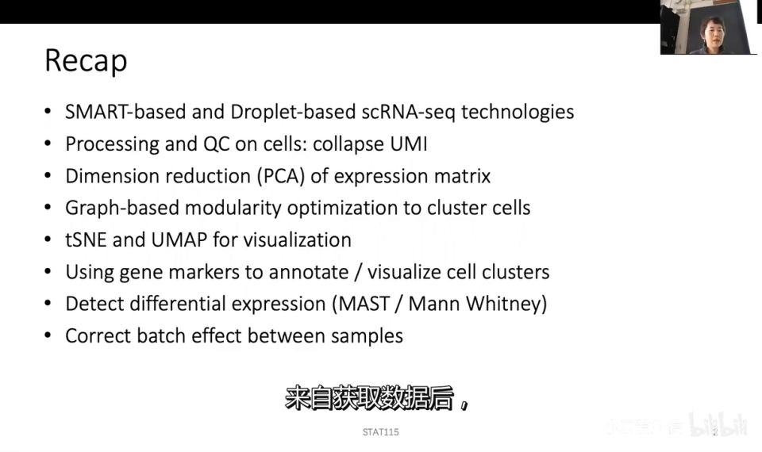
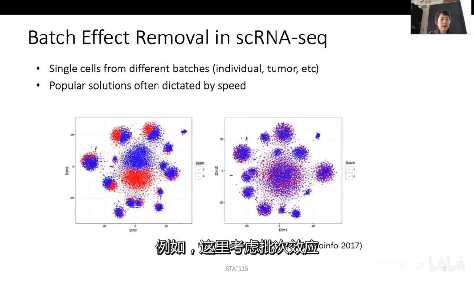
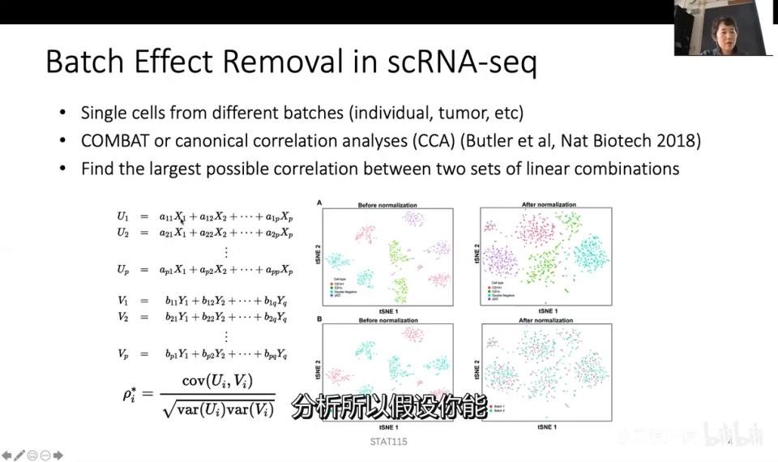
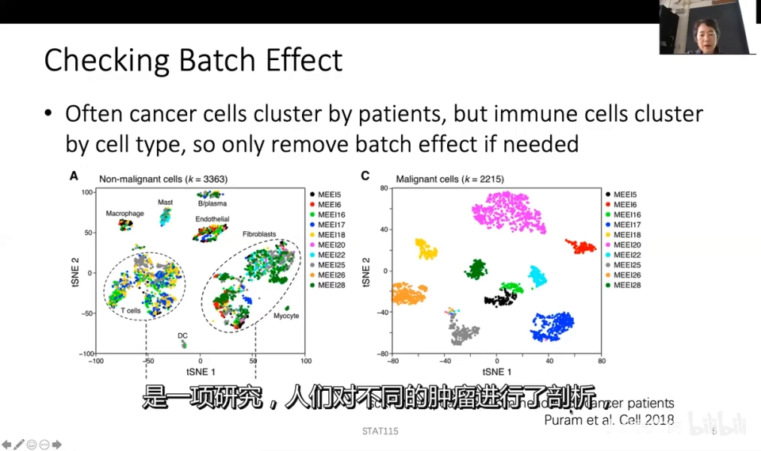
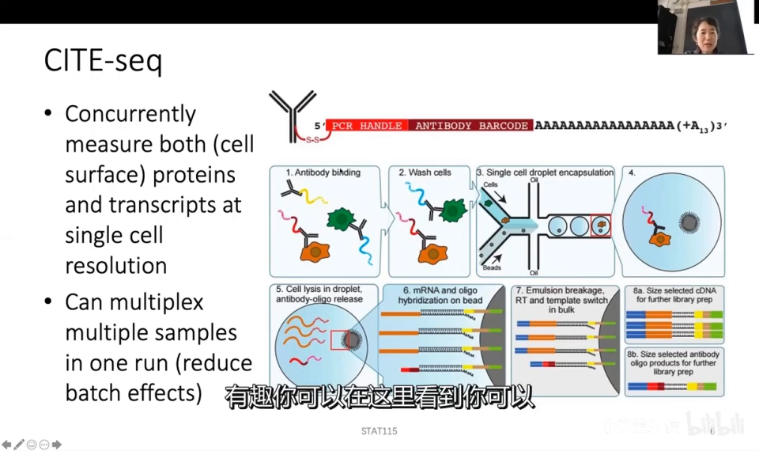

# 先判断再校正：批次效应的识别、CCA 对齐与 CITE-seq 多重化

> 视频来源：[单细胞数据批次效应去除](https://www.bilibili.com/video/BV1JL411o7h3/)（Bilibili · 小云爱生信）｜时长约 27 分钟
> 导读：这是一堂英文单细胞课程的录播（课件标注 STAT115），B 站版本由机器翻译中文字幕，术语错译较多（如「间歇效应」「侧求」「格斗」），本文已按上下文订正为批次效应、CITE-seq、ComBat。视频前一半讲批次效应怎么识别、CCA 怎么对齐、什么时候**不该**校正，后一半转向 CITE-seq 多重化与课程事务；本文只整理与批次效应相关的部分。

## 本讲要解决的核心问题（SCQA）

**背景**：单细胞分析的标准流程是：建库测序 → 比对 → 质量控制 → 降维 → 聚类 → 用标记基因注释 → 差异表达。这条流程在**单个样本内部**是自洽的——所有细胞经历了完全相同的实验过程。

**冲突**：一旦把两个病人的样本放在一起比较，问题就来了。同一群细胞会因为来自不同样本而在降维图上左右分开，看起来像是两种细胞类型。更微妙的是，**有时候这种分开是真的**：癌细胞的突变各不相同，本来就该按病人分开。

**疑问**：怎么判断图上的「分开」是批次效应还是真实生物学差异？校正方法（ComBat、CCA）到底在校正什么？有没有办法从实验端就减少批次？

**回答（中心思想）**：批次校正的前提是**先判断需不需要校正**。CCA 这类方法通过给基因重新加权、最大化两个样本之间的相关性来对齐同类细胞，它的成立依赖「两个样本的细胞组成大体可比」；而当数据本身已经协调（免疫细胞按类型聚、只有癌细胞按病人聚）时，再校正就是过度校正。真正从源头解决批次的办法是**实验设计**——把多个样本多重化到同一次运行里。

[【跳转到 00:05】](https://www.bilibili.com/video/BV1JL411o7h3/?t=5)

[【跳转到 00:55】](https://www.bilibili.com/video/BV1JL411o7h3/?t=55)

## 一、批次效应出现在「跨样本」这一步

### 1.1 先把流程摆出来

讲者开场快速回顾了整条流程，把批次校正放在最后一步：

1. **建库**：Smart-seq（一次一个细胞分别建库）与基于液滴的技术（细胞过液滴、每个转录本打上细胞条形码、混在一起测序）。
2. **比对**：用 Cell Ranger 或 STARsolo 把 reads 比对到基因组。
3. **质控**：去掉检测到的基因太少的细胞、去掉只在极少数细胞里表达的基因。
4. **UMI 合并（collapse UMI）**：同一个细胞里同一个基因的多条 UMI 要当作一条，而不是累加——这是液滴单细胞的关键一步。
5. **降维**：把上万个基因压到每个细胞由二十、五十或一百个主成分表示。
6. **聚类**：基于图的模块化优化，找出彼此接近的细胞群。
7. **可视化**：t-SNE 或 UMAP。
8. **注释**：用标记基因（marker）命名细胞簇。
9. **差异表达**：MAST、Mann-Whitney 等检验。
10. **批次校正**：只在跨样本比较时才需要。

### 1.2 为什么同一样本内部不需要校正

讲者的判断标准很干脆：**同一样本内部做单细胞，不应该有任何批次效应**，因为所有细胞经历了完全相同的过程。所以在同一样本内比较不同簇的差异表达，是安全的。

但如果你分别对病人 A 和病人 B 的样本做单细胞、再放在一起比较，就**必须把批次考虑进去**。

[【跳转到 01:55】](https://www.bilibili.com/video/BV1JL411o7h3/?t=115)

### 1.3 批次效应长什么样

[【跳转到 03:15】](https://www.bilibili.com/video/BV1JL411o7h3/?t=195)

这张图（课件标注 Butler et al., Bioinformatics 2017）是本讲最直观的一页：左边红色来自一个样本、蓝色来自另一个样本，两批细胞能看出相似之处，但**并不完全重叠**；右边是去除批次效应之后，细胞按细胞类型聚在一起，两个样本真正重叠了。

判断标准可以总结成一句话：**看颜色是不是按细胞类型混匀**。如果每一团细胞里红蓝都有，说明批次影响已经很小；如果红蓝各占一团，就是批次效应。

## 二、工具很多，选型由「速度」决定

讲者提到一个很现实的观察：人们已经开发了大量批次效应去除算法，有一篇 Nature Reviews Genetics 的综述总结了这些方法，**大概有 50 种工具**。

那实际用哪个？他的回答是：最流行的方案通常是由**速度**决定的——很多方法如果不是那么好用、不够快，人们就不太会用；要既有效又快。

在这个标准下，他点了两个名字：

- **ComBat**：转录组时代就在用的经典方法。
- **CCA（典型相关分析，canonical correlation analysis）**：单细胞里更流行的一种。

[【跳转到 03:40】](https://www.bilibili.com/video/BV1JL411o7h3/?t=220)

## 三、CCA 在做什么：给基因重新加权，让两个样本对齐

### 3.1 直觉

讲者先用一段话讲直觉：想象每个细胞都有很多基因的表达值——基因 1、基因 2、基因 3……然后你有两个样本。CCA 本质上是要给每个基因一个**线性组合**，也就是给每个基因一个系数，这样既缩小了维度，又保证两个样本之间有最好的相关性。

[【跳转到 03:45】](https://www.bilibili.com/video/BV1JL411o7h3/?t=225)

### 3.2 公式

课件把这件事写成了公式。设样本一的基因表达为 $X_1, X_2, \dots, X_p$，样本二为 $Y_1, Y_2, \dots, Y_q$，CCA 为每个样本构造 $p$ 个线性组合：

$$
U_i = a_{i1}X_1 + a_{i2}X_2 + \cdots + a_{ip}X_p
$$

$$
V_i = b_{i1}Y_1 + b_{i2}Y_2 + \cdots + b_{iq}Y_q
$$

然后找一组系数，使对应的 $U_i$ 与 $V_i$ 之间的相关性最大：

$$
\rho_i^{*} = \frac{\operatorname{cov}(U_i, V_i)}{\sqrt{\operatorname{var}(U_i)\operatorname{var}(V_i)}}
$$

[【跳转到 04:30】](https://www.bilibili.com/video/BV1JL411o7h3/?t=270)

用大白话说：**CCA 不是把批次减掉，而是重新定义坐标轴**——找一组基因权重，使得在这组权重下，两个样本的细胞分布尽可能重合。所以它和 PCA 很像：都是把细胞投射到新的维度上，只不过 PCA 要的是「方差最大」，CCA 要的是「两个样本最一致」。

### 3.3 它成立的前提：两个样本的细胞组成大体可比

这是本讲最容易被忽略、但最重要的一句：CCA 有效，是因为**两个样本的整体分布基本相似**——不同细胞簇的数量大致相同，每一组的分布也或多或少可比。

讲者举的例子是同一类乳腺癌组织：它们都有癌细胞，都有一些上皮正常细胞，也都有不同的免疫细胞和血管等等。这种情形就适合用 CCA 这类方法。

反过来推：如果两个样本的细胞组成差异极大（一个有 T 细胞、另一个完全没有），CCA 仍然会去找「最相关」的组合，但找到的可能不是同一类细胞——这就是过度校正的来源。

### 3.4 校正之后才能做样本间比较

讲者强调了一条实践纪律：如果你想做**样本间的差异表达**，务必先在不同样本之间做批次效应去除，再用检验方法看同一细胞类型在不同样本间的差异。

原因不难理解：如果不校正，你检验出来的「差异基因」里混着批次差异，而批次差异往往比真实的生物学差异还大——这类结论是站不住的。

[【跳转到 06:00】](https://www.bilibili.com/video/BV1JL411o7h3/?t=360)

## 四、什么时候**不该**校正：一个反直觉的实证

### 4.1 现象

讲者用一项研究（课件标注 Puram et al., Cell 2018，头颈癌）说明过度校正的风险。研究把多个病人的肿瘤细胞放在一起看：

- **只看癌细胞**：每个病人是一团，你在癌细胞上画 t-SNE 会觉得「很明显有批次效应」——这个病人的癌细胞都在这里、那个病人的都在那里。
- **只看非恶性细胞（免疫细胞等）**：这些病人其实按**细胞类型**聚得很好——所有病人的巨噬细胞聚在一起，内皮细胞聚在一起，成纤维细胞在一起，T 细胞在一起。

[【跳转到 07:25】](https://www.bilibili.com/video/BV1JL411o7h3/?t=445)

### 4.2 结论：数据可能已经协调好了

讲者的推理是：如果免疫细胞能跨病人按类型聚在一起，说明**这批数据在技术上已经协调得不错**；癌细胞按病人分开，是因为它们的突变不同——这是真实的生物学差异，不是批次。

所以结论是：**这种数据可能不再需要额外的批次效应去除**。硬做校正，反而会把「病人特异的癌细胞状态」这个真正想研究的东西抹平。

这条经验在肿瘤单细胞研究里被反复观察到，值得记住：**先按细胞类型检查一遍，再决定要不要校正。**

[【跳转到 08:40】](https://www.bilibili.com/video/BV1JL411o7h3/?t=520)

## 五、从实验端解决：多重化（multiplexing）

### 5.1 思路：与其事后校正，不如一开始就不产生批次

讲者的说法是：理想情况下，如果你有多个肿瘤样本，希望能**一起处理**，如果可行，就可以减少批次效应。

为此发展出了一种实验技术——**CITE-seq**（在纽约基因组中心开发）。它最初并不是为了多样本而开发的，而是为了在单细胞分辨率下**同时测量细胞表面蛋白和 RNA 表达**。

### 5.2 为什么需要同时测蛋白

讲者给了一个很实际的动机：有些细胞表面蛋白对应的 RNA 表达并不高，做单细胞 RNA-seq 时，这个 RNA 可能在这个细胞里 dropout 了，你就观察不到；但蛋白在细胞表面，可以直接用抗体检测。

### 5.3 抗体长什么样

CITE-seq 的抗体是一条「可以被测序的抗体」：一端是识别目标蛋白的抗体，另一端接一段 **PCR handle + 抗体条形码 + poly-A 尾巴**。

[【跳转到 10:50】](https://www.bilibili.com/video/BV1JL411o7h3/?t=650)

流程是：抗体结合到细胞表面 → 洗掉未结合的 → 细胞进液滴（液滴里还有带细胞条形码的珠子）→ 裂解 → mRNA 与抗体上的 oligo 一起被珠子捕获 → 反转录 → 建库测序。

关键的一步在最后：**因为抗体序列末端也有 poly-A，它会被液滴当成一条普通转录本处理**——所有普通 RNA 都有 poly-A，抗体 oligo 也有，所以它同样挂到珠子上、同样带上细胞条形码。于是测序结果里，这个细胞除了有 RNA，还有一条带抗体条形码的读数，告诉你它表面有没有那个蛋白。

### 5.4 用它做多重化

CITE-seq 现在也可以用来把多个样本**多重化（multiplex）到一次运行里**：

1. 每个样本用**不同的抗体条形码**标记（抗体本身是通用抗体，和所有细胞都结合）。
2. 把所有单细胞悬液混在一起。
3. 混合后过液滴机、建一个文库、一次测序。
4. 根据抗体条形码，就知道这个细胞来自第一个肿瘤、第二个还是第三个。

用这种方法，讲者的说法是：**你可能可以在完全不做批次效应处理的情况下分析数据**，因为它们是一起处理的，批次效应会大大减少。

[【跳转到 14:35】](https://www.bilibili.com/video/BV1JL411o7h3/?t=875)

### 5.5 提问环节的两个要点

视频后段有学生提问，回答里有两个值得记的点：

- **用 CITE-seq 做多重化时，不要用特异性的表面标记抗体**：如果你真的想用 CITE-seq 看表面蛋白表达，那你不会用这种多重化的做法——因为用同一种抗体标记所有样本，理论上会引入偏倚。多重化要的是「和所有细胞都结合」的通用标记。
- **也可以反过来用**：如果你只想看所有病人样本里的 T 细胞，可以用 CD3 抗体把所有 T 细胞抓出来，每个样本用不同的条形码，再把它们排在一起测——这样一次能看更多样本。
- **样本可以适当过载**：10x Genomics 一次大约用一万个细胞，如果你有四个样本，可以试着合并过机器，希望最终拿到一万个高质量细胞。

[【跳转到 20:43】](https://www.bilibili.com/video/BV1JL411o7h3/?t=1243)

## 六、把这一讲落到操作上

| 阶段 | 该做什么 | 判断依据 |
| --- | --- | --- |
| 实验设计 | 尽量把多个样本多重化到同一次运行 | 一起处理 = 批次效应从源头变小 |
| 拿到数据 | 先按批次上色画 UMAP/PCA | 颜色是否按细胞类型混匀 |
| 判断 | 分别看「非恶性/免疫细胞」和「目标细胞」 | 免疫细胞按类型聚 = 数据已协调 |
| 校正 | 需要时用 ComBat / CCA 一类方法 | 校正后再做样本间差异表达 |
| 复核 | 校正后重新降维聚类 | 已知的细胞类型差异是否还在 |

## 小结

- **批次效应只在跨样本比较时出现**：同一样本内部的细胞经历了相同过程，簇间差异表达不需要校正。
- **判断标准是「颜色按细胞类型混匀」**：红蓝各占一团就是批次；每团里红蓝交错就是协调良好。
- **工具多、选型看速度**：约 50 种方法，ComBat 与 CCA 是常被提到的两个。
- **CCA 的本质是重新加权坐标轴**：给每个基因一个系数，让两个样本的线性组合相关性最大，从而让同类细胞对齐；前提是两个样本的细胞组成大体可比。
- **过度校正是真实风险**：癌细胞按病人聚是生物学差异，免疫细胞按类型聚说明数据已协调，这时不该再校正。
- **最好的校正是不产生批次**：CITE-seq 通过抗体条形码把多样本多重化到一次运行，从实验端减少批次效应。

## 关键术语速查

| 术语 | 一句话解释 |
| --- | --- |
| 批次效应（batch effect） | 不同样本/批次之间的系统性技术差异，会让细胞按批次而非按细胞类型分群 |
| ComBat | 转录组时代就有的批次校正方法，通过统计模型估计并去除批次项 |
| CCA（典型相关分析） | 给每个基因一个权重，使两个样本的线性组合相关性最大，从而对齐同类细胞 |
| 过度校正（overcorrection） | 校正过头，把真实的生物学差异也抹掉 |
| 多重化（multiplexing） | 用不同条形码标记不同样本后混合测序，从实验端消除批次差异 |
| CITE-seq | 用带条形码的抗体同时测量细胞表面蛋白与 RNA 的单细胞技术 |
| 抗体条形码（antibody barcode） | 抗体 oligo 上的序列标签，测序后据此判断这条读数来自哪种抗体 |
| dropout | 某个基因在细胞里其实有表达，但因为没被测到而显示为 0 |
| collapse UMI | 把同一细胞、同一基因的多条 UMI 合并为一条，避免重复计数 |