# 批次效应从哪里来、怎么发现、怎么校正——Seurat Integration 与 Harmony 的取舍

> 视频来源：[单细胞07｜去除批次效应](https://www.bilibili.com/video/BV1aKN3z2EuA/)（Bilibili · 小简生信）｜时长约 15 分钟
> 导读：这是一支偏实操的短视频，先把「批次效应是什么、为什么必须处理」讲清楚，再用同一份双批次数据分别跑 Seurat Integration 与 Harmony，最后把 MNN、LIGER、Scanorama、BBKNN 等方法的定位一句话带过。本文按这条顺序整理，代码片段与运行结果都对应到原始画面；字幕里的 ASR 错拼（如「石城官网」「thoroute integration」「高倍基因」）已按上下文订正。

## 本讲要解决的核心问题（SCQA）

**背景**：单细胞实验很少只测一个样本。一次课题往往要整合多个样本的数据，而这些样本的测序时间、样本来源、测序平台、操作人员、试剂批次都可能不同。

**冲突**：这些「批次」带来的技术差异会在降维和聚类里变成系统性的偏差——细胞不是按细胞类型分群，而是按批次分群。更麻烦的是，单细胞数据不能照搬转录组时代那套「从表达矩阵里减掉批次」的做法，因为不同样本的细胞组成本来就不一样，硬减会把真实的生物学差异一起抹掉。

**疑问**：批次效应到底怎么识别？为什么单细胞要讲「数据整合（integration）」而不是「批次校正（batch correction）」？Seurat Integration 和 Harmony 各是什么思路，该怎么选？

**回答（中心思想）**：批次效应是**技术来源的系统性偏差**，它会让细胞按批次而不是按细胞类型分群。单细胞里正确的目标不是「把批次影响压到最小」，而是**让相同类型的细胞在同一个表达空间里对齐**——Seurat Integration 靠「锚点」对齐，Harmony 在 PCA 空间里迭代校正，二者都能达到目的，但代价与适用规模不同。

[【跳转到 00:00】](https://www.bilibili.com/video/BV1aKN3z2EuA/?t=0)

## 一、批次效应是技术差异，不是生物学差异

### 1.1 批次的来源

讲者开篇就把批次的来源列了一遍：多个样本的实验数据，往往有不同的**测序时间**、不同的**样本来源**、不同的**测序平台**，也可能由**不同的人**操作、用的**试剂**不一样。

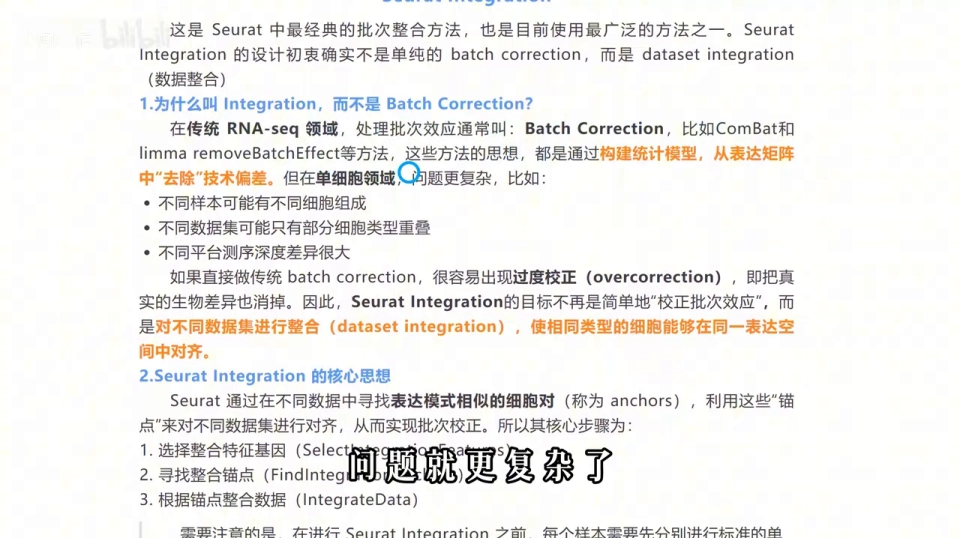

[【跳转到 00:25】](https://www.bilibili.com/video/BV1aKN3z2EuA/?t=25)

这些因素共同决定了「这些样本来自不同的实验批次」。而不同批次的样本之间，由技术带来的差异会在后续分析中引入**系统性的表达偏差**——这就是批次效应（batch effect）。

这里值得停一下，把「系统性」三个字讲清楚：批次效应不是一个细胞一个细胞的随机噪声，而是**整批细胞一起往同一个方向偏**。随机噪声可以靠增加细胞数平均掉，系统性偏差不行——它在降维图上会变成一个方向明确的「位移」，聚类算法会老老实实把这个位移当成结构。

### 1.2 它长什么样：按批次分群

判断批次效应最直接的办法，就是把细胞投射到低维空间、**按批次上色**看。

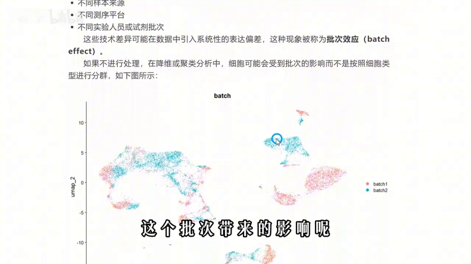

[【跳转到 00:50】](https://www.bilibili.com/video/BV1aKN3z2EuA/?t=50)

讲者用的是官方示例数据里的两个样本，当作两个批次。图上红蓝两色（batch1 / batch2）各自占据一片区域，中间只有少量交叠——**这就是批次效应的典型长相**：如果两个样本来自同一种组织、细胞类型构成相近，那么理想情况下红蓝点应该在同一团细胞里交错分布，而不是各占一半。

### 1.3 不处理的代价

讲者给了两条后果：

1. **后续分析不够准确**：聚类出来的「群」可能是批次造成的假群，细胞注释、标记基因、差异表达都会跟着错。
2. **结果影响实验结论**：如果两个样本恰好是「对照 vs 处理」，批次和分组完全混杂，那么你看到的差异到底来自处理还是来自批次，根本无法区分。

所以多样本单细胞分析里，通常都要做批次校正或数据整合，让细胞能按照真实的生物学特征聚类。

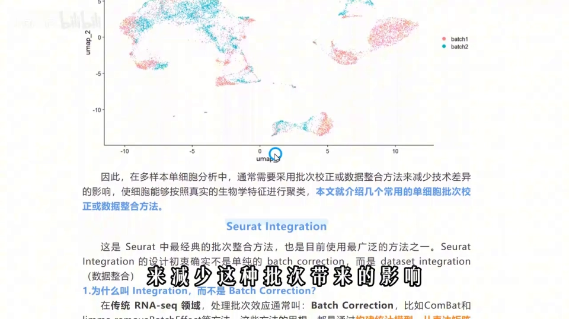

[【跳转到 01:40】](https://www.bilibili.com/video/BV1aKN3z2EuA/?t=100)

## 二、为什么单细胞要叫「整合」而不是「校正」

这是本讲最有价值的一段：它解释了方法命名背后的取舍。

### 2.1 转录组时代的做法：从矩阵里减掉批次

在传统 RNA-seq（转录组）领域，处理批次效应通常就叫 **batch correction**，代表方法如 ComBat、`limma` 的 `removeBatchEffect`。它们的核心思想是**构建统计模型，从表达矩阵中「去除」技术偏差**。

这套思路成立的前提是：每个样本测的是同一群细胞（或同一批基因的平均表达），样本之间的差异可以被建模成「批次项 + 生物学项」，把批次项减掉就行。

### 2.2 单细胞让问题变复杂

到了单细胞，这个前提被打破了。讲者列了三条：

- **不同样本可能有不同的细胞组成**：有些疾病样本会有特异性的细胞类型，别的样本里根本没有。
- **不同数据集可能只有部分细胞类型重叠**：比如有的数据里没有 T 细胞。
- **不同平台测序深度差异很大**：同一类型的细胞，在 A 平台和 B 平台上测到的分子数可以差出很多。

[【跳转到 02:15】](https://www.bilibili.com/video/BV1aKN3z2EuA/?t=135)

如果照转录组那套直接减，很容易出现**过度校正（overcorrection）**——把真实的生物学差异也一起消掉。讲者的解释很直白：强行去除批次间的差异，就会忽视某些细胞的特异性。

[【跳转到 03:02】](https://www.bilibili.com/video/BV1aKN3z2EuA/?t=182)

### 2.3 换目标：从「压到最小」到「对齐同类细胞」

所以 Seurat 提出的方法不叫 batch correction，而叫 **dataset integration（数据整合）**。它的目标不是让批次影响最小，而是：

> 对不同数据集进行整合，**使相同类型的细胞能够在同一表达空间中对齐**。

这个目标转换很关键：它把「减掉一个方向」换成了「把同类细胞拉到一起」。前者假设批次是一个可以整体平移的量，后者只要求同类细胞重合——**不同样本里独有的细胞类型不会被强行拉去配对**，因此更不容易过度校正。

[【跳转到 03:27】](https://www.bilibili.com/video/BV1aKN3z2EuA/?t=207)

## 三、Seurat Integration：用「锚点」对齐

### 3.1 核心思想

Seurat 的做法是：在不同数据中寻找**表达模式相似的细胞对**，称为**锚点（anchors）**，再利用这些锚点对不同数据集进行对齐，从而实现批次校正。

锚点的直觉可以这样理解：如果样本 A 里有一个细胞、样本 B 里也有一个细胞，它们的表达谱高度相似，那么它们很可能是同一类细胞——**这一对细胞就提供了一个「这两个坐标应该重合」的约束**。找足够多的锚点，就得到一张把两个数据集对齐的「映射表」。

### 3.2 三个步骤

讲者把流程拆成三步，与 Seurat 的函数一一对应：

1. **选择整合特征基因**（`SelectIntegrationFeatures`）——不是所有基因在所有数据集里都表达，先把用于对齐的特征基因挑出来。
2. **寻找整合锚点**（`FindIntegrationAnchors`）——找出表达模式相似的细胞对。
3. **根据锚点整合数据**（`IntegrateData`）——用锚点把各数据集对齐成一份整合后的矩阵。

[【跳转到 04:03】](https://www.bilibili.com/video/BV1aKN3z2EuA/?t=243)

### 3.3 一个容易踩的前置条件

讲者特别强调：**运行 Seurat Integration 之前，每个样本必须先分别做标准的单细胞预处理**，包括数据标准化和高变基因筛选等。

原因很直接：它要靠基因表达去找相似细胞，如果数据没处理过，找出来的锚点就不可靠。所以流程上是「先各样本独立预处理 → 再整合」，而不是把原始矩阵直接丢进去。

[【跳转到 04:28】](https://www.bilibili.com/video/BV1aKN3z2EuA/?t=268)

### 3.4 运行结果

整合完成后重新降维聚类，效果如下：

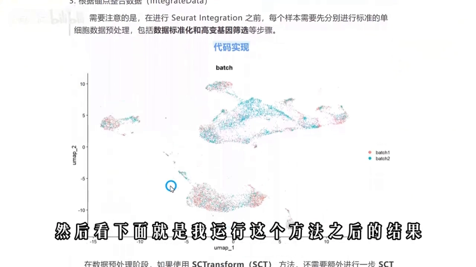

[【跳转到 04:53】](https://www.bilibili.com/video/BV1aKN3z2EuA/?t=293)

对照前面那张「按批次分成两团」的图，这里红蓝点已经在同一团里交错——这就是整合成功的标志。

### 3.5 代码实现

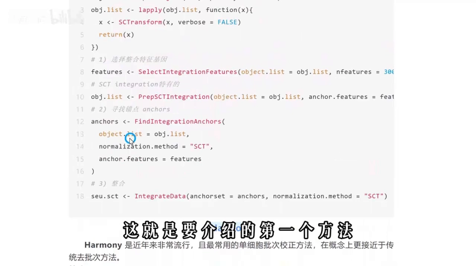

[【跳转到 05:28】](https://www.bilibili.com/video/BV1aKN3z2EuA/?t=328)

代码骨架（画面中的 R 代码）：

```r
obj.list <- lapply(obj.list, function(x) {
  x <- SCTransform(x, verbose = FALSE)
  return(x)
})

# 1) 选择整合特征基因
features <- SelectIntegrationFeatures(object.list = obj.list, nfeatures = 3000)

# SCT 整合特有的一步
obj.list <- PrepSCTIntegration(object.list = obj.list, anchor.features = features)

# 2) 寻找锚点
anchors <- FindIntegrationAnchors(
  object.list = obj.list,
  normalization.method = "SCT",
  anchor.features = features
)

# 3) 整合
seu.sct <- IntegrateData(anchorset = anchors, normalization.method = "SCT")
```

讲者提醒了两个实现细节：

- **`PrepSCTIntegration` 是 SCT 流程特有的**：如果用的是传统的 normalized data 流程，这一步不需要。
- 整合后的对象会带一条警告，说用的是 SCT 的矩阵、`data` 里的 counts 里没有；用 normalize 流程跑就不会有这个警告。

## 四、Harmony：在 PCA 空间里迭代校正

### 4.1 原理

Harmony 在概念上更接近传统的去批次方法，但操作对象不是表达矩阵，而是**低维空间**。

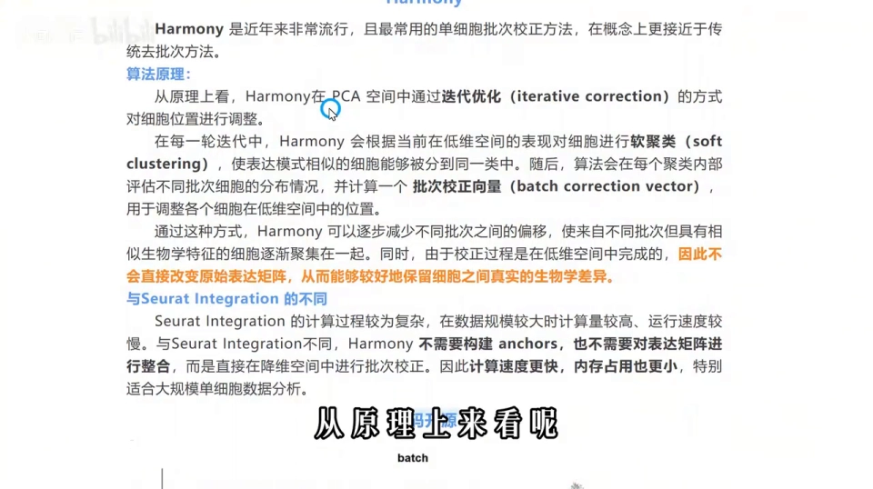

[【跳转到 06:43】](https://www.bilibili.com/video/BV1aKN3z2EuA/?t=403)

讲者把每一轮迭代拆成三件事：

1. **软聚类（soft clustering）**：根据细胞在当前低维空间（PCA 空间）里的位置，把表达模式相似的细胞分到同一类里。之所以叫「软」，是因为一个细胞不是硬性归到某一类，而是带概率地属于多个簇。
2. **估计批次校正向量**：在每个聚类内部，评估不同批次细胞的分布情况，计算出一个**批次校正向量（batch correction vector）**。这个向量是「这一簇里批次 A 相对批次 B 整体偏了多少」的估计。
3. **调整位置**：用这个向量调整各个细胞在低维空间中的位置。

通过反复迭代，不同批次之间的偏移被逐步减小，不同批次中具有相同生物学特征的细胞逐渐聚到一起。

[【跳转到 07:08】](https://www.bilibili.com/video/BV1aKN3z2EuA/?t=428)

### 4.2 为什么它不容易过度校正

讲者给了两条理由，都值得记住：

- **簇内估计**：校正向量是在「已经按表达相似性聚好的簇内部」估的，不是全局减一个常数。这意味着它只抹掉同类细胞之间的批次偏移，不会把不同类细胞拉到一起。
- **不改原始表达矩阵**：因为整个校正过程在低维空间完成，**不会直接改变原始表达矩阵**，因此能比较好地保留细胞之间真实的生物学差异。

第二条尤其重要：Harmony 的输出是一个新的降维结果（`reduction = "harmony"`），你原来的 counts 还在。**如果后面要做差异表达，必须回到原始表达量上做**，不能拿校正后的低维坐标当表达量用。

[【跳转到 07:33】](https://www.bilibili.com/video/BV1aKN3z2EuA/?t=453)

### 4.3 与 Seurat Integration 的差别

| 维度 | Seurat Integration | Harmony |
| --- | --- | --- |
| 校正对象 | 表达矩阵（整合出新的矩阵） | PCA 降维空间 |
| 是否需要锚点 | 需要，先找锚点再对齐 | 不需要 |
| 是否需要按批次拆开 | 需要，各样本分别预处理 | 不需要，整体跑完 PCA 即可 |
| 计算开销 | 高，数据量大时很慢、吃内存 | 低，速度快、内存占用小 |
| 适用场景 | 数据量中等、需要整合后的表达矩阵 | 大规模数据、常规去批次 |

讲者的总结是：Seurat Integration 计算过程较复杂，数据规模大时计算量很高、运行速度慢；Harmony 不需要构建锚点，直接在降维空间迭代校正，所以**计算速度更快、内存占用也更小，特别适合大规模单细胞数据分析**。

[【跳转到 08:10】](https://www.bilibili.com/video/BV1aKN3z2EuA/?t=490)

### 4.4 运行结果

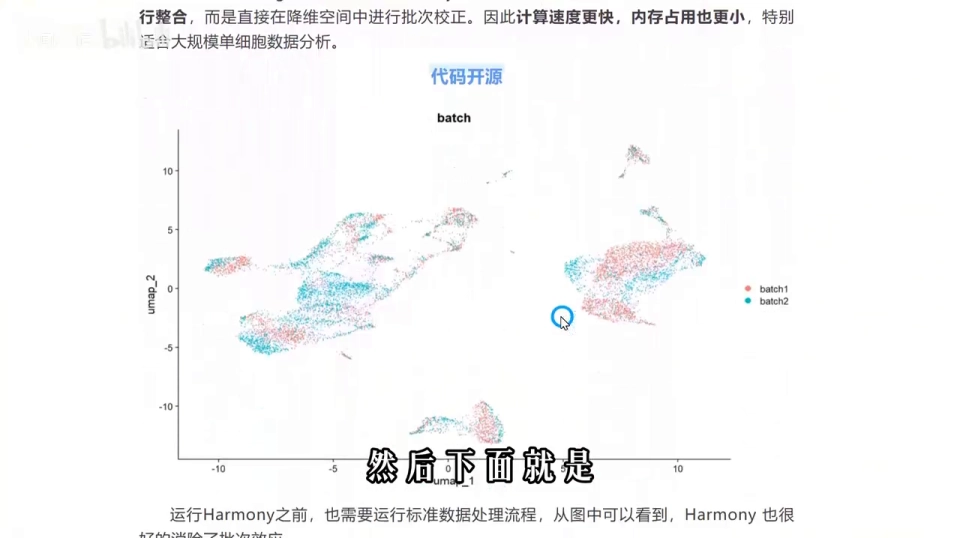

[【跳转到 08:42】](https://www.bilibili.com/video/BV1aKN3z2EuA/?t=522)

讲者的评价是「效果也非常不错，和上面那个方法的结果略微有点小差别」。**两个方法在这份数据上给出的结论基本一致**——这也说明，方法之间的差别往往不在「对不对」，而在「代价和适用规模」。

### 4.5 代码实现

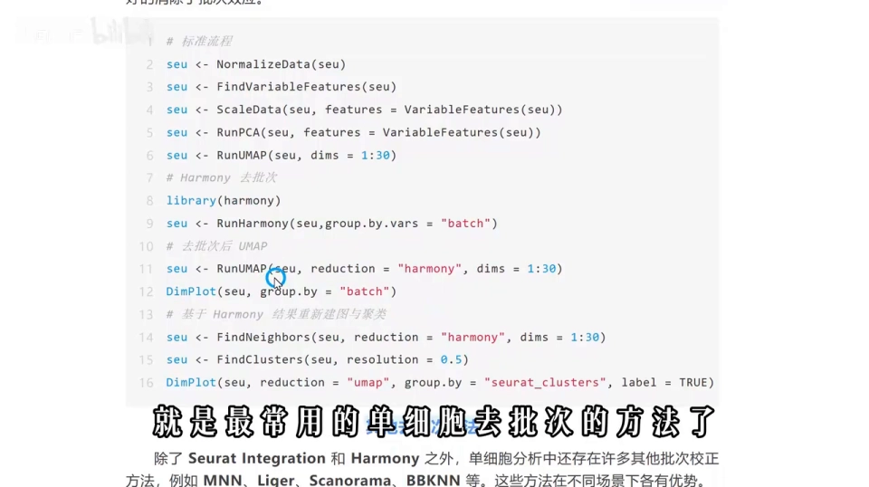

[【跳转到 09:49】](https://www.bilibili.com/video/BV1aKN3z2EuA/?t=589)

```r
# 标准流程
seu <- NormalizeData(seu)
seu <- FindVariableFeatures(seu)
seu <- ScaleData(seu, features = VariableFeatures(seu))
seu <- RunPCA(seu, features = VariableFeatures(seu))
seu <- RunUMAP(seu, dims = 1:30)

# Harmony 去批次
library(harmony)
seu <- RunHarmony(seu, group.by.vars = "batch")

# 去批次后的 UMAP
seu <- RunUMAP(seu, reduction = "harmony", dims = 1:30)
DimPlot(seu, group.by = "batch")

# 基于 Harmony 结果重新建图与聚类
seu <- FindNeighbors(seu, reduction = "harmony", dims = 1:30)
seu <- FindClusters(seu, resolution = 0.5)
DimPlot(seu, reduction = "umap", group.by = "seurat_clusters", label = TRUE)
```

注意 `group.by.vars = "batch"`：**这一项就是告诉 Harmony「哪一列是批次」**。批次信息通常存在细胞元数据的某一列里（这里叫 `batch`），所以做整合之前先确认元数据里有这一列。

## 五、方法谱系：还有哪些去批次方法

除了 Seurat Integration 和 Harmony，讲者列了四类常见方法，并给了每类的一句话定位。

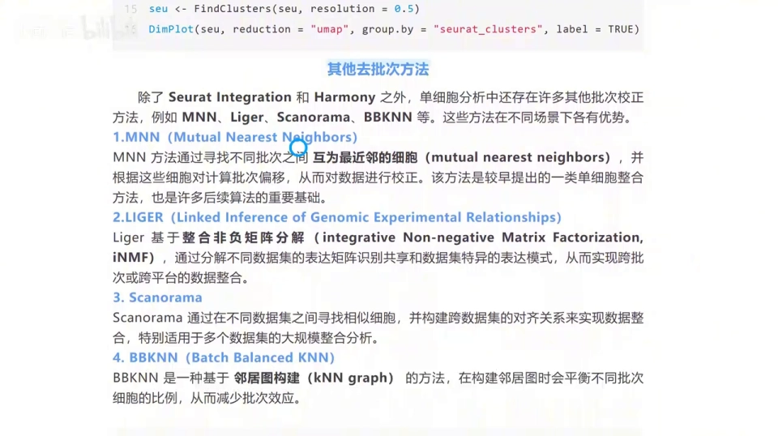

[【跳转到 10:02】](https://www.bilibili.com/video/BV1aKN3z2EuA/?t=602)

| 方法 | 思路 | 一句话定位 |
| --- | --- | --- |
| MNN（Mutual Nearest Neighbors） | 寻找不同批次之间互为最近邻的细胞对，据此估计批次偏移并校正 | 较早提出的一类整合方法，也是后续很多算法的基础 |
| LIGER | 基于整合非负矩阵分解（iNMF），分解出共享表达模式与数据集特异表达模式 | 适合跨批次、跨平台的数据整合 |
| Scanorama | 在不同数据集之间寻找相似细胞，构建跨数据集的对齐关系 | 特别适合多个数据集的大规模整合 |
| BBKNN | 在构建 kNN 邻居图时平衡不同批次细胞的比例 | 直接在邻居图上做批次平衡，速度快 |

讲者的态度很务实：**不同方法在不同场景下各有优势，选择一个最适合自己的就好**。他没有给出「哪个最好」的排名，这本身也是一条信息——批次校正没有普适最优解，取决于数据规模、批次数量、细胞类型重叠程度。

## 六、跑起来才会遇到的两个现实问题

### 6.1 数据集与内存

本讲用的数据是 Seurat 对象里 **2500 个基因、1 万多个细胞、两个批次**：

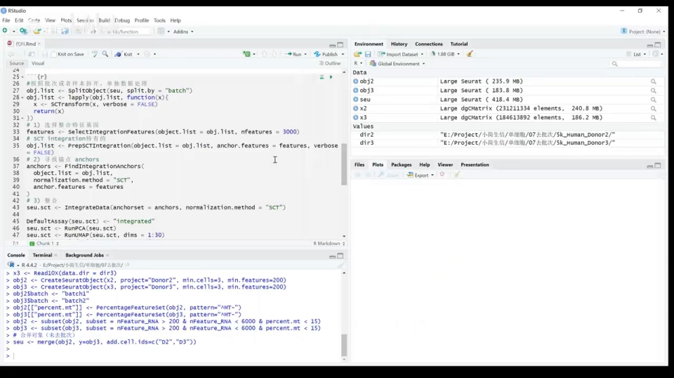

[【跳转到 10:37】](https://www.bilibili.com/video/BV1aKN3z2EuA/?t=637)

讲者在录屏里遇到了很实际的问题：跑 `SelectIntegrationFeatures` 时**默认内存不够**，需要把 R 的内存限制调到 4G 才能跑完。

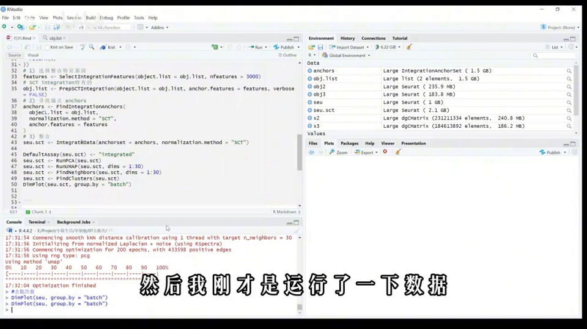

[【跳转到 12:42】](https://www.bilibili.com/video/BV1aKN3z2EuA/?t=762)

这也是他推荐 Harmony 的直接理由：**这个方法确实比较吃资源，而且浪费时间**。

### 6.2 为什么 Harmony 不用拆样本

讲者在代码部分专门解释了这个差异：

[【跳转到 13:32】](https://www.bilibili.com/video/BV1aKN3z2EuA/?t=812)

- **Seurat Integration 要拆**：因为它要找锚点，如果不对每个样本、每个批次的数据做处理，锚点可能找得不好，而且还要找特征基因。
- **Harmony 不用拆**：因为它是在整个 PCA 空间里结合 PC 信息不停迭代校正，所以只需要对整个整合对象跑完 PCA，就可以直接一行 `RunHarmony`。

这也解释了为什么 Harmony 的输入是「已经做完 PCA 的对象」，而 Seurat Integration 的输入是「各样本预处理后的列表」。

## 七、把方法选型落到实践

把全片的信息压缩成一张决策清单：

1. **先确认批次效应真的存在**：按批次上色画 UMAP/PCA，看细胞是不是按批次分群。如果两个批次本来就来自不同组织、细胞组成完全不同，图上分开是**生物学差异**，不该硬整合。
2. **确认元数据里有批次列**：Harmony 的 `group.by.vars`、Seurat 的拆分依据都来自这一列。这一列的信息通常在建库时就该记录（哪一批、哪一天、哪个平台）。
3. **数据量小、需要整合后的表达矩阵** → Seurat Integration；**数据量大、只想拿到可用的降维结果** → Harmony。
4. **整合完必须重新降维聚类**：讲者明确说，Harmony 跑完之后建议根据 harmony 结果重新做降维、聚类和绘图；Seurat Integration 整合后的对象也要重新走一遍下游。
5. **警惕过度校正**：整合后如果原本明显不同的细胞群被糊成一团、或者已知的标记基因差异消失，说明校正过头了。

## 小结

- **批次效应是技术来源的系统性偏差**：不同测序时间、样本来源、平台、操作者、试剂批次都会带来它，表现为细胞按批次而不是按细胞类型分群。
- **单细胞不能照搬 batch correction**：细胞组成不同、细胞类型只部分重叠、平台测序深度差异大，直接减批次很容易过度校正。
- **正确的目标是「对齐同类细胞」**：Seurat 把方法命名为 integration，就是因为目标从「把批次影响压到最小」换成了「让相同类型的细胞在同一表达空间中对齐」。
- **Seurat Integration 靠锚点**：选特征基因 → 找锚点 → 整合，三步；前置条件是各样本先独立预处理；代价是慢、吃内存。
- **Harmony 靠迭代**：在 PCA 空间里软聚类 → 估计批次校正向量 → 调整位置；不改原始表达矩阵，快且省内存，是大规模数据的默认选择。
- **方法没有普适最优**：MNN、LIGER、Scanorama、BBKNN 各有场景，按数据规模与批次结构选。

## 关键术语速查

| 术语 | 一句话解释 |
| --- | --- |
| 批次效应（batch effect） | 不同实验批次带来的系统性技术偏差，会让细胞按批次而非按细胞类型分群 |
| 数据整合（integration） | 让不同数据集里相同类型的细胞在同一表达空间中对齐，而不是简单减掉批次项 |
| 过度校正（overcorrection） | 校正过头，把真实的生物学差异也一起抹掉 |
| 锚点（anchor） | 不同数据集中表达模式高度相似的一对细胞，用作对齐的约束 |
| 软聚类（soft clustering） | 每个细胞以概率形式属于多个簇，而不是硬性归入某一类 |
| 批次校正向量（batch correction vector） | Harmony 在每个簇内估计出的批次偏移量，用于调整细胞在低维空间中的位置 |
| 高变基因 | 在细胞之间表达变化最大的基因，降维与整合都用它们作为特征 |
| SCT（SCTransform） | Seurat 的标准化方法，基于正则化负二项模型，替代 log 归一化 |