# 测序深度不均一：为什么每个细胞的 UMI 数能差 100 倍，归一化又能修到哪一步

> 视频来源：[Single Cell RNA-seq Analysis 2026 | 03: Normalization](https://www.youtube.com/watch?v=WRsQwCK36YQ)（YouTube · Bioinformatics DotCa，Canadian Bioinformatics Workshops 课程第三模块）｜时长约 47 分钟
> 导读：这支课把「测序深度」当成一条独立的问题线来讲：深度从哪来、它怎样伪装成生物学差异、几种归一化各自修到哪一步、以及为什么深度归一化和批次校正在实现上会撞在一起。字幕为 YouTube 自动生成，本文已订正术语（如 `surret` → Seurat、`skater` → scran、`plusone` → Poisson）。同小节另两篇博客讲 Harmony / CCA / ComBat 的具体算法，本文不重复，只在必要处交叉引用。

## 本讲要解决的核心问题（SCQA）

**背景**：单细胞数据落地成一张「基因 × 细胞」的 UMI 计数矩阵。直觉上，矩阵里的数字就是「这个细胞里这个基因有多少条转录本」。

**冲突**：但同一个样本里，每个细胞被测到的 UMI 总数可以相差几倍甚至上百倍——而其中绝大部分差异跟生物学无关，只是测序仪随机抽样抽多抽少。如果直接拿原始计数去算距离、做 PCA、做差异分析，那么「谁测得更深」会盖过「谁真的表达得更多」。更麻烦的是，修深度这件事和修批次这件事，在代码实现上常常是同一个回归模型。

**疑问**：深度差异到底从哪来？按总量缩放（CPM / 10,000）为什么不够？SCTransform 这类模型法在修什么、代价是什么？为什么把 batch 塞进同一个回归里反而更糟？

**回答（中心思想）**：测序深度是**抽样噪声**，不是生物学信号，所以必须在进入降维之前被显式处理；但处理深度只有「按总量缩放」和「按基因建模」两条路，前者会引入比例性副作用、后者会引入分布假设，两条路都只能把深度的影响压平到某个程度，而不能凭空恢复没测到的分子。也正因为深度归一化和批次校正共用同一套回归框架，把两者混在一个模型里做，会让「深度」和「批次」互相污染——正确的做法是分开做。

[【跳转到 00:58】](https://www.youtube.com/watch?v=WRsQwCK36YQ&t=58)

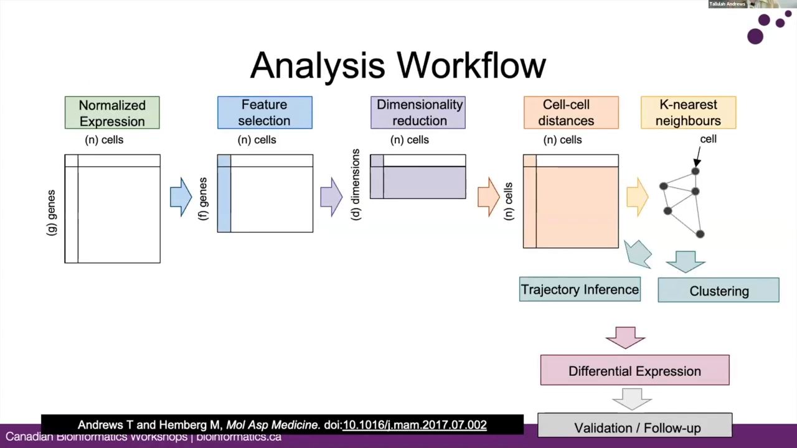

## 一、测序深度是抽样抽出来的，不是设计出来的

### 1.1 一个真实样本的深度账本

讲者先摊开一份 10x 数据的核心指标：

| 指标 | 数值 |
| --- | --- |
| Number of Reads（总 reads） | 372,170,107 |
| Estimated Number of Cells（估计细胞数） | 7,624 |
| Fraction Reads in Cells（落在细胞里的 reads 比例） | 61.6% |
| Mean Reads per Cell（每细胞平均 reads） | 48,816 |
| Median UMI Counts per Cell（每细胞 UMI 中位数） | 2,516 |
| Median Genes per Cell（每细胞检出基因中位数） | 281 |

[【跳转到 05:47】](https://www.youtube.com/watch?v=WRsQwCK36YQ&t=347)

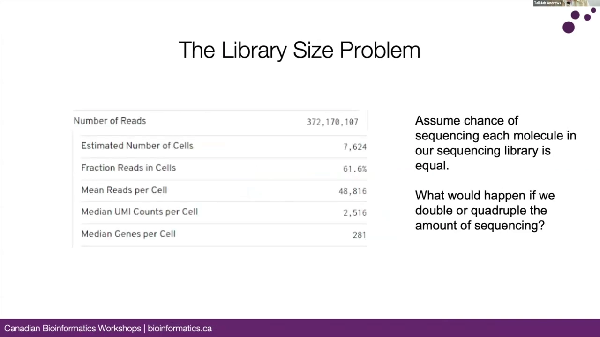

注意这里有两层「深度」：**每细胞平均 reads**（测序投入）和**每细胞 UMI 中位数**（去重后真正数到的分子数）。前者是机器读了多少条，后者才是矩阵里能用的数字。

### 1.2 为什么每个细胞的 UMI 数不一样

讲者把原因拆成两条：

1. **细胞本身的 RNA 含量不同**。有些细胞转录活跃，有些细胞小、RNA 少。
2. **测序是随机抽样**。测序仪从文库中随机挑分子去测，这个过程本身有涨落，不是完美均分。

第二条是讲者用来建模的假设：如果每个分子被测到的概率相同，那么把测序量翻倍或翻四倍，每个基因的计数也应该翻倍或翻四倍。[【跳转到 07:02】](https://www.youtube.com/watch?v=WRsQwCK36YQ&t=422)

这个推论在 barcode rank 图上可以直接看到：横轴是按 UMI 数排序的 barcode，纵轴是每个 barcode 的 UMI 数。讲者指出图上用蓝、红箭头标出的两个细胞，UMI 总数差了两倍以上；而如果顺着曲线往下滑到第二个「台阶」，两个细胞之间可以差到 **100 倍**。[【跳转到 08:17】](https://www.youtube.com/watch?v=WRsQwCK36YQ&t=497)

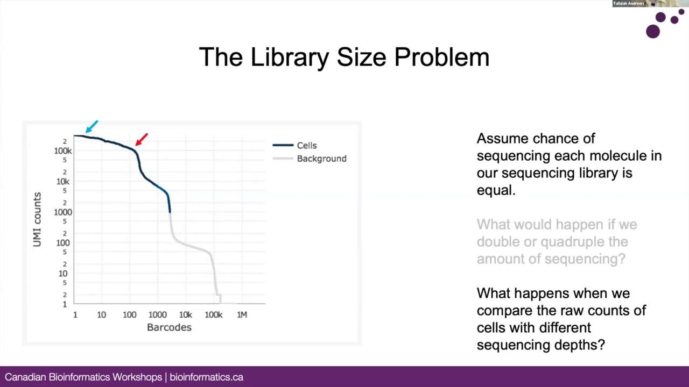

### 1.3 深度差异「大部分」与生物学无关，但不是永远无关

讲者特意留了一个反例：在疟原虫细胞图谱项目里，疟原虫生活史的某个阶段比另一个阶段大上百倍，两个阶段的 RNA 总量确实不同，**这种深度差异是真实的生物学**。但绝大多数情况下不是。[【跳转到 06:37】](https://www.youtube.com/watch?v=WRsQwCK36YQ&t=397)

这也解释了质控指标为什么长成现在这样。讲者回顾了 Fluidigm C1 时代的经验：那时能拍到捕获到的细胞照片，于是可以反过来检验「哪个统计量最能区分坏细胞」。结论是两条：

- **线粒体 RNA 比例** 是「细胞是否破损」的最佳指标；
- **每细胞检出基因数** 是「到底有没有捕获到细胞」的最佳指标。

[【跳转到 05:05】](https://www.youtube.com/watch?v=WRsQwCK36YQ&t=305)

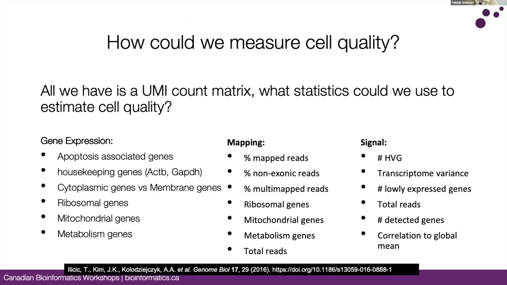

换句话说，深度在质控阶段就已经是一个「被判读」的量：检出基因数少，可能是细胞死了，也可能只是测得浅。

## 二、深度差异会伪装成生物学差异

问题的核心是一句话：**同一个基因，在测得更深的细胞里计数更高，但浓度可能完全一样**。讲者的说法是，那个蓝色细胞看起来每个基因都比红色细胞高两三倍，其实两个细胞里这些基因的浓度是相同的。[【跳转到 08:17】](https://www.youtube.com/watch?v=WRsQwCK36YQ&t=497)

这种伪装会顺着流程往下传，影响至少三处：

1. **降维**。PCA 这类工具假设数据近似正态分布，而原始 UMI 计数服从负二项分布，且与深度强相关；不处理深度，前几个主成分很可能就是在描述「谁测得更深」。[【跳转到 24:57】](https://www.youtube.com/watch?v=WRsQwCK36YQ&t=1497)
2. **聚类**。细胞距离被深度主导，聚类就会按深度分群，而不是按细胞类型分群。
3. **差异表达**。这是最隐蔽的一处，见下一节的比例性问题。

顺带解释一下「归一化」这个名字的由来：它来自**正态分布**。PCA 这类工具假设数据服从正态分布，而原始 UMI 计数是负二项分布（左下直方图那个挤在零处的尖峰）；log 变换之后分布才接近正态，这正是 log 归一化存在的理由。[【跳转到 24:32】](https://www.youtube.com/watch?v=WRsQwCK36YQ&t=1472)

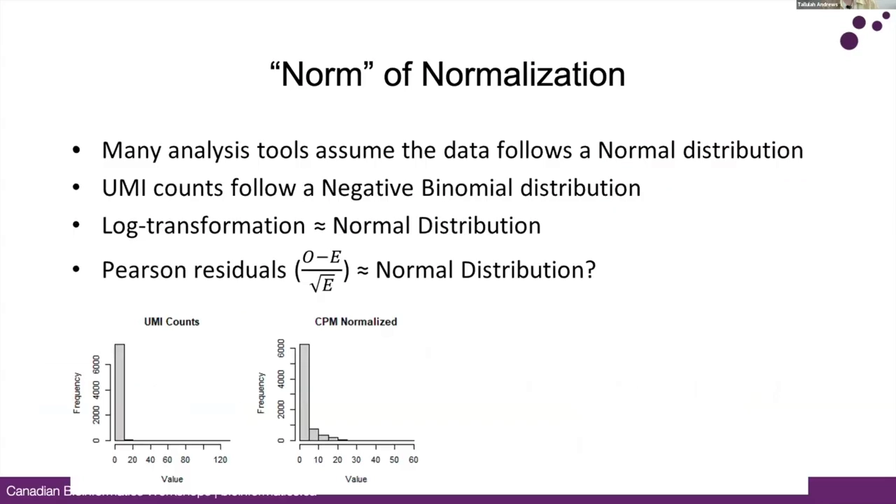

## 三、第一反应：除以总量（CPM / 10,000）

最直觉的修法是：把每个细胞的计数除以该细胞的总 UMI，得到「占总 RNA 的百分比」，再乘一个常数让数字回到正常量级。[【跳转到 09:07】](https://www.youtube.com/watch?v=WRsQwCK36YQ&t=547)

$$
\text{normalized}_{ij} = \frac{\text{count}_{ij}}{\sum_{g}\text{count}_{ig}} \times 10{,}000
$$

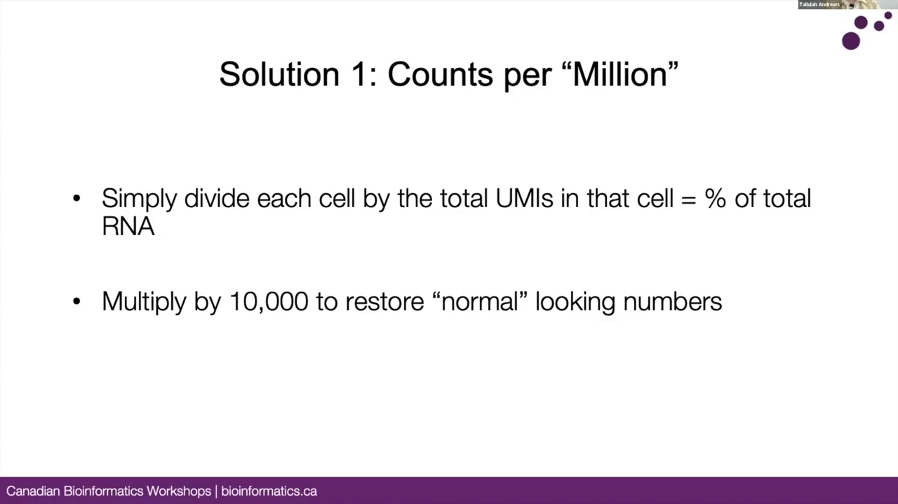

讲者在这里给了两个很实用的提醒：

- **10,000 是 Seurat 的默认值，不是正确答案**。多数单细胞数据集的每细胞总计数其实不到 10,000，所以这个常数偏大；其他实现会改用「每细胞总计数的中位数」作为缩放因子，而不是一个固定数字。[【跳转到 09:32】](https://www.youtube.com/watch?v=WRsQwCK36YQ&t=572)
- **除以总量会引入比例性副作用**。

### 3.1 比例性：一个基因上调，其他基因都像下调

讲者用一个只有七个基因的玩具例子说明。假设条件 B 里基因 A 的浓度是条件 A 的 10 倍，其他基因浓度不变：

| 基因 | 条件 A 浓度 | 条件 A 占总 RNA | 条件 B 浓度 | 条件 B 占总 RNA |
| --- | --- | --- | --- | --- |
| A | 5 | 3.55% | 50 | 26.88% |
| B | 10 | 7.09% | 10 | 5.38% |
| C | 20 | 14.18% | 20 | 10.75% |
| D | 4 | 2.84% | 4 | 2.15% |
| E | 30 | 21.28% | 30 | 16.13% |
| F | 12 | 8.51% | 12 | 6.45% |
| G | 60 | 42.55% | 60 | 32.26% |

[【跳转到 10:22】](https://www.youtube.com/watch?v=WRsQwCK36YQ&t=622)

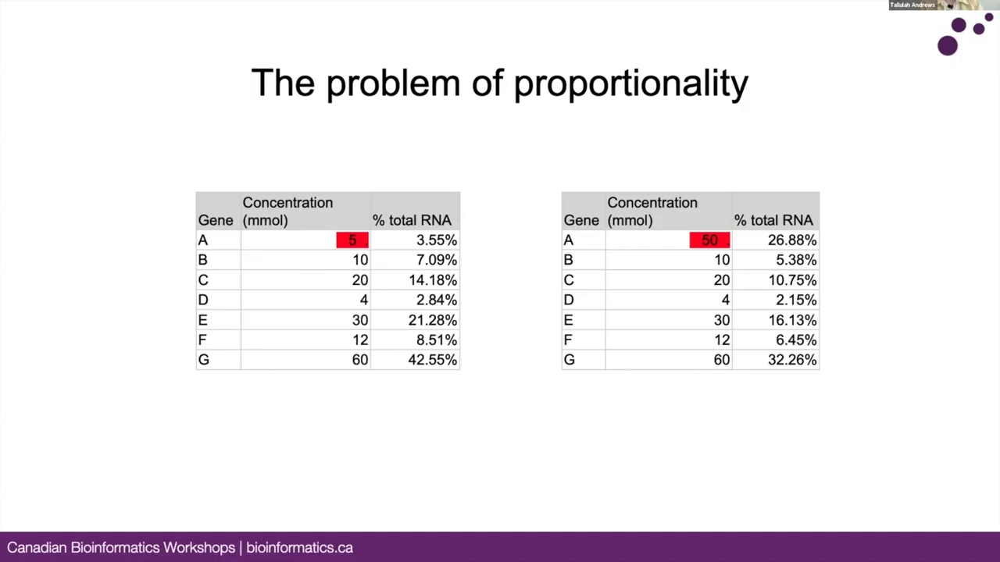

真实变化的只有 A，但转成百分比之后，其余六个基因全部「看起来下调」——因为百分比是个封闭系统，一项涨了，别的必须跌。[【跳转到 10:47】](https://www.youtube.com/watch?v=WRsQwCK36YQ&t=647)

讲者顺带提醒：同样的道理适用于**细胞类型比例**。如果你在比较各细胞类型的占比，一种类型上升，其他类型就会显得下降，即使它们的绝对数量没变。[【跳转到 11:12】](https://www.youtube.com/watch?v=WRsQwCK36YQ&t=672)

## 四、bulk 的老办法搬不过来：零值与「大多数基因不变」假设

bulk RNA-seq 早就遇到过同样的比例性问题，思路是：假设**大多数基因在不同样本间没有强差异表达**，用这个假设反推每个样本的缩放因子。讲者点了两个经典实现：

- **DESeq**：对每个基因计算「相对几何均值的表达中位数」；
- **TMM（trimmed mean of M-values）**：计算每个基因相对参考样本的 log2 倍数变化，取中间 50% 的均值作为缩放因子。

[【跳转到 13:17】](https://www.youtube.com/watch?v=WRsQwCK36YQ&t=797)

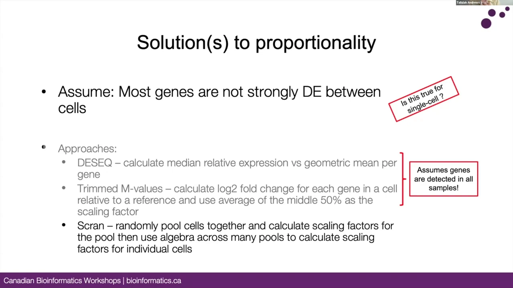

这两个方法在单细胞上有两道坎：

1. **「大多数基因不变」的假设未必成立**。细胞来自不同细胞类型，大量基因在细胞类型之间就是差异表达的。[【跳转到 12:02】](https://www.youtube.com/watch?v=WRsQwCK36YQ&t=722)
2. **它们假设所有基因在所有样本里都被检出**，也就是矩阵一行里没有零。而单细胞数据一行里一半以上是零。[【跳转到 12:52】](https://www.youtube.com/watch?v=WRsQwCK36YQ&t=772)

### 4.1 scran 的池化：把细胞凑成「够大的样本」

scran 的思路是绕开第二个坎：**随机把细胞合并成池**，池子大到「没有被检出的基因」这个假设基本成立，然后在池子上用 bulk 的方法算出该池的 size factor；重复很多次，每个细胞会出现在许多不同的池里，于是可以用解方程组的方式反推出每个细胞自己的 size factor。[【跳转到 13:42】](https://www.youtube.com/watch?v=WRsQwCK36YQ&t=822)

讲者对这个方法的评价是：这套办法「曾经是我们最好的选择」。[【跳转到 14:07】](https://www.youtube.com/watch?v=WRsQwCK36YQ&t=847)

## 五、不是所有基因都同样随深度变化：从 log 归一化到 SCTransform

### 5.1 一个把问题暴露出来的图

讲者展示了一张关键图：横轴是细胞的总 UMI 数，纵轴是该基因的表达量，基因按平均表达量分成六组（第一组最高、第六组最低）。看原始计数时，所有组的基因都随总 UMI 上升——这就是深度效应。[【跳转到 14:51】](https://www.youtube.com/watch?v=WRsQwCK36YQ&t=891)

做了 log 归一化之后，情况并没有完全变好：

- 低表达基因（第五、六组）：与总 UMI 的关系基本消失；
- 中等表达基因（第二、三组）：相关性还在；
- 高表达基因（第一组）：出现奇怪的 U 形。

[【跳转到 15:41】](https://www.youtube.com/watch?v=WRsQwCK36YQ&t=941)

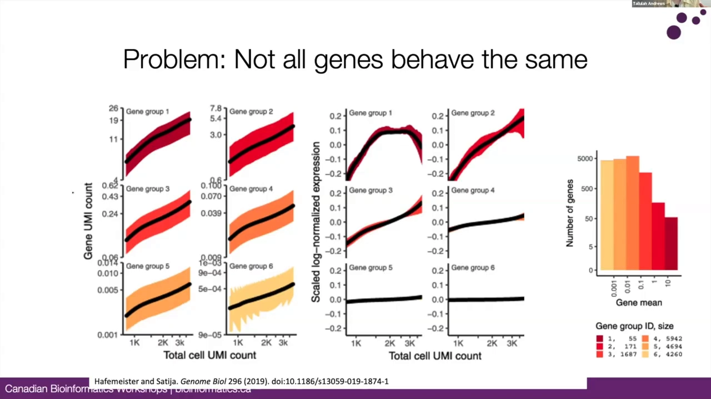

理想状态是六组全部压平。既然不同表达水平的基因行为不同，就不能用一个全局缩放因子解决。

### 5.2 Seurat 的第一版解法：按基因箱回归深度

Seurat 的做法是**按基因箱分别回归**：把每个基因的表达量对总 UMI 作图、拟合一条线，取每个细胞相对这条线的残差。这样每个基因都有自己的深度关系被扣掉。[【跳转到 16:05】](https://www.youtube.com/watch?v=WRsQwCK36YQ&t=965)

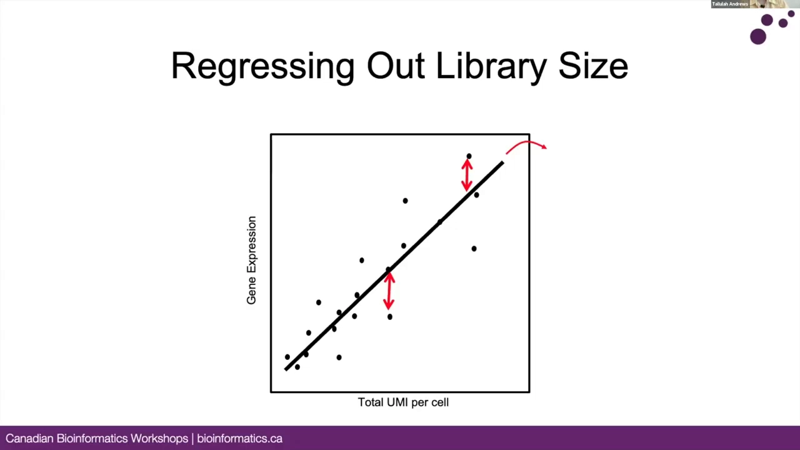

但这里有个统计学上的硬伤：**普通线性回归假设噪声服从高斯分布**，而原始计数服从负二项分布。[【跳转到 16:55】](https://www.youtube.com/watch?v=WRsQwCK36YQ&t=1015)

负二项分布的性质讲者讲得很清楚：

- 取值是整数，不可能小于零；
- 均值 $\lambda$ 本身服从 gamma 分布，因此**方差可以大于均值**；
- 而泊松分布的限制是方差等于均值，单细胞数据的噪声比泊松更大，所以必须用负二项。

[【跳转到 17:45】](https://www.youtube.com/watch?v=WRsQwCK36YQ&t=1065)

### 5.3 SCTransform：把「深度」写进模型里

于是有了 SCTransform。它的做法是把负二项分布的均值写成**总 UMI 数的线性函数**，然后拟合回归、用皮尔逊残差代替表达量。具体五步：[【跳转到 19:25】](https://www.youtube.com/watch?v=WRsQwCK36YQ&t=1165)

1. 按表达水平给基因**分箱**；
2. 每箱**随机挑几个基因**作为代表；
3. 对这些代表基因拟合「测序深度 vs 观测表达」的**负二项回归**；
4. 把拟合出的参数**外推**到所有基因；
5. 计算**皮尔逊残差**：

$$
\Pr = \frac{O - E}{\sqrt{V(E)}}
$$

其中 $O$ 是观测值，$E$ 是模型期望，$V(E)$ 是期望对应的方差。[【跳转到 19:50】](https://www.youtube.com/watch?v=WRsQwCK36YQ&t=1190)

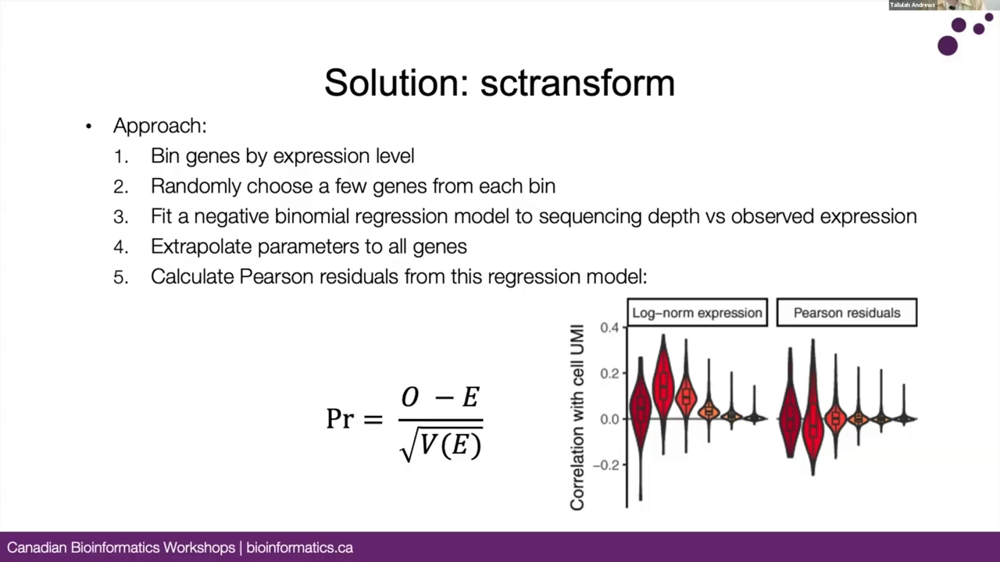

结果就是右图：log 归一化下各组基因与总 UMI 的相关性还在，换成皮尔逊残差后，各组的分布都居中在 0 附近。[【跳转到 21:05】](https://www.youtube.com/watch?v=WRsQwCK36YQ&t=1265)

### 5.4 代价：为了快而做的两个近似

讲者没有把 SCTransform 说成银弹，而是明确点出它为了速度做的妥协：

- **每箱只挑几个基因**代表整箱，再外推到所有基因，因为逐个基因拟合太慢；
- **大数据集只随机抽 2,000 个细胞**来拟合模型。

[【跳转到 20:15】](https://www.youtube.com/watch?v=WRsQwCK36YQ&t=1215)

这两个近似本身没问题，但它们埋下了下一节的坑。

## 六、深度与批次为什么会纠缠在一起

### 6.1 同一个回归框架，可以塞进任何变量

SCTransform 本质是一个回归模型，所以除了总 UMI，你还可以把**批次信息**、**线粒体比例**也放进同一个回归里，理论上一次性都扣掉。[【跳转到 21:30】](https://www.youtube.com/watch?v=WRsQwCK36YQ&t=1290)

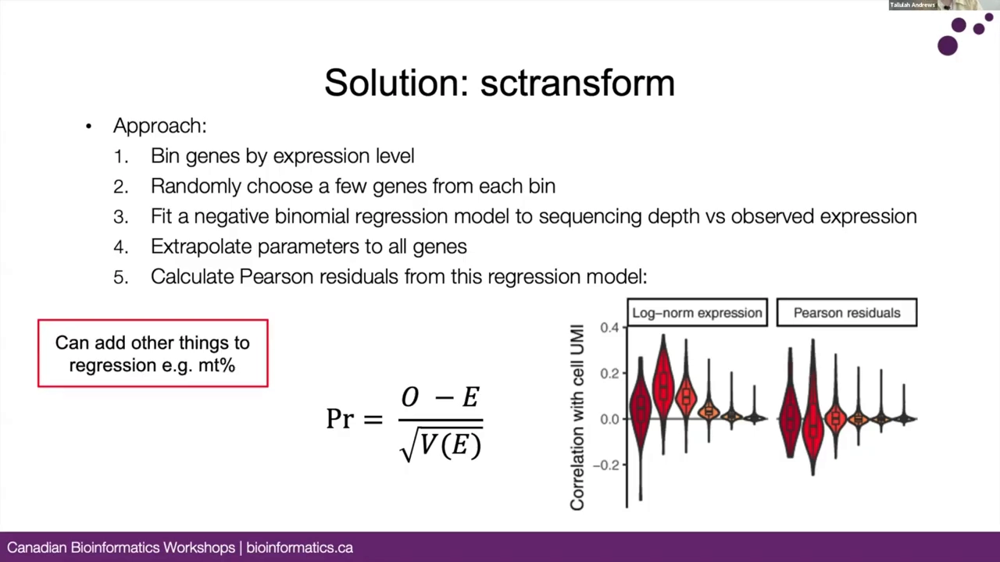

### 6.2 陷阱：外推假设了「同表达水平的基因行为一致」

讲者让听众先自己想这个问题，然后给出答案：因为算法**每箱只挑几个基因代表整箱**，再外推到所有基因，这等于假设「表达水平相近的基因，对塞进回归的那个变量响应方式相同」。而实际上：

- 线粒体比例对**应激相关基因**的影响远大于管家基因；
- 批次效应对**不同基因的影响也不一样**。

[【跳转到 23:10】](https://www.youtube.com/watch?v=WRsQwCK36YQ&t=1390)

结论很直接：**用 SCTransform 把 batch 一起回归掉，效果不如按批次分别跑 SCTransform**。讲者说这一点他们去年在测试时才注意到，并提到相关论文。[【跳转到 24:00】](https://www.youtube.com/watch?v=WRsQwCK36YQ&t=1440)

这就是「深度与批次纠缠」的机制性解释：两者共用同一个回归框架，一旦合并，深度关系的估计会被批次污染，批次效应的估计又会被深度污染。**该分开做的两件事，不要写进同一个模型。**（批次校正本身的方法取舍——CCA、Harmony、ComBat 各自在校正什么——见同小节另两篇博客，此处不展开。）

## 七、深度之外：其他混杂因素怎么处理

讲者把「混杂因素（confounder）」定义为：**观测之间与我们关心的变量无关的生物学或技术差异**。[【跳转到 26:50】](https://www.youtube.com/watch?v=WRsQwCK36YQ&t=1610)

典型例子与对应解法（幻灯片上是两列独立清单，并非一一对应）：

**常见的混杂因素**：细胞周期、遗传背景、组织保存时间、环境 / 生活方式、年龄或处理日期、昼夜节律、细胞应激。

**可选的解法**：

1. 设计实验，让混杂从一开始就不存在；
2. 用回归模型把它扣掉；
3. 剔除受影响最大的细胞或基因；
4. 作为协变量放进差异表达模型；
5. 忽略它，指望关心的生物学仍然透出来。

[【跳转到 28:05】](https://www.youtube.com/watch?v=WRsQwCK36YQ&t=1685)

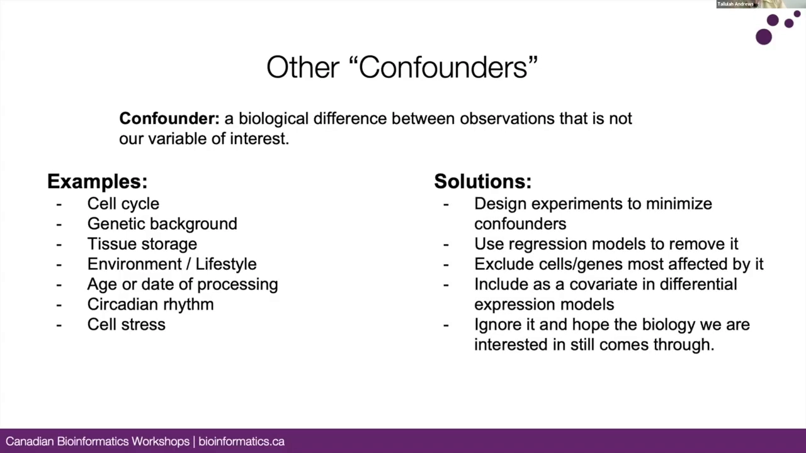

几条讲者特别强调的操作细节：

- **差异分析必须用原始计数**。差异表达模型多基于负二项分布，所以不能先回归再去做差异分析；协变量要直接放进模型里。[【跳转到 29:20】](https://www.youtube.com/watch?v=WRsQwCK36YQ&t=1760)
- **回归混杂因素与 SCTransform 同理，但不分箱**：逐基因单独做，可以用负二项回归（R 与 Python 都有现成函数），也可以用普通回归后取残差。[【跳转到 29:57】](https://www.youtube.com/watch?v=WRsQwCK36YQ&t=1797)
- **不要无脑回归细胞周期**。回归的本质是「找出所有基因与这个变量的关系然后扣掉」，所以**与它相关的真实生物学也会被一起扣掉**。发育分化研究里细胞周期可能不是重点，但成熟组织里少数在 cycling 的细胞往往正是免疫细胞或干细胞，癌症里「为什么有些细胞在周期里」本身就是问题。[【跳转到 30:32】](https://www.youtube.com/watch?v=WRsQwCK36YQ&t=1832)
- **排除主成分**是另一种办法：如果某个主成分与混杂因素高度相关，就在聚类和轨迹分析时不使用它。前提是混杂因素真的被单独一个主成分捕捉到——有时成立，有时不成立。[【跳转到 33:01】](https://www.youtube.com/watch?v=WRsQwCK36YQ&t=1981)

## 八、零值补全：深度的诱惑，也是陷阱

### 8.1 零不一定是「不表达」

讲者把话题转到矩阵里的零：很多零不是基因不表达，而是**投入量太低、灵敏度不够，没测到**。既然深度不足会造成假零，一个自然的想法就是「把零补回来」。[【跳转到 36:44】](https://www.youtube.com/watch?v=WRsQwCK36YQ&t=2204)

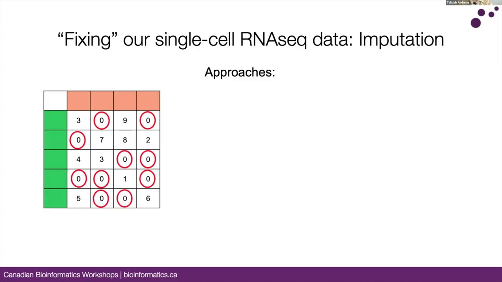

常见的补全思路有四类：

1. 看**相似的细胞**：这些细胞里该基因表达是 5，那这个细胞大概也是 5；
2. 看**相关的基因**：与该基因高度相关的另一个基因在这个细胞里很高，那它也应该高；
3. 两者结合，或丢进**自编码器**让模型猜；
4. 对照**公共图谱**，找最相似的细胞借表达量。

[【跳转到 37:34】](https://www.youtube.com/watch?v=WRsQwCK36YQ&t=2254)

最广为人知的是 **MAGIC**（Markov affinity graph imputation of cells）：用细胞近邻做平滑，用「时间步」参数控制平滑强度。讲者展示了 CDH1 与 VIM 两个基因：随着时间步增大，两个基因的相关性越来越强，图也越来越「好看」。[【跳转到 38:54】](https://www.youtube.com/watch?v=WRsQwCK36YQ&t=2334)

### 8.2 反例：95% 的非差异基因被「平滑」成差异基因

讲者的反应是「花三个月试图证明这是错的」。讲者做了一个模拟数据集：250 个基因完全不差异表达（在所有细胞里均匀表达），250 个基因真正差异表达。原始数据的基因-基因相关矩阵里，灰色区域（非差异基因）没有相关性。[【跳转到 41:46】](https://www.youtube.com/watch?v=WRsQwCK36YQ&t=2506)

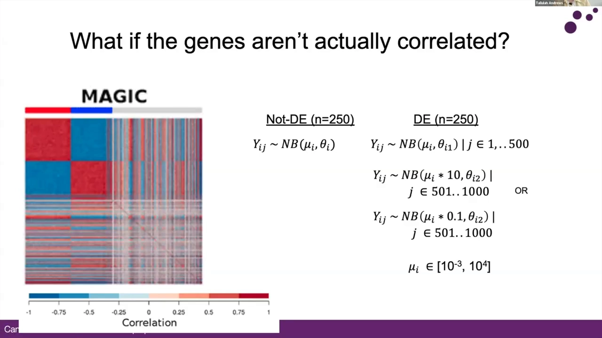

跑完 MAGIC 之后：**95% 原本不差异表达的基因变成了差异表达**，并且与真正差异表达的基因完全相关，方向随机——有的上调有的下调，毫无道理可言。[【跳转到 42:17】](https://www.youtube.com/watch?v=WRsQwCK36YQ&t=2537)

讲者又试了另外四种补全方法：一种几乎没做事；一种专门补零，结果是越低表达的基因被补得越多、假差异也越多；一种类似 MAGIC 但更弱，同样冒出大量假差异；一种基于自编码器，不仅所有基因都成了差异表达，还额外造出两簇基因，等于把两种细胞类型变成了四种。唯一没有明显制造假阳性的是 **SAVER**。[【跳转到 43:27】](https://www.youtube.com/watch?v=WRsQwCK36YQ&t=2607)

### 8.3 结论：只能用于可视化

讲者的结论很硬：**不要对数据做补全**。如果一定要用，只能用于可视化——补全后的图会非常平滑、非常有说服力（那种「某基因从早期高表达平滑下降到分化后」的红-橙-蓝渐变图，多半是补全过的），但那只是把结论讲给别人听的手段，不能用来做统计、更不能用来发现新东西。[【跳转到 44:17】](https://www.youtube.com/watch?v=WRsQwCK36YQ&t=2657)

这一节其实是深度问题的另一面：**深度不足造成的零，是数据本身的缺失，不是可以靠算法补回来的信息**。补全只是用邻近信息填了一个「看起来合理」的值，而统计检验会把这种填值当成真实观测。

## 小结

- **测序深度是抽样噪声**：每细胞 UMI 数的差异主要来自测序仪的随机抽样，同一样本内可以差到 100 倍，其中绝大部分与生物学无关（但疟原虫这类真实 RNA 含量差异是例外）。
- **深度会伪装成生物学差异**：不处理深度，PCA、聚类、差异分析都会被「谁测得更深」主导。
- **按总量缩放有两个坑**：10,000 只是 Seurat 的默认值而非正确答案；除以总量会引入比例性，一个基因上调会让其余基因集体「看起来下调」。
- **bulk 方法需要改造**：DESeq/TMM 依赖「多数基因非差异」和「无零值」两个假设，单细胞两条都不满足；scran 用池化绕开零值问题。
- **不同表达水平的基因行为不同**：log 归一化只能压平低表达基因，中等表达基因仍有深度相关、高表达基因出现 U 形；SCTransform 用负二项回归 + 皮尔逊残差把各组压平。
- **SCTransform 的近似有代价**：每箱只挑几个基因外推、大数据集只抽 2,000 个细胞，这使它对「同表达水平基因行为一致」的假设很敏感。
- **深度与批次共用一套回归框架**：把 batch 塞进 SCTransform 的回归里，效果不如按批次分别跑——两件事要分开做。
- **零值不能靠补全解决**：MAGIC 等方法在模拟数据上把 95% 的非差异基因变成假差异，只能用于可视化。

## 关键术语速查

| 术语 | 一句话解释 |
| --- | --- |
| 文库大小（library size） | 一个细胞被测到的 UMI 总数，也就是这个细胞的「测序深度」 |
| barcode rank 图 | 按 UMI 数排序的 barcode 曲线，用来区分真实细胞与背景液滴 |
| CPM / 10,000 缩放 | 把每个细胞的计数除以自身总量再乘常数，得到「占总 RNA 的比例」 |
| 比例性（proportionality） | 百分比是封闭系统，一项升高会让其余项被动降低 |
| size factor | 归一化时给每个细胞（或样本）乘的缩放系数 |
| scran 池化 | 把细胞随机合并成池，在池上算 size factor，再用线性代数反解单细胞系数 |
| 负二项分布 | 计数数据的分布，方差可以大于均值，比泊松更适合单细胞 |
| 皮尔逊残差 | $(O-E)/\sqrt{V(E)}$，把观测与模型期望的偏差按方差标准化 |
| SCTransform | 用负二项回归建模「深度 vs 表达」，输出皮尔逊残差作为归一化表达量 |
| 混杂因素（confounder） | 与关心的变量无关、但会影响观测的生物学或技术差异 |
| imputation（补全） | 用近邻细胞或相关基因填补零值；本文的结论是只可用于可视化 |
