# 单细胞质控阈值怎么定：从基因数到线粒体比例

> 视频来源：[挑战10分钟讲清楚什么是单细胞数据质控](https://www.bilibili.com/video/BV1vfV56KESQ/)（Bilibili · 董一点生信）｜时长约 12 分钟
> 导读：这支视频不写代码教程，而是用一份真实的胰腺癌多样本数据，把「质控阈值到底该定多少」这件事拆成可复述的决策流程：先看三类异常细胞在指标上的指纹，再按样本画分布，最后用分位数和保留率反推阈值。本文按这条主线整理，数值与结论都对应原始字幕。

## 本讲要解决的核心问题（SCQA）

**背景**：单细胞测序把组织消化成一个个细胞，尽量让每个细胞被单独捕获，再测它的基因表达。走完数据读取这一步，你手上已经是一份「细胞 × 基因」的表达矩阵，看起来随时可以进入聚类和注释。

**冲突**：但矩阵里的这些细胞，并不一定都是适合分析的好细胞。有的细胞在消化、捕获或孵育过程中已经受损甚至接近死亡；有的液滴里根本没有细胞，是空液滴；还有的液滴一次捕获了两个细胞，是双细胞。这些细胞直接进入下游，会污染聚类结果，也会让差异分析得出假信号。而麻烦在于，**过滤它们需要阈值，而阈值没有标准答案**——卡太严会删掉真实的细胞，卡太松又会放进低质量细胞。

**疑问**：那么三个常用质控指标分别能识别哪一类坏细胞？阈值到底该按什么依据来定，而不是照抄别人论文里的数字？

**回答（中心思想）**：质控阈值不是固定答案，而是**基于本数据分布做出的分析决策**。做法是：先用 nFeature_RNA、nCount_RNA、percent.mt 三个指标刻画每个细胞，再**按样本**画分布找出离群区域，用分位数（如 25%、95%、99%）把阈值锚定在分布的拐点上，最后用「保留了多少细胞」反过来检验这个阈值是否合理。

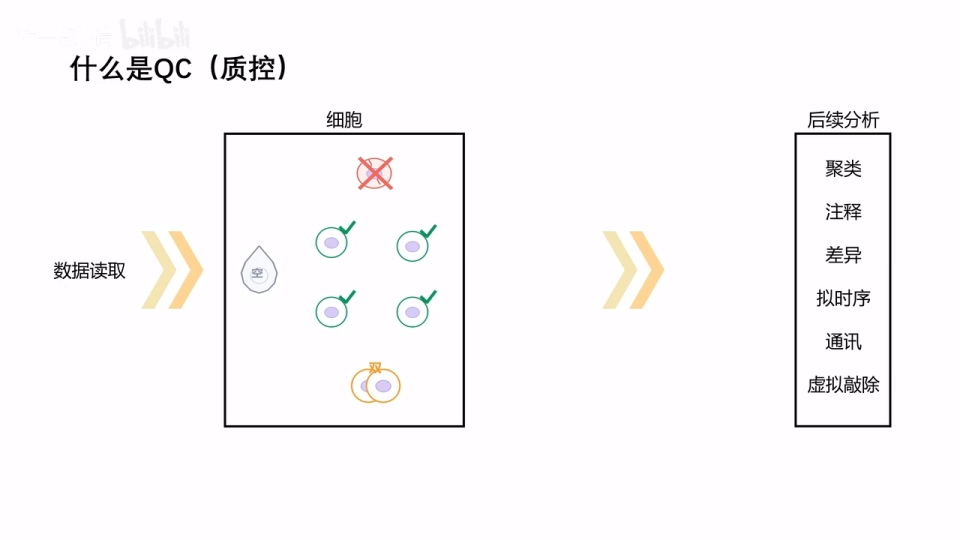

[【跳转到 00:00】](https://www.bilibili.com/video/BV1vfV56KESQ/?t=0)

## 一、QC 是「筛选」，所以必须先有筛选标准

讲者给质量控制下的定义很朴素：**在真正开始单细胞分析之前，把明显不可靠的细胞去掉**。它是一个筛选动作，而任何筛选都必须先回答「按什么筛」。

单细胞实验里会出问题的环节很多，讲者归成三类：

1. **低质量细胞**：细胞受损或死亡时，细胞质 RNA 更容易流失或降解，而线粒体相关基因相对更容易被测到，所以线粒体基因比例会升高。
2. **空液滴**：里面本来就没有真正的细胞，最典型的特征是检测到的基因很少、总 UMI 数也很少。
3. **双细胞**：两个细胞被当成一个细胞来测，检测到的基因种类可能异常偏多，总 UMI 数也可能异常偏高。

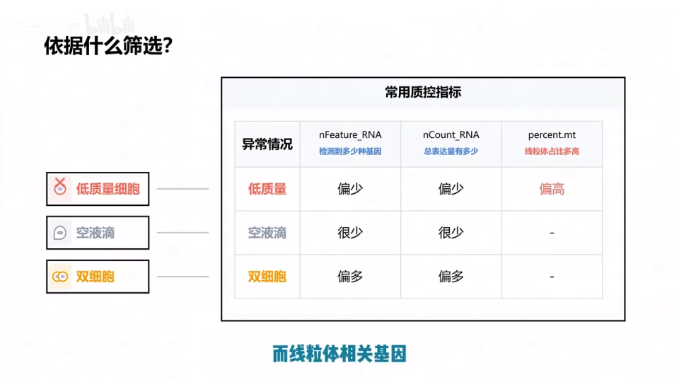

[【跳转到 01:40】](https://www.bilibili.com/video/BV1vfV56KESQ/?t=100)

这张表是整支视频的骨架：**每一种坏细胞都在指标空间里留下一个特定的方向**。低质量细胞往「基因少、UMI 少、线粒体高」的方向偏；空液滴往「基因很少、UMI 很少」的方向偏，但线粒体比例不一定异常；双细胞则往「基因多、UMI 多」的反方向偏。质控要做的，就是在这三个方向上各画一条线。

## 二、三个指标：两个自动算，一个要自己算

在 Seurat 里做质控，最常看到的就是三个指标：

- **nFeature_RNA**：每个细胞检测到多少**种**基因。
- **nCount_RNA**：每个细胞检测到多少**总表达量**（总 UMI 数）。
- **percent.mt**：线粒体基因表达占比。

前两个在创建 Seurat 对象时已经自动统计好了，不用再单独计算。**唯一需要自己算的是 percent.mt**。

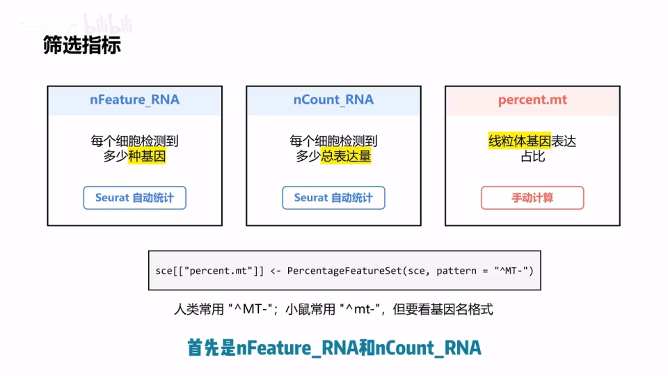

[【跳转到 02:05】](https://www.bilibili.com/video/BV1vfV56KESQ/?t=125)

计算方式是按基因名前缀匹配线粒体基因，再求这些基因占该细胞总表达量的比例。写成公式，对第 $i$ 个细胞：

$$
\text{percent.mt}_i = \frac{\sum_{g \in \mathrm{MT}} x_{ig}}{\sum_{g} x_{ig}} \times 100\%
$$

其中 $x_{ig}$ 是这个细胞在基因 $g$ 上的计数，$\mathrm{MT}$ 表示线粒体基因集合。

讲者特别提醒了物种差异：**人类的线粒体基因一般以大写 `MT-` 开头，小鼠则是小写 `mt-`**，所以匹配模式要按数据来源改。这一点看似琐碎，实际很容易翻车——如果物种搞错，算出来的 percent.mt 会全是 0，后面所有基于它的过滤都等于没做。

算完这一步，每个细胞就都有了三个质控指标。但讲者紧接着强调：**到这里还不能直接过滤**。

## 三、为什么不能直接套一个数字

原因讲得很直白：质控参数不是固定的，也不是所有数据都统一用一个标准。

以线粒体比例为例。有些细胞代谢比较旺盛——心肌细胞、肝细胞、某些肿瘤细胞——它们的线粒体基因占比本来就可能偏高。如果阈值设得严，这些**真实但代谢活跃**的细胞就会被当成死细胞删掉；如果设得松，又会让真正的低质量细胞混进来。

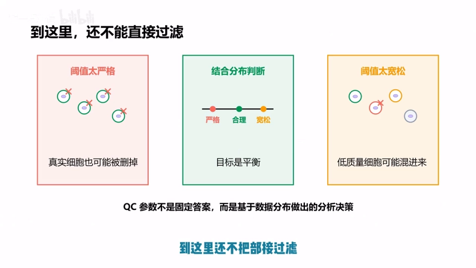

[【跳转到 03:08】](https://www.bilibili.com/video/BV1vfV56KESQ/?t=188)

所以正确的顺序不是「先定阈值再过滤」，而是「**先把指标画出来看分布，再定阈值**」。讲者用的工具是小提琴图，并且要求画两组：

1. **按样本分组**的小提琴图：用来看每个样本质量好不好，并帮我们判断质控阈值。
2. **按疾病与对照、分期或其它分组**的小提琴图：用来看后面要比较的分组之间，是否本身就存在明显的质量差异。

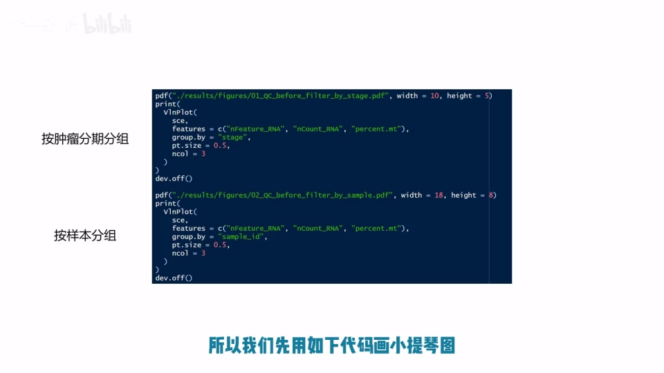

[【跳转到 03:47】](https://www.bilibili.com/video/BV1vfV56KESQ/?t=227)

第二组图的意义值得多说一句。如果两个分组在质控指标上差异很大，那么后面做差异分析、细胞比例比较时就要非常谨慎——**你看到的差异可能不只是生物学差异，也可能混入了样本质量差异**。这一步是「先检查混杂，再谈结论」。

### 3.1 按分期看：分组之间确实有质量差异

讲者用的是一份胰腺癌（PDAC）多样本数据。先看按 stage 分组的图：

- 从 nFeature_RNA 看，PDAC I 和 PDAC IV 的分布更宽，说明这两个分期里的细胞质量波动更大。
- 从 percent.mt 看，PDAC I 的线粒体比例整体更高一些。讲者做了统计：PDAC I 的 percent.mt 中位数大约 10.28%，而 PDAC II、III、IV 大约都在 7% 左右。

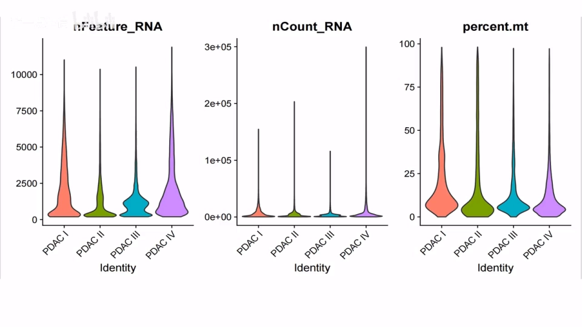

[【跳转到 04:29】](https://www.bilibili.com/video/BV1vfV56KESQ/?t=269)

这个差异该怎么解读？讲者的态度很克制：现在还没有去除批次效应，而且不同分期背后可能混着不同的样本来源、数据集来源、组织来源。比如 PDAC IV 里包含了 GSE205013 的肝转移样本，它和 GSE242230 里的原发灶样本来源并不完全一样。所以**这里的差异可以接受，但后续做分期比较时要注意**：看到的差异可能不完全来自分期本身，也可能混入了样本来源和批次因素。

### 3.2 按样本看：问题往往来自某几个样本

讲者说这张图在质控里**更关键**——因为很多时候质量问题不是来自整个疾病分组，而是来自某几个具体样本。

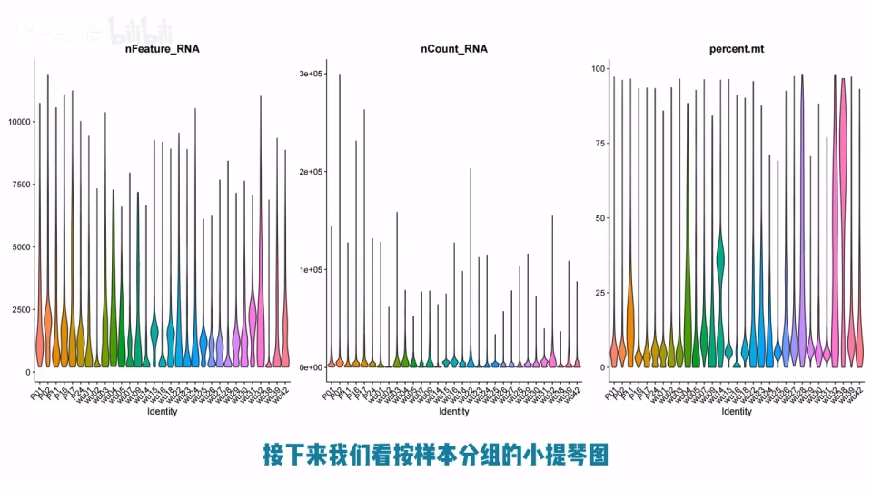

[【跳转到 05:19】](https://www.bilibili.com/video/BV1vfV56KESQ/?t=319)

这一步的实践含义是：**阈值要按样本分别看分布，而不是拿全局一个数字一刀切**。如果某个样本整体测序浅，全局阈值会把它几乎全部删掉；如果某个样本整体线粒体偏高（比如组织消化应激重），全局阈值也会误伤它。看分布能让你识别出「这是样本级问题，不是细胞级问题」。

## 四、三个指标逐个定阈值

接下来是视频的主体：讲者按「下限怎么定、上限怎么定」逐个指标走了一遍，每个都给出「常见做法」和「这批数据的选择」两条线。

### 4.1 nFeature_RNA 的下限：防止空液滴和低质量细胞

nFeature_RNA 太低，说明细胞的信息量太少，可能是空液滴，也可能是低质量细胞，**所以一定要设下限**。

常见做法是 200~500：样本质量好、测序深，可以更接近 500；比较珍贵的临床样本、细胞本身 RNA 含量偏低，或者某些免疫细胞比例很高时，有时也会用 200 或 300。

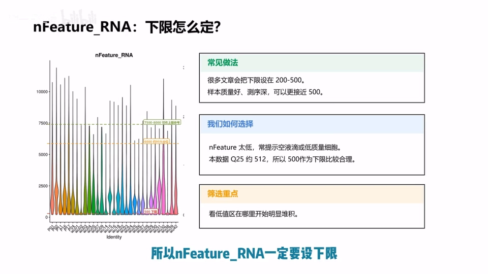

[【跳转到 05:52】](https://www.bilibili.com/video/BV1vfV56KESQ/?t=352)

讲者给出的判断依据是**分位数**：这批数据 nFeature_RNA 的 25% 分位数约 512，所以把下限设在 500 左右比较合理。他的筛选重点是「看低值区在哪里开始明显堆积」——分布图上如果低端有一条长长的尾巴，那就是空液滴和碎片细胞的堆积区。

### 4.2 nFeature_RNA 的上限：高值不一定是好细胞

这一条是新手最容易忽略的：**检测到的基因种类异常多，不一定是质量特别好，也可能是双细胞**。

常见做法是把上限设在 5000、6000、7500 甚至更高，具体取决于组织类型和测序深度。这批数据的 95% 分位数约 6172，99% 分位数约 8160，所以讲者会考虑把上限设在 7500~8000 左右。

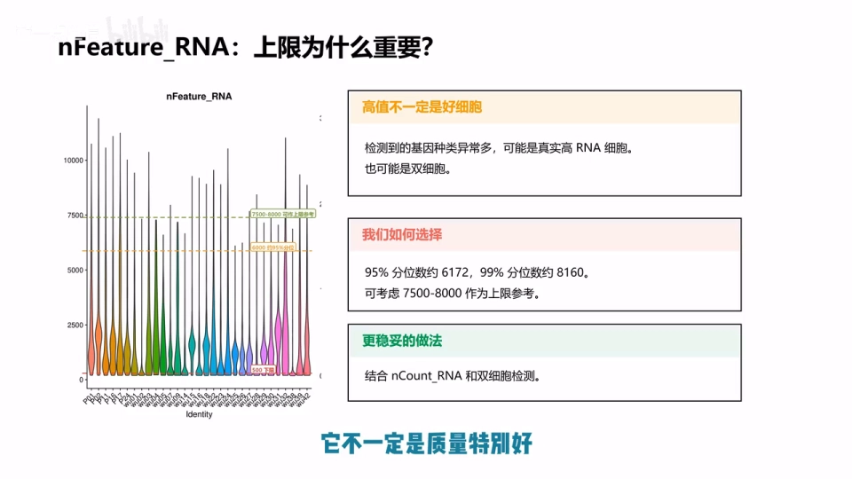

[【跳转到 06:56】](https://www.bilibili.com/video/BV1vfV56KESQ/?t=416)

注意他给的是「参考」而不是「判决」：设上限的目的是**尽量保留大部分真实细胞，同时把异常的高 feature 细胞先筛掉，或者至少标记出来**，后续再结合双细胞检测工具判断。这是一个「先隔离、后定罪」的思路。

### 4.3 nCount_RNA：同样要看上下两端

nCount_RNA 表示每个细胞的总 UMI 数，也就是这个细胞整体的表达量总和。

**下限**：nCount 太低说明细胞检测到的信息很少，可能是空液滴或低质量细胞。常见下限是 500、1000 或 2000——数据整体测序深度浅，下限可以低一点；测序深度高，就可以严格一点。这批数据的 25% 分位数约 1306，所以讲者把下限设在 1000 左右。

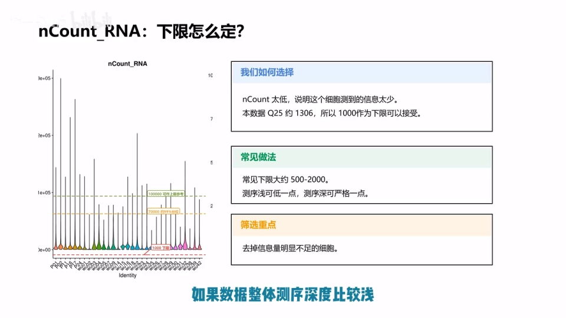

[【跳转到 07:40】](https://www.bilibili.com/video/BV1vfV56KESQ/?t=460)

**上限**：nCount 异常高，可能是双细胞，也可能是某些异常捕获事件。常见上限在 2 万、5 万、7 万、10 万这些位置，没有固定答案，要看数据分布。这批数据的 99% 分位数约 69810，但**最大值接近 30 万**——右侧有一条非常长的尾巴。

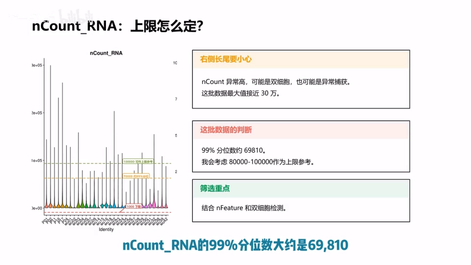

[【跳转到 08:30】](https://www.bilibili.com/video/BV1vfV56KESQ/?t=510)

讲者的选择是 8 万到 10 万，并且给了一个更保守的替代方案：**先不直接删除，而是把这部分细胞标记出来**，再结合 nFeature_RNA 和双细胞检测结果判断。

### 4.4 percent.mt：不能死背一个数字

percent.mt 是三个指标里最容易被机械套用的一个。讲者专门用了一张幻灯片讲「不能死背一个数字」。

先说历史：早期很多 Seurat 教程常以 **5%** 作为过滤阈值，尤其在 PBMC 示例中很常见。后续有研究基于大量人和小鼠的单细胞数据发现，**5% 对人类样本可能过于严格**，因此提出人类样本可以参考 **10%** 作为更合理的通用阈值，而小鼠样本中 5% 在多数情况下仍然适用。

但讲者马上补了一句关键限定：这并不意味着实际分析中可以机械地采用「人类 10%、小鼠 5%」。

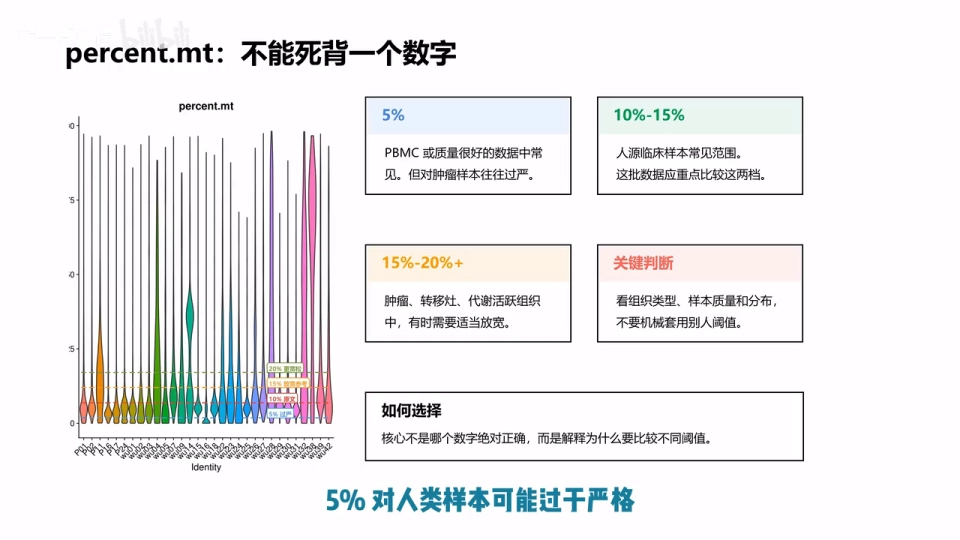

[【跳转到 09:20】](https://www.bilibili.com/video/BV1vfV56KESQ/?t=560)

他按场景给了四档参考：

- **5%**：PBMC 或质量很好的数据中常见，但对肿瘤样本往往过严。
- **10%~15%**：人源临床样本的常见范围。
- **15%~20% 以上**：肿瘤、转移灶、代谢活跃组织中，有时需要适当放宽。
- **关键判断**：看组织类型、样本质量和分布，不要机械套用别人的阈值。

回到这批数据：percent.mt 的中位数约 8.12%，75% 分位数已经接近 19.67%——说明有相当一部分细胞线粒体比例并不低。

## 五、定完阈值，先算一遍保留率

这是整支视频最有操作价值的一步：**把不同阈值下的保留细胞数算出来，用保留率反过来检验阈值**。

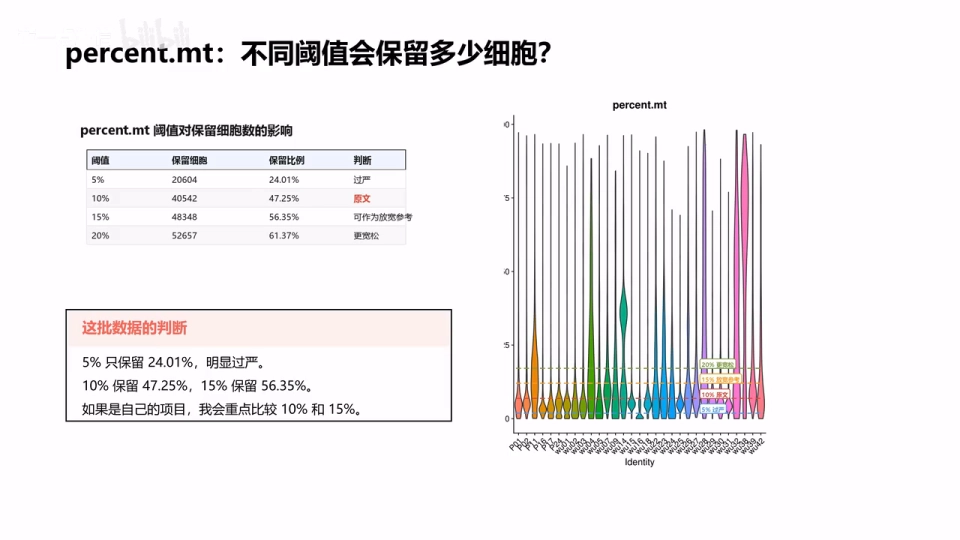

[【跳转到 10:35】](https://www.bilibili.com/video/BV1vfV56KESQ/?t=635)

| percent.mt 阈值 | 保留细胞数 | 保留比例 | 判断 |
| --- | --- | --- | --- |
| 5% | 20604 | 24.01% | 过严 |
| 10% | 40542 | 47.25% | 原文采用 |
| 15% | 48348 | 56.35% | 可作为放宽参考 |
| 20% | 52657 | 61.37% | 更宽松 |

这张表把「阈值」翻译成了「代价」：5% 只保留 24% 的细胞，意味着**四分之三的数据被扔掉**，对一份来之不易的临床样本来说几乎不可接受；10% 保留 47%，15% 保留 56%。讲者的结论是：如果这是自己的项目，会**重点比较 10% 和 15% 两套结果**。

比较的方法也讲清楚了——做**敏感性分析**：如果两套结果的主要细胞类型、聚类结构和核心结论差不多，说明结果比较稳定；如果差异很大，就说明这个阈值对分析影响很大，需要更谨慎地解释。

讲者还展示了按原文阈值过滤后、**保留比例最低的几个样本**：

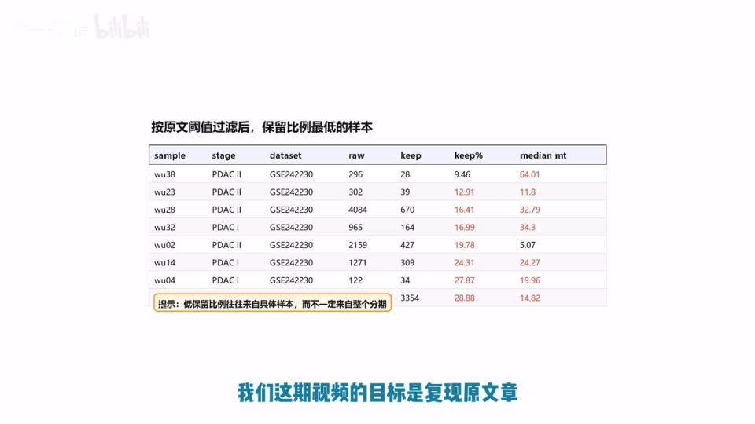

[【跳转到 11:34】](https://www.bilibili.com/video/BV1vfV56KESQ/?t=694)

表格里可以看到，保留率最低的几个样本（如 wu38 保留 9.46%、wu23 保留 12.91%）来自不同分期，而且它们的 median mt 明显偏高（64.01%、11.80%）。这印证了前面的判断：**低保留比例往往来自具体样本，而不一定来自整个分期**。这是质控阶段就该记录下来的信息——它决定了后面做分组比较时，哪些样本的结论要打折扣。

## 六、复现原文，还是按自己的数据定？

视频最后，讲者把两条路线并排摆了出来，态度很清楚：

- **这期视频的目标是复现原文章**，所以后面继续按原文阈值走：nFeature_RNA 大于 500、nCount_RNA 大于 1000、percent.mt 小于 10%。
- **如果这是自己的项目**，他不会只写这三个参数：会额外考虑 nFeature_RNA 和 nCount_RNA 的**上限**，并且会比较 10% 和 15% 两套线粒体阈值。

也就是说，从这批数据本身出发，他更倾向于：

| 指标 | 下限 | 上限 |
| --- | --- | --- |
| nFeature_RNA | 大于 500 | 小于 7500 或 8000 |
| nCount_RNA | 大于 1000 | 小于 8 万或 10 万 |
| percent.mt | 无 | 小于 10% 或 15%（两套都跑） |

这张表是本文最值得带走的东西：**下限管「信息太少」，上限管「可能是双细胞」，线粒体管「可能是死细胞」，而每一个数字都要用本数据的分布和保留率来支撑。**

## 小结

- 质控是**筛选**动作，所以先要有筛选标准；标准来自指标，指标来自对三类异常细胞的理解。
- 三个指标各有分工：nFeature_RNA 与 nCount_RNA 由 Seurat 自动统计，percent.mt 要按物种前缀（人类 `MT-`、小鼠 `mt-`）自己算。
- 三类坏细胞在指标空间里有固定的方向：低质量细胞是「基因少、UMI 少、线粒体高」，空液滴是「两项都很少」，双细胞是「两项都偏多」。
- 阈值不是固定答案，要**按样本看分布**再定；按分组的小提琴图则用来提前发现「分组间本身就有质量差异」这个混杂。
- 定阈值的技术手段是**分位数**：下限看低值区从哪开始堆积（如 25% 分位数），上限看长尾从哪里突然拉起（如 95%、99% 分位数）。
- 定完阈值要**算保留率**，并用 10% 与 15% 两套阈值做敏感性分析，看聚类结构和主要结论是否稳定。
- 复现别人的论文就照抄它的阈值；做自己的项目，就要给出自己的依据，并把上限也考虑进去。

## 关键术语速查

| 术语 | 一句话解释 |
| --- | --- |
| QC（质量控制） | 在正式分析前把明显不可靠的细胞剔除的步骤 |
| nFeature_RNA | 每个细胞检测到的基因种数，太低是空液滴或低质量细胞，太高可能是双细胞 |
| nCount_RNA | 每个细胞的总 UMI 数，反映这个细胞整体的表达量总和 |
| percent.mt | 线粒体基因表达量占该细胞总表达量的比例，偏高提示细胞受损或接近死亡 |
| 空液滴 | 液滴里没有真正捕获到细胞，表现为基因数和 UMI 数都极少 |
| 双细胞（doublet） | 一个液滴里进了两个细胞，被当成一个细胞测序，表现为基因数和 UMI 数异常偏高 |
| 分位数 | 把一列数值排序后按百分比切分的位置，用来把阈值锚定在分布拐点上 |
| 保留率 | 过滤后剩下的细胞数占过滤前的比例，用来检验阈值是否过严或过松 |
| 敏感性分析 | 换一套阈值重跑，看主要结论是否改变，以此判断结论对阈值有多敏感 |