# 细胞过滤与标准化三步走：用分位数定阈值，从 count 走到 scale

> 视频来源：[3.单细胞质控(细胞过滤和标准化三步走)](https://www.bilibili.com/video/BV1a7zeBjEvJ/)（Bilibili · 生信小当家阿伦）｜时长约 11 分钟
> 导读：这支视频把「质控 + 标准化」当成一条连续流水线走了一遍：先算四个指标，用分位数把上下限「算」出来而不是拍出来，subset 过滤，再依次做 NormalizeData、FindVariableFeatures、ScaleData。本文按流水线顺序整理，重点放在每一步的判断依据和顺序为什么不能反。

## 本讲要解决的核心问题（SCQA）

**背景**：上一个视频已经把数据读进来，Seurat 对象里存着一份 count 矩阵——每个数字是「在这个细胞的这个基因上数到了几条 UMI」。接下来要进入降维聚类。

**冲突**：这份矩阵里混着坏死细胞、红细胞污染和可能的双细胞；同时，不同细胞的总 UMI 数差得很远，直接拿 count 去算距离和降维，结果会被「谁测得更深」主导。但这里有个先后顺序的陷阱：**过滤要在原始计数上做，标准化要在过滤之后做**，顺序一反，后面每一步的语义都会错。

**疑问**：四个质控指标的阈值到底怎么用分位数定出来？过滤完之后的「标准化三步走」各自在做什么，为什么必须按 normalize → 找高变基因 → scale 这个顺序？

**回答（中心思想）**：阈值不必凭感觉拍，**用分位数把分布切开来读**——下限看 1%~10% 分位从哪开始抬升，上限看 90%~100% 分位在哪里突然跳高，跳高的那一段就是双细胞或污染。过滤完成后再走三步：`NormalizeData` 按测序深度缩放并取对数、`FindVariableFeatures` 挑出 2000 个高变基因、`ScaleData` 只对这 2000 个基因做 z-score。**顺序的关键在于：过滤必须基于原始计数，而 scale 会把矩阵变成稠密的标准化值，所以它只能放在最后、且只作用于高变基因。**

[【跳转到 00:00】](https://www.bilibili.com/video/BV1a7zeBjEvJ/?t=0)

## 一、先把四个指标算出来

演示数据是 GSE315604，对象里已有 count 数据与 metadata，分组信息 `orig.ident` 与 `group` 已经整理好，两个分组分别是 4953 和 5553 个细胞。

### 1.1 percent.mt：按基因名前缀匹配

第一步是定义线粒体比例。做法是用一个表达式去匹配 `MT-` 开头的基因——因为人类的线粒体基因都是 `MT-` 开头的——然后把结果写进对象的一列 `percent.mt`。

算完之后 metadata 里就多了这一列。**每一行代表一个细胞**，讲者随手点开第一行：这个细胞的线粒体比例达到了 97%，说明这就是需要过滤掉的坏死细胞。

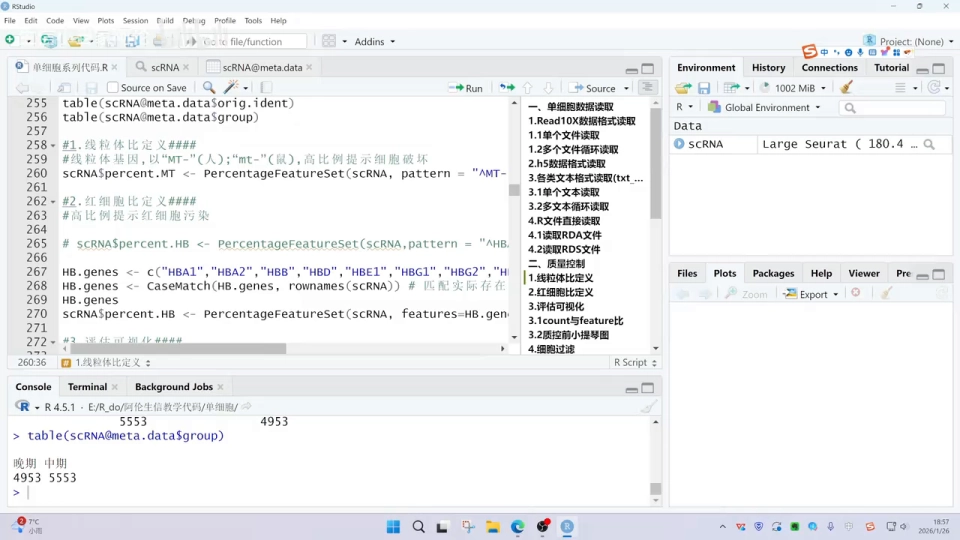

[【跳转到 00:55】](https://www.bilibili.com/video/BV1a7zeBjEvJ/?t=55)

### 1.2 percent.HB：红细胞污染用 marker 集合匹配

红细胞污染是另一类需要单独处理的问题，因为红细胞基因（HBA、HBB 等）在组织样本里常常来自取样时混入的血液。

讲者给了两种写法，效果一样，选一种即可：

1. 直接用正则表达式匹配以 HB 开头的基因；
2. 先准备一组红细胞 marker 基因，再用 `match` 去跟对象的全部基因名匹配，只保留数据里真实存在的那些，再算比例。

第二种写法更稳妥，因为它会告诉你**哪些 marker 在这份数据里根本不存在**。讲者演示时准备了 10 个红细胞基因，匹配下来只剩 7 个——比如 HBG2 就没有匹配到——最后就用这 7 个基因算出了 `percent.HB`。

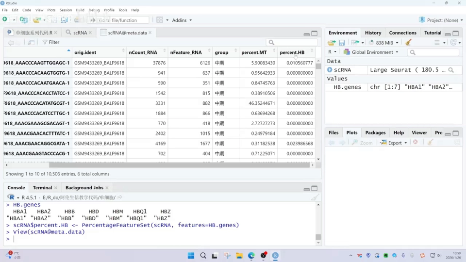

[【跳转到 02:10】](https://www.bilibili.com/video/BV1a7zeBjEvJ/?t=130)

算完再看这一列，讲者指着一个细胞说它的红细胞比例达到了 96%——这也是需要过滤掉的。**注意红细胞比例不是所有研究都设阈值**，讲者的做法是把它算出来、画出来，再决定要不要用。

## 二、过滤前先做两项体检

在动手删细胞之前，讲者做了两件检查，目的是确认「这份数据本身是正常的」。

### 2.1 count 与 feature 应当正相关

第一项是把 nCount_RNA 和 nFeature_RNA 画成散点图。正常情况下，**一个细胞检测到的基因种类越多，它的总 UMI 数也应该越大**，两者应当呈明显的正相关。这份数据的相关系数是 **0.93**，符合预期；而且两个样本的数据点能融合在一起，说明样本之间没有明显分裂。

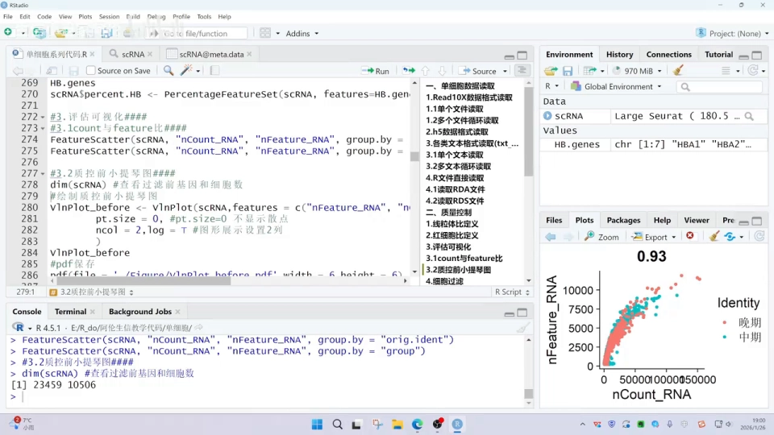

[【跳转到 02:35】](https://www.bilibili.com/video/BV1a7zeBjEvJ/?t=155)

这个检查之所以有意义，是因为它能反向暴露问题：如果两者几乎不相关，往往意味着大量细胞的 count 主要来自少数几个高表达基因（比如线粒体基因），也就是细胞已经破损。

### 2.2 记下过滤前的基线

第二项是画过滤前的小提琴图，把四个指标（nFeature、nCount、percent.MT、percent.HB）的分布存成 PDF，同时用 `dim()` 记下过滤前的规模：**23459 个基因 × 10506 个细胞**。

这张「过滤前」的图后面要和「过滤后」的图并排对比——**没有基线，就无法证明过滤真的起了作用**。

## 三、用分位数把阈值「算」出来

这是整支视频方法上最有价值的一段。讲者的原则是：**优先看 95%~99% 之间的分位数值**，用分位数把分布切开，让阈值落在分布的拐点上，而不是拍一个整数。

具体做法是用 `quantile()` 按 1% 的步长输出分位数值，分两段看：

- **下限**：看 1%~10% 这一段，找「从哪开始明显抬升」。
- **上限**：看 90%~100% 这一段，找「在哪里突然跳高」。

### 3.1 nFeature_RNA：下限 200，上限 8000

**下限**：从 1% 到 10% 逐 1% 看，nFeature 从 315 慢慢升到 362，再到 538。既然前 1% 就已经到了 300 多，那么把下限设在 200 也是没关系的——讲者说一般都在 200~400 之间选。

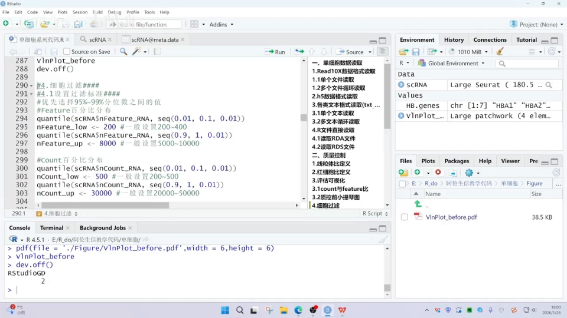

[【跳转到 04:15】](https://www.bilibili.com/video/BV1a7zeBjEvJ/?t=255)

**上限**：从 90% 到 100% 看，nFeature 从 3567 一路平缓升到 99% 的 6643，然后 **100% 突然跳到 11904**。这个突然抬升就是信号——它说明有一小撮细胞的基因数远超正常范围，很可能就是双细胞。所以讲者把上限设在 **8000**，把 1 万多那一段切掉。

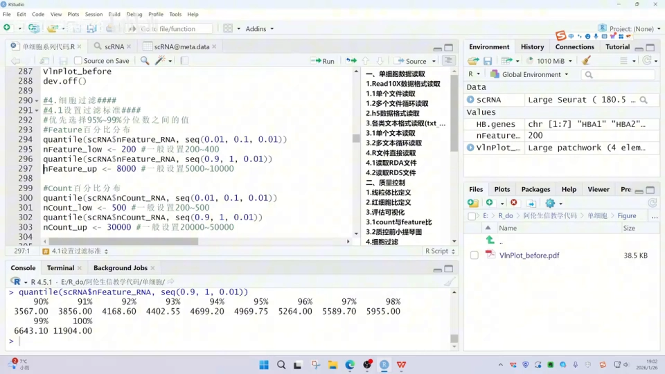

[【跳转到 04:40】](https://www.bilibili.com/video/BV1a7zeBjEvJ/?t=280)

### 3.2 nCount_RNA：下限 500，上限 30000

**下限**：同样看 1%~10%，讲者一般选 500，也就是 200~500 之间。

**上限**：从 90% 的 13430 慢慢升到 99% 的 32849，然后 **100% 直接跳到 153110**——接近 15 万。讲者的判断是「这一部分就是需要我们过滤的」，可以选 3 万，也可以选 3 万 5、3 万 9、4 万，最后他选了 **3 万**。

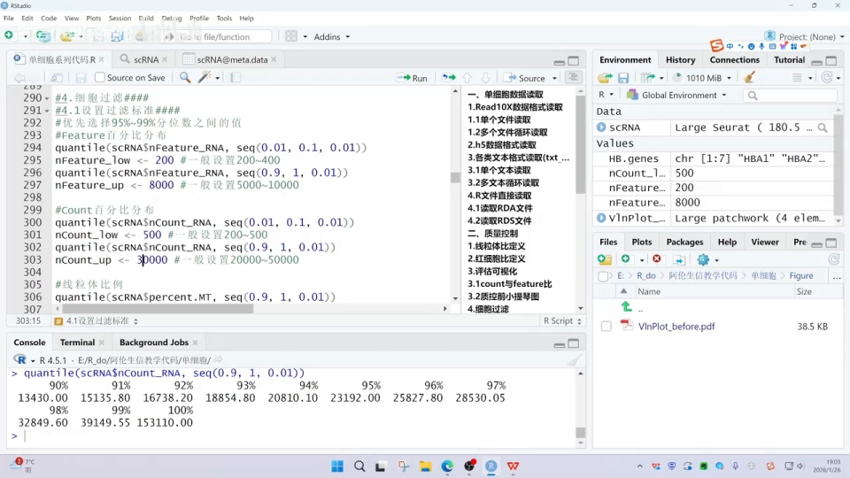

[【跳转到 05:30】](https://www.bilibili.com/video/BV1a7zeBjEvJ/?t=330)

### 3.3 percent.MT：上限 10%~20% 之间，本例取 10

线粒体比例看高分位：90% 的细胞只有 4.13%，慢慢上升，到 98% 时是 11.49%，然后 **100% 直接跳到 97.09%**。

讲者的判断是：一般设置在 **10~20** 之间；如果想卡得严一点，设 10% 也是可以的。这个例子里他取了 10。

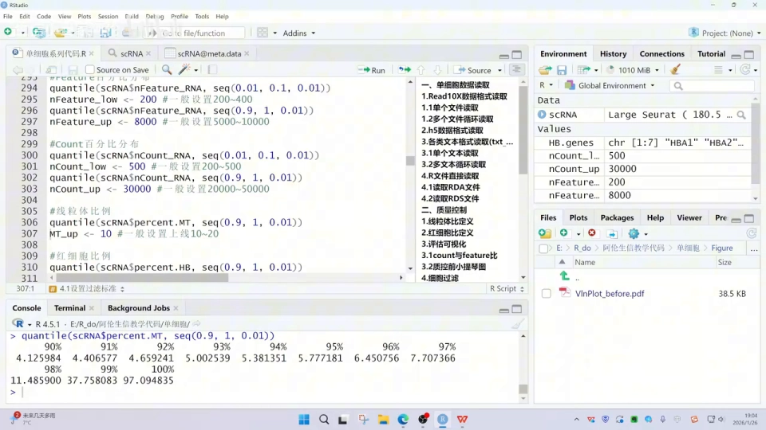

[【跳转到 05:55】](https://www.bilibili.com/video/BV1a7zeBjEvJ/?t=355)

### 3.4 percent.HB：上限 1

红细胞比例的分位分布更极端：90% 的细胞是 0.04%，到 99% 也才 0.16%，但 **100% 直接到了 96.69%**。

讲者给的经验是：红细胞比例一般设 **1~5**；**组织样本可以低一点，设到 1；血液样本可以高一点，可以到 5**。这个例子里他设 1。

到这里，四个指标的上限下限就都齐了：

| 指标 | 下限 | 上限 |
| --- | --- | --- |
| nFeature_RNA | 200 | 8000 |
| nCount_RNA | 500 | 30000 |
| percent.MT | 无 | 10 |
| percent.HB | 无 | 1 |

值得强调的是这套流程的**可复述性**：阈值不是从别人的论文里抄来的，而是从本数据的 `quantile()` 输出里读出来的——**下限看低分位从哪抬升，上限看高分位在哪跳高**。跳高的那一段，就是双细胞或污染堆积的地方。

## 四、subset 过滤，并对比前后

阈值齐了之后，用 `subset()` 一次性把条件写进去：count 大于下限且小于上限、feature 大于下限且小于上限、percent.MT 小于上限、percent.HB 小于上限。

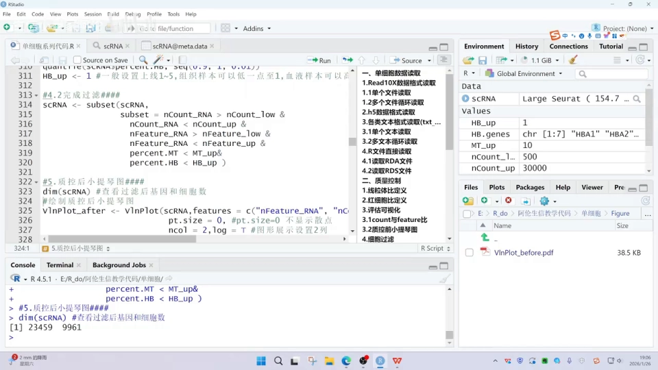

[【跳转到 07:10】](https://www.bilibili.com/video/BV1a7zeBjEvJ/?t=430)

过滤完再 `dim()` 一次：**23459 个基因 × 9961 个细胞**。对比过滤前的 10506 个细胞，**一共去掉了约 545 个细胞**。

这个数字很关键：它说明阈值是「切掉了尾部」而不是「砍掉了主体」。如果过滤后只剩一半细胞，那就要回头检查阈值是不是太严了。

然后画过滤后的小提琴图，和过滤前的 PDF 并排对比：

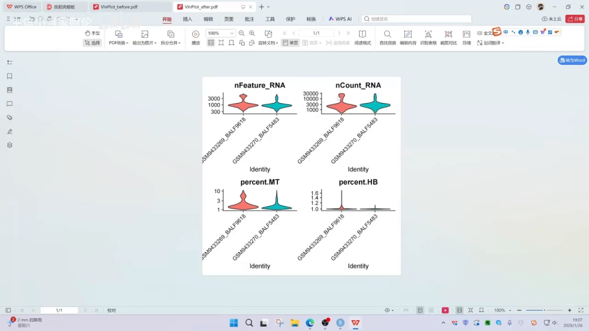

[【跳转到 07:52】](https://www.bilibili.com/video/BV1a7zeBjEvJ/?t=472)

讲者逐项对照：过滤前 nCount 最大值到了 $10^5$ 这个量级，percent.MT 可以到 100%；过滤后 nFeature 的上限就是 8000、nCount 的上限是 3 万、percent.MT 到 10% 为止。**这就是「过滤前基线」的用处——它把阈值的效果变成了肉眼可核对的事实。**

## 五、标准化三步走

过滤后的数据保存好，进入第二部分：标准化。

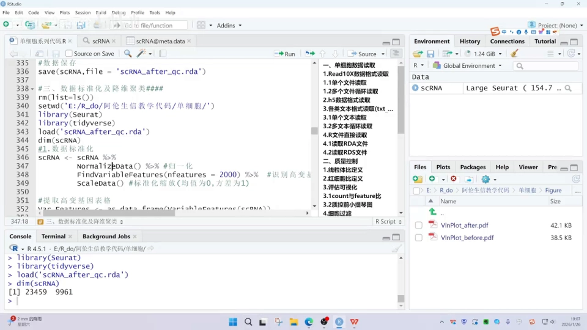

[【跳转到 08:22】](https://www.bilibili.com/video/BV1a7zeBjEvJ/?t=502)

三步用管道符串成一句，因为默认参数就够用，括号里不用再填参数。唯一需要留意的是 `FindVariableFeatures` 的 `nfeatures`，默认 2000；也可以调成 1500 或 3000，文献里大家一般在 1000~3000 之间选。

### 5.1 NormalizeData：count 层旁边多出一个 data 层

质控之前，对象里只有一个 `counts` 数据。做完 `NormalizeData` 之后，`counts` 旁边多了一个 `data`——这就是归一化后的数据。

这一步做的事是：**按每个细胞的总表达量做缩放，再取对数**。缩放解决的是「不同细胞测序深度不同」，取对数解决的是「高表达基因的数值动辄是低表达基因的上百倍」。这两步的数学细节属于归一化本身的内容，这里只需记住它的产物：`data` 层，以及**原始计数 `counts` 依然原样保留**。

### 5.2 FindVariableFeatures：挑出 2000 个高变基因

第二步是在归一化后的数据上挑高变基因。讲者的操作是先 `help()` 看一眼默认参数，确认 `nfeatures = 2000`，然后直接跑。

跑完可以把这 2000 个基因提取成一个数据框查看，也可以可视化：

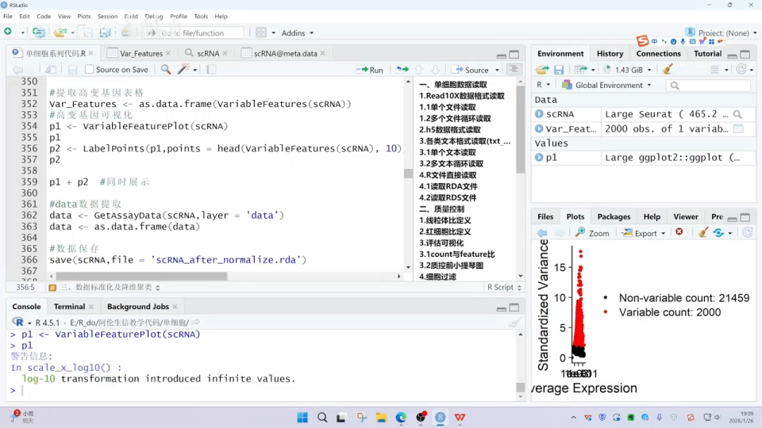

[【跳转到 10:02】](https://www.bilibili.com/video/BV1a7zeBjEvJ/?t=602)

图上红色点就是筛出来的 2000 个高变基因，黑色是被排除的 21459 个。讲者用 `LabelPoints` 把前 10 个基因标在图上（也可以改成 20 或 15），再把两张图相加，让标记和散点显示在同一张图上。

顺带一提，这个画图步骤的控制台里出现了 `log10 transformation introduced infinite values` 的警告——因为横轴取了对数，而部分基因的平均表达量是 0，取对数后变成负无穷。它只是绘图坐标轴的警告，不影响高变基因的选择结果。

### 5.3 ScaleData：只对 2000 个基因做 z-score

第三步 `ScaleData` 是把每个基因的表达值减去该基因的均值、再除以标准差，也就是 z-score，让每个基因的均值为 0、方差为 1。

这里有个容易被忽略的细节：**scale 只作用在那 2000 个高变基因上**，`scale.data` 里存的就是这 2000 行。原因在于 scale 会把原本稀疏的计数矩阵变成**稠密的、带负数的标准化值**——如果对全部 2 万多个基因做，既浪费内存，也把大量本来就没信息的基因抬到了同等权重。

### 5.4 为什么顺序不能反

把三步连起来看，顺序的必然性就清楚了：

1. **过滤必须在最前**：所有阈值都是拿原始计数算的（count 总数、基因数、线粒体占比），一旦先归一化，这些量的物理含义就变了，阈值也就失效了。
2. **归一化在过滤之后**：过滤掉的极端细胞会改变总表达量的分布，先归一化再过滤，等于用一份被污染的数据估算了缩放系数。
3. **高变基因在归一化之后**：方差要在「可比」的尺度上算，否则高变基因会被高深度细胞主导。
4. **scale 在最后、且只对高变基因**：它破坏稀疏性，也抹掉了基因间的绝对丰度差异，所以只能作为「进降维前的最后一步」。

最后，如果要把标准化后的数据拿出来，用 `GetAssayData` 指定 `layer = "data"` 即可，得到的是「基因 × 9000 多个细胞」的矩阵。

## 六、这条流水线里最容易踩的坑

- **物种前缀搞错**：人类是 `MT-`，小鼠是 `mt-`，写错会导致 percent.mt 全为 0，等于没做线粒体过滤。
- **marker 集合不检查存在性**：红细胞 marker 里有些基因在这份数据里根本没有，直接对全集求比例会算错，所以要像讲者那样先 `match` 再算。
- **只设下限不设上限**：只防了空液滴，没防双细胞。nFeature 和 nCount 的上限正是用来切掉双细胞长尾的。
- **阈值拍整数而不看分布**：8000、30000 这些数字之所以成立，是因为它们落在分位数的跳变处；换一份数据，跳变位置就变了。
- **不看过滤前后的细胞数**：讲者过滤掉 545 个细胞（10506 → 9961），是「切尾」；如果过滤后只剩一半，就该回头检查阈值。
- **以为 scale 之后还能回到 count**：`scale.data` 是稠密矩阵，原始计数只在 `counts` 层里，两者不能互相还原。

## 小结

- 质控的四个指标：nFeature_RNA、nCount_RNA、percent.MT、percent.HB；前两个自动统计，后两个要自己算。
- percent.mt 按物种前缀匹配；percent.HB 用 marker 集合匹配，并先检查哪些 marker 在数据里真实存在。
- 过滤前先做两项体检：count 与 feature 应正相关（本例 0.93），并记下过滤前的基因数、细胞数与分布基线。
- 阈值用分位数「算」出来：**下限看 1%~10% 分位从哪抬升，上限看 90%~100% 分位在哪跳高**，跳高段对应双细胞或污染。
- 本例阈值：nFeature 200~8000、nCount 500~30000、percent.MT 小于 10、percent.HB 小于 1；过滤后 10506 → 9961 个细胞。
- 标准化三步走：`NormalizeData`（count 层旁多出 data 层）→ `FindVariableFeatures`（默认 2000 个高变基因）→ `ScaleData`（只对高变基因做 z-score）。
- 顺序不能反：过滤基于原始计数，归一化在过滤后，高变基因在归一化后，scale 在最后且只作用于高变基因。

## 关键术语速查

| 术语 | 一句话解释 |
| --- | --- |
| percent.mt | 线粒体基因表达量占该细胞总表达量的比例，按 `MT-` 前缀匹配计算 |
| percent.HB | 血红蛋白基因表达量占比，用来识别红细胞污染 |
| 分位数 | 把一列数值排序后按百分比切分的位置，用来把阈值锚定在分布拐点上 |
| subset | Seurat 里按条件筛选细胞或基因的函数，四个指标的上下限可一次写进同一句 |
| NormalizeData | 按每个细胞的总表达量缩放并取对数，产物存在 data 层 |
| FindVariableFeatures | 在归一化后的数据上挑出表达变异最大的基因，默认 2000 个 |
| ScaleData | 对每个基因做 z-score（均值 0、方差 1），只作用于高变基因 |
| counts 层与 data 层 | counts 是原始 UMI 计数，data 是归一化后的表达值，两者并存 |
| 双细胞（doublet） | 一个液滴里进了两个细胞，表现为 nFeature 与 nCount 的高分位异常跳高 |