# RNA 指纹：用扰动字典把单细胞现象追溯到因果扰动

> 视频来源：[RNA指纹：链接单细胞与因果扰动](https://www.bilibili.com/video/BV1gpnG6BE8c/)（Bilibili · 景磊博士）｜时长约 50 分钟
> 导读：这是一场围绕 Cell 新方法 RNA fingerprinting 的文献精读。本文只取它最有价值的那条主线——**为什么观察性单细胞数据答不了「为什么」，扰动组学凭什么补上这一环，以及一次扰动要能被当成因果证据需要满足什么条件**。算法细节只保留理解范式所必需的部分；Perturb-seq 的建库与 gRNA 设计不在本文范围（属 3.3 节）。

## 本讲要解决的核心问题（SCQA）

**背景**：单细胞测序已经能一次读出成千上万个细胞的转录组。我们看到的是细胞状态：哪些细胞聚成一团、哪一群在疾病样本里变多了、哪一群开始表达某个 marker。这类数据我们通常称为**观察性数据（observational data）**。

**冲突**：观察性数据能告诉我们细胞「是什么」，却答不了「为什么」。我们看到实验组相对对照组发生了变化，但变化背后的驱动因素混杂在无数变量里——病人与健康人的年龄、用药、组织来源、批次，全都搅在一起。讲者把它说成一座**缺失的桥梁**：观测数据描绘状态，因果推断需要干预，而「扰动 → 响应」这条规则无法从数据本身读出来。

**疑问**：既然扰动组学（perturbation omics）的数据天然带因果注释——我确实敲掉了某个基因、确实加了某个药，然后才测到那个转录组状态——那能不能用这些带因果标签的数据，去解释我们手上这份没有因果标签的单细胞数据？

**回答（中心思想）**：可以，而且这正是「扰动范式」的核心价值：**把扰动实验当作一本因果字典，把观察到的细胞状态当作待解释的查询，用统计匹配把「是什么」倒推成「可能由什么造成」**。但这条路要成立，必须先把三件事做扎实：扰动必须真的发生（有效）、扰动必须只动目标（特异）、观测到的差异必须能归因于扰动而不是背景（可归因）。RNA fingerprinting 这个工具，本质上就是在给后两条补证据。

## 一、观察性数据只能回答「是什么」，扰动才能回答「为什么」

讲者开场就把单细胞数据的性质说得很清楚：**我们拿到的单细胞数据，本质上是观测数据，记录的是取样那一刻细胞的状态**。它反映的是细胞状态，告诉我们细胞是什么；但背后我们更想知道的，是细胞为什么变成这个样子。

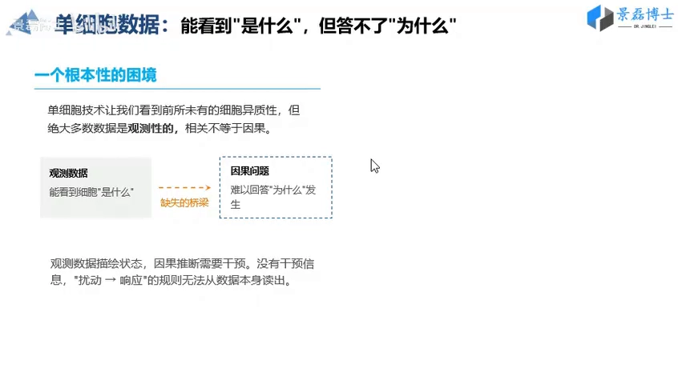

这个区分不是文字游戏，它决定了你手上数据能回答哪类问题：

- **观察性研究的差异是「混杂的」**：实验组与对照组之间，除了你关心的那个因素，还有细胞周期、分化阶段、测序深度、批次、微环境等等同时在变。
- **扰动实验的差异是「可指认的」**：我干扰了某个基因，所以我有一个明确的、记录在案的干预变量；转录组的变化可以被归到这次干预上。

讲者用一句话点出这层因果的来源：扰动组学用 CRISPR screen 或者药物等处理条件，结合单细胞测序做组学分析，**背后天然带着因果成分——因为我干扰了某个基因，对应的转录组才变成了那个状态** [【跳转到 01:53】](https://www.bilibili.com/video/BV1gpnG6BE8c/?t=113)。

于是问题被重新表述成一个「原料 + 加工」的结构：

> 扰动字典为我们提供了因果关系的原料，而 RNA fingerprinting 把这份原料用到我们想解释的数据上，它提供了一个实现这个目的的统计框架。[【跳转到 02:43】](https://www.bilibili.com/video/BV1gpnG6BE8c/?t=163)

注意这里已经包含了本小节要讲的**一次 perturbation 的三要素**，只是讲者没有用这个术语：

| 要素 | 在这套框架里的位置 | 缺了会怎样 |
| --- | --- | --- |
| 可指认的干预 | 扰动字典里的每一个扰动条件（敲哪个基因、加哪个药、什么剂量） | 不知道改了什么，差异无法归因 |
| 可比的对照 | 同一细胞类型、同一实验体系下的 non-targeting / DMSO 对照细胞 | 没有基线，分不清「扰动效应」和「细胞本来就这样」 |
| 可测量的读出 | 扰动后的单细胞转录组（本文的读出层次） | 没有读出，扰动就只是一次操作，不是一次实验 |

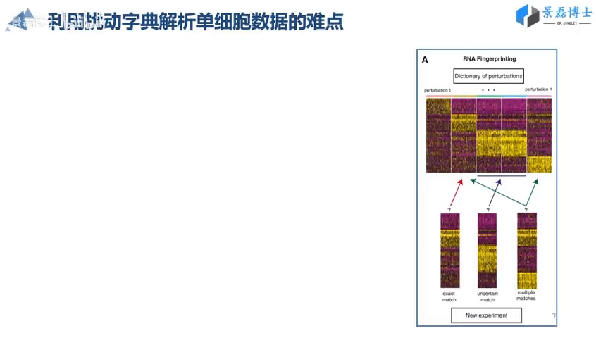

## 二、扰动组学已经积累出一本「扰动字典」

要把扰动当字典用，前提是字典足够厚。讲者列举了作者实际使用的几本「字典」，这份清单本身就是一张**扰动类型学**的速查表——按干预手段分四类，正好覆盖本系列后面几节要展开的全部技术：

| 数据集 | 扰动类型 | 规模与要点 |
| --- | --- | --- |
| CPA-Perturb-seq | 遗传扰动（CRISPRi 敲低） | 42 个与 RNA 切割、多聚腺苷酸化（CPA）相关的基因，14 万个单细胞 |
| 全基因组 Perturb-seq（GWPS） | 遗传扰动（全基因组 CRISPRi 筛选） | K562 细胞，覆盖全基因组 |
| CaRPool-seq | 组合扰动 | 单基因与双基因组合，双 gRNA 载体 |
| sci-Plex | 化学扰动 | 多种药物 × 多个剂量处理 K562 |
| Immune Dictionary（免疫字典） | 环境扰动（细胞因子刺激） | 小鼠 18 种免疫细胞类型 × 88 种细胞因子 |
| PerturBase | 整合资源 | 122 个单细胞扰动数据集，约 2.4 万个遗传扰动、230 个化学扰动 |

这张表值得多看一眼，因为它把「扰动」这个词拆成了四种完全不同的操作：

1. **遗传扰动**：把基因本身改掉——敲除（knockout）、敲低（CRISPRi / RNAi）、激活（CRISPRa）、过表达、点突变。CPA-Perturb-seq 用的是 CRISPRi 敲低，GWPS 也是 CRISPRi 筛选。
2. **化学扰动**：小分子药物，通常还带剂量梯度与时间梯度。sci-Plex 就是「多种药物 × 多个剂量」的矩阵。
3. **环境扰动**：细胞因子、缺氧、温度、基质、共培养、机械力。免疫字典里那 88 种细胞因子就是典型的环境扰动。
4. **组合扰动**：多基因组合，或者基因 × 药物。CaRPool-seq 用双 gRNA 载体，在同一个细胞里同时破坏两个基因。

讲者还提到了一个更宏观的数字：PerturBase 这类整合库已经把 122 个单细胞扰动数据集收在一起，涵盖约 2.4 万个遗传扰动和 230 个化学扰动条件 [【跳转到 05:24】](https://www.bilibili.com/video/BV1gpnG6BE8c/?t=324)。

**这正是「扰动组学」这个名字的来历**：一次实验测几百到几千个扰动 × 几万个细胞，把「一个基因一个基因地做」变成「一张扰动 × 响应的矩阵」。矩阵一旦成型，它就不再是一堆个案，而是一本可以查询的字典。

> 边界说明：各类扰动的具体技术原理（CRISPR-KO / CRISPRi / CRISPRa 怎么实现、RNAi 怎么设计、药物剂量怎么设）属于本系列 3.2 节；Perturb-seq 的建库与 barcode 设计属于 3.3 节。这里只做分类与定位。

## 三、有字典不等于能用：五个让匹配失败的现实障碍

字典很厚，但讲者紧接着泼了一盆冷水：**已有扰动的数据资源，无法直接用于解释单细胞数据**。原因有五条，这五条其实也是「扰动范式」自带的三个前提假设在实际数据里被削弱的地方。

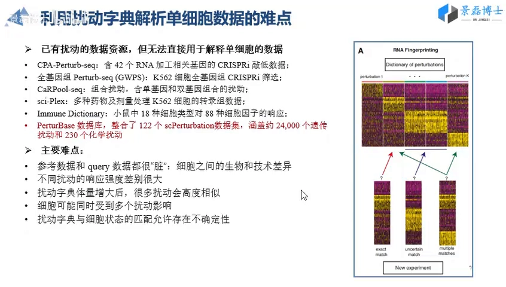

**难点一：参考数据和 query 数据都很「脏」。** 细胞之间本来就存在大量生物或技术层面的差异——细胞状态不同、测序噪声不一样，这些变异可能盖过真正的扰动信号。讲者说得很直白：如果用绝对的差异分析，背景噪声造成的差异可能比扰动本身的差异还大 [【跳转到 06:14】](https://www.bilibili.com/video/BV1gpnG6BE8c/?t=374)。这一条直接对应「响应可归因」这个假设：**观测到的差异未必来自扰动**。

**难点二：不同扰动的响应强度差别很大。** 有的扰动一敲下去转录组天翻地覆，表达量和表达基因的种类都大变；有的只有轻微改变。信号有强有弱，怎么平衡是个问题。

**难点三：扰动字典越大，扰动之间越相似。** 扰动条件一多，就会发现越来越多扰动条件彼此相似，要构建「特异性」指纹、区分不同扰动，难度随之增大。

**难点四：一个细胞可能同时受多个扰动影响。** 拿到一个细胞的转录组状态，背后可能有不知道多少种扰动条件共同造成。这一条在真实生物学里尤其重要——很多细胞状态根本不是「一个扰动说了算」。

**难点五：匹配本身存在多种可能性。** 我们不能人为地给细胞强贴一个标签，那怎么用统计方法把这种不确定性恰当地涵盖进去？[【跳转到 07:54】](https://www.bilibili.com/video/BV1gpnG6BE8c/?t=474)

把这五条翻译成方法学语言，就是本小节要强调的那句话：**扰动组学的全部方法学，都是在给「扰动有效」「扰动特异」「响应可归因」这三个假设补证据**。难点一、五在补「可归因」，难点二、三在补「特异」，而「有效」这一条留给了实验侧的效率验证（属 3.3.5）。
## 四、第一步：把「扰动指纹」从背景里剥出来

面对上面五个难点，作者给出的方案是**两步法**：先把每个扰动的净效应提纯成「扰动指纹」，再用指纹去匹配 query 细胞。

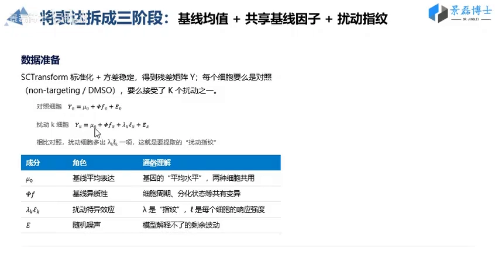

### 4.1 一个细胞表达谱由三部分组成

讲者把处理组的信号拆成三个层面：**基线的因素、共享的基线因子、真正由扰动造成的扰动指纹**。落到公式上，对照细胞与扰动细胞的表达可以写成：

$$
Y_{0c} = \mu_0 + \phi f_c + E_c
$$

$$
Y_{kc} = \mu_0 + \phi f_c + \lambda_k \ell_k + E_k
$$

其中各成分的角色如下：

| 成分 | 角色 | 通俗理解 |
| --- | --- | --- |
| $\mu_0$ | 基线平均表达 | 基因的「平均水平」，两种细胞共用 |
| $\phi f_c$ | 基线异质性 | 细胞周期、分化状态等共有变异 |
| $\lambda_k \ell_k$ | 扰动特异效应 | $\lambda_k$ 是「指纹」，$\ell_k$ 是每个细胞的响应强度 |
| $E$ | 随机噪声 | 模型解释不了的剩余波动 |

对照细胞由前三项中的 $\mu_0$、$\phi f_c$ 加噪声构成；扰动细胞多出来的 $\lambda_k \ell_k$ 这一项，才是真正由扰动造成的特异性指纹 [【跳转到 14:30】](https://www.bilibili.com/video/BV1gpnG6BE8c/?t=870)。

这里有一个必须说清楚的**前提假设**：对照组和扰动组共享同一套基线因子。讲者特意强调，这是整个算法能行得通的底层逻辑，但**基线怎么定义要因课题而异**——如果你的科学问题就是分化，那你就不能把分化当作要排除的基线；如果你研究的是细胞周期的影响，当然也不能把细胞周期当作要排除的条件。换句话说，「基线」不是客观存在的一个东西，而是**你对「什么算无关变异」的声明**。

### 4.2 四步估计：用对照细胞定基线，用残差取指纹

具体的估计分四步，每一步都在解决一个很实际的问题 [【跳转到 17:30】](https://www.bilibili.com/video/BV1gpnG6BE8c/?t=1050)：

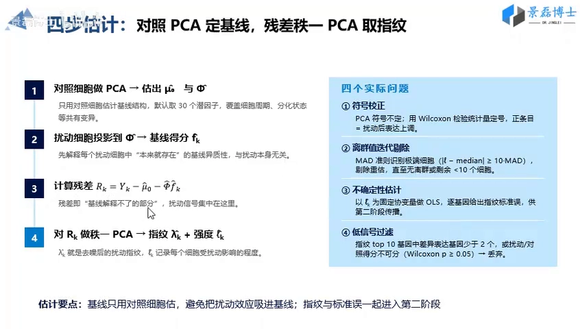

1. **对照细胞做 PCA，估出 $\mu_0$ 与 $\phi$**：只用对照细胞估计基线结构，默认取 30 个潜因子，覆盖细胞周期、分化状态等共有变化。注意这里刻意**只用对照组**，避免把扰动效应吸进基线里。
2. **扰动细胞投影到 $\phi$ 上，得到基线得分 $f_k$**：先解释每个扰动细胞中「本来就存在」的基线异质性，这部分与扰动无关。
3. **计算残差 $R_k = Y_k - \hat\mu_0 - \hat\phi \hat f_k$**：残差就是「基线解释不了的部分」，扰动信号集中在这里。
4. **对 $R_k$ 再做一次 PCA，得到指纹 $\hat\lambda_k$ 与强度 $\hat\ell_k$**：$\hat\lambda_k$ 就是去掉背景后的扰动指纹，$\hat\ell_k$ 记录每个细胞受扰动影响的程度。

四个实际问题也在这一步处理：

- **符号校正**：PCA 的符号是不定的，用 Wilcoxon 检验统一符号，正条目即扰动后表达上调的基因。
- **离群值迭代剔除**：用 MAD 准则识别极端细胞（$|f - \mathrm{median}| \ge 10\,\mathrm{MAD}$），反复剔除直到剩余离群值少于 10 个。单细胞里的离群值很可能只是双细胞或测序异常，并不代表真实的细胞状态。
- **不确定性估计**：以 $\ell_k$ 为固定协变量做 OLS，逐个基因给出指纹标准误，供第二阶段传播使用。
- **低信号过滤**：指纹 top10 基因中差异表达基因少于 2 个，或者扰动与对照得分不可分的，直接丢弃，以提高特异性。

## 五、第二步：不贴标签，而是给出「可信集」

第二步要回答的问题是：一个 query 细胞的状态，是哪些扰动指纹按什么强度贡献的？

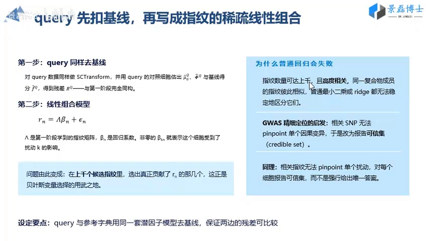

### 5.1 为什么普通回归会失败

query 细胞先做同样的去基线处理，得到残差 $r_n$，然后写成指纹矩阵的稀疏线性组合：

$$
r_n = \Lambda \beta_n + \varepsilon_n
$$

$\Lambda$ 是第一阶段学到的指纹矩阵，$\beta_n$ 是回归系数，非零的 $\beta_{nk}$ 表示这个细胞受到了扰动 $k$ 的影响。问题在于：**候选指纹数量可达上千个，而且彼此高度相关**——同一个蛋白复合物成员之间的指纹尤其相似。这种情况下，普通最小二乘或岭回归都无法稳定地区分它们 [【跳转到 21:52】](https://www.bilibili.com/video/BV1gpnG6BE8c/?t=1312)。

讲者在这里做了一个很漂亮的类比：GWAS 精细定位（fine-mapping）里，高度相关的 SNP 无法 pinpoint 到单个因果变异，于是改为**报告可信集（credible set）**。同样的道理，相关的指纹无法 pinpoint 到单个扰动，那就对每个细胞报告一个可信集，而不是强行给出唯一答案。

### 5.2 SuSiE：把「选哪个指纹」的不确定性显式保留下来

具体工具是从 GWAS 工具改造来的 SuSiE（Sum of Single Effects）。它的核心想法是：把系数写成 $L$ 个单效应的求和，

$$
\beta_n = \sum_{l=1}^{L} \beta_{nl}, \qquad \beta_{nl} = \gamma_l b_l
$$

每个单效应 $\beta_{nl}$ 只允许一个非零条目，$\gamma_l$ 决定第 $l$ 个效应选中哪个指纹；用 IBSS 算法逐个拟合单效应，默认 $L = 10$。直观理解：**每个单效应对应一份扰动贡献，不确定性体现在「哪个指纹拿到非零条目」的后验概率上** [【跳转到 23:11】](https://www.bilibili.com/video/BV1gpnG6BE8c/?t=1391)。

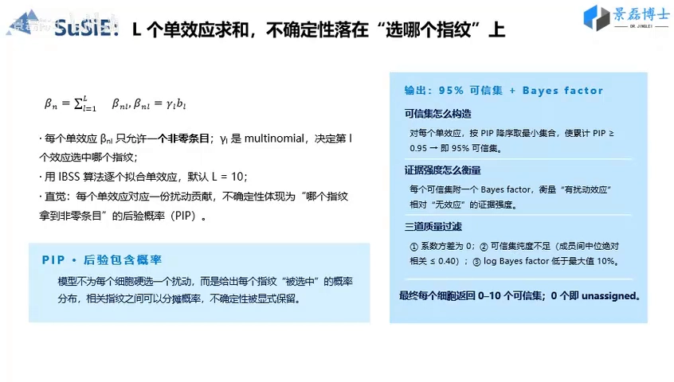

输出有三层，每一层都在回答一个不同的问题：

1. **95% 可信集**：对每个单效应按 PIP（后验包含概率）降序取最小集合，使累计 PIP 达到 0.95。讲者用「嫌疑值」来打比方——把每个指纹的嫌疑值从高到低排序，累加到 95% 就停下，后面的不再考虑。
2. **Bayes factor**：每个可信集附一个证据强度分数，回答的是「**这个细胞到底有没有受到扰动**」，而不是「受了哪种扰动」。
3. **三道质量过滤**：系数方差为 0 的不要；可信集内部成员彼此太像（中位相对相关 $\ge 0.40$）的不要；log Bayes factor 低于最大值 10% 的不要。最终每个细胞返回 0 到 10 个可信集，**0 个就标记为 unassigned**。

第 3 点最值得注意：这套方法**允许说「对不上」**。讲者说，如果输出为零的细胞太多，反过来提示你的扰动集可能不理想，要换一个扰动集训练的库 [【跳转到 25:16】](https://www.bilibili.com/video/BV1gpnG6BE8c/?t=1516)。这是一个很健康的范式信号——**能报「无结论」的方法，比强行给每个细胞贴标签的方法更接近科学**。

### 5.3 为单细胞数据打的三个补丁

把 GWAS 工具搬到单细胞上，要处理三个单细胞特有的坑 [【跳转到 27:45】](https://www.bilibili.com/video/BV1gpnG6BE8c/?t=1665)：

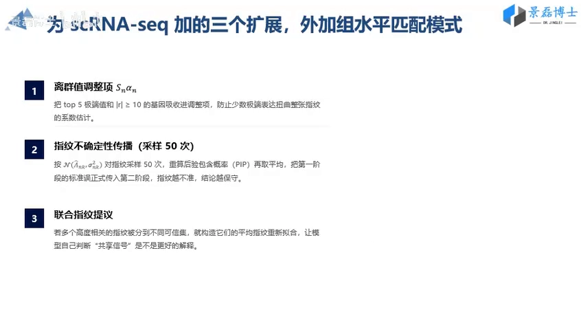

- **离群值调整项**：把 top 5 极值基因和 $|t| \ge 10$ 的基因吸收进调整项，防止少数极端表达扭曲整个指纹的系数估计。
- **指纹不确定性传播（采样 50 次）**：按 $\mathcal{N}(\hat\lambda_{nk}, \hat\sigma_{nk}^2)$ 对指纹采样 50 次，重算 PIP 再取平均，把第一阶段的标准误正式传入第二阶段。讲者的总结很精炼：**指纹越不准，结论越保守**。
- **联合指纹提议**：若多个高度相关的指纹被分到不同可信集，就构造它们的平均指纹重新拟合，让模型自己判断「共享信号」是不是更好的解释。

## 六、验证：从「近亲扰动」一路测到全基因组与跨细胞类型

一个把观测数据映射到因果字典的方法，最怕的批评是「你只是在自己熟悉的场景里找到了答案」。讲者的讲解顺序恰好就是作者设计的四层验证，层层加码。

### 6.1 第一层：近亲扰动能不能分开

第一个测试用的是 CPA-Perturb-seq：CRISPRi 分别敲低 42 个与 RNA 切割和多聚腺苷酸化（CPA）相关的基因，共 14 万个单细胞。关键在于，这 42 个靶基因很多属于同一个蛋白复合物（比如 CFIm、CPSF、CSTF、PAF 等），**敲低不同成员的转录组后果非常相似**——这是最苛刻的工况：如果方法只能区分「差异很大」的扰动，那它在这里必然失败。

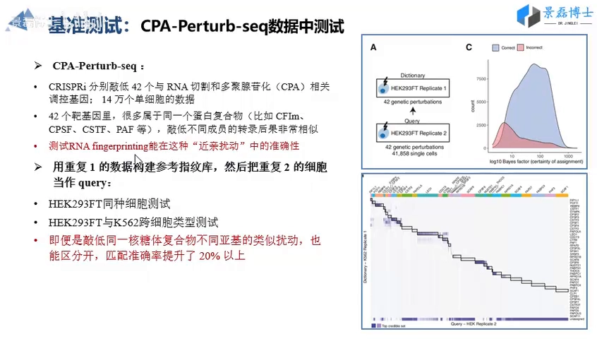

实验设计是**同种细胞两次重复之间**做训练与验证（HEK293FT 重复 1 建库、重复 2 当 query），再加一组 **HEK293FT 与 K562 的跨细胞系验证**。结论是：即便是敲低同一核糖体复合物的不同亚基这种类似扰动，也能被区分开，匹配准确率提高了 20% 以上 [【跳转到 31:45】](https://www.bilibili.com/video/BV1gpnG6BE8c/?t=1905)。

作者还补了一刀更狠的验证：把强效应基因剥离掉——有些基因被扰动后响应极其剧烈，可能主导整个匹配——先不看这些基因的数据，看指纹还能不能有效匹配。结果准确率依然很高，说明**这套方法依赖的不是少数强信号，而是扰动相关的、特异性的稳健信号**。

### 6.2 第二层：组合扰动能不能被拆开

真实生物学里，很多细胞状态不是「一个扰动说了算」，而是多个扰动共同作用的结果。于是作者用 CaRPool-seq 做测试：在一个 CRISPR 双 gRNA 载体上同时表达两个基因的 gRNA，感染的细胞可以同时被破坏两个基因。

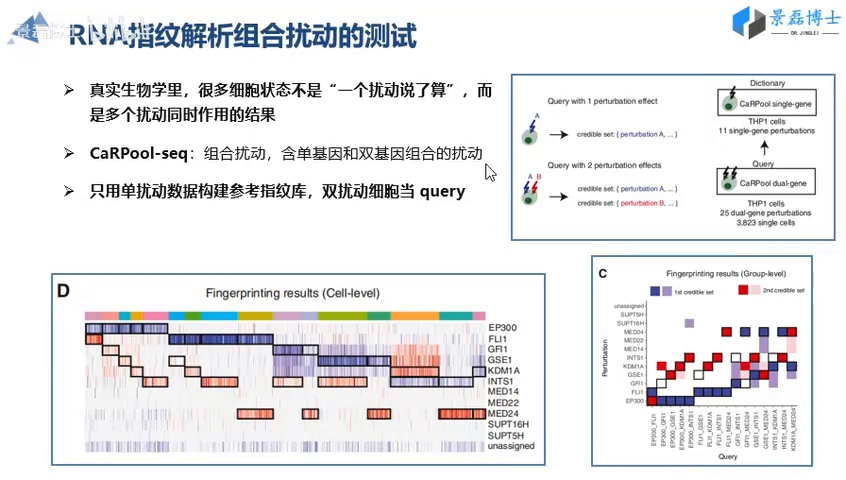

注意这里的巧妙之处：作者**不是**想做组合扰动的图谱，而是利用「我很清楚扰动条件是什么」这一点，把双扰动细胞当作 query，看用单基因扰动建的字典能不能把它解出来。结论是准确率超过 85% [【跳转到 33:48】](https://www.bilibili.com/video/BV1gpnG6BE8c/?t=2028)。这意味着：**对于双基因共同决定的细胞行为，基于单基因扰动数据也能解析**。

### 6.3 第三层：全基因组尺度与跨数据集迁移

接下来是规模测试。用的是 K562 细胞的全基因组 Perturb-seq 数据集，策略是**交叉数据集验证**：一个数据集提供扰动数据构建参考指纹库，另一个**独立数据集**里的 query 细胞去匹配。

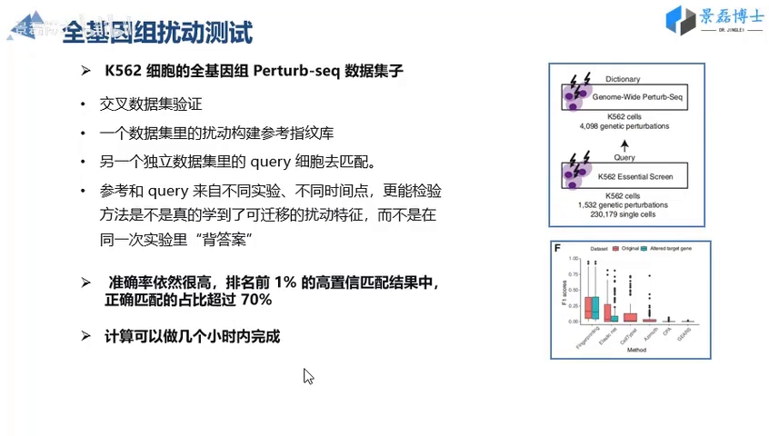

讲者特别点出这个设计的意义：参考和 query 来自不同实验、不同时间点，**更能检验方法是不是真正学到了可迁移的扰动特征，而不是在同一次实验里「找答案」「背答案」**。结果准确率依然很高：排名前 1% 的高置信匹配里，正确匹配占比超过 70%；全基因组规模的扰动库分析几个小时就能跑完；横向比较中，RNA fingerprinting 的 F1 score 也是最高的 [【跳转到 36:05】](https://www.bilibili.com/video/BV1gpnG6BE8c/?t=2165)。

### 6.4 第四层：跨细胞类型能不能迁移，并给出新发现

最后一层是跨细胞类型。作者的测试场景是寻找 p53 的「上下文特异性调控因子」。背景知识：核糖体应激状态下细胞会激活 p53 通路；传统认知是核糖体蛋白 RPL5 和 RPL11 与 5S rRNA 结合形成 5S-RNP 复合物，这个复合物抓住 MDM2，阻止它降解 p53，从而让 p53 稳定下来、启动下游响应。

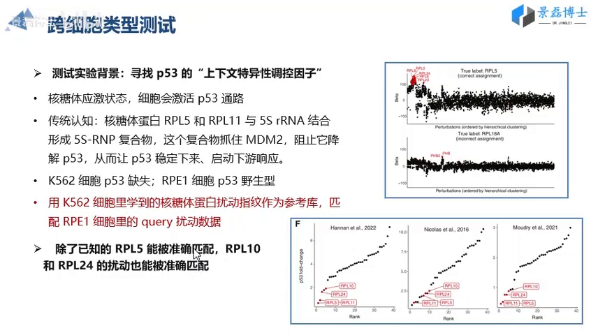

设计是：K562 是 p53 缺失的，RPE1 是 p53 野生型；用 K562 里学到的核糖体蛋白扰动指纹当参考库，去匹配 RPE1 里的 query 细胞。结果除了已知的 RPL5 能准确匹配，**RPL10 和 RPL24 也被准确匹配进来**，而且在另外几个独立研究的数据里都能复现 [【跳转到 38:40】](https://www.bilibili.com/video/BV1gpnG6BE8c/?t=2320)。

这一条的意义超出了「方法有效」：它说明这套范式不仅能解释已知现象，还能**倒推出来一个之前没在湿实验里被发现的、p53 对核糖体应激响应的新亚基**。这正是「扰动 → 响应」映射作为一种知识资产的价值。

## 七、同一套框架还能回答药物机制与体内因果问题

### 7.1 药物扰动：不仅知道「打中了谁」，还能知道「误伤了谁」

药物扰动测试的逻辑是把处理过的细胞当作 query，去匹配全基因组遗传扰动的参考字典——**用药物处理之后转录组的后果去「对号入座」，看是哪些遗传扰动指纹能解释这个后果**。

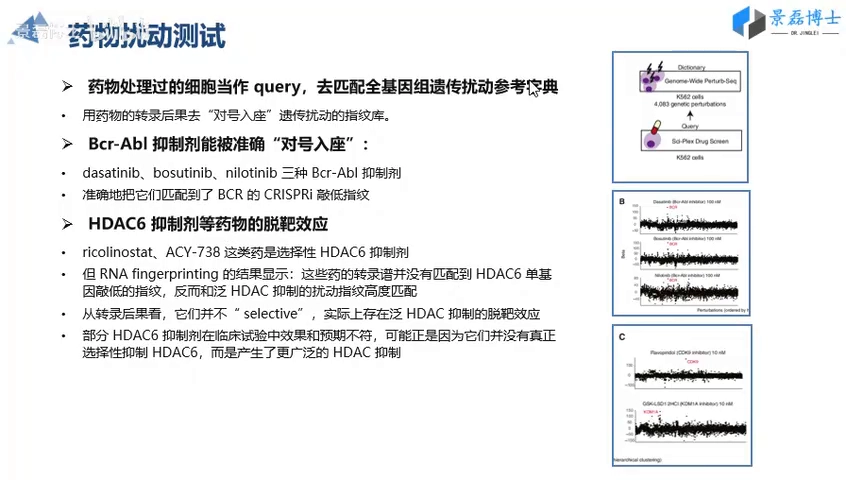

两个结果值得记住：

- **正向验证**：dasatinib、bosutinib、nilotinib 三种 Bcr-Abl 抑制剂，都被准确匹配到 BCR 的 CRISPR 敲低指纹——药物确实打中了它声称的靶点。
- **反向揭示**：ricolinostat、ACY-738 这类号称选择性 HDAC6 抑制剂，其转录组并没有匹配到 HDAC6 单基因敲低的指纹，反而和泛 HDAC 抑制的扰动指纹高度匹配。从转录组后果看，它们并不「selective」，存在明显的泛 HDAC 脱靶效应 [【跳转到 41:38】](https://www.bilibili.com/video/BV1gpnG6BE8c/?t=2498)。

讲者由此给出一个很实用的判断：部分 HDAC6 抑制剂在临床试验中效果和预期不符，可能正是因为它们并没有真正选择性抑制 HDAC6，而是产生了更广泛的 HDAC 抑制。**这就是「扰动特异」这个假设被数据检验的典型场景**——off-target 不是一句免责声明，而是可以被量化、被指认的。

### 7.2 体内场景：从「B 细胞有异质性」到「哪些细胞因子在驱动它」

最后一个验证回到体内。作者用的是小鼠二次流感感染的模型，想回答的是免疫细胞（特别是 B 细胞）对细胞因子的响应。

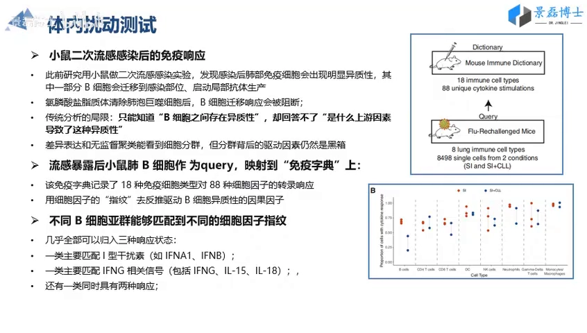

先看传统分析的局限：此前研究发现二次感染后肺部免疫细胞出现明显异质性，其中一部分 B 细胞会迁移到感染部位、启动局部抗体生产；用氯磷酸盐脂质体清除肺泡巨噬细胞后，B 细胞迁移会被阻断。但**传统分析只能知道「B 细胞之间存在异质性」，回答不了「是什么上游因素导致了这种异质性」**——差异表达和无监督聚类能看到细胞群，但分群背后的驱动因素仍然是黑箱 [【跳转到 44:58】](https://www.bilibili.com/video/BV1gpnG6BE8c/?t=2698)。

作者的做法是把免疫字典当作参考库（18 种免疫细胞类型 × 88 种细胞因子刺激），再把流感二次感染后小鼠的肺 B 细胞作为 query 映射上去。结果这些异质性 B 细胞几乎可以归入三种响应状态：

- 一类主要匹配 I 型干扰素（如 IFNA1、IFNB）信号；
- 一类主要匹配 IFNG 相关信号（包括 IFNG、IL-15、IL-18）；
- 还有一类同时具有两种响应。

也就是说，驱动 B 细胞迁移与局部抗体产生的刺激因子，很可能就是不同的干扰素信号在起作用。**工具不仅描述了异质性，还回答了是哪些细胞因子在驱动异质性**——这是观察性分析给不出的答案。

## 八、把范式放回地图：它与虚拟细胞互补，也能迁移到别的组学

讲者最后跳出这篇文章，谈这套范式的定位。这一段对建立整章的概念框架特别有用。

### 8.1 本质：把观测数据映射到因果参考上

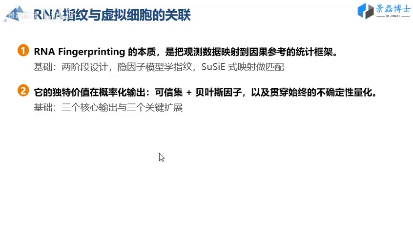

- **本质**：把观测数据映射到因果参考的统计框架上。两个阶段的设计——潜因子模型学指纹、SuSiE 式映射做匹配——分别对应「提炼因果原料」和「把原料用在观测数据上」。
- **独特价值**：概率化输出。可信集、贝叶斯因子，以及贯穿始终的不确定性量化，这三个核心输出配合三个关键扩展（离群值调整、不确定性传播、联合指纹），才让它在单细胞这种噪声极大的数据上站得住。
- **与虚拟细胞的关系是互补而非竞争**：虚拟细胞需要因果数据来学习，也需要可解释的输出来验证。讲者提出一个值得思考的走向——如果虚拟细胞最终演化成能模拟任意细胞对任意扰动响应的「世界模型」，那么因果指纹库很可能成为它的核心知识表示层；但它不替代深度模型，只是为深度模型提供一个可解释的因果框架。

### 8.2 迁移：两阶段框架依赖的是结构，不是转录组本身

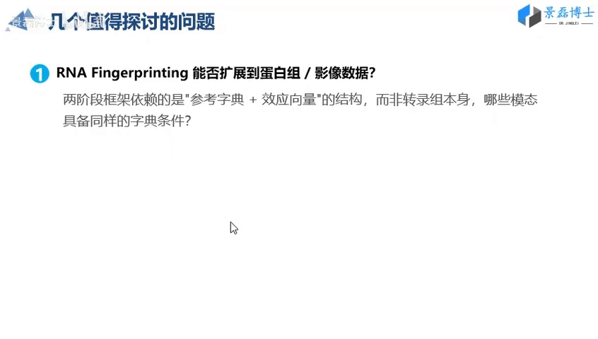

讲者指出，两阶段框架真正依赖的是「**参考字典 + 效应响应向量**」这个结构，而不是转录组本身。所以理论上，蛋白质组、代谢组都可以做类似的扰动指纹；影像组学或许也可以——只要扰动条件确定，扰动之后的变化足够明确，就能构成一本字典 [【跳转到 47:57】](https://www.bilibili.com/video/BV1gpnG6BE8c/?t=2877)。

他还点出了与药物重定位（drug repurposing）类方法的关键差异：**输出的形式不同**。RNA fingerprinting 输出的是概率化的可信集加证据强度，而不是一个相似度排名。以及一个尚未解决的问题：**扰动字典不完整时怎么办**？指纹库的覆盖度决定可信集的质量，字典缺失的区域，模型会默认沉默，还是胡乱给出一个结果？这仍有待探讨。

## 小结

- **观察性数据答「是什么」，扰动数据答「为什么」**。单细胞图谱能描绘状态，但「扰动 → 响应」这条规则无法从观测数据本身读出来，中间缺一座桥；扰动组学的价值就是补上这座桥。
- **一次 perturbation 需要三个要素**：可指认的干预、可比的对照、可测量的读出。缺任何一个，差异都无法归因。
- **扰动有四类**：遗传扰动（KO / CRISPRi / CRISPRa / 过表达 / 点突变）、化学扰动（药物 + 剂量 + 时间）、环境扰动（细胞因子、缺氧、基质等）、组合扰动（多基因、基因 × 药物）。规模化之后，它们被组织成一张「扰动 × 响应」的矩阵，这就是扰动组学。
- **范式的三个前提假设**：扰动有效、扰动特异、响应可归因。RNA fingerprinting 的五个难点（数据脏、响应强弱悬殊、扰动相似、多扰动叠加、匹配不确定）本质上都是这三个假设被现实削弱的地方。
- **方法上的两个关键设计**：先用潜因子模型把「基线 + 基线异质性 + 扰动指纹」拆开，只保留最后一项；再用 SuSiE 把匹配写成稀疏线性组合，输出 95% 可信集而不是唯一答案。
- **允许说「对不上」是这套范式的优点**：可信集为 0 的细胞被标记为 unassigned，反过来还能提示扰动字典不够理想。
- **验证是层层加码的**：近亲扰动（同一复合物不同亚基）→ 组合扰动（双基因）→ 全基因组跨数据集 → 跨细胞类型（并给出 RPL10 / RPL24 的新发现）。
- **同一框架能横跨遗传与化学扰动**：药物既能验证「打中靶点」，也能揭示「误伤靶点」，这正是 off-target 假设被数据检验的地方。
- **范式的位置**：3.1 讲原理（本节），3.2 讲手段，3.3 讲实验设计，3.4 讲响应分析；第 4 章的扰动数据资源、第 5 章的预测模型，都建立在本节这套「字典 + 匹配」的范式之上。

## 关键术语速查

| 术语 | 一句话解释 |
| --- | --- |
| perturbation（扰动） | 在受控条件下对细胞施加一个可指认的改变，并测量由此产生的差异 |
| perturbation omics（扰动组学） | 把大量扰动 × 大量细胞组织成一张响应矩阵的研究范式 |
| readout（读出） | 用来衡量扰动后果的测量层，本文是单细胞转录组 |
| perturbation dictionary（扰动字典） | 把每个扰动对应的特异性转录组变化整理成的参考库 |
| perturbation fingerprint（扰动指纹） | 扣掉基线异质性与噪声后，纯粹由某个扰动造成的表达变化模式 |
| baseline / latent factor（基线 / 潜因子） | 细胞周期、分化状态等与扰动无关的共有变异，需要先扣掉 |
| query cell（查询细胞） | 待解释的单细胞，要与扰动字典做匹配 |
| credible set（可信集） | 以概率形式给出的候选扰动集合，累计后验包含概率达 95% |
| PIP（后验包含概率） | 某个指纹「被选中」的概率，讲者称之为「嫌疑值」 |
| Bayes factor（贝叶斯因子） | 衡量「有扰动效应」相对「无扰动效应」的证据强度 |
| off-target（脱靶） | 扰动误伤了非目标基因或蛋白，会污染因果结论 |
| CRISPRi | 用失活 Cas9 抑制转录，实现基因敲低（knockdown） |
| pooled screen（混合筛选） | 把大量扰动混在一个体系里筛，读出通常是生长/存活，需单细胞读出才能看转录组 |
| functional genomics（功能基因组学） | 系统性地改变基因并观察表型，以推断基因功能 |
