# 从死活到转录组：单细胞读出如何把CRISPR筛选变成扰动组学

> 视频来源：[聊聊 CRISPR screen 和单细胞测序的王炸组合](https://www.bilibili.com/video/BV1yJ4m1G7ez/)（Bilibili · 临渊啸歌）｜时长约 89 分钟
> 导读：这是一场直播式的文献串讲，主线是**「把 CRISPR 筛选的读出从死活换成转录组」这件事到底改变了什么**。本文沿着讲者的思路走完一条完整的证据链：pooled screen 为什么只能看死活、阵列筛选为什么补不上通量、Perturb-seq / CROP-seq / TROPIC / direct-capture Perturb-seq 四代方案各自解决了哪个具体障碍、以及单细胞读出让扰动组学多问出了哪些问题。CRISPR 的分子机制只保留理解「读出局限」所必需的部分（技术原理属 3.2 节，建库细节属 3.3 节）。

## 本讲要解决的核心问题（SCQA）

**背景**：CRISPR 筛选（CRISPR screen）是功能基因组学的主力工具：把成千上万个 guide RNA 混成一个 pool 打进细胞群，施加筛选压力，然后看哪些 guide 变多了、哪些变少了，从而找出影响某个表型的基因。这套流程已经非常成熟，成本也不高。

**冲突**：它的读出极其贫瘠——**只有「活」和「死」两个取值**。所有能读出信息的地方，都被压缩成一次富集统计。于是凡是不能变成死活表型的生物学过程（药物不杀死细胞、某个通路只是把一批基因上调下调），这套方法就完全读不出来。讲者把这句话说得非常直白：传统 CRISPR 筛选「一定要死要活，必须杀死一些细胞、由活的细胞做侧差，然后你才能区分哪个基因可能对这个表型有影响」[【跳转到 27:09】](https://www.bilibili.com/video/BV1yJ4m1G7ez/?t=1629)。

**疑问**：既然我们已经有单细胞转录组测序，能一个细胞一个细胞地读出全转录本，那能不能把「我打进这个细胞的是哪条 guide」也一起测出来？如果能，扰动和响应就落在同一个细胞上，读出就从一比特的死活变成几万个基因的表达向量。

**回答（中心思想）**：**能，而且这一步正是「扰动组学（perturbation omics）」的起点。** 单细胞读出的价值不在于「测得更细」，而在于它把一次扰动实验的三要素——可指认的干预、可比的对照、可测量的读出——第一次同时装进了同一个反应单元（一个液滴、一个细胞）里。于是扰动不再只是一次「筛」，而成为一张可以反复查询的「扰动 × 响应」矩阵。本文要讲的就是这张矩阵是怎么被一代代载体设计抠出来的，以及每一个设计选择背后必须付出的代价。

## 一、CRISPR 筛选的读出只有一个比特：活或死

### 1.1 先复习机制，但只复习到「为什么测不出表达量」为止

讲者开场用几分钟把 CRISPR 的分子机制过了一遍，这段复习的目的很明确：**推出一个关于「读出」的结论**，而不是讲技术本身。

- **guide 的来历**：天然的 CRISPR 系统里是 crRNA 和 tracrRNA 两段 RNA；有人做了个巧妙改造，在中间加一个 linker，把两段连成一条 **sgRNA（single-guide RNA）**，从此变成一个可编程的工具 [【跳转到 00:34】](https://www.bilibili.com/video/BV1yJ4m1G7ez/?t=34)。
- **切割怎么发生**：Cas9 有两个核酸酶结构域，**HNH 切与 guide 配对的那条链，RuvC 切非配对链**。guide 上那 20 nt 负责与靶位点配对；Cas9 识别靶点旁边的 **PAM（NGG）**，在 PAM 上游约 3 个碱基处形成高频切割位点 [【跳转到 01:24】](https://www.bilibili.com/video/BV1yJ4m1G7ez/?t=84)。
- **切完为什么等于敲除**：双链断裂后细胞走两条修复路径——有同源模板时走 **HDR（同源定向修复）**，没有模板时走 **NHEJ（非同源末端连接）**，后者会在断口处随机插入或缺失碱基（indel），造成移码，翻译出来的蛋白就废了 [【跳转到 02:46】](https://www.bilibili.com/video/BV1yJ4m1G7ez/?t=166)。

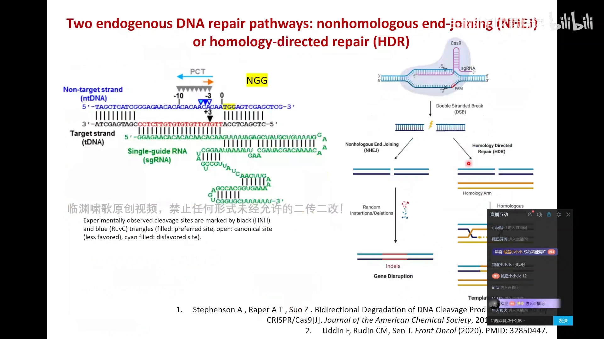

### 1.2 关键推论：敲除在 mRNA 层面「看不见」

机制讲完，讲者立刻抛出全篇第一个、也是最关键的技术推论：

> CRISPR 其实只是在目的基因座位上插入或缺失了一定的序列，但我们通过 mRNA 这种方式去检测，是检测不出它表达丰度的变化的。[【跳转到 04:01】](https://www.bilibili.com/video/BV1yJ4m1G7ez/?t=241)

这句话值得展开，因为它是后面所有方法学创新的源头。一个基因被敲除，mRNA 的**数量**可能几乎不变（转录还在发生，只是序列里多了或少了一个碱基），变的是**序列的正确性**。而 RT-qPCR 这类方法测的是「这个基因的转录本有多少」，不是「这个转录本序列对不对」。所以：

- **不能用 RT-PCR 验证敲除效率**，必须去测基因组那个位点到底改成了什么样子；
- 推论到筛选层面就更严重：一个 pool 里几千个细胞混在一起，你既没法逐个区分，也没法逐个验证，**能作为分组依据的只剩「这个细胞还活着吗」** [【跳转到 05:11】](https://www.bilibili.com/video/BV1yJ4m1G7ez/?t=311)。

### 1.3 pooled screen 的完整工作流，以及它把信息丢在哪一步

讲者给了这张标准流程图，值得对着它数一遍「信息是在哪一步被压缩掉的」：

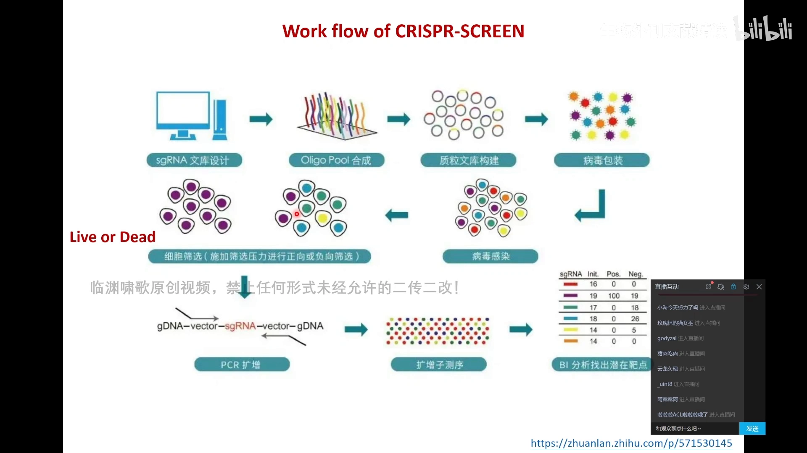

流程是：**sgRNA 文库设计 → oligo pool 合成 → 质粒文库构建 → 病毒包装 → 病毒感染 → 施加筛选压力（正向或负向）→ PCR 扩增 guide 区 → 扩增子测序 → 生信分析找富集/缺失的 guide**。

信息丢失发生在「施加筛选压力」这一步之后：此时每个细胞里到底敲了哪个基因**仍然存在**（guide 序列还在基因组里），但你没有办法把它和「这个细胞的转录组长什么样」对应起来。你能拿到的只是一个**群体层面的计数**：某个 guide 在筛选后变多了还是变少了。

于是这套方法的适用边界就由表型本身决定了：

| 表型类型 | 能否用死活读出 | 原因 |
| --- | --- | --- |
| 细胞增殖/存活相关（如必需基因） | 可以 | 敲掉就死，活细胞里自然富集不到这条 guide |
| 药物敏感性 | 部分可以 | 前提是药物真的杀死了一部分细胞 |
| 通路调控（上调/下调一批基因） | 不可以 | 细胞不死，没有可富集的表型 |
| 细胞状态转换（激活、分化） | 不可以 | 状态变了但细胞还活着，死活读出看不见 |

讲者举的例子很具体：某些细胞过程是通过基因调控某些基因上调下调来实现的，想找到调控这个过程的基因，「你很难用 CRISPR 筛选去实现，因为它不死，你没办法实现细胞的富集」[【跳转到 27:34】](https://www.bilibili.com/video/BV1yJ4m1G7ez/?t=1654)。

## 二、阵列筛选补上了转录组读出，却把通量还了回去

在单细胞方案出现之前，人们确实试过一条折中路：**阵列 CRISPR 筛选（arrayed CRISPR screen）**。做法是把孔板当作反应单元，**一个孔只放一条 guide**，于是「哪个孔对应哪个扰动」是已知的；每个孔单独做 CRISPR 加 RNA-seq，就能得到「敲掉这个基因之后，全转录本怎么变」的一张热图 [【跳转到 29:59】](https://www.bilibili.com/video/BV1yJ4m1G7ez/?t=1799)。

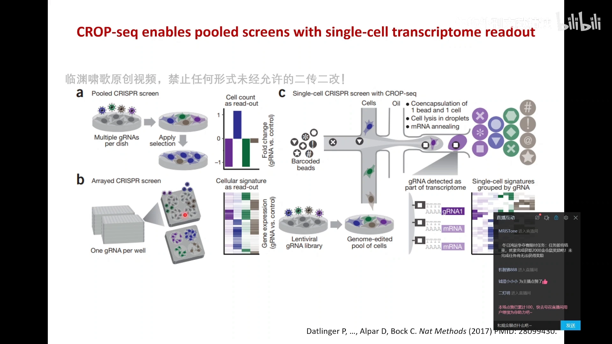

这张图把三代范式的取舍摆得很清楚：

- **pooled screen（图 a）**：读出是 `Cell count as read-out`，纵轴是相对对照的 fold change。通量极高，信息极低。
- **arrayed screen（图 b）**：读出是 `Cellular signature as read-out`，能拿到表达谱。但代价是「一孔一 guide、一孔一次测序」——讲者的原话是：假如 pool 里有 1000 个基因要去敲，你得多少个板子？「这就导致整个工程变得非常复杂」，「我们自己干实验肯定要累死」[【跳转到 30:24】](https://www.bilibili.com/video/BV1yJ4m1G7ez/?t=1824)。
- **单细胞 CRISPR 筛选（图 c）**：把 guide 打进细胞、用油包水把细胞一个个分开，**每个液滴里既测到细胞的转录本，也测到 guide 的序列**，于是通量和读出同时拿到。

这里可以顺手把「一次扰动」的三要素对齐到这三代范式上，这张表其实是本小节的概念骨架：

| 要素 | pooled screen | arrayed screen | 单细胞读出 |
| --- | --- | --- | --- |
| 可指认的干预 | 有，但只能群体统计 | 有，按孔位指认 | 有，按液滴内的 guide 指认 |
| 可比的对照 | 有（NT guide / 未处理） | 有（对照孔） | 有（同一 pool 里的 NT guide 细胞） |
| 可测量的读出 | 存活/富集计数 | 全转录本 | 全转录本 + guide 身份 |

差别只在第三行，但这一行的变化把前两行的价值都放大了：**对照从「另一个孔」变成了「同一个 pool 里的另一群细胞」**，批次差异被大幅压缩。

## 三、把「哪条 guide」测出来：单细胞读出让扰动第一次可归因

### 3.1 那个关键的念头：guide 本身也是 RNA

讲者把方法学的诞生讲成了一个非常朴素的念头：

> 既然我可以通过单细胞测序知道细胞里整体转录本的变化，那我有没有办法在做单细胞测序的时候把带进去的是哪个 guide 的 RNA 也测出来？这不就配上了吗？[【跳转到 19:06】](https://www.bilibili.com/video/BV1yJ4m1G7ez/?t=1146)

这个念头之所以能成立，是因为单细胞转录组测序的物理结构天然提供了「一对一配对」的机会：细胞和带 barcode 的磁珠被一起包进油包水液滴，一个液滴里的所有转录本共享同一个细胞 barcode。**只要 guide 的序列也在这个液滴里被反转录、被打上同一个 barcode，它就和这个细胞的转录组绑定了。**

### 3.2 但 guide 抓不到，得给它找个「搭车」的位置

第一代方案（**Perturb-seq** 与 **CROP-seq**）的做法是：在 CRISPR 质粒上再加一段**特殊的 barcode 序列**，并提前建立一张「barcode ↔ guide」的对照表；测序时只要读到 barcode，就能反查是哪条 guide [【跳转到 19:56】](https://www.bilibili.com/video/BV1yJ4m1G7ez/?t=1196)。

这里有个容易被忽略的细节，讲者专门解释了：**barcode 不能直接接在 guide 后面**。因为 guide 是一段不翻译的小 RNA，没有 polyA 尾巴，常规的单细胞 3′ 建库根本抓不到它。所以 barcode 必须插在**一个能表达蛋白的转录本中间**——比如 puromycin 抗性基因或者荧光蛋白的 mRNA——这样它才会被反转录、被打上细胞 barcode、被测出来 [【跳转到 20:46】](https://www.bilibili.com/video/BV1yJ4m1G7ez/?t=1246)。

一句话总结这一代方案的逻辑：**用一个「会表达的」转录本当载体，把「不会表达的」guide 身份捎带进转录组。**

### 3.3 范式跃迁在这一步完成

把前面三节连起来看，范式跃迁其实只发生了一次，但它同时改写了三件事：

1. **读出从标量变成向量**：原来每个扰动只对应一个富集倍数，现在对应一个几万维的表达向量。
2. **归因从群体变成单细胞**：原来「这条 guide 富集了」是群体推断，现在「这个细胞敲了哪个基因、它的转录组长什么样」是同一行数据。
3. **实验从一次性变成可复用**：同一批数据，只要换一套「特征基因」当评判标准，就能回答另一个表型问题（这一点在第六章会看到实例）。

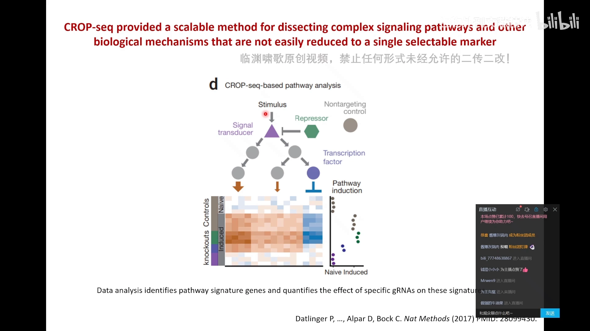

这张图值得提前看一眼，因为它预告了整篇的方法论：一旦读出是转录组，**「表型」就不再是实验者事先设定的一个筛选条件，而是可以从数据里定义出来的一组特征基因**。图里那三个角色——信号传递者（signal transducer）、抑制者（repressor）、转录因子（transcription factor）——敲掉之后在特征基因热图上的表现完全不同，这正是下一章要展开的「预期—验证」逻辑。
## 四、TROPIC：把 guide 塞进被删掉的那 400 bp，用一个转录本同时读出扰动与响应

### 4.1 先看第一代方案的工程代价

Perturb-seq / CROP-seq 有一个非常现实的麻烦：**一个载体要装两个变量**。传统建 CRISPR 文库时只有一个变量——把不同的 guide 插进载体；现在还要再插一段 barcode，而且两者在载体上**并不相邻**，于是「这两个都要单独改造、插进去，然后还要让它们有一个数据库配上」[【跳转到 22:01】](https://www.bilibili.com/video/BV1yJ4m1G7ez/?t=1321)。克隆难度、验证成本都翻倍。

TROPIC 的思路是把两个变量合并成一个：**让 guide 自己变成一段能被 polyA 捕获的转录本的一部分。**

### 4.2 原理：两个启动子、两种转录本，同一个 guide

讲者先把载体结构讲清楚，这是理解 TROPIC 的前提：

- guide 由 **U6 启动子**驱动，U6 是 **RNA 聚合酶 III** 的启动子，转录产物是一段短小的、不带 polyA 的 RNA；
- 筛选标记（puromycin 抗性基因或荧光蛋白）由 **EF-1α 启动子**驱动，EF-1α 是 **RNA 聚合酶 II** 的启动子，转录产物是带 polyA 的 mRNA。

两者本来各行其道。TROPIC 的巧处在于**位置**：慢病毒载体在改造为自抑制（self-inactivating）版本时，3′ LTR 上有一段约 **400 bp** 的序列被删掉了——这段缺失原本是为了让病毒不失控复制，同时也腾出了一块插入空间。把 U6-guide 这一段塞进这个位置，就会出现两种转录本 [【跳转到 24:06】](https://www.bilibili.com/video/BV1yJ4m1G7ez/?t=1446)：

1. 从 **U6** 起转 → 得到正常的 guide RNA，用于基因编辑；
2. 从 **EF-1α** 起转 → Pol II 一路通读下去，把 puromycin 抗性基因**和后面的 U6-guide** 一起转录出来，末尾加上 polyA 尾巴，形成一条**含 guide 序列的 mRNA** [【跳转到 24:31】](https://www.bilibili.com/video/BV1yJ4m1G7ez/?t=1471)。

第二条转录本正是关键：它带 polyA，所以常规的单细胞 3′ 建库能抓到它；抓到它，就等于抓到了 guide 的身份。

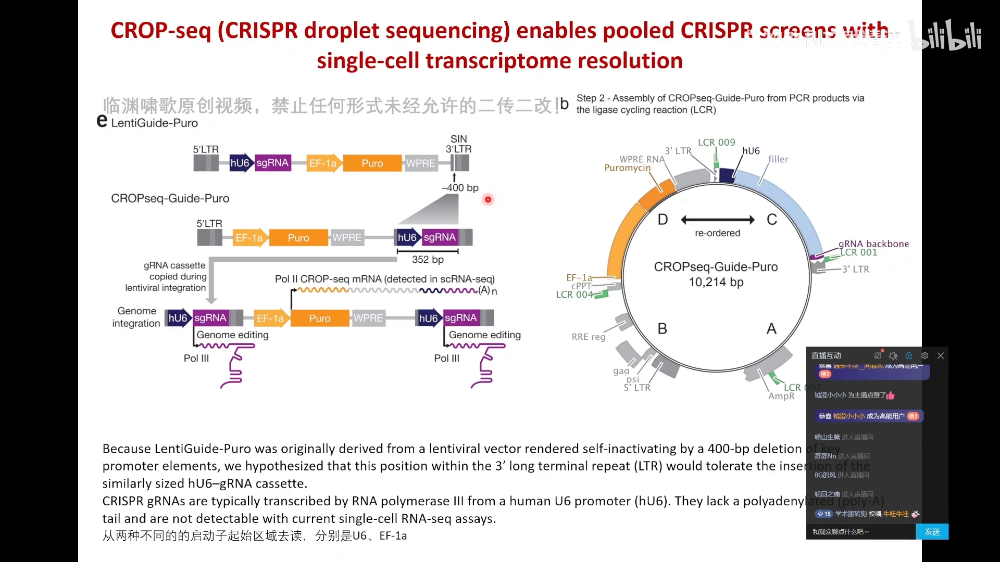

### 4.3 两个必须回答的质疑

这个设计一抛出来，自然有两个疑问，讲者都当场回答了：

**疑问一：把 mRNA 搞得这么长，会不会影响抗性基因的蛋白表达？** 不会。因为翻译遇到**终止密码子**就停了，后面那一堆序列不翻译，所以 puromycin 抗性蛋白照常产生 [【跳转到 25:21】](https://www.bilibili.com/video/BV1yJ4m1G7ez/?t=1521)。这里要区分两个层次：**蛋白层面**不受影响，**转录本层面**被拉长了——而拉长恰恰是我们想要的。

**疑问二：这是不是在一个质粒上放了两个 guide？** 不是。质粒是一个环状分子，pol II 通读只是把下游已有的 U6-guide 区段**转录进去**，基因组里仍然只有一份 guide 序列 [【跳转到 25:46】](https://www.bilibili.com/video/BV1yJ4m1G7ez/?t=1546)。

于是 TROPIC 用「一个插入位点」换掉了「barcode + guide 两个变量」，建库难度回到传统 CRISPR 文库的水平。这就是讲者说自己「比较喜欢这个原理」的原因 [【跳转到 28:24】](https://www.bilibili.com/video/BV1yJ4m1G7ez/?t=1704)。

### 4.4 代价：插入片段不能太长

任何设计都有代价，TROPIC 的代价是**空间被卡死**。因为插入位点只有那 400 bp，guide 太长就会破坏慢病毒原有功能。作者做了滴度实验：短 guide 时，传统慢病毒骨架和 TROPIC 骨架没有差异；一旦在 guide 中间塞进长片段，**TROPIC 的病毒滴度基本掉到零** [【跳转到 35:44】](https://www.bilibili.com/video/BV1yJ4m1G7ez/?t=2144)。

讲者的判断是「这不是一个很致命的问题」，理由也很实在：常规 CRISPR 筛选用的就是 20 nt 的 guide，很少需要长 guide；但如果实验确实需要长序列靶向，那这个方法在包病毒这一步就过不去，不要用 [【跳转到 36:34】](https://www.bilibili.com/video/BV1yJ4m1G7ez/?t=2194)。

## 五、验证一代新读出：先证明「扰动是有效的」，再证明「读出是公平的」

方法学文章的第一要务不是报新发现，而是证明**新读出没有把老能力弄丢**。这篇 2017 年的 TROPIC 文章（讲者给了 PMID，可自行检索原文）做的验证可以分成三层，这三层其实正好对应扰动范式的三个前提假设。

### 5.1 第一层：编辑效率没掉——「扰动真的发生了」

作者用 DNMT3B、MBD1 等基因，在六种不同细胞系里比较传统 CRISPR 与 TROPIC 的**基因编辑效率**（即真正发生切割、发生 indel 编辑的细胞比例）[【跳转到 37:24】](https://www.bilibili.com/video/BV1yJ4m1G7ez/?t=2244)：

| 指标 | 传统 CRISPR | TROPIC |
| --- | --- | --- |
| 平均编辑率 | 95.5% | 90.5% |
| 2/3 移码速率 | 60.2% | 62.4% |

5 个百分点的编辑率损失，换来「能直接高通量读出全转录本」，讲者的评价是「这也不是很大的问题」[【跳转到 38:14】](https://www.bilibili.com/video/BV1yJ4m1G7ez/?t=2294)。文章还用了另一个公认方法 **T7 核酸内切酶** assay 交叉验证，说明作者不是「随便拿一个符合预期的结果就讲讲」[【跳转到 38:51】](https://www.bilibili.com/video/BV1yJ4m1G7ez/?t=2331)。

### 5.2 第二层：三种 guide 一比一混合，测出来还是一比一

作者把三个基因的 guide 库按 1:1:1 混成一个 pool 做单细胞测序，然后看 guide 信号在基因组坐标上的分布。图呈「山形」——讲者顺带解释了原因：测序读长有限，离 guide 太远的读段匹配不上（灰色部分是未匹配），越靠近 guide 序列信号越强 [【跳转到 40:30】](https://www.bilibili.com/video/BV1yJ4m1G7ez/?t=2430)。

但作者真正想强调的不是山形，而是**三条曲线的峰高基本相等**：混进去是一比一，测出来也是一比一。这一点直接决定下游能不能做富集分析——如果混合比例和测序比例不一致，「因为它本身基数不一样」，富集结果就会被系统偏差污染 [【跳转到 41:20】](https://www.bilibili.com/video/BV1yJ4m1G7ez/?t=2480)。

### 5.3 第三层：测序深度与 guide 检出率的关系——一条必须记住的实验设计约束

作者扫了一批测序条件（不同细胞量、每个细胞测到的基因数），得到两条同时上升的曲线：

- 随着**每个细胞测序深度增加**，测到**单一 guide** 的细胞比例上升 [【跳转到 42:10】](https://www.bilibili.com/video/BV1yJ4m1G7ez/?t=2530)；
- 同时，测到**多个 guide** 的细胞比例也上升。

第二条的原因是**双细胞（doublet）**：油包水过程中本来就有一定概率两个细胞进同一个液滴；测得浅时第二条 guide 测不到，测深了就都测出来了 [【跳转到 43:00】](https://www.bilibili.com/video/BV1yJ4m1G7ez/?t=2580)。这类细胞在分析时直接剔除即可，占比不大；但第一条结论是硬约束：**如果一群细胞里只有 10% 测到了 guide，剩下 90% 的数据是配不上扰动的，等于白测** [【跳转到 42:35】](https://www.bilibili.com/video/BV1yJ4m1G7ez/?t=2555)。

这就是「读出」这一层带来的新成本：**转录组读出要求你为 guide 分配足够的测序深度，而这部分深度对表达定量几乎无用。** 这是后面 3.3 节实验设计要正面处理的问题。

## 六、读出从「死活」升级为「打分」：165 个特征基因把表型变成连续量

验证完载体，文章做了一个真正的概念验证（proof-of-concept）筛选，讲者在这一段花了将近 20 分钟，因为**这是「范式跃迁」最有说服力的实例**。

### 6.1 实验设计：一个刻意做小的库 + 两个处理条件

- **细胞**：Jurkat，人 T 淋巴细胞系，源自 T 细胞白血病患者外周血，可以被激活，常用来模拟激活的 T 细胞 [【跳转到 44:11】](https://www.bilibili.com/video/BV1yJ4m1G7ez/?t=2651)。
- **库**：87 条靶向 TCR 相关基因的 guide（对应 6 个 TCR 信号高阶调控因子 + 23 个转录因子）、20 条**非靶向（non-targeting, NT）**guide 作阴性对照、9 条**必需基因**guide 作阳性对照 [【跳转到 44:36】](https://www.bilibili.com/video/BV1yJ4m1G7ez/?t=2676)。
- **两个条件**：一组血清饥饿保持 naive；一组在血清饥饿下用 **anti-CD3 + anti-CD28** 刺激激活 [【跳转到 45:26】](https://www.bilibili.com/video/BV1yJ4m1G7ez/?t=2726)。

血清饥饿这一步不是走过场。讲者解释了它的作用：血清里有很多细胞因子，会干扰细胞本底状态；先饥饿，把血清因子的影响排除掉，剩下的变化才能归因于 CD3/CD28 激活 [【跳转到 45:51】](https://www.bilibili.com/video/BV1yJ4m1G7ez/?t=2751)。**这就是「可比的对照」在实验层面的具体做法**——不是加个对照孔就完事，而是要把混杂因素先按住。

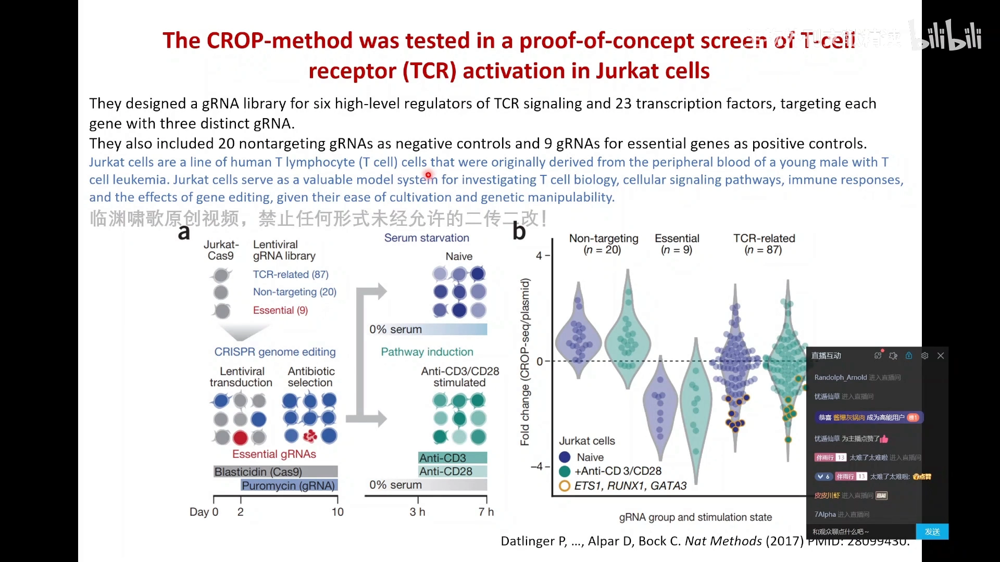

### 6.2 第一张图：还是老读出，但已经能看出新东西

图 b 纵轴是每条 guide 相对质粒的 fold change，横轴按 guide 分组、并按处理状态拆开。读法很直观：

- **必需基因**：不管哪一组都掉下去——敲掉就死，符合预期；
- **非靶向对照**：两组都没有明显偏移——不敲任何基因，细胞不受影响；
- **TCR 相关基因里的 ETS1、RUNX1、GATA3**（图里圈出的点）：在两组里都表现为**负富集**，即敲除后细胞变少了。

讲者对最后一条的解读是：这几个基因「可能对不管是激活还是不激活、对细胞的增殖都有一定的抑制作用」[【跳转到 47:06】](https://www.bilibili.com/video/BV1yJ4m1G7ez/?t=2826)。注意这里用的还是**老读出（细胞计数）**——也就是说，单细胞方案并不排斥死活读出，它只是**不再被死活读出限制**。

### 6.3 第二张图：成对距离——「同一扰动的细胞应该长得像」

要证明「敲掉同一个基因的细胞，转录组彼此接近」，文章用了**成对距离（pairwise distance）**：对每一对细胞算转录组距离，再按 guide 分组聚合。

结论是：**靶向同一基因的 guide 之间的成对距离，小于不同基因 guide 之间的距离**（p 值分别为 7.30e-17 与 8.38e-11）[【跳转到 47:36】](https://www.bilibili.com/video/BV1yJ4m1G7ez/?t=2856)。换成白话：同一个扰动的细胞，转录组确实更相似——**这说明扰动效应是可重复、可归因的**，而不是噪声。

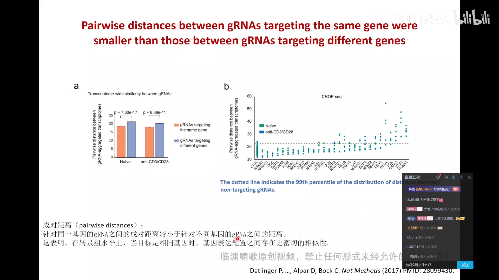

图 b 里那条**虚线**是这套分析的关键：它取的是**非靶向 guide 之间成对距离分布的 99% 分位**。讲者解释得很清楚——即使不敲任何基因，单个细胞之间也有表达差异，这是**背景差异**；把 99 分位当阈值，意味着「比这个范围变化更大的」才算真的有扰动效应 [【跳转到 49:41】](https://www.bilibili.com/video/BV1yJ4m1G7ez/?t=2981)。

这一步其实就是**把「可归因」这件事量化**：先量出没有扰动时的噪声底，再看扰动信号能不能超过它。图 b 里跑在虚线上方最远的，是 ETS1、RUNX1、LCK、GATA3 这些基因——它们对整体转录组的扰动最大 [【跳转到 50:06】](https://www.bilibili.com/video/BV1yJ4m1G7ez/?t=3006)。

### 6.4 第三张图：用主成分分析把「表型」定义成 165 个基因的打分

这是全篇方法学上最漂亮的一步。讲者先花时间解释**主成分分析（PCA）**在做什么，用了一个流行病学的类比：一群病人有男有女、有老有少、有高有矮，到底哪个因素是致病主因？如果按性别分组，疾病表型能完全分开，那性别就是一个主成分；如果按性别分不开，那它就不是主要影响因素 [【跳转到 52:45】](https://www.bilibili.com/video/BV1yJ4m1G7ez/?t=3165)。

把这个逻辑代入：**以「敲掉哪个基因」作为分组方式，看细胞能不能按转录组被分开**。能分得越开，说明这个基因对细胞状态的塑造作用越强。作者据此给每个基因打了一个「影响细胞分群」的分数，选出**165 个能较好分群的基因**作为评估 T 细胞激活的**特征基因集（signature）** [【跳转到 54:00】](https://www.bilibili.com/video/BV1yJ4m1G7ez/?t=3240)。

而且这 165 个基因不是拍脑袋选的：通路富集分析显示它们与 T 细胞功能调控显著相关，于是它们同时成为**「扰动效应」的度量**和**「T 细胞激活状态」的度量** [【跳转到 54:50】](https://www.bilibili.com/video/BV1yJ4m1G7ez/?t=3290)。这一步把「表型」从一个实验者预设的二值条件（活/死、激活/未激活），变成了一个**从数据里学出来的连续分数**。

### 6.5 打分读出了什么：促进者与抑制者被自动分开

有了 165 个特征基因，就能给每个扰动算一个「特征强度」并看它的分布：

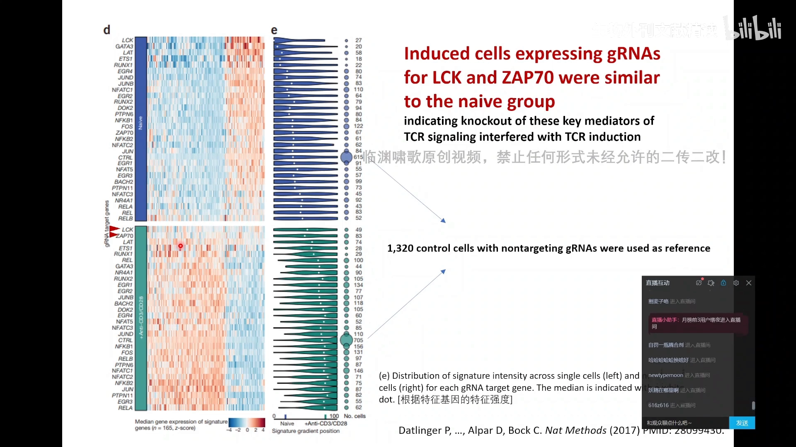

- **LCK、ZAP70**：敲除后，激活组细胞的特征基因表达分布**靠近 naive 组**，也就是说「细胞更倾向于处在一种没有激活的状态」[【跳转到 57:00】](https://www.bilibili.com/video/BV1yJ4m1G7ez/?t=3420)。结论：这两个基因对 T 细胞激活起**促进**作用。
- **PTPN11、EGR3**：敲除后，分布相对激活对照**进一步右移**，激活分数更高 [【跳转到 57:25】](https://www.bilibili.com/video/BV1yJ4m1G7ez/?t=3445)。结论：这两个基因对激活起**抑制**作用——把抑制拿掉，激活更猛烈。

这两条结论后来都被独立验证了：

1. **用传统方法单基因敲除**，再用同一套 165 基因打分，结果点几乎落在对角线上，说明 TROPIC 的信号丰度与传统方法高度一致 [【跳转到 58:48】](https://www.bilibili.com/video/BV1yJ4m1G7ez/?t=3528)；
2. **用流式看 CD69 蛋白**（CD69 是常用的 T 细胞激活表面指标）：敲 LCK、ZAP70 后 CD69 峰下降，敲 PTPN11 后峰右移，与转录组打分方向一致 [【跳转到 63:02】](https://www.bilibili.com/video/BV1yJ4m1G7ez/?t=3782)。

注意第二条验证的意义：**它把「转录组读出」和「蛋白/表型读出」对上了**。同一扰动在不同读出层次上给出一致结论，这是这套范式可信的关键证据之一。

### 6.6 这一节真正的收获：一个库可以被反复查询

讲者在总结这段时说了一句非常关键的话，值得单独拎出来：

> 你筛选了一系列指标基因；那下次我还用这个库，因为操作是一样的，我选择另一堆基因的转录情况设定一个标准作为指标，我是不是就可以用上次的数据再分析针对另一个过程敲掉某个基因的影响？所以我觉得这是一个一劳永逸的建库和操作方法。[【跳转到 61:47】](https://www.bilibili.com/video/BV1yJ4m1G7ez/?t=3707)

这句话点出了**扰动组学与「筛选」的根本区别**：筛选是一次性的（一个筛选压力 → 一份富集名单），而扰动组学产出的是一张**矩阵**（扰动 × 全转录本）。矩阵可以换着问题去查——这次查 T 细胞激活，下次查细胞周期，只要换特征基因集，数据不用重做。

也正因为如此，讲者提醒这批方法目前**基本都是验证性文章**，「真正把这个技术用于探索一个课题的文章目前可能少之又少」[【跳转到 27:59】](https://www.bilibili.com/video/BV1yJ4m1G7ez/?t=1679)。范式已经搭好，用它做生物学发现的红利还没被吃完。

## 七、barcode 与 guide 分居两地：Perturb-seq 的结构性风险

讲完 TROPIC，讲者回头补上了第一代方案最要命的一个缺陷——这个缺陷不是操作麻烦，而是**会直接制造假数据**。

### 7.1 缺陷的物理根源：慢病毒会重组

Perturb-seq、CRISPR-seq、Mosaic 这一类方案的共同点是：**guide 和 barcode 在载体上是分开的两段**（图里可以看到 Perturb-seq 是 18 nt barcode、CRISPR-seq 是 8 nt、Mosaic 是 12 nt，插入位置也略有差别，但都在有蛋白表达的筛选基因后面）[【跳转到 65:07】](https://www.bilibili.com/video/BV1yJ4m1G7ez/?t=3907)。

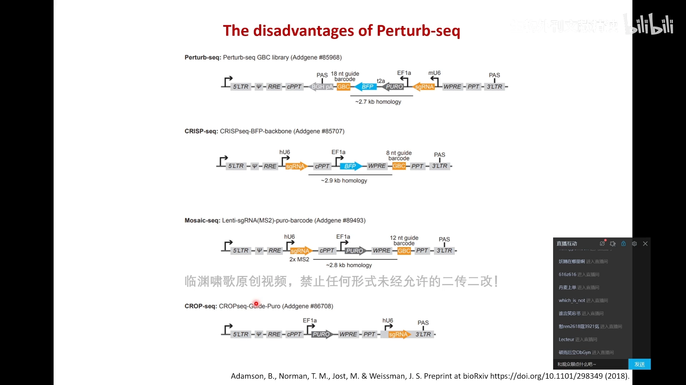

问题出在两段之间的**距离**：图里标出的同源区长度约 **2.7 kb**。而慢病毒（包括 HIV）在复制过程中本来就要靠重组来维持多样性，已有报道指出：**序列间隔超过 1–2 kb 的元件之间，重组率可以达到 50% 以上** [【跳转到 66:22】](https://www.bilibili.com/video/BV1yJ4m1G7ez/?t=3982)。

后果非常具体：一个 pool 里既有 A 基因的 guide+barcode，也有 B 基因的 guide+barcode；共包装、共感染时发生重组，就可能产生「**A 的 guide + B 的 barcode**」的新质粒。你测到 barcode 以为是 A，实际敲的是 B [【跳转到 66:47】](https://www.bilibili.com/video/BV1yJ4m1G7ez/?t=4007)。

### 7.2 讲者把重组的机制也讲了一遍

这段是讲者的「较真」时刻——他说「单讲这个重组可信度也不高，我去查了一些文献」，然后把逆转录病毒的复制元件过了一遍 [【跳转到 67:37】](https://www.bilibili.com/video/BV1yJ4m1G7ez/?t=4057)：

- **PBS（primer binding site）**：宿主 tRNA 结合、起始反转录的位置；
- **R 区**：基因组两端的重复序列（flanking repeats），让反转录能从 5′ 端「跳」到 3′ 端继续；
- **LTR（long terminal repeat）**：长末端重复；
- 反转录到 5′ 端后，产物可以与**另一条病毒 RNA 的 3′ R** 配对——这就是一次**模板转换（template switching）**，从 A 病毒的序列走到 B 病毒的序列，重组就在这一步发生 [【跳转到 68:02】](https://www.bilibili.com/video/BV1yJ4m1G7ez/?t=4082)；
- DNA 合成阶段，从 **cPPT / PPT**（含聚嘌呤序列的位点）起始的扩增同样可以发生模板转换 [【跳转到 68:27】](https://www.bilibili.com/video/BV1yJ4m1G7ez/?t=4107)。

### 7.3 一个漂亮的双色实验：把重组率量出来

讲者引了一篇 bioRxiv 上的工作（他说没找到正式发表版本，但实验设计「非常有意思」）：做一个表达 **GFP** 的细胞，同时用两种质粒——

- 质粒 1：敲 GFP 的 sgRNA + **BFP（蓝）**；
- 质粒 2：不敲任何东西的 sgNT + **mCherry（红）**。

理论上，质粒 1 进去应该「绿灭、蓝亮」，质粒 2 进去应该「绿在、红亮」。**如果发生重组**，就会出现交叉表型：**绿灭但红亮**（拿到了质粒 1 的 sgGFP + 质粒 2 的 mCherry），或者**绿在但蓝亮** [【跳转到 70:37】](https://www.bilibili.com/video/BV1yJ4m1G7ez/?t=4237)。

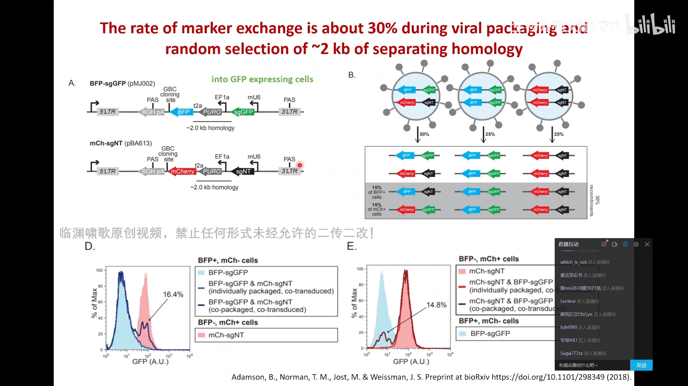

流式结果：交叉表型的比例分别是 **16.4%** 和 **14.8%**，合计约 **30%**，与理论模型一致 [【跳转到 71:52】](https://www.bilibili.com/video/BV1yJ4m1G7ez/?t=4312)。而且实验进一步区分了包装方式：重组主要发生在**共包装 + 共感染**（co-packaged, co-transduced）这一路，而不是共转染 [【跳转到 72:17】](https://www.bilibili.com/video/BV1yJ4m1G7ez/?t=4337)。

这个数字的分量，讲者算得很清楚：建库、扩库、包装、感染，每一步都绕不开共包装共感染，所以「这部分比例其实是不能避免的，有 30%」。他的评价是：「3% 我觉得还能避免一下，30% 这个比例你怎么剔除呢？」[【跳转到 72:42】](https://www.bilibili.com/video/BV1yJ4m1G7ez/?t=4362)

**这就是「特异性」假设在载体层面被破坏的样子**：你以为在分析 A 基因的扰动效应，其实有相当一部分细胞敲的是 B。任何下游的响应分析，都建立在一个可能有 30% 错标率的 guide 身份上。

## 八、direct-capture Perturb-seq：不改质粒，改引物

讲者把最后一个方法称为「今天最后一个重要的测序方式」，也是他认为**最巧妙**的一个：**direct-capture Perturb-seq**。它是在 TROPIC 的基础上改造的，但解决的正是第七章那个 30% 重组问题 [【跳转到 73:19】](https://www.bilibili.com/video/BV1yJ4m1G7ez/?t=4399)。

### 8.1 换个角度：不追 polyA，去追 guide 自己的「恒定区」

回到最原始的困境：常规单细胞 3′ 建库靠 **oligo-dT 抓 polyA**，而 sgRNA 没有 polyA，所以抓不到 [【跳转到 74:01】](https://www.bilibili.com/video/BV1yJ4m1G7ez/?t=4441)。

但 sgRNA 并不是一串完全自由的序列。它由两部分组成：

- **可变区**：那 20 nt 的靶向序列，每条 guide 都不同；
- **恒定区**：tracrRNA 骨架形成的 **stem-loop 结构**（讲者口误说成「环状 loop」，随即更正），这段序列在质粒上是**固定的**。

既然恒定区固定，那就可以**针对它设计一条特异的引物**，把「带着恒定区的 guide 序列」特异性地捕获下来 [【跳转到 74:26】](https://www.bilibili.com/video/BV1yJ4m1G7ez/?t=4466)。剩下的事情和常规建库一样：打断、反转录、加 barcode——而 barcode 加在 3′ 端，随便加多少都无所谓，因为它不再需要和 guide 建立一一对应的白名单 [【跳转到 75:16】](https://www.bilibili.com/video/BV1yJ4m1G7ez/?t=4516)。

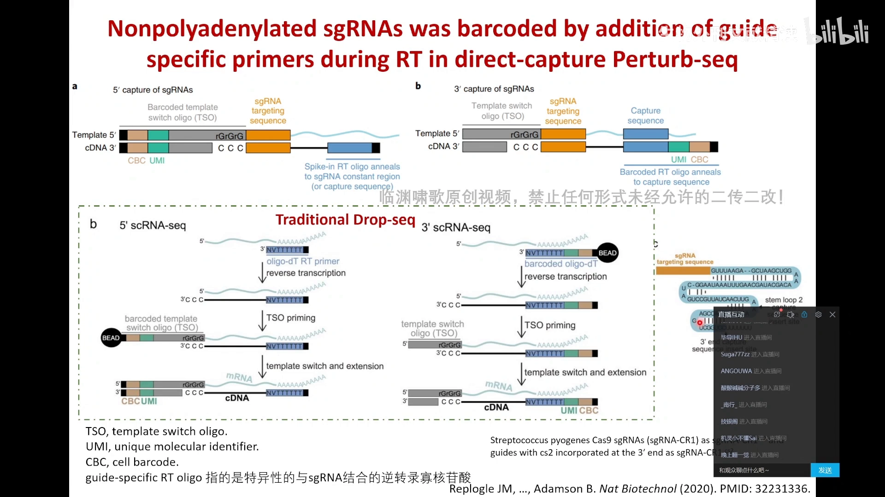

### 8.2 为什么这一步能根治重组问题

关键差别在于**身份信息与扰动信息的耦合方式**变了：

| 方案 | guide 身份如何被测到 | 需要白名单吗 | 重组风险 |
| --- | --- | --- | --- |
| Perturb-seq / CROP-seq | 测 barcode，再查 barcode↔guide 表 | 需要 | 高（barcode 与 guide 相隔约 2.7 kb） |
| TROPIC | guide 与抗性基因同处一条转录本 | 不需要 | 低（同一转录本） |
| direct-capture Perturb-seq | **直接测 guide 序列本身** | 不需要 | 低（测的就是 guide） |

只要你是**直接读 guide 的那 20 nt**，就不存在「barcode 说是 A、实际敲的是 B」的错配——因为被读的就是扰动本身。这就是讲者说它「能够有效避免我们前面提到的 barcode 跟 guide 序列发生重组配对的问题」的原因。

### 8.3 工程细节：捕获序列要试出来

恒定区虽然固定，但**用哪一段当捕获序列、往哪个方向捕获**需要实验优化。作者试了不同来源的捕获序列，用传统 barcode 捕获（**GBC**）作基准，比较 5′ 与 3′ 两种方向的捕获效率，最后选定 **CR1**（5′ 捕获）与 **CS1**（3′ 捕获）作为优选序列 [【跳转到 76:08】](https://www.bilibili.com/video/BV1yJ4m1G7ez/?t=4568)，并以「测到单一 guide 的细胞比例」作为最终判据 [【跳转到 76:33】](https://www.bilibili.com/video/BV1yJ4m1G7ez/?t=4593)。

随后作者验证了这套改造**没有破坏表达谱本身**：与传统 barcode 捕获相比，单细胞转录本的分群结构、基因表达分布差别都很小 [【跳转到 77:03】](https://www.bilibili.com/video/BV1yJ4m1G7ez/?t=4623)。

### 8.4 「优质 Perturb-seq」的四条标准

这段是讲者对整套范式的一次提炼，值得原样记下来。文章总结了高通量 Perturb-seq 应该具备的表型能力 [【跳转到 77:53】](https://www.bilibili.com/video/BV1yJ4m1G7ez/?t=4673)：

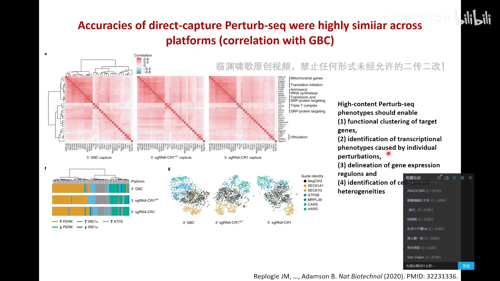

1. **能很好地触及靶基因**（functional clustering of target genes）——功能相近的基因，敲掉后的转录组响应应该聚在一起；
2. **能鉴定单一扰动引起的转录本变化**（identification of transcriptional phenotypes）——知道敲了哪个、影响了哪些；
3. **能把基因表达与细胞状态一起分群**（delineation of gene expression regulons）——把调控模块读出来；
4. **能鉴定细胞之间的异质性**（identification of cell heterogeneities）。

这四条其实就是「什么叫一次成功的扰动读出」的操作性定义：**扰动身份清楚（第 2 条）、扰动效应可聚合（第 1 条）、效应可分解为模块（第 3 条）、并且不掩盖细胞异质性（第 4 条）。** 反过来说，任何一条不满足，就说明你的读出里混进了不该有的东西——双细胞、错配的 guide、测序深度不足，或者批次效应。

## 九、单细胞读出让扰动组学多问出了哪些问题

前面八章都在讲「怎么把读出做出来」，这一章讲「读出做出来之后能问什么」。讲者用 direct-capture Perturb-seq 的两个实例说明：**一旦读出是转录组，组合扰动（combinatorial perturbation）就从不可能变成了常规操作。**

### 9.1 组合扰动为什么必须靠单细胞读出

在 pooled screen 里做双基因组合筛选极其别扭：你得保证同一个细胞里两条 guide 都进去了，还要能读出「这两条是哪两条」——用 barcode 方案，两条 guide 两个 barcode，重组和错配的风险成倍放大。而 direct-capture 方案直接读 guide 序列，一个细胞里有几条 guide 就读出几条 [【跳转到 85:07】](https://www.bilibili.com/video/BV1yJ4m1G7ez/?t=5107)。讲者的结论很干脆：「我甚至连两个、多个 guide 进去都能配上，这个技术就已经攻克了这个难点」[【跳转到 85:32】](https://www.bilibili.com/video/BV1yJ4m1G7ez/?t=5132)。

### 9.2 实例一：胆固醇合成 × DNA 修复的「缓冲型」互作

作者用双载体系统（一个质粒敲两个基因）筛胆固醇生物合成通路与 DNA 修复之间的关系——这是他们此前工作已经报道过的一条线索 [【跳转到 78:17】](https://www.bilibili.com/video/BV1yJ4m1G7ez/?t=4697)。读出用三个量：

- **胆固醇响应评分（cholesterol score）**：通路被扰动后，胆固醇合成基因的反馈上调程度；
- **细胞周期占比**：细胞停在 M / M-G1 / G1-S / S / G2-M 各期的比例；
- **HUS1 GI 评分**：以 HUS1 敲低为搭档时的生长缺陷程度，HUS1 是进化上保守的检查点复合物组分，参与细胞周期停滞。

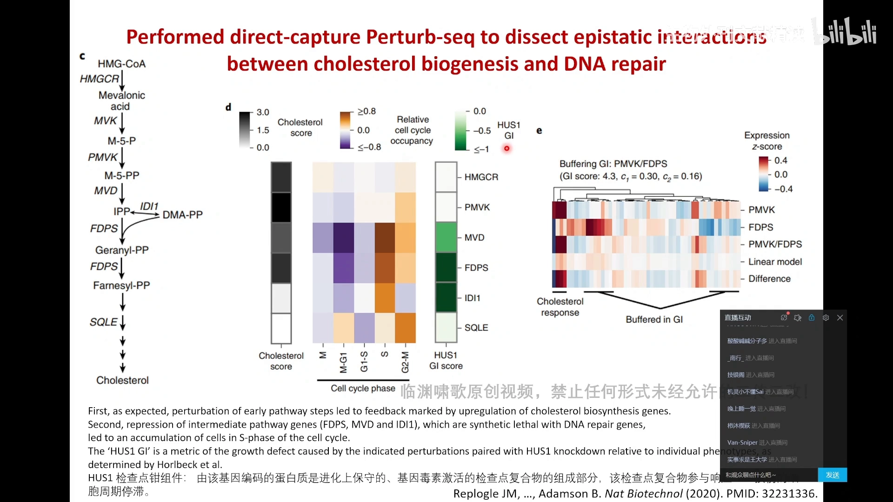

读图的关键在于**三个量的分离**：抑制通路早期步骤（如 HMGR）会出现预期的反馈上调；而抑制**中间步骤**（FDPS、MVD、IDI1）的细胞，胆固醇评分变化不大，却大量**滞留在 S 期**，HUS1 GI 评分显著变差 [【跳转到 79:57】](https://www.bilibili.com/video/BV1yJ4m1G7ez/?t=4797)。

讲者对这一现象的解读是：中间步骤被抑制后产生的**不是胆固醇缺失的后果，而是某些中间代谢物积累造成的毒性**——因为胆固醇响应几乎没变，但细胞周期停滞和 DNA 修复缺陷很严重 [【跳转到 80:22】](https://www.bilibili.com/video/BV1yJ4m1G7ez/?t=4822)。

**这正是「死活读出」永远读不出来的东西**：所有这几组细胞最后都死了或长不好，pooled screen 只会告诉你「这些基因重要」；而转录组 + 细胞周期 + 通路评分把「为什么死」拆成了不同的机制。

### 9.3 实例二：双敲把单敲的表型「废除」——上位效应的直接证据

更漂亮的是双基因组合的结果。单敲 **FDPS** 会引起胆固醇响应异常、并造成明显的生长缺陷；但**同时敲掉上游的 PMVK 和 FDPS**，这套表型**被废除了** [【跳转到 81:12】](https://www.bilibili.com/video/BV1yJ4m1G7ez/?t=4872)。

讲者用代谢通路图解释这个逻辑：如果 FDPS 被抑制后，某个中间产物（IPP 一类）滞留在细胞里产生毒性，那么**从更上游把合成掐断**（敲 PMVK），这个毒性物质就产生不出来，于是 FDPS 敲除的毒性表型被「缓冲」掉了 [【跳转到 82:02】](https://www.bilibili.com/video/BV1yJ4m1G7ez/?t=4922)。

用遗传互作的语言说，这就是**缓冲型互作（buffering interaction）**：把两个基因的扰动效应记为 $f_1$、$f_2$，双扰动的观测效应记为 $f_{12}$，则遗传互作评分可以写成

$$
\mathrm{GI} = f_{12} - \mathbb{E}\left[f_{12} \mid f_1, f_2\right]
$$

其中 $\mathbb{E}\left[f_{12} \mid f_1, f_2\right]$ 是由两个单扰动效应预测的「无互作」期望。$\mathrm{GI} \approx 0$ 表示两个扰动各自独立叠加；$\mathrm{GI} < 0$ 表示双敲比预期更差（协同致死）；$\mathrm{GI} > 0$ 表示双敲比预期更好（缓冲/上位）。文章报出的数字正是这样读的：PMVK/FDPS 是**缓冲型**（$\mathrm{GI} = 4.3$），HUS1/FDPS 是**协同型**（$\mathrm{GI} = -5.6$）[【跳转到 83:02】](https://www.bilibili.com/video/BV1yJ4m1G7ez/?t=4982)。

而单细胞读出把这个「评分」落到了细胞层面：

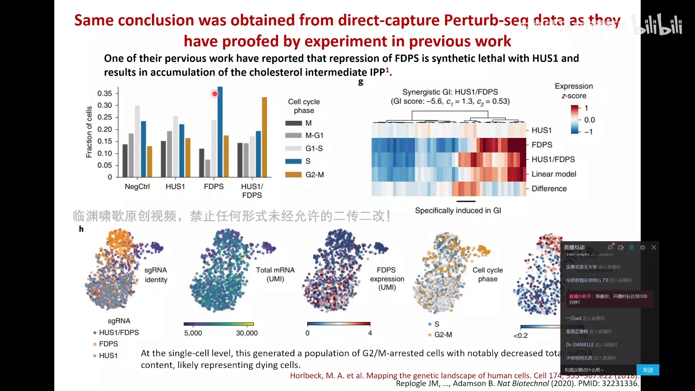

- FDPS 单敲：更多细胞停在 **S 期**；
- FDPS + HUS1 双敲：更多细胞停在 **G2/M 期**，且这群细胞的**总 mRNA（UMI）显著更低**——讲者的解读是「更多的细胞发生了死亡」，即这两个基因的**联合致死**作用 [【跳转到 84:17】](https://www.bilibili.com/video/BV1yJ4m1G7ez/?t=5057)。

注意这里读出层次的叠加：**细胞周期占比**（表型层）+ **总 UMI**（技术层，兼作细胞健康度的代理）+ **FDPS 表达**（扰动有效性层）三者一起，才把「这群细胞是快死的」这件事说圆。任何单一层次都做不到。

### 9.4 读出层次决定你能问的问题

把这两章的方法学收拢成一张表，就是本小节最想传达的判断：

| 读出层次 | 能回答的问题 | 答不了的问题 |
| --- | --- | --- |
| 存活/富集计数 | 哪个基因影响增殖与存活 | 细胞是怎么变的、为什么变 |
| 全转录组 | 扰动影响了哪些基因、哪些模块、细胞进入什么状态 | 蛋白层面是否同步、形态是否改变 |
| 转录组 + 蛋白（流式） | 转录与蛋白是否一致、激活比例 | 空间位置、谱系关系 |
| 转录组 + 细胞周期/健康度 | 细胞是不是在死、死在哪一期 | 直接机制 |

一句话：**选读出等于选问题。** 这也是本小节反复强调的那句判断——同一扰动在不同读出层次上可能给出不同结论，而「扰动组学」之所以成立，是因为转录组这个层次的读出**足够宽**，宽到可以用同一批数据回答很多个问题。

## 十、范式自带的三个假设：这套读出到底在哪些地方可能骗你

讲者在 89 分钟里其实一直在做一件事：**每介绍一个方法，就把它破坏了哪个假设、又补回了哪个假设讲清楚**。把散落各处的线索收拢起来，可以得到一张「假设—证据—失效模式」的对照表。这张表也是本小节要立的框架，后面 3.3（实验设计）与 3.4（响应分析）会逐条展开。

| 前提假设 | 这套读出提供的证据 | 失效模式（本文出现过的） |
| --- | --- | --- |
| 扰动是**有效的**（目标真被敲掉） | 编辑效率 95.5% 对 90.5%、移码率 60.2% 对 62.4%；双敲组里 FDPS mRNA 明显下降 | 编辑了但没移码、蛋白仍保留部分功能；guide 没进细胞 |
| 扰动是**特异的**（只动了目标） | 20 条 NT guide 作阴性对照；直接读 guide 序列避免 barcode 错配 | 慢病毒重组造成 guide/barcode 错配（约 30%）；off-target |
| 响应是**可归因的**（差异来自扰动而非背景） | 同基因 guide 的成对距离更小；以 NT 分布的 99% 分位为阈值；血清饥饿排除血清因子 | 双细胞/双 guide 液滴；测序深度不足导致 guide 检出率低；批次效应 |

三条假设里，第一条和第三条在这套读出下有了**可量化的内建证据**（编辑效率、成对距离阈值），第二条则被**载体设计**部分解决了（direct-capture 直接读 guide），但 off-target 这一层仍然要回到 3.4 节的响应分析去处理。

### 10.1 一个容易被忽略的边界：这套范式只保证「读出」，不保证「机制」

讲者在结尾的总结里说得很克制：

> 现在这个技术克服了传统 CRISPR 筛选必须的一个筛选条件——死活：我可以通过一系列的基因变化来表征我筛选的条件。[【跳转到 86:22】](https://www.bilibili.com/video/BV1yJ4m1G7ez/?t=5182)

注意他用的是「表征筛选的条件」，而不是「找到机制」。转录组读出给你的是**响应表型**，从这个表型到机制（谁调控谁、通过哪个中间代谢物）仍然需要额外的实验——比如 9.3 节那个「缓冲」结论，最终还是要靠代谢通路的知识和后续验证来支撑。

### 10.2 与相邻小节的边界

为避免重复，这里明确本文的取舍：

- **CRISPR-KO / CRISPRi / CRISPRa / RNAi 的技术原理**、各类扰动的分子实现：属 3.2 节。本文只保留「为什么 KO 在 mRNA 层面测不出、为什么 guide 没有 polyA」这两处必需背景。
- **Perturb-seq / CROP-seq 的建库流程、barcode 与 UMI 设计、细胞捕获效率**：属 3.3 节。本文只讲到「读出从哪来」为止。
- **对照组设置、重复与批次**：属 3.1.3；**从相关性到因果的推断逻辑**：属 3.1.4。本文提到因果只说「扰动让归因成为可能」，不展开推断方法。
- **扰动数据的响应分析与统计模型**（成对距离、PCA 打分、GI 评分的完整算法）：属 3.4 节与第 5 章。本文只把它们当作「读出能做到什么」的证据。

## 小结

- **CRISPR 筛选的读出只有一比特。** 因为敲除只在基因座位上造成 indel，mRNA 的**数量**几乎不变，RT-PCR 测不出差异；于是 pool 里唯一能当分组依据的就是细胞死活。凡是不能变成死活表型的过程（通路调控、细胞状态转换），pooled screen 都读不出来。
- **阵列筛选补上了转录组读出，却把通量还了回去。** 一孔一 guide、一孔一次测序，1000 个基因就是 1000 个孔——工程上不可行。
- **范式跃迁的关键动作是「把 guide 身份也测进同一个液滴」。** 一旦扰动身份和转录组响应落在同一行数据上，一次扰动实验的三要素（可指认的干预、可比的对照、可测量的读出）第一次同时成立。
- **四代载体方案，每一代解决一个具体的物理障碍。** Perturb-seq / CROP-seq 用 barcode 捎带身份（但引入两个变量与重组风险）；TROPIC 把 guide 塞进 3′ LTR 那 400 bp 的缺失里，让 Pol II 通读产生含 guide 的 polyA 转录本（单变量，但插入长度受限）；direct-capture Perturb-seq 直接针对 sgRNA 恒定 loop 设计引物（彻底绕开 barcode↔guide 错配）。
- **慢病毒重组不是一个理论风险，是一个 30% 量级的数字。** 相隔约 2 kb 的元件在共包装共感染时重组率可达约 30%，会造成「A 的 guide + B 的 barcode」的错标——这是第一代方案最要命的结构性缺陷。
- **读出从「死活」升级为「打分」，表型就从预设条件变成了可学习的量。** 165 个特征基因把 T 细胞激活状态变成一个连续分数，于是促进者（LCK、ZAP70）与抑制者（PTPN11、EGR3）能被同一套读出自动分开，并被流式 CD69 独立验证。
- **矩阵可以反复查询，这是扰动组学与「筛选」的根本区别。** 同一个库、同一批数据，换一套特征基因就能回答另一个表型问题——所以讲者说这是「一劳永逸的建库和操作方法」。
- **读出变宽之后，组合扰动成了常规操作。** 双基因扰动让「缓冲型」与「协同型」遗传互作可以在单细胞层面被拆开：PMVK/FDPS 缓冲掉 FDPS 的毒性表型，FDPS/HUS1 则联合致死（G2/M 滞留 + 总 UMI 下降）。
- **这套范式的全部方法学，都是在给三个假设补证据**：扰动有效（编辑效率、目标 mRNA 下降）、扰动特异（NT 对照、直接读 guide）、响应可归因（成对距离的 99% 分位阈值、血清饥饿、双细胞剔除）。三条里任何一条塌掉，下游的响应分析都不成立。

## 关键术语速查

| 术语 | 一句话解释 |
| --- | --- |
| perturbation（扰动） | 在受控条件下对细胞施加一个可指认的改变，并测量由此产生的差异；三要素是可指认的干预、可比的对照、可测量的读出 |
| perturbation omics（扰动组学） | 把大量扰动 × 全转录本响应组织成一张矩阵来研究的范式，区别于一次性的筛选 |
| pooled screen | 把成千上万条 guide 混成一个 pool 打进细胞群，靠筛选压力后的 guide 富集/缺失来推断基因功能 |
| arrayed screen | 一个孔只放一条 guide 的筛选方式，能拿到表达谱读出，但通量与成本随基因数线性恶化 |
| readout（读出） | 实验中真正被测量的量；本文的核心论点是读出层次决定了你能问什么问题 |
| sgRNA / guide | single-guide RNA，由 crRNA 与 tracrRNA 经 linker 融合而成，20 nt 可变区负责靶向，其余为恒定骨架 |
| PAM | protospacer adjacent motif，Cas9 识别所需的邻近序列（SpCas9 为 NGG） |
| NHEJ / HDR | 双链断裂的两条修复路径；NHEJ 产生随机 indel 造成移码（基因破坏），HDR 用同源臂精确修复 |
| indel | insertion/deletion，插入或缺失；非 3 整数倍会造成移码 |
| Perturb-seq | 在 CRISPR 载体上加 barcode、通过 barcode↔guide 白名单把扰动身份读进单细胞转录组的方法 |
| CROP-seq | 与 Perturb-seq 思路相近的方案，把 guide 盒插入使 guide 序列成为可被捕获的转录本一部分 |
| TROPIC | 把 U6-guide 塞进慢病毒 3′ LTR 的 400 bp 缺失位点，靠 EF-1α（Pol II）通读产生带 polyA 的含 guide mRNA |
| direct-capture Perturb-seq | 针对 sgRNA 恒定 loop 设计特异引物直接捕获 guide 序列，无需 barcode 白名单，规避重组错配 |
| GBC | guide barcode，传统 Perturb-seq 里与 guide 配对的 barcode 捕获方式，常作为新方案的对照基准 |
| doublet（双细胞） | 两个细胞被包进同一个液滴，表现为测到多条 guide、表达谱混合，分析时需剔除 |
| pairwise distance（成对距离） | 细胞间转录组距离；同基因 guide 之间小于不同基因 guide 之间，是扰动效应可重复的证据 |
| signature genes（特征基因） | 用来给某个细胞状态打分的一组基因；本文中 165 个基因用于给 T 细胞激活状态打分 |
| PCA（主成分分析） | 用某个分组变量去切数据，看能否把样本分开；能分开说明该变量是主要影响因素 |
| genetic interaction（GI，遗传互作） | 双扰动效应偏离两个单扰动预期叠加的部分；负值为协同，正值为缓冲 |
| synthetic lethality（协同致死） | 单独敲任一个不死、同时敲两个才死的互作类型 |
| off-target | 编辑发生在非目标位点，破坏「扰动是特异的」这一假设 |
| template switching（模板转换） | 逆转录过程中新生链换用另一条模板继续合成，是慢病毒重组的分子基础之一 |
