# 细胞可塑性：基因型与环境如何共同决定细胞表型

> 视频来源：[肿瘤细胞的"改头换面"-细胞可塑性](https://www.bilibili.com/video/BV1Tdr8YGEDh/)（B 站 · 概普生信人 胡桃）｜时长约 16 分钟
> 导读：这支视频是对 Nature Cancer 一篇综述的讲解，主线是「细胞可塑性」——细胞被重新编程、改变命运与身份的能力。本文只取其中与本节相关的部分：**基因型、环境、表型这三个变量各指什么，它们如何通过可塑性互相作用**；关于具体扰动技术（CRISPR、药物处理）与对照设计，请看本系列 3.2 与 3.1.3 小节。

## 本讲要解决的核心问题（SCQA）

**背景**：我们已经知道，一个细胞表达出什么状态，是「它带什么基因型」和「它处在什么环境里」共同作用的结果。经典遗传学把这句话写成一句口号：表型 = 基因型 + 环境。

**冲突**：但单细胞数据里出现了一个加法解释不了的现象——同一个细胞、同一套基因组，在不同时间点可以表现出完全不同的状态：上皮细胞变成间充质细胞，肿瘤细胞在化疗下变成「装死」的持留细胞，分化好的细胞重新回到干细胞状态。也就是说，**表型不是一个固定的结局，而是一个可以被改写的程序**。

**疑问**：那么「基因型决定表型」这句话到底还成立吗？基因型、环境、表型这三个变量在单细胞语境下分别指什么？它们之间是什么关系？

**回答（中心思想）**：基因型提供的是**可能性空间**（哪些状态这个细胞「够得着」），环境决定**当前落在哪个状态**，而**可塑性**是允许细胞在这些状态之间移动的规则。三者不是相加关系，而是「基因型 × 环境 → 可塑性 → 表型」的链条。因此扰动实验真正要分离的，不是「表型变了没有」，而是**变的是基因型、环境，还是可塑性本身**。

## 一、先把三个变量定义清楚：基因型、环境、表型

### 1.1 视频给出的定义：可塑性是「对内外因素的反应」

视频开篇引用的是一篇 2023 年 8 月发表在 Nature Cancer 上的综述，题目是 *Cancer cell plasticity during tumor progression, metastasis and response to therapy*。[【跳转到 00:23】](https://www.bilibili.com/video/BV1Tdr8YGEDh/?t=23)

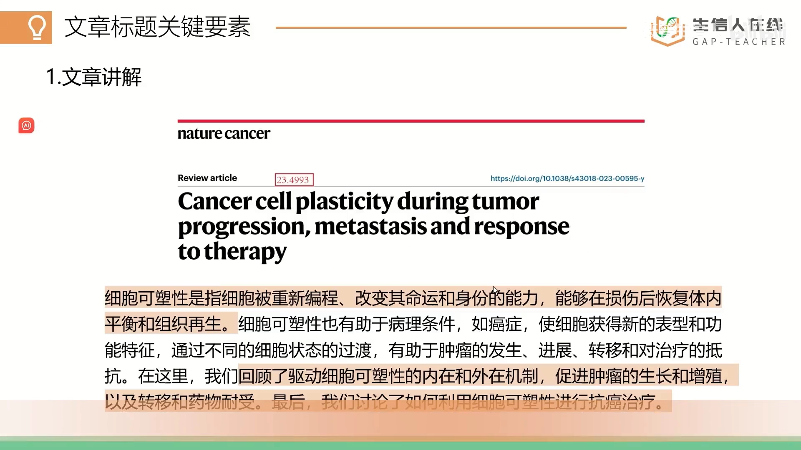

讲者对「细胞可塑性」的定义是：**细胞对内在或外在因素作出反应、重新编程并改变自身命运与身份的能力**。[【跳转到 00:36】](https://www.bilibili.com/video/BV1Tdr8YGEDh/?t=36)

这句话里藏着本节要讲的三个变量，值得逐字拆开：

- **内在因素**——细胞自己带的程序：基因型（突变、拷贝数变异）、表观遗传状态、已经表达的转录因子网络；
- **外在因素**——细胞所处的环境：邻近细胞、细胞外基质、旁分泌信号、氧气与营养、药物与炎症刺激；
- **表型**——细胞最终呈现出来的、可被测量的状态：形态、表面标志物、表达谱、增殖与迁移能力。

传统遗传学里，表型常常被压缩成一两个数（株高、眼色、是否患病）。而在单细胞层面，**表型是一个高维向量**：几千个基因的表达值、一批表面蛋白、一段染色质的可及性。这一点决定了后面所有的分析难点——「扰动有没有效果」取决于你在哪个维度上、用什么距离去比较。

### 1.2 可塑性的三种实现方式：去分化、转分化、EMT

视频把可塑性拆成三条具体的「换装路径」：[【跳转到 01:45】](https://www.bilibili.com/video/BV1Tdr8YGEDh/?t=105)

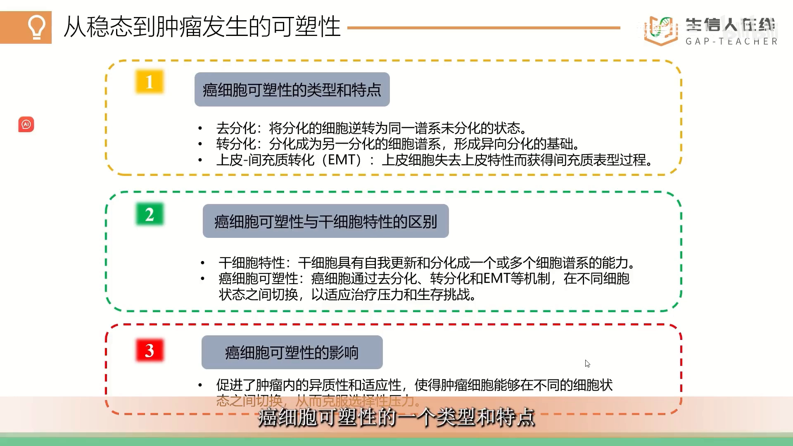

| 类型 | 一句话定义 | 类比 |
| :--- | :--- | :--- |
| 去分化（dedifferentiation） | 把已分化的细胞逆转回**同一谱系**的未分化状态 | 熟练工退回学徒 |
| 转分化（transdifferentiation） | 分化成**另一条谱系**的细胞 | 木工改行做电工 |
| 上皮–间充质转化（EMT） | 上皮细胞失去上皮特性、获得间充质表型 | 从「砌墙的砖」变成「能搬家的细胞」 |

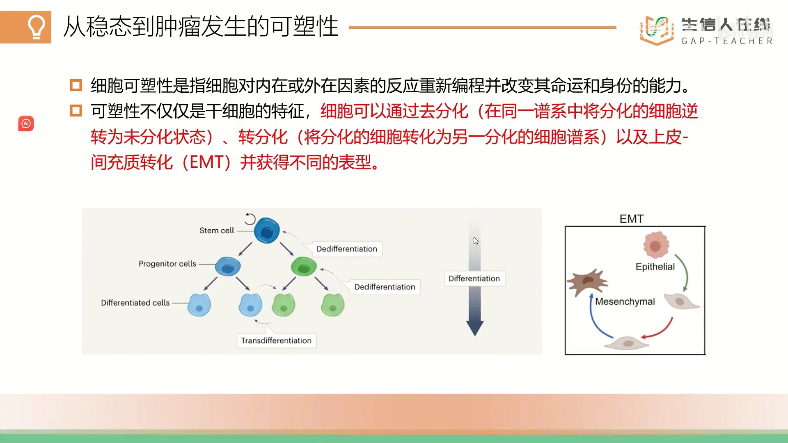

这张图很关键：左边那棵「树」是经典的发育谱系树，箭头通常只朝下（分化）；而可塑性意味着**箭头也可以朝上（去分化）或横向（转分化）**。换句话说，细胞状态不是一条单向的路，而是一个**可以来回走的状态空间**。

### 1.3 可塑性不等于干性

初学者最容易混淆的一点：可塑性和「干细胞特性」是不是一回事？视频明确区分了两者：[【跳转到 02:10】](https://www.bilibili.com/video/BV1Tdr8YGEDh/?t=130)

- **干细胞特性**：干细胞具有自我更新、并能分化成一个或多个谱系的能力——强调的是「能生出什么」；
- **癌细胞可塑性**：癌细胞通过去分化、转分化和 EMT 等机制**在不同细胞状态之间切换**，以适应治疗压力和生存挑战——强调的是「能变成什么」。

区别在于：干性是一种**能力等级**，可塑性是一种**移动能力**。一个细胞可以很可塑但并不干（比如在 EMT 中间态来回摆动的细胞），也可以很干但可塑性有限。

> 落到本节的框架：**干性更像基因型与环境共同设定的「状态空间结构」，可塑性则是细胞在这个空间里移动的自由度。**

## 二、同一套可塑性程序，既用于再生，也用于致癌

视频第二部分最有说服力的地方，是把「正常稳态」「组织再生」「肿瘤发生」三件事放在同一张幻灯片上讲——它们用的是**同一套可塑性机制**，区别只在有没有被失控地打开。[【跳转到 02:40】](https://www.bilibili.com/video/BV1Tdr8YGEDh/?t=160)

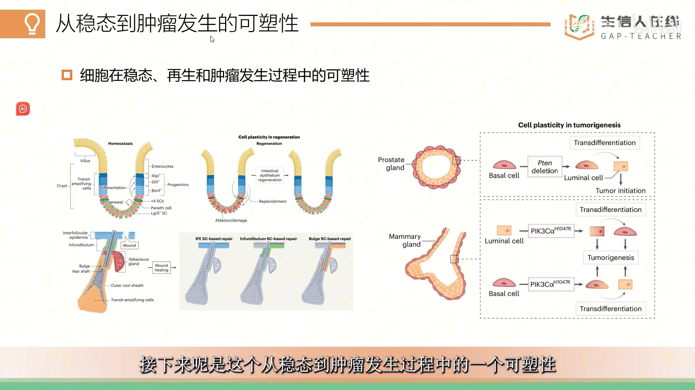

### 2.1 肠道：干细胞被清空后，谁来回填？

肠道上皮是哺乳动物体内更新最快的组织之一，LGR5 是小肠和结肠中干细胞的标志物。视频讲了两个实验事实：

1. 如果在小鼠中把 LGR5 阳性的干细胞清除掉，**表达 Bmi1 的细胞可以补充 LGR5 阳性细胞库**，维持平衡；
2. 分化程度更高的肠上皮祖细胞也可以转分化成 LGR5 阳性细胞；当肠道受损时，一些已经分化的前体细胞能**重新回到干细胞状态**，填补干细胞池，促进再生修复。

这里的关键不是「哪个基因是标志物」，而是：**在同一套基因组下，细胞的表型取决于它在组织里所处的位置和受到的信号**。干细胞池空了，这个「环境变化」本身就足以让别的细胞改写身份。

### 2.2 皮肤与乳腺：单能细胞在特定条件下变得多能

- **皮肤表皮**：不同细胞层由不同的单能干细胞维持；伤口愈合时，毛囊间表皮干细胞参与修复，毛囊隆突部位的干细胞也能向上迁移、增殖，并重新编程为毛囊间表皮干细胞。
- **乳腺**：乳腺基底细胞和腔细胞在稳态下都是单能的；但把基底细胞移植到乳腺脂肪垫后，基底细胞表现出多能性，可以产生腔细胞，形成功能性的乳腺。

注意这里的操作：**移植 = 换环境**。同一群细胞，放在原来的位置只能做一件事，换到另一个微环境里就能做两件事。这是「环境改写表型」最干净的证据。

### 2.3 突变改写的是「可塑性的开关」

视频接着给出两个遗传学例子：在前列腺中，**Pten 缺失**会让基底细胞转分化为腔细胞并启动肿瘤；在乳腺中，**PIK3CA H1047R** 这个突变在基底细胞中表达时使其转分化为腔细胞，在腔细胞中表达时又使其转化为基底细胞，而两种情况下都会启动肿瘤发生。[【跳转到 04:20】](https://www.bilibili.com/video/BV1Tdr8YGEDh/?t=260)

这两个例子把 G×E 讲得很清楚：**突变（G）本身不直接等于肿瘤（P），它改变的是细胞对环境的响应方式**——同一个突变放在不同细胞状态里，走向不同的结局。这正是「基因型 × 环境交互」在单细胞层面的样子。
## 三、肿瘤干性：表型是「状态」，不是「身份」

### 3.1 肿瘤由不同状态的细胞组成

视频的下一段把镜头从正常组织转向肿瘤：**肿瘤由处于不同状态的肿瘤细胞组成，各自执行不同功能**；肿瘤生长由肿瘤干细胞（cancer stem cell，CSC）维持，CSC 表达类似干细胞的程序，能够自我更新、维持肿瘤生长，并产生增殖潜力更有限的肿瘤细胞。例如结直肠癌的 CSC 就表达与正常肠干细胞相似的基因特征。[【跳转到 04:34】](https://www.bilibili.com/video/BV1Tdr8YGEDh/?t=274)

这里有一个容易被忽略的推论：如果 CSC 的基因特征与正常干细胞相似，那么**「是不是 CSC」很大程度上不是基因型问题，而是状态问题**——同一群肿瘤细胞，谁处在那个状态，谁就承担干性功能。

### 3.2 怎么证明一群细胞真的「干」：三条功能路线

CSC 的鉴定不能只看标志物，视频介绍了三种功能层面的策略：[【跳转到 04:59】](https://www.bilibili.com/video/BV1Tdr8YGEDh/?t=299)

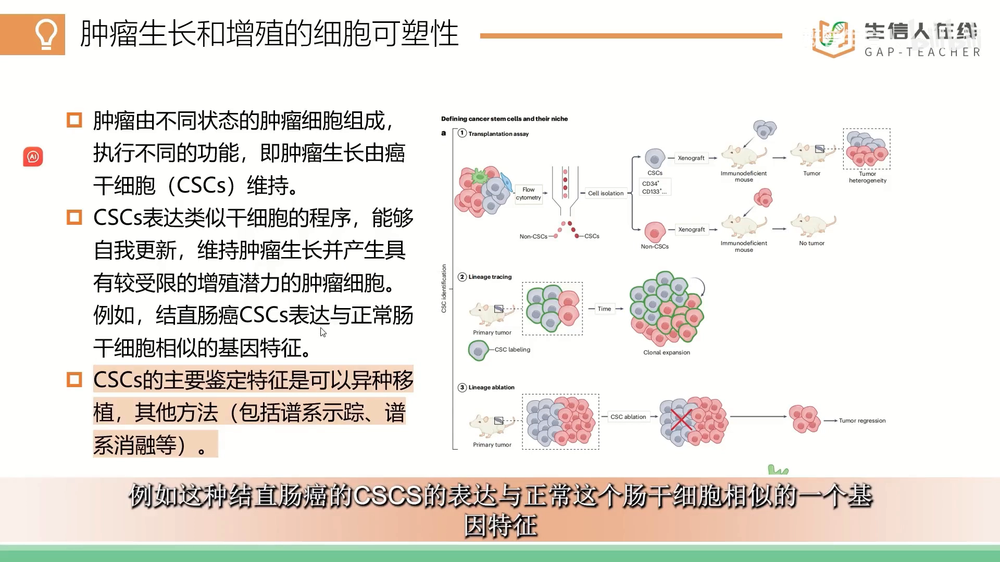

1. **移植实验（transplantation assay）**：用荧光激活细胞分选把不同肿瘤亚群分开，分别移植到免疫缺陷小鼠。移植 CSC 能成瘤并再现肿瘤异质性，移植非 CSC 成瘤效率很低。
2. **谱系追踪（lineage tracing）**：给特定亚群打标记，在肿瘤进展过程中跟踪它们的命运，评估克隆扩增。
3. **谱系消融（lineage ablation）**：清除特定亚群。如果 CSC 被清除后剩下的细胞无法维持肿瘤生长、肿瘤退化，就说明这个亚群是必需的。

对做扰动实验的人来说，这三条路线其实是三种不同层级的「读出」：**移植测的是功能潜力，谱系追踪测的是状态转移历史，谱系消融测的是必要性**。同一个扰动，在这三种读出下可能给出不同结论。

### 3.3 CSC 与非 CSC 都可以可塑

严格意义上，CSC 会产生生长和分化潜力更有限的亚群，并且「永远不会回到 CSC 状态」。但视频强调：**现在的证据表明 CSC 和非 CSC 都是可塑的，在某些条件下可以发生表型转变**。[【跳转到 06:05】](https://www.bilibili.com/video/BV1Tdr8YGEDh/?t=365)

这句话对「基因型决定表型」是一个直接的反例：如果非 CSC 能在特定条件下变成 CSC，那么它的基因组没变，变的是**状态**。这就是为什么扰动实验必须测量「状态分布」，而不只是测量「平均表达」。

## 四、环境的第一层：CSC 生态位

视频接着讲环境如何从外部维持干性。CSC 与其微环境之间的串扰对维持肿瘤生长至关重要，CSC 由**癌症相关成纤维细胞（CAF）、内皮细胞和免疫细胞组成的生态位**支持，从外部促进肿瘤的干性。[【跳转到 06:05】](https://www.bilibili.com/video/BV1Tdr8YGEDh/?t=365)

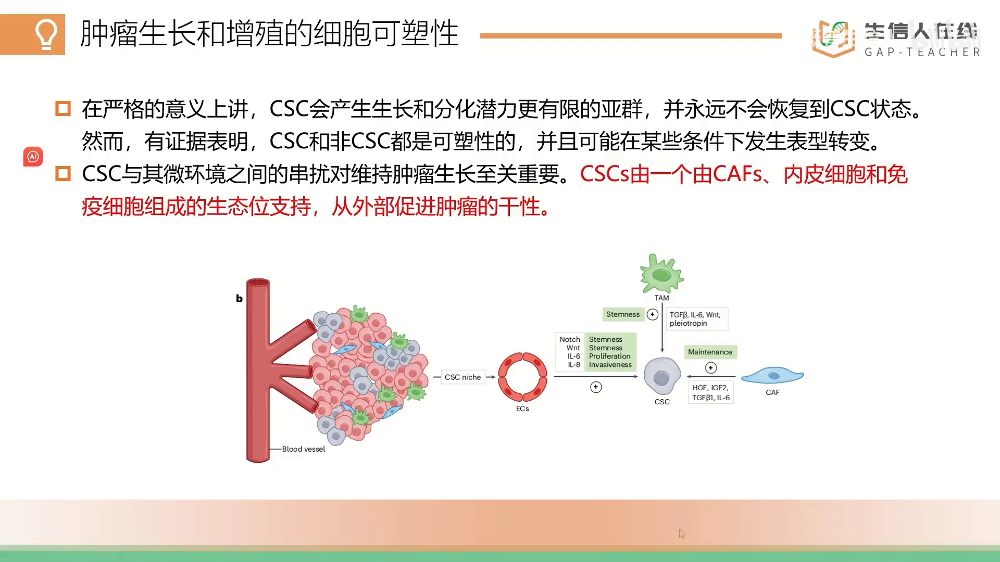

具体机制在图上写得很清楚：内皮细胞通过分泌 **WNT** 以及一些配体、并通过直接的细胞间相互作用维持 CSC 的干性；内皮细胞还会分泌 **IL-8、IL-6**，增加皮肤鳞状细胞癌中的浸润和增殖；巨噬细胞（TAM）通过 TGF-β、IL-6、Wnt 等信号支持干性；CAF 通过 HGF、IGF2、TGF-β1、IL-6 维持 CSC。

生态位本身也是分类型的：血管生态位由内皮细胞、周细胞、平滑肌细胞和免疫细胞组成，是一个高度血管化的区域，它通过影响干性、化疗耐药、侵袭和转移，营造出允许肿瘤生长的微环境。[【跳转到 07:00】](https://www.bilibili.com/video/BV1Tdr8YGEDh/?t=420)

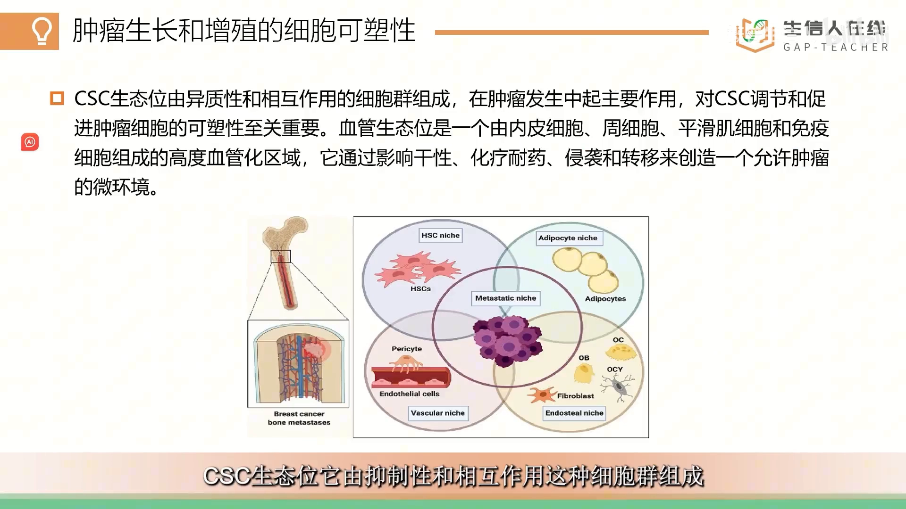

**这一节对「环境」这个变量的意义**：环境不是一句笼统的「培养条件」，它可以被拆成具体的、可操作的层：

- **细胞层**：邻居是谁（内皮、CAF、免疫细胞）；
- **信号层**：哪些配体在附近（Wnt、Notch、IL-6、TGF-β）；
- **物理层**：血管化程度、氧浓度、基质硬度；
- **时间层**：这些信号持续多久（急性刺激 vs 长期暴露）。

扰动实验里，如果只改变细胞自己的基因，却让这四层同时漂移，那么测到的差异里就混进了环境效应——这就是后面 3.1.3 要处理的「对照」问题。

## 五、转移：环境连续变化下的表型连续切换

### 5.1 转移是一个多步级联

视频把转移拆成一条链：癌细胞从原发肿瘤脱落 → 局部侵袭周围组织 → 向血管或淋巴管内渗入 → 外渗 → 在远处器官定植并形成继发肿瘤。只有部分肿瘤细胞能成为**转移起始细胞（metastasis-initiating cell，MIC）**并形成转移。[【跳转到 07:21】](https://www.bilibili.com/video/BV1Tdr8YGEDh/?t=441)

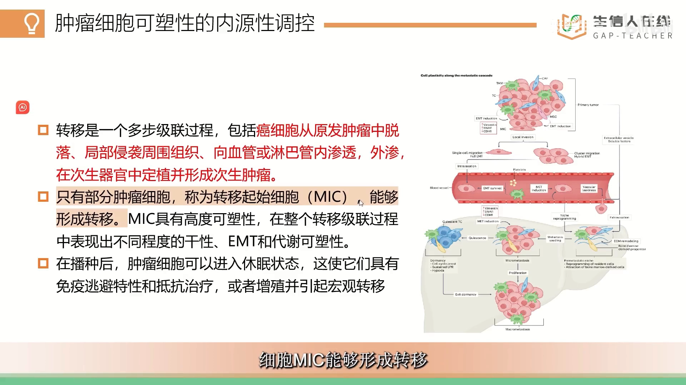

### 5.2 MIC 的可塑性是「多维度」的

MIC 具有高度可塑性，在整个转移级联过程中表现出**不同程度的干性、EMT 和代谢可塑性**：

- EMT 使 MIC 从原发肿瘤中分离；
- 血管生态位促进 MIC 进入血液；
- 单个或成簇的 CSC 表现出高可塑性和**混合的 EMT 状态**（既不是纯上皮，也不是纯间充质）；
- CSC 与血小板、巨噬细胞相互作用，进一步促进可塑性；被血小板包裹可以保护 CSC 免受血流剪切力的影响；
- 继发器官会被原发肿瘤通过分泌细胞外囊泡和可溶性因子预先「制备」，提前营造允许肿瘤生长的微环境；
- 定植时，肿瘤细胞对来自转移生态位的信号作出应答，**恢复到上皮状态（MET）**；
- 完成播种后，肿瘤细胞可以进入**休眠状态**，从而免疫逃逸、抵抗治疗，之后再增殖引起宏观转移。

这条链最能说明「表型是连续量」：EMT 不是一个开关，而是一段**中间态光谱**。如果实验只按「上皮 / 间充质」二分去分组，就会把大量混合态细胞错误归类，扰动效应也会被平均掉。

## 六、环境的第二层与细胞内部：谁在调控可塑性

### 6.1 外源信号与内源程序是一张网

视频用一张通路图把「环境 → 细胞 → 表型」的中间环节画了出来：癌细胞的可塑性在细胞外受微环境信号调控，在细胞内则通过信号通路、转录程序和染色质重塑来调控。[【跳转到 08:53】](https://www.bilibili.com/video/BV1Tdr8YGEDh/?t=533)

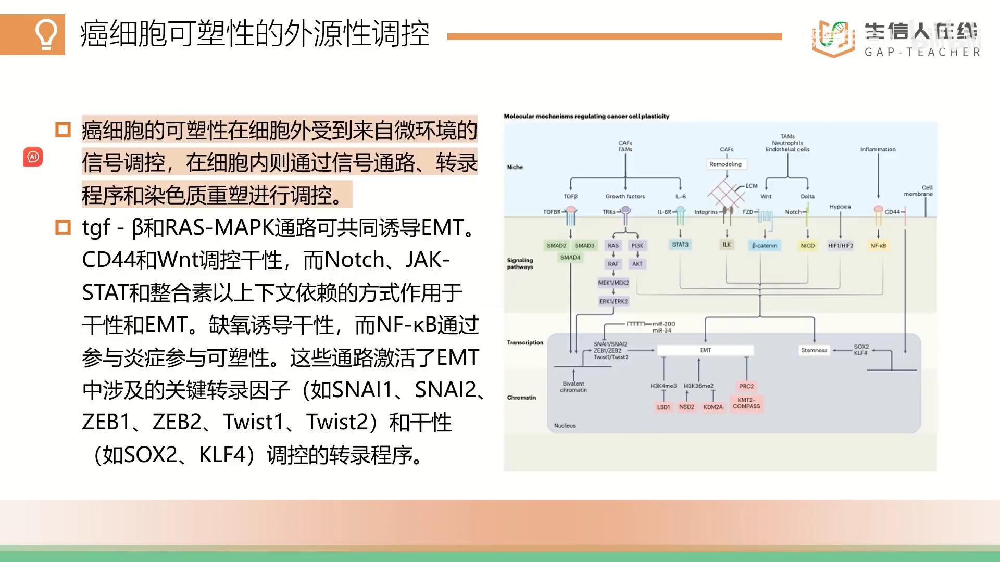

按层次读这张图：

| 层次 | 代表分子 | 作用 |
| :--- | :--- | :--- |
| 生态位信号 | TGF-β、生长因子、IL-6、整合素、Wnt、Notch、缺氧、炎症、CD44 | 把「外面发生了什么」传进来 |
| 信号通路 | SMAD2/3/4、RAS–MAPK、PI3K–AKT、JAK–STAT、β-catenin、HIF1/HIF2、NF-κB | 把信号转成转录程序 |
| 转录因子 | SNAI1、SNAI2、ZEB1、ZEB2、Twist1、Twist2；干性：SOX2、KLF4 | 执行 EMT 或干性程序 |
| 染色质 | H3K4me3、H3K36me2、PRC2、LSD1、KDM2A | 决定这些程序能不能被打开 |

几个具体对应关系值得记住：**TGF-β 和 RAS–MAPK 通路可以共同诱导 EMT**；CD44 和 Wnt 调控干性；Notch、JAK–STAT 和整合素以**依赖上下文**的方式作用于干性和 EMT；**缺氧诱导干性**；**NF-κB 通过参与炎症影响可塑性**。

「依赖上下文」这四个字是 G×E 交互的分子版本：同一条通路，在不同细胞类型、不同状态下打开，后果不同。

### 6.2 为什么这一层对扰动实验特别重要

如果扰动打在**信号通路**上（比如抑制 TGF-β），你改变的是「环境信号的接收端」；如果扰动打在**转录因子**上（比如敲低 SNAI1），你改变的是「程序的执行端」；如果扰动打在**染色质调控因子**上（比如 PRC2 组分），你改变的是「程序能否被打开」。

三者都会让表型变化，但**变化的性质不同**：前两者改变的是当前状态，后者改变的是**可塑性的范围本身**。这就是为什么在单细胞扰动实验里，敲染色质调控因子往往表现出「响应异质性特别大」——因为不同细胞原本处在状态空间的不同位置。

## 七、耐药：基因型耐药与表型耐药的分野

视频最后一段讲治疗，这部分是本节「G 与 P 不是一回事」的最好例证。

**耐药持留（drug-tolerant persister，DTP）细胞**有四个特征：增殖缓慢、代谢灵活、对微环境的适应性强、以及**表型可塑性**。[【跳转到 09:48】](https://www.bilibili.com/video/BV1Tdr8YGEDh/?t=588)

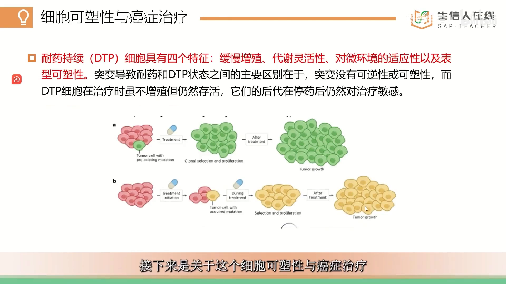

视频明确对比了两类耐药：

- **突变导致的耐药**：没有可逆性，也没有可塑性——基因组改了，就一直是耐药；
- **DTP 状态**：治疗时不增殖但仍存活，**停药后它们的后代仍然对治疗敏感**。

第二点是关键：DTP 细胞的基因组没变，变的是**状态**。这类耐药是「表型耐药」，可逆、可塑，因此不能用「找耐药突变」的思路去解决。

视频还展示了两种克隆选择的路径：左侧是**预先存在的突变**赋予内在的遗传耐药性，带有这些突变的肿瘤细胞在特定治疗方案下被克隆选择、存活并增殖；右侧是**后天获得的突变**，同样经过克隆选择、存活和增殖。

> 用本节的框架说：**突变改变的是可能性空间（G），DTP 改变的是当前位置（P）。** 二者都会让治疗失败，但对应的干预策略完全不同。

## 八、多组学：把「表型」当成高维对象来测量

### 8.1 五个层面，一条流水线

视频第二部分转向方法学：多组学是了解细胞可塑性很有前景的工具。**基因组、表观遗传和转录组层面发生的任何事情，最终都会体现在蛋白质和代谢物水平上**，这些变化导致癌细胞的重新编程、可塑性、异质性和转移。[【跳转到 10:43】](https://www.bilibili.com/video/BV1Tdr8YGEDh/?t=643)

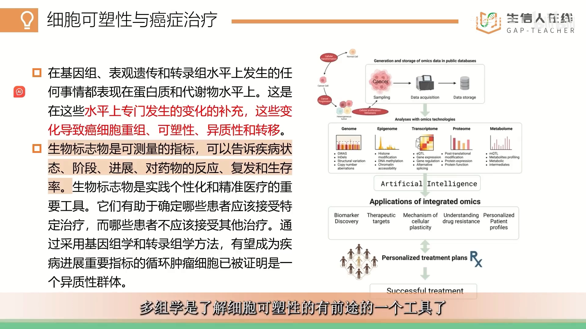

这张图把「表型」拆成了五个可测层面：

- **基因组（genome）**：GWAS、插入缺失、结构变异、拷贝数畸变；
- **表观基因组（epigenome）**：组蛋白修饰、DNA 甲基化、染色质可及性；
- **转录组（transcriptome）**：eQTL、基因表达、基因调控、可变剪接；
- **蛋白组（proteome）**：翻译后修饰、蛋白表达、蛋白功能；
- **代谢组（metabolome）**：代谢物定量、代谢中间产物。

### 8.2 每一层的证据各自说明什么

视频逐层说明了这些证据与可塑性的关系：

- **遗传细胞学证据**：癌细胞的发育通常归因于突变、拷贝数畸变、染色体分离错误或插入缺失等 DNA 损伤；这些变化会导致染色体不稳定性等通路假设，从而促进癌细胞的可塑性。可以用单细胞基因组学（如单细胞 DNA 测序）这类方法测量单个细胞的遗传学变化，了解癌细胞可能的进化路径。[【跳转到 11:08】](https://www.bilibili.com/video/BV1Tdr8YGEDh/?t=668)
- **转录组学证据**：导致可塑性的基因组事件可能带来、也可能不带来转录组变化；此外转录组中也可能存在由可变剪接或加工独立促进的事件。因此可以通过转录组分析找到癌细胞的生物标志物。[【跳转到 11:58】](https://www.bilibili.com/video/BV1Tdr8YGEDh/?t=718)
- **表观遗传学证据**：支持表观遗传在可塑性中作用的证据，在血液系统恶性肿瘤中比在实体瘤中更明显；DNA 甲基转移酶抑制剂或组蛋白脱乙酰酶抑制剂在临床上治疗实体瘤并未成功，而实体瘤的显著特征是异质性，这也可能是肿瘤干细胞可塑性的来源之一。[【跳转到 12:23】](https://www.bilibili.com/video/BV1Tdr8YGEDh/?t=743)
- **代谢组证据**：癌细胞有多种代谢变化，但代谢物水平上生成组学数据的技术仍然有限；代谢组学又与基因组规模代谢模型的计算机模型相关，这些模型可以用同一批细胞的转录组数据帮助推断代谢物水平的变化。[【跳转到 13:13】](https://www.bilibili.com/video/BV1Tdr8YGEDh/?t=793)

### 8.3 生物标志物：把「表型」压缩成可用的数

视频给生物标志物的定义很朴素：**可测量的指标，能告诉我们疾病的状态、阶段、进展、对药物的反应、复发和生存率**；它是实现个性化医疗或精准医疗的工具，有助于确定哪些患者应该接受治疗、哪些不应该。[【跳转到 14:03】](https://www.bilibili.com/video/BV1Tdr8YGEDh/?t=843)

这句话其实点出了本节的一个核心张力：**表型本身是高维连续的，但临床决策需要一个低维的、可比较的数**。生物标志物就是从高维表型里挑出来的那一个投影。投影选得好，扰动效应清晰；投影选得差，真实差异会被平均掉。

### 8.4 开放问题：可塑性是个体标志还是普遍现象

视频结尾提出的问题很有分量：癌症进展是一个异质化的过程，患者之间、患者内部都存在差异；用多组学方法从细胞异质性视角理解这些变化，而这些变化很可能就是癌细胞可塑性的结果。**那么可塑性到底是个体标志，还是普遍现象，还有待后续的数据和工具来揭开**；随着单细胞多组学工具的出现，这个问题有望得到解决。[【跳转到 14:28】](https://www.bilibili.com/video/BV1Tdr8YGEDh/?t=868)

对扰动组学来说，这个问题的实际含义是：**如果可塑性是普遍的，那么任何扰动都会引起状态漂移，你必须区分「扰动特异的响应」和「细胞本来就在漂移」**。这就是随机性（stochasticity）为什么要单独建模。

## 九、回到实验设计：三条推论

把上面所有内容压缩成本节的核心命题，可以写成一条链：

$$
\text{表型} = f\big(\text{基因型},\ \text{环境}\big) + \text{可塑性带来的状态漂移} + \text{噪音}
$$

更实用的写法是把可塑性显式放进模型：

$$
P = \underbrace{\beta_G G}_{\text{基因型主效应}} + \underbrace{\beta_E E}_{\text{环境主效应}} + \underbrace{\beta_{G \times E}\,(G \times E)}_{\text{交互}} + \underbrace{\varepsilon}_{\text{随机性}}
$$

其中 $G \times E$ 交互项就是视频里那些「依赖上下文」的现象：同一个 PIK3CA 突变，在基底细胞和腔细胞里走向不同结局；同一个 TGF-β 信号，在不同染色质状态下诱导出不同程度的 EMT。

由此得到三条设计推论：

1. **想分离基因型的效应 → 环境必须一致**：同一批培养、同一时间点、同一微环境。否则环境漂移会被误读成基因效应。
2. **想分离环境的效应 → 基因型必须一致**：同一细胞系、同一供体背景。否则测到的是「不同基因型对不同环境的平均响应」。
3. **想研究 G×E → 必须做交叉设计**：多基因型 × 多环境，否则交互项在数学上无法估计。视频里「移植到乳腺脂肪垫」「换到不同生态位」就是最朴素的交叉设计。

一句话总结：**你能否回答「基因型还是环境在起作用」，在你设计实验那一刻就已经决定了。**

## 小结

- **三个变量要分清**：基因型是可能性空间，环境是当前条件，表型是可测量的高维状态；可塑性是允许状态移动的规则。
- **可塑性有三种实现方式**：去分化（回同一谱系）、转分化（换谱系）、EMT（换表型），它们让发育谱系树上的箭头可以朝上、朝侧面走。
- **可塑性不等于干性**：干性回答「能生出什么」，可塑性回答「能变成什么」。
- **正常再生与肿瘤发生共用同一套可塑性程序**：肠道、皮肤、乳腺的例子说明，环境一变（损伤、移植），同一群细胞就能改写身份。
- **突变改变的是可塑性的开关**：Pten 缺失、PIK3CA H1047R 说明基因型不直接决定表型，而是改变细胞对环境的响应方式。
- **环境是可拆解的**：细胞层、信号层、物理层、时间层；CSC 生态位与转移级联都是具体的例子。
- **耐药分两类**：突变耐药不可逆（改 G），DTP 持留可逆（改 P）。
- **表型必须高维测量**：基因组、表观组、转录组、蛋白组、代谢组五个层面共同定义表型，生物标志物只是其中一个低维投影。
- **设计决定结论**：控制环境分离 G，控制基因型分离 E，交叉设计才能估计 G×E。

## 关键术语速查

| 术语 | 一句话解释 |
| :--- | :--- |
| 基因型（genotype） | 细胞携带的遗传信息；在扰动实验里还包括人为引入的敲除、敲低、激活 |
| 环境（environment） | 细胞所处的全部外部条件：邻居细胞、基质、氧与营养、药物与炎症刺激，以及这些条件持续的时间 |
| 表型（phenotype） | 细胞可被测量的状态；在单细胞层面是一个高维向量，而不是一个数 |
| 细胞可塑性（cell plasticity） | 细胞对内在或外在因素作出反应、重新编程并改变命运与身份的能力 |
| 去分化（dedifferentiation） | 已分化细胞逆转回同一谱系的未分化状态 |
| 转分化（transdifferentiation） | 已分化细胞转变为另一条谱系的细胞 |
| 上皮–间充质转化（EMT） | 上皮细胞失去上皮特性、获得间充质表型的过程，常伴随迁移能力增强 |
| 干性（stemness） | 自我更新并分化成一个或多个谱系的能力 |
| CSC 生态位（niche） | 由 CAF、内皮细胞、免疫细胞等组成的局部微环境，从外部维持肿瘤干性 |
| 转移起始细胞（MIC） | 在转移级联中真正能定植并形成继发肿瘤的那部分细胞 |
| 耐药持留细胞（DTP） | 治疗时不增殖但仍存活、停药后后代仍敏感的一类可逆耐药状态 |
| G×E 交互（gene–environment interaction） | 同一基因型在不同环境下效应不同，或同一环境在不同基因型下效应不同 |
| 随机性（stochasticity） | 即使基因型与环境完全相同，细胞间表达仍有差异；它决定了「多大差异才算真差异」 |
| 混杂（confounder） | 与扰动同时变化、又会影响表型的外部因素，会让因果归因失效 |
