# 肺腺癌早期上皮细胞状态图谱：AT2 到肿瘤的可塑性通路

> 视频来源：[肺腺癌上皮细胞状态和可塑性单细胞图谱 || Dr. Guangchun Han](https://www.bilibili.com/video/BV13hezzNE5q/)（B 站 · MCBRLab，讲者韩广春，MD Anderson 癌症中心）｜时长约 55 分钟
> 导读：这是一场研究组会报告，讲一项用多区域单细胞转录组 + 全外显子测序追踪早期肺腺癌的研究。本文只取与本节相关的部分：**研究者如何把「基因型」「环境」「表型」三个变量分别变成可测量的量**，以及由此找到的一条 AT2 → 中间态 → 肿瘤的可塑性通路。视频原声为英文、中文字幕为 AI 翻译，本文对术语做了订正。

## 本讲要解决的核心问题（SCQA）

**背景**：我们说细胞表型由基因型和环境共同决定。在肿瘤里，这句话有两层具体含义：基因型是驱动突变（EGFR、KRAS、TP53……），环境是肿瘤微环境与它所在的组织位置。

**冲突**：可一旦真的去测，两个困难立刻出现。第一，**同一个肿瘤里，不同细胞的转录组差异极大**，你很难说「这个肿瘤的表型是什么」；第二，**同一个肿瘤里，不同细胞携带的突变也可能不同**，你很难说「这个细胞的基因型是什么」。更麻烦的是，肿瘤旁边的「正常」组织可能已经在分子层面发生了变化（场癌变），拿它当对照并不干净。

**疑问**：在这样的样本里，怎么把基因型、环境、表型三个变量分开测量？表型应该定义在哪一层？

**回答（中心思想）**：这项研究的答案是——**用「多区域取样」把环境变成可比较的梯度，用「全外显子测序」给每个患者（进而每群细胞）贴上基因型标签，用「转录组状态向量 + 分化程度 + 元程序」三层来定义表型**。三者对齐之后，浮现出一条可塑性通路：AT2 细胞 → 中间态细胞（AIC / KRT8 阳性的 KAC）→ 肿瘤细胞；而且这条通路在 KRAS 突变型肿瘤里更明显。

## 一、研究设计：先把「环境」变成可比较的梯度

### 1.1 场癌变：为什么「正常对照」不干净

这项研究延续的是同一个课题组 2021 年发表在 Cancer Discovery 上的多区域单细胞工作。它的样本设计是：每位患者取**四个区域**——肿瘤本身（LUAD）、紧邻肿瘤的正常组织（Adj）、中间区域（Int）、远离肿瘤的正常组织（Dis）。[【跳转到 01:35】](https://www.bilibili.com/video/BV13hezzNE5q/?t=95)

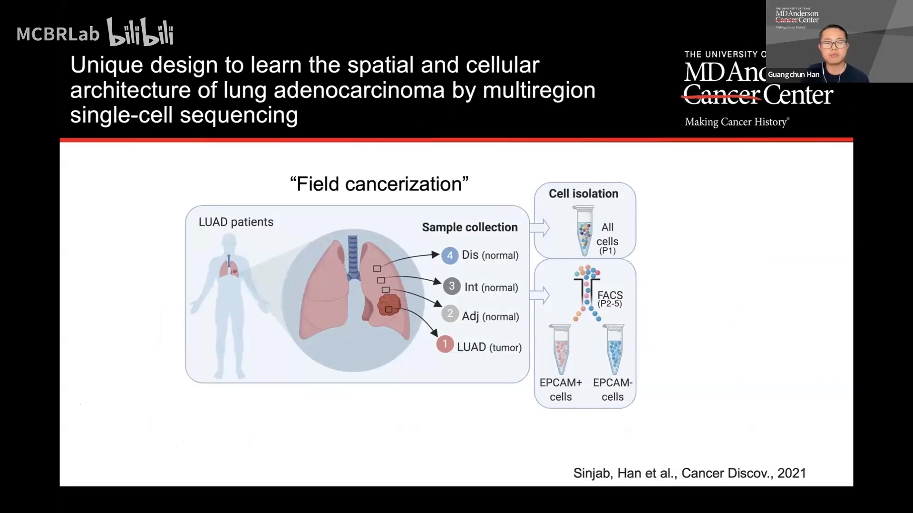

这个设计针对的是「场癌变」（field cancerization）这个概念：长期暴露在烟草致癌物下的肺上皮，**即使形态上还是正常组织，分子层面可能已经发生了改变**。所以「肿瘤 vs 正常」的二分法在这里会失效——你需要一条从远端正常到肿瘤的**空间梯度**，才能看出变化是在哪一段开始出现的。

对扰动组学来说，这是一个很直接的启发：**环境不是一个二元标签（处理/未处理），而是一条连续的梯度**；取样位置本身就是环境变量的一部分。

### 1.2 前一项研究已经看到了什么

在正式介绍新研究之前，讲者回顾了同一队列的前两项工作：他们描绘了肿瘤微环境的变化（不同个体的免疫细胞与基质细胞组成），发现 **B 细胞在肿瘤样本中相对正常区域富集**，而且这种富集有特异性——**吸烟者与非吸烟者不同**。[【跳转到 02:55】](https://www.bilibili.com/video/BV13hezzNE5q/?t=175)

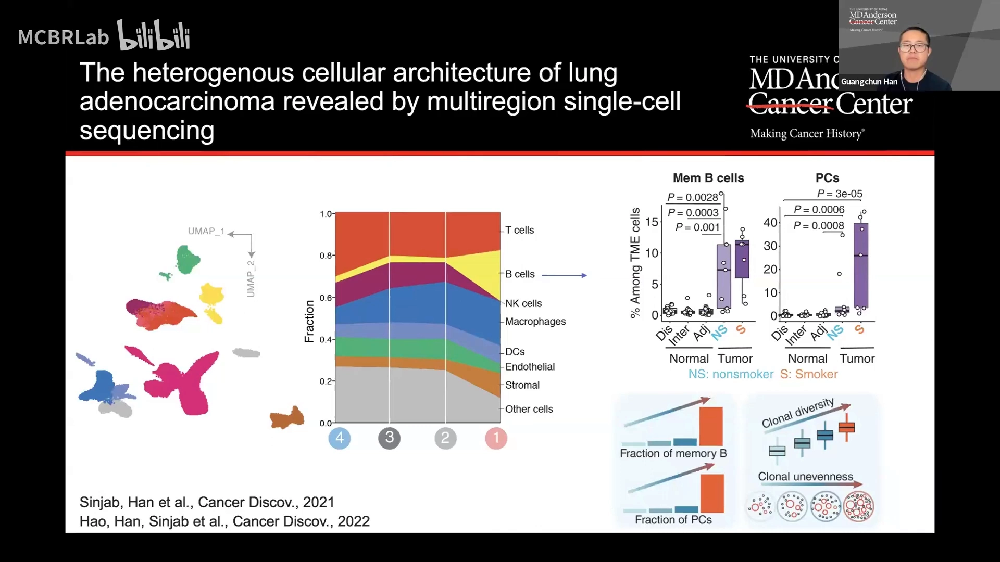

这一页其实已经演示了「G×E」的经典形态：**同一个组织位置（环境），在不同暴露史（吸烟与否）的人身上，免疫组成不同**。环境变量在这里被拆成了两层——组织位置（肿瘤/正常）与暴露史（吸烟）。

### 1.3 本项研究的两个目标

本项研究纳入 16 名患者，每位患者收集四个样本（肿瘤 + 邻近正常肺组织），做了**单细胞转录组测序**和**全外显子测序**，然后做整合的生物信息学分析。最终目标有两个：

1. 理解这一早期阶段的**肿瘤细胞异质性**；
2. 找出显示特定特征的**谱系可塑性事件**，并建立肿瘤细胞与可能产生它的正常细胞之间的联系——也就是回答「起源细胞」问题。

这两个目标正好对应本节的两个变量：**目标 1 是「表型有多分散」，目标 2 是「基因型如何通过一条状态通路变成表型」**。

## 二、表型的第一层：上皮细胞状态图谱

### 2.1 四种主要上皮状态 + 两种中间态

研究首先构建了上皮细胞的图谱。主要群体是 **AT1（1 型肺泡细胞）** 与 **AT2（2 型肺泡细胞）**，其中 AT2 最丰富；除此之外还识别出两个显示**中间特征**的群体，讲者分别称为 **AIC（alveolar intermediate cell，肺泡中间细胞）** 与 **SDP（bronchioalveolar，支气管肺泡细胞）**，它们表现出组合型的标记物表达模式。[【跳转到 06:05】](https://www.bilibili.com/video/BV13hezzNE5q/?t=365)

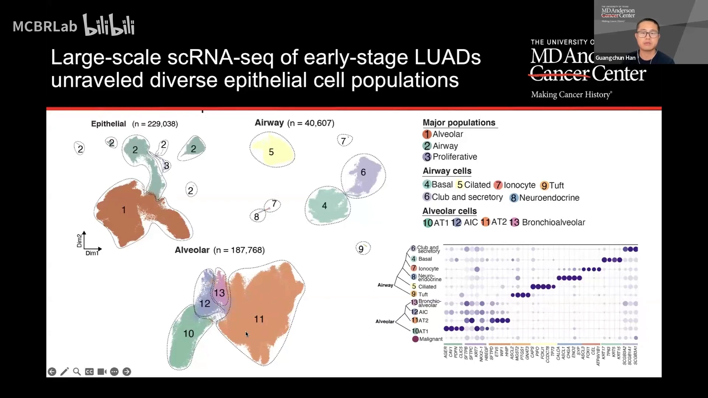

此外，由于细胞数量庞大，还鉴定出几种罕见群体：基底细胞、纤毛细胞、**离子细胞（ionocyte）**、**簇细胞（tuft cell）**、神经内分泌细胞等。

**这里有一个方法论要点值得初学者记住**：所谓「中间态细胞」，不是靠人工命名出来的，而是靠**标记物组合**识别出来的——它们同时表达 AT2 和 AT1 的部分标记，又不完全像任何一个。这正是本节说的「表型是高维向量」的具体体现：**状态是连续谱上的一段，而不是离散的格子**。

### 2.2 恶性细胞：约一万七千个细胞，以及「谱系特异性丢失」

接下来，研究者用拷贝数变异（CNV）特征结合表达谱聚类，从所有患者的肿瘤样本中识别出约 **17,064 个恶性细胞**。[【跳转到 07:42】](https://www.bilibili.com/video/BV13hezzNE5q/?t=462)

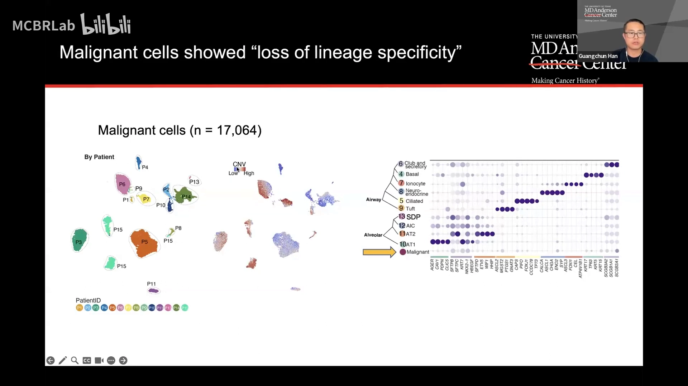

这张图的标题就是结论：**恶性细胞表现出「谱系特异性丢失」（loss of lineage specificity）**。看右侧的气泡图：正常 AT1、AT2 细胞各自有明确的标记基因高表达，而恶性细胞那一行（黄色箭头所指）几乎是「一片模糊」——AT1 和 AT2 的标记都低，同时表达一些正常肺泡细胞不表达的基因。

这是本节一个非常重要的观察：**恶性转化在表型上的第一个标志，不是「表达得更多」，而是「身份变得不清楚」**。用状态空间的比喻说，细胞从谱系树上掉了下来，落到了树之间的空白区域。

## 三、基因型：驱动突变谱与「基因型标签」

### 3.1 全外显子测序给出的突变谱

对肿瘤样本和匹配的正常样本做全外显子测序后，研究者确定了每位患者的驱动突变。最常见的突变是 **EGFR**，其次是 **TP53** 与 **KRAS**；此外还有 SETD2、SMAD4、MET 等，以及一名患者的融合事件。由于队列规模限制，分析主要聚焦在 EGFR 与 KRAS 这两类常见驱动突变上。[【跳转到 09:10】](https://www.bilibili.com/video/BV13hezzNE5q/?t=550)

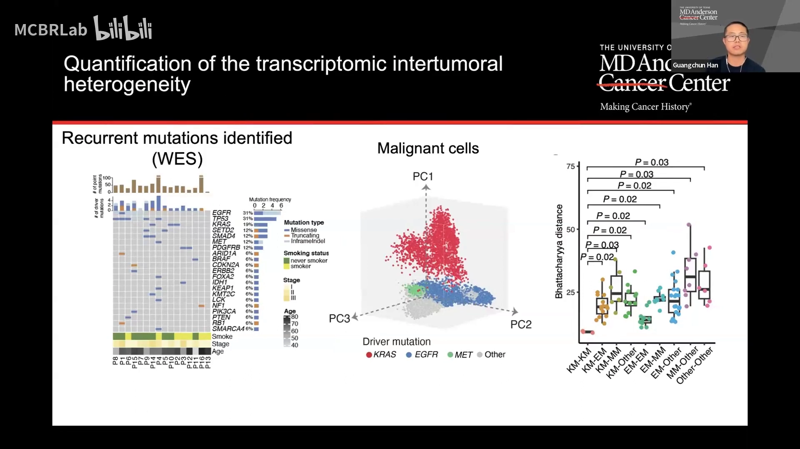

这张幻灯片右侧是本节最值得学的一步操作：**把基因型标签投射到表达空间，再用距离度量去量化差异**。

- 中间的三维 PCA 图上，每个点是一个恶性细胞，颜色是驱动突变类型；可以看到 **KRAS 突变的恶性细胞沿 PC1 轴与其余细胞明显分开**；
- 右侧箱线图用 **Bhattacharyya 距离**量化不同突变组之间的转录组差异：KRAS 样本内部（KM-KM）距离最低，而 KRAS 与 EGFR 之间（KM-EM）距离显著增加。

这实际上是「G×E」的一个定量版本：**基因型（驱动突变）改变了细胞的转录组位置，而「位置差多少」是可以被算出来的**。距离度量就是判断「表型差异有多大」的尺子。

### 3.2 基因型在单细胞里是逐细胞不同的

讲者在讨论中反复提到一个限制：某些突变亚型（例如 MET 突变）只有一位患者、捕获的细胞也太少，因此无法给出可靠统计结论。这提示了一个在扰动实验里同样成立的事实：**基因型标签在单细胞层面是有分辨率的**——它取决于你测了多少细胞、测得多深、以及样本里有多少种基因型。

## 四、表型的第二层与第三层：分化程度与元程序

### 4.1 分化程度：用转录组复杂性当尺子

研究使用了一个叫 **CytoTRACE** 的计算工具，它的思路来自斯坦福大学的一项研究：在单细胞水平上，**转录组复杂性可以作为细胞分化程度的预测指标**（分化程度越低的细胞，表达的基因种类越多、越「杂」）。[【跳转到 11:42】](https://www.bilibili.com/video/BV13hezzNE5q/?t=702)

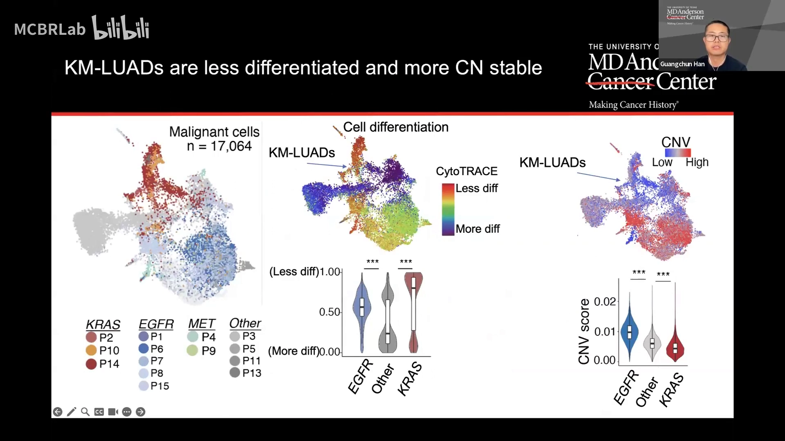

结果很清楚：**KRAS 突变的恶性细胞相比其他突变组分化程度更低**（CytoTRACE 评分更接近「less differentiated」一端），同时 **CNV 评分更低**（拷贝数更稳定）。

注意这里同时用了两个不同性质的指标：CytoTRACE 是**表型**指标（转录组复杂性），CNV 评分是**基因型**指标（拷贝数）。两者在同一张图上对齐，才能得出「KRAS 型肿瘤更去分化、但基因组更稳定」这种双变量结论。

### 4.2 元程序：把「状态」压缩成可比较的签名

最后一层是**元程序（meta-program，MP）**。研究领域已经积累了大量单细胞数据，两项已发表的独立研究用计算方法从多种肿瘤类型中总结出一套相对一致的元程序。研究者把这套元程序特征用到肺腺癌队列上，量化每个恶性细胞簇的元程序水平。[【跳转到 14:03】](https://www.bilibili.com/video/BV13hezzNE5q/?t=843)

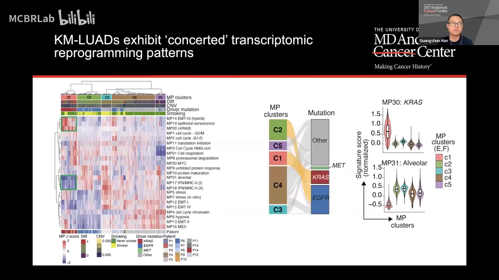

热图的读法是：每一行是一个元程序（MP14 EMT-III、MP19 epithelial senescence、MP30 KRAS、MP1/MP2 细胞周期、MP6 hypoxia、MP13 EMT-II、MP16 MES……），每一列是一类恶性细胞的无监督聚类，顶部色条标注了分化程度、CNV、驱动突变、吸烟状态。

结论是：**KRAS 突变的恶性细胞在元程序层面呈现出「协同的转录组重编程」模式**——它们不是零散地改变几个基因，而是整组程序一起切换。这解释了一个初学者常有的困惑：为什么「敲一个基因」有时会引发巨大的表型变化？因为基因处在程序里，程序是成组开关的。

> 三层表型的对照：**细胞状态（AT1/AT2/AIC）是「在哪」，分化程度是「离起点多远」，元程序是「正在运行哪套程序」**。三者合起来才是一个完整的表型描述。
## 五、把基因型与表型接起来：中间态细胞是桥梁

### 5.1 中间态细胞在肿瘤里富集

研究者注意到，AIC 与 SDP 这两个中间态群体在 UMAP 上位于 AT2 与 AT1 之间的「桥梁」位置。于是他们检查了这些细胞的比例：如果它们与肿瘤发生相关，那么在肿瘤样本中应该富集。[【跳转到 16:52】](https://www.bilibili.com/video/BV13hezzNE5q/?t=1012)

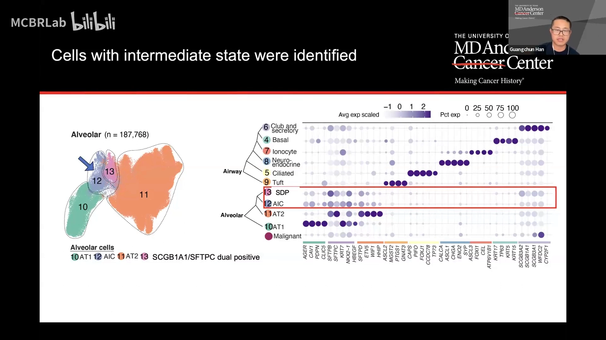

结果是：**AIC 在肿瘤样本中显著富集**，而 SDP 未显示显著结果。这一步很朴素但很关键——它把「这群细胞看起来像中间态」变成了「这群细胞在疾病状态下更多」，从描述走向了关联。

### 5.2 轨迹分析：AT2 → AIC → AT1 或肿瘤

接着研究者把 AIC 与 AT1、AT2 细胞合并，构建发育轨迹。轨迹的起点是 AT2 细胞，随后分成两支：**下层分支通向正常的 AT1 细胞，上层分支的末端是恶性细胞**，而且末端带有 KRAS 突变的富集。[【跳转到 18:41】](https://www.bilibili.com/video/BV13hezzNE5q/?t=1121)

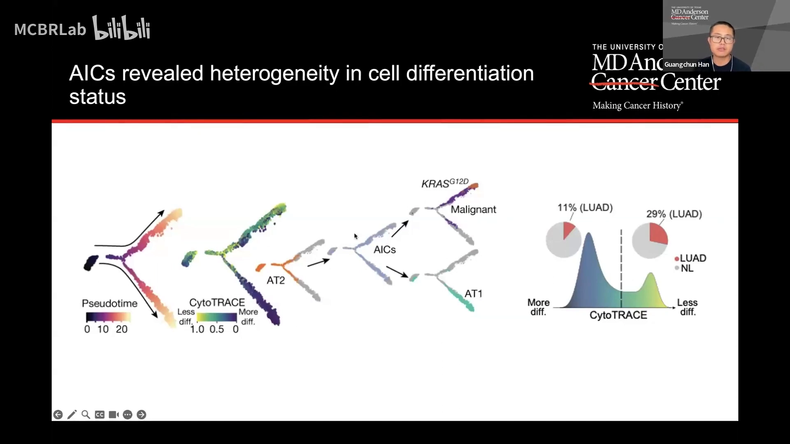

右侧那张 CytoTRACE 分布图值得单独看：AIC 的分化程度呈**双峰**，一个峰更去分化、另一个峰更接近分化状态；而肿瘤样本中「更去分化」那一侧的比例（29%）明显高于正常肺组织（11%）。

**这就是「表型是连续量」的直接证据**：同一个被命名为「AIC」的群体，其实包含分化程度不同的两部分细胞；如果只按群体标签做比较，这个内部差异会被平均掉。

### 5.3 亚群分析：KRT8 阳性的 KAC

对 AIC 做亚群分析后，研究者分出两个簇：一个高表达 **KRT8、CDKN2A、PLAUR、CLDN4、CDKN1A** 等基因，被称为 **KAC（KRT8-positive alveolar intermediate cell）**；另一个是其余 AIC。[【跳转到 20:21】](https://www.bilibili.com/video/BV13hezzNE5q/?t=1221)

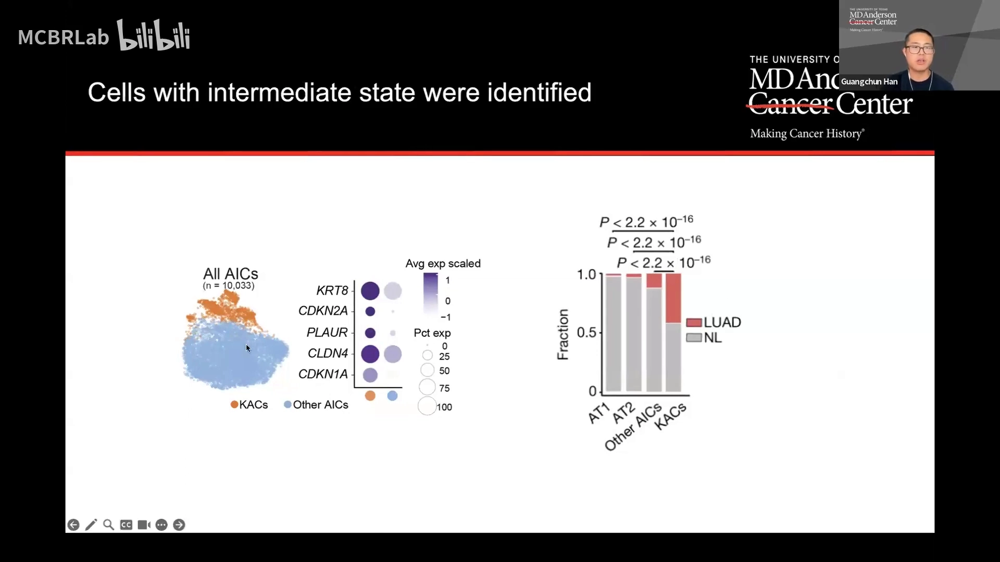

右侧比例图显示：在 AIC 与 KAC 两个群体中，来自肿瘤样本（红色）的比例都显著高于正常肺组织（灰色），统计检验的 $P$ 值小于 $2.2 \times 10^{-16}$。而 KAC 的富集程度更高。

KRT8 阳性、CDKN2A 高表达、处于去分化状态——这组特征在文献里常被称为「损伤相关的过渡状态」。**它的意义在于：细胞在受到损伤或致癌刺激时，会先进入一个可逆的过渡态，而不是直接变成肿瘤**。这个过渡态就是可塑性最具体的形态。

## 六、空间验证：把「环境」的位置信息补回来

单细胞测序把细胞打散了，位置信息丢失。为了验证 KAC 在组织中的真实位置，研究者用了两种空间技术。

### 6.1 DSP：邻近正常区域也「脏」了

在 14 号患者上做的数字空间剖面（DSP）分析显示：不仅肿瘤区域的标记基因得到验证，**KAC 的标记物在「肿瘤邻近区域」也相对富集，但在远端正常肺组织中不富集**。[【跳转到 21:34】](https://www.bilibili.com/video/BV13hezzNE5q/?t=1294)

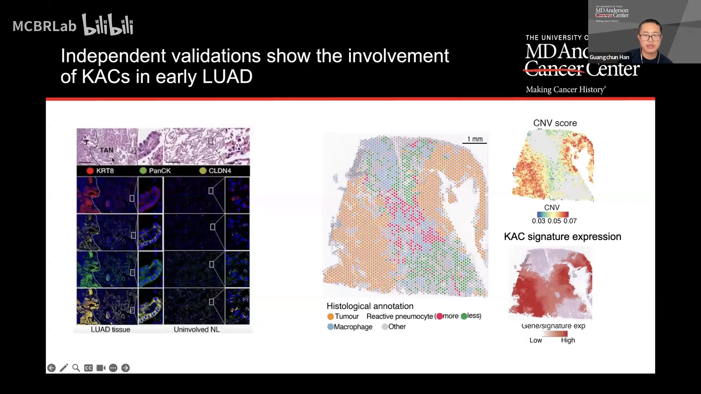

这一结果回到第一节的「场癌变」：**紧挨着肿瘤的那圈组织，分子状态已经不一样了**。如果实验设计里把「邻近正常」当成干净的对照，就会低估扰动效应，甚至把环境效应误判成扰动效应。

### 6.2 10x 空间转录组：反应性区域是「桥」

在同一名患者的 10x 空间转录组数据上，研究者识别出两个肿瘤区域，并在它们之间观察到**反应性区域**；这些反应性区域按强弱可分为两组，其中更强的那组正好连接两个肿瘤区域。

换句话说，**空间上「肿瘤—反应性区域—肿瘤」的排列，与单细胞轨迹上「AT2—KAC—肿瘤」的排列是对应的**。两条独立证据链指向同一个结构，这就是多模态验证的价值。

## 七、公共数据与预后：这个特征能不能迁移

研究者把这个中间态特征做成一个可计算的签名，拿到公共数据上验证：[【跳转到 24:14】](https://www.bilibili.com/video/BV13hezzNE5q/?t=1454)

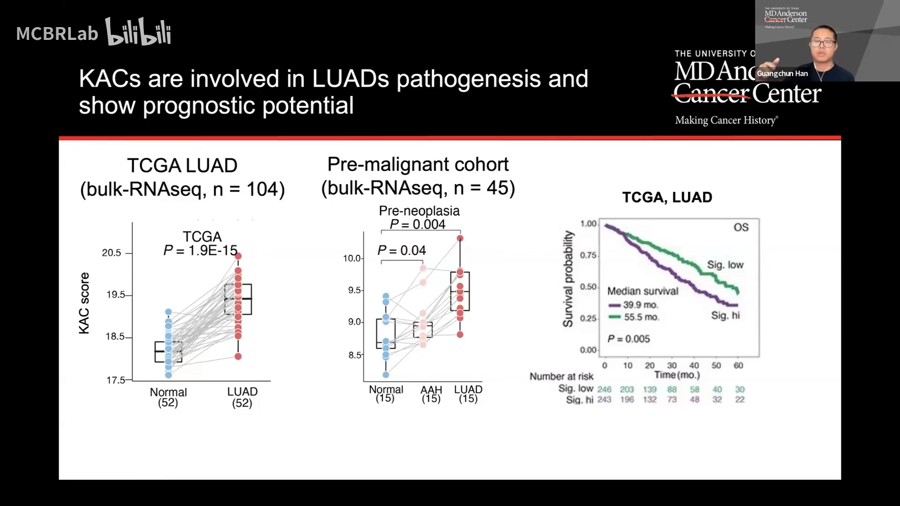

- **TCGA 肺腺癌（bulk RNA-seq，n = 104）**：肿瘤样本的 KAC 评分显著高于配对的正常样本（$P = 1.9 \times 10^{-15}$）；
- **癌前病变队列（n = 45）**：从正常 → 不典型腺瘤样增生（AAH）→ 肺腺癌，KAC 评分逐步升高；
- **生存分析**：KAC 签名低的组中位生存 55.5 个月，高的组 39.9 个月（$P = 0.005$）。

这一步的意义在于：**一个从单细胞状态里提取出来的签名，可以在 bulk 数据上复现，并且带有临床信息**。这提示「状态」不只是描述性概念，它可以被压缩成一个数，成为可用的生物标志物。

## 八、动物模型：把基因型和环境都控制住

### 8.1 致癌物诱导的 KRAS 突变小鼠

为了做因果验证，研究者使用了一个基因工程小鼠模型（GEMM）：携带 KRAS 突变，并经过烟草致癌物（NNK）处理，能够发育出肺部肿瘤。他们收集了两个时间点的样本：**暴露结束时（EOE）** 与 **暴露后 7 个月**，做单细胞测序。[【跳转到 27:34】](https://www.bilibili.com/video/BV13hezzNE5q/?t=1654)

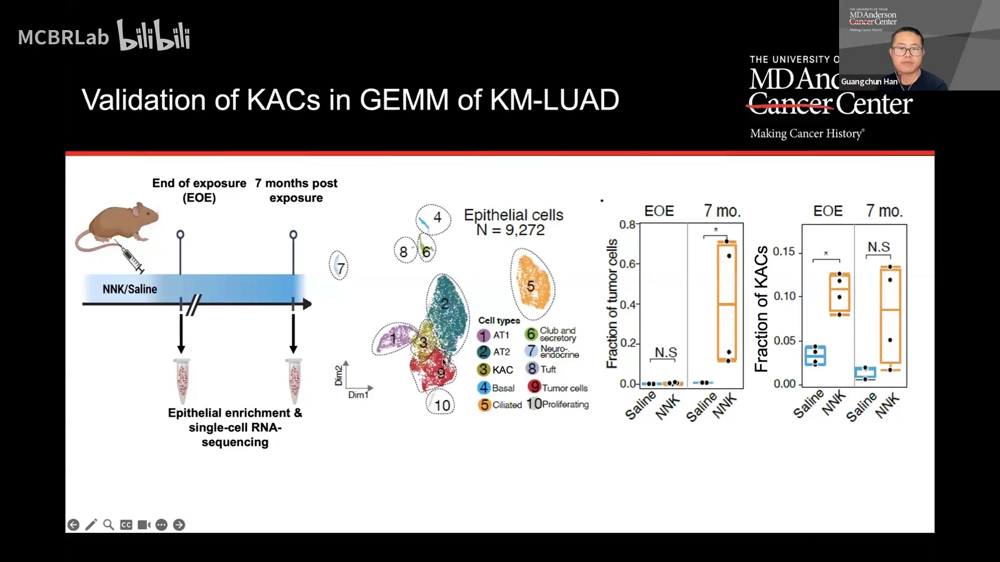

在小鼠数据中，研究者识别出与人类等效的细胞群体：AT1、AT2、**KAC**、以及肿瘤细胞。关键结果是：

- **肿瘤细胞只在暴露后 7 个月出现**；
- **KAC 在暴露结束的早期时间点就已经出现**，并在 7 个月时保持。

这正好符合「中间态是通路上的早期事件」这一推论。**时间点在这里就是环境变量**：同样的基因型（KRAS 突变 + NNK 暴露），在不同时间点给出的表型完全不同。

### 8.2 空间验证：签名在肿瘤中心最高

在小鼠肺组织的 10x 空间数据上，KAC 签名与 KRAS 签名都呈现**从肿瘤主体向外递减的梯度**，在肿瘤周围的反应性区域仍然可见。[【跳转到 29:39】](https://www.bilibili.com/video/BV13hezzNE5q/?t=1779)

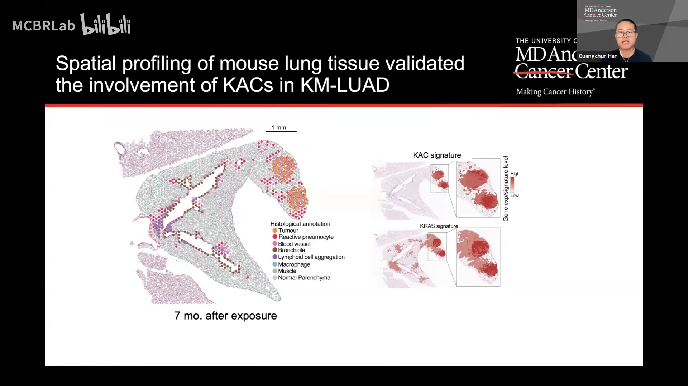

这个梯度是「环境」最直观的样子：**同一个签名，随空间位置连续变化**。它同时说明，用「肿瘤 vs 正常」二分去比较，会把梯度信息压成一个差值。

### 8.3 谱系标记：证明 KAC 来自 AT2

最后一步是谱系追踪。研究者使用了一只能够特异性标记 AT2 细胞的小鼠（用 *Sftpc* 启动子驱动 CreER，配合 Rosa26 报告基因），在 NNK 处理后收集 GFP 阳性的细胞做单细胞测序。[【跳转到 34:14】](https://www.bilibili.com/video/BV13hezzNE5q/?t=2054)

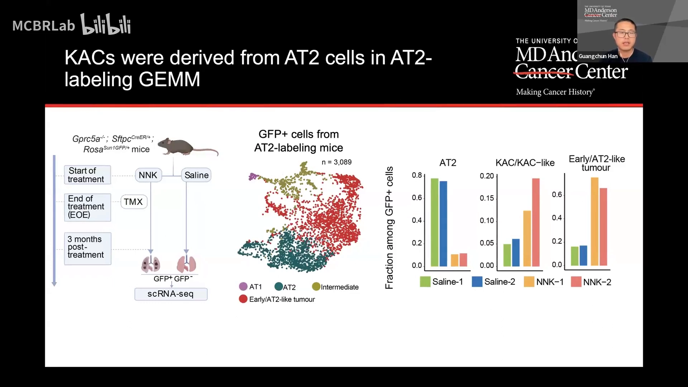

结果显示，被标记的 AT2 细胞后代中同时包含 **AT1、AT2、中间态（KAC/KAC 样）以及早期 AT2 样肿瘤细胞**；并且与盐水对照组相比，NNK 处理组的 KAC 与早期肿瘤样细胞比例显著升高。

**这是本节最硬的证据**：同一批被标记的细胞，在致癌物（环境）作用下，走向了不同的状态，其中一部分变成了肿瘤样细胞。基因型没变（都是同一只小鼠的 AT2 后代），变的是环境和状态——这就是「表型可塑性」在体内被直接看到的例子。

## 九、这套做法对扰动实验的五条启示

讲者最后把整项研究总结成一个「模块化计算框架」，包含六个可复用的模块：祖细胞预测、轨迹刻画、分化状态分析、转录组复杂性量化、基于 scRNA-seq 的突变/CNV 筛查、以及临床特征（发病机制/生存）的整合。[【跳转到 36:54】](https://www.bilibili.com/video/BV13hezzNE5q/?t=2214)

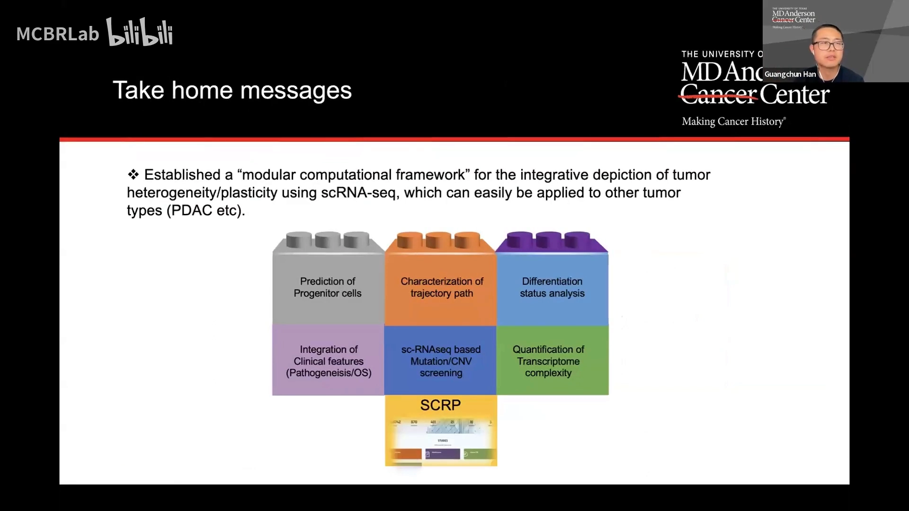

把它翻译成扰动实验的设计原则：

1. **基因型要单独测，不能默认相同**。同一个样本里不同细胞的突变、CNV、gRNA 都可能不同；不测，就不知道自己在比较什么。
2. **环境要做成梯度，而不是二分**。多区域取样、多个时间点、多个剂量，比「处理 vs 未处理」提供更多信息。
3. **表型要多层定义**。细胞状态（聚类/注释）、分化程度（CytoTRACE 类指标）、程序活性（元程序/通路打分）是三个不同层次的读出，缺一层就会漏掉一类效应。
4. **状态是连续量，群体标签会掩盖异质性**。AIC 内部的双峰分布提醒我们：把细胞硬分到离散的簇里，会平均掉真正的差异。
5. **轨迹 + 谱系追踪 + 空间位置，是三种互补的因果线索**。轨迹给出顺序，谱系追踪给出来源，空间给出位置；三者一致时，结论才稳。

## 小结

- **研究设计的核心是把变量变成可测量的量**：多区域取样量化环境梯度，WES 给基因型贴标签，转录组状态 + 分化程度 + 元程序定义表型。
- **场癌变让「正常对照」不再干净**：邻近肿瘤的组织在分子层面已经改变，KAC 标记物在邻近区域富集、在远端正常组织不富集。
- **恶性细胞的第一特征是「谱系特异性丢失」**：不是表达更多，而是身份变得不清楚。
- **基因型差异可以用距离量化**：KRAS 与 EGFR 突变的恶性细胞在表达空间里明显分开，Bhattacharyya 距离给出了差异的大小。
- **KRAS 突变型更去分化、CNV 更稳定、元程序呈协同重编程**：同一层次的表型指标要成组看。
- **中间态是桥梁**：AT2 → AIC/KAC（KRT8 阳性）→ AT1 或肿瘤；AIC 在肿瘤中富集，且内部呈分化程度双峰。
- **空间验证补回位置信息**：DSP 与 10x 空间数据都显示签名沿「肿瘤—反应性区域—正常」递减。
- **动物模型把基因型和环境都控制住**：NNK + KRAS 突变小鼠中，KAC 早于肿瘤出现；AT2 谱系标记证明 KAC 来自 AT2。
- **签名可以迁移**：KAC 评分在 TCGA、癌前队列与生存分析中都可复现。

## 关键术语速查

| 术语 | 一句话解释 |
| :--- | :--- |
| 场癌变（field cancerization） | 长期致癌物暴露使一片看似正常的组织在分子层面已经改变，肿瘤只是其中最明显的一点 |
| AT1 / AT2 | 1 型与 2 型肺泡上皮细胞；AT2 是肺腺癌最主要的候选起源细胞 |
| AIC（alveolar intermediate cell） | 肺泡中间细胞，同时表达 AT1 与 AT2 部分标记的过渡状态群体 |
| KAC（KRT8+ alveolar intermediate cell） | AIC 中高表达 KRT8、CDKN2A、PLAUR、CLDN4 的亚群，在肿瘤中显著富集 |
| SDP（bronchioalveolar） | 支气管肺泡样群体，与 AIC 一样处于中间状态，但在本队列中未显示显著富集 |
| CNV 评分 | 由表达谱推断的拷贝数变异程度，用来区分恶性与非恶性细胞 |
| CytoTRACE | 用转录组复杂性预测细胞分化程度的计算工具，评分越低越「去分化」 |
| 元程序（meta-program，MP） | 由大量单细胞数据总结出的一组协同表达的基因程序，如细胞周期、EMT、缺氧 |
| Bhattacharyya 距离 | 衡量两个分布之间差异的距离度量，这里用来量化不同突变组细胞的转录组差异 |
| DSP（digital spatial profiling） | 数字空间剖面技术，在保留组织位置的前提下定量区域内的基因表达 |
| GEMM | 基因工程小鼠模型，用于在体内验证基因型与环境的因果作用 |
| 谱系追踪（lineage tracing） | 用遗传标记给特定细胞打上永久记号，追踪它们的后代走向 |
| 伪时间（pseudotime） | 由轨迹分析推断出的细胞发育顺序，是一个相对时间而不是真实时间 |
