# 单细胞扰动实验的重复怎么设：配对取材、混样与细胞捕获数

> 视频来源：[单细胞组学之实验设计](https://www.bilibili.com/video/BV1RM4y1171p/)（Bilibili · 否定之否定Lty）｜时长约 60 分钟
> 导读：这是一堂面向科研人员的技术培训课（课件来自美吉生物），按「取材 → 生物学重复 → 混样 → 分选 → 细胞捕获数 → 抽核 → 质检 → 验证」的顺序，把单细胞项目的实验设计逐环节讲了一遍。本文只取与「对照组与实验组怎么摆」直接相关的部分：对照该配在什么位置、重复该设几个、样本量不够怎么办、哪些技术参数会悄悄变成混杂因素。字幕为 B 站 AI 生成，错拼（如「火药」「雌株」「抽盒」「双爆率」「抑制性」「石城」）已按上下文订正为混样、磁珠、抽核、双胞率、异质性、10x。

## 本讲要解决的核心问题（SCQA）

**背景**：单细胞扰动实验的产出是一张「基因 × 细胞」的矩阵，看起来只要把扰动组和对照组的细胞分别聚出来、比一比差异基因就行。

**冲突**：但差异基因的来源远不止扰动本身。同一组内部的个体差异、取样部位的代表性、样本量不足导致的统计功效不够、细胞捕获数带来的双胞率与背景升高——这些都会在矩阵里留下与扰动同量级甚至更大的差异。讲者反复强调的一句话是：**单细胞是一个降维的过程，样本、细胞、基因三个维度里任何一个没控制住，结论就站不住。**

**疑问**：对照应该配在取材这一步还是配在分析这一步？生物学重复到底要几个？样本量不够能不能混样？细胞上多少个才算够？

**回答（中心思想）**：**单细胞扰动实验的对照必须「配对」在取材环节，而不是事后在数据里找**——最干净的对照来自同一个体、同一块组织、同一个时间窗的另一半样本；在此之上，用**生物学重复**把组内个体差异压下去，用**混样**在样本量不足时换取细胞数，用**细胞捕获数**控制技术性混杂。这四件事共同决定了「差异能不能归因于扰动」。

## 一、实验设计的骨架：先造出表型差异，再分三个维度看

讲者开篇把单细胞实验的设计逻辑压成一句话：**先经过实验干预或条件处理，形成一个表型差异，才有后续可比较的东西。**

这个表型差异可以来自两种情形：

- **自然条件**：病人与非病人；
- **人为干预**：在小鼠体内接种肿瘤，或用药物、基因操作处理细胞。

有了表型差异，才能去研究目标基因。而单细胞相对于 bulk 多出来的那个维度，正是「目标细胞」：bulk 只有「样本 × 基因」两个维度，单细胞是「样本 × 细胞 × 基因」三个维度。三个维度各自能回答不同的问题——细胞层面看分化状态、细胞构成、有没有疾病特异的细胞类型；基因层面看细胞内的表达变化和样本间的表达变化。

讲者在这里给了一条很实用的设计建议：**实验处理要丰富**。处理越多、时间点越复杂，可比较的点就越多，故事越好讲；但相应地，**就必须把对照组别设计好**。这句话点出了本节的主题：处理越复杂，对照越不能省。

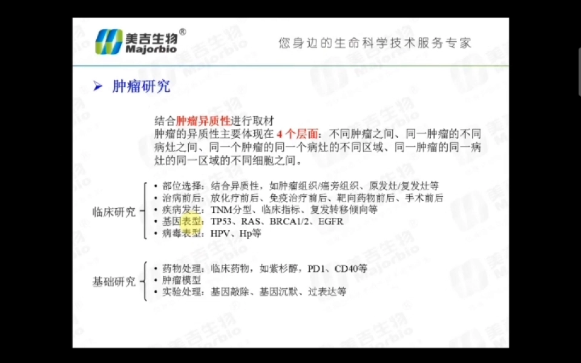

[【跳转到 09:21】](https://www.bilibili.com/video/BV1RM4y1171p/?t=561)

## 二、对照从取材开始：同一病人的另一半组织才是最干净的对照

### 2.1 肿瘤的四个异质性层面

讲者先讲肿瘤研究，因为肿瘤的取材最难。肿瘤异质性体现在四个层面：

1. 不同肿瘤之间（如淋巴瘤、肝内胆管癌）；
2. 同一肿瘤的不同病灶之间（相当于转移灶）；
3. 同一肿瘤、同一病灶的不同区域（中间区域 vs 边缘区域）；
4. 同一肿瘤、同一病灶、同一区域的不同细胞之间。

第四层才真正进入细胞层面。前三层说明一件事：**在肿瘤研究里，「取一块肿瘤」和「取另一块肿瘤」本身就可能是一次组间差异**。如果不把这个差异和扰动/处理造成的差异分开，对照就是假的。

### 2.2 临床研究里的五种「配对」

讲者把临床研究的对照逻辑讲得很清楚：**取肿瘤组织时，顺便也要取癌旁组织**。理由不是「多一组数据好看」，而是——

> 这样能保证它来源于同一个病人，生物学背景基本上是一致的，比较起来也更方便。

这就是配对对照（paired control）的核心：**让对照与实验组共享尽可能多的背景**。同一个人身上的癌与癌旁，共享遗传背景、年龄、性别、用药史、取材与运输条件，剩下的差异才更可能来自「癌」这个自变量。

除了「肿瘤 vs 癌旁」，讲者还列了四种可以做出对照的维度：

| 对照维度 | 实验组 | 对照组 |
| --- | --- | --- |
| 部位 | 肿瘤组织 | 癌旁组织（同一病人） |
| 病程 | 原发灶 | 复发灶 |
| 治疗 | 治疗前 | 治疗后（如耐药病人手术前后） |
| 疾病发生 | 按 TNM 分型、临床指标、复发倾向分层 | 分层之间互为对照 |
| 基因表型 | TP53 高表达病人 | TP53 低表达病人 |
| 病毒表型 | HPV 阳性、幽门螺杆菌（Hp）感染 | 阴性/未感染 |

讲者的评价是：把这些维度叠起来，「故事能讲得更丰富」。但每多一个维度，就多一层混杂风险——这一点在第四部分讲样本量时会再出现。

### 2.3 基础研究：三种「人为扰动」的对照

临床样本拿不到时，讲者建议用基础研究去支撑。这里的对照逻辑更接近扰动组学：

- **药物处理**：可以设给药梯度（微量、过量），看药理情况、耐药机制或治疗机制；
- **肿瘤模型**：皮下接种、诱导成瘤；
- **实验处理**：对关键基因做**敲除、沉默、过表达**，再测序，去看这个基因究竟有没有那么重要。

最后一条正是 Perturb-seq 这类实验的原型：**扰动组（敲除/沉默/过表达）必须对照未扰动组**，而两者的差别应当只在于那一个基因。

## 三、生物学重复：把组内个体差异从组间差异里剥出来

### 3.1 生物学重复的五个作用

讲者给「生物学重复」下了一个功能性定义：它的意义主要是**减少组内个体之间差异性的干扰，去体现真实的组间差异**。具体有五条：

1. 减少组内个体差异干扰，体现真实的组间差异；
2. 评估差异表达基因的**可靠性**；
3. 用重复之间的相关性**辅助筛查异常样本**——比如取了十几个病人样本，其中一个与其他明显偏离，就可以考虑剔除（可能是取错部位，或这个病人不典型）；
4. 检验生物学实验操作的**可重复性**；
5. 现实角度：不设生物学重复，部分杂志可能因此拒稿。

第 3 条最容易被忽略，也最实用：**重复不只是用来算 p 值的，它还是一把筛样本的尺子。** 一个和同组其他样本都对不上的样本，往往在分析开始前就已经告诉你取材出了问题。

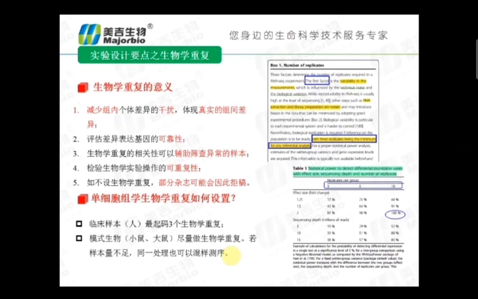

[【跳转到 16:51】](https://www.bilibili.com/video/BV1RM4y1171p/?t=1011)

### 3.2 设几个：临床至少 3 个，模式生物尽量做

讲者的建议很具体：

- **临床样本（人）**：最起码 3 个生物学重复；
- **模式生物（小鼠、大鼠）**：尽量做生物学重复，做了肯定更好；
- 如果样本量实在不足，**同一处理可以混样测序**（见第四部分）。

他还给了一组趋势数据：2018 年到 2019 年年中，发育分化方向的文章平均约 5 个样本；到 2020 年 11 月已攀升到约 11 个样本。同时，现在的单细胞文章基本需要 **3 个生物学重复左右**、并设计 **3 个时间点**；而更早的时候可能只设计两个时间点，重复有的有、有的没有。**分越高，重复要求越高**，这是讲者反复提到的现实压力。

### 3.3 统计功效：重复数决定你能不能看见效应

幻灯片右侧引了 Box 1「Number of replicates」：决定重复数的因素包括**技术噪声、效应量（effect size）、生物学变异**，其中生物学变异最麻烦，因为它无法通过改实验流程来消除，只能靠重复数去平均。

旁边的 Table 1 把这件事量化了：在给定的测序深度下，检出差异表达基因的统计功效随效应量和重复数上升——**效应量只有 1.25 倍时，3 个重复的功效仅 17%，增加到 5 个、10 个重复也只到 25%、44%**；效应量到 1.5 倍时三个档位分别是 43%、64%、91%；到 2 倍时才接近 82%、98%、100%。

这张表对扰动实验的含义很直接：**如果你的扰动效应本来就温和（比如 CRISPRi 敲低只带来 1.2～1.3 倍的表达变化），那么 3 个重复根本不够。** 这时候要么加大效应量（提高敲低效率、延长处理时间），要么加重复，否则阴性结果说明不了「没有效应」，只说明「没看见」。

## 四、混样：样本量不足时用细胞数换个体数

讲者把「混样」（pooling）单列一节，因为它在单细胞里几乎不可避免。

**什么情况下可以混样？** 取材量少时，需要样本混合才能得到足够的细胞数。他举了几个文献里的做法：一篇文章取了差不多 3 只小鼠混在一起；另一篇用 5 条鱼混成一个部位去测。小鼠的海马体、脊髓这类部位确实量太少，病人活检样本也可能不够，这时混样是合理的折中。

**混样换来了什么、又失去了什么？** 换来的是足够的细胞数（否则连聚类都做不了）；失去的是**个体层面的分辨率**——混样之后你无法再区分「这个差异来自处理」还是「来自混进去的那几只里某一只特别不一样」。讲者给的建议是：如果实在不够，就**多取几个位点**来取样，而不是无限混下去。

对扰动实验来说，混样还有一个额外的好处：**把处理组与对照组的样本混进同一个 10x 通道**，可以让两组共享同一批试剂、同一次测序，批次效应从设计上就被消掉了。这与「两组分别建库、分别测序」相比，是控制混杂最彻底的做法。

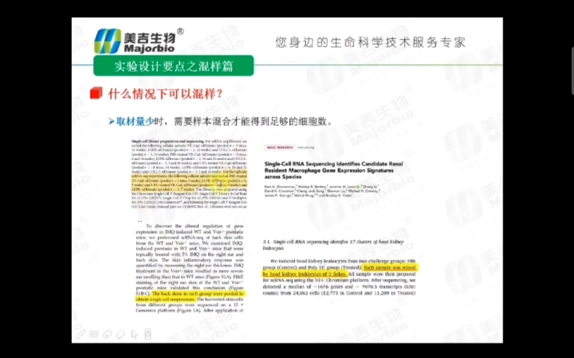

[【跳转到 18:06】](https://www.bilibili.com/video/BV1RM4y1171p/?t=1086)

## 五、对照不能只靠「多取」，还要靠「取对位置」

### 5.1 肿瘤：样本代表性 A > B > C > D

讲者用一张示意图把取样策略排了序。同一块肿瘤，四种取法：

| 方案 | 做法 | 代表性 |
| --- | --- | --- |
| A | 取不同部位的多个块状样本，**分别检测** | 最好 |
| B | 取不同部位的多个块状样本，**混在一起检测** | 次之 |
| C | 取随机部位的一个横切面样本 | 再次 |
| D | 取随机部位的一个块状样本 | 最差 |

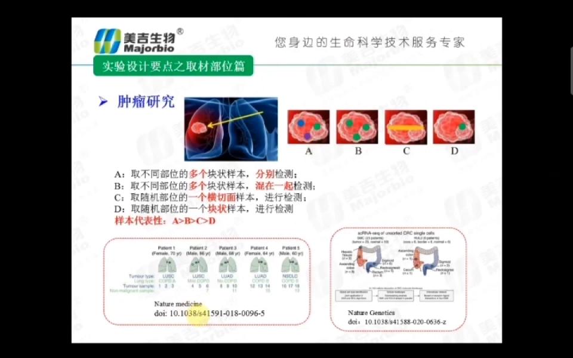

[【跳转到 28:04】](https://www.bilibili.com/video/BV1RM4y1171p/?t=1684)

他举了一篇 Nature Medicine 的肺癌研究：5 位病人，每位切 3 个部位（编号 1-2-3、4-5-6……），用多部位分别检测来对付肿瘤的不均匀性。而对**对照样本**，讲者的说法很干脆：**取癌旁组织，一般取一个也 OK**。

这句话背后的逻辑值得点出来：**实验组需要更多重复去平均异质性，对照组不需要**，因为对照组的「异质性」本身就是你要测的基线的一部分。真正要小心的是两者**取样条件必须对称**——如果实验组取了 3 个部位、对照组只取 1 个部位，那么「部位数」就成了一个新的无关变量。

### 5.2 非肿瘤疾病：按器官特点定「疾病位 vs 健康位」

非肿瘤疾病涉及器官太多，讲者的原则是结合器官与组织特点：肝脏异质性相对较好，可取疾病发生的特殊部位，同时取相同部位的正常样本；脑的异质性大、特殊部位多，就必须先确定好取样部位（他举例某研究明确定位到额前叶的一小块）。

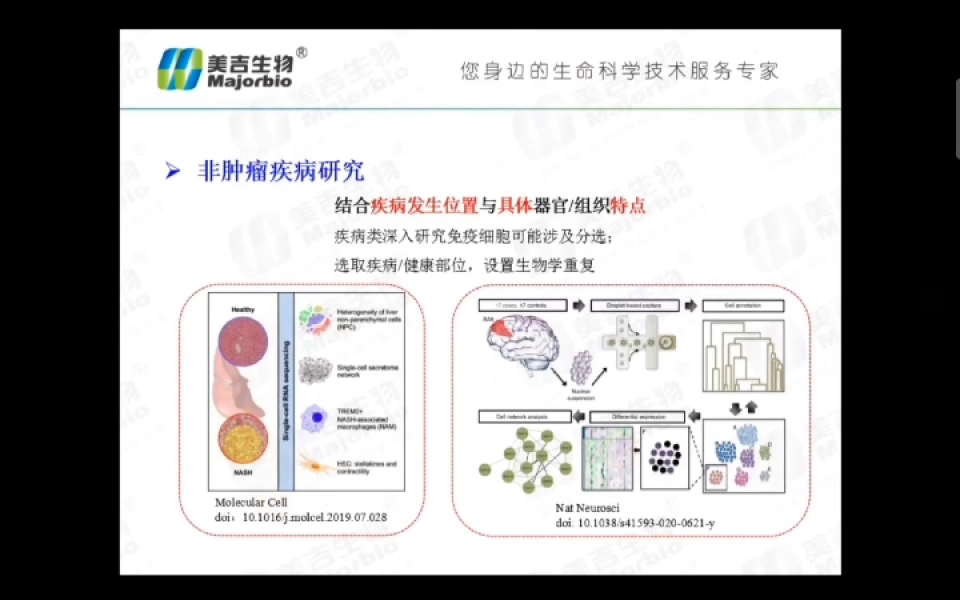

[【跳转到 29:24】](https://www.bilibili.com/video/BV1RM4y1171p/?t=1764)

## 六、细胞捕获数：一个被当成「越多越好」的无关变量

这一节是全讲最反直觉的部分。很多人的默认假设是「细胞上得越多越好」，讲者用三条理由说明为什么不是。

### 6.1 捕获数越高，背景越杂

细胞捕获数与细胞悬液的稀释体积紧密相关：**捕获数越高，补水量越少**，背景信息就越杂，进而影响后续细胞类型判定。换句话说，为了多抓细胞而浓缩悬液，会把环境 RNA、碎片、死细胞的内容一起浓缩进去。

### 6.2 捕获数越高，双胞率越高

双胞（doublet）是油包水结构里一个液滴包进了多个细胞。10x 官方测试的结果是：**细胞捕获数越高，双胞率越高**。双胞带来的后果是连锁的：

- 细胞个数虚高（双胞也被算成了一个细胞）；
- 表达量虚高（里面不止一个细胞，某些基因相当于双倍）；
- 对细胞亚群判定产生很大影响。

讲者预先回应了「不是有软件可以去双胞吗」：软件只是事后的校正算法，本身不一定准确，**双胞太多时校正就会带来偏差**——不如防患于未然，前面就别上那么多细胞。

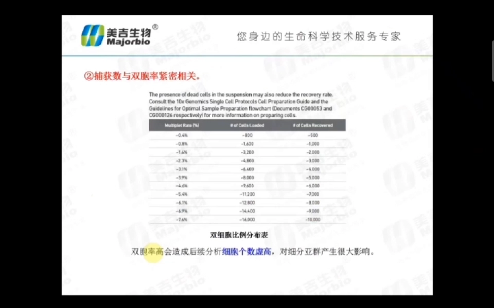

[【跳转到 25:08】](https://www.bilibili.com/video/BV1RM4y1171p/?t=1508)

### 6.3 细胞太少也不行：2500 是一条线

反过来，细胞太少同样有害。讲者引了一篇文章的结论：在测序深度影响相对较小的情况下，**2500 个细胞时细胞分群的准确度会迅速降至 80% 以下，500 个细胞时准确度降至 60% 以下**；而且与测序深度相比，细胞采样的复制变异性也更高，在细胞数较低时这种变异性还会增加。

结论：**细胞数官方没有明确要求，建议 2500～10000 之间**；从已发表文章看，平均细胞捕获数基本在 5000～10000。**不宜太少，也不宜太多。**

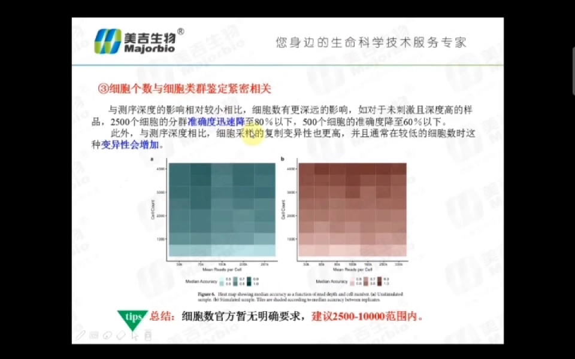

[【跳转到 25:39】](https://www.bilibili.com/video/BV1RM4y1171p/?t=1539)

### 6.4 为什么这一节属于「对照」问题

因为细胞捕获数是一个典型的**隐藏无关变量**：它同时影响双胞率、背景 RNA 比例、每个细胞的测序深度，而这三者都能改变表达谱。如果扰动组上了 15000 个细胞、对照组只上了 3000 个，那么两组之间的差异里必然混着「双胞率不同」和「背景不同」的贡献。**把两组的捕获数控制在同一个区间，是配对原则在技术参数上的延伸。**

## 七、视频其余部分：与对照相邻的四个环节

讲者后半段还讲了分选、抽核、质检和验证。它们不是对照本身，但每一项都会影响「两组可比性」，这里各取要点。

### 7.1 要不要分选：能不分就不分

判断标准是实验目的是否需要深入分析微量细胞类型。两种方法各有取舍：

| 维度 | 流式分选 | 磁珠分选 |
| --- | --- | --- |
| 速度与通量 | 4 h 最多 70000 cells | 4 h 可达 10⁶ cells |
| 纯度 | >90% | 80～90% |
| 参数 | 多参数（多种荧光标记组合） | 每次只能一个参数 |
| 技术难度 | 需调节仪器参数，较高 | 无需调节仪器，操作简单 |
| 优势 | 多参数、不同荧光强度分选 | 操作简单、速度快、细胞活性好 |
| 缺点 | 细胞类型丢失、细胞活性降低 | 单参数，双阳性细胞需分两次 |

讲者的建议是**如果能不分选就不分选**：分选最大的缺点是活性会降低，而且如果要做，**分选完必须立刻上机**（1～2 小时内），否则细胞状态会明显变差。

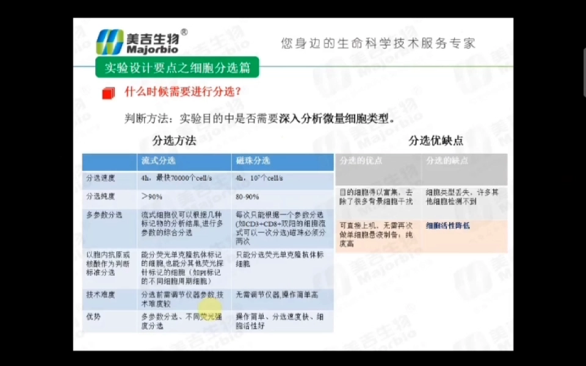

[【跳转到 19:27】](https://www.bilibili.com/video/BV1RM4y1171p/?t=1167)

### 7.2 抽核还是抽细胞：什么时候必须用单细胞核转录组

四种情况建议做单细胞核转录组（snRNA-seq）：

1. 没有新鲜组织，只有**冷冻样本**；
2. 某些细胞**消化后很敏感**、活性低；
3. 送样前要经过**病理检测**、需要保存较长时间；
4. 某些亚群（如脑部神经元、星形胶质细胞）**很难通过解离获得**。

优势有三：细胞类型捕获更准确（更接近机体真实情况）；没有解离过程，不会造成人为改变、能反映转录本真实情况；冷冻与新鲜样本都能做。**最大的缺点**是只能获得细胞核内或群体水平的 mRNA 信息。

讲者用一篇肾脏研究量化了这个取舍：snRNA-seq 相对 scRNA-seq 有更低的解离偏差；scRNA-seq 对足细胞、内皮细胞和系膜细胞的检出率非常低，而 snRNA-seq 检出足细胞的比例是 scRNA-seq 的 20 倍（2.4% vs 0.12%）。

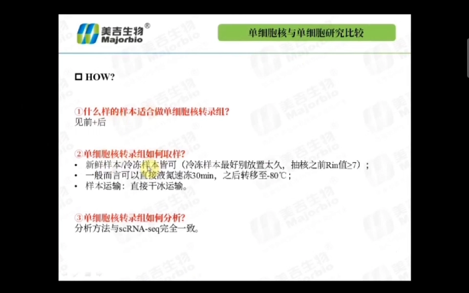

[【跳转到 43:12】](https://www.bilibili.com/video/BV1RM4y1171p/?t=2592)

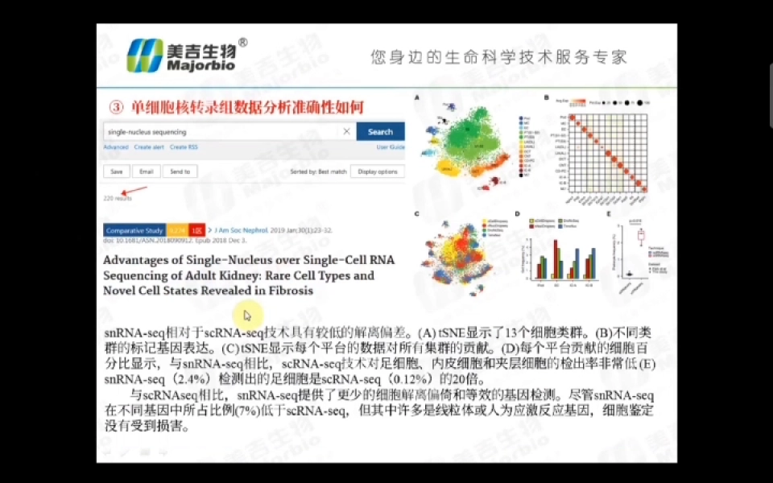

[【跳转到 41:07】](https://www.bilibili.com/video/BV1RM4y1171p/?t=2467)

### 7.3 质检：上机前的那一小时

单细胞悬液的质检要点：

- 细胞状态：**不能成团、碎片少、存活率大于 80%（最好大于 90%）**，细胞直径小于 40 μm，不能存在逆转录酶和非细胞的核酸（否则会造成背景杂音）；
- **目标细胞占比**：如果目标细胞（比如辅助性 T 细胞）占捕获总细胞的比例不到 10%，建议先做流式或磁珠富集；
- 细胞总数：解离完成后一般要求 5 万个以上；
- **悬液制备完成后 1～2 小时内必须确定是否上机**，达到标准就立刻安排。

抽核的质检类似：抽核前活细胞比率理论大于 90%，核膜不破裂、光滑圆润，核数一般建议大于 15000 才能上机，且**1 小时内**就要安排上机（核更容易降解）。

### 7.4 验证：把测序结论拿回实验里核对

讲者最后讲了实验验证。为什么要验证？因为转录组本质上是数学模型，二代测序整体准确，但具体到某些基因或转录本（尤其是存在多个剪接体时）就不一定准，所以要用实验方法互相 check，做到**干湿结合**。

验证分三个层面：

- **细胞类型/细胞比例**：免疫荧光、免疫组化、FACS、smart-seq2；
- **细胞类型功能**：免疫荧光、bulk-seq；
- **关键基因/marker**：免疫荧光、免疫组化、FISH、qPCR、bulk-seq、基因敲除/沉默/过表达；
- **机制探索**：模型鼠、细胞系、临床药物处理；
- **临床用药指导**：治疗前后比较。

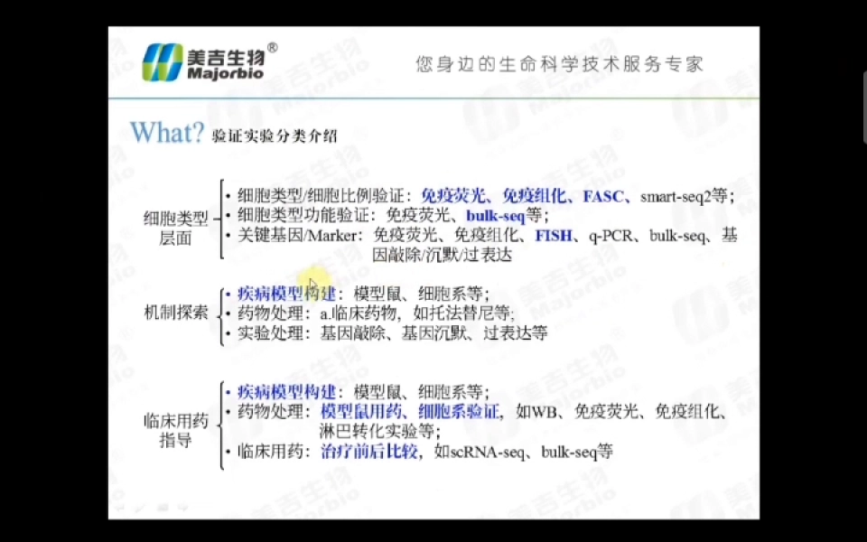

[【跳转到 57:20】](https://www.bilibili.com/video/BV1RM4y1171p/?t=3440)

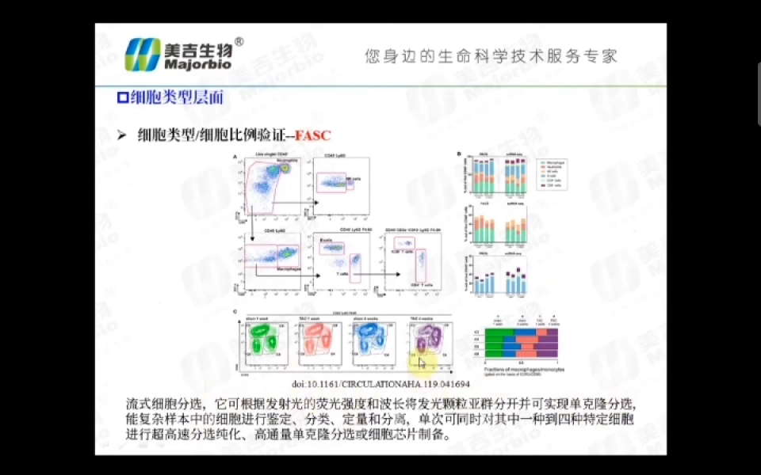

[【跳转到 58:58】](https://www.bilibili.com/video/BV1RM4y1171p/?t=3538)

## 小结

- **先有表型差异，才有对照**：单细胞实验的设计起点是「自然条件或人为干预造成的表型差异」，处理越丰富，对照越不能省。
- **最干净的对照是配对对照**：同一病人的癌旁组织、同一病人的治疗前后、同一病灶的不同区域——共享的背景越多，剩下的差异越可能来自自变量。
- **生物学重复是用来剥组内差异的**：五个作用里最实用的是「用重复之间的相关性筛异常样本」；临床样本至少 3 个重复，模式生物尽量做。
- **重复数决定你能否看见效应**：效应量 1.25 倍时 3 个重复的功效只有 17%，10 个重复也只到 44%；温和扰动需要更多重复或更大的效应量。
- **样本量不足时用混样换细胞数**：代价是失去个体分辨率；把处理组与对照混进同一个通道，则能顺带消掉批次。
- **细胞捕获数是一个隐藏的无关变量**：太高则背景杂、双胞率高，太低则分群准确度掉到 80% 以下；建议 2500～10000，且两组必须落在同一区间。
- **技术参数必须两组对称**：取几个部位、分不分选、抽核还是抽细胞、上多少细胞，任何一项只在一边做，都会变成新的混杂因素。

## 关键术语速查

| 术语 | 一句话解释 |
| --- | --- |
| 配对对照 | 与实验组共享同一个体、同一时间窗背景的对照，如同一病人的癌旁组织 |
| 生物学重复 | 独立个体/独立样本的重复，用来平均组内个体差异；与同一份样本的技术重复不同 |
| 混样（pooling） | 把多个样本混合后一起建库测序，用个体分辨率换取足够的细胞数 |
| 双胞（doublet） | 一个液滴中包进多个细胞，会让细胞数与表达量虚高；捕获数越高越常见 |
| 统计功效 | 在给定效应量与重复数下，能检出真实差异的概率；效应量越小、重复越少，功效越低 |
| 细胞捕获数 | 一次上机目标捕获的细胞数量，建议 2500～10000，过高带来双胞与背景，过低损失分群准确度 |
| 单细胞核转录组（snRNA-seq） | 抽细胞核而非完整细胞测序，适合冷冻样本、难解离细胞；代价是只拿到核内 RNA 信息 |
| 解离偏差 | 酶解过程对不同细胞类型的偏好性丢失，会让细胞比例偏离真实情况 |