# 对照实验的本质是控制无关变量：从溶剂对照到单一变量原则

> 视频来源：[【科研训练】科学实验设计入门](https://www.bilibili.com/video/BV1pY411B7xq/)（Bilibili · 胶原三螺旋）｜时长约 35 分钟
> 导读：这是中山大学附属第五医院分子影像中心为科研零基础研究生开设的入门课第一讲。讲者用一道高考真题加四个真实实验室案例，把「实验目的—对照实验—科学假说」三个要素讲透。本文只沿「对照」这条线整理：为什么 control 的本义是「控制无关变量」、溶剂对照（vehicle）怎么设、为什么一次只能改一个因素、无关变量为什么难以发现。字幕为 B 站 AI 生成，错拼（如「皮细胞」「白水白介素」「事迹」「雌株」）已按上下文订正为脾细胞、白介素、试剂、磁珠。

## 本讲要解决的核心问题（SCQA）

**背景**：在做细胞扰动实验时，我们习惯把「扰动组」和「对照组」的表达谱放在一起比，把两者的差异当成扰动本身的效应。这个做法背后有一个默认前提：除了扰动，两组之间别的条件都一样。

**冲突**：这个前提在真实实验里几乎从不自动成立。细胞的代数、培养基的批次、试剂的新旧、加药的顺序、成像的角度，任何一项变了，都会在结果里留下一个不比扰动小的差异。讲者举的例子很直接：一位同学把荧光标记的多肽注射到小鼠体内，看到关节处亮了起来，结果「貌似很酷，科学价值几无」——因为他没有任何一组数据能排除「关节本来就有自发荧光」这类解释。

**疑问**：对照到底在控制什么？一个合格的对照组应该长什么样？为什么有的实验做了对照仍然推不出结论？

**回答（中心思想）**：**对照（control）的本义就是「控制无关变量」**——除自变量这一个因素外，其余所有因素都与实验组保持一致，结果才有可比性。因此设计对照的第一步不是「顺手加一组」，而是先穷举可能影响结果的无关变量，再让每一组对照**只改变一个因素**。这条原则直接决定了单细胞扰动实验里对照组该怎么摆：扰动的「自变量」只有一个，但能污染结果的因素有一长串。

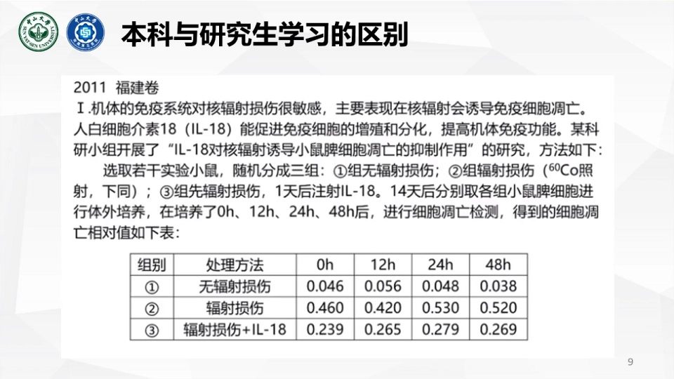

[【跳转到 07:54】](https://www.bilibili.com/video/BV1pY411B7xq/?t=474)

## 一、先把实验的骨架说清楚：自变量、对象、因变量

### 1.1 一道高考题里的完整实验

讲者开场没有直接讲对照，而是先拿 2011 年福建省高考生物的一道题做解剖。题面背景是教科书式的结论：机体免疫系统对核辐射损伤很敏感，核辐射会诱导免疫细胞凋亡；人白细胞介素 18（IL-18）能促进免疫细胞增殖分化、提高免疫功能。题目接着给出研究：「IL-18 对核辐射诱导小鼠脾细胞凋亡的抑制作用」，方法是取小鼠随机分成三组：

1. ① 组：无辐射损伤；
2. ② 组：辐射损伤（⁶⁰Co 照射）；
3. ③ 组：先辐射损伤，1 天后注射 IL-18。

14 天后取各组小鼠脾细胞体外培养，在 0 h、12 h、24 h、48 h 检测细胞凋亡，得到一张凋亡相对值的表。讲者的意思是：**这就是一个科学实验的完整骨架**，研究生每天面对的就是这类「分组 + 处理 + 读数」的信息。

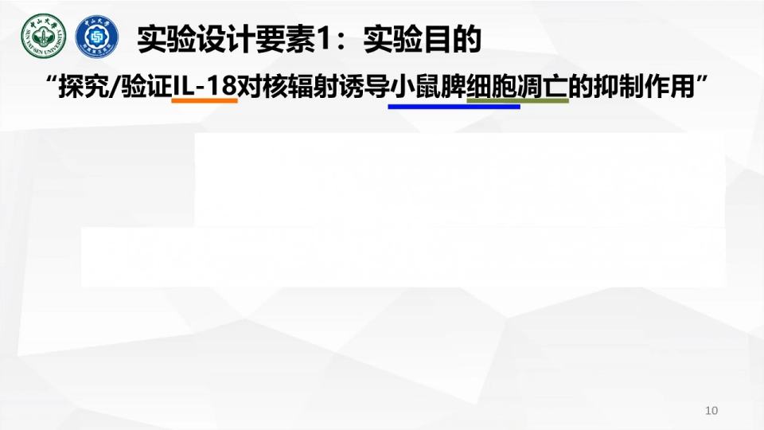

[【跳转到 09:28】](https://www.bilibili.com/video/BV1pY411B7xq/?t=568)

### 1.2 实验目的的固定句式

把这句话拆开，三个关键词各归其位：

| 成分 | 在这道题里 | 含义 |
| --- | --- | --- |
| 实验对象 | 小鼠脾细胞 | 你要研究的那个东西，不是大鼠也不是人 |
| 自变量 | IL-18 | 人为控制、施加在对象上的处理因素 |
| 因变量 | 细胞凋亡 | 因为自变量改变而改变的变量 |

讲者给了一个可以套用的句式：**「探究/验证自变量 X 对实验对象的因变量 Y 的影响或作用」**。他还提醒了一个细节：开头用「验证」暗含实验者对结果已有预判，用「探究」则表示预判不确定。这个区别在第五部分讲「科学假说」时会重新出现。

为什么先讲这个？因为**对照组的数量由自变量决定**。一个实验里只有一个自变量，就只需要一组对照；有两个自变量，就得有能分别把它们拆开的对照。这一点在第三部分会展开。

## 二、对照实验：control 控制的是「无关变量」

### 2.1 无关变量：除自变量以外所有能影响结果的因素

讲者先引了人教版高中生物教材的定义：除自变量以外，实验过程中还存在一些对实验结果会造成影响的可变因素，这些变量统称为**无关变量**。他特别强调，教材里说「一些」是客气了——在研究生每天的实际操作里，无关变量可能是无数的：

- 做动物实验：动物的年龄、性别、体重、生理状况；
- 做细胞实验：细胞数量、细胞代数；
- 环境：温度、湿度；
- 做反应：分子浓度、溶剂选择、反应时间；
- 做免疫组化：抗体品牌、试剂新旧、加药（加样）顺序。

一句话概括：**只要不是你想人为改变的那个变量，都是无关变量。**

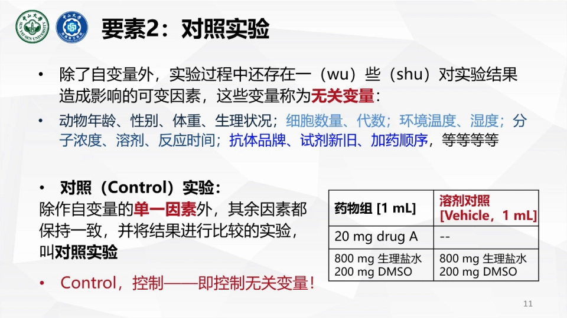

[【跳转到 12:05】](https://www.bilibili.com/video/BV1pY411B7xq/?t=725)

### 2.2 定义与那个「控制」的疑问

对照实验的定义是：**除自变量的单一因素外，其余所有因素都跟实验组保持一致，并将结果能够进行比较的实验。**

讲者在这里分享了一个他自己备课时的困惑，也是全讲最值得记住的一处：英文把对照组叫 control，中文译成「对照」，可 control 明明是「控制」——控制的是什么？他的答案是：**control 控制的就是无关变量**。所以对照实验本质上是一台「无关变量过滤器」，而不是「一组什么都不做的细胞」。

这个视角一转，很多设计问题就顺了：对照组不是「空白」，它是**被精心安排成与实验组处处相同、只差一个因素**的那一组。

### 2.3 溶剂对照（vehicle）：一个不起眼却标准的例子

讲者给了一个日常实验的例子。假设你发明了一个药物，想放到细胞里试效果：药物组是 20 mg 药物溶在 1 mL 溶剂里。可这 1 mL 溶剂里其实还有 800 mg 生理盐水和 200 mg DMSO——**两个溶剂的剂量远远超过药物本身**。那么细胞上看到的效应，凭什么说是药物造成的，而不是 DMSO 或生理盐水造成的？

答案是加一组 **vehicle 组（溶剂对照组）**：不加药物，只加完全相同体积、相同配方的溶剂。

| 药物组（1 mL） | 溶剂对照（Vehicle，1 mL） |
| --- | --- |
| 20 mg drug A | —— |
| 800 mg 生理盐水 | 800 mg 生理盐水 |
| 200 mg DMSO | 200 mg DMSO |

如果溶剂组无效、而药物组有效，药效才可以归因于药物。这就是一个最标准的对照实验：它控制住了「溶剂」这个无关变量。

对单细胞扰动实验来说，这一栏几乎可以原样搬过来：用 CRISPRi 做敲低时，「加了慢病毒、加了诱导剂、加了抗生素」的扰动组，其对应的对照必须也经历慢病毒转导、诱导、抗性筛选的全过程，只是携带的 sgRNA 不靶向任何基因。**载体本身、病毒转导、药物筛选都是溶剂**。

### 2.4 缺对照的代价：多肽 Q 的案例

第二个例子来自真实的实验室。某同学合成了一个荧光标记的多肽 Q，尾静脉注射到正常小鼠，一天后用活体成像和病理切片观察，发现关节、软骨组织中有荧光信号。他很高兴地去找老师，老师看完说：**结果貌似很酷，但科学价值几无**。

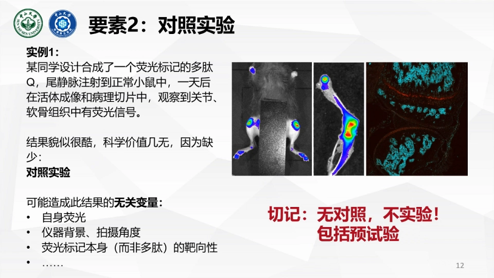

[【跳转到 16:55】](https://www.bilibili.com/video/BV1pY411B7xq/?t=1015)

原因就是缺对照。如果想说「多肽 Q 能选择性靶向关节组织」，那么至少还有千百种基于无关变量的解释没被排除：

- **自身荧光**：很多组织本身就有自发荧光；
- **仪器背景与拍摄角度**：活体成像的角度也可能对信号造成干扰；
- **荧光标记本身（而非多肽）的靶向性**：可能是你挂上去的那个荧光染料分子靶向关节，跟多肽没关系。

讲者把这三个都写在幻灯片上，并配了一句口号：**切记：无对照，不实验！包括预实验。** 他的建议是养成一个习惯——开始任何实验前先问自己一句：「我今天实验的对照是什么？」

### 2.5 对扰动实验的映射

把这三条无关变量翻译到单细胞扰动里，几乎一一对应：

| 视频里的无关变量 | 单细胞扰动实验里的对应物 |
| --- | --- |
| 自身荧光 | 细胞自身的背景表达、环境 RNA（ambient RNA）污染 |
| 仪器背景、拍摄角度 | 测序深度、批次、10x 通道差异 |
| 荧光标记本身的靶向性 | 载体骨架、Cas 蛋白表达、病毒转导与抗性筛选带来的效应 |

最后一条尤其容易被忽略：**扰动组和对照组之间差的不能只是「目标基因被敲低」，还要确认两者都经历了同样多的操作**。

## 三、一次只改一个因素：对照组的数量由自变量个数决定

### 3.1 抗体案例：一个实验里其实有两个自变量

第三个例子是一个预实验。文献和产品手册报道某一抗试剂适用于**石蜡切片的免疫组化**，但没提它是否适用于**冰冻切片的免疫荧光**。某同学想在自己的冰冻切片免疫荧光实验里用这支抗体，于是做了一个预实验：直接用该抗体在冰冻切片上做免疫荧光。

讲者的评价是：这个设计「有很多可以探讨、可以改进的地方」。为什么？因为仔细分析会发现，这个实验里其实有**两个自变量**：

1. 切片的形式（冰冻 vs 石蜡）；
2. 显色的方式（免疫组化 vs 免疫荧光）。

只做一组实验、而这一组同时改变了两个条件，那么一旦失败，你并不知道是哪一个自变量造成的。

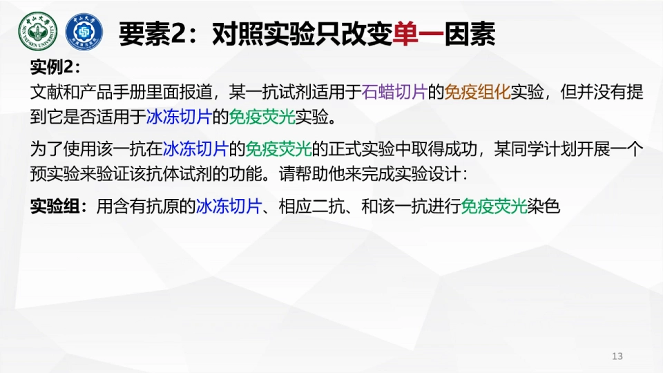

[【跳转到 17:05】](https://www.bilibili.com/video/BV1pY411B7xq/?t=1025)

### 3.2 三组对照，每组只动一个因素

正确的做法是让每一组对照只改变一个条件：

| 组别 | 切片 | 显色方式 | 作用 |
| --- | --- | --- | --- |
| 实验组 | 冰冻 | 免疫荧光 | 你想做的那件事 |
| 对照 1 | 冰冻 | 免疫组化 | 对应自变量 1（显色方式） |
| 对照 2 | 石蜡 | 免疫荧光 | 对应自变量 2（切片形式） |
| 对照 3 | 石蜡 | 免疫组化 | 控制无关变量（复现文献条件） |

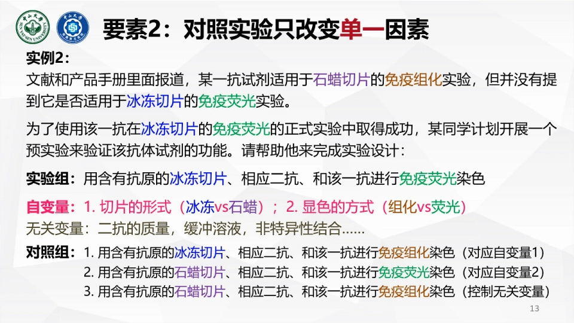

[【跳转到 19:10】](https://www.bilibili.com/video/BV1pY411B7xq/?t=1150)

这样设计的好处，讲者说得很实在：**你不会有完完全全的失败**。因为无论结果如何，你总能知道是哪一个因素出了问题，并且拿到一点点结果。

### 3.3 第四组：把文献方法原样复现一遍

讲者还补了一组常被忽略的对照。除了上面三组，考虑到真实存在的其他无关变量——比如实验里的二抗和文献里的二抗质量不一样、缓冲溶液出了问题、样本组织存在非特异性结合——最好再加一组：**把文献或产品手册里的方法一模一样地做一遍**（石蜡切片 + 免疫组化）。

如果这一组能做出来，就说明「除抗体以外的实验条件、实验材料都没有问题」。这是一组很典型的**阳性对照**思路：它不检验你的新条件，它检验你的体系能不能跑通。体系跑不通时，实验组阴性并不说明抗体不行。

### 3.4 这条原则怎么用在单细胞扰动上

单细胞扰动实验同样常常一次动两个因素。比如「CRISPRi 敲低基因 X + 加药物处理」：如果只设一组「敲低 + 加药」和一组「不敲低 + 不加药」，那么任何差异都无法拆开。要拆开，至少需要 2×2 的四组：

- 不敲低、不加药（基线）；
- 敲低、不加药（扰动本身）；
- 不敲低、加药（药物本身）；
- 敲低、加药（交互作用）。

讲者那句「每一个对照实验只改变一个条件」，在这里就是**析因设计**的雏形。

## 四、无关变量的隐蔽性：连 Nature Communications 也会踩

### 4.1 LOX 探针案例

第四个例子来自一篇 Nature Communications（2020）上的工作。某课题组测试一种靶向 LOX 酶活性的新型荧光染料分子：该分子与 LOX 酶反应后会被点亮、显示荧光。他们在肝纤维化小鼠模型里做动物实验，验证这个探针能否在活体上靶向肝纤维化病灶中活跃的 LOX 酶。

分组看起来相当完整：

1. **空白疾病组（Blank）**：有肝纤维化，但不打探针——肝脏没有信号；
2. **正常 Control**：正常小鼠注射探针——正常小鼠肝脏没有很高的 LOX 酶活性，探针也不显像；
3. **2 周 CCl₄ 组**：四氯化碳造成肝损伤纤维化，进展到 2 周；
4. **4 周 CCl₄ 组**：进展到 4 周，荧光信号进一步增强。

除了活体数据，作者还对离体肝组织成像，荧光信号同样明显、符合预期。基于这些数据，作者得出结论：这个点亮型荧光分子可以反映 LOX 酶活性，在活体上对肝纤维化进行靶向成像。

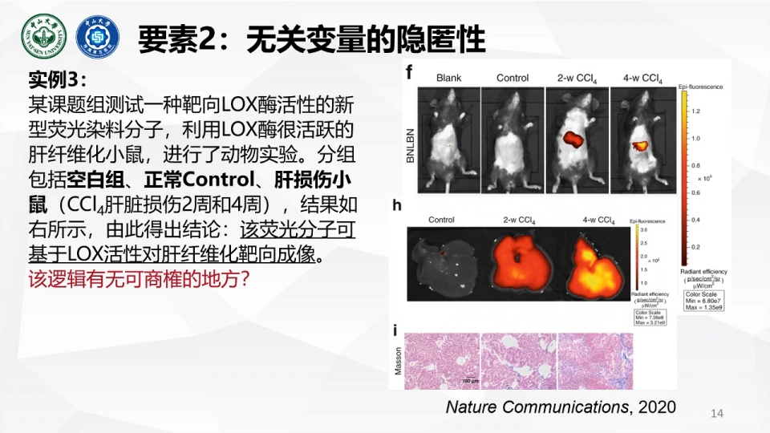

[【跳转到 20:55】](https://www.bilibili.com/video/BV1pY411B7xq/?t=1255)

### 4.2 目标自变量与实际自变量

讲者请听众一起用前面讲的要素来分析这个实验：

- **研究对象**：肝纤维化小鼠；
- **目标自变量**：LOX 酶的活性水平（这是作者希望研究的）；
- **实际自变量**：肝纤维化的进展程度；
- **无关变量**：肝功能水平。

问题出在第三、四行。注射 CCl₄ 以后，肝脏里发生变化的**不只是 LOX 酶活性**，整个肝的病理生理状态都变了。于是「打算研究的自变量」和「实际的研究自变量」出现了不一致，肝功能就成了一个混进来的无关变量。

讲者进一步解释了这个无关变量为什么能伪造出信号：肝脏被破坏后功能不健全，而很多药物（包括这个探针分子）是靠肝脏代谢的——论文支撑材料里给了数据，该探针约 60% 通过肝脏代谢。**肝功能不正常，探针就可能滞留在肝里**，从而在其他代谢反应中被点亮。

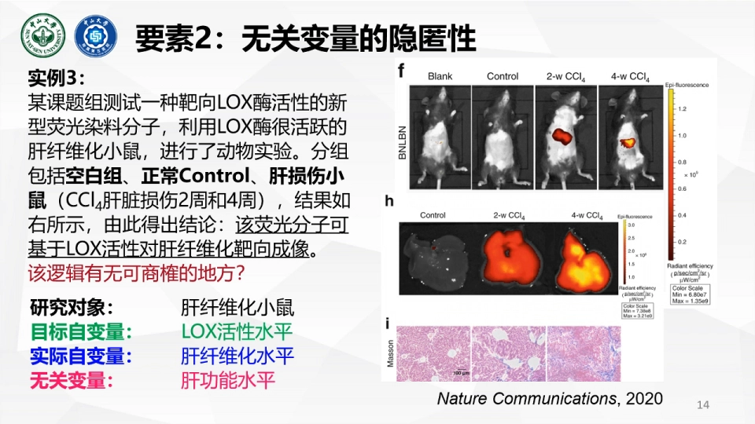

[【跳转到 22:10】](https://www.bilibili.com/video/BV1pY411B7xq/?t=1330)

结论是：单凭这些数据，不能完全说明该探针的信号必然是 LOX 酶活性的结果。讲者的总结很克制也很有分量：**即便是高水平的期刊，也可能有结论不能被数据完全支持的情况**，所以读文章时一定要仔细甄别和思辨。

### 4.3 对扰动实验的启示：扰动本身会连带改变别的东西

这个案例对单细胞扰动实验的警示非常直接。敲掉一个基因，你改变的不只是「这个基因的表达」，还可能连带改变：

- 细胞的增殖速率（快增殖的细胞转录组整体偏移）；
- 细胞周期分布与细胞大小；
- 细胞对解离、对病毒转导的敏感性。

这些都是「肝功能水平」式的隐藏无关变量：它们和扰动同时发生，而且都能改变表达谱。**如果扰动组和对照组在细胞周期构成上本来就不同，那么差异表达里必然混着细胞周期效应。** 讲者那句「无关变量可能是非常隐秘的，你不仔细想就可能会忽略它的存在」，在扰动组学里是常态而不是例外。

## 五、第三要素：科学假说——没有预期结果就没有对照

### 5.1 因果关系不能被直接观测

讲者把分子医学的研究分成三类：回答「是什么」的客观结果型、回答「怎么办」的解决问题型、以及最常见的回答「为什么」的因果关系型。

因果关系之所以特殊，是因为它**不是具体事物，不能被直接观测**——它是一种认知，存在于你的大脑里。那怎么做实验去检验它？科学家发明的方法是**科学假说**：从一个已知的自变量（因）出发，人为假定一个因果关系，据此推测一个可预期、可检测的「果」，然后真的去做实验创造条件，再看检测到的事实和预期的果是否相符。相符，则此前假定的因果关系得到一定证实。

这是间接的方法，但对因果类研究不可或缺，甚至是最核心的思维方式。

### 5.2 假说从哪来：新鲜文献 + 预实验

讲者用牛顿与万有引力、李政道与杨振宁提出宇称不守恒（后来由吴健雄实验证实）两个例子说明：**没有假说，你根本不知道实验该怎么设计**。他也回应了「这跟我一个硕士生有什么关系」的疑问：只要你做因果关系研究，假说就无处不在，常见到你都没意识到它的存在。

把实验目的那句话改几个字就变成了假说：把「探究自变量 X 对 Y 的影响」改成「验证自变量 X 对 Y 的**抑制**作用」——你已经在假定它起的是抑制作用了。

假说的来源，讲者列了两条：**已有的知识（课本），以及更重要的是你课题的新鲜文献和预实验结果。**

### 5.3 高考题里的假说与预期结果

回到那道高考题，讲者用三种颜色把逻辑标了出来：蓝色是已知事实（IL-18 能促进免疫细胞增殖分化、提高免疫），红色是科学假说（IL-18 对辐射诱导的脾细胞凋亡有抑制作用），绿色是实验依据（预期结果：+IL-18 组的凋亡低于单纯辐射损伤组）。

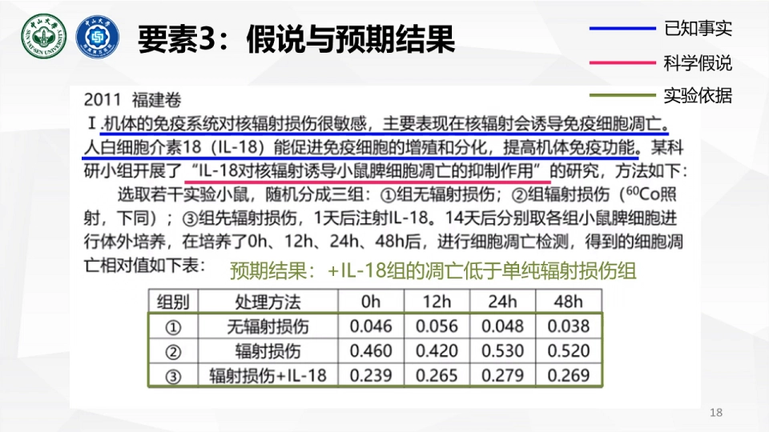

[【跳转到 31:10】](https://www.bilibili.com/video/BV1pY411B7xq/?t=1870)

这一步和对照的关系在于：**只有先有预期结果，你才知道该拿哪一组去比。** 如果假说预测「③ 组凋亡低于 ② 组」，那么 ② 组就是 ③ 组必须对照的那一组；而 ① 组（无辐射损伤）提供的是「没有辐射时凋亡本来是多少」的基线。三个组各司其职，缺一组，假说就无法被检验。

## 六、把三要素落成一张自查表

### 6.1 表格长什么样

讲者为帮助听众把理论用到实践，粗略设计了一张**实验设计自查表**，字段包括：

1. **实验目的**：自变量、因变量、对象分别是什么；
2. **假说依据**：文献证据 1、文献证据 2、预实验证据 1、预实验证据 2；
3. **假说**：一句话写清楚假定的因果关系；
4. 在这些实验条件下，你能预判到哪些**无关变量**；
5. 针对这些无关变量，你可以设计哪些**对照实验**。

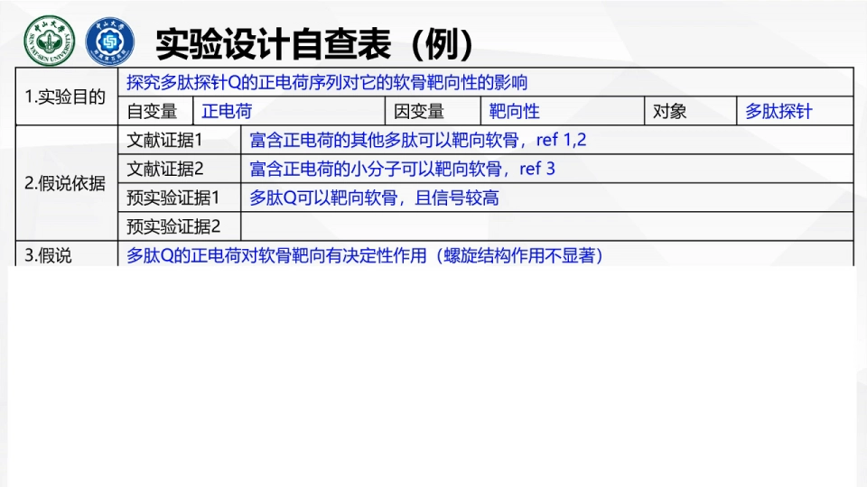

[【跳转到 32:15】](https://www.bilibili.com/video/BV1pY411B7xq/?t=1935)

### 6.2 实操：多肽 Q 的对照该怎么补

讲者用前面那个「科学价值几无」的多肽 Q 案例演示了这张表怎么用。原先的实验设计只有实验组，虽然拿到了看似阳性的结果，但推不出结论。

考虑到多肽 Q 有两个结构特征——富含正电荷、有螺旋结构——可以先根据文献证据猜想：靶向软骨这件事上，正电荷可能比螺旋结构作用更大。于是提出假说：**多肽 Q 的正电荷对软骨靶向具有决定性作用**。接着考虑实验条件，想到螺旋结构和成像误差可能作为无关变量存在。最后针对每个无关变量各设计一组对照，例如用「没有螺旋结构、但有正电荷」的探针，来排除螺旋结构这个无关变量。

讲者的总结是：**在实验前进行这样的思考检查，再去做实验，就更有可能有成效。**

### 6.3 换成单细胞扰动实验，这张表怎么填

按讲者的字段，把「多肽 Q」换成「敲低基因 X」：

| 字段 | 单细胞扰动实验里的填法 |
| --- | --- |
| 自变量 | 基因 X 的敲低（CRISPRi 或 KO） |
| 因变量 | 表达谱变化 / 细胞状态比例变化 |
| 对象 | 某细胞系或原代细胞 |
| 假说 | 敲低 X 会让细胞退出增殖周期 |
| 可预判的无关变量 | 病毒转导本身、抗性筛选、细胞周期构成、批次、测序深度 |
| 对应的对照 | 非靶向 sgRNA（转导与筛选流程完全相同）、未处理组、同批次混样 |

这张表的价值在于它是**在实验开始之前**填的。等到数据出来再想「我是不是漏了一组对照」，代价就是重做整个实验。

讲者留的课后作业也是同一件事：用这张表对自己正在或即将进行的一个实验做自评，指明各要素与它们之间的逻辑关系，明确科学假说，并思考是否存在被漏掉的无关变量和对照组。

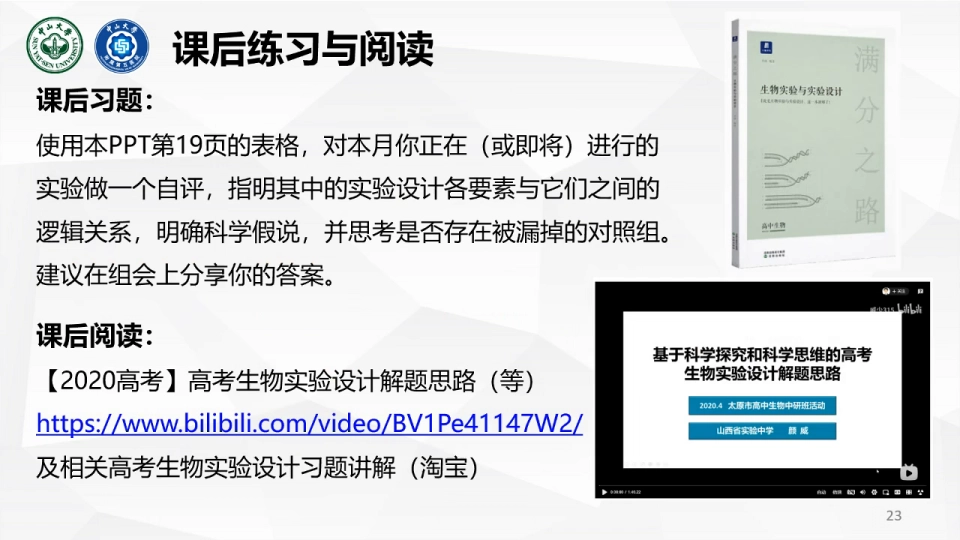

[【跳转到 34:11】](https://www.bilibili.com/video/BV1pY411B7xq/?t=2051)

## 小结

- **对照（control）控制的是无关变量**：除自变量这一个因素外，其余所有因素都与实验组保持一致，结果才可比较。对照组不是「什么都不做的一组」，而是「被安排成处处相同、只差一个因素的一组」。
- **溶剂对照（vehicle）是最标准的模板**：药物组里有 800 mg 生理盐水 + 200 mg DMSO，对照就必须有同样的 800 mg + 200 mg，只是没有药。翻译到扰动实验，就是载体、病毒转导、抗性筛选这一整套流程，对照组一样都不能少。
- **一次只改一个因素**：一个实验里有两个自变量，就需要能分别拆开它们的对照；每组对照只改变一个条件，这样「你不会有完完全全的失败」。
- **无关变量是隐蔽的**：CCl₄ 同时改变了 LOX 活性和肝功能，肝功能就能伪造出探针信号；敲掉一个基因同样会连带改变增殖速率与细胞周期。高水平期刊也可能出现结论不被数据完全支持的情况。
- **无对照，不实验，包括预实验**：开始任何实验前先问自己「我今天实验的对照是什么」。
- **假说决定你拿哪一组去比**：先有预期结果，才知道谁是实验组、谁是对照组。

## 关键术语速查

| 术语 | 一句话解释 |
| --- | --- |
| 自变量 | 人为控制、施加在实验对象上的处理因素，比如 IL-18、基因敲低 |
| 因变量 | 因为自变量改变而改变的变量，比如细胞凋亡、表达谱 |
| 无关变量 | 除自变量以外，所有能影响实验结果的可变因素，如细胞代数、试剂批次、加样顺序 |
| 对照实验（control） | 除自变量的单一因素外其余因素都与实验组保持一致、结果可比较的实验；control 控制的就是无关变量 |
| 溶剂对照（vehicle） | 只加与药物组相同配方、相同体积的溶剂而不加药，用于排除溶剂本身的效应 |
| 空白组 | 有疾病/有背景但不施加探针或处理的一组，用于确认「没有探针时信号本来是什么样」 |
| 阳性对照 | 用已知能成功的条件（如文献里的原方法）跑一遍，检验实验体系本身是否跑得通 |
| 科学假说 | 人为假定的因果关系，据此推测可检测的预期结果，再用实验去验证 |
| 单一变量原则 | 每一组对照只改变一个条件，从而保证失败或成功都能归因到具体因素 |