# 扰动为什么能推出因果：因果之梯上的关联、干预与反事实

> 视频来源：[因果推断1小时入门 causal inference in statistics: a primer](https://www.bilibili.com/video/BV16Y4y1z72G/)（Bilibili · 岭铁城）｜时长约 60 分钟
> 导读：这支视频按 Judea Pearl 教材《Causal Inference in Statistics: A Primer》的骨架讲了一遍因果推断的最小完整框架：辛普森悖论 → 结构化因果模型 → chain/fork/collider 与 d-separation → 干预与调整公式 → 反事实。本文按原讲顺序整理，并在最后把这些工具映射回单细胞扰动实验：为什么「敲掉 A、B 变了」比「A 和 B 相关」更接近因果，以及它仍然不等于「A 直接调控 B」。

## 本讲要解决的核心问题（SCQA）

**背景**：我们手上几乎所有的组学数据都是**观测数据**——没有人为干预，只是把细胞或病人身上已经发生的事测下来。传统统计和机器学习在这类数据上做的事，是找出变量之间的相关性：A 高的时候 B 也高，就把这条相关写进模型。

**冲突**：但相关可以来自完全不同的机制。A 可能真的导致 B；也可能 B 导致 A（因果方向反了）；也可能有第三个变量同时影响 A 和 B，让它们看起来相关而实际上互不相干。更麻烦的是，**同一个数据集，整体看和分组看可以给出方向完全相反的结论**（辛普森悖论）。这时候「该信哪个数」不是靠多看几遍数据能解决的。

**疑问**：既然数据本身给不出因果，那我们凭什么说某件事是另一件事的原因？「因果」能不能像概率一样写成公式、能不能从观测数据里算出来？如果能，需要什么条件？

**回答（中心思想）**：因果可以形式化——用**结构化因果模型**把「谁由谁决定」写成赋值函数和图，于是「相关 vs 因果」的差别就变成了图上的通路问题：**看到相关，往往是因为存在一条没被堵住的后门通路；要得到因果，就得把后门堵上**。而「堵后门」有两种手段，正好对应因果之梯的上两层：**干预**（do 算子，等价于把指向该变量的边全部删掉）和**反事实**（固定外生变量后重算另一个世界的结果）。扰动实验之所以比观测数据更有说服力，正是因为它把「干预」从数学上的假设变成了实验里真实发生的事。

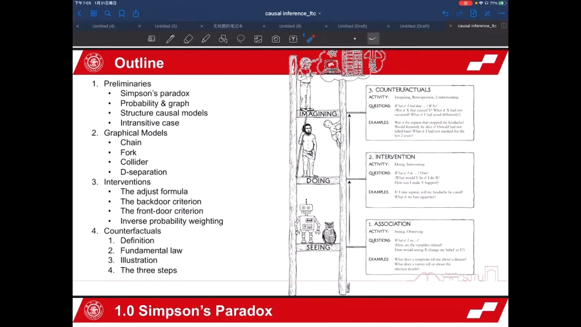

[【跳转到 01:21】](https://www.bilibili.com/video/BV16Y4y1z72G/?t=81)

## 一、辛普森悖论：数据自己不会告诉你该看整体还是看分组

讲者用三个例子开场，结构完全一样：**分组看是一个方向，整体看是反方向**。

### 1.1 用药、康复与性别

第一个例子是关于用药和康复的。分组数据里，男性用药的康复率高于不用药，女性用药的康复率也高于不用药；但把两组合并成整体数据之后，结论反过来——不用药的康复率反而更高。

如果照整体数据的结论办事，就会得到一句很荒谬的话：「知道病人性别时可以放心用药，不知道性别时就别用药了」。讲者指出背后的故事有两条：雌激素本身对康复有副作用；同时数据里女性用药的人数明显比男性多。**这两条合起来，就让「用药」这个变量和「性别」这个变量绑在了一起**，于是整体比较时，用药组里塞满了康复率本来就偏低的女性。

### 1.2 锻炼、胆固醇与年龄

第二个例子是锻炼量和胆固醇含量。分组看，每个年龄阶层内部，胆固醇含量都随运动量增加而减少；整体看，运动量越多胆固醇含量反而越高。

讲者给的机制是：年纪大的人可能本身更注重身体，因此运动更多；但年纪大的人胆固醇含量本身也偏高，无论运动与否。于是**年龄同时影响了「锻炼量」和「胆固醇」**，把两条本来无关甚至反向的关系，在整体上拧成了正相关。

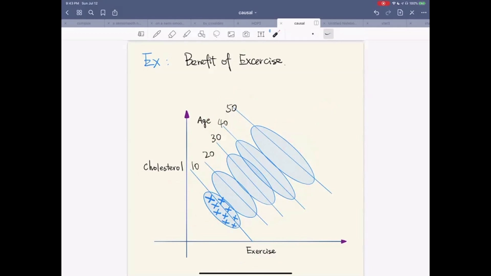

[【跳转到 06:12】](https://www.bilibili.com/video/BV15J411L7xW/?t=372)

### 1.3 第三个例子：这次的正确答案是「看整体」

第三个例子同样是用药与康复，但分组变量换成了**用药之后的血压**。结果：低血压的人不吃药的康复率高于吃药，高血压的人也是不用药更好；可整体数据反过来，不用药的更差。

讲者解释：这个药本身就是通过降低血压起效的，同时它还有副作用。**血压在这里不是「共同的因」，而是「药效经过的中间环节」**。只看分组数据，等于把药效那条路堵死了，只剩下副作用那条路。所以这个例子里应该看整体数据，结论是「用药有效」。

三个例子放在一起，讲者给出了本节最重要的一句话：**辛普森悖论不是在教你「该看分组还是该看整体」，它是在说数据本身无法提供因果关系**。统计教材里那句「相关并非因果」，说的就是这件事。

## 二、把因果写成公式：结构化因果模型

### 2.1 因果的定义与非对称性

讲者先给了一个朴素的因果定义：**如果一个变量 $Y$ 以任何一种方式依赖于 $X$ 的赋值（$X$ 的取值），就把 $X$ 称作 $Y$ 的一个原因**。

有了定义就要能写成数学。这里用到两块前置知识：概率论和图论。

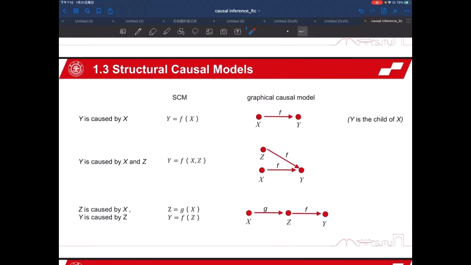

[【跳转到 08:59】](https://www.bilibili.com/video/BV16Y4y1z72G/?t=539)

结构化因果模型（Structural Causal Model, SCM）由三样东西组成：

- **外生变量集合 $U$**：模型外面来的、不由模型内任何变量决定的量，对应图上的根节点；
- **内生变量集合 $V$**：模型内被决定的量，对应图上的非根节点；
- **赋值函数集合 $F$**：每个内生变量由谁、按什么方式决定，对应图上的边。

于是三种最基本的因果陈述都能画出来：

| 因果陈述 | SCM 写法 | 图 |
| :--- | :--- | :--- |
| $X$ 导致 $Y$ | $Y = f(X)$ | X → Y |
| $Y$ 由 $X$ 和 $Z$ 共同导致 | $Y = f(X, Z)$ | Z → Y，X → Y |
| $Z$ 由 $X$ 导致，$Y$ 由 $Z$ 导致 | $Z = g(X)$，$Y = f(Z)$ | X → Z → Y |

有了图，因果概念就可以重新定义：

- **直接原因**：$X$ 出现在 $Y$ 的赋值函数里，$X$ 就是 $Y$ 的直接原因；
- **间接原因**：$X$ 生成 $Z$、$Z$ 又导致 $Y$，$X$ 就是 $Y$ 的间接原因；
- **原因**：直接原因或任何一种间接原因，都统称原因。

这里讲者特意问了一个问题：数学上可以把 $X$ 写成 $F$ 的逆、由 $Y$ 反解 $X$，**因果推断里可以这样反着来吗？答案是不行**。例子是：$X$ 是气温，$F$ 是身体对气温的反应机制，$Y$ 是最终是否感冒。气温降低会引起一系列身体反应，最终导致感冒；但反过来不能说「感冒导致了气温降低」。**因果里有时间先后，因果不具有对称性**——这是它和普通等式最本质的区别。

### 2.2 因果一定推出相关吗？不一定

讲者接着把「因果 vs 相关」两个方向都拆开看。

**相关不一定因果**：前面辛普森悖论的例子已经说明了。

**因果也不一定相关**：讲者给了一个极端的反例。两枚独立硬币 $X$ 和 $U_Y$，各自掷到正面的概率都是 $1/2$；定义 $Y$ 当且仅当 $X = U_Y$ 时取 1。用 SCM 写出来，$X$ 确实是 $Y$ 的原因，但直接算 $Y$ 的边缘概率会发现它恒等于 $1/2$，与 $X$ 无关——**$X$ 和 $Y$ 完全独立，尽管 $X$ 是 $Y$ 的原因**。

这个例子是因果推断的难点之一（讲者称其为 intransitive dependence）。但讲者也说明：这是特殊情况，**绝大多数情况下因果还是能推出相关的**，所以实践中「看到相关就去找因果」仍然是合理的起点，只是不能停在相关。

## 三、三种基本结构：chain、fork、collider

实际因果图很复杂，但都可以拆成三种三节点结构。讲者的做法是：先给每个结构配一个 SCM 例子，再推出它的**条件独立法则**。

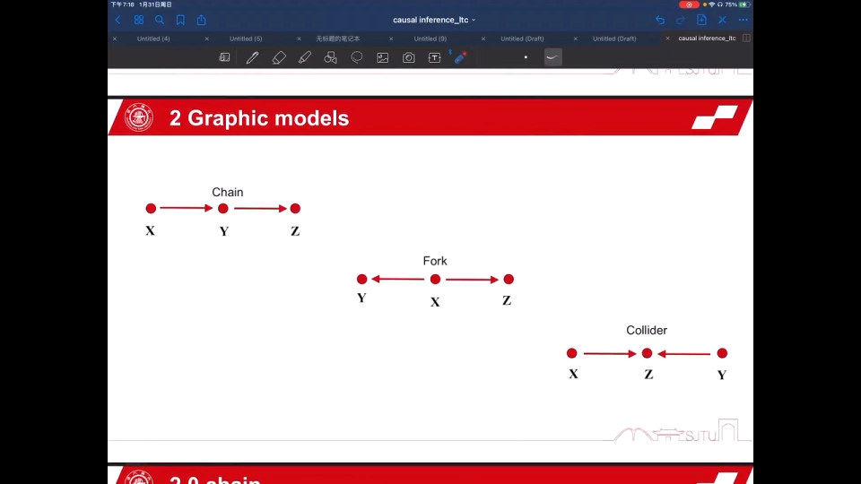

[【跳转到 14:26】](https://www.bilibili.com/video/BV16Y4y1z72G/?t=866)

### 3.1 chain：堵住中间，两端就独立

chain 的结构是 $X \to Y \to Z$，讲者举的例子是：$X$ 是工作时间，$Y$ 是业余训练时间，$Z$ 是业余比赛的表现。工作时间越长训练时间越短，训练时间越短表现越差。SCM 写成

$$
X = U_X,\qquad Y = 84 - X - U_Y,\qquad Z = 100Y + U_Z
$$

四条结论依次是：$Z$ 与 $Y$ 相关、$Y$ 与 $X$ 相关、$Z$ 与 $X$ 相关（$X$ 是 $Z$ 的间接原因），但**一旦 condition 在 $Y$ 上，$Z$ 与 $X$ 就独立了**。为什么？把 $Y$ 固定成常数 $C$，$Z = 100C + U_Z$，表达式里已经没有 $X$ 了。

这就是 **chain 上的条件独立法则**：$X$ 与 $Y$ 由一条链相连、$Z$ 是链上任意一个变量，则 condition 在 $Z$ 上时 $X$ 与 $Y$ 独立。

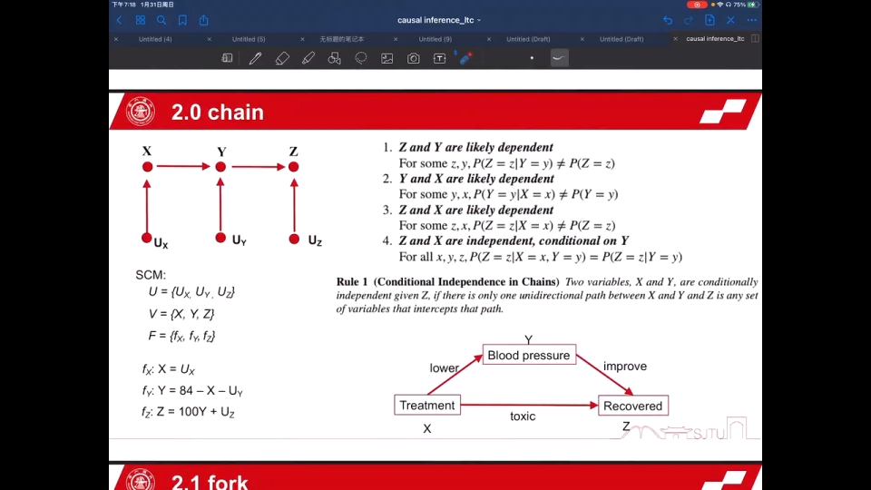

[【跳转到 15:16】](https://www.bilibili.com/video/BV16Y4y1z72G/?t=916)

这张图右下角正是辛普森悖论第三个例子的图：**用药 → 血压 → 康复** 是 chain，**用药 → 康复** 是另一条直接通路（副作用）。一旦 condition 在血压上，上面那条 chain 就被打断，你看到的只剩下副作用——所以那个例子必须看整体数据。

### 3.2 fork：共同的因，堵住它就独立

fork 的结构是 $X$ 同时指向 $Y$ 和 $Z$。SCM 写成

$$
X = U_X = C,\qquad Y = 4X + U_Y,\qquad Z = X/10 + U_Z
$$

结论：$X$ 与 $Y$ 相关、$X$ 与 $Z$ 相关、$Y$ 与 $Z$ 也相关；而**condition 在 $X$ 上之后，$Y$ 与 $Z$ 独立**。因为把 $X$ 固定成常数后，$Y$ 和 $Z$ 各自只由自己的外生变量决定，而外生变量是相互独立的。

**fork 上的条件独立法则**：$X$ 是 $Y$ 和 $Z$ 的共同原因，且 $Y$ 与 $Z$ 之间只有这一条通路，则 condition 在 $X$ 上时 $Y$ 与 $Z$ 独立。

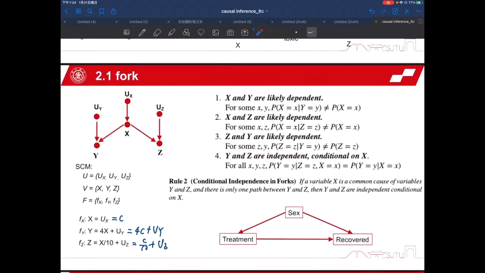

[【跳转到 20:41】](https://www.bilibili.com/video/BV16Y4y1z72G/?t=1241)

这张图的例子对应辛普森悖论的第一个例子：**性别 → 用药、性别 → 康复** 构成 fork，它是一条非因果通路。condition 在性别上（也就是按性别分组），这条路就被打断，剩下的是用药 → 康复那条真正的因果通路。

### 3.3 collider：唯一一个「condition 之后反而相关」的结构

collider 的结构是 $X \to Z \leftarrow Y$，两条边都指向中间那个变量。结论和前两种完全相反：

- $X$ 与 $Z$ 相关、$Y$ 与 $Z$ 相关；
- 但 **$X$ 与 $Y$ 本身是独立的**（它们各自只由自己的外生变量决定）；
- **一旦 condition 在 $Z$ 上，$X$ 与 $Y$ 反而相关了**。

讲者的具体例子：把 $Z$ 固定成常数 $C$，$Z = X + Y + U_Z$ 就变成 $X + Y = C - U_Z$，于是知道 $X$ 就能反推出 $Y$——两个本来无关的变量因为「共同的结果被固定」而产生了关联。

**collider 上的法则**：$X$ 与 $Y$ 由 collider 相连且只有这一条通路，则 $X$ 与 $Y$ 无条件独立，但 condition 在 $Z$ 或 $Z$ 的任意子孙节点上时相关。

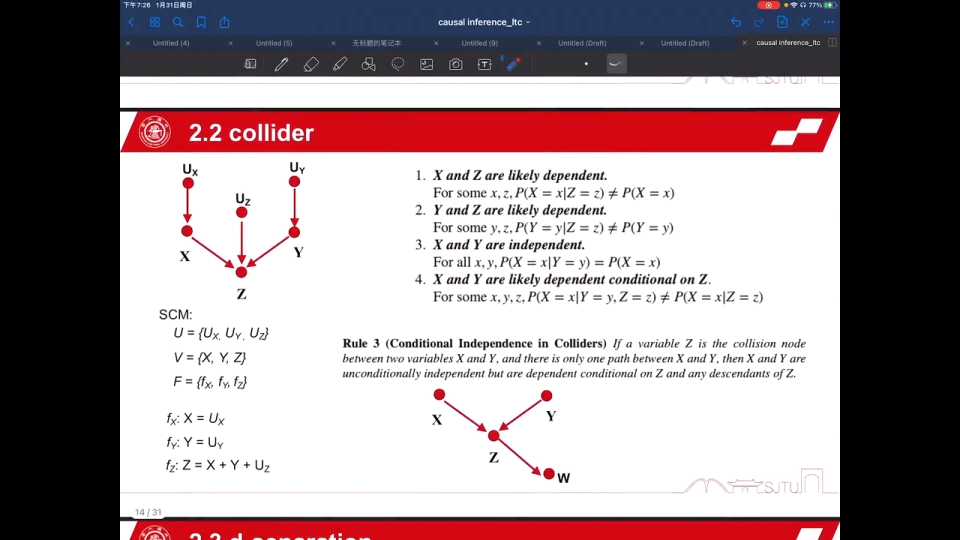

[【跳转到 22:50】](https://www.bilibili.com/video/BV16Y4y1z72G/?t=1370)

这个法则解释了一类常被忽略的错误：**按某个「结果」去筛选样本，会凭空造出相关性**。讲者没有展开生物学例子，但机制很直接——如果 A 和 B 都影响某个下游结果 C，那么「只保留 C 高的细胞」这个筛选动作，就会让 A 和 B 在筛选后的子集里显得相关，而它们在全体细胞里本来无关。

## 四、d-separation：把三条法则合成一条判据

真实图里任意两个节点之间可能有多条通路，这时要判断「这两个变量到底相关不相关」，用的工具是**有效分离（d-separation）**，$d$ 是 directional 的意思。

定义是：**如果 $X$ 和 $Y$ 之间的每一条通路都被 block 了，就认为它们有效分离（独立）；只要存在一条通路没被 block，就是有向连接（相关）**。

而 block 与 unblock 完全由前面三种结构决定：

- 通路上有 chain 或 fork，且 condition 在它的中间变量上 → 被 block；不 condition → 通；
- 通路上有 collider，且**不** condition 在它（及其子孙）上 → 被 block；condition 了 → 通。

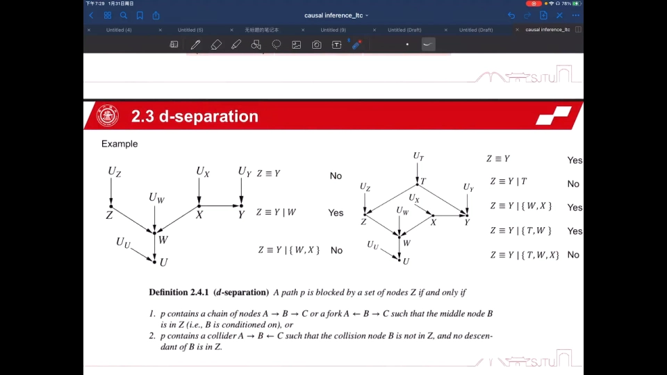

[【跳转到 26:11】](https://www.bilibili.com/video/BV16Y4y1z72G/?t=1571)

这张判定表值得逐行读一遍。左边那组图，$Z$ 与 $Y$ 之间只有一条通路，中间是 collider，所以默认不相关；一旦 condition 在 $W$ 上，通路通了，两者相关；再同时 condition 在 $X$ 上，$X$ 是 fork 的中间变量，通路又被堵回去，两者又不相关。右边那组图多了一条通路，于是每一行的答案都要同时看上下两条路。

讲者也提醒：这一节讲得有点快，但**概念本身很简单，自己按规则过一遍就清楚**。

## 五、干预：do 算子做的事就是「删掉指向它的边」

前面所有内容都还在因果之梯的第一层。讲者的原话是：**只有讲到干预，才真正开始讲因果**。

### 5.1 condition 与 do 的区别

为了对比，讲者把两者并排放在一起：

- **condition**（条件概率 $P(Y \mid X = x)$）：只关注数据的一个子集，**没有改变世界本身，只是改变了我们看世界的方式**，数据分布不变；
- **do**（干预 $P(Y \mid do(X = x))$）：**真的改变世界**，把分布里变量 $X$ 的取值全部赋成 $x$，因此会改变原始数据的分布。

这里有一个前提假设：**干预没有副作用**——把 $X$ 设成 $x$ 的时候，其他变量的赋值不受影响。

从图上看这个区别非常直观：condition 不改变图；**do 会改变图——所有指向 $X$ 的边被删除，$X$ 的赋值固定为 $x$**。讲者跟观众确认过这一点：不只是删掉某个父节点到 $X$ 的边，而是**把 $X$ 的所有「因」全部切断**，再把小 $x$ 赋给大 $X$。

### 5.2 调整公式：把 do 从观测数据里算出来

干预的定义是：在原图上的干预，等于在**修改后的图**上做条件概率。要把它算出来，还需要两个条件：

1. $Y$ 的条件概率不变——因为 $Y$ 只是对 $Z$ 和 $X$ 的响应过程，它并不关心 $X$ 是自发变成这样还是被干预成这样的；
2. $Z$ 的边缘分布不变——因为 $X$ 不影响 $Z$，而且 $Z \to X$ 的边已经被删掉了。

于是可以推出**调整公式（adjustment formula）**：

$$
P(Y = y \mid do(X = x)) = \sum_{z} P(Y = y \mid X = x, Z = z)\, P(Z = z)
$$

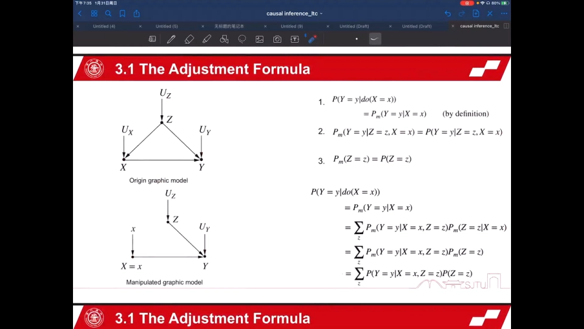

[【跳转到 31:58】](https://www.bilibili.com/video/BV16Y4y1z72G/?t=1918)

这个公式的意义在于：**等号右边全是干预之前的观测概率**。也就是说，只要找对了要调整的变量 $Z$，干预的效果可以直接从观测数据里「仿真」出来，do 这个算子可以被消掉。讲者把这个运算叫做「调整 $Z$」或者「控制 $Z$」。

公式还能推广：如果 $X$ 有多个父节点，把 $Z$ 换成父节点集合 $pa$ 即可，公式形式完全一样。**但这里就埋了一个隐患：父节点必须全部可观测**。如果某些父节点测不到，这个公式就失效了。

## 六、后门准则、前门准则与逆概率加权

### 6.1 后门准则：用可观测的替代变量堵住后门

讲者先定义前门和后门：从 $X$ **指出去**的通路叫前门；**指向 $X$** 的那些通路叫后门。后门准则用人话讲就是三件事：

1. 把 $X$ 与 $Y$ 之间所有**伪通路（后门）全部堵上**；
2. 所有从 $X$ 到 $Y$ 的**有向通路保持不动**；
3. 不制造出新的伪通路。

满足这三条的变量集合 $Z$ 就可以用来做后门调整，公式和调整公式长得一模一样，只是 $Z$ 从「父节点」变成了「一组可观测的替代变量」。具体条件写出来是：$Z$ 中不能有 $X$ 的后代，且 condition 在 $Z$ 上时必须 block 掉 $X$ 与 $Y$ 之间所有含指向 $X$ 箭头的通路。

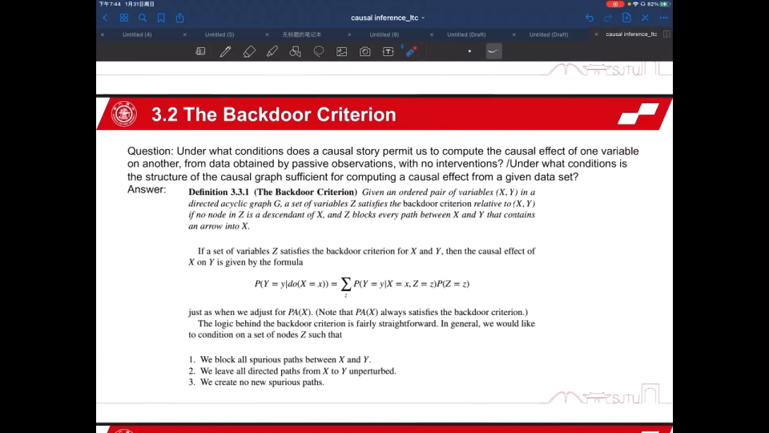

[【跳转到 40:30】](https://www.bilibili.com/video/BV16Y4y1z72G/?t=2430)

### 6.2 前门准则：后门堵不住时的退路

后门准则不能通吃。讲者给了经典的反例：**吸烟 → 肺癌**，但存在一个不可观测的基因型，它同时影响吸烟倾向和肺癌风险。这条后门经过不可观测变量，堵不住，后门准则失效。

这时候可以用**前门准则**：找一个完全夹在 $X$ 和 $Y$ 中间的中介变量 $Z$（这里是「焦油沉积」），它满足三条——condition 在 $Z$ 上能堵住 $X$ 到 $Y$ 的前门；$X$ 与 $Z$ 之间没有后门；$Z$ 与 $Y$ 之间的后门被 $X$ 全部堵住。满足之后，因果效应可以写成两步调整的复合：

$$
P(Y = y \mid do(X = x)) = \sum_{z} P(Z = z \mid X = x) \sum_{x'} P(Y = y \mid Z = z, X = x')\, P(X = x')
$$

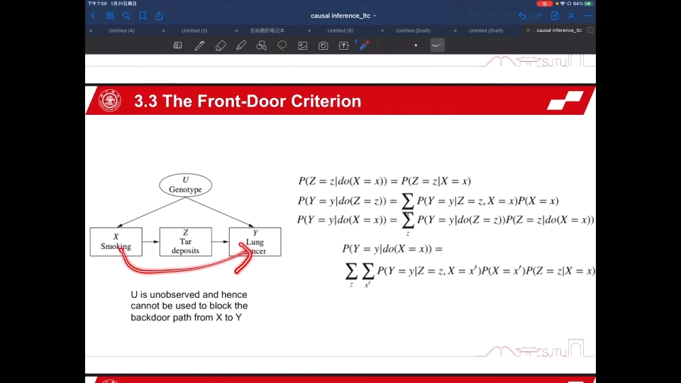

[【跳转到 47:10】](https://www.bilibili.com/video/BV16Y4y1z72G/?t=2830)

讲者自己也说这一段讲得不算特别清楚，但**最直白的理解是：前门调整调整的都是前门路径上的变量，不调整后门路径上的变量，所以叫前门调整**。

### 6.3 逆概率加权：$Z$ 的取值太多时怎么办

调整公式还有一个工程上的问题：**当 $Z$ 的维度很高时，计算量爆炸；而且对每一组 $Z$ 来说样本会变少，估计也就不准**。

解法是对调整公式做一次恒等变形——分子分母同时乘上 $P(X = x \mid Z = z)$，得到**逆概率加权（IPW）**：

$$
P(y \mid do(x)) = \sum_{z} \frac{P(Y = y, X = x, Z = z)}{P(X = x \mid Z = z)}
$$

其中 $P(X = x \mid Z = z)$ 就是**倾向得分（propensity score）**——在给定协变量的条件下接受某种处理的概率。讲者顺带提到，这个概念在生物领域用得比较多。

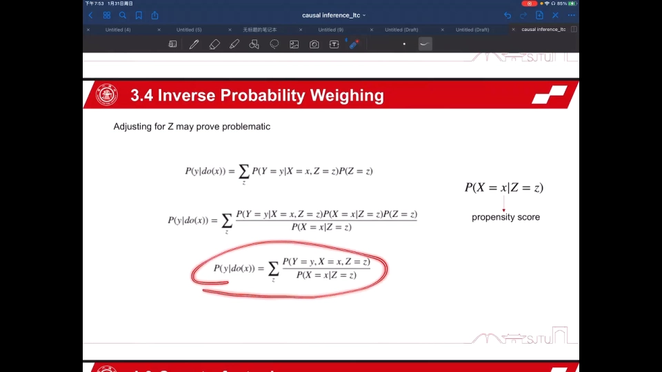

[【跳转到 50:12】](https://www.bilibili.com/video/BV16Y4y1z72G/?t=3012)

## 七、反事实：因果之梯的第三层

### 7.1 一个开车的例子

讲者用一个生活例子引入：昨晚开车回家遇到岔路，可以走高速也可以走地面，他选择了走地面，结果开了一个小时才到家。他说了一句「我真应该走高速的」。

这句话是虚拟语气，翻译过来是：**如果我当时走了高速，结果可能不一样，我会更早到家**。这就是反事实——事实是走了地面，`if` 后面描述的是一个没有发生的前因；两个世界其他条件都一样，唯一的区别就是前因不同。

### 7.2 为什么 do 表达不了反事实

讲者尝试用干预的公式来表达反事实：要求的是驾驶时间，做的干预是走高速，依据的条件是「现在的驾驶时间是一个小时」。**矛盾在于：要求的东西同时又出现在条件里**。

所以用 do 算子表达反事实并不准确——它无法区分「实际的驾驶时间」和「假设的驾驶时间」。正确的写法是给每个世界一个下标：走高速的驾驶时间记作 $Y_{X=1}$（简写 $Y_1$），走地面的记作 $Y_{X=0}$（简写 $Y_0$），反事实就是

$$
E(Y_{X=1} \mid X = 0,\ Y = Y_0 = 1)
$$

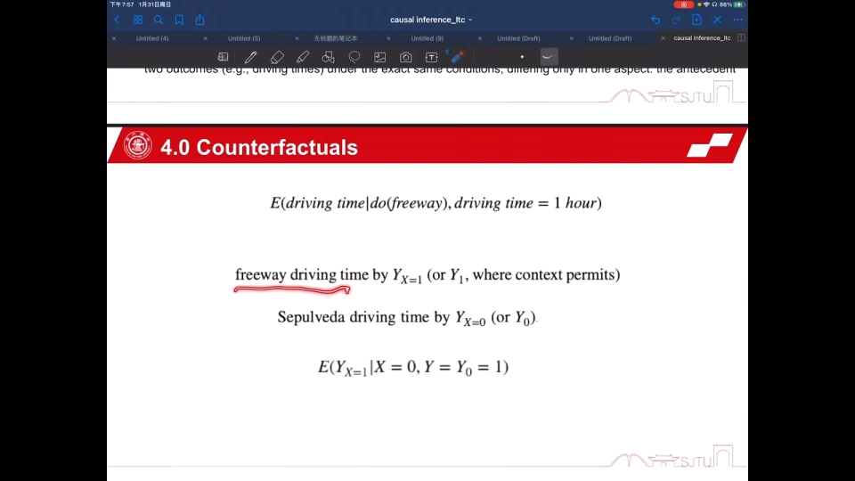

[【跳转到 53:37】](https://www.bilibili.com/video/BV16Y4y1z72G/?t=3217)

讲者给了一个很清楚的直觉解释：**做干预或做 condition 时，所有样本都来自同一个世界；而反事实存在两个世界**——一个世界的事情已经发生，我们要基于已经发生的事去估计另一个世界里的值。所以 $Y_0$ 和 $Y_1$ 表达的是两样东西，不能当成同一个东西对待。

### 7.3 反事实怎么算：外展、干预、预测

反事实的计算分三步：

1. **外展（abduction）**：用已有的事实 $E = e$ 反推外生变量 $U$ 的取值；
2. **干预（action）**：修改模型——删掉 $X$ 的结构方程，把 $X$ 替换成常数 $x$，得到修改后的模型 $M_x$；
3. **预测（prediction）**：在 $M_x$ 下、用第一步得到的外生变量，计算 $Y$ 的值。

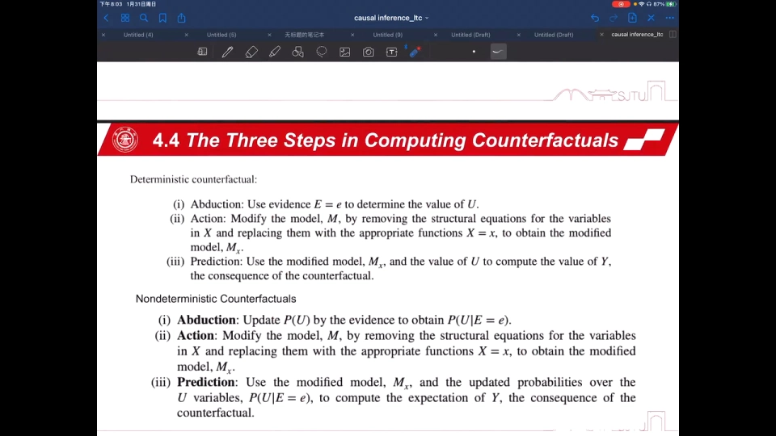

[【跳转到 59:19】](https://www.bilibili.com/video/BV16Y4y1z72G/?t=3559)

讲者还给了一个完整算例：$X$ 是补课时间，$H$ 是作业量，$Y$ 是考试成绩，结构方程是

$$
X = U_X,\qquad H = aX + U_H,\qquad Y = bX + cH + U_Y
$$

系数 $a = 0.5$、$b = 0.7$、$c = 0.4$，所有 $U$ 相互独立。观测到某个学生 $X = 0.5$、$H = 1$、$Y = 1.5$，先外展算出 $U_X = 0.5$、$U_H = 0.75$、$U_Y = 0.75$；再假设作业量翻倍（$H = 2$），在修改后的模型里代入同一组外生变量，得到 $Y = 1.9$。于是反事实的结论是：**如果作业量翻倍，这个学生的成绩会从 1.5 升到 1.9**。

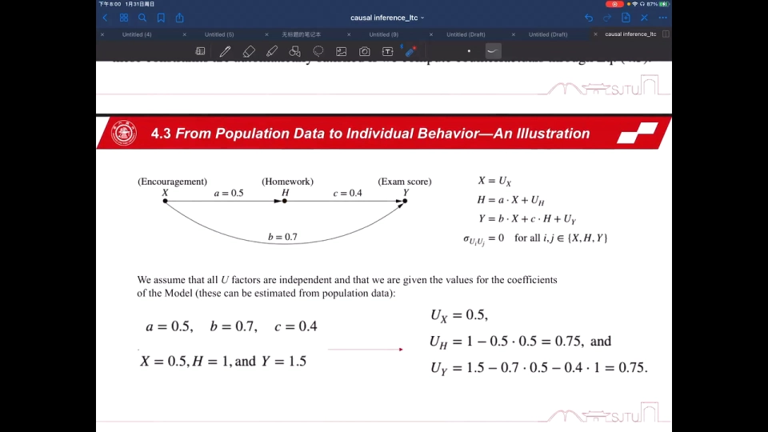

[【跳转到 57:17】](https://www.bilibili.com/video/BV16Y4y1z72G/?t=3437)

讲者还提到一条**一致性原则**：如果输入到反事实模型里的观测值就是事实本身，那就等于没有做反事实，$Y$ 的值不会改变。

## 八、把这些工具搬回单细胞扰动实验

视频本身讲的是通用因果推断，没有涉及单细胞。但这一节的框架正好能回答单细胞扰动里最容易被含糊过去的问题，下面这几条是把上面的工具逐条对上：

**（1）观测数据只能给出第一层，扰动实验把你送到第二层。** 「A 高的时候 B 也高」是关联；「把 A 敲掉之后 B 变了」是干预。前者对应 $P(B \mid A)$，后者对应 $P(B \mid do(A = \text{敲低}))$。这就是为什么扰动实验在因果链条上比相关性分析更强——它真的执行了一次 do 算子。

**（2）do 在图上的含义是「切断 A 的所有上游」。** 敲低 A 时，A 的表达不再由它原本的调控输入决定，这正是「删掉所有指向 A 的边、把 A 固定成一个新值」。而 A 到 B 的那条边（如果有）保持不动——这就是扰动实验能用来判断「A 是否调控 B」的图论依据。

**（3）「敲低 A 后 B 变了」仍然不等于「A 直接调控 B」。** 用 chain 的法则看：如果真实结构是 A → C → B，敲 A 也会让 B 变，但 A 对 B 是**间接原因**，A 与 B 之间没有直接边。要区分直接与间接，需要看中介变量 C 是否被阻断（例如同时扰动 C，或测量 C 的响应），这正是 chain 上条件独立法则要处理的问题。

**（4）细胞类型、批次、测序深度都是典型的 fork。** 它们同时影响「你观察到 A 的表达」和「你观察到 B 的表达」，属于共同的因。不做分层或校正，就会在 A 与 B 之间造出一条非因果通路——和视频里「性别同时影响用药与康复」是同一个结构。fork 上的法则说：condition 在它上面（分层/校正）之后，两端才独立。

**（5）按「响应」筛细胞，等于在 collider 上做条件化。** 如果只挑「响应强烈」的细胞来比较 A 和 B，而 A 和 B 都影响响应强度，那么在这个筛选子集里 A 与 B 会凭空相关。collider 法则是唯一一个「condition 之后反而相关」的结构，也是最容易在做亚群分析时踩到的坑。

**（6）单细胞做不了反事实。** 反事实要求「同一个个体，在两个世界里各有一个结果」——$Y_1$ 和 $Y_0$ 必须来自同一个细胞。而一个细胞只能被一种扰动处理一次，另一个世界的结果永远观测不到。这就是单细胞扰动数据在因果之梯上停在第二层、上不到第三层的原因：我们能算平均干预效应，算不出单个细胞的反事实。

**（7）后门/前门准则决定了「校正什么」。** 做扰动效应比较时，该校正哪些协变量不是凭经验挑的：要校正的是那些同时影响「扰动分配」和「读出表型」的变量（后门），而不是扰动之后才被改变的变量（那是中介，校正它会把真实效应一起删掉）。视频里「血压是中间环节，不该按它分组」的例子，对应的正是这条禁忌。

## 小结

- **数据本身给不出因果**。辛普森悖论的意义不是教你选整体还是选分组，而是说明同一批数据可以支持方向相反的结论，选择取决于背后的因果结构。
- **因果可以形式化**：SCM 用外生变量、内生变量和赋值函数把「谁由谁决定」写清楚，图上的边就是赋值函数。因果**不具有对称性**，不能像等式一样反解。
- **相关与因果互不蕴含**：相关可能来自后门，因果也可能因为极端结构而不表现为相关（两枚硬币的例子），但绝大多数情况下因果能推出相关。
- **三种基本结构决定了「该不该 condition」**：chain 和 fork 上 condition 中间变量会**切断**关联；collider 上 condition 反而**制造**关联。
- **d-separation 是统一判据**：所有通路都被 block 才叫独立，只要有一条通就相关。
- **干预 = 删掉指向该变量的所有边**。调整公式把 do 换成了观测概率之和，前提是父节点（或满足后门准则的替代变量）可观测。
- **后门堵不住时用前门准则**（靠中介变量两步调整）；**$Z$ 维度太高时用逆概率加权**（倾向得分）。
- **反事实是第三层**：外展 → 干预 → 预测三步，要求「同一个个体在两个世界的结果」，这是单细胞扰动目前上不去的一层。

## 关键术语速查

| 术语 | 一句话解释 |
| :--- | :--- |
| 辛普森悖论 | 整体数据与分组数据给出方向相反的统计结论，根源是存在分组变量（混杂/中介） |
| 结构化因果模型（SCM） | 用外生变量 $U$、内生变量 $V$、赋值函数 $F$ 描述变量间因果关系的模型 |
| 直接原因 / 间接原因 | $X$ 出现在 $Y$ 的赋值函数里是直接原因；$X$ 经由中间变量影响 $Y$ 是间接原因 |
| chain（链） | $X \to Y \to Z$；condition 在中间变量上，两端独立 |
| fork（叉） | $X$ 同时指向 $Y$ 和 $Z$；condition 在 $X$ 上，两端独立 |
| collider（对撞） | $X \to Z \leftarrow Y$；不 condition 时两端独立，condition 在 $Z$ 或其子孙上反而相关 |
| d-separation | 两节点间所有通路都被 block 时称有效分离，即条件独立 |
| do 算子 | 干预的记号；在图上是删除所有指向该变量的边并固定其取值 |
| 调整公式 | 用 $\sum_z P(Y \vert X, Z) P(Z)$ 把干预概率写成观测概率，即「调整 Z」 |
| 后门准则 | 找一组可观测变量堵住所有指向 $X$ 的通路，同时保留所有有向通路 |
| 前门准则 | 后门堵不住时，用夹在中间的中介变量做两步调整 |
| 倾向得分 | $P(X = x \vert Z = z)$，给定协变量下接受处理的概率，用于逆概率加权 |
| 反事实 | 「如果当时做了另一个选择会怎样」；需固定外生变量后在修改模型里重算 |
| 外展 / 干预 / 预测 | 反事实计算的三步：由事实反推 $U$、修改模型、在新模型下预测 |