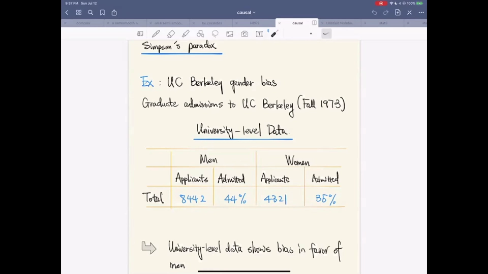
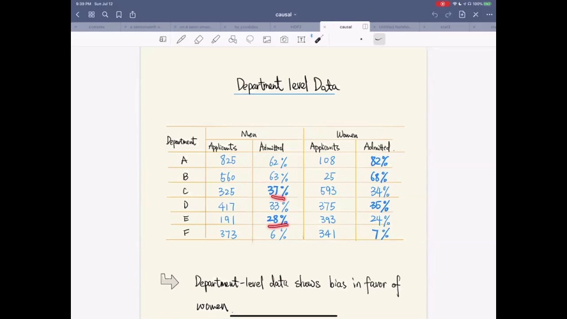
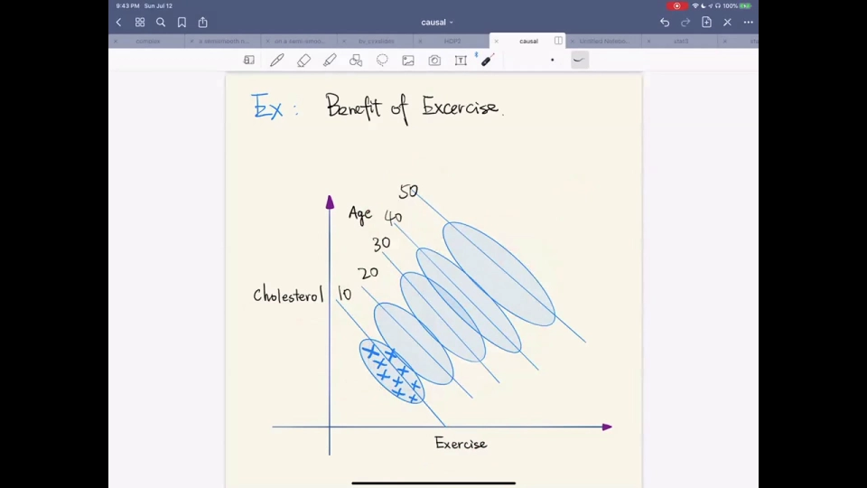
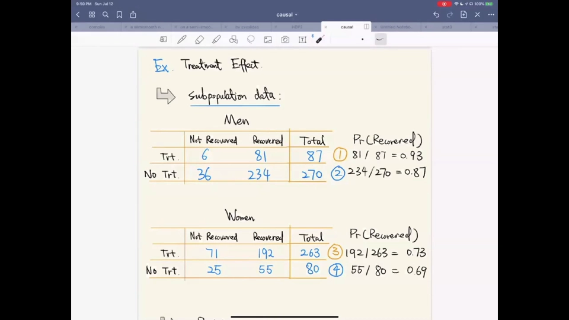
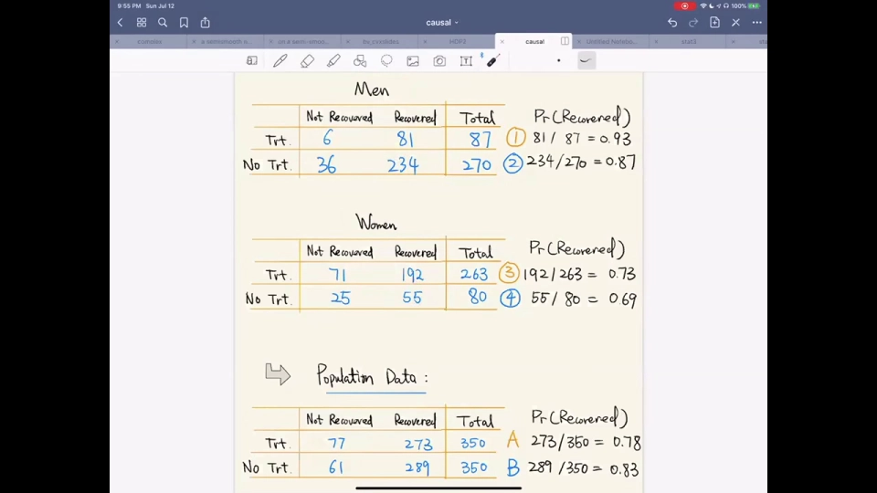
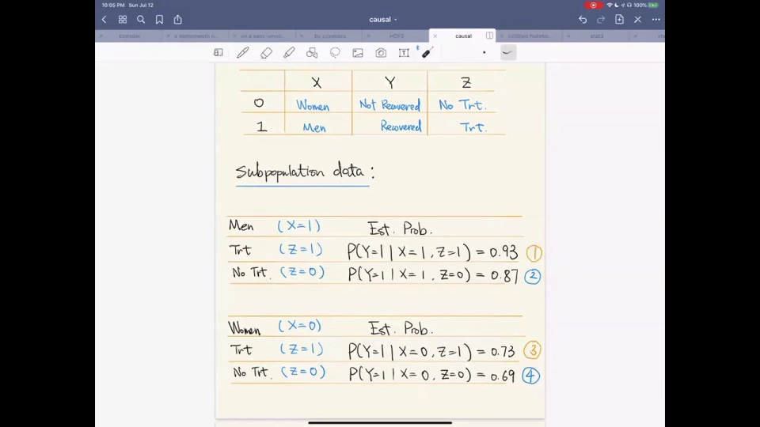
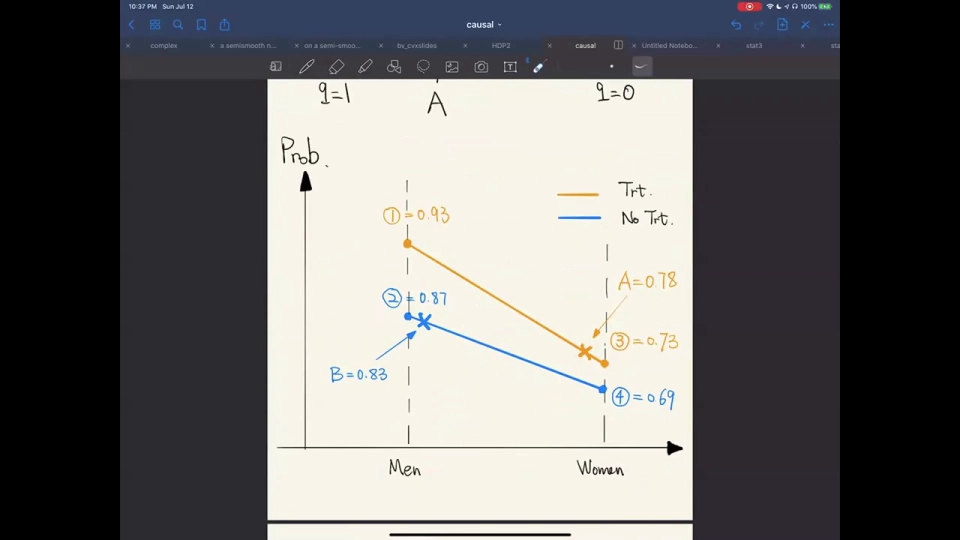
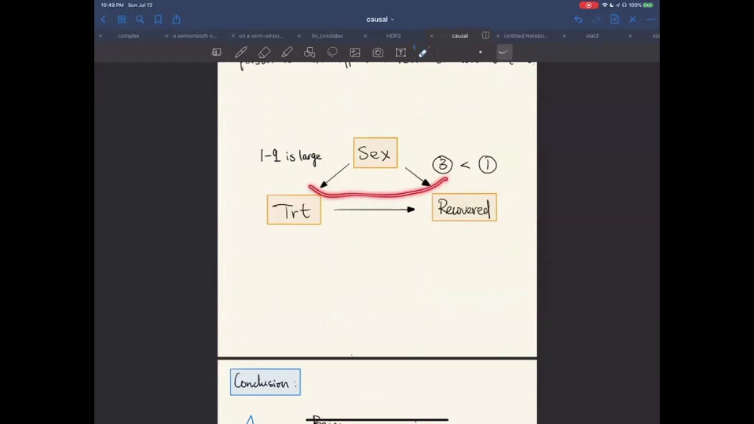

# 辛普森悖论：忽略混杂变量，整体与分组会给出相反结论

> 视频来源：[【因果推断入门】第1季第2集 辛普森悖论 上 Simpson's Paradox](https://www.bilibili.com/video/BV15J411L7xW/)（Bilibili · 饺子博士and饭老师）｜时长约 33 分钟
> 导读：这一集只讲一件事——辛普森悖论。它先用伯克利录取数据和「锻炼—胆固醇」两个例子说明「整体与分组结论相反」不是数据出错，再用药效数据把这件事算到底：把整体恢复率拆成子群恢复率与人群构成的凸组合，从而证明「反转」在数学上完全可能。本文按原讲顺序整理，最后把这个结构对回单细胞扰动里的批次、细胞类型与响应筛选。

## 本讲要解决的核心问题（SCQA）

**背景**：在传统统计框架里研究两个变量的关系，标准做法是拿一批数据算相关性——A 高的时候 B 是高还是低。这也是今天大部分组学分析在做的第一步。

**冲突**：但同一批数据，**整体算一遍和分组算一遍，可以得出方向完全相反的结论**。伯克利的研究生录取数据里，全校看男性录取率 44%、女性 35%，像是明显的性别歧视；按系拆开看，绝大多数系里女性的录取率反而更高。药效数据里，男性和女性分别看都是吃药更好，合起来看却是不吃药更好。这时候「到底有没有歧视」「药到底有没有用」变成了一个无法用数据本身回答的问题。

**疑问**：这种反转是数据有错、还是巧合？如果不是，它产生的**数学条件**是什么？为什么会出现「整体反着来」？以及——到底该信整体还是该信分组？

**回答（中心思想）**：反转不是错误，而是**存在第三个变量（混杂变量）时的必然可能**。整体恢复率可以写成「子群恢复率」与「子群里处理组占比」的凸组合：只要处理组里更偏向那个恢复率更低的子群，整体比较就会被子群构成带偏。所以**该看整体还是分组，取决于第三个变量在因果结构里的位置**——如果它是同时影响处理与结果的混杂变量（fork），就该分组；如果它是处理到结果之间的中间环节（chain），就该看整体。判断依据是因果结构，不是数据本身。

[【跳转到 02:02】](https://www.bilibili.com/video/BV15J411L7xW/?t=122)

## 一、三个例子：分组与整体互相打脸

### 1.1 伯克利录取数据：全校偏向男性，各系偏向女性

这是 1973 年秋季学期加州大学伯克利分校研究生入学的真实数据。当时的背景是：有人状告伯克利在招生时更愿意招男性、不招女性，构成性别歧视，于是校方把入学数据拿了出来。

先看全校汇总：男性申请人大约 8000 多，女性申请人 4000 多；男性录取率 44%，女性只有 35%。**只看这个数，结论似乎很清楚：明显歧视。**

但把数据按系拆开——A、B、C、D、E、F 每一行是一个系——结果反过来了。A 系女性申请人 108 人、录取率 82%，男性 825 人、录取率 62%；B、D、F 也都是女性高于男性；只有 C 系和 E 系是男性略高。

[【跳转到 03:42】](https://www.bilibili.com/video/BV15J411L7xW/?t=222)

讲者强调这是真实数据，伯克利有很多系，这里只列了人数最多的那些系，而**绝大多数系里女性的录取率都比男性高**。于是矛盾出现了：全校看男性高很多，按系看女性更高。用传统统计的视角，你没法回答「到底该看哪个」。

### 1.2 锻炼与胆固醇：组内负相关，整体正相关

第二个例子是把人群按年龄分组采样。横轴是每个人的锻炼量，纵轴是体内胆固醇含量，图里每个椭圆是一组同龄人的数据云。

**每个年龄组内部**，锻炼量和胆固醇含量是负相关——锻炼越多，胆固醇越低。但**把年龄这个信息隐藏掉、把所有数据云合在一起看**，整体呈现的却是正相关：锻炼越多的人，胆固醇反而越高。

[【跳转到 06:12】](https://www.bilibili.com/video/BV15J411L7xW/?t=372)

讲者给的机制是：年龄大的人可能本身更注重身体，因此锻炼量更大；但年龄大的人胆固醇含量本身也偏高，无论是否锻炼。**年龄同时影响了锻炼量和胆固醇**，于是它把两条本来无关甚至反向的关系，在整体上拧成了正相关。

这也说明为什么「再多看几个分组变量」不能解决问题：讲者说，如果你还想按性别分、按是否抽烟分，考虑的因素越多，这个关系就变得越不确定。**到底锻炼对控制胆固醇有没有帮助，在传统统计里完全无法回答。**

### 1.3 药效数据：男性吃药更好、女性吃药更好，整体却是不吃药更好

第三个例子是整集的主菜。研究问题是：某种药对某种疾病（讲者举例新冠）的恢复有没有作用。数据按性别分成两组。

| 男性 | 未恢复 | 恢复 | 合计 | 恢复率 |
| :--- | ---: | ---: | ---: | ---: |
| 用药 | 6 | 81 | 87 | 0.93 |
| 未用药 | 36 | 234 | 270 | 0.87 |

| 女性 | 未恢复 | 恢复 | 合计 | 恢复率 |
| :--- | ---: | ---: | ---: | ---: |
| 用药 | 71 | 192 | 263 | 0.73 |
| 未用药 | 25 | 55 | 80 | 0.69 |

男性里吃药恢复率 0.93 高于不吃药 0.87；女性里吃药 0.73 高于不吃药 0.69。**两个子群的结论一致：吃药有帮助。**

[【跳转到 10:22】](https://www.bilibili.com/video/BV15J411L7xW/?t=622)

现在把两张表按对应项相加，得到不区分性别的整体数据：用药组 350 人、恢复 273 人；未用药组 350 人、恢复 289 人。

| 整体 | 未恢复 | 恢复 | 合计 | 恢复率 |
| :--- | ---: | ---: | ---: | ---: |
| 用药 | 77 | 273 | 350 | 0.78 |
| 未用药 | 61 | 289 | 350 | 0.83 |

**整体看，用药组恢复率 0.78 反而低于未用药的 0.83。** 讲者对这个结果的评价是「显然荒谬」：如果我是医生，知道病人是男是女，无论男女我都觉得该用药；但如果不知道性别，我反而会说别用药——这显然说不通。

[【跳转到 13:17】](https://www.bilibili.com/video/BV15J411L7xW/?t=797)

## 二、把「反转」算出来：整体率是子群率的凸组合

讲者没有停在「这很奇怪」，而是把这件事算到底。

### 2.1 变量与记号

先用三个变量把数据形式化：$X$ 表示性别（0 女、1 男），$Y$ 表示是否恢复（0 未恢复、1 恢复），$Z$ 表示是否用药（0 未用药、1 用药）。于是四个子群恢复率可以写成条件概率：

$$
p_1 = P(Y = 1 \mid X = 1, Z = 1) = 0.93,\qquad p_2 = P(Y = 1 \mid X = 1, Z = 0) = 0.87
$$

$$
p_3 = P(Y = 1 \mid X = 0, Z = 1) = 0.73,\qquad p_4 = P(Y = 1 \mid X = 0, Z = 0) = 0.69
$$

也就是讲者幻灯片上的 ① 到 ④ 四个数，下文分别记作 $p_1$ 到 $p_4$。

整体数据里的两个恢复率记为 $A = 0.78$（用药组）和 $B = 0.83$（未用药组）。

[【跳转到 18:42】](https://www.bilibili.com/video/BV15J411L7xW/?t=1122)

### 2.2 关键一步：$A$ 和 $B$ 都是凸组合

把 $A$ 按全概率公式对 $X$ 展开：

$$
A = P(Y = 1 \mid Z = 1) = \sum_{x} P(Y = 1 \mid X = x, Z = 1)\, P(X = x \mid Z = 1)
$$

记 $q = P(X = 1 \mid Z = 1)$，也就是**用药组里男性的比例**，那么 $1 - q$ 就是用**药组里女性的比例**。于是

$$
A = p_1 \cdot q + p_3 \cdot (1 - q),\qquad q \in (0, 1)
$$

同理，记 $q' = P(X = 1 \mid Z = 0)$ 为未用药组里男性的比例：

$$
B = p_2 \cdot q' + p_4 \cdot (1 - q'),\qquad q' \in (0, 1)
$$

**这就是整集最关键的一步**：整体的恢复率不是「所有恢复人数除以总人数」那么简单，它是**两个子群恢复率的加权平均**，权重是两个子群在处理组里的占比。

[【跳转到 22:41】](https://www.bilibili.com/video/BV15J411L7xW/?t=1361)

### 2.3 几何图像：两个可以在线段上滑动的点

凸组合有一个非常直观的几何解释：把 $p_1$ 和 $p_3$ 看成数轴上的两个点，那么 $p_1 q + p_3(1-q)$ 就是**连接这两点的线段上的一个点**——$q = 1$ 时落在 $p_1$ 端，$q = 0$ 时落在 $p_3$ 端，$q$ 在中间时点就在线段上滑动。$B$ 同理，是 $p_2$ 和 $p_4$ 之间线段上的点。

[【跳转到 24:46】](https://www.bilibili.com/video/BV15J411L7xW/?t=1486)

图上能直接看出反转是怎么发生的：橙色线段整体在蓝色线段上方（$p_1 > p_2$、$p_3 > p_4$，这就是「两个子群里用药都更好」），但 **$A$ 和 $B$ 在这两条线段上的位置由 $q$、$q'$ 决定**。只要让 $q$ 足够小（用药组里女性占绝大多数，$A$ 滑向 $p_3$ 那一端）、让 $q'$ 足够大（未用药组里男性占多数，$B$ 滑向 $p_2$ 那一端），就完全可能出现 $A < B$。

**换句话说：子群结论一致（$p_1 > p_2$、$p_3 > p_4$）与整体结论反转（$A < B$）在数学上并不矛盾，它们是同一组数字的两种读法。**

## 三、反转的两个必要条件，以及它为什么叫「混杂」

### 3.1 两个必须同时成立的条件

从上面的凸组合出发，要让 $A < B$，需要两个因素**联动**：

1. **$p_3 < p_1$**：女性（无论用药与否）的恢复率比男性低。图上就是橙色线段向右下倾斜、蓝色线段也在下方。
2. **$q$ 小**，也就是 $1 - q$ 大：**用药组里女性占绝大多数**。

讲者逐条核对过数据：女性的恢复率确实更低（$p_3 = 0.73 < p_1 = 0.93$，$p_4 = 0.69 < p_2 = 0.87$），用药组里也确实以女性为主（263 对 87）。

### 3.2 两个条件合起来，就是「性别同时影响用药和恢复」

把这两个条件翻译成因果语言：

- 用药的人大多数是女性 → **性别影响「是否用药」**；
- 女性恢复更差 → **性别影响「是否恢复」**。

于是三者的关系是：**性别 → 用药，性别 → 恢复，用药 → 恢复**。这就是一个典型的 fork 结构：性别是那个「共同的因」。

[【跳转到 31:25】](https://www.bilibili.com/video/BV15J411L7xW/?t=1885)

讲者对这个结构的解释很直白：在整体数据上看到「吃药的人恢复比较差」，**不是因为药没用，而是因为吃药的人大多数是女性，而女性整体恢复比男性差一些**。当你只看女性这个分组时，大家的性别都一样了，性别这个因素就被剔除掉了，这时候观测到的才是「用药对恢复有帮助」这个真正的因果关系。

所以结论是：**想观察到用药对恢复的因果关系，必须把性别这样的因素剔除掉，办法就是看它的分组数据**。在这个例子里，医生该看的是分类数据而不是整体数据——因为性别在这里扮演的是**混淆变量（confounder）**的角色。

[【跳转到 31:50】](https://www.bilibili.com/video/BV15J411L7xW/?t=1910)

## 四、为什么第三个例子反过来：该看整体

前面三个例子里，前两个（性别、年龄）都该看分组数据，第三个（血压）却该看整体数据。讲者在第一个视频里给的判据是：**看第三个变量在因果结构里的位置**。

- **性别 / 年龄是 fork**：它们同时影响「处理」和「结果」，是共同的因。按它们分组，等于把这条非因果通路切断，剩下的就是处理到结果的直接通路。
- **血压是 chain 上的中间变量**：药 → 血压降低 → 恢复改善，同时药还有一条副作用直接指向恢复。按血压分组，等于把「药效经过血压」这条路堵死，你看到的只剩副作用。

所以「该看整体还是分组」不是一个统计学问题，而是一个**因果结构问题**：先画出三者的图，再决定 condition 在谁身上。这也是为什么辛普森悖论本身不构成一个「解题技巧」——它只是把「数据无法自己给出因果」这件事摆到了台面上。

## 五、把这个结构对回单细胞扰动

视频讲的是临床数据，但结构完全同构。单细胞扰动实验里最常见的三个「性别」是：

**（1）细胞类型。** 如果某个扰动只在一部分细胞类型里生效，而不同细胞类型在你测到的基因上表达基线又不同，那么把全部细胞混在一起比较扰动组与对照组，就是在做一次「整体 vs 分组」的比较。细胞类型同时影响「扰动是否生效」和「读出基因的表达」，是标准的 fork。

**（2）批次 / 测序深度。** 如果扰动组和对照组来自不同批次、捕获效率不同，批次就同时影响「你被分到哪一组」和「你测到的表达量」。不按批次分层或校正，整体比较出来的差异基因里就混着批次效应。

**（3）按响应筛选细胞（collider 陷阱）。** 更隐蔽的一种：先按「响应强度」挑出高响应细胞，再在这些细胞里比较扰动组与对照组。如果扰动和细胞固有状态都影响响应强度，那么「按响应筛选」这个动作本身就会在扰动与状态之间造出关联——这是 fork 之外的另一种偏倚，机制不同但后果类似。

三条的共同结论是一样的：**在做「扰动组 vs 对照组」的整体比较之前，先问一句「有没有一个变量同时影响分组和读出」**。如果有，就必须按它分层、配对或校正；如果没有，整体比较才是对的。判据是因果图，不是数据本身。

## 小结

- **辛普森悖论不是数据错误**，而是同一批数据在整体与分组两个粒度上给出方向相反的结论。伯克利录取数据、锻炼—胆固醇、药效数据是三个真实形态。
- **它的数学机制是凸组合**：整体恢复率等于「子群恢复率」按「子群在处理组中的占比」加权平均。占比一变，整体率就可能在子群率不变的情况下反转。
- **反转需要两个条件同时成立**：子群基线不同（$p_3 < p_1$），且处理组偏向基线更差的子群（$q$ 小）。这两个条件合起来就是「第三个变量同时影响处理与结果」。
- **这个第三个变量就是混杂变量（confounder）**，在因果图上是一个 fork。按它分组或校正，才能看到真正的处理效应。
- **不是所有第三个变量都该被剔除**：如果它是处理与结果之间的中间环节（chain，如血压），按它分组反而会把真实效应堵掉，这时应该看整体。
- **判据是因果结构，不是数据**：先画图，再决定 condition 在谁身上——这是辛普森悖论给出的唯一可靠答案。

## 关键术语速查

| 术语 | 一句话解释 |
| :--- | :--- |
| 辛普森悖论 | 整体数据与分组数据给出方向相反的统计结论 |
| 子群（subpopulation） | 按第三个变量切分出来的数据子集，如「男性」「女性」 |
| 整体数据（population data） | 不区分第三个变量、把所有子群合并后的数据 |
| 凸组合 | $p_1 q + p_3(1-q)$ 这种权重非负且和为 1 的线性组合，几何上是两点之间线段上的点 |
| 混杂变量（confounder） | 同时影响「处理」与「结果」的变量，在因果图上是 fork 的中间节点 |
| 中间变量（mediator） | 位于「处理 → 结果」通路上的变量，在因果图上是 chain 的中间节点 |
| 分层 / 分组分析 | 按混杂变量把数据切开分别比较，等价于在因果图上 condition 在该变量 |
| 因果通路 | 从处理指向结果的有向通路；与之相对的是经过混杂变量的非因果通路 |