# RNA 干扰的发现与分子机制：从矮牵牛共抑制到 Dicer-RISC 通路

> 视频来源：[【生科集录】RNA干扰丨双链RNA引发的沉默现象](https://www.bilibili.com/video/BV1Yb421e7kh/)（Bilibili · 博士夏洛克）｜时长约 26 分钟
> 导读：这是一支按「发现史 → 三步机制 → siRNA 的四条生产路线 → shRNAmir 载体 → siRNA 与 miRNA 的区别」顺序讲的分子生物学综述，信息密度高、术语给得完整（Dicer、Ago、TRBP、Drosha、DGCR8、Exportin-5 都点了名）。本文按原讲顺序整理，把机制部分逐步骤拆开，并在末尾补一段与单细胞扰动实验的衔接。视频最后约 4 分钟讨论了「诺奖该不该给植物学家」的公案，本文也一并收录。

## 本讲要解决的核心问题（SCQA）

**背景**：在分子生物学的中心法则里，RNA 一直被当成「中间人」——把 DNA 上的遗传信息抄一份，送到核糖体那里翻译成蛋白质。按这个图景，想让一个基因「不干活」，最彻底的办法是去改 DNA。

**冲突**：但 1990 年代接连出现三个解释不通的实验结果。把一份色素基因**多**转入矮牵牛，花不但没变得更紫，反而变白了；在线虫里注射**正义** RNA（和 mRNA 序列相同的那条），居然也能阻断基因表达——这和「反义 RNA 靠互补配对去封堵」的经典原理完全相反。更奇怪的是，单独注射正义或反义 RNA 效果都很微弱，把两者混在一起却效果惊人。

**疑问**：到底是什么东西在起作用？如果起作用的不是单链 RNA 而是**双链 RNA**，那细胞里是谁把它变成有活性的分子，又是谁带着它去找到并销毁目标 mRNA？这套机制为什么能持续好几天，而不是转染进去几小时就结束？

**回答（中心思想）**：RNA 干扰（RNA interference，RNAi）是**在 mRNA 层面、而不是在 DNA 层面**关掉基因的一套机制，它由三步构成：**Dicer 把长双链 RNA 剪成 21–23 bp 的 siRNA → siRNA 装进 RISC 并选出一条「引导链」→ 引导链通过碱基互补配对找到靶 mRNA，由 Ago 蛋白把它切断**。切断后的 mRNA 片段失去帽子结构和 polyA 尾，很快被外切酶啃掉。因为 RISC 在切开一条 mRNA 之后可以**继续去找下一条**，加上植物/线虫里还存在依赖 RNA 依赖的 RNA 聚合酶（RdRP）的**次级 siRNA 放大回路**，所以一次导入的 dsRNA 能维持数天的沉默效果。而 shRNA 只是把「siRNA 的生产」这一步搬进了细胞里：用载体表达一个发卡结构，让细胞自己的加工流水线把它切成 siRNA。

## 一、RNAi 是什么：在 mRNA 层面关掉基因

讲者给的定义很直接：**RNA 干扰是一种双链 RNA 分子在 mRNA 水平关闭相应序列基因的表达、并使其降解的过程**，它是转录后基因沉默（post-transcriptional gene silencing，PTGS）的一种方式，属于**转录后水平调控**的范畴。

这个定义里有三个关键词值得单独拎出来：

- **双链 RNA 分子**——触发器是双链，不是单链。这是整支视频反复回到的原点。
- **在 mRNA 水平**——被销毁的是 mRNA，DNA 序列本身完好无损。所以这种沉默是**可逆的、可调的**，细胞只要重新转录就能恢复。
- **特异性地降解**——降解只发生在序列匹配的那一条 mRNA 上，其他 mRNA 不受影响。

讲者特别强调它的**普遍性**：RNA 干扰广泛存在于从细菌到植物、从无脊椎动物到哺乳动物的多种生物之中，甚至低等的原核生物中也存在 RNA 干扰现象。这一点很重要——正因为它是几乎一切生物都保留的古老机制，它才既能被当成实验室工具，也解释了为什么外源双链 RNA 会顺带触发免疫反应（这一点在下一篇里展开）。

## 二、发现史：三次「意外」

讲者的开场白是：「许多伟大科学成果的灵感或最初发现，都是从意外得到的实验结果中获得的。」RNA 干扰的发现正是如此，而且**并非一个人或几个人的功劳**。他挑了三件有代表性的事例。

### 2.1 第一件（1990）：矮牵牛共抑制——想加深颜色，结果花变白了

1990 年，Jorgensen 研究团队在研究植物类黄酮合成的关键酶——**查尔酮合成酶**（chalcone synthase）是否决定花青素的合成速度这一课题。他们的做法是**转基因**：在矮牵牛花中过量表达查尔酮合成酶，按预期这批花的颜色会大大加深。

实验结果却恰恰相反。许多花瓣的颜色并未加深，反而呈现白紫杂色甚至白色；并且**本该过量表达的查尔酮合成酶，其浓度比正常矮牵牛花还低了 50 多倍**。

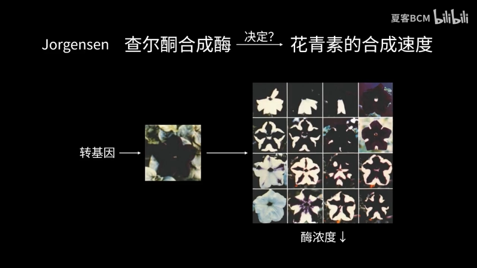

[【跳转到 02:43】](https://www.bilibili.com/video/BV1Yb421e7kh/?t=163)

Jorgensen 等人推测：这是**转基因和同源的内源基因的表达都被抑制**的结果——外源转入的编码查尔酮合成酶的基因自身被抑制的同时，也抑制了矮牵牛花中内源查尔酮合成酶基因的表达。他把这个现象命名为**共抑制**（co-suppression）。

### 2.2 沉默的两条路：甲基化与 PTGS

后续研究发现，这类「转基因诱导的沉默」在机制上并不统一：

- 在一些植物中，它来自**基因特异性的甲基化**——在 DNA 层面把基因关掉；
- 但另一些是在**转录后水平**出现的，即**转录后基因沉默（PTGS）**——DNA 没被动过，是 mRNA 被销毁了。

而且，不只是转基因能诱导基因沉默，**转入某些病毒同样能够诱导基因沉默**。这两条线索合起来，指向一个结论：**外源基因诱导的基因沉默，是植物对抗病毒和转座子的一套防御系统**。

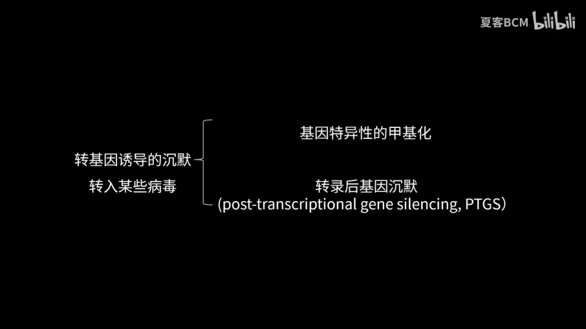

[【跳转到 03:38】](https://www.bilibili.com/video/BV1Yb421e7kh/?t=218)

> 这里出现了一个贯穿全节的区分：**甲基化式的沉默发生在 DNA 层面，PTGS 式的沉默发生在 mRNA 层面**。RNAi 属于后者。到第 3.2.1 节会看到，CRISPRi 用 dCas9-KRAB 把染色质改造成抑制态，走的是前一条路；两者都能「把基因按下去」，但作用层级完全不同。

### 2.3 先补两个概念：正义 RNA 与反义 RNA

要讲清楚第二件意外，得先分清正义链和反义链。DNA 由两条反平行且互补的链组成，缠绕成双螺旋。转录时 DNA 局部双链解开，以其中一条链为模板合成互补的 RNA 链：

- 作为模板的那条 DNA 单链叫**模板链**，也叫**反义链**；
- 另一条 DNA 单链叫**编码链**，也叫**正义链**。

而正义 RNA 和反义 RNA 的概念，是**相对于转录产生的特异 mRNA 链**来讲的：**反义 RNA 可与特定的 mRNA 互补，正义 RNA 与特定的 mRNA 的核苷酸序列相同**。还有**双义 RNA**，指的就是双链 RNA——它同时包含单链正义 RNA 和单链反义 RNA。

讲者给了一套便于记忆的符号约定：把编码链标记为 $+$，模板链则为 $-$；由模板链产生的 mRNA 标记为 $+$；则能够与该 mRNA 互补的 RNA 链标记为 $-$，与特定 mRNA 的核苷酸序列相同的 RNA 标记为 $+$。

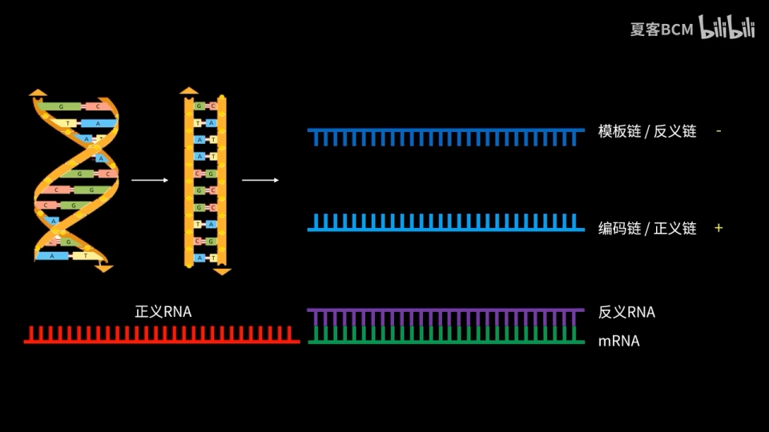

[【跳转到 05:43】](https://www.bilibili.com/video/BV1Yb421e7kh/?t=343)

### 2.4 第二件（1995）：线虫里注射正义 RNA 也沉默了

1995 年，美国康奈尔大学的 Guo 和 Kemphues 在研究 **par-1 基因**对线虫第一次卵裂不对称性的影响时，用**反义 RNA** 阻断线虫 par-1 基因的表达。同时他们发现：**注入正义 RNA 的对照组中也阻断了该基因的表达**。

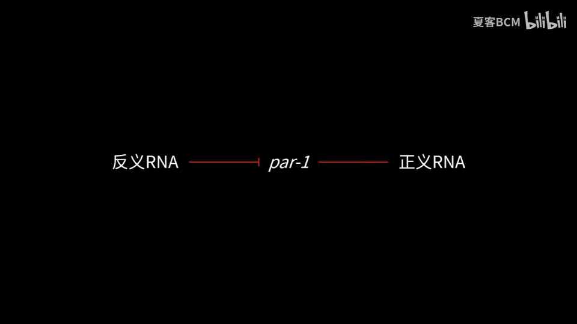

[【跳转到 06:33】](https://www.bilibili.com/video/BV1Yb421e7kh/?t=393)

这一现象与传统的反义 RNA 技术原理背道而驰。是什么因素或机理导致了这一结果？相关研究人员无法给出合理解释，但他们还是把实验结果如实发表在了 1995 年的 *Cell* 杂志上。

### 2.5 第三件（1998）：Fire 与 Mello 把「双链」揪了出来

直到 3 年后，**Andrew Fire 和 Craig Mello** 才揭开了这个悬疑。他们首先看到了 Guo 和 Kemphues 的结果，猜测原因可能是**制备的单链正义 RNA 中混有其他成分**。随后他们在研究调节线虫基因表达的过程中发现：

- 单独注射编码肌丝蛋白的 **unc-22** 基因的正义或反义 RNA，都能引发**很小的**干扰效果，并且需要**大剂量**的 RNA 才能观察到；
- 但**正义-反义 RNA 的混合物**可以产生非常明显的干扰效应，**干扰效果比单链 RNA 至少高出 2 倍**。

为了证实双链 RNA 的特异性，Fire 和 Mello 又引入了另外 3 个基因的双链 RNA，得到了相同的结果；并且这种干扰现象**在接受注射的动物及其子代中都有发现**。

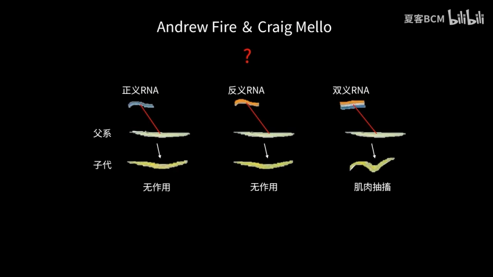

[【跳转到 07:48】](https://www.bilibili.com/video/BV1Yb421e7kh/?t=468)

由此他们把这一现象称为 **RNA 干扰**。结论是：外源导入的正义 RNA 之所以能引起内源 RNA 降解，是因为制备单链正义 RNA 的过程中**混入了双链 RNA**；外源导入的单链正义 RNA，**只有在反义 RNA 存在的条件下**才能引起 RNA 降解。在后续的一系列实验研究中，他们进一步探讨了 RNA 干扰的作用机制。

2006 年，诺贝尔生理学或医学奖授予美国科学家 Andrew Fire 和 Craig Mello，以表彰他们对 RNA 干扰机制的研究——**发现了控制遗传信息流动的基本机制，首次揭示了一种由 RNA 介导的全新的基因表达调控机制**。

## 三、机制：三步把 mRNA 切碎

这是全片最核心的部分。讲者把 RNAi 拆成三个先后衔接的步骤，每一步都点名了关键的蛋白质。

### 3.1 第一步：Dicer 把长 dsRNA 剪成 21–23 bp 的 siRNA

当较长的外源性或由细胞自身产生的 dsRNA 进入细胞质中，**ATP 依赖性 RNaseⅢ——Dicer**（也可简称为 DCR）会特异性地与 dsRNA 结合，并将其剪切成 **21–23 bp** 的小分子 RNA 片段；并且在这些小分子 RNA 的 **3′ 末端具有两个突出的核苷酸**。

这种通过 Dicer 作用产生的 21–23 bp 产物，被称为**短或小干扰 RNA**（small interfering RNA，**siRNA**）。讲者强调：**这一步是 RNA 沉默应答的核心反应**，siRNA 是引发核酸酶降解 mRNA 的引导物。

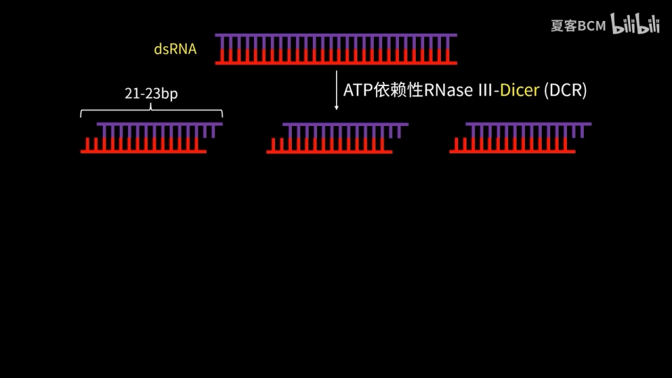

[【跳转到 10:37】](https://www.bilibili.com/video/BV1Yb421e7kh/?t=637)

为什么是「3′ 端两个核苷酸突出」这件事值得记？因为它是 siRNA 的**结构身份证**：后面 miRNA 加工出来的产物也是同样的形状（约 22 bp、3′ 端两个碱基悬垂），这正是两者共用下游机器（RISC）的原因，也正是 shRNAmir 这类载体能「借用」miRNA 加工流水线的物理基础。

### 3.2 siRNA 的结构：guide 链与 passenger 链

siRNA 由两条长约 21–23 个碱基的小 RNA 组成：

- 与靶标 RNA **完全互补配对**的那条链叫 **guide 链**（guide strand），也称为**反义 RNA**；
- 另一条链叫 **passenger 链**（passenger strand）。

guide 链和 passenger 链之间有约 **19 个碱基互补配对**，在双链 siRNA **两端各形成 2 个碱基的 3′ 末端悬垂**。

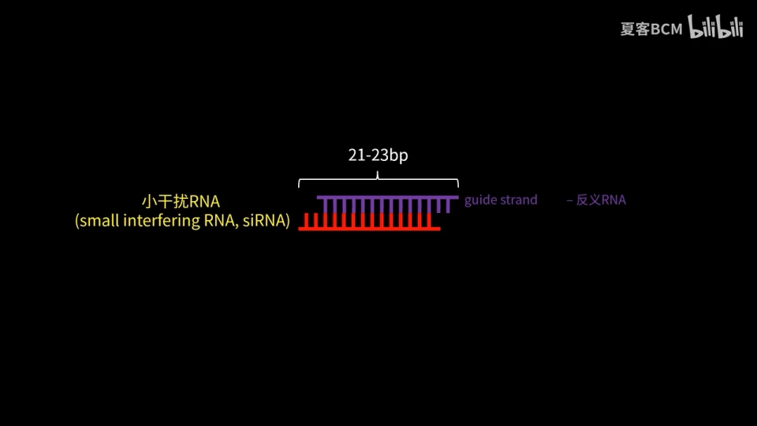

[【跳转到 11:27】](https://www.bilibili.com/video/BV1Yb421e7kh/?t=687)

### 3.3 第二步：装进 RISC，选一条链当「引导链」

每一个 siRNA 都能与 **RNA 诱导沉默复合体**（RNA-induced silencing complex，**RISC**）相结合，并发挥 RISC 的**解旋酶活性**，使 siRNA 解链并保留反义 RNA。

**选哪条链留下来，是有规则的**：一般情况下，RISC 会保留 siRNA 中 **5′ 末端碱基配对相对不稳定的那条链**（含有较多 A/U 碱基）；另一条链则大部分被丢弃并降解。

这种结合与选择性主要依赖于 RISC 中的**核心蛋白质 Ago**（Argonaute），并且还需要其他蛋白质如 **TRBP** 的协助，以使 siRNA 高效进入 RISC、组装形成具有活性的 RNAi 分子机器。

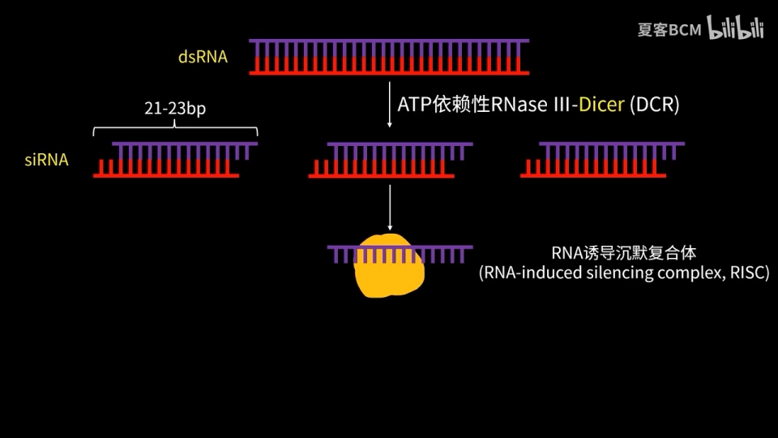

[【跳转到 12:42】](https://www.bilibili.com/video/BV1Yb421e7kh/?t=762)

> 「5′ 端配对更不稳定的一条被留下」这条规则，解释了为什么设计 siRNA 时序列本身会影响沉默效率——两条链的热力学不对称性决定了哪条链成为 guide 链。如果选错了链，效果会大打折扣。

### 3.4 第三步：引导链配对靶 mRNA，Ago 负责「切片」

反义 RNA 在 RISC 的介导下，通过碱基互补配对原则与相应的靶 mRNA 结合，利用 RISC 的核酸酶活性导致靶标 mRNA 的**内源性降解**：mRNA 被切断，或产生失去 polyA 尾和 5′-甲基鸟嘌呤帽的片段。因此释放出的 RNA 片段更容易受到 5′ 或 3′ 核酸外切酶的攻击而快速降解，从而在转录后水平沉默靶基因的表达。

这一步同样依赖于 RISC 中的核心蛋白质 Ago：**在镁离子和 ATP 的参与下，Ago 可以利用其核酸内切酶活性，切割与反义 RNA 完全互补配对的靶标 RNA**。

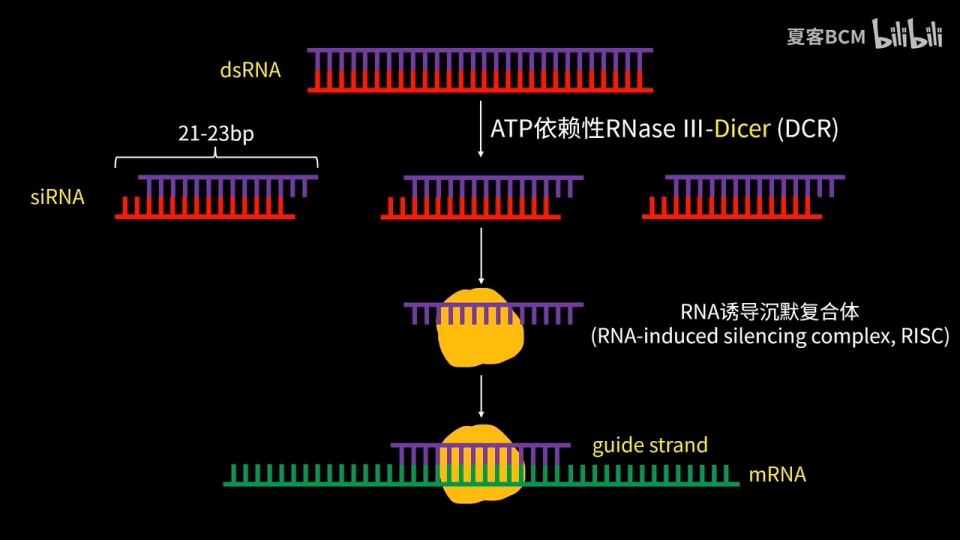

[【跳转到 13:32】](https://www.bilibili.com/video/BV1Yb421e7kh/?t=812)

最后，**在靶标 mRNA 降解之后，包含有反义 RNA 的 RISC 复合体继续靶定另外的 mRNA 分子**。这一点是理解「RNAi 为什么效率这么高」的关键：RISC 是**催化剂**，不是一次性消耗品——一个 RISC 分子可以循环切开多条同种 mRNA，所以只需少量 siRNA 就能把某个基因的 mRNA 水平压下去一大截。

### 3.5 为什么沉默能持续几天：次级 siRNA 的放大回路

如果只是把 siRNA 转进去，理论上它只能「扫描」而不能「复制」，那这个过程不应该长久。但实际的 RNAi 效果能持续一段时间。讲者在讲解 RNAi 引发的基因沉默机制时给出的解释是：除了直接由外源 dsRNA 经 Dicer 产生 siRNA 之外，还存在一条**自我复制式的放大回路**——细胞里的机制可以让「双链 RNA 干扰的效应不断得到复制」，新产生的前体再走一遍 Dicer + RISC 的流程，于是沉默可以不断继续下去。

[【跳转到 03:00】](https://www.bilibili.com/video/BV1Yb421e7kh/?t=180)

当然这个时效是有一定的，**并不是永无止境，一般情况下就几天左右**。

> 这条放大回路在文献里通常写作「RNA 依赖的 RNA 聚合酶（RdRP）以靶 mRNA 为模板合成新的 dsRNA，产生次级 siRNA（secondary siRNA）」。需要留意：它在**植物和线虫**中很突出，而哺乳动物细胞里 RdRP 活性很弱。这解释了为什么在哺乳动物细胞里做 siRNA 敲低，效果往往只能维持数天、且会随细胞分裂被稀释——这一点在下一篇讲 siRNA 与 shRNA 的取舍时会再次用到。

## 四、siRNA 从哪来：四条生产路线

讲者把 siRNA 的来源归纳为四种方式：

1. **长的双链 RNA（dsRNA）加工生成**——即由 Dicer 剪切产生，这是细胞内的天然路径；
2. **直接通过化学方法合成**——实验室里最常用的方式，合成好的双链 siRNA 直接转染进细胞；
3. **RNA 聚合酶Ⅲ启动子转录产生**——用 Pol Ⅲ 启动子在细胞内转录出短 RNA；
4. **RNA 聚合酶Ⅱ启动子转录产生**——用 Pol Ⅱ 启动子表达更长的前体，再走加工途径。

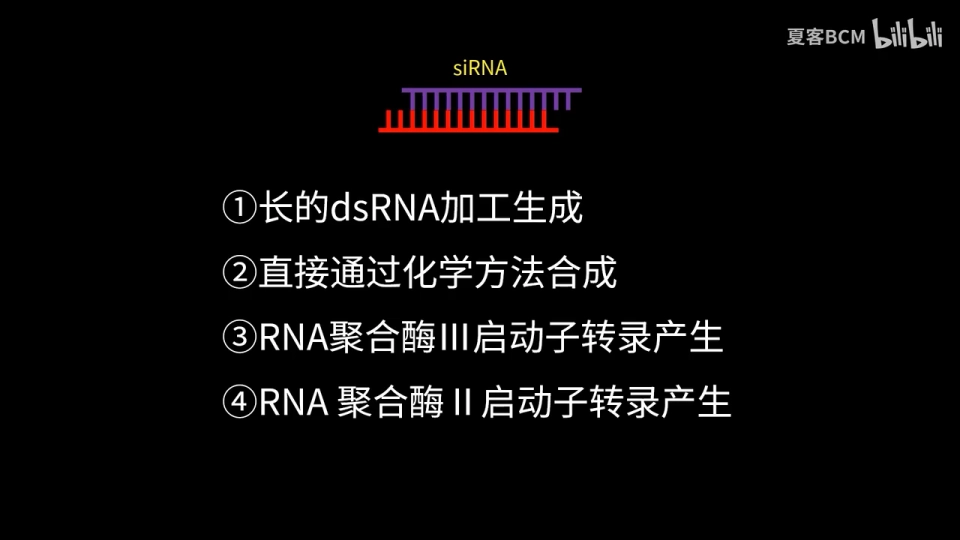

[【跳转到 14:42】](https://www.bilibili.com/video/BV1Yb421e7kh/?t=882)

针对不同的物种，或同一物种不同种类的细胞，可以选取适当的方式产生 siRNA 引发 RNAi。但讲者紧接着提醒：**在实际应用过程中，并不是产生相应的 siRNA 就能够万事大吉**，还需要考虑众多因素的影响，例如 siRNA 对受体细胞自身的影响、能否长期稳定表达、操作难度、转染效率、实验成本、RNAi 的脱靶效应等等。

为了解决这些问题，研究人员开发了众多技术方法。其中**构建基于 miRNA 前体的 siRNA 表达载体**特异性高、较为灵活，属于利用 RNA 聚合酶Ⅱ启动子转录产生 siRNA 的方式。视频接下来只对这一种方法做了展开。

## 五、shRNA：借 miRNA 的加工流水线做「可表达」的 siRNA

要理解 shRNAmir 这个设计，得先看 miRNA 自己是怎么被加工出来的。

### 5.1 miRNA 是什么

**微小 RNA／小分子 RNA**（microRNA，**miRNA**）是由内源性发夹结构转录产物衍生而来的一种长为 **19–25 nt 的单链 RNA**（single-stranded RNA，ssRNA），广泛存在于真核生物中，**不编码蛋白质**。miRNA 通过与靶信使核糖核酸（mRNA）特异结合，从而抑制转录后基因表达，在调控基因表达、细胞周期、生物体发育时序等方面起重要作用。

一个重要的拓扑特征是：**每个 miRNA 可以有多个靶基因，而几个 miRNA 也可以调节同一个基因**——这是一个多对多的调控网络，而不是 RNAi 那种「一条 siRNA 对准一条 mRNA」的一对一关系。

### 5.2 miRNA 的生物发生：核内两步 + 核外一步

讲者把 miRNA 的加工拆得很细，共三步：

1. **核内转录**：在细胞核内，通过 RNA Pol Ⅱ 转录产生长度为几百到几万个碱基的、包含一个或几个 miRNA 的、具有 5′ 端帽子结构和 3′ 端 polyA 尾的 **pri-miRNA**。
2. **核内剪切**：pri-miRNA 在**微处理器**（RNaseⅢ 蛋白质家族的 **Drosha** 与协助蛋白 **DGCR8**）作用下，识别不同的 pri-miRNA 的二级结构，并在其根部进行剪切，形成约 **70 nt 的前体 miRNA**（precursor miRNA，**pre-miRNA**）。这一过程也发生在细胞核中。
3. **出核与胞质内切割**：**Exportin-5** 识别 pre-miRNA 的 3′ 末端两个碱基的悬垂结构，并将其运输到细胞质中；在细胞质中由 **Dicer/TRBP** 进一步切割去除顶端单链环，产生长度约 **22 bp 的双链 miRNA**。其中 **5′ 末端碱基配对相对不稳定的那条链**会进入 RISC 发挥功能。

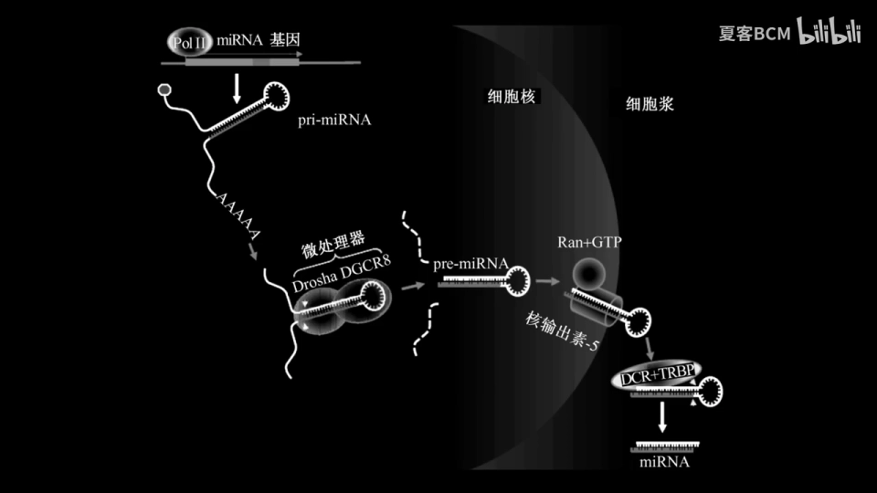

[【跳转到 16:22】](https://www.bilibili.com/video/BV1Yb421e7kh/?t=982)

### 5.3 shRNAmir：把 miRNA 的骨架换成 siRNA 的序列

由于 siRNA 和 miRNA 在**长度、结构、加工途径和结合的蛋白质**上都较为类似，于是有了一个很自然的工程想法：**基于 miRNA 的产生途径，把 pri-miRNA 中的 miRNA 序列替换成 siRNA 序列**。这样通过 RNA 聚合酶Ⅱ 启动子转录，就能产生一个类似 pri-miRNA 结构的 siRNA 前体；它被细胞核内的 Drosha 及细胞质中的 Dicer 连续切割，产生成熟的 siRNA，同样可以有效沉默靶基因的表达。

这种基于 miRNA 前体的 RNAi 载体被称为 **shRNAmir**。

使用这类 Pol Ⅱ 启动子的优点是：**能够选择不同组织特异性或诱导型的启动子来表达 siRNA**，从而实现在肝脏或神经组织等特定组织中沉默，以及由小分子化合物或光诱导的基因沉默。

> 这一步是 RNAi 从「往细胞里塞一段 RNA」变成「往基因组里装一个开关」的关键。化学合成的 siRNA 是**外源投递**，用完就没了；shRNA 载体是**内源表达**，只要载体还在、启动子还开着，细胞就会持续不断地生产 siRNA。这条区别在下一篇会展开成「瞬时 vs 稳定」的取舍表。

## 六、siRNA 与 miRNA 不是一回事

讲者特别强调：**尽管 siRNA 与 miRNA 存在一些相似之处，但本质上属于两种完全不同的概念，不可混为一谈**。他从机制、来源、分子特征、特异性、作用方式、作用位置、重要特性和生物学意义八个维度做了对照。

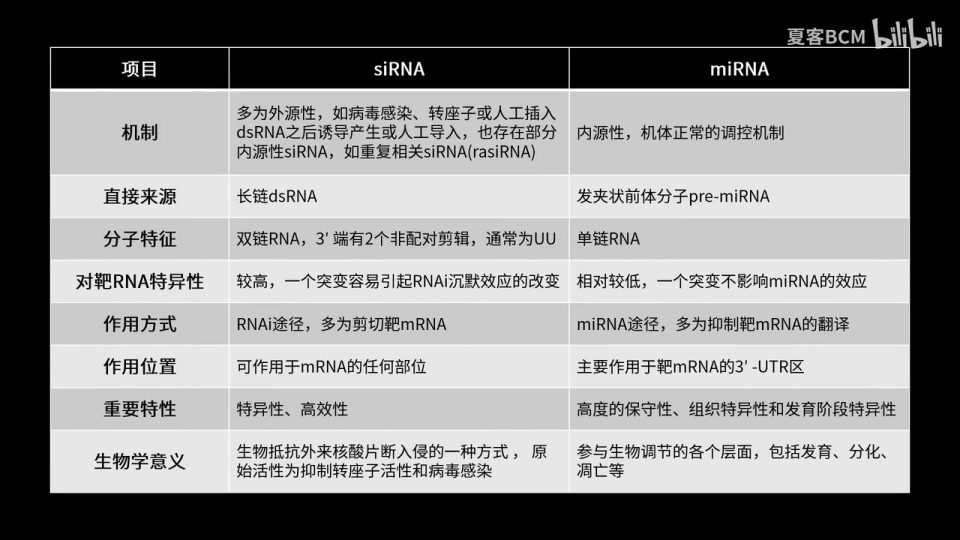

[【跳转到 20:12】](https://www.bilibili.com/video/BV1Yb421e7kh/?t=1212)

| 项目 | siRNA | miRNA |
| --- | --- | --- |
| 机制 | 多为外源性，如病毒感染、转座子或人工插入 dsRNA 之后诱导产生或人工导入，也存在部分内源性 siRNA，如重复相关 siRNA（rasiRNA） | 内源性，机体正常的调控机制 |
| 直接来源 | 长链 dsRNA | 发夹状前体分子 pre-miRNA |
| 分子特征 | 双链 RNA，3′ 端有 2 个非配对剪接，通常为 UU | 单链 RNA |
| 对靶 RNA 特异性 | 较高，一个突变容易引起 RNAi 沉默效应的改变 | 相对较低，一个突变不影响 miRNA 的效应 |
| 作用方式 | RNAi 途径，多为剪切靶 mRNA | miRNA 途径，多为抑制靶 mRNA 的翻译 |
| 作用位置 | 可作用于 mRNA 的任何部位 | 主要作用于靶 mRNA 的 3′-UTR 区 |
| 重要特性 | 特异性、高效性 | 高度的保守性、组织特异性和发育阶段特异性 |
| 生物学意义 | 生物抵抗外来核苷酸片段入侵的一种方式，原始活性为抑制转座子活性和病毒感染 | 参与生物调节的各个层面，包括发育、分化、凋亡等 |

这张表里最值得记住的是**第 4、5、6 行**，它们连成一条因果链：

- 因为 siRNA 与靶 mRNA **完全互补**，所以对序列变化**很敏感**——靶位点上一个突变就可能让沉默失效；
- 因为完全互补，Ago 才能像限制性内切酶那样**直接切断** mRNA（「剪切」）；
- 而 miRNA 与靶 mRNA **只是部分互补**，主要靠 3′-UTR 上的多位点弱配对来**抑制翻译**，mRNA 本身不一定被降解。

一句话概括：**siRNA 是「剪掉」，miRNA 是「捂住」**。前者适合做实验工具（干净、可预测），后者是细胞自己的调光开关（温和、可逆、覆盖面广）。

## 七、RNAi 的应用与它尚未解决的问题

讲者对应用只做了概述：RNA 干扰现象自 1998 年发现后，就被广泛应用于下调目的基因的表达，目前已用于动物和植物基因功能研究以及基因治疗等领域。**虽然有部分成果已经落地，但在实际应用过程中仍有不少困难需要克服。**

这些「困难」具体是什么、为什么 RNAi 在有些场景下不如 CRISPR 可靠，下一篇会逐条展开（脱靶、干扰素反应、敲低效率差异、蛋白半衰期等）。这里先记住一句话：**RNAi 的机制很漂亮，但它的工程化难点全部集中在「怎么把合适的 dsRNA 送进正确的细胞、并且只打中一个靶点」上。**

## 八、一段插曲：诺奖该不该给植物学家

视频最后约 4 分钟讲了一桩公案，与 RNAi 的科学内容无关，但很能说明这个领域的历史层次。

自 2006 年诺贝尔生理学或医学奖授予两位美国医学遗传学家法尔（Andrew Z. Fire）和梅洛（Craig C. Mello）、以表彰他们发现 RNA 干扰现象之后，这个决定就受到了不少人、**特别是部分植物学家**的质疑。这些质疑声与 RNA 干扰本身无关，而是**针对获奖者**。

他们的主要论点是：

- 2006 年度诺贝尔奖评委会为 RNA 干扰的发现颁奖，竟将植物学家排斥其外，完全是不妥当的；
- 在这一领域中作出关键性成就的都是植物学者；
- 足以支持这项诺贝尔奖的六项成就，不是法尔和梅洛首先完成的，而是从植物学界移植过来的——为此他们引用了相应的原始文献；
- 由于每项诺贝尔奖最多可允许三人获奖，而现在获奖者仅为两人，所以植物学家理应分享一份。

他们还提出了具体的获奖候选人，并指出诺贝尔医学奖评委会是知道、并且承认植物界在发现 RNA 干扰中的历史地位的；评委会可能仅仅是因为局限于自己的专业（生理学或医学奖评委会），而不得不把植物学家排斥在获奖者名单之外。

讲者对这一说法保持了距离：「不过，这种说法也不能让人完全信服。」他举了一个反例——1973 年的诺贝尔医学奖授予三位动物学家，表彰他们发现了（生物）个体和社会行为型的组织与引导，这个授奖项目纯属于动物学，严格说来与生理学或医学风马牛不相及。

结论是：**诺贝尔基金会并不会顺从这些质疑声，他们既不会表态也不会修改**。而且这种「漏评」之说并非首例：2003 年诺贝尔生理学或医学奖（核磁共振技术）获奖者公布之后，也有科学家刊登大幅广告，指责评委会将雷蒙德·达马迪安遗漏，认为他应当与彼得·曼斯菲尔德和保罗·劳特布尔共享该奖——「没有他就不会有核磁共振成像技术」。这则广告还呼吁美国人写信给诺贝尔奖评选委员会替达马迪安鸣冤。而在瑞典方面，评选委员会表示将维持现有评选结果：「我们保持我们的观点，我们没有出错。」

> 这段插曲对读文献有实际意义：**RNAi 的关键线索（共抑制、PTGS、病毒诱导沉默）最早几乎都来自植物学**，而「RNAi」这个名字来自线虫。查这段历史时，如果只搜「RNA interference」，会漏掉 1990 年代一大批植物学文献。

## 九、把 RNAi 放回单细胞扰动实验里看

> 以下不是视频内容，而是本文把上面的机制对回本系列主线的一点延伸。

本系列关心的是「怎么扰动一个细胞、然后读出它的响应」。RNAi 在这条线索上的位置，可以直接从它上面三条机制性质推出来：

1. **它不改 DNA。** 被销毁的是 mRNA，基因组序列完好。这意味着 RNAi 造成的是一种**可逆、可调、剂量相关**的扰动：撤掉 dsRNA，细胞重新转录，表达就回来了。相比之下，CRISPR-KO 造成的是基因组上的 indel，一旦发生就随细胞分裂永久遗传。
2. **它是「降低」而不是「归零」。** 因为 RISC 只能降解已经转录出来的 mRNA，而且降解效率受 siRNA 浓度、靶位点可及性、mRNA 周转速率共同限制，所以敲低后的残余表达是这套方法的**固有特征**，不是操作失误。这一点在解读扰动数据时非常关键：一个「敲低」组的表达值下降 70%，剩下 30% 仍然在产生蛋白，下游表型可能被完全掩盖。
3. **蛋白半衰期决定了表型何时出现。** mRNA 被清掉不等于蛋白立刻消失。如果目标蛋白本身很稳定，敲低 mRNA 之后要等很久才能看到蛋白水平下降——这是 RNAi 与 CRISPR 在**时间尺度**上的另一处差别。

而目前大规模的单细胞扰动筛选（Perturb-seq 一类）之所以更常用 CRISPR 而不是 RNAi，一个很实际的机制原因是：**CRISPR 的扰动身份可以写在 DNA 上**——用一段可测序的 gRNA 序列标记每个细胞受到了哪种扰动，测序时一并读出来。RNAi 的扰动身份是「一段外源 RNA」，在单细胞测序流程里没有同样干净的读出方式。这是工程层面的取舍，不是机制优劣。第 3.3 节会展开这套「扰动身份 + 表达谱」的编码方案。

## 小结

- **RNAi 是在 mRNA 层面关掉基因**，不是改 DNA；它属于转录后基因沉默（PTGS），广泛存在于从细菌到哺乳动物的各类生物中。
- **发现史由三次意外串成**：1990 年矮牵牛的共抑制（转入色素基因反而变白）→ 1995 年线虫里正义 RNA 也能沉默 par-1 → 1998 年 Fire 与 Mello 证明起作用的是**双链 RNA**，效果比单链强至少 2 倍且可传给子代。2006 年获诺贝尔生理学或医学奖。
- **机制三步**：Dicer 把长 dsRNA 剪成 21–23 bp、3′ 端带两个突出核苷酸的 siRNA → siRNA 装进 RISC，按「5′ 端配对更不稳定」的规则选出一条 guide 链 → guide 链与靶 mRNA 完全互补配对，Ago 在镁离子和 ATP 参与下切断 mRNA，断片被外切酶迅速降解。
- **RISC 是催化剂**：切开一条 mRNA 后可以继续靶定下一条，所以少量 siRNA 就能压住大量 mRNA；植物/线虫中还有 RdRP 依赖的**次级 siRNA 放大回路**，让沉默持续数天。
- **siRNA 有四条生产路线**：长 dsRNA 加工、化学合成、Pol Ⅲ 启动子转录、Pol Ⅱ 启动子转录。
- **shRNA 的本质是把 siRNA 的生产搬进细胞**：借用 miRNA 的加工流水线（pri-miRNA → Drosha/DGCR8 → pre-miRNA → Exportin-5 出核 → Dicer/TRBP → 双链 miRNA），把 miRNA 序列换成 siRNA 序列，得到 **shRNAmir**；用 Pol Ⅱ 启动子的好处是能做组织特异性和诱导型表达。
- **siRNA 与 miRNA 的关键差别**：siRNA 外源、双链、完全互补、**剪切** mRNA；miRNA 内源、单链、部分互补、主要**抑制翻译**，作用位点在 3′-UTR。
- **RNAi 的工程化难点不在机制，而在投递与特异性**——脱靶、效率、持续时间都是应用层面的问题。

## 关键术语速查

| 术语 | 一句话解释 |
| --- | --- |
| RNAi（RNA interference） | 由双链 RNA 触发的、在 mRNA 层面特异性降解靶转录本的转录后沉默机制 |
| PTGS | 转录后基因沉默，DNA 不动、mRNA 被销毁的那一类沉默，RNAi 属于此类 |
| 共抑制（co-suppression） | 转入的同源转基因与内源基因同时被抑制的现象，1990 年在矮牵牛中发现 |
| dsRNA | 双链 RNA，RNAi 的真正触发分子 |
| Dicer（DCR） | ATP 依赖性 RNaseⅢ，把长 dsRNA 剪成 21–23 bp siRNA 的核酸酶 |
| siRNA | 小干扰 RNA，21–23 bp 双链、3′ 端各两个核苷酸悬垂的沉默引导分子 |
| guide 链 | siRNA 中被 RISC 保留、负责与靶 mRNA 互补配对的那条链（即反义 RNA） |
| passenger 链 | siRNA 中被丢弃降解的另一条链 |
| RISC | RNA 诱导沉默复合体，装载 guide 链并执行切割的核糖核蛋白机器 |
| Ago（Argonaute） | RISC 的核心蛋白，在镁离子和 ATP 参与下提供核酸内切酶活性 |
| TRBP | 协助 siRNA/miRNA 高效装载进 RISC 的辅助蛋白 |
| RdRP | RNA 依赖的 RNA 聚合酶，以靶 mRNA 为模板合成新 dsRNA，产生次级 siRNA 放大沉默 |
| miRNA | 内源发夹前体加工来的 19–25 nt 单链小 RNA，多通过抑制翻译调控基因表达 |
| pri-miRNA / pre-miRNA | miRNA 的初级转录本（核内，带帽子与 polyA）与约 70 nt 的茎环前体 |
| Drosha / DGCR8 | 核内的「微处理器」，把 pri-miRNA 剪成 pre-miRNA |
| Exportin-5 | 识别 pre-miRNA 3′ 端两个碱基悬垂、负责把它运出细胞核的转运蛋白 |
| shRNA | 短发卡 RNA，用载体表达、由细胞自身加工成 siRNA 的 RNAi 形式 |
| shRNAmir | 基于 miRNA 前体骨架构建的 shRNA 表达载体，走 Drosha + Dicer 的完整加工路线 |
| rasiRNA | 重复序列相关的内源性 siRNA，是 siRNA 的内源来源之一 |