# 基因敲低怎么实现：siRNA、shRNA 的类型、特点与应用边界

> 视频来源：[RNAi原理、类型及其应用](https://www.bilibili.com/video/BV1EY4y1k7Ap/)（Bilibili · 贾英俊de科研日记）｜时长约 14 分钟
> 导读：这支视频是一节浓缩的 RNAi 综述课，讲法偏「教科书 + 实验经验」：先把 RNAi 与基因敲除的分界线划清楚，再走一遍 Dicer–RISC 通路，然后把 miRNA／siRNA／shRNA／dsRNA 四类分子摆在一起对比，最后落到作用特点、应用场景和脱靶缺陷。本文按原讲顺序整理，并把讲者口述的实验经验（70% 的敲低效率门槛、STAT3 的 Western blot）原样保留。字幕为 AI 生成、错拼较多，本文按上下文做了订正。

## 本讲要解决的核心问题（SCQA）

**背景**：研究一个基因的功能，最直接的办法是把它「关掉」看细胞少了什么。经典的关法是**基因敲除（knockout）**——在染色体或 DNA 层面把目的基因删掉或者突变，让它失去功能、或者干脆不表达。

**冲突**：但敲除有两个绕不过去的麻烦。第一，**有些基因是致死的**：把它敲掉，这个细胞或者这个物种就不能正常发育，你连活的材料都拿不到，更谈不上研究它的功能。第二，敲除要动基因组，投入大、周期长、操作复杂。

**疑问**：有没有一种办法，**不改 DNA、只把基因的表达量降下来**，让细胞还能活着、但功能被削弱，从而观察它的缺陷？如果有，这种「降低」和「删除」在机制上到底差在哪里？它靠什么分子实现、能维持多久、又有什么代价？

**回答（中心思想）**：有，这就是**基因敲低（knockdown）**，实现它的主流技术是 **RNA 干扰（RNAi）**。它不在 DNA 层面动手，而是在 **mRNA 层面把转录本水解掉**——mRNA 变少，翻译出的蛋白自然变少。具体由一套「Dicer 剪切 → RISC 装载 → 引导链配对 → 切割 mRNA」的机器完成。按投递方式不同，RNAi 分成**瞬时型（直接转染化学合成的 siRNA 或 dsRNA，效果维持几天）**和**稳定型（用质粒或慢病毒表达 shRNA，载体整合进基因组后可长期甚至永久沉默）**两类。代价是它天然存在**脱靶**：21–23 nt 的 siRNA 只要与某个无关基因有 7 个碱基同源，就可能把那个基因也一起沉默掉。

## 一、RNAi 的定义：把 mRNA 水解掉，而不是把基因删掉

### 1.1 定义

讲者给的定义是：**RNA 干扰是由 RNA 介导的、特异性地沉默目的基因表达的过程**。

从作用点上看，正常流程是 DNA 在细胞里转录出 mRNA，mRNA 再翻译成蛋白。RNAi 在中间插了一刀：经过特意设计的 RNA 让 mRNA 被水解，mRNA 少了，翻译成蛋白的过程自然被抑制，蛋白也就变少了。讲者把这个过程也称为 **knockdown**——就是把基因的**表达水平**给降低。

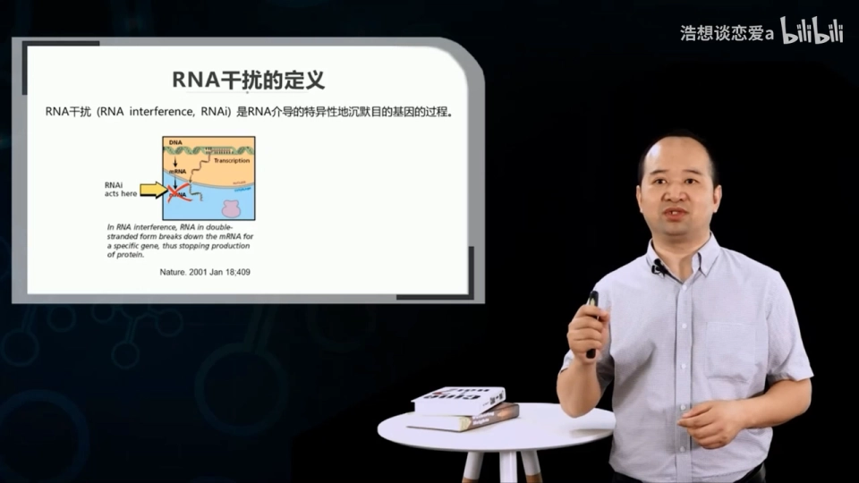

[【跳转到 00:40】](https://www.bilibili.com/video/BV1EY4y1k7Ap/?t=40)

### 1.2 knockdown 与 knockout 的分界线

这是本节最该记住的一段对比。讲者把两者放在一起讲，区别只有一句话，但后果完全不同：

| | 基因敲除（knockout） | 基因敲低（knockdown，RNAi） |
| --- | --- | --- |
| 作用层面 | 染色体层面／DNA 层面 | mRNA 层面 |
| 具体动作 | 把目的基因删掉或者突变 | 把目的 mRNA 水解掉 |
| 基因本身 | 失去功能，或者不表达 | 完好无损，仍然正常转录 |
| 蛋白结果 | 通常为 0 | 变少，但**不为 0** |
| 可逆性 | 不可逆，随基因组永久遗传 | 撤掉 RNA 后可恢复 |

讲者的原话是：敲除「是在染色体层面上或者 DNA 层面上，把我们的目的基因给删掉或者突变，让我们基因失去功能，或者是让基因不表达」；而 RNAi「没有从基因 DNA 层面上把基因给敲掉，而是在 mRNA 层面上把 mRNA 给水解了，这样的话达到让我们的目的基因的蛋白表达变少的一个目的」。

> 这两句话值得逐字读一遍，因为它决定了你如何解读实验数据。**敲除组的表达值应该接近零（如果克隆是纯合的），敲低组的表达值是「下降」，而且下降多少取决于干扰效率。** 一个 70% 的敲低意味着还剩 30% 的 mRNA 在工作——如果这 30% 足够维持表型，你会看到「敲低成功但表型没变」，这并不矛盾。

## 二、发现：从矮牵牛到线虫

讲者对发现史只做了简短交代，三个节点：

1. **1993 年**（讲者口述的年份）：有文献报道，科学家想把产生色素的基因转入开紫花的矮牵牛中，希望得到紫色更深的花。结果事与愿违，非但没有加深紫色，反而变成了白色。当时认为这是矮牵牛本身有的色素基因和转入的外来色素基因**都失去了功能**，称之为**共抑制**——即导入的基因和其相似的内源基因同时都被抑制。
2. 后来在其他植物以及真菌中也发现了类似的现象。
3. **1998 年**：**Fire 和 Mello** 发现**双链的 RNA 可以使基因沉默**。他们在秀丽隐杆线虫（*C. elegans*）中发现了这个现象，因此获得了 2006 年的诺贝尔生理学或医学奖。

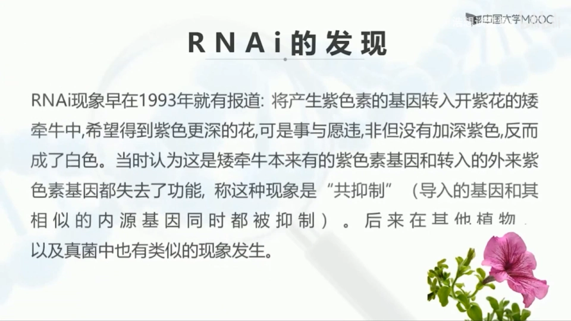

[【跳转到 01:23】](https://www.bilibili.com/video/BV1EY4y1k7Ap/?t=83)

## 三、原理：Dicer–RISC 三步走

### 3.1 基本流程

讲者把 RNAi 的原理讲成一条流水线：

1. **导入双链 RNA**：把一段双链 RNA 转入细胞中。
2. **Dicer 剪切**：细胞中有一种酶（Dicer 酶），可以把这段双链 RNA 变成**小片段的双链 RNA**。
3. **装载进沉默复合体**：细胞中有一个复合体，叫 RNA-induced silencing complex，即 **RNA 诱导的沉默复合体（RISC）**。它可以和这段短的双链 RNA 结合，然后把其中一条链去除。
4. **扫描并切割靶标**：复合体带着那条单链 RNA 去扫描 mRNA，找到它的目的 mRNA，然后把 mRNA 水解。

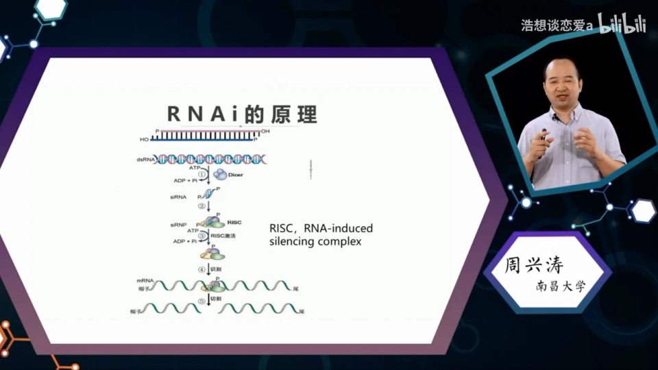

[【跳转到 02:12】](https://www.bilibili.com/video/BV1EY4y1k7Ap/?t=132)

### 3.2 沉默为什么能持续几天

讲者自己提出了一个问题：如果只是把 RNA 转染进去，它**只能扫描、不能被复制**，那这个过程不就不能长久吗？

答案是：实际的 RNAi 效果**还能持续一段时间**。机制在于细胞里存在一条**自我复制式的放大回路**——双链 RNA 进入细胞、被 Dicer 水解成小双链之后，一部分前体可以**自我复制**，又形成双链复合体，再进入下一轮抑制。于是「双链 RNA 干扰的效应不断得到复制」，RNA 干扰可以不断继续下去。

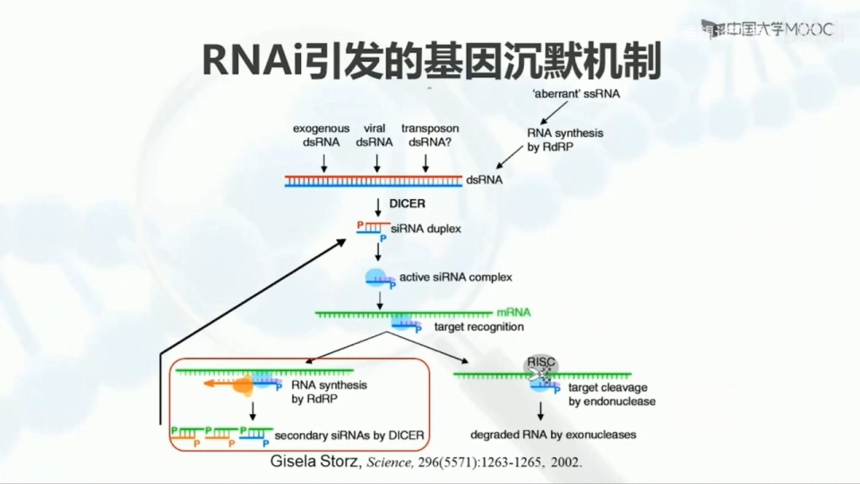

[【跳转到 03:05】](https://www.bilibili.com/video/BV1EY4y1k7Ap/?t=185)

但讲者紧接着划了边界：**这个时效是有一定的，并不是永无止境，一般情况下就几天左右**。

> 这条放大回路在文献中通常归因于 RNA 依赖的 RNA 聚合酶（RdRP）产生的**次级 siRNA**。它在植物和线虫中很强，哺乳动物细胞里则弱得多——这正是为什么在哺乳动物细胞里做 siRNA 敲低，效果只能维持几天、并且会随细胞分裂被稀释。

### 3.3 细胞里的 miRNA 走的是同一套机器

讲者接着指出：细胞里还有另一类小 RNA——**miRNA**，它跟细胞外的 RNA 不一样。

细胞外的 RNA 是**直接输入或转染**一段双链 RNA 进去发生作用；而 miRNA 是细胞**自己合成**的：先在细胞里合成 miRNA 的前体，前体在 Dicer 酶作用下形成一条链，然后在这个复合体的作用下**开启两种方式**：

- **方式一**：像外源双链 RNA 一样，直接水解 mRNA——miRNA 与 mRNA 作用，让 mRNA 水解；
- **方式二**：与细胞里的 mRNA 结合，**抑制**这个 mRNA 的表达。

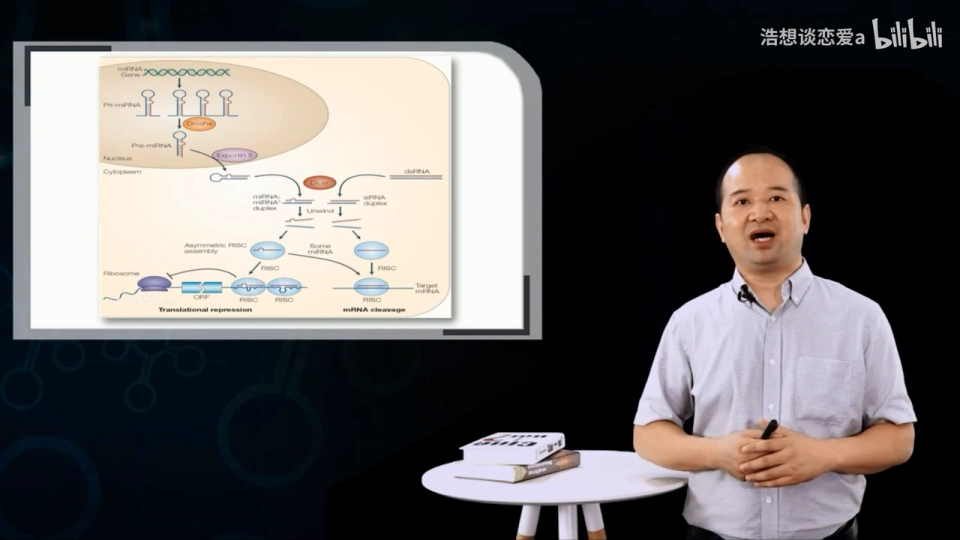

[【跳转到 03:46】](https://www.bilibili.com/video/BV1EY4y1k7Ap/?t=226)

## 四、RNAi 的四类小分子

讲者把 RNAi 涉及的小分子归为四类，这是全片最有信息密度的一张分类清单。

### 4.1 miRNA（微小 RNA）

**单链**，大约 **22 nt** 左右，一般是由**基因组的 DNA 编码产生**的，属于内源性分子。

### 4.2 siRNA（小干扰 RNA）

**双链**分子，大约 **20–25 bp**，一般是由**外源人为注入**到细胞里去的。

### 4.3 shRNA（短发卡 RNA）

讲者说这是他「最近做得比较多」的一种干扰形式。全名 **short hairpin RNA**，就是短的、**发卡结构**的 RNA。它通常需要**通过载体导入细胞**中，让基因去沉默。

为什么 shRNA 用得比较多？讲者给了两条理由：

1. **可以经常通过慢病毒介导**；
2. 慢病毒可以**整合到染色体上**去，这样可以让细胞**一直**干扰目的基因——时间可能是几个月，而**理论上是可以永久的干扰**。

### 4.4 dsRNA（双链 RNA）

长双链 RNA 本身也能引发 RNAi，但它有一个副作用：**可以引起真核生物的干扰素反应**。

> 这条副作用是 RNAi 在哺乳动物细胞里必须小心处理的问题：外源长 dsRNA 会被细胞的先天免疫系统识别为「病毒来了」，触发干扰素通路，导致广泛的翻译停滞和细胞毒性。这也是为什么哺乳动物细胞里用的是 21–23 bp 的短 siRNA，而不是长 dsRNA——短到不足以激活干扰素反应。

### 4.5 siRNA 与 miRNA 的共性与差异

讲者先讲共性，再讲差异。

**共性**（四条）：

- 大概都是由 **22 个左右的核苷酸**组成；
- 都是由 **Dicer 酶**切割产生的；
- 都是与 RNA 诱导的沉默复合体（RISC）形成复合物来进行干扰调节作用；
- 都是在**转录后／翻译水平**上干扰 mRNA。

**差异**（六条）：

| 维度 | siRNA | miRNA |
| --- | --- | --- |
| 来源 | 一般是**外源性**的 | 一般是**内源性**的 |
| 产生方式 | 由双链 RNA 经过 Dicer 酶切得到 | 由 miRNA 的前体经过 Dicer 酶切产生 |
| 与靶 mRNA 的配对 | **完全互补** | 不要求完全互补，**部分互补**即可 |
| 作用形式 | 与 mRNA 结合后**水解**它，让它不表达 | 主要方式是**抑制**基因不表达，但不降解 mRNA；特殊情况下也会让 mRNA 水解 |
| 额外功能 | 抑制转座子和病毒 | 表达具有时空性，可在细胞发育、生长过程中进行调节 |
| 分子形态 | 双链 | 单链 |

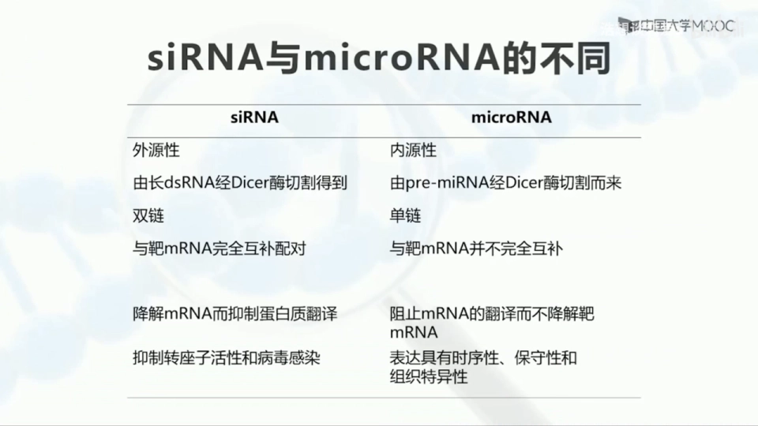

[【跳转到 05:35】](https://www.bilibili.com/video/BV1EY4y1k7Ap/?t=335)

一句话记住：**siRNA 是「剪掉」，miRNA 是「捂住」**。做实验要的是干净、可预测的沉默，所以选 siRNA／shRNA；miRNA 是细胞自己的调光开关，覆盖面广但更温和。

## 五、shRNA 的载体路线

### 5.1 从质粒到慢病毒

讲者用一张示意图讲了 shRNA 的调节原理。流程是：

1. **构建载体**：一般情况下，我们经常是用**质粒**，把这个序列插到质粒中去，然后把它转到细胞里。
2. **在细胞里表达**：如果是转质粒，那它就做质粒的表达；如果是通过**慢病毒**，那么它就会**嵌合到基因组上**去，和细胞的基因组一起表达。
3. **翻译出发卡结构**：首先翻译出来的是一个**短链的发卡 RNA**。
4. **剪掉环**：这个短发卡 RNA 出来之后，会把那个不对称、不配对的**环状部分水解**掉。
5. **进入 siRNA 通路**：剪切完之后，后续就跟 siRNA 一样了——在 RISC 复合体的作用下识别目的 mRNA，然后把这个 mRNA 水解，或者抑制它的表达。

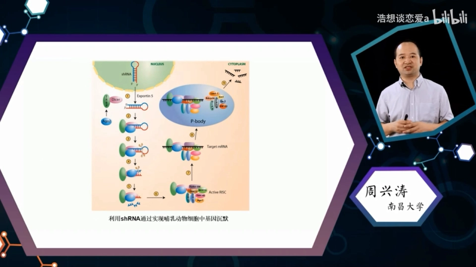

[【跳转到 06:30】](https://www.bilibili.com/video/BV1EY4y1k7Ap/?t=390)

讲者对这条路线评价很高：「这个方式用起来还比较顺手，我是用的比较多一点。」

### 5.2 一个真实实验：STAT3 shRNA

讲者拿自己做过的实验当例子：通过**慢病毒包装**的方式，把 **STAT3** 的 shRNA 转到细胞里去，抑制 STAT3 这个基因的表达。

结果是一张 Western blot：

- 第 1 泳道是**野生型**（WT）；
- 第 2 泳道是只转了一段**非靶向 shRNA**（empty vector）的对照；
- 第 3、4 泳道是转了**靶向 shRNA** 的两个样本。

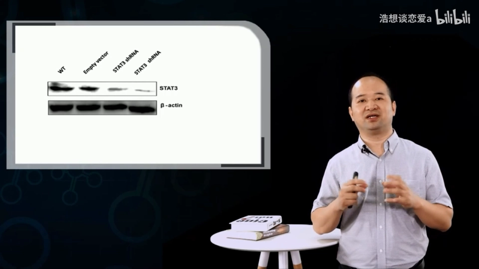

[【跳转到 07:34】](https://www.bilibili.com/video/BV1EY4y1k7Ap/?t=454)

可以看到这个蛋白的表达量明显下降了。讲者说：「我们通过定量的方式，大概最后能够达到 **70% 以上**。」

**70% 这个数字不是随口说的**——讲者把它当成 RNAi 实验成败的判据：做 RNA 干扰一般情况下成不成功，大概有一个要求，就是**干扰希望在 70% 以上**，也就是说有 70% 的被干扰了，**只有 30% 以下的表达**。

> 这个「70% 门槛」正是敲低与敲除最直观的差别：**敲除追求 0，敲低追求「足够低」**。而「足够低」是多少，取决于你的下游表型有多敏感，没有普适答案。70% 只是一个经验起点。

## 六、RNAi 的四个作用特点

讲者把 RNAi 的作用特点总结成四条，这四条决定了它在什么场景下好用、在什么场景下不好用。

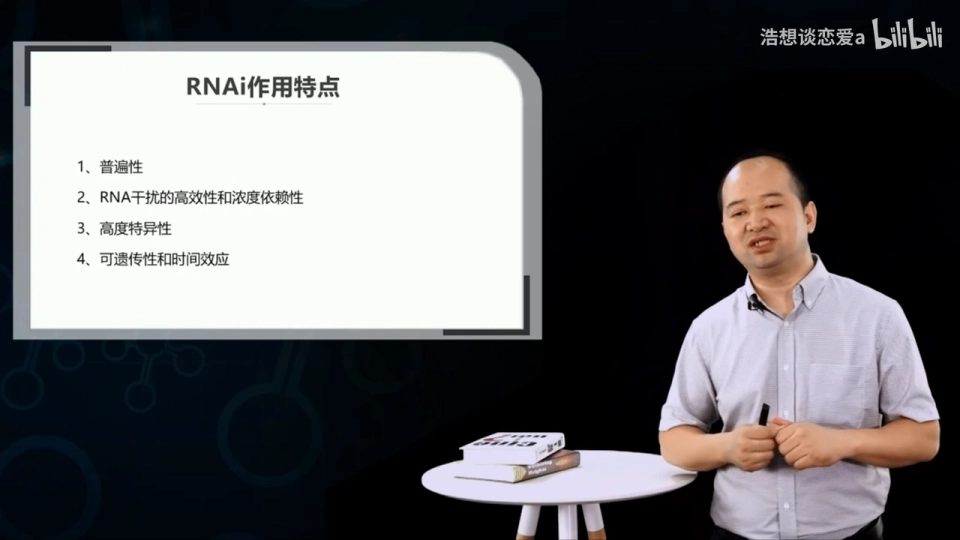

[【跳转到 09:02】](https://www.bilibili.com/video/BV1EY4y1k7Ap/?t=542)

### 6.1 普遍性

RNAi 可以对**大部分细胞、大部分物种**都有用。这一点与 CRISPR 相比是优势也是劣势：优势是不用为每个物种重新搭建工具；劣势是「到处都能用」意味着「到处都可能误伤」（见第八节的脱靶）。

### 6.2 高效性与浓度依赖性

- **高效性**：转进去之后基本不长时间就可以发挥效应。
- **浓度依赖性**：需要应用的剂量超过某个阈值，它就可以发挥作用；**但过了这个剂量之后，它再多也不会有作用了**——存在饱和。

> 「饱和」这件事在实验设计上很重要：加更多 siRNA 不会让沉默更深，只会增加脱靶和细胞毒性。所以敲低实验要的是「刚好够」的剂量，而不是越多越好。

### 6.3 高度特异性

因为它作用是通过**碱基互补**来实现的——靶向 RNA 跟 mRNA 要通过碱基互补配对上，**至少要互补上七八个碱基以上**它才能作用；正常情况下长度是 21 个、20–25 个碱基左右。

### 6.4 可遗传性与时效性

- **可遗传性**：细胞分裂之后，它可能也会带着它传一段时间。
- **时效性**：但这个时间，如果用**转质粒**或者**直接转双链 RNA**，时效不会太长，**大概就是几天**。

所以为了弥补这一点，现在的做法是：如果你需要**长时间的抑制**，就转一个**慢病毒**去沉默。慢病毒转进去之后跟细胞里的基因组一起表达，理论上它的时间**非常非常长**。

> 这四条的排列其实是一条逻辑链：**普遍性**说明它适用范围广 → **高效性 + 浓度依赖**说明它起效快但有饱和 → **高度特异性**说明它原则上精准 → **可遗传性 + 时效性**说明它在时间维度上分成「瞬时」和「稳定」两档，而这两档正好对应 siRNA 和 shRNA 两种投递方式。

## 七、应用：从基因功能到基因治疗

### 7.1 基因功能研究（Gene knock down）

第一个应用，当然是把基因敲低，让基因不表达、或者说表达量降低。这可以用来研究各种基因工程。

讲者特别点出了**敲低相对敲除的独特价值**：最方便的方式可能是基因敲除，**但是有的时候我们有些基因是致死的**——你敲除它，这个细胞或者这个物种就不能正常发育；那我们把它**敲低**呢，它量值变少了，但是这个细胞和这个动物**还能活下去**，那你就可以看它的缺陷，从而研究这个基因的功能。

常用的模式生物有**小鼠、果蝇、线虫**——线虫尤其重要，因为这个现象就是在线虫中发现的。

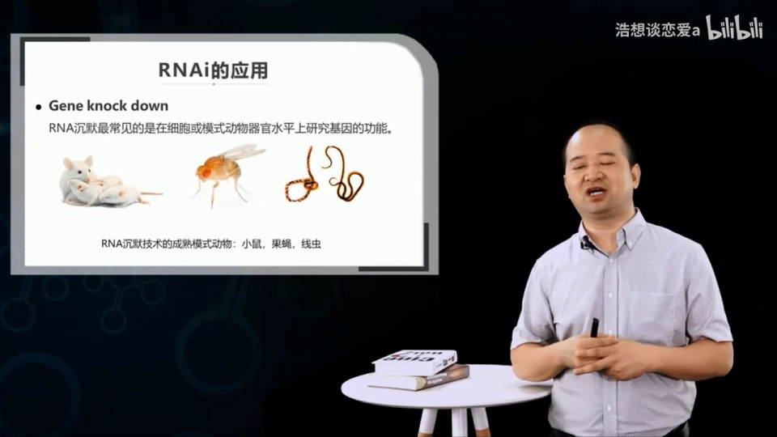

[【跳转到 09:32】](https://www.bilibili.com/video/BV1EY4y1k7Ap/?t=572)

讲者还做了一段**效率对比**，很实用：

- 用**双链 dsRNA** 输进去，大概**几天**就可以做完；
- 做 **shRNA**、用慢病毒介导、用**质粒转染**，也就是**一个礼拜**可以做完的事情；
- 用**慢病毒包装**需要一段时间，但整个时间还是比做基因敲除的投入和时间要短一点，操作也简单一点，验证起来也挺简单。

一句话：**RNAi 技术有投入少、周期短、操作简单等优势**，可以大大促进新基因工程的研究。

### 7.2 基因治疗

RNAi 在基因治疗方面有三个方向：

1. **特异性抑制致病基因**；
2. **抵抗病毒入侵**——可以抵抗多种病毒；
3. **肿瘤**：肿瘤的发生是因为基因调控中发生失控，可以导入双链 RNA 使目的基因沉默，从而使癌细胞的生长停止。

讲者还提到降脂方向，已经在临床前期开始试用了。

具体的里程碑是：**2017 年，第一个 RNAi 疗法获得美国 FDA 认证**，应用于突破性类型的治疗，就是 **hATTR 淀粉样变性**这种遗传性疾病。这个疾病是由于 **TTR 基因的突变**引起的，它引起了转甲状腺素蛋白的异常积聚，对神经和心脏造成了损伤。所以如果把那个突变的东西干扰它、不让它表达、表达量减少，就可以减少症状，甚至达到治愈的目的。讲者还提到有公司对**乙肝**进行二期的实验治疗。

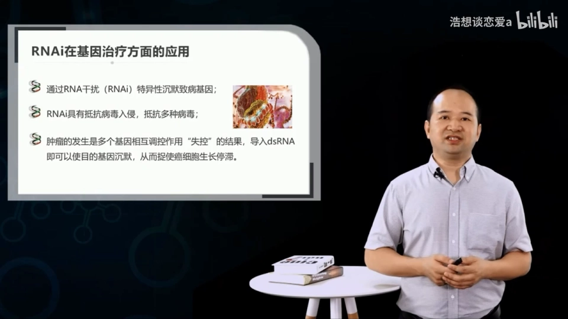

[【跳转到 10:55】](https://www.bilibili.com/video/BV1EY4y1k7Ap/?t=655)

### 7.3 农业

讲者讲了三个方向。

**（1）品种改良。** 比如把 **DET1 基因**抑制它的表达，可以让西红柿中**类胡萝卜素和类黄酮明显升高**，而果实的其他品质却没有发生大的改变。我们知道胡萝卜素和黄酮对我们人体抗肿瘤、抗衰老都有很好的效果。

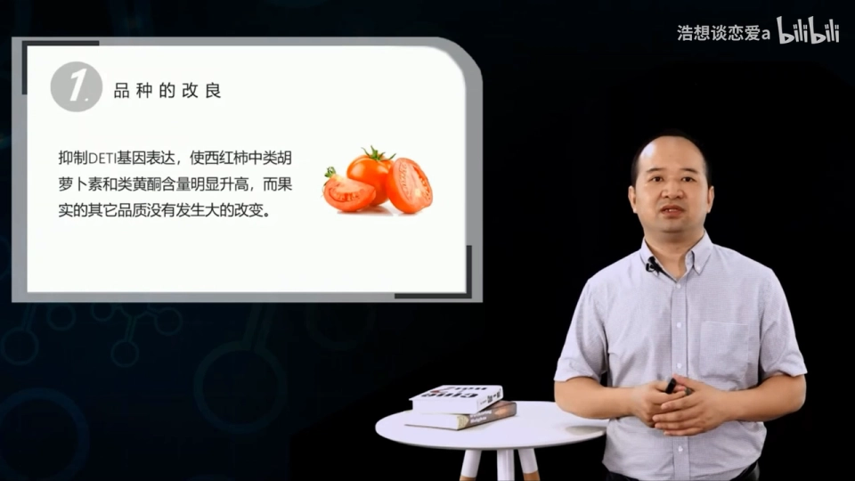

[【跳转到 11:56】](https://www.bilibili.com/video/BV1EY4y1k7Ap/?t=716)

还有一个很出名的例子：日本和澳大利亚的研究者用 RNA 干扰把**玫瑰中的二氢黄酮还原酶基因**给干扰掉，培育出了**蓝色的玫瑰**。

**（2）防虫。** 现在的农作物打的农药比较多，农药有农残，所以人们想能不能用**生物农药**——把双链 RNA 作为昆虫的食物，抑制昆虫某些生存所需要的基因，让这个昆虫死亡。

**（3）抗病毒。** 在抗病毒方面，RNA 干扰最早被认为是**真核生物普遍对抗外源核酸入侵的一个防御机制**。可以通过这个机制，利用植物的病毒和它同源的 RNA 整合到基因组中来对抗植物病毒基因组，防止植物病毒的扩散，达到获得稳定遗传的抗病毒植物。水稻上就有人应用 RNAi 沉默了**水稻矮缩病毒**中的一个基因，获得了病毒抗性的转基因水稻。

> 注意这里的逻辑：**RNAi 本来就是免疫系统**。农业上的「抗病毒转基因作物」不是发明了一套新机制，而是把细胞原有的抗病毒机制指向了指定的病毒序列。同一件事在医学上就是「抗病毒治疗」，在实验室里就是「敲低工具」——一套机制，三种用法。

## 八、缺陷：脱靶效应

讲者用「说了这么多好处，它有什么缺陷呢」来收尾，答案只有一个词：**脱靶（off-target）**。

具体表现是：对于 21–23 个碱基的 siRNA，它**有的时候只需要 7 个碱基序列同源，就可以使这个基因发生沉默**。也就是说，一段设计用来打 A 基因的 siRNA，只要在 B 基因的 mRNA 上找到 7 个碱基的匹配，就可能顺手把 B 也按下去。

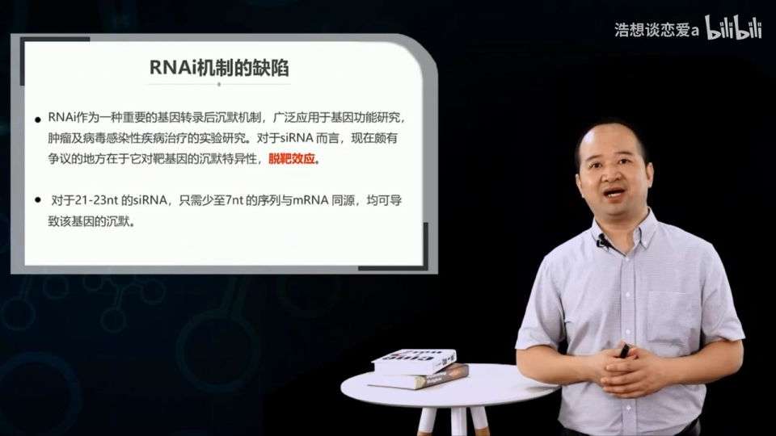

[【跳转到 13:17】](https://www.bilibili.com/video/BV1EY4y1k7Ap/?t=797)

所以现在的问题就变成：**我们怎么来提高它的特异性？** 讲者指出，脱靶率实际上是各个公司做生物技术也好、做基因治疗也好，都是一个**重大的问题**。

> 把这条与第三节的「高度特异性」放在一起看，会发现一个表面上的矛盾：前面说 RNAi「高度特异，至少要七八个碱基互补」，后面说「7 个碱基同源就可能脱靶」。这两句话其实描述的是同一件事的两面——**7–8 个碱基的匹配门槛，既是特异性的来源，也是脱靶的来源**。门槛低到足以容忍单个错配，就必然会在庞大的转录组里找到大量偶然匹配。这是 RNAi 的固有代价，不是设计失误。

## 九、把 RNAi 放回单细胞扰动实验里看

> 以下不是视频内容，而是本文把上面的机制对回本系列主线的一点延伸。

本系列关心的是「怎么扰动一个细胞、然后读出它的响应」。把这一讲的四类分子和四个特点摆到这条线索上，可以得到几条对做扰动实验很实际的推论：

1. **敲低是「程度问题」，敲除是「有无问题」。** 70% 的敲低意味着还有 30% 的 mRNA 在工作。在单细胞数据里，这会让同一扰动下的细胞呈现出**连续的表达分布**而不是干净的双峰——一部分细胞敲得深、一部分敲得浅。解读扰动效应时必须把这个分布当成信号的一部分，而不是噪声。
2. **瞬时 vs 稳定，决定了你能观察到什么样的表型。** 化学合成的 siRNA 只能维持几天，适合看**急性响应**（哪些基因在敲低后几小时内被拉动）；慢病毒 shRNA 可以长期沉默，适合看**稳态适应**（细胞在长期缺失该基因后如何重塑状态）。两者问的是不同的问题。
3. **脱靶在单细胞尺度上会被放大。** 一个 bulk 实验里 7 nt 的偶然匹配可能被平均掉；但在单细胞里，每个细胞都是一个独立的观测，脱靶基因的表达变化会被当成「扰动效应」记录下来，直接污染下游的调控推断。所以用 RNAi 数据做基因调控网络推断时，**必须把 seed 区的匹配情况作为协变量考虑进去**。
4. **RNAi 的扰动身份比 CRISPR 难编码。** CRISPR 的扰动身份写在 gRNA 序列上，测序时可以直接读出来；RNAi 的扰动身份是一段外源 RNA，在单细胞测序流程里没有同样干净的读出方式。这是工程层面的取舍，也是目前大规模 Perturb-seq 更常用 CRISPR 的现实原因之一。第 3.3 节会展开这套「扰动身份 + 表达谱」的编码方案。

## 小结

- **RNAi 是在 mRNA 层面把转录本水解掉，不改 DNA**；它与基因敲除（knockout）的分界线就在作用层面：敲除动的是染色体／DNA，敲低动的是 mRNA。
- **敲低最独特的价值是能研究致死基因**：敲除会让细胞或个体死掉，敲低只是把量降下来，细胞还活着，于是缺陷可以被观察到。
- **机制是一条流水线**：双链 RNA → Dicer 剪成小片段双链 → 装进 RISC 并去掉一条链 → 带着单链去扫描并水解靶 mRNA。细胞里还有自我复制的放大回路，所以沉默能维持几天，但**不会永无止境**。
- **四类分子**：miRNA（内源、单链、约 22 nt）、siRNA（外源、双链、20–25 bp）、shRNA（发卡结构、需载体）、dsRNA（长双链，会触发干扰素反应）。
- **siRNA 与 miRNA 的核心差异**：外源 vs 内源、完全互补 vs 部分互补、**降解 mRNA vs 抑制翻译**。
- **shRNA 的价值在于「可表达」**：走质粒或慢病毒，慢病毒可整合进基因组，于是从「瞬时几天」变成「长期甚至永久」。
- **四个作用特点**：普遍性、高效性与浓度依赖性（存在饱和）、高度特异性（七八个碱基互补）、可遗传性与时效性（几天 vs 长期）。
- **70% 是敲低的经验门槛**：干扰 70% 以上、残余表达 30% 以下，才算一次成功的敲低实验。
- **应用横跨三界**：基因功能研究（含致死基因）、基因治疗（2017 年首个 RNAi 药物获批，针对 hATTR）、农业（DET1 番茄、蓝色玫瑰、生物农药、抗病毒水稻）。
- **唯一的硬缺陷是脱靶**：21–23 nt 的 siRNA 只需 7 nt 与某条 mRNA 同源就可能沉默它——这正是「高度特异性」的另一面。

## 关键术语速查

| 术语 | 一句话解释 |
| --- | --- |
| RNAi（RNA 干扰） | 由 RNA 介导、特异性地沉默目的基因表达的转录后调控机制 |
| Knockdown（敲低） | 把基因的表达量降下来，但基因本身完好、表达不为零 |
| Knockout（敲除） | 在 DNA／染色体层面删除或突变基因，使其彻底失去功能 |
| Dicer | 把长双链 RNA 剪成 20–25 bp 小片段双链 RNA 的核酸酶 |
| siRNA | 小干扰 RNA，双链、约 20–25 bp、外源导入，与靶 mRNA 完全互补 |
| shRNA | 短发卡 RNA，带发卡环结构，需质粒或慢病毒载体导入，在细胞内被加工成 siRNA |
| miRNA | 微小 RNA，内源、单链、约 22 nt，与靶 mRNA 部分互补，主要抑制翻译 |
| dsRNA | 双链 RNA，可引发 RNAi，但在真核细胞中也会触发干扰素反应 |
| RISC | RNA 诱导沉默复合体，装载单链引导 RNA 并切割靶 mRNA |
| 共抑制（co-suppression） | 转入的同源转基因与内源基因同时被抑制，1990 年代在矮牵牛中发现 |
| 瞬时转染 | 直接转入化学合成的 siRNA／dsRNA，效果维持数天 |
| 稳定转染 | 用质粒或慢病毒表达 shRNA，载体可整合进基因组，长期甚至永久沉默 |
| 脱靶效应（off-target） | siRNA 与非目标 mRNA 仅 7 nt 同源即可引发沉默，造成非预期基因下调 |
| 干扰素反应 | 真核细胞识别外源长双链 RNA 后启动的先天免疫反应，是 RNAi 的副作用之一 |
| hATTR | 转甲状腺素蛋白（TTR）突变引起的淀粉样变性遗传病，2017 年首个获批 RNAi 药物的适应症 |