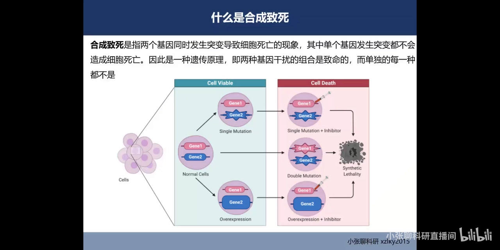
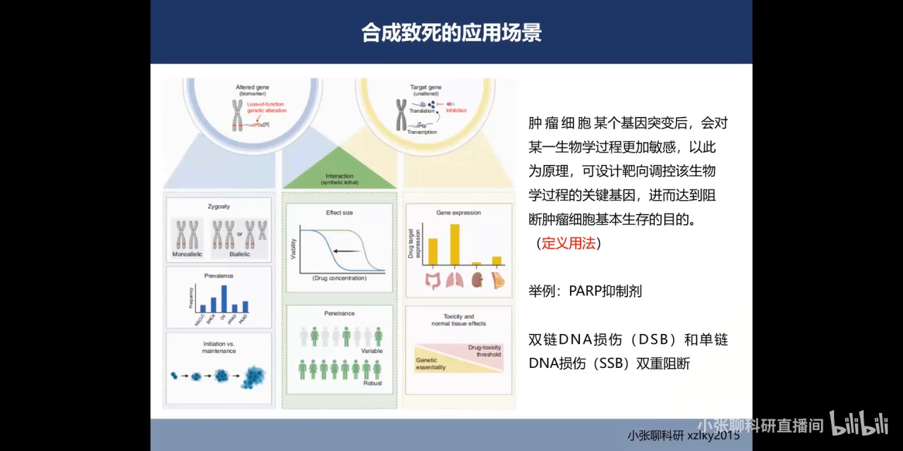
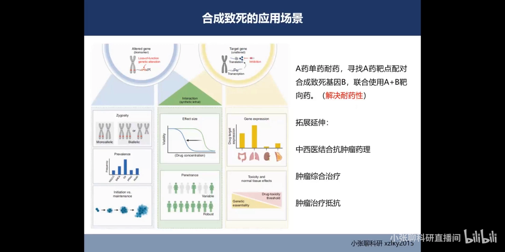
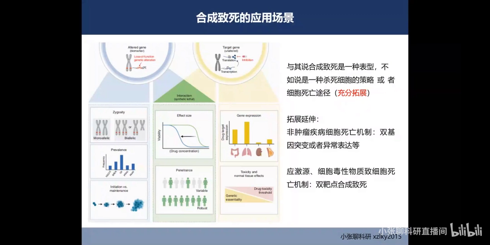
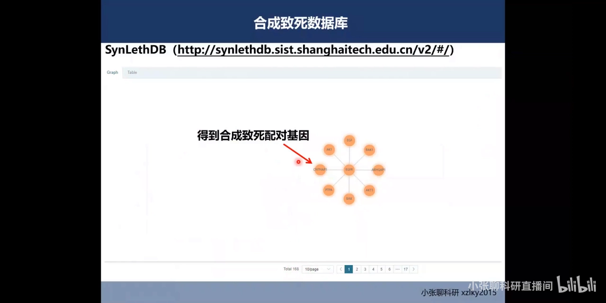
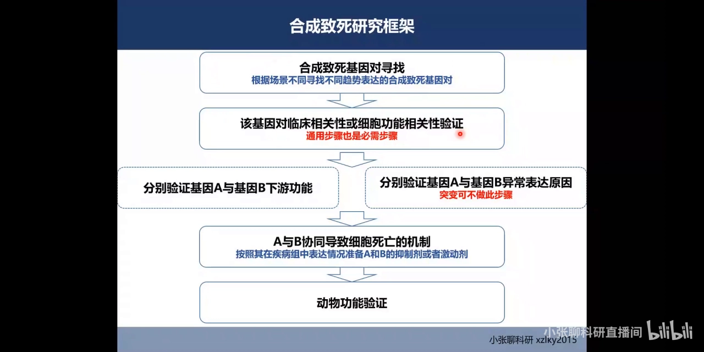
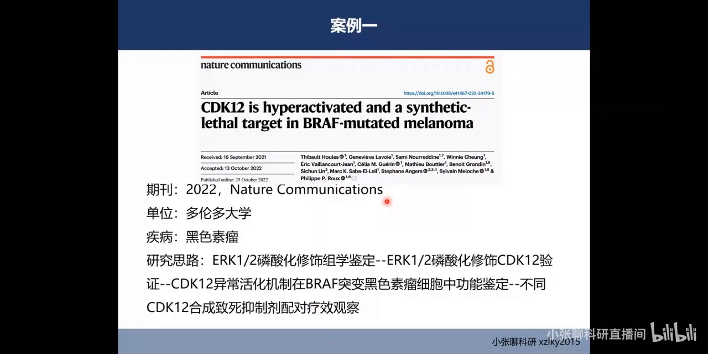
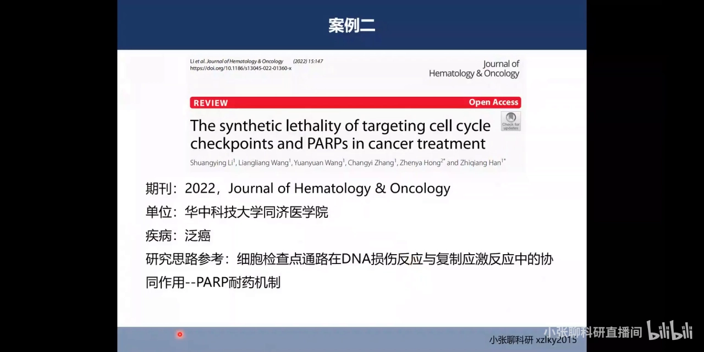
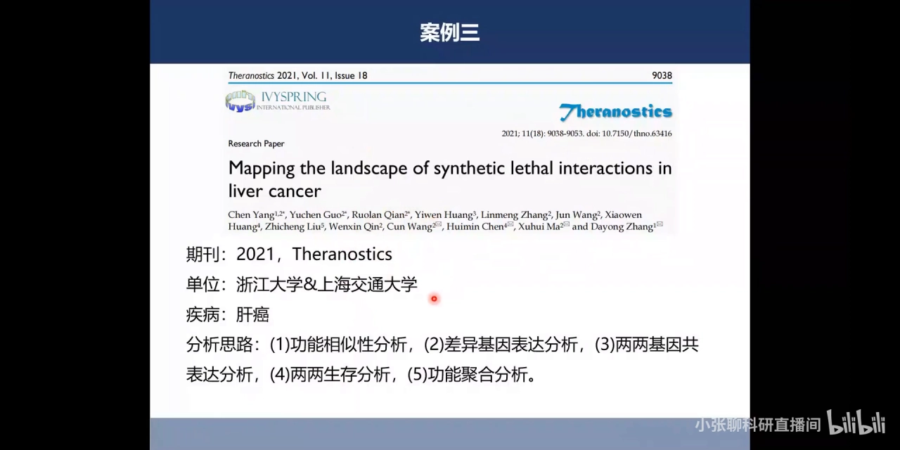

# 合成致死：多基因组合扰动的逻辑与基因对发现

> 视频来源：[科研热点讲座：合成致死专题](https://www.bilibili.com/video/BV1Ue411w7px/)（Bilibili · 小张聊科研直播间 · 胖师兄）｜时长约 76 分钟（正文 8:00–33:00，其后为抽奖与答疑）
> 导读：这支讲座的落点在"怎么把一个合成致死课题做完整"，但它把组合扰动最核心的一件事讲透了——**为什么必须同时动两个基因，以及怎么在组合爆炸之前把候选对挑出来**。本文按"概念 → 应用场景 → 基因对发现 → 验证框架 → 三个案例"的顺序梳理，并补上它对单细胞组合扰动的直接含义。讲座带有较强的课题申请视角，本文只取其中的方法学部分。

## 本讲要解决的核心问题（SCQA）

**背景**：单基因扰动是功能基因组学的主力手段——敲掉一个基因，看细胞有什么变化。绝大多数筛选、绝大多数论文，都是这么做的。

**冲突**：可细胞里的基因不是一根根独立的管子，它们成网工作。有些基因敲掉之后几乎没有表型，因为旁系同源的另一个基因顶上了；有些基因敲掉之后通路另一头代偿了；还有些基因，单独敲哪个细胞都活得好好的，**只有两个一起敲才会死**。用单基因扰动去测，这些现象一律看不见——不是测得不细，而是设计上就测不到。

**疑问**：既然如此，要怎样才能看见基因之间的相互作用？而如果每两个基因都要试一遍，组合数按平方增长，实验根本做不完——那到底该怎么挑、怎么验？

**回答（中心思想）**：**合成致死是"必须一次动两个基因"的最强理由，也是把组合爆炸压下来的抓手。** 它的定义本身就是一个双扰动判据：单基因失活不致死、双基因同时失活才致死。围绕这个定义，讲座给出了一条完整链路：用合成致死数据库或生信分析先筛出候选基因对（把 $O(N^2)$ 压到几十对），再用**单扰动臂 + 双扰动臂**的对照实验验证致死效应，最后用单／双扰动的转录组取交集定位协同机制。其中最关键的一条纪律是：**任何"双扰动才出现"的结论，都必须有对应的单扰动臂做对照**——否则你无法区分"协同"与"两个效应简单叠加"。

## 一、合成致死的定义：一个天然的双扰动判据

讲座开篇给的定义非常干脆：

> 合成致死是指两个基因同时发生突变导致细胞死亡的现象，其中单个基因发生突变都不会造成细胞死亡。因此这是一种遗传原理，即**两种基因干扰的组合是致命的，而单独的每一种都不是**。

这张图把四种情形并排放在一起，值得逐格看：

- **单基因突变（Single Mutation）**：细胞存活；
- **单基因过表达（Overexpression）**：细胞存活；
- **双基因同时突变（Double Mutation）**：细胞死亡——这就是经典合成致死；
- **突变 + 抑制剂（Single Mutation + Inhibitor / Overexpression + Inhibitor）**：同样致死。

最后一格是这套概念能变成药物的关键：**你不需要真的去突变第二个基因，只要用一个小分子把它的产物抑制掉，就能复现"双基因失活"的效果。** 这就是 PARP 抑制剂的逻辑来源。

[【跳转到 09:08】](https://www.bilibili.com/video/BV1Ue411w7px/?t=548)

这个概念 1940 年代就被提出，长期只是一个遗传学原理；它真正变成研究热点，是因为大家发现它可以被"用起来"。

## 二、三种用法：从"杀死肿瘤"到"解释疾病"

讲座把合成致死的应用场景分成三层，一层比一层抽象。

**第一层：让肿瘤对现有治疗更敏感。** 肿瘤细胞某个基因突变之后，会对某一生物学过程更加敏感；以此为原理，可以设计靶向调控该过程的关键基因，从而阻断肿瘤的基本生存。讲座举的例子是 PARP 抑制剂：很多肿瘤在双链或单链 DNA 损伤修复中已经有一条通路被阻断，但另一条还在，于是放化疗造成的损伤仍能被修掉。**这时候把剩下那条修复通路的核心酶也抑制掉，细胞就同时失去了两条修复能力。**

[【跳转到 11:30】](https://www.bilibili.com/video/BV1Ue411w7px/?t=690)

**第二层：解决耐药。** 这是临床上最常见、也最容易落地的场景。

流程是：A 药单药耐药 → 寻找 A 药靶点的配对合成致死基因 B → 研发 B 的靶向药 → A、B 联合使用。这里的 A 不一定是靶向药，也可以是化疗药；那 B 就是 DNA 损伤修复通路的靶向药，两者联合提升化疗敏感性。讲座还提到一条更短的路径：中西医结合——**用中药去解决西药靶向药或化疗药的耐药问题，比"从零研发 B 的靶向药"周期短得多。**

[【跳转到 17:28】](https://www.bilibili.com/video/BV1Ue411w7px/?t=1048)

**第三层：把它当成一种思维方式，而不只是一个表型。**

讲座的原话很到位：**"与其说合成致死是一种表型，不如说它是一种杀死细胞的策略、或者说细胞死亡的途径。"** 一旦这样理解，适用范围立刻打开：

- **非肿瘤疾病**：某疾病是因为 A、B 两个基因双突变，导致某种细胞死亡——那这就是一种发病机制，而不只是治疗手段；
- **其他死亡方式**：细胞表型无非生老病死，"死"的方式有很多种。比如 A 是铁死亡的促进基因、B 是铁死亡的抑制基因，A 的激活加上 B 的下调，最后导致铁死亡发生——同样落在合成致死的框架里；
- **应激源与细胞毒性物质**：某应激导致 A 基因过表达，正常细胞里这没什么；但如果这个细胞同时带着一个必需基因的突变，再给予应激源，它就容易死亡。反过来看代谢通路也一样：正常人有代谢某毒物的途径，如果这条途径的关键基因 B 突变、代谢不掉，毒物累积就导致细胞死亡。

[【跳转到 19:58】](https://www.bilibili.com/video/BV1Ue411w7px/?t=1198)

**这一层对组合扰动设计的启示是**：合成致死不限于"两个基因同时敲"，它可以是"基因状态 + 外部干预"的组合——一个已有的突变（内源状态）加一个药物（外源扰动）。这本质上就是组合扰动，只不过其中一个扰动是细胞自带的。

## 三、基因对从哪里来：先压住组合爆炸

概念讲完，讲座直接切入最关键的问题：**整个研究的开端，是合成致死基因对的寻找。**

[【跳转到 22:52】](https://www.bilibili.com/video/BV1Ue411w7px/?t=1372)

N 个基因的全组合是 $O(N^2)$ 对；人类基因组上万个基因，穷举不可能。所以实际做法一定是**先降维、再验证**。讲座给了两条路径。

### 3.1 路径一：合成致死数据库

讲座演示的是 SynLethDB（上海科技大学团队维护）。用法有两种：

- **有 A 找 B**：在搜索框输入基因，点搜索。演示中某个基因返回了 168 个候选配对基因，**按置信度排序**——每页十个的话，前十个就是置信度最高的一批。
- **没有 A，按疾病找**：如果手上没有明确的 A 基因，可以直接按疾病筛选（目前只支持肿瘤），列出疾病相关基因后挑一个作为 A，再点"寻找它的配对基因"，界面与前者一致。

[【跳转到 24:57】](https://www.bilibili.com/video/BV1Ue411w7px/?t=1497)

讲者特别提醒了两件事，都很实用：

1. **这类数据库都不太稳定**，可能关闭、也可能只对校内开放。建议一上站就把 download 里的原始数据全部下载下来，本地留一份。
2. **挑 A 的时候优先挑有现成药物的**。因为最终要落到"用抑制剂模拟双基因失活"，如果 A、B 都是新基因、市面上没有任何激动剂或抑制剂，你就得自己造——讲座的建议是先去 MCE 这类化合物网站查，如果没有，就往上游找它的转录因子，看看上游有没有可用的商品化分子。

[【跳转到 33:48】](https://www.bilibili.com/video/BV1Ue411w7px/?t=2028)

### 3.2 路径二：纯生信挖掘

没有现成数据库命中时，可以自己从表达数据里挖。讲座的第三个案例就是这种思路（见第六节）：功能相似性分析、差异表达分析、两两基因共表达分析、两两生存分析、功能富集分析——**核心是找"表达趋势一致、生存趋势也一致"的基因对**。

讲座也点出了这类做法的一个常见缺陷：多数分析只取"共表达"（共高或共低），**没有考虑一高一低的情形**，而实际数据里一高一低同样存在。补救办法是做负相关分析：生存分析匹配 + 共表达负相关 + 功能相似或功能相反。

## 四、验证框架：单臂与双臂必须成对出现

有了候选基因对，接下来是验证。讲座给出一张五步框架图，这张图其实是整场讲座方法学上最值得抄下来的部分。

**第一步：基因对寻找**（上一节）。依据不同场景，寻找不同趋势表达的合成致死基因对。

**第二步：临床相关性或细胞功能相关性验证。** 讲座强调这一步"通用步骤也是必需步骤"。假设 A、B 要双重过表达才能导致细胞死亡，那么临床相关性做完之后，必须在细胞上做**单过表达**，看细胞死亡率的变化。如果是耐药场景，则先做耐药株，在耐药株里让 A 过表达，再分别测"单独抑制 A"和"抑制 A 同时给所耐受的药物"两种情况下的细胞死亡率。

[【跳转到 29:38】](https://www.bilibili.com/video/BV1Ue411w7px/?t=1778)

**这一步正是加性基线的雏形**：单过表达 A、单过表达 B 各自造成多少死亡，是后面判断"双扰动是否产生额外效应"的唯一参照。讲座把它列为"一定要有"的预实验，理由也在这里——**没有单臂，双臂的数字就没有意义。**

**第三步：分别验证 A 与 B 的下游功能。** 因为配对基因的协同方式有两种可能：A 和 B 直接结合起作用，或者 A、B 各自调控一条通路、两条通路在下游交叉。做法是**单过表达 A、单过表达 B、双过表达，三者分别做转录组，然后取交集**——交集里的通路就是协同致死的候选机制。讲座顺带说了一句很实在的话：转录组现在很便宜，不要一听"做组学"就发怵，这类研究里它基本是标配。

[【跳转到 32:08】](https://www.bilibili.com/video/BV1Ue411w7px/?t=1928)

**第四步：A 与 B 协同致死的机制。** 这里要按疾病组里的表达方向来准备工具分子：

| 疾病组中的表达 | 需要准备的工具 |
| --- | --- |
| A、B 双高表达 | A 与 B 的抑制剂 |
| A 高、B 低 | A 的抑制剂 + B 的激动剂 |

讲座反复强调一个容易搞错的点：**基因突变不一定是下调，也可能是上调**。所以要先看突变导致的上下调关系，才能确定要开发的是抑制剂还是激动剂——这直接决定后面体外、体内实验里选什么试剂。

**第五步：动物功能验证。** 讲座给了通用步骤（组织表达、单因素回归、细胞功能干预、增殖／侵袭／迁移／凋亡或死亡），并提到检测死亡用 PI 即可、不必加 AV；如果是特殊死亡方式（焦亡、铁死亡），就按各自的检测方法来。

## 五、案例：一条完整的协同致死机制链

理论讲完，讲座用 PARP 抑制剂 + BRCA 突变这条最经典的合成致死关系，把"机制链"具体化了一遍。

[【跳转到 35:03】](https://www.bilibili.com/video/BV1Ue411w7px/?t=2103)

链条是这样的：

1. PARP 抑制剂抑制 PARP → **DNA 单链损伤无法修复**；
2. 未修复的单链损伤在复制时引起**复制叉崩解** → 产生**双链 DNA 损伤**；
3. 正常细胞里，BRCA1、BRCA2 可以共同介导双链损伤修复 → 损伤被修好，细胞存活；
4. 如果这个肿瘤本身就是 BRCA1/BRCA2 缺陷型，或者同时用了 BRCA1/2 的抑制剂 → **两条修复路径同时断掉**，肿瘤细胞顺利死亡。

这条链值得注意的地方是：**它解释了"为什么是这两个基因"，而不只是"这两个基因一起敲会死"。** 讲座提醒，这正是组合扰动研究比单基因研究难的地方——你不仅要证明双扰动致死，还要说清楚"两个基因为什么同时高表达或同时低表达""协同之后通过什么路径导致死亡"。经费有限时可以优先保证前者，后者是加分项。

## 六、三个案例：三种不同的入口

讲座最后用三篇文献展示三种进入方式。

**案例一：从修饰组学出发（多伦多大学，Nature Communications，2022，黑色素瘤）。**

思路是：先用 ERK1/2 的磷酸化组学鉴定下游受修饰调控的基因，找到 CDK12；发现 CDK12 在 BRAF 突变的黑色素瘤细胞中异常活化；再沿 CDK12 下游通路去找能与之产生协同致死效应的抑制剂（如 NF-κB 通路抑制剂），做配对疗效观察。

[【跳转到 43:25】](https://www.bilibili.com/video/BV1Ue411w7px/?t=2605)

讲座对这篇文章有一个很坦率的点评：它的磷酸化组学用的不是常规方法，而是"邻近相互作用组"，属于一种新的蛋白质组学；文章 2021 年 9 月做完实验、2022 年 10 月才发表，中间隔了一年零一个月。如果按课题申请的偏好来改，问题在于"做的东西太散"——**上来就用各种抑制剂随便搭配，不如先从基因层面做干预、把机制做透，最后再落到抑制剂配对。**

**案例二：从综述切入（华中科技大学同济医学院，Journal of Hematology & Oncology，2022，泛癌）。**

这篇综述的价值有两块：一是梳理了细胞周期检查点通路与 PARP 在 DNA 损伤反应、复制应激反应中的协同作用，给出了 PARP 抑制剂的新协同致死靶点；二是讨论了 PARP 本身的耐药机制。

[【跳转到 51:42】](https://www.bilibili.com/video/BV1Ue411w7px/?t=3102)

**耐药机制这一块，恰好把话题推回了组合扰动的边界。** 讲座的推理是：PARP 的药理机制就是合成致死，那么 PARP 耐药就等价于"合成致死这条途径被阻断了"。为什么会断？可能是肿瘤又突变了一个基因，这个基因阻断了原有的致死关系，或者开辟了一条新的 DNA 修复通路。由此引出一个开放问题：**合成致死配对被定义成"一对"，那有没有可能三个、四个基因一起协同，能起更好的效应？** 这正是组合扰动从"两两"走向"高阶"的入口。

**案例三：从纯生信切入（浙江大学与上海交通大学，Theranostics，2021，肝癌）。**

分析思路五步：功能相似性分析、差异基因表达分析、两两基因共表达分析、两两生存分析、功能富集分析。讲座的评价是"从分析角度来说其实不难"——本质就是找两个表达趋势一致、生存趋势一致的基因对。缺陷前面提过：只考虑了共表达，没考虑一高一低。

[【跳转到 52:57】](https://www.bilibili.com/video/BV1Ue411w7px/?t=3177)

## 七、这套逻辑对单细胞组合扰动的意义

讲座是 bulk 与细胞系语境，但它的骨架可以直接搬到单细胞上，而且单细胞还额外解决了两件事。

**第一，"单臂 + 双臂"的纪律不变，而且更需要。** 单细胞组合扰动（比如一个细胞里同时表达两条 sgRNA）最常见的分析错误，就是拿"双 sgRNA 细胞"直接和"对照细胞"比。正确的做法仍然是：单 sgRNA A、单 sgRNA B、双 sgRNA AB、对照，四组齐全，先算单臂的加性预期，再看双臂偏离多少。讲座里"单过表达必须做"这条要求，在单细胞里就是"单 sgRNA 臂必须测"。

**第二，单细胞能回答"哪一类细胞才合成致死"。** bulk 读出只能给一个平均存活率。如果一个组合只对某个细胞状态（比如处于特定细胞周期的亚群）致死，在 bulk 里会被平均掉，看起来像"弱协同"甚至"无效应"；在单细胞里则能直接看到效应集中在哪个亚群。**平均效应的偏离与响应分布的改变，是两件不同的事**——后者只有单细胞能看见。

**第三，代价同样被放大。** 组合数按平方增长，而每个组合分到的细胞数随组合数增加而下降。讲座里"168 个候选、按置信度取前十"的做法，本质上就是**用先验把组合数压下来，保证每个组合还有足够的细胞量**。这是组合扰动设计里最核心的取舍：覆盖广度与每组合样本量，两者不可兼得。

## 小结

- **合成致死的定义本身就是双扰动判据**：单基因失活不致死、双基因同时失活才致死。它是"必须一次动两个基因"最直接的理由。
- **它有三种用法**：让肿瘤对现有治疗更敏感（PARP 抑制剂）、解决单药耐药（A 耐药 → 找配对的 B）、以及作为一种通用的"双基因致病／致死机制"思维方式。
- **组合爆炸靠先验压下来**：合成致死数据库（SynLethDB，按置信度排序）或纯生信挖掘（功能相似 + 差异表达 + 两两共表达 + 两两生存 + 富集）。挑基因时优先挑**有现成抑制剂或激动剂**的。
- **验证框架五步**：基因对寻找 → 临床／细胞功能相关性 → 分别验证 A 与 B 下游功能 → 协同致死机制 → 动物验证。
- **单臂是双臂的前提**：单过表达、单 sgRNA 这类对照臂不是可选项，没有它们就无法定义"协同"。
- **机制要落到通路交集**：单扰动与双扰动各做一次转录组，三者取交集，才能说清"两个基因通过哪条通路协同"。
- **两两不是终点**：PARP 耐药提示可能存在三基因、四基因的高阶组合——组合扰动从"对"走向"组"，代价是样本量被进一步摊薄。

## 关键术语速查

| 术语 | 一句话解释 |
| --- | --- |
| 合成致死（synthetic lethality） | 两个基因同时失活才导致细胞死亡，单独失活任一个都不致死 |
| 合成致死基因对 | 满足上述关系的一对基因，如 PARP 与 BRCA |
| 冗余（redundancy）／旁系同源（paralog） | 功能重叠的基因互相顶替，敲掉一个几乎无表型 |
| 补偿／缓冲（compensation / buffering） | 敲掉 A 后细胞上调 B 维持同一通路功能 |
| 上位效应（epistasis） | 两个扰动的联合效应不等于各自效应之和，偏离量即交互强度 |
| SynLethDB | 合成致死关系数据库，可按基因或按疾病检索，结果按置信度排序 |
| 单扰动臂／双扰动臂 | 组合实验里必须成对出现的对照：只动一个 vs 同时动两个 |
| 加性基线 | 假设两者互不影响时双扰动应有的效应，判定协同的参照 |
| PARP 抑制剂 | 通过阻断单链 DNA 损伤修复、与 BRCA 缺陷形成合成致死的经典药物 |
| 复制叉崩解 | 未修复的单链损伤在复制时崩塌，转成双链损伤 |
| 双链／单链损伤修复（DSB / SSB repair） | 两条并行的 DNA 修复路径，同时阻断即构成合成致死 |
| 条件性敲除 | 在特定时间或组织中敲除基因的动物模型，用于体内验证双基因致死 |
| 组合索引（combinatorial indexing） | 用 barcode 组合标记扰动身份，降低大规模组合实验的建库成本 |