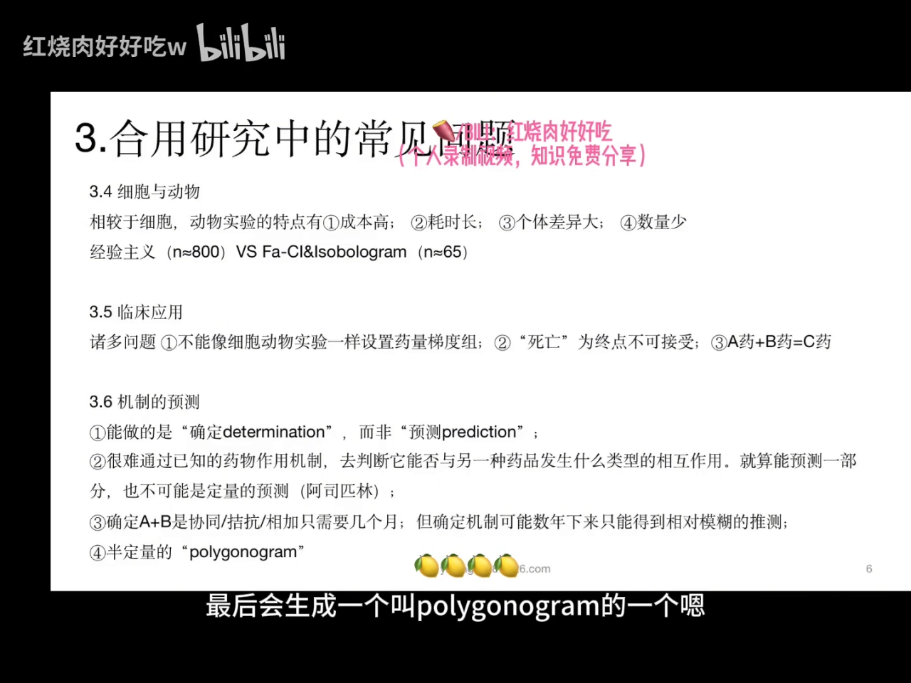
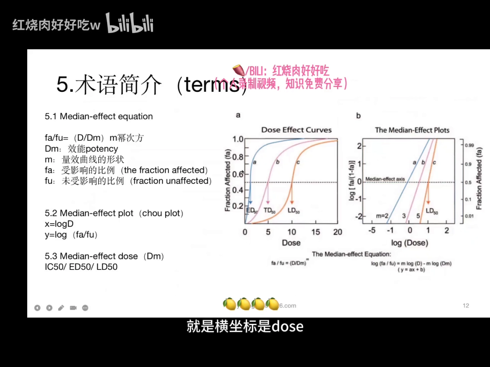
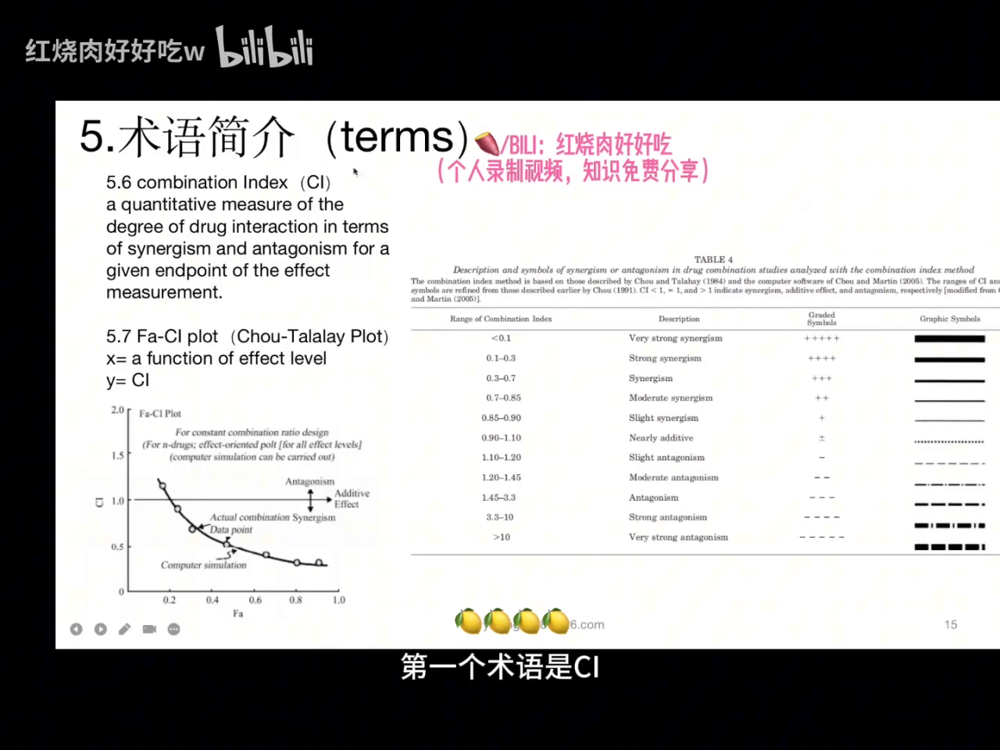
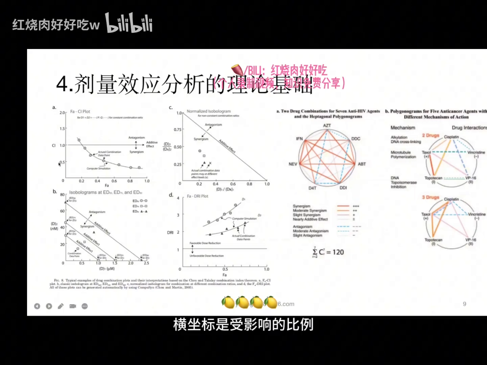
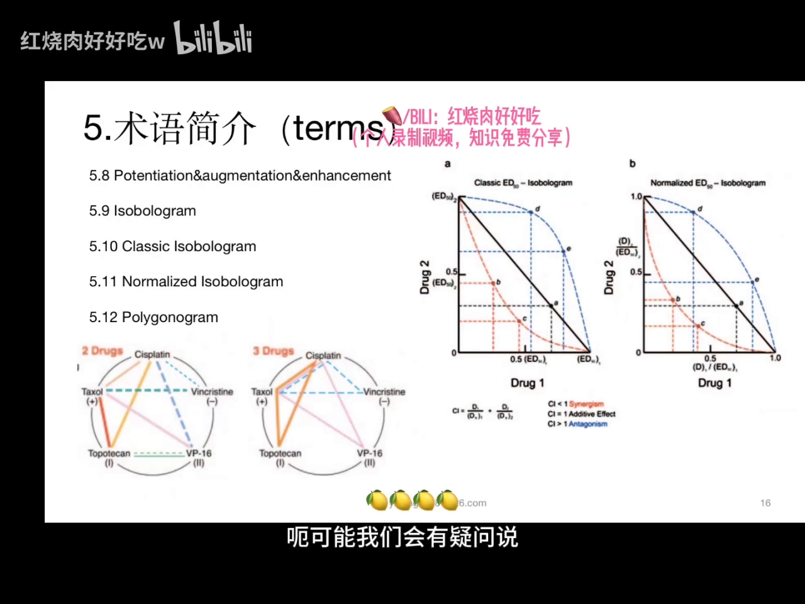
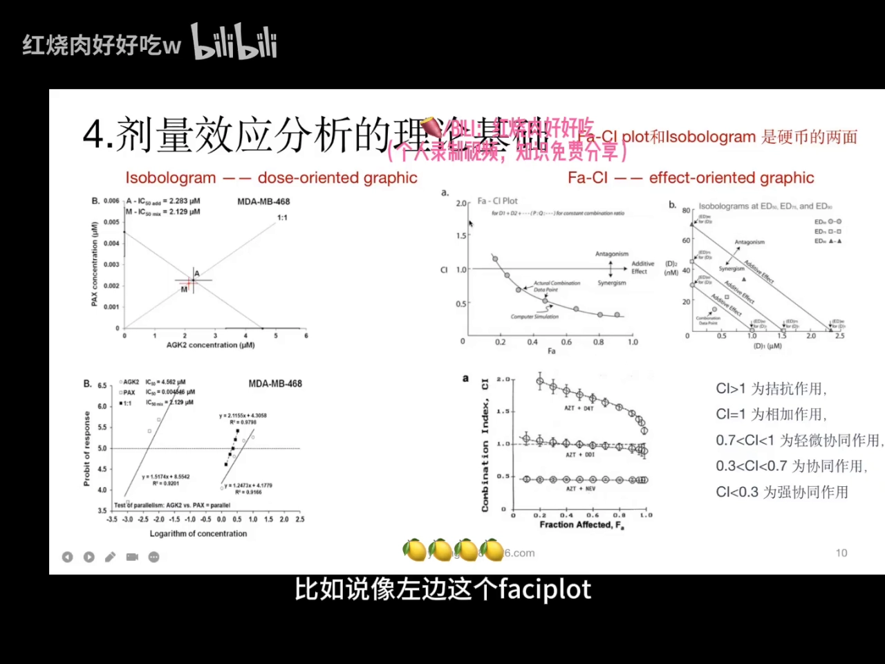
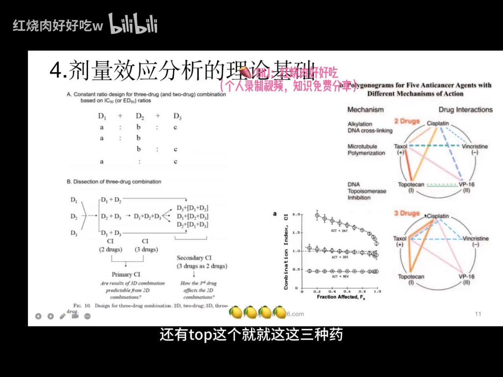
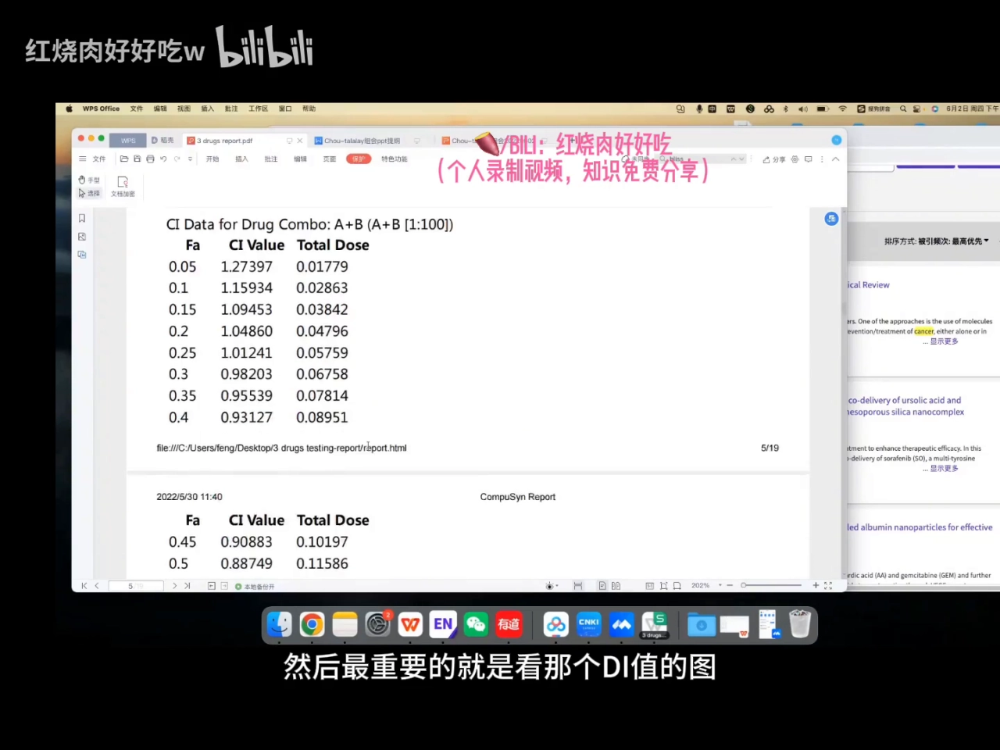
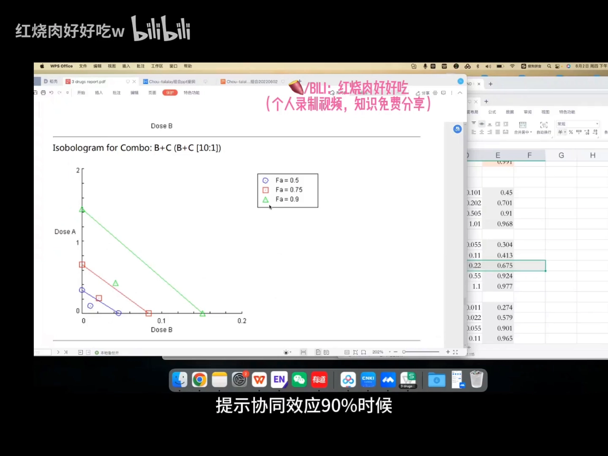

# 组合扰动如何判定真交互：加性基线与协同拮抗

> 视频来源：[药物联合应用理论介绍/CompuSyn 软件安装与使用/协同拮抗与相加](https://www.bilibili.com/video/BV1ESY8eoEtH/)（Bilibili · 红烧肉好好吃w）｜时长约 47 分钟
> 导读：这支视频讲的是"两个（或三个）干预叠在一起，怎么用一套定量框架判断它们是不是真的相互作用"。它用药物联合做例子，但 **CI（合用指数）与加性基线这套逻辑，对任何两种扰动都通用**——包括两条 sgRNA、一次药物加一次基因敲除。本文按视频顺序梳理概念、判读规则与 CompuSyn 实操，并在关键处点明它对单细胞组合扰动的意义。

## 本讲要解决的核心问题（SCQA）

**背景**：做扰动实验时，我们常常把两个干预叠在一起用——两种药一起加、两个基因一起敲、一个药配一个基因敲除。叠加之后测到的表型，往往比单独用任何一个都强。

**冲突**：叠加后表型更强，并不能说明两者"协同"。A 加 B 的效果大于 A 单用，这几乎是公理——只要 B 有一点作用就会成立。可大量文献正是用"合用比单用好"来宣称协同。更麻烦的是，叠加效应里到底有多少是"各自独立贡献相加"，有多少是"两者真的互相影响"，光看表型强弱根本分不出来。

**疑问**：既然"更强"不等于"协同"，那要满足什么条件，才能说两个扰动之间存在真实交互？怎样把这件事变成一个可计算、可比较、可复现的量？

**回答（中心思想）**：**必须先建立"没有交互时应该是什么样"的加性基线，再看实测值偏离基线的方向与幅度。** 视频给出的落地工具是 Chou-Talalay 的中值效应方程与 CI 值：CI 约等于 1 为相加，小于 1 为协同，大于 1 为拮抗；再配合等辐射图、Fa-CI 图、polygonogram 三种视图交叉印证。而这一切的前提，是**每个单扰动臂都必须单独测出完整的剂量效应曲线**——没有单扰动基线，交互效应在数学上根本无法定义。

## 一、"合用比单用好"不是协同，这是全篇的地基

视频一开场就把最容易犯的错误摆在前面：协同（synergy）和增强（potentiation/augmentation/enhancement）是两码事。

- **增强是单方面的**：A 加 B 比 B 单用好，可能只是因为 A 自己也有点作用，或者 A 放大了 B 的效应。如果 A 本身只是一种增敏剂、自己根本没有剂量效应曲线，那就只能说"A 增强了 B"，不能说两者协同。
- **协同是相互的**：要谈协同，必须两个干预各自都有完整的剂量效应关系，再由这两条曲线推出"如果没有交互，合用应该是什么样"的第三条曲线，然后拿实测的合用曲线去比。

[【跳转到 06:12】](https://www.bilibili.com/video/BV1ESY8eoEtH/?t=372)

这个区分对组合扰动实验是致命的。比如你敲掉基因 A 后细胞活力下降 20%，再敲 B 又下降 20%，两者一起敲下降 40%——这恰好是"各管各的"的相加结果，谈不上任何交互。只有当实测值显著偏离 40% 这个基线，才谈得上协同或拮抗。**基线不是可选项，它是定义的一部分。**

## 二、为什么需要一个定量框架：三类绕不过去的问题

讲者先列了合用研究中的三类常见问题，正好解释了为什么"凭经验看强弱"行不通。

**第一类：细胞与动物之间的落差。** 动物实验成本高、耗时长、个体差异大，样本量远小于细胞实验——细胞板一排就是 6 个孔、一块板能给出几十上百个样本，小鼠做不到。讲者引用的估算是：如果完全靠经验主义去论证"A 加 B 比单用好"，可能需要接近 800 只小鼠；而用 Fa-CI 与等辐射图这套框架，样本量可以压到 65 左右。**框架的价值不只是"算得准"，还是"用更少的样本得出可靠结论"。**

[【跳转到 03:22】](https://www.bilibili.com/video/BV1ESY8eoEtH/?t=202)

**第二类：临床场景的限制。** 在人身上不能像细胞或动物那样设剂量梯度组，也不能以"死亡"为终点。所以临床上的合用判断，只能借用细胞和动物层面建立起来的定量结论。

**第三类：机制只能"确定"，不能"预测"。** 讲者用阿司匹林举例：上市这么多年，我们对它作用机制的描述仍谈不上详尽。也就是说，即便已知两个干预各自的作用通路，也很难凭机制推断它们叠在一起会发生哪种类型的相互作用；就算能猜个方向，也不可能是定量的。**确定 A+B 是协同、拮抗还是相加，只要几个月；而确定背后的机制，可能要好几年才得到模糊的推测。** 这正是为什么需要一个只依赖表型数据、不依赖机制先验的判据——polygonogram 这类图就是在这个意义上被称作"半定量"的指示。

## 三、中值效应方程：把一条 S 形曲线压成一条直线

整套框架的数学起点是 Chou-Talalay 的中值效应方程（median-effect equation）：

$$
\frac{f_a}{f_u} = \left(\frac{D}{D_m}\right)^m
$$

其中 $f_a$ 是受影响的比例（fraction affected），$f_u = 1 - f_a$ 是未受影响的比例，$D$ 是剂量，$D_m$ 是达到 50% 效应所需的剂量（即 IC50 / ED50 / LD50，讲者称为"效能" potency），$m$ 是曲线的形状参数。

两边取对数，方程就变成一条直线：

$$
\log\frac{f_a}{f_u} = m\log D - m\log D_m
$$

这条直线的斜率 $m$ 直接反映剂量效应曲线的形状：$m=1$ 时是双曲线型，$m$ 明显大于 1 时是反 S 型。讲者强调这一点有实际意义——**同样看 ED50，双曲线型的药在很低的剂量就到了，反 S 型的药要爬到偏右的高剂量才到**。只看一个 ED50 数值，会掩盖两条曲线形状上的巨大差异。

[【跳转到 26:14】](https://www.bilibili.com/video/BV1ESY8eoEtH/?t=1574)

同一张 PPT 上还有拟合度 $R$ 值：$R$ 越接近 1，说明数据越容易连成一条线，而不是一堆散点——这是判断这批剂量效应数据能不能用的第一道关。

## 四、CI 值：把"偏离加性基线"变成一个数

有了每个单干预的中值效应参数，就能算出**如果没有交互、合用需要多少剂量才能达到同样的效应**，再和**实测合用剂量**相比，这个比值就是合用指数（combination index, CI）：

$$
CI = \frac{(D)_1}{(D_x)_1} + \frac{(D)_2}{(D_x)_2}
$$

其中 $(D_x)_1$、$(D_x)_2$ 是两种干预单独使用时达到效应 $x$ 所需的剂量，$(D)_1$、$(D)_2$ 是合用中各自实际用的剂量。直观理解：**如果两者完全独立、效应可以简单相加，那么各自只需要用到"单用剂量"的一部分就够了，两项加起来正好等于 1。**

判读规则（视频给出的分档）：

| CI 区间 | 含义 |
| --- | --- |
| $CI < 0.1$ | 极强协同 |
| $0.1 \sim 0.3$ | 强协同 |
| $0.3 \sim 0.7$ | 协同 |
| $0.7 \sim 0.85$ | 中度协同 |
| $0.85 \sim 0.90$ | 轻微协同 |
| $0.90 \sim 1.10$ | 接近相加 |
| $1.10 \sim 1.20$ | 轻微拮抗 |
| $1.20 \sim 1.45$ | 中度拮抗 |
| $1.45 \sim 3.3$ | 拮抗 |
| $3.3 \sim 10$ | 强拮抗 |
| $> 10$ | 极强拮抗 |

[【跳转到 08:08】](https://www.bilibili.com/video/BV1ESY8eoEtH/?t=488)

讲者反复强调一句：**CI 值不等于 P 值**。P 值回答的是"两组有没有差别"，CI 回答的是"合用的效应偏离加性基线有多远、往哪个方向偏"。前者是统计显著性，后者是交互的方向与强度，两者不能互相替代。

## 五、三种视图，看的是同一件事

CI 只是一个数。要真正读懂一次组合实验，视频给出了一套互相印证的图形语言。

**Fa-CI 图（效应视角）**：横坐标是 $f_a$（受影响的比例），纵坐标是 CI。CI 曲线落在 1 以下就是协同，落在 1 以上就是拮抗。它的好处是能一眼看出**协同发生在哪个效应区间**。

**等辐射图 isobologram（剂量视角）**：横纵坐标分别是两种干预的剂量，图上画一条"相加线"，实测合用达到某个效应所需的剂量组合如果落在线的内侧（更低的剂量），就是协同；落在外面就是拮抗。

两者是"硬币的两面"：一个从效应角度切，一个从剂量角度切，结论必须能对上。至于为什么还要额外引入 CI，讲者的解释是等辐射图**不够直观、也没有给出定量刻度**——图上只能看出"在里还是在外"，看不出"偏离了多少"。

**polygonogram（多边形图）**：把多个干预画在一个圆上，两两之间连线的**实线表示协同、虚线表示拮抗，线的粗细表示强度**。它的用途是"一次看全局"——比如同一个药分别和三种药搭配，一张图就能排出谁最值得往下做。

[【跳转到 12:00】](https://www.bilibili.com/video/BV1ESY8eoEtH/?t=720)

## 六、同一个组合，在低剂量协同、在高剂量拮抗

这套框架最有价值的一点，是它把"协同"从一个形容词变成了**随效应区间变化的函数**。

讲者给了一个具体例子：某两药合用时，$f_a$ 在 0 到 0.22（也就是 0% 到 20% 效应）这一段，CI 处于相加甚至偏拮抗；但到了 80%、90% 的高效应区，CI 明显掉到 1 以下，呈现很强的协同。

[【跳转到 16:39】](https://www.bilibili.com/video/BV1ESY8eoEtH/?t=999)

这直接决定了结论该怎么用：

- 如果目标是**抗肿瘤或镇痛**，希望在高效应区拿到强协同——那么这个组合正合适；
- 如果目标是**控制毒性**，希望两个药都在低剂量时就有好效果——那么同一份数据给出的答案就是"不合适"，该换方案。

也就是说，**"这两个扰动协不协同"这个问法本身是不完整的**，完整的问法是"在哪个效应区间协同"。这一点在组合扰动设计里尤其重要：组合筛选往往在单一剂量点上做，得出的结论可能只在那一个效应水平成立。

## 七、三药及以上：组合数增长，判断难度也增长

两药还可以用二维等辐射图，三药就变成了立体坐标系——这是讲者放弃早期方法、转向 Chou-Talalay 框架的原因之一。

三药合用的最小实验设计是四组：药 1 单用、药 2 单用、药 3 单用，以及三者按固定比例混合。但讲者强调，**条件允许时一定要补上 AB、BC、AC 三个两两组合组**，原因是软件内部的运算逻辑本来就是按两两拆分来做的（primary CI 用两药组合算，secondary CI 再看第三个药如何影响两药组合）。

[【跳转到 23:19】](https://www.bilibili.com/video/BV1ESY8eoEtH/?t=1399)

为什么非补不可？讲者给了一个反例：只看"三药混合"这一组，可能得出"三者一起用是拮抗"的结论；但把两两组合补上之后会发现，其中一对是弱协同、另一对是强拮抗——**整体表现出的拮抗，掩盖了内部方向相反的交互**。这正是组合扰动最危险的地方：**组合数越多，平均效应越容易把真实交互抹平。**

这也解释了为什么固定比例与非固定比例要分开处理。固定比例（比如一比二，然后 A 用 1 毫克、B 用 2 毫克，再 A 用 2 毫克、B 用 4 毫克逐级叠加）便于计算，但如果其中一个干预毒性很强，按比例翻倍可能在达到目标效应之前就已经超出细胞或动物能承受的范围，这时就必须改用非固定比例给药——软件里对应 classic 与 normalized 两种等辐射图。

## 八、实操：CompuSyn 里一次完整的分析

视频后半段是软件演示。讲者用的是三代软件 CompuSyn（二代 CalcuSyn 已被公司收购、价格较高），因为软件较老，需要在 Win7 环境里跑，并且要先装 Java 环境包。

流程要点：

1. **准备数据表**：三药单用、两两合用、三药混合，各自的剂量与对应效应。
2. **输入单药**：每行填药品全称、简写、单位（两个药的单位可以不同，一个用毫克每公斤、另一个用毫摩尔每升都没问题），再填剂量—效应点。**单药至少两个点**，少于两个软件会拒绝。
3. **输入合用组**：选固定比例或非固定比例；固定比例下只需填总剂量，软件自动按比例拆算。
4. **生成报告**：可指定关注的效应水平（50%、75%、90%），初次使用可以把所有表都勾上。
5. **读报告**：先看单药的 $D_m$（即 ED50/IC50），再看 CI 表与各类图。

[【跳转到 36:33】](https://www.bilibili.com/video/BV1ESY8eoEtH/?t=2193)

读报告的顺序讲者也有交代：**第一步永远是看单药的 ED50**。比如报告里写 $D_m$ 是 0.00217，就意味着效应达到 50% 对应的剂量是 0.00217；可以顺手反推一下自己对数的直觉对不对——如果 0.002 时效应是 0.429，那么比 0.002 略高一点就该到 0.5。同一步还会给出 $m$ 值，据此就能预判这条曲线是双曲线型还是反 S 型，再和软件画出的图对一下是否吻合。

[【跳转到 42:10】](https://www.bilibili.com/video/BV1ESY8eoEtH/?t=2530)

讲者还特别提醒了数据量的问题：理论上五个数据点就能拟合出结果，但他建议**每组最好 5 到 8 个数**——孔板一排 6 个孔、8 到 9 个浓度梯度，刚好满足。另外，如果想获得最大协同效果，最好让两个干预的效应水平对齐（纵坐标 ED50 对横坐标 ED50、ED95 对 ED95）；有特殊需求时错开也可以，不必强求剂量完全一致。

## 九、拿到结果后，先自己验算一遍

视频最后演示了如何读一份实际报告，其中最有价值的是**用原始数据做主观验算**这一步。

讲者的验算过程大致是这样：

- 先看单药的 $D_m$，并反推自己对数的直觉是否合理（比如 0.002 时效应是 0.429，那么比 0.002 略高一点就该到 50%）；
- 再看 CI 曲线：BC 组合从效应 10% 到 100% 一直落在 1 以下，即全程协同；
- 然后回到原始数据抽查：B 单用 0.2 时效应约 30%，C 单用 0.02 时效应约 20%。**如果没有强协同，两者叠加大概应该是 30% 到 40% 这个量级**；而实测合用已经到六七十%，与图上的结论吻合。
- 最后用等辐射图交叉印证：Fa 等于 50%、75%、90% 时，实测点都在相加线的左侧。

[【跳转到 43:56】](https://www.bilibili.com/video/BV1ESY8eoEtH/?t=2636)

这一步看似多余，其实是判断"这份报告能不能信"的最快方式——**任何交互判据的结论，都应该能被原始剂量—效应数据粗略地复述出来**。如果图上说强协同，但原始数据看起来只是简单叠加，那就该怀疑拟合或分组出了问题。

## 小结

- **"合用比单用好"不等于协同。** 协同要求两个干预各自都有完整的剂量效应曲线，并由这两条曲线推导出"无交互时应该是什么样"的加性基线。
- **CI 是偏离加性基线的定量度量**：约等于 1 相加，小于 1 协同，大于 1 拮抗，并按区间细分为若干档。CI 不等于 P 值——前者是交互的方向与强度，后者只是统计显著性。
- **三种视图看同一件事**：Fa-CI 图从效应角度、等辐射图从剂量角度、polygonogram 从多组合全局角度，结论必须互相吻合。
- **协同是随效应区间变化的函数**，不是组合的固有属性。同一个组合可以在低剂量相加、在高剂量强协同，结论必须带上"在哪个效应水平"。
- **组合数增长会掩盖交互**：三药只测混合组，可能只看到整体拮抗；补上两两组合组才能看到内部方向相反的交互。
- **数据量要够**：理论上五点可拟合，实践建议每组 5 到 8 个点；拿到报告后要用原始数据做一次粗验算。
- **对单细胞组合扰动的意义**：这套框架只依赖表型读数，不依赖机制先验，因此可以直接搬到"两条 sgRNA 同时表达"的场景——把"剂量"换成扰动强度、把"效应"换成细胞状态或活力，加性基线与 CI 的逻辑不变。代价同样存在：每个组合都要有单扰动臂做基线，组合越多，每个组合分到的细胞越少。

## 关键术语速查

| 术语 | 一句话解释 |
| --- | --- |
| 协同（synergy） | 合用效应显著优于各自独立相加的预期，且两个干预互相影响 |
| 增强（potentiation） | 单向放大：A 放大 B 的效应，但 A 自身没有可定义的剂量效应关系 |
| 相加（additivity） | 合用效应等于各自效应按独立作用叠加的预期，即"无交互" |
| 拮抗（antagonism） | 合用效应弱于相加预期，两者互相抵消 |
| 加性基线 | 假设两者互不影响时，合用"应该"达到的效应水平，是判定交互的参照物 |
| 中值效应方程 | $f_a/f_u=(D/D_m)^m$，把 S 形剂量效应曲线在对数坐标下变成直线 |
| $D_m$ | 达到 50% 效应所需剂量（IC50/ED50/LD50），反映效能 |
| $m$ | 中值效应直线的斜率，反映剂量效应曲线的形状（双曲线型或反 S 型） |
| CI（combination index） | 合用指数，量化偏离加性基线的方向与幅度；<1 协同、=1 相加、>1 拮抗 |
| $f_a$ / $f_u$ | 受影响 / 未受影响的比例，两者之和为 1 |
| Fa-CI 图 | 横坐标效应比例、纵坐标 CI，用来看协同发生在哪个效应区间 |
| 等辐射图（isobologram） | 横纵坐标为两种干预剂量，实测点落在相加线内侧为协同、外侧为拮抗 |
| polygonogram | 多干预多边形图，实线协同、虚线拮抗、线粗表示强度 |
| DRI | 剂量减少指数，衡量合用时各干预能省下多少剂量 |
| CompuSyn | 基于 Chou-Talalay 理论的免费软件，输入剂量—效应数据即输出 CI 与各类图 |