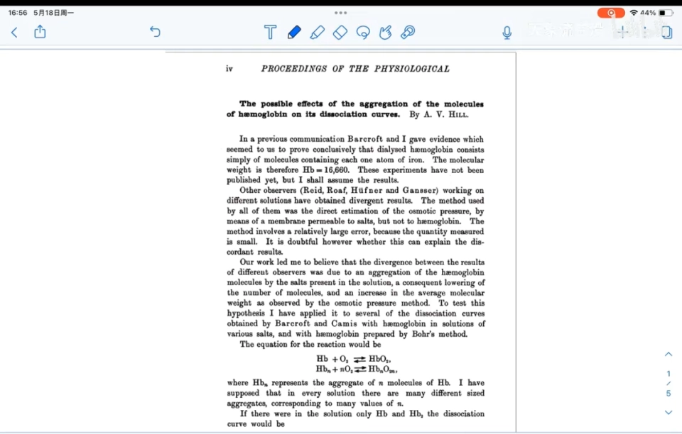
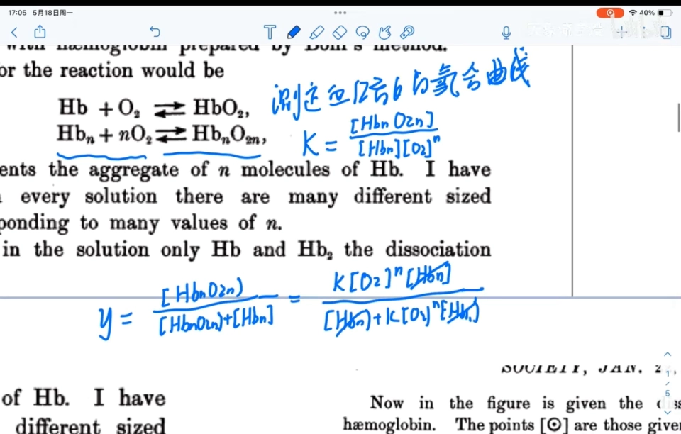
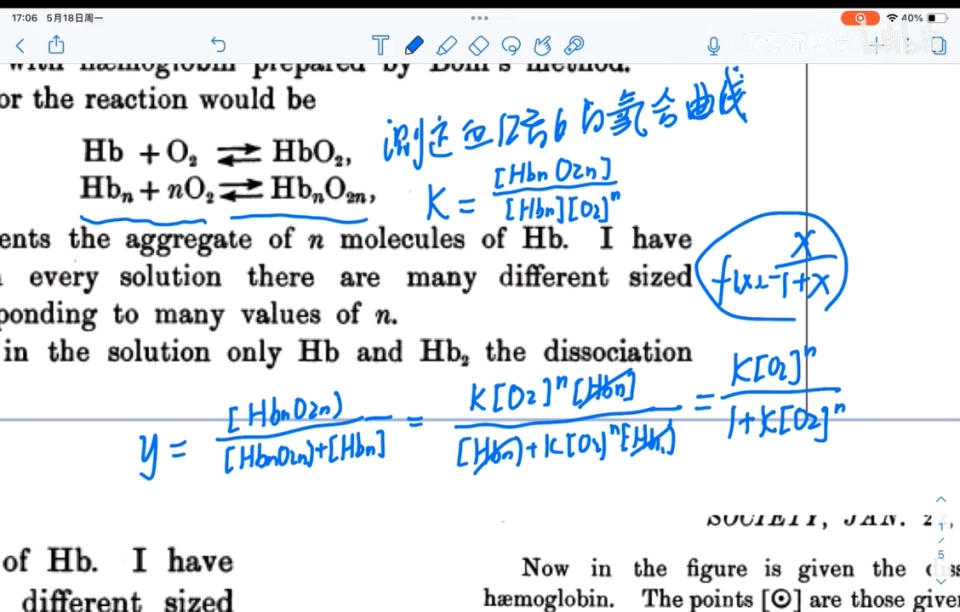
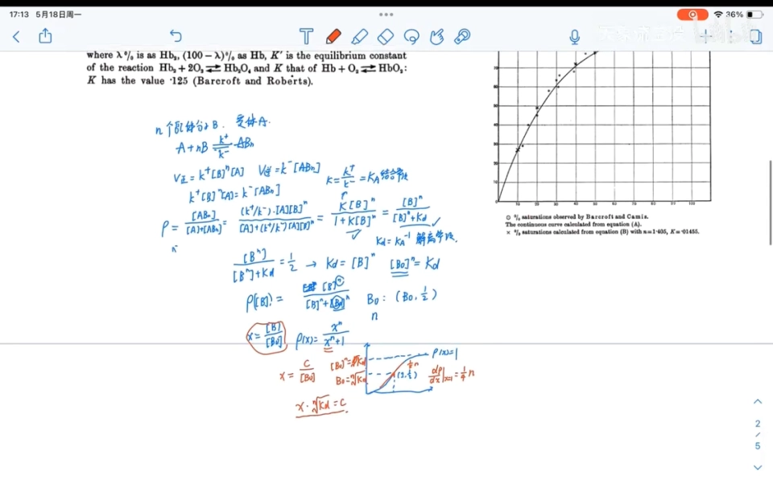
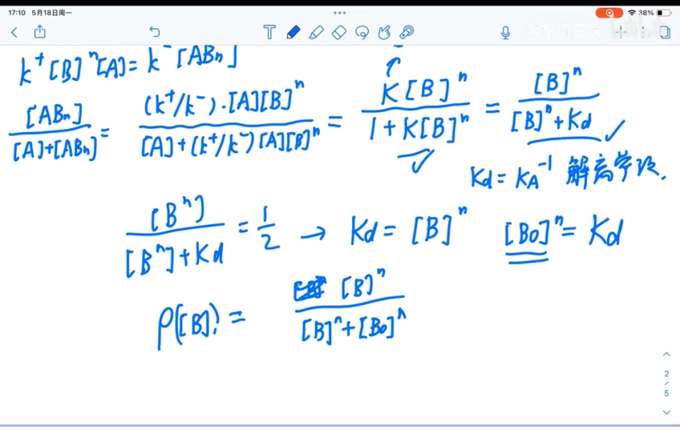
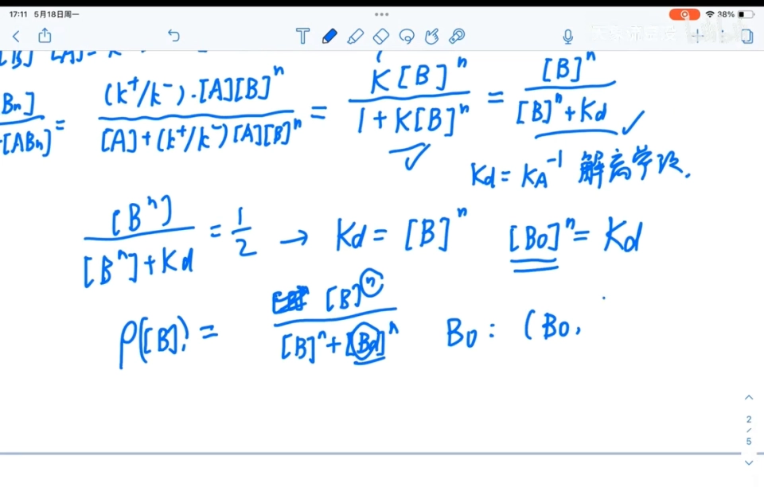
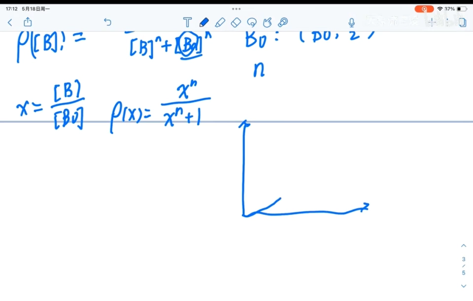
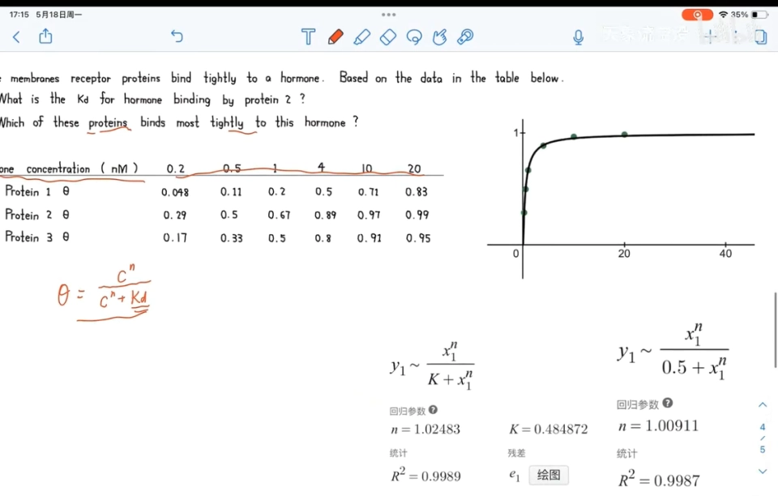
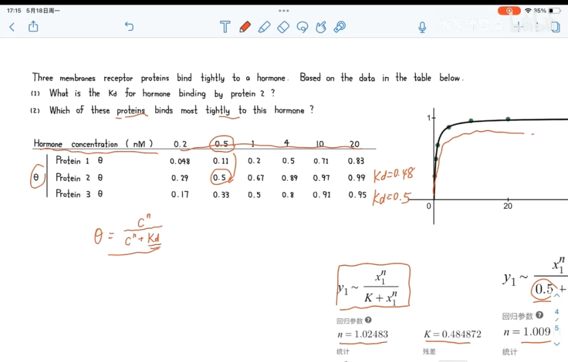

# Hill 方程：剂量-反应曲线为什么是 S 形，Hill 系数又说明了什么

> 视频来源：[【生物信息学10】生物化学中的Hill动力学方程](https://www.bilibili.com/video/BV1a5Lw6vEXK/)（Bilibili · 天象流空没）｜时长约 22 分钟
> 导读：这支视频不是药理学课，而是一节「从原始论文出发、把公式一步步推出来」的课：讲者从 1910 年 Hill 研究血红蛋白分子量的论文讲起，用质量作用定律推出 Hill 方程，再把两个参数（半饱和浓度 $B_0$ 与 Hill 系数 $n$）的几何意义讲透，最后用一道受体结合数据的例题收尾。本文保留完整推导，并在最后把它接回扰动实验的布点问题。量效曲线的药理学读数（效能、效价、治疗指数）见本小节《小分子药物为什么必须做剂量梯度》。

## 本讲要解决的核心问题（SCQA）

**背景**：上一节已经看到，剂量-反应曲线在对数浓度横轴上是一条对称的 S 形曲线，中段最陡、两端走平，中点被定义为 EC50 或半最大效应浓度。

**冲突**：但「S 形」只是一个形状描述，它回答不了三个具体问题：**这条曲线的中点到底在哪个浓度？它有多陡？陡峭程度又意味着什么？** 如果只用一句「中段最灵敏」来指导实验，你既不知道该把浓度点布在哪里，也无法判断两个化合物的曲线差异是「位置不同」还是「形状不同」。

**疑问**：有没有一个方程，能用尽量少的参数同时描述曲线**在哪里**和**有多陡**？这两个参数各自对应什么可观测的量？

**回答（中心思想）**：**有，就是 Hill 方程。它只需要两个参数：半饱和浓度 $B_0$ 决定曲线的位置（曲线必然经过 $(B_0, 1/2)$ 这一点），Hill 系数 $n$ 决定曲线的陡峭程度（$n$ 越大越像阶跃，$n=1$ 退化成一条双曲线）。** 讲者强调这两个参数「都有很明确的几何意义」：一个确定函数的位置，一个确定函数的形状。而这两个参数都可以从实验数据里拟合出来——这也是为什么剂量-反应实验必须做梯度：**没有梯度就没有曲线，没有曲线就拟合不出 $B_0$ 和 $n$。**

## 一、Hill 方程不是为药理学发明的

讲者开场先交代动机：Hill 动力学方程是生物化学中一个很常用的方程，在生物信息学中，后续比如信号转导网络的定量建模、写方程的时候都非常有用 [【跳转到 00:00】](https://www.bilibili.com/video/BV1a5Lw6vEXK/?t=0)。它在生物化学上最常见的出处，是讲血红蛋白那一章的**别构效应与 S 型曲线**——有的教材会讲到，但大部分高校不会讲。

### 1.1 1910 年的原始问题：血红蛋白的分子量到底是多少

讲者展示了一篇非常早的论文：1910 年，作者 A. V. Hill，发表在 *Proceedings of the Physiological Society*（生理学相关会议论文集），题目是 *The possible effects of the aggregation of the molecules of hemoglobin on its dissociation curves*——「血红蛋白分子的聚集对它的解离曲线的可能影响」 [【跳转到 00:50】](https://www.bilibili.com/video/BV1a5Lw6vEXK/?t=50)。

当时的背景是这样：Hill 和他的同事 Barcroft 的工作是在计算血红蛋白的分子量，他们认为透析后的血红蛋白分子量是 **16600** [【跳转到 01:45】](https://www.bilibili.com/video/BV1a5Lw6vEXK/?t=105)。按今天的知识，这差不多是血红蛋白四聚体中**一个亚基**的分子量——我们现在讲 Hb 是指一个四聚体，但当时不是，当时指的是一个亚基，讲者特意提醒「这个标记还蛮重要的」 [【跳转到 02:35】](https://www.bilibili.com/video/BV1a5Lw6vEXK/?t=155)。

问题出在别人测出来的数不一样。论文原话是：*Other observers working on different solutions have obtained very different results. The method used by all of them was the direct estimation of the osmotic pressure by means of a membrane permeable to salts but not to hemoglobin.* 也就是说，当时很多同僚也在测血红蛋白的分子量，但**大家得到的分子量都各不相同**，而他们用的都是**渗透压法** [【跳转到 03:09】](https://www.bilibili.com/video/BV1a5Lw6vEXK/?t=189)。

### 1.2 渗透压法为什么会给出不同的数

讲者在这里插了一段物理化学的复习，这段复习是后面理解 $n$ 的关键。渗透压按范特霍夫公式是：

$$
\Pi = c_s R T
$$

其中 $c_s$ 是溶质颗粒的摩尔浓度，$R$ 是气体常量，$T$ 是热力学温度。把 $c_s$ 写成质量浓度除以分子量，就得到：

$$
\Pi = \frac{C}{M} R T
$$

于是当时的人就倾向于：测出溶液的渗透压，反推出分子的分子量 $M$ [【跳转到 04:49】](https://www.bilibili.com/video/BV1a5Lw6vEXK/?t=289)。

**但这里有一个陷阱**：公式里的 $c_s$ 是**独立颗粒**的浓度，不是「你称了多少摩尔」。讲者的例子很直白：氯化钠放进水里会解离，一摩尔氯化钠变成一摩尔钠离子加一摩尔氯离子，溶液中独立颗粒数是**两摩尔**；氯化钾也是一变二；氯化钙则可能一变三 [【跳转到 06:13】](https://www.bilibili.com/video/BV1a5Lw6vEXK/?t=373)。

反过来推：如果分子进入溶液后不是解离、而是**单体间发生聚集**，独立颗粒数变少，测得的渗透压就会偏低，反推出来的表观分子量就会偏大。而当时很多研究者用的是盐溶液，蛋白质放在盐溶液里会发生一定程度的聚集，形成二聚体甚至四聚体 [【跳转到 07:38】](https://www.bilibili.com/video/BV1a5Lw6vEXK/?t=458)。

于是 Hill 的猜想是：**不同研究者测出分子量有差异，不是因为谁测错了，而是因为溶液里盐的种类不同、聚集程度不同——盐越多，聚集越严重，测得的分子量越大。**

### 1.3 怎么证明这个猜想：去测氧合曲线

要证明「聚集程度不同」，需要一个能反映聚集状态的观测量。Hill 选的是**氧合曲线**——血红蛋白最重要的功能就是结合氧气 [【跳转到 08:23】](https://www.bilibili.com/video/BV1a5Lw6vEXK/?t=503)。

他提出的模型是：一个由 $n$ 个亚基组成的聚集体，同时结合 $n$ 个氧分子：

$$
\mathrm{Hb}_n + n\,\mathrm{O_2} \rightleftharpoons \mathrm{Hb}_n\mathrm{O}_{2n}
$$

按化学平衡，平衡常数是：

$$
K = \frac{[\mathrm{Hb}_n\mathrm{O}_{2n}]}{[\mathrm{Hb}_n]\,[\mathrm{O_2}]^n}
$$

结合率（已结合氧的亚基占总亚基的比例）是：

$$
\rho = \frac{[\mathrm{Hb}_n\mathrm{O}_{2n}]}{[\mathrm{Hb}_n\mathrm{O}_{2n}] + [\mathrm{Hb}_n]}
= \frac{K[\mathrm{O_2}]^n}{1 + K[\mathrm{O_2}]^n}
$$

这个式子的行为完全由 $n$ 决定，这正是 Hill 想要的东西 [【跳转到 10:39】](https://www.bilibili.com/video/BV1a5Lw6vEXK/?t=639)：

- 如果**没有发生聚集**（$n = 1$），氧合曲线是一条**双曲线**，形状类似 $f(x) = \dfrac{x}{1+x}$；
- 如果**发生了聚集**（$n > 1$），曲线就不再是双曲线，而变成一条 **S 型曲线**。

于是他就可以对不同盐溶液中的血红蛋白氧合数据去测定、去拟合这个 $n$，用 $n$ 的大小判断血红蛋白是否发生了不同程度的聚集。

> **这段历史的启示**：Hill 方程最初不是描述「药物剂量与效应」的，而是描述「配体浓度与受体占据率」的。它后来被广泛用于剂量-反应曲线，是因为**「配体结合受体」和「药物产生效应」在数学上是同一件事**：都是一个饱和过程——位点有限，浓度再高也只能占满。

## 二、推广到任意受体-配体：Hill 方程的一般推导

讲者接下来把血红蛋白这个特例推广成一般形式 [【跳转到 11:12】](https://www.bilibili.com/video/BV1a5Lw6vEXK/?t=672)。

设有 $n$ 个配体分子 $B$ 和一个受体 $A$，反应为：

$$
A + nB \;\underset{k_-}{\overset{k_+}{\rightleftharpoons}}\; AB_n
$$

按质量作用定律，正反应速率是 $k_+ [B]^n [A]$，逆反应速率是 $k_- [AB_n]$。平衡时两者相等 [【跳转到 12:02】](https://www.bilibili.com/video/BV1a5Lw6vEXK/?t=722)，于是受体结合率

$$
\rho = \frac{[AB_n]}{[A] + [AB_n]}
= \frac{K[B]^n}{1 + K[B]^n},
\qquad K = \frac{k_+}{k_-}
$$

讲者把 $K$ 命名为**结合常数**（association constant，$K_A$）。把式子上下同除以 $K$，就得到另一种写法 [【跳转到 13:17】](https://www.bilibili.com/video/BV1a5Lw6vEXK/?t=797)：

$$
\rho = \frac{[B]^n}{[B]^n + K_D},
\qquad K_D = \frac{1}{K_A}
$$

$K_D$ 是**解离常数**（dissociation constant）。**$K_D$ 越小，亲和性越大，受体和配体的结合越紧密。**

### 2.1 半饱和浓度 $B_0$：把 $K_D$ 换成一个「浓度」

$K_D$ 的化学意义很明确，但它的量纲是「浓度的 $n$ 次方」，不能直接读成「某个浓度」。讲者用一步很巧的替换解决了这个问题 [【跳转到 14:32】](https://www.bilibili.com/video/BV1a5Lw6vEXK/?t=872)：令 $\rho = 1/2$，即

$$
\frac{[B]^n}{[B]^n + K_D} = \frac{1}{2}
\;\Longrightarrow\;
K_D = [B]^n
$$

把满足 $\rho = 1/2$ 的那个浓度记作 $B_0$（**半饱和浓度**），于是

$$
B_0^{\,n} = K_D
$$

Hill 方程于是可以写成最常用的形式：

$$
\rho([B]) = \frac{[B]^n}{[B]^n + B_0^{\,n}}
$$

讲者解释了为什么要做这个替换：$K_D$ 有很明确的化学意义，但在其他情形下它的意义可能表现得比较暧昧；**比起 $K_D$，用 $n$ 和 $B_0$ 作为参数的 Hill 方程会更加常见**，因为这两个参数「都有很明确的几何意义」 [【跳转到 15:22】](https://www.bilibili.com/video/BV1a5Lw6vEXK/?t=922)。

## 三、两个参数，两个几何意义

### 3.1 $B_0$ 定位置

$B_0$ 确定了函数上的一个点：**横坐标是 $B_0$，纵坐标是 $1/2$**。确定了 $B_0$，函数上这一点就确定下来了 [【跳转到 15:47】](https://www.bilibili.com/video/BV1a5Lw6vEXK/?t=947)。

### 3.2 $n$ 定形状

$n$ 去确定这一点的**陡峭程度**：$n$ 越大，曲线就越 S 形，形状就确定了。讲者的总结是：**一个确定函数的位置，一个确定函数的形状，相当于把曲线的增长速度连同曲线本身的绝对位置都确定下来了。**

### 3.3 归一化：最清晰的形式

把式子上下同除以 $B_0^{\,n}$，并定义 $x = [B]/B_0$，方程就变成最干净的形式 [【跳转到 16:12】](https://www.bilibili.com/video/BV1a5Lw6vEXK/?t=972)：

$$
\rho(x) = \frac{x^n}{x^n + 1}
$$

这个函数的性质讲者逐条点了出来 [【跳转到 16:37】](https://www.bilibili.com/video/BV1a5Lw6vEXK/?t=997)：

- 从 0 开始递增，右侧渐近线是 1；
- 固定经过点 $(1,\, 1/2)$；
- 在这一点上的斜率是 $\dfrac{n}{4}$，即 $\left.\dfrac{d\rho}{dx}\right|_{x=1} = \dfrac{n}{4}$。

**斜率 $\dfrac{n}{4}$ 这个结果是理解「陡峭度」的关键**：中点的斜率正比于 $n$。$n$ 大，中点陡；$n$ 小，中点缓。而中点恰恰是实验里最灵敏、也最容易测准的位置。

## 四、$n$ 到底意味着什么

### 4.1 从原始问题看：$n$ 是「一次结合几个」

在 Hill 最初的模型里，$n$ 就是**一个聚集体同时结合几个氧分子**。$n = 1$ 意味着每个结合位点独立、互不影响，曲线是双曲线；$n > 1$ 意味着多个位点被「一起」结合，曲线变成 S 形 [【跳转到 10:14】](https://www.bilibili.com/video/BV1a5Lw6vEXK/?t=614)。

讲者把这条线索一路带到了血红蛋白的别构效应上——这正是 $n > 1$ 的生物学来源：**一个位点被占据之后，其余位点更容易被占据**，宏观上就表现为「浓度稍微高一点，占据率一下子跳上去」。

### 4.2 从公式看：$n$ 是陡峭度，不是「分子个数」

需要说清楚的是：在推广后的 Hill 方程里，$n$ 已经**不再严格等于分子个数**，它只是一个描述曲线陡峭程度的指数——所以它常被称作 **Hill 系数（Hill coefficient）** 而不是「结合数」。讲者的用法也是这个意思：$n$ 越大，曲线越 S 形。

> **对扰动实验的推论**：$n$ 的大小直接决定「有效浓度窗口」有多宽。$n$ 大（曲线陡）意味着浓度稍微变一点，效应就从几乎没有跳到接近饱和——窗口窄，布点必须密；$n$ 小（曲线缓）意味着效应随浓度缓慢变化——窗口宽，布点可以稀一些，但要覆盖更宽的数量级范围。

## 五、一道例题：从受体结合数据里读出 $K_D$ 与亲和力排序

讲者最后用一道题收尾 [【跳转到 17:52】](https://www.bilibili.com/video/BV1a5Lw6vEXK/?t=1072)：有三个膜受体蛋白结合同一种荷尔蒙，表中给出各浓度下的结合率 $\theta$：

| 荷尔蒙浓度（nM） | 0.2 | 0.5 | 1 | 4 | 10 | 20 |
| --- | --- | --- | --- | --- | --- | --- |
| Protein 1 的 $\theta$ | 0.048 | 0.11 | 0.2 | 0.5 | 0.71 | 0.83 |
| Protein 2 的 $\theta$ | 0.29 | 0.5 | 0.67 | 0.89 | 0.97 | 0.99 |
| Protein 3 的 $\theta$ | 0.17 | 0.33 | 0.5 | 0.8 | 0.91 | 0.95 |

题目问两件事：**(1) 蛋白 2 结合该荷尔蒙的 $K_D$ 是多少？(2) 哪个蛋白结合最紧密？**

讲者说这是「开放性问题」，可以有不同的做法 [【跳转到 18:42】](https://www.bilibili.com/video/BV1a5Lw6vEXK/?t=1122)：

**做法一（拟合）**：用 Hill 方程拟合，得到参数 $n = 1.02$、$K = 0.48$，所以蛋白 2 的 $K_D$ 大约 0.48。

**做法二（直接读表）**：因为 $K_D$ 是 $\theta = 0.5$ 时的配体浓度，而这里 $n \approx 1$，所以**半饱和浓度就是 $K_D$**。直接读表：蛋白 2 在 0.5 nM 时 $\theta = 0.5$，所以 $K_D \approx 0.5$。

讲者还补了一句很实用的观察：**如果你固定 0.5 去拟合，得到的 $n$ 也在一左右，$R^2$ 大家都是一样的**——也就是说固定一个参数和拟合两个参数，结果一样 [【跳转到 19:57】](https://www.bilibili.com/video/BV1a5Lw6vEXK/?t=1197)。所以答案写 0.48 或 0.5 都可以。

第二问的判据是：**$K_D$ 越小，亲和性越强**。讲者指出，其实不用算 $K_D$ 也能判断——**无论在哪个浓度下，蛋白 2 的结合率都比蛋白 1 和蛋白 3 高** [【跳转到 20:47】](https://www.bilibili.com/video/BV1a5Lw6vEXK/?t=1247)。看 $\theta = 0.5$ 那一列：蛋白 1 需要 4 nM，蛋白 2 只要 0.5 nM，蛋白 3 需要 1 nM——**0.5 最小，所以蛋白 2 的亲和力最强**。

## 六、把 Hill 方程接回剂量梯度设计

讲者在结尾说，Hill 方程可能下次再讲一课，讲它和二项分布以及混合分布的关系，原始论文也还没读完 [【跳转到 21:52】](https://www.bilibili.com/video/BV1a5Lw6vEXK/?t=1312)。就本节而言，这个方程给出了三条可以直接用于实验设计的结论。

**第一，$B_0$（也就是 EC50/IC50）是曲线的位置参数，梯度必须跨过它。** 如果所有浓度点都落在 $B_0$ 的一侧，你拟合出来的曲线只会是一条「上升段」或一段「平台」，$B_0$ 只能靠外推——而外推出来的 $B_0$ 是不可信的。合理的梯度至少要覆盖 $B_0$ 上下各一到两个数量级。

**第二，$n$ 决定梯度该有多密。** 中点的斜率是 $n/4$：$n$ 越大，中点越陡，同样的浓度间隔带来的效应变化越大——此时点数不够就会「跳过」中段，拟合出的 $n$ 严重失真。这也是为什么药理学实验通常要 5–8 个甚至更多浓度点，并且用对数间隔而不是线性间隔。

**第三，$n$ 本身是生物学信息，不只是拟合副产品。** $n > 1$ 意味着协同（一个位点被占据会促进其余位点被占据），$n \approx 1$ 意味着各位点独立，$n < 1$ 意味着负协同或体系里存在多个亲和力不同的组分。讲者提到的「Hill 方程与混合分布的关系」，说的正是后一种情况：**同一批细胞里如果存在两个亲和力差别很大的亚群，整体曲线看起来会变缓**——这在单细胞扰动实验里是一个必须警惕的混淆因素。

> **本节边界**：Hill 方程与二项分布、混合分布的关系，讲者明确留到下一课，本文不展开。单细胞层面「同一浓度下细胞间响应异质」的测量与分解，属于本系列 3.4.4 节。

## 小结

- **Hill 方程最初来自 1910 年血红蛋白分子量的争论**：Hill 猜想不同研究者测出的分子量差异来自盐诱导的聚集，并用氧合曲线的形状（双曲线还是 S 形）来检验这个猜想。
- **一般形式**：$\rho = \dfrac{[B]^n}{[B]^n + B_0^{\,n}}$，其中 $B_0$ 是半饱和浓度、$n$ 是 Hill 系数。
- **两个参数、两个几何意义**：$B_0$ 定位置（曲线过 $(B_0, 1/2)$），$n$ 定形状（越大越 S 形）。
- **$K_D$ 与 $B_0$ 的关系**：$B_0^{\,n} = K_D$；$n = 1$ 时 $B_0$ 就等于 $K_D$。$K_D$ 越小，亲和力越强。
- **归一化形式** $\rho(x) = \dfrac{x^n}{x^n + 1}$（$x = [B]/B_0$）过点 $(1, 1/2)$，渐近线为 1，中点斜率为 $n/4$——**斜率正比于 $n$**，这就是「陡峭度」的定量含义。
- **对实验的指导**：梯度要跨过 $B_0$；$n$ 越大，中点越陡，布点要越密；$n$ 偏离 1 本身是信息（协同性、或体系里存在多个亲和力组分）。

## 关键术语速查

| 术语 | 一句话解释 |
| --- | --- |
| Hill 方程 | $\rho = [B]^n / ([B]^n + B_0^n)$，描述配体浓度与受体占据率（或药物剂量与效应）的 S 形关系 |
| Hill 系数 $n$ | 曲线的陡峭度参数，$n=1$ 退化为双曲线，$n$ 越大越接近阶跃 |
| 半饱和浓度 $B_0$ | 占据率达到 50% 时的配体浓度，决定曲线在横轴上的位置 |
| 结合常数 $K_A$ | $k_+ / k_-$，越大表示结合越强 |
| 解离常数 $K_D$ | $1/K_A$，满足 $B_0^{\,n} = K_D$；$K_D$ 越小亲和力越大 |
| 别构效应 | 一个位点被占据后改变其余位点的亲和力，是 $n > 1$ 的常见来源 |
| 协同性 | 多位点结合相互促进（正协同）或相互抑制（负协同），体现在 $n$ 偏离 1 |
| 双曲线型结合 | $n=1$ 时的结合曲线形状，各位点独立、互不影响 |